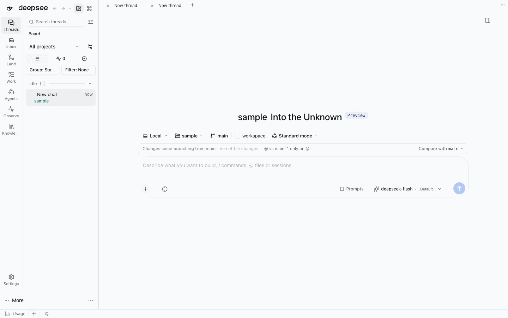
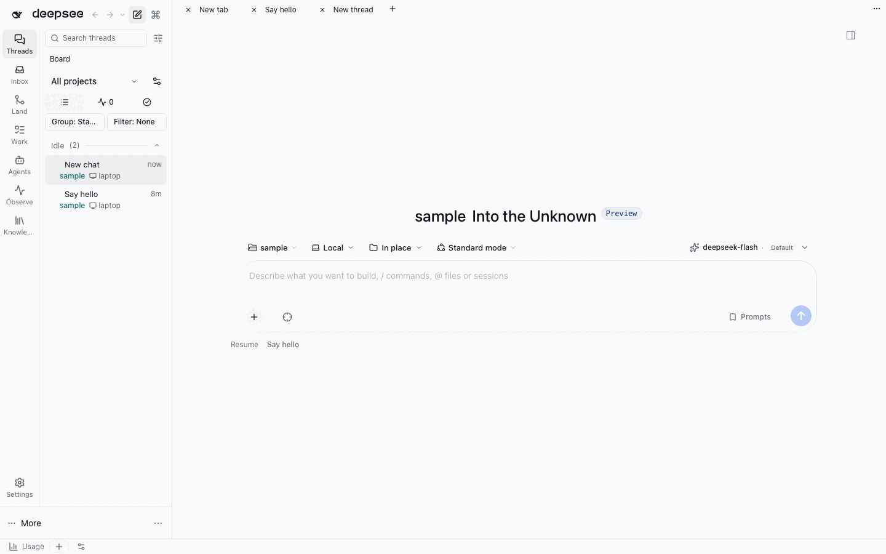
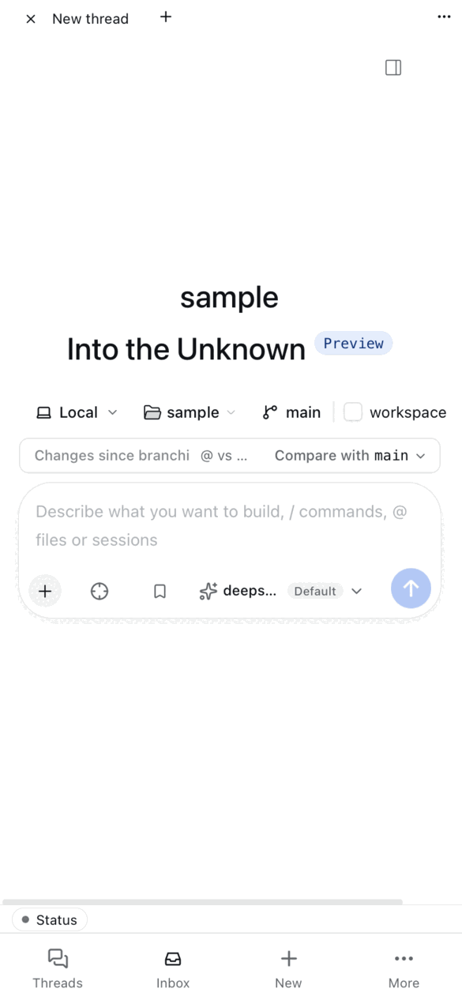
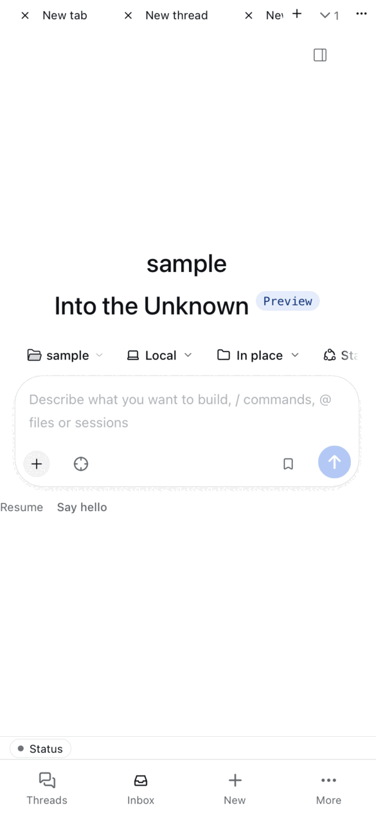
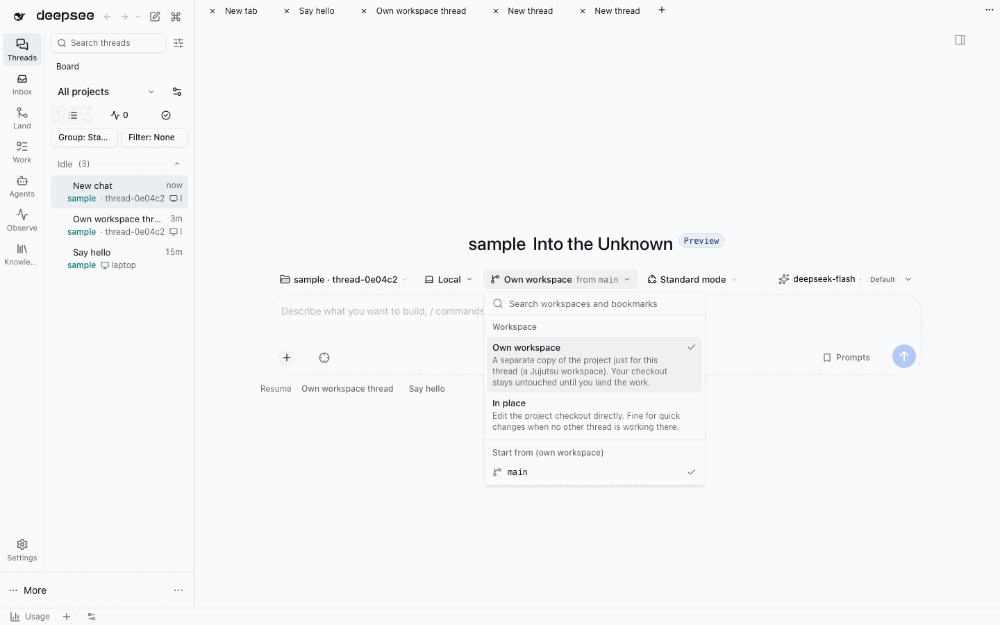
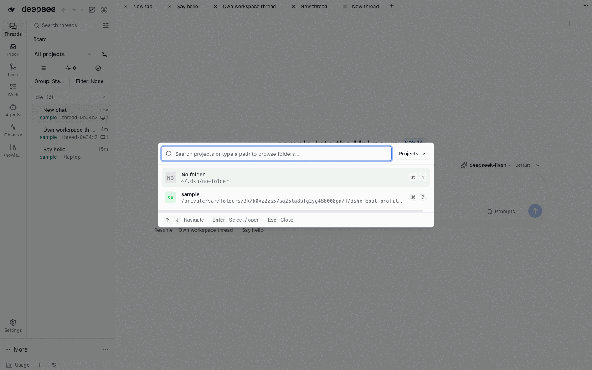
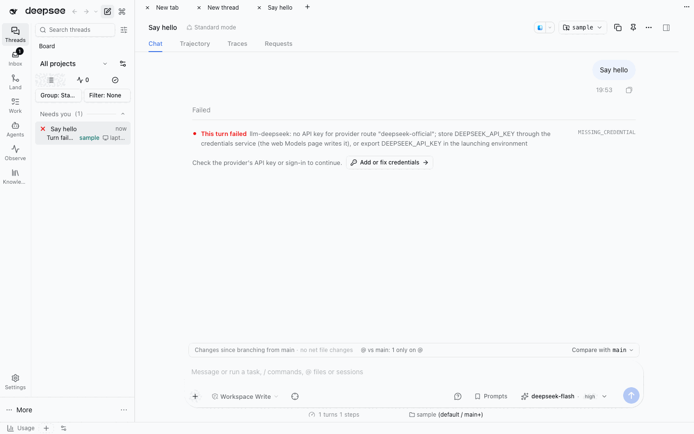
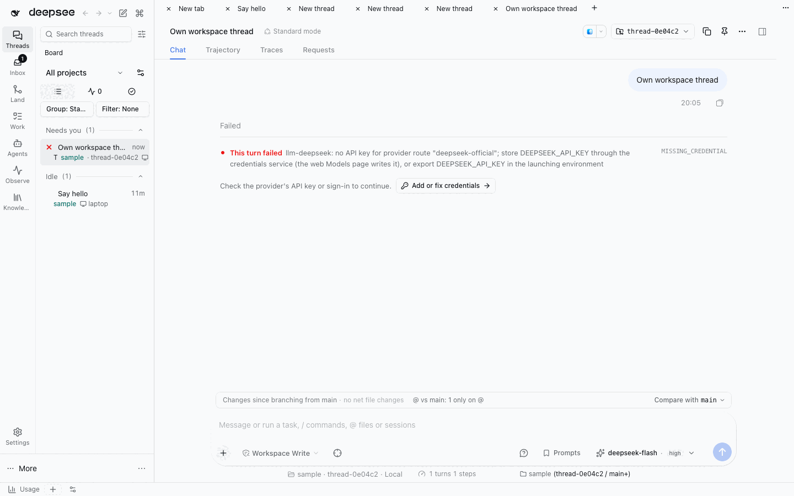

# Phase 4 part B: the composer run row

Plan: [§4.5 The composer](../../README.md#45-the-composer), acceptance in [§8](../../README.md#8-phases): "new thread
needs ≤ 1 chip change for the common case". Workspace `ade-4b-composer`. Captures are WebKit (desktop 1440×900, phone
390×844 at 2× then 75%) from a scratch DSH with every web-profile bundle (`dshx dev up --skip-build`).

## What changed

| Before (main) | After |
| --- | --- |
| Five chips over the input (`Local ▾`, `sample ▾`, `main`, `☐ workspace`, `Standard mode ▾`), a jj "Changes since branching from main · no net file changes · Compare with main" bar, then the input with the model seat inside it | One **run row**: `project ▾ · host ▾ · workspace ▾ · agent mode ▾ · (file access) · model + account ▾`, then the input |
| `main` and `☐ workspace` were two controls with jargon ("workspace" checkbox, a bookmark name) | One **Workspace** segment: *Own workspace from main* / *In place*, each explained in its menu; the starting bookmark is chosen in the same menu |
| The project picker listed thread workspaces on their own tab | Projects only ("No folder" + registered projects) |
| A started thread's footer: activity pill, jj chip, context ring | Meter line led by the collapsed run row (`project · host` summary chip), then context %, cost/activity readings, plugin chips and `N queued` |
| Phone 390 px: the chip row overflowed the page sideways (Standard mode cut off) | The run row is one sideways-scrolling line inside the composer with a trailing fade; page `scrollWidth` = 390 |

| Desktop before | Desktop after |
| --- | --- |
|  |  |

| Phone before | Phone after |
| --- | --- |
|  |  |

| Workspace segment menu | Project picker (projects only) |
| --- | --- |
|  |  |

| Started thread before | Started thread after (summary chip leads the meter line) |
| --- | --- |
|  |  |

## Decisions (safe defaults, user asleep)

1. **Ownership.** rich-composer owns the row. Its existing slots are the segment registry: `conversation.hero.workspace`
   (jj-integration: host chip from multi-host + Workspace segment), `conversation.hero.agentPreset` (agent-preset),
   `conversation.hero.options` (plugins), and the bar's own `conversation.input.permission` and `conversation.input.model`
   seats, which the InputBar moves into the row on a new thread. Providers already depend one way on the composer's slot
   contract, so no new `defineRegistry` was needed and no plugin gained a dependency. A missing owner drops its segment.
2. **Mode stays two segments.** "Agent mode" (agent-preset's seat) and "File access" (the native
   `@deepseek-ai/dsh-client-ui-permission-presets` seat) are separate owners; the permission choice lives in that native
   package's private store with no supported API to set it together with the preset, so merging them would fake state.
   On a blank thread the native seat renders nothing (the new-thread default lives in Settings), so the File access
   segment hides itself; it shows in the toolbar once the thread has started.
3. **No "Share with a thread…".** jj-integration deliberately moves a blank thread out of another thread's workspace
   before its first send (`sharedThreadWorkspaceMove`, "the last line of defence against two threads sharing one jj
   thread workspace"). The existing workspace API therefore does not support sharing, so the segment offers only
   *Own workspace* and *In place*.
4. **Defaults.** Host (multi-host's stored destination), agent mode (agent-preset's New task default) and model (the
   picker's selection) already default from their owners' last choice; they were not changed. The Workspace segment
   defaults to jj-integration's *isolate by default* setting. A per-project "last choice" memory was built and then
   removed: it silently overrode that explicit setting, which the journey "A blank thread returns to its owning project
   instead of inheriting a prior thread workspace" guards. Revisit with an explicit "Remember for this project" choice.
5. **Account switch.** The model picker already switches account route and fallbacks for this thread. The quota strip's
   *Use for this thread* (ai-accounts `ThreadAccountDialog`) is not a pure duplicate: it previews the target account's
   model mapping and context estimate before switching, so it stays. Agent tools are unchanged.
6. **jj "Changes since branching" bar** is hidden while a thread is blank (the run row already says where it will work);
   it returns after the first message.

## Journey: new thread with defaults

Scratch: New thread in `sample` → type → Enter. **Zero chip changes**; the row shows the project, `Local`, the
project's last workspace choice, the agent mode and the model before typing. After the send the row is gone and the
summary chip reads `sample · Local`.

## Checks

`pnpm check:e2e <plugin>` on the branch and on `main` (`jj:qotvsoku`, temporary workspace `ade-4b-main`, forgotten after):

| Plugin | main | branch | Notes |
| --- | --- | --- | --- |
| rich-composer | 2 pass / 4 fail / 1 skip (7) | 4 pass / 3 fail / 1 skip (8) | New run-row scenario passes; the 3 failures ("Session controller is not running" via thread-sidebar's create API) also fail on main; main's 4th (workbench header) is flaky |
| jj-integration | 14 / 9 fail | 16 / 7 fail | Branch failures ⊂ main failures |
| jujutsu | 14 / 2 fail | 16 / 0 fail | |
| agent-preset | pass | pass | |
| multi-host | 0 / 6 (plan §11: 0/6 on main) | 0 / 6 | Not rerun on main in this pass |

Static: typecheck and unit tests of the 5 touched plugins, Host import, `features:check`, `check:cycles`, `check:copy`
(156 = baseline), `ade:migration-map --check` pass. `native-fork-diff` fails only on frame-layout's pre-existing
`StatusStrip.tsx` (same on main).

## Follow-ups

- The project segment shows the blank thread's current DSH workspace title (`sample · thread-0e04c2`) while a new
  thread sits in an inherited thread workspace before its first send; rich-composer has no project linkage for a thread
  workspace. A jj-integration-provided project title would fix it.
- The summary chip and jujutsu's `sample (thread-… / main+)` chip both name the place on a started thread; fold the
  jujutsu chip into the summary chip's tooltip or vice versa.
- The new Workspace segment copy is English-only (inline in `destination-bar.tsx`); move it to jj-integration's locale
  table with the zh strings.
