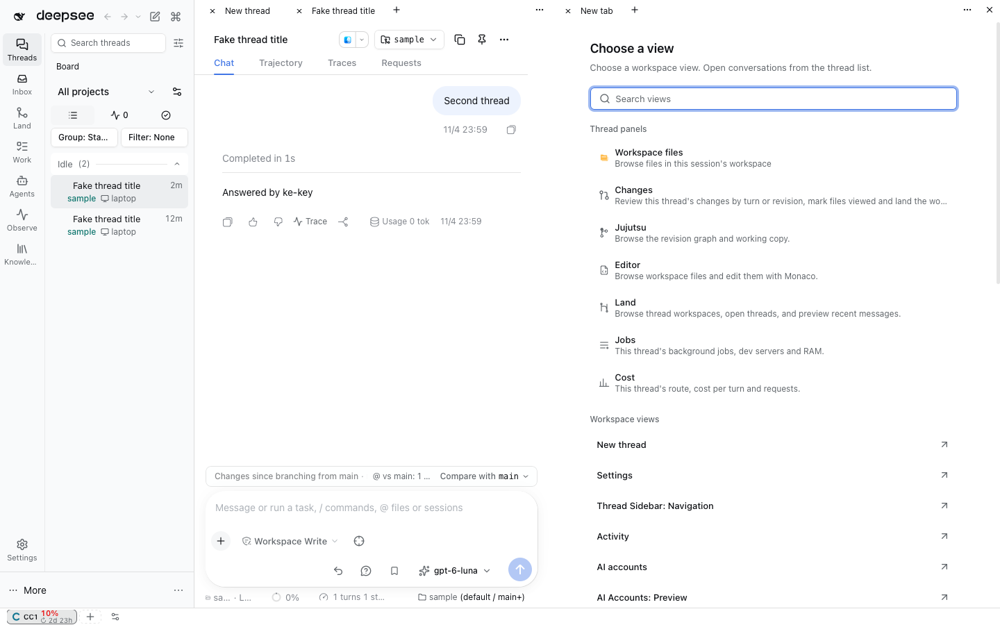

# Thread facets in the full profile (Workbench chooser)

Evidence for [the ADE plan](../../README.md) §4.4 panel facets and the
[Phase 5 dock chooser contract](../README.md#thread-panel-facets-what-works-and-what-the-shell-lane-must-add). Captured
2026-11-05 in a scratch DSH (full web profile, `dshx dev up --skip-build`) with WebKit at 1440×900 and 390×844 (iPhone
UA, `isMobile`). No page errors and no horizontal overflow in any capture.

## What changed

- Every pane's **Choose a view** lists **Thread panels** first: each native `SidebarRightTabRegistry` page type that
  carries `guide` entries, with the guide's title, description, icon and order (Workspace files, Changes, Jujutsu,
  Editor, Land, Jobs, Cost in the full profile). Rows are disabled while no thread is on screen.
- A pick opens the page for the on-screen thread through sidebar-right's `openPage` admission, seated in the chooser's
  own group. The body renders through the `sidebar.right.pane.tab` seat with that thread's `sessionId`.
- An open facet follows the thread on screen: switching threads puts the new thread's page in the same group and tab
  position, so the right pane no longer closes with it. During a new-thread draft or on a destination page it keeps
  its place.
- Picking a facet the thread already shows moves it into the chooser's group.

## Captures

| State | Desktop | Phone |
| --- | --- | --- |
| Choose a view › Thread panels | [desktop](chooser-desktop.png) (right pane) | [phone](chooser-phone.png) (main pane) |
| Cost facet | [desktop](cost-desktop.png) | [phone](cost-phone.png) |
| Jobs facet | [desktop](jobs-desktop.png) | [phone](jobs-phone.png) |
| Jobs facet with the thread's own job (fake-provider `bash`, Chromium) | [desktop](jobs-with-job-desktop.png) | — |
| Changes facet | [desktop](changes-desktop.png) | [phone](changes-phone.png) |
| Cost + Jobs re-bound after switching thread | [thread A](follow-thread-a-desktop.png) · [thread B](follow-thread-b-desktop.png) | — |

On a phone the Workbench right pane is a cramped column (Phase 6 owns phone sheets), so the phone path is the main
pane's **New tab**, which lists the same Thread panels at full width.

## Follow check (WebKit, DOM `data-sidebar-right-session` of each facet body vs the URL thread)

| Step | Thread on screen | Cost body | Jobs body |
| --- | --- | --- | --- |
| Open Cost and Jobs in the right pane | A | A | A |
| Switch to thread B | B | B | B |
| Back to A | A | A | A |
| New thread (draft) | draft | draft | draft |
| Thread B | B | B | B |

Also passed: reload between steps, Settings › AI accounts opened while Cost is the active tab, re-picking Cost after a
thread switch.
