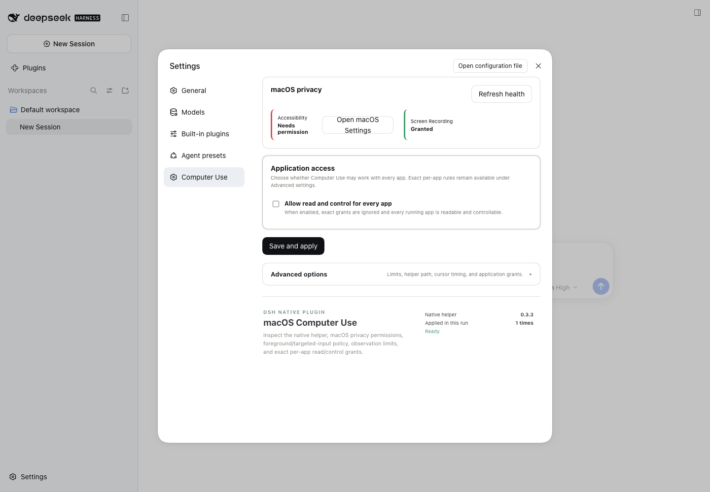
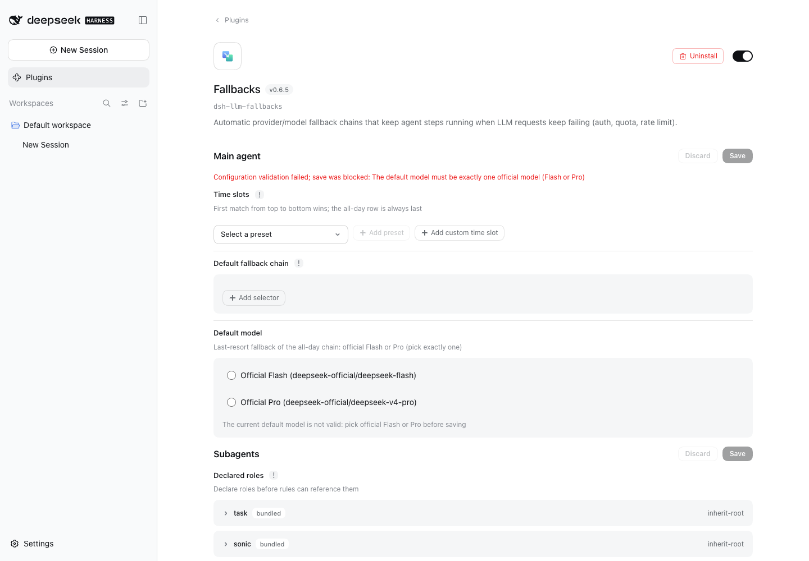

# Community DSH plugin audit — 308-entry third-party catalog

Snapshot audit of the [HackSing/dsh-plugins](https://github.com/HackSing/dsh-plugins) directory
(`data/plugins.json`, directory snapshot dated 2026-10-15), updated with decision-focused source
research and disposable UI probes on 2026-10-16. Baseline: stock DSH **0.2.0-rc.2**, cordis 4.0.4,
Node 22.23.3, macOS, jj-only version control, 44 owned plugins, multi-agent threads, multi-host SSH.

Verdicts used below:

- **ADOPT AS-IS** — install the upstream package unchanged, only after the listed fit and safety
  conditions are met; keep it out of `web` until explicitly promoted.
- **PROBE** — real capability this setup lacks, with a plausible 0.2.0-rc.2 fit; verify in a
  scratch `DSH_HOME`, never straight into `web`.
- **BORROW** — the idea or a small kernel is worth owning; the package is not a candidate.
- **SKIP** — no value here, already covered, incompatible, or not a DSH plugin.

## How the catalog was checked

- All 308 entries link-checked; **13 are broken (4.2%)** — see below.
- **181 repositories inspected from source**: README, `package.json`, `cordis.patch.yml`, and for
  contested claims the installed bundles in the pnpm store and the live composition
  (`dsh --profile web --dump-config`, 222 active entries).
- **114 entries judged from the catalog description and category only** — games, pets, skins,
  stickers, single-domain "guide" tools, marketing/vertical apps, and bundled skill
  methodology packs. They were not source-read; treat their omission as a category decision, not a
  verified SKIP.
- Compatibility claims were checked against the installed `@deepseek-ai` packages, not the
  README's peer ranges alone. Several plugins are declared compatible but resolve no `dsh-tools`
  peer at rc.2, or drag a second core copy in.

## 1. Broken links (13)

Ten of the thirteen belong to one owner (`JohnXu22786`), whose account kept a few repos
(`safety-net`, `secret-guard`, `db-connector`, `session-export`, `codegraph`, `docindex`,
`apply-patch`, `worktree-mgr`, `net-debug`) while purging the rest. The directory's own weekly
link-check workflow has not removed them.

| Entry              | Link                          |
| ------------------ | ----------------------------- |
| command-scout      | `JohnXu22786/command-scout`   |
| context-pruner     | `JohnXu22786/context-pruner`  |
| docgen             | `JohnXu22786/docgen`          |
| docs-retriever     | `JohnXu22786/docs-retriever`  |
| fs-mcp             | `JohnXu22786/fs-mcp`          |
| github-mcp         | `JohnXu22786/github-mcp`      |
| pty-runner         | `JohnXu22786/pty-runner`      |
| session-titler     | `JohnXu22786/session-titler`  |
| skill-framework    | `JohnXu22786/skill-framework` |
| task-board         | `JohnXu22786/task-board`      |
| dsh-disk-audit     | `zoahdev/dsh-audit` (404)     |
| dsh-weekly-hot     | `XCNXNXNX/dsh-weekly-hot`     |
| DeepSeek-PPT-skill | `lecutu/dsh-slide-reflex`     |

Two more are live but not installable as published: `JohnXu22786/net-debug` (no `lib/`, no build
script, npm 404) and `william-jin-cmu/dsh-evolve` (no `lib/`, no `prepare`, stale `^0.0.1` peers).

## 2. Worth a probe

Ranked by capability gap × compatibility confidence.

| Plugin                                        | Fills                                                                                      | Compat evidence                                                                            | Main risk                                                                                                                       |
| --------------------------------------------- | ------------------------------------------------------------------------------------------ | ------------------------------------------------------------------------------------------ | ------------------------------------------------------------------------------------------------------------------------------- |
| `omdsh-dev/dsh-llm-fallbacks`                 | Cross-provider/model fallback chains, per-role policy, half-open recovery probes           | all 22 dsh peers resolve at rc.2                                                           | must mount after `llm-retry`; client injects 6 UI plugins                                                                       |
| `Anionex/dsh-turn-rewind`                     | Per-**message** file rewind (jj can only undo operations)                                  | only repo with an explicit `0.2.0-rc.2: compatible` matrix                                 | in a jj workspace pin `turnCheckpointMode: legacy` and add `.jj` to `.dsh-rewindignore`                                         |
| `Anionex/dsh-computer-use`                    | AX-first macOS desktop control (nothing owned competes)                                    | compat list includes 0.2.0-rc.2; uses active `dsh-storage-domain`                          | approvals are off here → configure per-bundle-id grants; ad-hoc-signed Swift helper                                             |
| `GooDAnDReaDY/dsh-approval-gate`              | Destructive-command gate on native `ctx.tools.guard`                                       | peers resolve; both guard seams verified in rc.2                                           | ask tier auto-allows under `danger-full-access` + policy `never`; only deny tier is active here                                 |
| `JohnXu22786/secret-guard`                    | Blocks `.env`/credential reads, masks secret-shaped results                                | deny-only path, works with prompts off                                                     | peers pin 0.1.x; raw `.ts` entry; `..`/symlink classification weaknesses                                                        |
| `GooDAnDReaDY/dsh-agent-loop-guard`           | Duplicate/repeat tool-call denial, per-turn budget, output-loop cancel                     | `ctx.tools.guard` + `agent/pre-step` verified                                              | fail-closed: probe with `dryRunMode: true` first                                                                                |
| `omdsh-dev/dsh-inspect`                       | Packaged adversarial checkup/fix/review pipelines on the active workflow engine            | compiled entry imports only schemastery + our `dsh-tools`                                  | `private: true` → git install; README points at the moved org                                                                   |
| `fuhefei/dsh-sentinel`                        | Condition-driven wakeups (file/http/process/port/webhook) that resume a dormant session    | peers `>=0.2.0-rc.2`, rehearsed on rc.2                                                    | 5 s probing of command/http/process sensors; needs a resident host                                                              |
| `GooDAnDReaDY/dsh-cron` 0.3.7                 | Unattended scheduler: cron/interval/one-shot, 9 runtimes, cost guard, delivery             | latest peers now semver-admit rc.2; runtime still unverified                               | self-updater mutates profile; Git worktrees are not jj workspaces                                                               |
| `titanwings/dsh-automation`                   | Scheduled fresh-session agent runs with a read-only/workspace-write boundary               | no `@deepseek-ai` peers at all                                                             | no version contract; narrower than dsh-cron                                                                                     |
| `vlln/dsh-loop`                               | `/loop` + `loop` tool: interval re-delivery inside the live session                        | peers `^0.2.0-rc.1`, README verified on rc.2                                               | model-created loops are a token-burn path                                                                                       |
| `Moeblack/dsh-message-edit`                   | Event-sourced edit / reroll / retry with a Timeline tab, history preserved                 | host seams (`agents.create` seed, `sessions.flush`, `sessionPersistence`) verified in rc.2 | no peers; built against 0.1.0-rc.6; injects the absent `dsh-client-runtime`                                                     |
| `JohnXu22786/db-connector`                    | SQLite/PostgreSQL/MySQL, read-only default, write gate, JSONL audit                        | host-only; `engines.node >=22.16`                                                          | no `@deepseek-ai` peers → verify a single cordis resolves                                                                       |
| `GooDAnDReaDY/dsh-server-monitor`             | SSH fleet metrics, containers, journalctl, runbooks, alerts                                | peers `^0.2.0-rc.1`                                                                        | write paths (files, runbooks) need review                                                                                       |
| `xgone/dsh-remote`                            | Inbound login + TOTP MFA + admin/user/guest roles                                          | cordis/home-paths present                                                                  | declares cordis under `dependencies`; single-tenant; restarts needed                                                            |
| `GooDAnDReaDY/dsh-voice`                      | Streaming dictation, PTT, voice messages, provider fallback                                | peers `^0.1.7-rc.2 \|\| ^0.2.0-rc.1` all satisfied                                         | browser WebGPU is not a privacy guarantee: a later cloud provider may receive audio on error; use local-only chain              |
| `GooDAnDReaDY/dsh-tts`                        | Spoken replies, LRU cache, local or cloud engines                                          | peers satisfied                                                                            | without a local CLI only cloud providers work                                                                                   |
| `STARDUSTLC666/dsh-email` 0.16.2              | IMAP/SMTP mail with drafts and confirm-before-send                                         | `engines` match; validation previously co-loaded rc.2 at 0.15.1, not exact current release | OAuth tokens/passwords stored as plaintext JSON/YAML; default Outlook app ID belongs to upstream; no real mailbox/send verified |
| `Nagi-ovo/dsh-visualize`                      | Model-callable sandboxed interactive HTML card in the transcript                           | peers satisfied; README documents rc.2                                                     | Web-only; card buttons cannot follow up yet                                                                                     |
| `omdsh-dev/dsh-annotation`                    | Passage quoting, cross-turn annotation blocks, reply chips                                 | CHANGELOG 1.4.11 audited against rc.2 core                                                 | DOM surgery (bubble splitting, 1 s polling); unscoped cordis peer                                                               |
| `omdsh-dev/dsh-genui`                         | ```dsh-ui fence: whitelisted interactive components in replies + export                    | peers `>=0.2.0-rc.1`                                                                       | needs a host `fence-registry` slot that rc.2 lacks → DOM channel; renamed npm scope                                             |
| `Han-1413141/dsh-compat-guardian`             | Offline rescue when a profile will not boot; quarantine + restore                          | peers `>=0.2.0-rc.2 <0.3.0-0`, cordis `~4.0.4`                                             | defaults to quarantining and rewriting profile patches — set `policy: report`                                                   |
| `PerryLink/dsh-test-drive`                    | Install → boot → capability-assert a third-party plugin in a throwaway `DSH_HOME`          | peers `>=0.2.0-0 <0.3.0-0`                                                                 | needs `dsh`/`pnpm` and network; git targets hit the pnpm `prepare` gate                                                         |
| `JohnXu22786/apply-patch` (`dsh-patch-apply`) | Structured unified-diff apply, dry-run, reverse, undo journal                              | npm-published, zero deps, no `@deepseek-ai` imports; DSL matches rc.2                      | default `io: node` bypasses `ctx.fs` sandbox → set `io: ctx-fs`                                                                 |
| `chenxiachan/thoughtdag`                      | Wire the next turn's context on a node/edge canvas                                         | peers `^4.0.2`/`>=0.1.2-rc.1` hold; npm 0.5.19                                             | claims `sidebar.panellist` + root `main`; documented collisions with host chrome                                                |
| `JohnXu22786/docindex`                        | SQLite FTS5 document index (MD/TXT/PDF/DOCX/PPTX/XLSX) with line-cited hits                | peers satisfied; `node:sqlite` needs >=22.5                                                | npm 404 → git install; defaults to watching `process.cwd()`                                                                     |
| `JohnXu22786/session-export`                  | Redacted Markdown/JSONL/HTML(+PDF) session archive with content hash                       | host-only, zero deps                                                                       | no peers declared; npm name belongs to another project → git install                                                            |
| `omdsh-dev/dsh-mnemon`                        | Complete local-first memory system with per-turn memory bar, git sync, pluggable providers | README and peers target 0.2.0-rc.2; npm 0.5.29                                             | replaces `@dshfiles/memory` + optmem wholesale — decide, do not co-install                                                      |
| `fly3366/DeepJIT`                             | Mines repeated tool paths from traces into skills/flows                                    | git HEAD pins 0.2.0-rc.2                                                                   | npm is stale (0.1.0); `@deepseek-ai/*` as dependencies; overrides the base `skill-filesystem` row                               |

The decision follow-up below resolves the main shortlist questions with current source/release
checks and a disposable DSH probe; it does not authorize any install in `profiles/web/`.

## 3. BORROW — capabilities we do not have and should

Grouped by the owned plugin that would take the feature.

**Context and token budget**

- `dsh-usage-guard` — sanitize missing/NaN/fractional provider token counts before the usage fold.
  This is a live defect, not a nicety: `@deepseek-ai/dsh-token-meter@0.2.0-rc.2`
  `lib/types/usage-projection.js` reads `usage.inputTokens`/`outputTokens` raw while the projection
  schema is `.strict()` `z.number().int().nonnegative()`, and this setup routes through Codex,
  Claude, OpenCode Go, Command Code and Cursor. Copy the sanitizer into owned code rather than
  monkey-patching the private projection registry.
- `dsh-context-doctor` — per-injection token cost, exact duplicate AGENTS.md blocks, shadowed-skill
  detection; our AGENTS.md + skill catalog + memory block make this the highest-value audit we lack.
- `Moeblack/dsh-prompt-studio` — assembled-prompt view with live overrides of injected components.
  Its client half injects `dsh-client-runtime`, absent from rc.2, so reimplement the audit view.
- `Sev7eEn7/sieve` — tool-output admission before the result enters the session, batched forgetting
  with a spill archive, skill disclosure by task relevance (−21% live main-model input as measured
  by its author). Peer-pinned to 0.2.1-alpha.1; borrow the design.
- `GooDAnDReaDY/dsh-context-lens` — failure-aware condensation of test/build logs (stock pruning is
  head/middle/tail only).
- `vibeinging/dsh-agent-budget` — tree-wide token admission budgets with restart-durable deadlines.
- `vibeinging/dsh-tool-search` — progressive tool disclosure through the stock `ctx.tools.restrict()`
  seam; the right lever for a 44-plugin tool surface. Reimplement; the package pins a second cordis.

**Transcript and session UX**

- `Han-1413141/dsh-sticky-disclosure` — collapse-all with a recordable hotkey, live expanded count,
  pinned chips for off-screen rows. Verified: stock `dsh-client-ui-chat` rc.2 has no collapse-all.
- `renat3u/dsh-web-archive` — automatic per-message Think + tool grouping (higher DOM fragility).
- `GooDAnDReaDY/dsh-session-control` — cross-folder labels, `Alt+K` quick jump, session size badges,
  inline rename (F2), archived-transcript viewer, Markdown/batch export, search snippets.
- `Han-1413141/dsh-ui-hub` — JSON layout export/import for arbitrary UI, hold-to-reveal, three-state
  visibility, collision avoidance. Borrow the model, not the second global styling authority.
- `lehhair/dsh-diff-viewer` — real diff rendering (unified/split, true file line numbers,
  word-level marks, windowed); note its host-side shadow-definition trick that stamps
  `oldStart`/`newStart` into `meta.diffs`.
- `omdsh-dev/dsh-session-health` — frame-level session-log diagnostics (torn / empty / not-zstd /
  interrupted-turn) on top of the zstd reader `usage` already has.
- `Tang-mm95/dsh-single-instance-guard` — `DSH_HOME` `O_EXCL` lock against concurrent session-log
  corruption. Fix two defects before using: compare the recorded `hostname`, and allow an opt-out so
  the desktop shell can spawn a second server on `~/.dsh` (scratch profiles are unaffected — they
  use their own `DSH_HOME`).
- `WongYuYe/dsh-appshots` — one keystroke captures the frontmost window into the composer.
- `omdsh-dev/dsh-notification` and `dingyi222666/dsh-session-notification` — per-outcome toggles
  (error/aborted/blocked/token-limit), keyword rules, and "alert the main session only after every
  subagent it spawned finished". Owned `thread-sidebar` already ships browser notifications for
  approval/question/turn-finished, so take only those deltas.

**Models, keys, quota**

- `GooDAnDReaDY/dsh-subscriptions` — headless OAuth sign-in for Codex/Claude (PKCE, loopback,
  device code) instead of requiring the vendor CLIs on every host; per-account proxy; family-scoped
  cooldown; composer quota chip with burn-rate runway.
- `GooDAnDReaDY/dsh-key-rotation` — key-level pools (not only accounts of one kind), pre-emptive
  token bucket, least-connections, circuit breaker with half-open probes.
- `GooDAnDReaDY/dsh-key-limits` — composer-adjacent quota/balance chip for the active account,
  monetary balances, low-quota toast.
- `zh667/TokenLedger` — wallet/credit balances per provider origin, rolling 5 h/weekly/monthly
  windows with reset times, relay-site attribution, unpriced model → dash.
- `GooDAnDReaDY/dsh-cost-meter` — peak/off-peak tariff engine with a countdown (our `usage` has
  context bands only).
- `GooDAnDReaDY/dsh-model-search` — fuzzy/acronym subsequence matching (`dsr` → `deepseek-reasoner`)
  and `@provider` scoping. Our `model-effort-picker` matches with one `String.includes`.
- `DTSFO/dsh-model-modes` — provider-native Fast/priority service-tier switch beside the effort
  control.

**Safety, audit and workspace scope**

- `JohnXu22786/safety-net` (Barricade) — the POSIX argv rule engine (41 rules, three levels,
  heredoc/`$()`/wrapper unwrapping). Do not install: its allow path returns the call instead of
  `next()`, which bypasses every later pre-execute listener and monotonic guard.
- `GooDAnDReaDY/dsh-shadow-auditor` — `agent/pre-step` prompt-injection pre-filter and reversible
  masking. Never stack it with another command guard.
- `onlyqzq/dsh-riskproof` — taint/provenance labelling of tool data with output-side blocking.
- `jiangr100/dsh-workspace-scope-selection` — a per-session writable-root set with an "Edit scope"
  chip. It monkey-patches five core internals, so vendor the model.
- `GooDAnDReaDY/dsh-issue-reporter` — redacted upstream bug reports (tokens/paths/emails) with
  duplicate search.

**Agents, planning, verification**

- `JohnXu22786/adversarial-review` (gavel) — deterministic regex sentinel graded with impact and
  confidence, cross-lens corroboration weighting, suppression rules, append-only docket that marks
  repeats `known`.
- `JohnXu22786/file-planning` (trailmap) — durable on-disk plan state with a dependency-aware step
  state machine and a machine-checked completion gate.
- `omdsh-dev/dsh-inspect` — packaged adversarial pipelines with a red-team stage and "never report a
  false clean" degradation, as above.
- `GooDAnDReaDY/dsh-moa` — cross-model parallel proposals with a judge and promotion; promotion
  fails closed without `dsh-time-machine`.
- `titanwings/dsh-plannotator` — multi-comment anchored plan review through the real plan gate.
- `NanmiCoder/dsh-agent-teams` — dependency-aware task DAG with atomic claims, stale-attempt
  revocation and idle-member re-use. Fourteen always-on tools is real prompt tax; note that the
  stock `dsh-experimental-agent-team` bundle (durable peer mailbox + shared task DAG) is already in
  the store and simply not loaded — evaluate that first.
- `LoserFox/distill` — turn-boundary background reflection proposing skill create/update, with an
  ownership marker so only self-authored skills are rewritten.
- `ZK-Andy/dsh-continual-evolve` — pre-gate before the expensive extraction call, mechanically
  ledgered skips, `corrects` links, quarantine-never-delete, dry-run review budget.
- `Co-Engram/Co-Engram` — RPE reinforcement, LTD decay/forgetting, 12-kind synapse graph, token-
  budgeted tiered reads, per-assembly prompt section (instead of a frozen block).
- `Hoshino910/REMI` — compaction subclassing with a custom checkpoint summarizer and a budgeted
  mid-thread `<memory-context>` window.
- `zilliztech/memsearch` — distilling recurring workflows into installable skills; three-layer
  progressive disclosure.
- `wly8691-jpg/knowlp-rag` — per-class half-life decay and explicit chosen≻rejected preference pairs.
- `Ikalus1988/MisakaNet` — E0–E4 evidence grading and a `no_match` miss contract.

**Files, VCS, hosting**

- `omdsh-dev/DSH-better-sidebar` and `AKS1st/dock-files` — file-manager layer our `editor` lacks:
  rename/delete/new-file/mkdir, bulk ops, drag+clipboard upload, streaming ZIP download, a
  realpath-then-prefix workspace fence, a file-viewer/icon registry, and a model-facing
  `sidebar_open` tool.
- `FSMargoo/dsh-at-file` — per-workspace Exact/Regex ignore rules and ArrowRight directory descend
  for `mentions`.
- `GooDAnDReaDY/dsh-time-machine` — session-scoped rollback, reimplemented on
  `jj op log` / `jj op restore` / `jj undo`, never on shadow git refs.
- `JohnXu22786/worktree-mgr` — batch landing of many finished workspaces plus repo-declared
  `on_merge`/`on_finish` hooks for `jj-integration`.
- `GooDAnDReaDY/dsh-gitea` — issue/PR tracker only if a Gitea/Forgejo instance ever exists here.
- `ZASENJC/dsh-plugins-store` — catalog trust evidence (repo id + source SHA + DSH version +
  platform, produced by an isolated sandbox boot) for `plugin-marketplace`.

**Integrations and tooling**

- `JohnXu22786/net-debug` — raw HTTP tool (method/headers/status/timing, SSRF fence). Not
  installable as published; write a thin owned tool.
- `bill9109/dsh-drag-and-drop` — drop → absolute path in the composer instead of upload-then-hunt.
- `chunkithwang/craft-mermaid` — version-pinned Mermaid → high-res PNG with a render→look→fix loop.
- `duhu2000/dsh-mcp-connector` — OAuth PKCE/DCR, catalog, three-layer tool governance, per-session
  tool injection for `mcp-servers`. Never run both MCP managers at once.
- `JohnXu22786/hooks-adapter` — `http`/LLM-oracle/proxy handler kinds beyond the stock command
  hooks (the stock `dsh-hooks-codex` bridge is in the store, unloaded — enable that first).
- `Walvez/dsh-codex-sync` — one-shot import of Codex chats/skills/MCP config; watch its
  `/repair-sessions --fix` path, which rewrites stored session logs.
- `GooDAnDReaDY/dsh-messenger-gateway` — inline-button answers to a blocked agent from a phone.
  Largest egress surface in the catalog; borrow the ask shape into `agent-questions`.
- `Nwflower/dsh-chat-import` — parsers for foreign transcript shapes.
- `Han-1413141/dsh-visual-edit` — the slot-shadowing technique for preview-side plugins, given that
  stock document preview sandboxes HTML with `allow-scripts` only.
- `omdsh-dev/dsh-tool-csv`, `omdsh-dev/dsh-tool-schema` — CSV state machine and JSON-Schema
  validation with failure paths, only if a concrete need lands; ten extra tool schemas is a
  standing prompt cost this setup should not pay speculatively.

## 4. Already covered — do not adopt

| Plugin                                                                                              | Covered by                                                                                                                                                      |
| --------------------------------------------------------------------------------------------------- | --------------------------------------------------------------------------------------------------------------------------------------------------------------- |
| `omdsh-editor`, `dsh-open-in`, `dsh-open-in-vscode`                                                 | stock `dsh-host-open-in-app` + `dsh-client-ui-open-in-app` (30+ apps, icns icons); only user-defined commands are a delta                                       |
| `dsh-spotlight`                                                                                     | owned `command-palette` (registry-based, not DOM-scraped)                                                                                                       |
| `dsh-tps`                                                                                           | stock `dsh-client-ui-chat` already renders `{tps} tok/s`                                                                                                        |
| `dsh-task-status`                                                                                   | archived by its author; stock `dsh-client-ui-jobs`/`dsh-tool-jobs` already tail job output                                                                      |
| `widget-dock` (context cards)                                                                       | stock `dsh-token-meter` context-pressure ring                                                                                                                   |
| `dsh-turn-navigator`, `dsh-navbar`                                                                  | stock turn rail in `dsh-client-ui-chat`; navbar is archived                                                                                                     |
| `session-titler` (dead)                                                                             | stock `dsh-session-title` + first-prompt LLM titling                                                                                                            |
| `dsh-sidechain`                                                                                     | version-locked to 0.2.1-alpha.2; owned `btw` covers side chats                                                                                                  |
| `dsh-goal`                                                                                          | shadow the active stock goal tools and disable the human-turn gate `goal-stall-guard` relies on                                                                 |
| `dsh_workflow`                                                                                      | pinned to DSH 0.0.1-rc.2; the active `dsh-tool-workflow` is the supported path                                                                                  |
| `mosaic_compress`                                                                                   | self-deprecated in favour of core compaction; documents sessions it compressed becoming unopenable                                                              |
| `dsh-tool-approval`                                                                                 | ask-only: with prompts disabled every tool call is auto-rejected                                                                                                |
| `dsh-workshop`, `ex-setting`, `dsh-need-finder`                                                     | stock plugin manager/inventory, `dsh-config-editor`, owned `settings-shell` and `plugin-marketplace`                                                            |
| `dsh-telemetry-redactor`                                                                            | inert here — `session-telemetry-otel` and `session-log-deepseek` are disabled in this profile                                                                   |
| `dsh-plannotator`-style gate replacements                                                           | stock plan mode is active; only annotation is new                                                                                                               |
| `dsh-tool-*` pack, `dsh-toolkit`                                                                    | bash/node reach the same results; ~10 schemas of standing prompt cost                                                                                           |
| `hooks-adapter` (core part)                                                                         | `dsh-hooks-claude-code` / `dsh-hooks-codex` / `dsh-hook-protocol` exist in the store, unloaded                                                                  |
| `dsh-deeplink`                                                                                      | owned `thread-sidebar` already owns the `?thread=`/`?workspace=` contract                                                                                       |
| `dsh-side-panel`, `dsh-compass`, `dsh-dir-tree`, `dsh-workspace-dir`                                | archived or duplicating `editor` + stock files/terminal panels; their git panels are dead in jj thread workspaces (those have no `.git`)                        |
| `dsh-acp-for-bitfun`                                                                                | `checkOnStart: true` fails the boot when `bitfun` is off `PATH`                                                                                                 |
| `dsh-webbridge`, `sandbox-mxc`, `sandbox-nono`, `stent`, `dsh-trace`, `uagent-sync`, `dsh-deeplink` | daemon `curl \| bash` installs, 0.1.x-only descriptors or Linux-only bindings, unpublished pins, native DBs, or config-rewriting sync that fights the Nix setup |
| `dsh-mcp-connector`                                                                                 | would double-manage `mcp__*` entries next to owned `mcp-servers` (borrow only)                                                                                  |
| `dsh-gitea`                                                                                         | requires a Gitea/Forgejo instance this setup does not have                                                                                                      |
| `dsh-llm-verifier`, `review-gate`                                                                   | git worktrees / git-commit merge gates — incompatible with a jj-only workflow (Node 24 + Python + `uv` for the first)                                           |
| `dsh-intelligent-ui`, `dsh-live-canvas`, `dsh-postman`                                              | duplicate generative-UI scope, self-updating `unsafe-eval` preview, or already covered by stock upload/attachment                                               |
| `git-identity`, `dsh-worktree-flow`, `worktree-mgr` (as installs)                                   | jj ignores `GIT_AUTHOR_*`, and linked git worktrees are not jj repos                                                                                            |

Not DSH plugins at all, despite the directory: `isomoes/ikanban` (OpenCode V2 frontend),
`scotthuang/agent-knock-knock` (OpenClaw plugin), `Roarpeng/GraphFlow` (MCP server + global agent
installer), `zzhang82/Agent-Memory-Bridge` (Python MCP server), `omdsh-dev/sandbox-micro` (Linux
KVM only), and most `*-skills` bundles.

## 5. Clusters not source-read (114 entries)

- **Playful and cosmetic (~32)** — games (`dsh-gomoku`, `dsh-minigames`, `dsh-auto-chess`), pets
  (`whale-girl`, `dsh-png-pet`), skins/wallpapers/themes, stickers, emoji, parody ads, stock-market
  and short-video sidebars, "appends a thank-you message".
- **Single-domain tools (~26)** — CPR, plant-cutting/drying/pruning guides, whiskey recommendations,
  instrument tuning, family-dinner hosting, parenting-emotion advice, bookkeeping, investment
  decisions, Stata, recruitment, novel writing, resumes, official-document formatting, GeoPIX
  optimization, math modeling, EDU platforms.
- **Skill / methodology packs (~16)** — `sandbase-skills` (88 skills), `spec-driven`,
  `skill-framework`, `agent-dev-skills`, `conservative-code-edits`, `mstar-harness`,
  `function-testing`, `replicate-android-feature`, `embedded-workbench`, `docgen`, and similar;
  these are prompt libraries for a generic agent, not capabilities this setup lacks.
- **MCP wrappers, doc/media converters and misc (~40)** — `fs-mcp`, `local-shell-mcp`,
  `github-mcp`, `sandbase-harness`, PPT generators, MineRU/document parsers, video frame
  interpolation, image generation, note apps, chat importers, sandboxes, and provider companions
  already served by stock MCP resources or owned plugins.

## 6. Cross-cutting install hazards found

1. **`@deepseek-ai/dsh-client-runtime` does not exist in 0.2.0-rc.2** (0 matches in the installed
   288-package set), yet many client halves declare it in `dsh.client.inject`
   (`dsh-message-edit`, `dsh-at-file`, `dsh-dir-tree`, `dsh-open-in-vscode`, `dsh-prompt-studio`,
   `widget-dock`, `dsh-side-panel`, …). Their browser halves may never activate; verify in a probe.
2. **Core copies instead of peers.** Several plugins declare `@deepseek-ai/*` under `dependencies`
   (`DeepJIT`, `dsh-polyglot`, `dsh-subagent-acp` users) or pin `>=0.0.1-rc.1 <0.2.0`
   (`dsh-tool-*`, `dsh-plugin-check`, `dsh-custom-tool`). With peer auto-install that drags a
   second `dsh-tools` or an unscoped `cordis` beside our pinned one — the two-cordis boot failure
   this repo's contract forbids. Probe with `autoInstallPeers: false` and check the resolved tree.
3. **Version lines ahead of us.** `dsh-sidechain`, `dsh-session-notification`, `dsh-intelligent-ui`
   (HEAD) and `sieve` target 0.2.1-alpha.*; they will not load on rc.2.
4. **npm-name collisions and scope squatting.** `dsh-session-export`, `dsh-codegraph`,
   `dsh-genui`, `dsh-toolkit`/`dsh-tool-*` (`@deepseek-ai/…`, `private: true`) and
   `dsh-security-audit` resolve to different projects than the audited repos — install by
   `github:<owner>/<repo>#<sha>`, never by bare npm name.
5. **Self-updaters and profile mutation.** `dsh-cron`, `dsh-live-canvas`, `dsh-compat-guardian`,
   `dsh-plugins-store`, `dsh-autocompose` and `dsh-workshop` rewrite profiles, run `dsh plugin`, or
   patch `cordis.patch.yml` directly, bypassing `pnpm profile:sync` and the seeded patch region.
6. **Egress surfaces to decide on, not to discover later:** cloud STT/TTS and vision, messenger
   gateways (session content + workspace file download), keyless Firecrawl search, prompt/injection
   audits that ship prompt text to a third-party model, and plugins that keep provider keys in
   browser `localStorage`.

## 7. Decision follow-up and disposable probes (2026-10-16)

This is a decision layer over the 2026-10-15 catalog snapshot, not a second full source audit.
Current releases, first-party alternatives, and the consequential package surfaces were checked
again. The runtime probe used a disposable `DSH_HOME` at port 3199 with no model credentials, no
project workspace, and no live session. It did not touch the running `web` profile on :3080.

### Diffs that matter

| Need                       | What dshfiles already has                                                                                                                                                         | What the candidate actually adds                                                                                                                                                                                                                                                                                                                                                                              | Verdict                                                                                                                                                                                                                                                                                                                                                                                                                                                                                                                                                                             |
| -------------------------- | --------------------------------------------------------------------------------------------------------------------------------------------------------------------------------- | ------------------------------------------------------------------------------------------------------------------------------------------------------------------------------------------------------------------------------------------------------------------------------------------------------------------------------------------------------------------------------------------------------------- | ----------------------------------------------------------------------------------------------------------------------------------------------------------------------------------------------------------------------------------------------------------------------------------------------------------------------------------------------------------------------------------------------------------------------------------------------------------------------------------------------------------------------------------------------------------------------------------- |
| macOS computer use         | No owned AX/screenshot/control tool. Local stdio MCP is supported, but is not a DSH-native macOS control policy.                                                                  | `@anionex/dsh-computer-use` 0.3.3: AX-first observation, optional screenshots, exact-app grants, app/session/turn leases, stale-observation rejection, and one-use high-impact tokens. Release metadata explicitly lists DSH 0.2.0-rc.2.                                                                                                                                                                      | **ADOPT AS-IS only for an explicit app use-case.** Keep per-app grants narrow; never turn on “allow every app” by default. With `approval: never`, an ungranted app fails closed; whether `computer_confirm` produces a human prompt is unverified. [Source](https://github.com/Anionex/dsh-computer-use/releases/tag/v0.3.3).                                                                                                                                                                                                                                                      |
| Rewind an Agent turn       | `jj-integration` exposes jj history/workspace diffs and restore operations; it does not bind a file restore point to each user message and fork the conversation from that point. | `@anionex/dsh-turn-rewind` 0.3.9 captures pre-turn file state, previews changed paths, then can restore files and fork a child Session, restore files only, or rewind messages only. The new default `auto` mode uses Git-native checkpoints in Git worktrees.                                                                                                                                                | **BORROW for this jj-only setup.** Rebuild the UX on `jj op log` / `jj op restore` / `jj undo`. If testing the package in a disposable ordinary workspace, use `turnCheckpointMode: legacy` and exclude `.jj`; do not use its default Git-native mode in a colocated jj repo. [Source](https://github.com/Anionex/dsh-turn-rewind).                                                                                                                                                                                                                                                 |
| Recover from model failure | `ai-accounts` manages account pools/quota and `llm-retry` retries the current route; neither is a role-aware cross-provider/model failure chain.                                  | `dsh-llm-fallbacks` 0.6.5 switches root and subagent requests after auth/quota/rate-limit failures, with ordered chains, roles, cooldowns, and optional time slots. It adds a real validated Web editor.                                                                                                                                                                                                      | **ADOPT AS-IS only if you want automatic cross-provider routing.** Configure a valid chain first: the current editor requires the last/default model to be official Flash or Pro. In the empty scratch profile its validation correctly blocked saving; nothing was saved. [Source](https://github.com/omdsh-dev/dsh-llm-fallbacks).                                                                                                                                                                                                                                                |
| Speech input/output        | Optional stock voice-input bundle is local SenseVoice dictation to an editable draft; it is disabled by default and has no reply TTS.                                             | `dsh-voice` 0.9.36 adds streaming/PTT and a provider chain; paired with `dsh-tts` 0.4.33 it can speak replies. Browser WebGPU Whisper is real, but a later cloud provider can receive audio on failure. `dsh-voice-mode` 0.7.24 adds local ASR, TTS, captions, barge-in, wake word, and auto-send; Edge cloud TTS is its default. Browser `SpeechSynthesis` needs no API key but is not wired to DSH replies. | **Enable stock local dictation first.** Probe community voice only for a concrete streaming/TTS need, with a local-only chain if audio must stay local. Prefer hold-to-talk over always-listening/auto-send. [Stock voice docs](https://github.com/deepseek-ai/deepseek-harness/blob/master/docs/subsystems/voice-input.md), [voice](https://github.com/GooDAnDReaDY/dsh-voice), [TTS](https://github.com/GooDAnDReaDY/dsh-tts), [voice mode](https://github.com/qishuilalala/dsh-voice-mode), [SpeechSynthesis](https://developer.mozilla.org/en-US/docs/Web/API/SpeechSynthesis). |
| Email                      | No mailbox plugin is loaded; the owned MCP manager supports remote Streamable HTTP, but Gmail OAuth compatibility is not yet verified.                                            | Google's official Gmail MCP currently covers search/read/threads/labels/draft creation and exposes no send tool. `dsh-email` adds reply/send/move and Outlook, but stores macOS/Linux tokens in plaintext JSON and mailbox passwords in plaintext settings; default Outlook app ID is not yours.                                                                                                              | **Probe Google Gmail MCP read/draft-only first.** Keep mailbox data out of unrelated work and remember message bodies enter the selected model context. Do not grant send until a disposable-mailbox test proves the gate works. [Google setup](https://developers.google.com/workspace/gmail/api/guides/configure-mcp-server), [tools](https://developers.google.com/workspace/gmail/api/reference/mcp), [dsh-email validation](https://github.com/STARDUSTLC666/dsh-email/blob/main/docs/VALIDATION.md).                                                                          |
| Inline visual cards        | No stock renderer for replayable model-generated HTML cards.                                                                                                                      | `dsh-visualize` renders stored HTML in a sandboxed iframe with restrictive CSP, so a collapsed card can be replayed; card controls cannot send a follow-up to the conversation. `dsh-genui` adds richer forms/actions, but rc.2 lacks its `fence-registry` seam, so it falls back to more DOM-coupled rendering.                                                                                              | **Probe `dsh-visualize` first** for charts, previews, and small interactive result cards; choose `dsh-genui` only if model-directed actions are required. Do not stack both renderers. [Visualize](https://github.com/Nagi-ovo/dsh-visualize), [GenUI](https://github.com/omdsh-dev/dsh-genui).                                                                                                                                                                                                                                                                                     |
| Passage annotations        | No owned transcript quote-to-prompt anchor.                                                                                                                                       | `dsh-quote-annotate-pro` selects a passage, stores a comment, and inserts a navigable quote chip; `dsh-annotation` adds cross-turn annotation blocks but mutates transcript DOM and declares unscoped `cordis`.                                                                                                                                                                                               | **Probe the fork only** after reviewing/disabling its diagnostic ping to `127.0.0.1:47821`. Do not install both. [Quote Annotate Pro](https://github.com/zhao-guang-ai/dsh-quote-annotate-pro), [annotation](https://github.com/omdsh-dev/dsh-annotation).                                                                                                                                                                                                                                                                                                                          |

**Computer-use alternative:** `Perception Dynamics/a11y-computer-use` is a local stdio MCP with per-app read/click/full grants, OS-native consent, destructive-action confirmation, user-active refusal, and audit logging. It could be better if an independent human gate is mandatory while DSH prompts are disabled, but it is Alpha/high-churn and DSH 0.2 image/elicitation/TCC attribution is unverified; probe read-only before relying on it. OpenClaw Peekaboo has useful screenshot/AX ideas but its reviewed MCP surface lacks DSH-style app leases and high-impact confirmation. AppleScript/Shortcuts fit narrow, allow-listed workflows, not a generic agent seeing and controlling arbitrary apps. [a11y-computer-use](https://github.com/Perception-Dynamics-Inc/a11y-computer-use), [permissions](https://github.com/Perception-Dynamics-Inc/a11y-computer-use/blob/main/docs/permissions.md), [Peekaboo](https://github.com/openclaw/Peekaboo).

### Scheduler: one plugin or three?

**Not one plugin, and do not install all three.** They have different lifetime and execution semantics. For this profile, install none until there is a specific recurring task.

| Option                                      | Example it fits                                                                                       | Real distinction / caution                                                                                                                                                                                                                                                                                                   | Recommendation                                                                                                                                                                                                                                                                                                            |
| ------------------------------------------- | ----------------------------------------------------------------------------------------------------- | ---------------------------------------------------------------------------------------------------------------------------------------------------------------------------------------------------------------------------------------------------------------------------------------------------------------------------- | ------------------------------------------------------------------------------------------------------------------------------------------------------------------------------------------------------------------------------------------------------------------------------------------------------------------------- |
| Stock optional Schedule bundle              | “Remind me every Monday in this chat.”                                                                | Durable one-shot/interval/daily/weekly/cron reminders; can reopen the original Session and post a follow-up. Not a fresh isolated coding run.                                                                                                                                                                                | Best for reminders; enable stock before adding a community scheduler. [Schedule](https://www.npmjs.com/package/@deepseek-ai/dsh-schedule).                                                                                                                                                                                |
| `@linxin666/dsh-client-ui-task-board` 0.4.6 | “Run a nightly read-only audit in a fresh DSH Session and show me history.”                           | DSH-specific board + cron + fresh Session; declared rc.2 contract. No spend cap/external delivery; goal continuation defaults on, verification can add several model requests, and it documents an anonymous daily heartbeat. A new Session is not a new jj workspace.                                                       | **Best single-plugin probe** if independent scheduled Agent work becomes a real need; disable goals/verification first and confirm telemetry posture. [Source](https://github.com/zhu1090093659/dsh-web/tree/dev/packages/dsh-task-board).                                                                                |
| `@goodandready/dsh-cron` 0.3.7              | “Run shell/HTTP/SSH jobs without model tokens, enforce per-task cost limits, and alert me elsewhere.” | Broadest runner and delivery surface; latest peer ranges now admit rc.2 (correcting the older row above), but that is declaration, not runtime proof. `worktree: true` means Git worktree, not jj isolation; ships a self-updater route that can mutate the seed-managed profile. Shell/Node/Python are host code execution. | **Skip as default.** Consider only if these runtimes, channels, and cost controls are must-haves and the updater/JJ concerns are resolved. [Manifest](https://raw.githubusercontent.com/GooDAnDReaDY/dsh-cron/main/package.json), [updater](https://raw.githubusercontent.com/GooDAnDReaDY/dsh-cron/main/lib/updater.js). |
| `titanwings/dsh-automation` 0.1.7           | “At 2am, launch a fresh read-only Agent and retain run history.”                                      | Simpler fresh-root/session runner, but no DSH peer/engine compatibility claim, no cost budget, and no external delivery.                                                                                                                                                                                                     | **Alternate probe** only if the smaller runner is preferred over task-board. [Source](https://github.com/titanwings/dsh-automation).                                                                                                                                                                                      |
| `vlln/dsh-loop` 0.4.2                       | “Keep checking this build every five minutes while this Session stays open.”                          | Re-delivers into the current Session; process-lifetime only, no durable history, new root Session, delivery, or spend cap. Every tick can spend model tokens.                                                                                                                                                                | Use only for live-session polling; it is not an unattended scheduler. [Source](https://github.com/vlln/dsh-loop).                                                                                                                                                                                                         |

### Plain examples for the confusing candidates

| Candidate              | Plain-language use-case                                                                                                                                                                      | What it is not / call                                                                                                                                                                                                                                     |
| ---------------------- | -------------------------------------------------------------------------------------------------------------------------------------------------------------------------------------------- | --------------------------------------------------------------------------------------------------------------------------------------------------------------------------------------------------------------------------------------------------------- |
| `dsh-approval-gate`    | A deny-list for commands that must never run (for example a destructive shell pattern).                                                                                                      | Not a human “ask me first” popup. Under `danger-full-access` with prompts disabled, only hard denial is useful; keep skipped unless a concrete deny rule is missing.                                                                                      |
| `secret-guard`         | Block ordinary Agent attempts to read `.env`/credential paths and mask secret-shaped tool output.                                                                                            | Not a security boundary against arbitrary host code or shell under full access; this version also has stale peers and path/symlink weaknesses. Borrow only, do not rely on it as the credential vault.                                                    |
| `dsh-agent-loop-guard` | Stop a model from repeating the same failing tool call or exceeding a per-turn tool/output budget. Example: a broken test command loops five times.                                          | Can false-positive on legitimate retries; only probe in dry-run first, and only if repeated-call behavior is a real observed problem.                                                                                                                     |
| `dsh-inspect`          | One reusable workflow runs parallel checkers, asks a red-team agent to challenge the findings, then returns a graded issue list; its fix/review pipelines can rerun repros and verify fixes. | Not a new model or a replacement for the official workflow engine. We already have workflows/subagents and review skills; borrow the pipeline shape unless this repeatable one-call gate is valuable. [Source](https://github.com/omdsh-dev/dsh-inspect). |
| `dsh-sentinel`         | Wake a dormant Session when a local HTTP service becomes ready, a file appears, or a process/port changes.                                                                                   | Not a broad calendar scheduler; sensors poll every five seconds and require the Host to remain resident. Defer until a concrete condition-triggered wakeup exists.                                                                                        |
| `dsh-test-drive`       | Install a registry/GitHub plugin into a throwaway DSH home, boot it, and check that a named tool/command really ran.                                                                         | More focused than reading a README, but overlaps our `dshx` boot tests and needs network/package-manager access. Adopt only if community-plugin trials become routine. [Source](https://github.com/PerryLink/dsh-test-drive).                             |

### Probe evidence and limits

The disposable profile installed exactly `@anionex/dsh-computer-use@0.3.3`,
`@anionex/dsh-turn-rewind@0.3.9`, and `dsh-llm-fallbacks@0.6.5` with peer auto-install disabled.
`dsh --profile research --dump-config` exited 0; the DSH UI returned HTTP 200, the inspected views
had no page errors, and the Plugin Manager showed all three components running. The Computer Use
settings page reported helper 0.3.3 **Ready**; Accessibility **Needs permission**; Screen Recording
**Granted**; blanket app access remained unchecked. These are the plugin UI's reported states; the
probe changed no macOS permissions, added no app grant, clicked no native permission button, and
invoked no computer-use tool/screenshot action. The Fallbacks editor rendered correctly but required
an official Flash/Pro default; its invalid empty-profile draft was not saved. Turn Rewind booted, but
no Agent turn was generated, so restore semantics and the rewind dialog were not exercised.
`pnpm peers check` reported the DSH core peers as missing from the profile package because
`autoInstallPeers: false`; the observed DSH base bundle supplied the runtime and these UI routes
loaded, but this is not proof of every plugin path. The scratch profile isolates DSH profile state,
not OS-user privileges: third-party Host code still runs as the local user. No credential provider,
project workspace, model request, user Session, or computer-control action was used. This is a
UI/boot probe, not full behavior or security validation.






## 8. Follow-up

- No package was added to `profiles/web/`; the disposable profile was only a probe. Do not promote
  a candidate just because it boots.
- Highest-value immediate choices: stock local voice input; Google Gmail MCP read/draft-only probe;
  `dsh-visualize` inert-card probe; then `dsh-quote-annotate-pro` only after reviewing its localhost
  diagnostic. Keep email authority isolated from code-workspace authority.
- Computer Use is the strongest exact DSH-native desktop option, but it needs an explicit exact-app
  grant; leave blanket access off and do not infer a human confirmation popup from its token API.
- If file rewind is important, prototype JJ-native checkpoints on the op log. If using Turn Rewind
  for an ordinary non-jj directory, exclude `.jj` and force legacy mode before testing.
- Scheduler choice is use-case driven: stock Schedule for same-chat reminders; task-board for a
  fresh scheduled Agent Session; dsh-cron only for jobs/channels/cost controls that justify its
  updater and Git-worktree risks. Never install the three together.
- Highest-value owned work remains the `dsh-usage-guard` sanitizer, the `dsh-context-doctor`
  injection audit, transcript collapse/grouping, and the session-control sidebar deltas.
