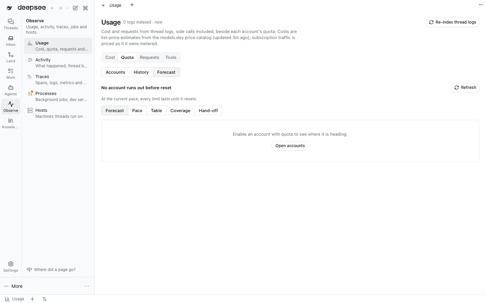

# Phase 5 part A: Observe (one Usage page, one Processes page, Cost and Jobs facets)

Evidence for [the ADE plan](../README.md) §6 rows "Cost/usage in 4–6 places" and "Processes in 3 boards", §4.4 Cost and
Jobs facets. Captured 2026-11-04 in a scratch DSH (full web profile, `dshx dev up --skip-build`) with WebKit at
1440×900 and 390×844 (iPhone UA, `isMobile`). No horizontal overflow and no page errors in any capture.

## What changed

| Before | After |
| --- | --- |
| Usage: Analytics, AI Accounts: Usage history, AI Accounts: Quota forecast (3 pages) and the account page's Usage tab | **Observe › Usage** with tabs **Cost · Quota · Requests · Tools**; Quota holds Accounts (one account's limits plus its recorded requests and cost), History and Forecast |
| Background Jobs: Jobs, Worktree Memory: RAM, the thread header dev-server chip (3 boards) | **Observe › Processes** with tabs **Jobs · Dev servers · RAM**; the chip stays as the per-thread quick view |
| Per-thread cost only in the composer and turn tails | **Cost** facet: route, cost per turn, links to the thread's requests, its quota and Traces |
| Jobs of one thread only by filtering the board | **Jobs** facet: the thread's jobs, its dev servers and its RAM |

Old names stay findable: "Where did a page go?" lists every former entry, the palette matches them through the section's
`formerLabels`, and usage/background-jobs add palette rows that land on the right tab or view. Saved tabs of the
former pages redirect. Without the owning plugin (usage, background-jobs) the former pages keep their own entries.

## Ownership (one-way dependencies)

- **Processes:** background-jobs declares `@dshfiles/background-jobs/process-views` (`ProcessViews` registry,
  `ProcessesNavigation` contract). worktree-memory and preview depend on background-jobs and provide tabs, per-thread
  views and (RAM) the navigation glyph marks.
- **Usage:** the brief asked for a registry declared by usage that ai-accounts fills. That direction would close a cycle:
  usage already depends on ai-accounts (price catalog, cost estimate and the accounts API on its Host). Per
  [plugin boundaries](../../../docs/plugin-boundaries.md) the dependency stays usage → ai-accounts, so ai-accounts
  declares `@dshfiles/ai-accounts/quota-views`: `AccountQuotaViews` (provided by ai-accounts, rendered by usage) and
  `UsageNavigation` (provided by usage, used by ai-accounts' old entry points). Same pattern as the existing
  `account-usage-view` contract. `pnpm check:cycles` passes.

## Captures

| State | Desktop | Phone |
| --- | --- | --- |
| Usage › Cost | [desktop](usage-cost-desktop.png) | [phone](usage-cost-phone.png) |
| Usage › Quota › Accounts | [desktop](usage-quota-accounts-desktop.png) | [phone](usage-quota-accounts-phone.png) |
| Usage › Quota › History | [desktop](usage-quota-history-desktop.png) | [phone](usage-quota-history-phone.png) |
| Usage › Quota › Forecast | [desktop](usage-quota-forecast-desktop.png) | [phone](usage-quota-forecast-phone.png) |
| Usage › Requests | [desktop](usage-requests-desktop.png) | [phone](usage-requests-phone.png) |
| Usage › Tools | [desktop](usage-tools-desktop.png) | [phone](usage-tools-phone.png) |
| Processes › Jobs | [desktop](processes-jobs-desktop.png) | [phone](processes-jobs-phone.png) |
| Processes › Dev servers | [desktop](processes-dev-servers-desktop.png) | [phone](processes-dev-servers-phone.png) |
| Processes › RAM | [desktop](processes-ram-desktop.png) (shot before the tab switch landed: Jobs selected) | [phone](processes-ram-phone.png) (process probe still reading) |

## Journeys, main vs branch

Scratch e2e (`pnpm check:e2e <plugin>`), main = a temporary workspace at `jj:lslztmkm` (forgotten afterwards).

| Owner | Scenario | main | branch |
| --- | --- | --- | --- |
| usage | Read, filter and follow the request log | pass | pass |
| usage | Read the usage charts | pass | pass |
| usage | Read tool and Jev activity | pass | pass |
| usage | Quota history and forecast are views of the Usage page (new) | — | pass |
| usage | A thread's Cost facet folds its requests per turn (new) | — | pass |
| background-jobs | Browse, classify and filter every Session's background jobs | pass | pass |
| background-jobs | Stop several running jobs through one confirmation | **fail** | fail (same step) |
| background-jobs | A live job whose label exceeds the wire bound still renders | **fail** | fail (same step) |
| background-jobs | Jobs and RAM are tabs of one Processes page (new) | — | pass |
| background-jobs | A thread's Jobs facet lists the job that thread runs (new) | — | fail: same precondition as batch-stop (no job starts) |
| worktree-memory | both scenarios | not rerun | pass (2/2, before the rebase onto `jj:zpnktynl`) |
| preview | A server started by a thread is listed, previewed by the agent and stopped | **fail** (timeout) | fail (timeout) |

Branch failures ⊆ main failures plus one new scenario blocked by the same precondition. Root cause seen in scratch: a
fake-provider `bash` call fails on current main with "Cannot read properties of undefined (reading 'prepare')", so no
job starts; the batch-stop and oversized-label steps then wait for a call row or a job that never appears.

## Thread panel facets: what works and what the shell lane must add

The facets are page tab types of the native right pane (`ctx.sidebarRightTabs.register` plus the
`sidebar.right.pane.tab` seat, which passes `sessionId`). No sidebar-right edit. They work where the native right pane
renders its guide (the usage journey opens the Cost facet through **Open right sidebar** → guide entry). In the full web
profile the owned Workbench dock owns the right pane, and its **Choose a view** chooser lists main panels only, so it does
not offer plugin tab types such as Cost and Jobs. Contract needed from the sidebar-right / workbench lane:

- The dock's view chooser (and the facet strip of §4.4 when it exists) lists every `SidebarRightTabRegistry` page type
  whose definition has `guide` entries, using `guide[].title`, `description`, `icon` and `order`.
- Picking one opens the kind as a page for the stage's thread (`openTab(kind)` semantics), and the body renders through
  the `sidebar.right.pane.tab` seat with the thread's `sessionId`, exactly as the native shell does.

Until then the facets are reachable only in compositions that use the native right pane.
