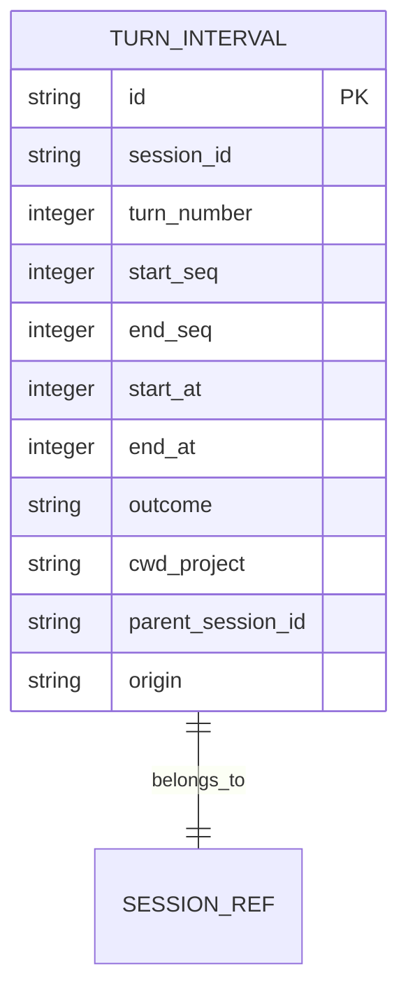

# Agent Calendar plan

## Context

- BB's third-party Agent Calendar measures turn intervals, merges turns across a configurable idle gap, and provides calendar/project/timesheet CSV views. It reports wall-clock agent time, not tokens or billable compute: [listing](https://getbb.app/marketplace/agent-calendar), [README](https://raw.githubusercontent.com/charpeni/bb-plugins/main/plugins/agent-calendar/README.md).
- DSH [Activity Timeline](../plugins/@dshfiles/activity-timeline/README.md#L62-L71) is lifecycle-level, not a turn calendar. DSH [Usage](../plugins/@dshfiles/usage/README.md#L3-L39) owns request token/cost analytics and is in the [web profile](../profiles/web/package.json).
- Host `sessionQuery` can list the complete logical Session corpus and read replay-validated event logs; DSH turn markers carry `turn/start` and `turn/end`. `session/event` provides committed events. Existing Session metadata includes parent/origin lineage but no definitive hidden/background visibility flag.
- Adjacent competitors are not equivalent: [TokiToki](https://github.com/astahmer/tokitoki) focuses on normalized token/cost/quota/request analytics; [OpenUsage.ai](https://www.openusage.ai/) focuses on limits/cost, not turn-time timesheets.

## Goal

Show retrospective DSH agent-turn time by project and Session in a local Calendar view, without claiming productive/billable time or mixing duration with token usage.

## What

Add a Calendar tab inside existing Usage rather than a standalone plugin. Project turn intervals into a separate table/API; provide day/3-day/week, project filters, Session blocks, summaries, and CSV. Keep request tokens/costs and turn duration as separate measures.

## Why

The user's Agent Calendar interest is “when and how long did agents run?” DSH already stores turn markers and offers a Host query seam, so a local projection is feasible without a core API addition. Reusing Usage avoids another analytics owner.

## How

### Conceptual model

One interval per Session turn, paired from `turn/start` to matching `turn/end`. Backfill from validated Session logs; consume committed live events idempotently. Merge nearby intervals only for display; retain raw turn durations separately.

### Operations / behavior

- Browse Day/3-day/Week and project/cwd filters; click a block to open its Session.
- Show raw turn seconds, merged block span, parallel agent-hours, and optional display-only quarter-hour rounding with clear labels.
- Default to top-level Sessions; allow explicit child/subagent inclusion, never silently roll child time into parent.
- Include archived persisted Sessions; reconcile disappeared/deleted Sessions. Label aborted/error turns and exclude unmatched/incomplete turns from completed totals.
- Use viewer timezone and Monday week start; default merge gap 30 minutes, configurable 15m/1h/2h.
- Do not claim exclusion of every hidden/background Session until Host exposes reliable visibility metadata.

### Tech choices

| Choice                         | Decision                                                 | Rationale                                                                                              |
| ------------------------------ | -------------------------------------------------------- | ------------------------------------------------------------------------------------------------------ |
| Standalone plugin vs Usage tab | Add Calendar tab in Usage                                | Usage already owns analytics and Host SQLite; keep one analytics surface.                              |
| Source                         | Host `sessionQuery` + `session/event`                    | Reads complete persisted corpus and committed live turn events without loading Sessions into an Agent. |
| Persistence                    | Separate `turn_intervals` table from request records     | Duration and token/cost metrics have different semantics.                                              |
| Child sessions                 | Store separately; top-level default with explicit toggle | Parallel child time must not be silently double-counted.                                               |
| Rounding                       | Exact duration default; optional display-only rounding   | Time sheet conventions are not billing facts.                                                          |

### Architecture

```text
sessionQuery list/read + committed session/event
  -> Usage Host turn-pair projection / bounded reconciliation
  -> separate turn_intervals table + typed summary API
  -> Usage Calendar UI + CSV
```

## What this allows

- Local retrospective agent-turn calendar and project/session time sheet.
- Explicit parallel agent-hours, child inclusion, and exact-vs-rounded display.
- Deterministic backfill and incremental updates without storing prompts or tool payloads.

## What this does not allow

- Token/cost totals, billable/productive-time claims, OS-level runtime monitoring, or reliable hidden-session exclusion without Host metadata.
- Combining parent and child durations invisibly or inventing end times for incomplete turns.

## UI & UX

### Desktop

Add a `Calendar` tab in Usage: Week default; Day/3-day options; project filter; Session blocks; totals for raw turn time and merged agent-hours; CSV export; child-agent toggle with explanation. Label all totals “agent-turn time.”

### Mobile

Use a compact agenda/list view; preserve timezone, filter, and child-count labels.

### Common interactions

| Action                    | Result                                                                   |
| ------------------------- | ------------------------------------------------------------------------ |
| Select project/date range | Query local intervals and redraw calendar/timesheet.                     |
| Toggle child agents       | Include/exclude separately indexed child Sessions; label parallel hours. |
| Export CSV                | Emit stable, timezone-aware interval rows and summary provenance.        |

## Data model



Store only derived Session/turn IDs, seqs, timestamps, outcome, project/cwd label, and lineage needed for filters. Never copy prompt text, tool arguments/results, or raw event bodies. Reconcile deletion against SessionQuery corpus; use bounded/cancellable scans and a persisted high-water mark.

## Implementation steps

1. Confirm Usage is the desired analytics home.
2. Implement and test a pure turn-pair fold: duplicate/out-of-order events, missing end, aborted/error outcomes, invalid timestamps, and child lineage.
3. Add separate `turn_intervals` storage, bounded `sessionQuery` backfill/reconciliation, and idempotent `session/event` updates.
4. Expose validated range/summary APIs only; keep raw logs and event bodies Host-side.
5. Add Calendar/agenda UI, project/date filters, child toggle, merge-gap/rounding controls, Session navigation, and CSV.
6. Verify archived/deleted reconciliation, timezone/DST behavior, duplicate delivery, privacy, and large-corpus latency in scratch DSH.

## Open questions

1. Should Calendar be bundled with Usage even if user only wants time reporting, or is one analytics surface preferred?
2. Should quarter-hour rounding be available, and should merged gap default to 30 minutes?
3. Should hidden/background Sessions be excluded? DSH lacks reliable visibility metadata today.
4. Should child agents be included by default? Plan recommends top-level only plus explicit toggle.
5. What retention/reconciliation policy is acceptable for local interval summaries?

## Acceptance criteria

- [ ] Matched turn markers produce exact intervals; unmatched turns are labeled incomplete and never assigned invented end times.
- [ ] Duplicate/replayed events and repeated backfills are idempotent; archived Sessions appear and removed Sessions prune on reconciliation.
- [ ] Child Sessions remain separate; default totals do not silently include them; enabled totals are labeled parallel agent-hours.
- [ ] Timezone/DST, Monday week start, merge gaps, and rounding labels are tested; raw duration remains available.
- [ ] Storage/API contain no prompts, tool output, or raw Session event bodies.
- [ ] Duration, token counts, estimated/provider costs, and quota remain separate metrics.
- [ ] Usage is not described as active until profile enablement is approved and verified.

## Decisions log

| Date       | Decision                                                    | Rationale                                                                          |
| ---------- | ----------------------------------------------------------- | ---------------------------------------------------------------------------------- |
| 2026-10-16 | Useful; add Calendar inside Usage, not a standalone plugin  | Reuses existing analytics and Host SQLite while keeping a separate interval model. |
| 2026-10-16 | Treat values as agent-turn time, never billing/productivity | Calendar records observed wall-clock intervals only.                               |
