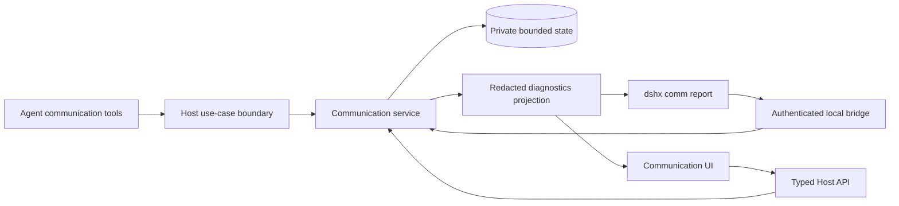
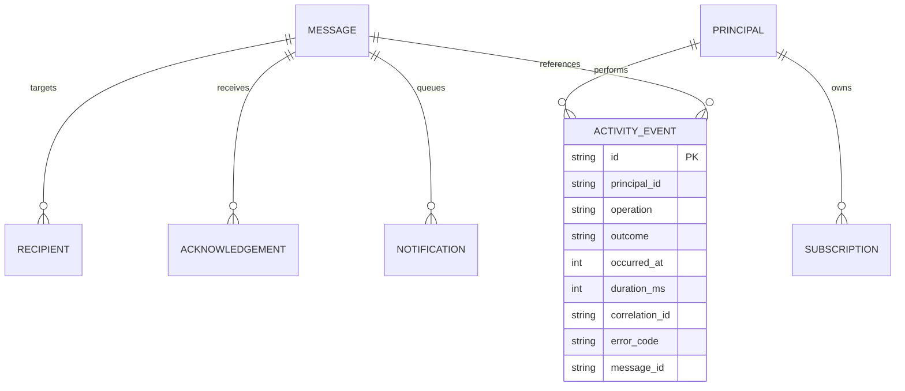

# Agent communication observability plan

## Context

- `@dshfiles/agent-communication` gives DSH Agents durable topics, direct inboxes, subscription controls, and quiet/queue/steer delivery.
- `@dshfiles/dshx/communication` owns the service, private JSON state, authenticated local socket bridge, and existing `dshx comm` adapters.
- Current durable state includes messages, recipients, subscriptions, acknowledgements, and notification receipts. It does not record tool invocation history (including read-only tool calls), failed attempts, or inbox reads as events.
- Existing CLI `agents`, `topics`, and `inbox` commands are not an operator report. The inbox prints message text, so diagnostics must use metadata-only output by default.
- The web profile includes this plugin, but configured composition alone does not prove Host activation or Agent usage. The previous live diagnostic attempt found the communication bridge unavailable and no state file at the default location; treat that as an unconfirmed runtime, not evidence of zero use.
- Build this in a dedicated JJ workspace based on the current `main` bookmark tip. Do not modify or restart the running DSH instance.
- Related code: `plugins/@dshfiles/agent-communication/src/host.ts`, `tooling/dshx/packages/dshx/src/communication/{service,bridge,cli,types}.ts`.

## Goal

Make communication usage and delivery inspectable, then let a local operator safely manage subscriptions and pending messages from DSH UI.

First ship read-only CLI diagnostics so the stored evidence and operational gaps are visible without changing state. Then add a UI backed by the same Host-owned diagnostic and management service.

## What

### Phase 1: read-only CLI / diagnostic report

- Add a metadata-only command (proposed: `dshx comm report`) that reports Host/bridge availability; current live Agents and topics; subscriber and delivery-mode summaries; message counts and recent activity; pending/acknowledged status; notification outcomes; and activity-record availability/coverage.
- Return stable, versioned JSON and concise human output. Bound time range, row count, and payload size. Never print message bodies or credentials in the default report.
- Record Agent communication tool invocations at the Host tool/use-case boundary, including read-only operations such as `agents`, `topics`, and `inbox`; include outcome and duration so “used” is distinct from “message sent.” Capture only safe metadata, never arguments or message text.
- Report current historical limitations honestly: prior use cannot be inferred for periods before activity recording existed, and a missing bridge is not evidence of non-use.

### Phase 2: DSH UI with controls

- Add a communication inspector surface to the existing `agent-communication` plugin.
- Show overview, activity timeline, topic/subscription view, and message lifecycle metadata. Message text stays hidden until an explicit user action.
- Add narrowly scoped controls: update delivery mode, unsubscribe/rejoin a workspace topic, and acknowledge a pending message. Enabling `steer` must require an explicit sender Session-id allowlist; never enable it implicitly. No bulk clear, delete, publish, or send controls in initial scope.
- Use Host-backed queries and mutations. Do not make the browser read the state file or write persistent state directly.

## Why

The capability is configured but currently opaque. Operators cannot distinguish installed tools from actual Agent usage, understand delivery failures, inspect pending work, or safely adjust subscriptions without CLI calls. Structured, privacy-preserving evidence gives the CLI and UI one trustworthy operational model.

## How

### Conceptual model

Separate three evidence layers:

1. **Activation/health** — whether the Host bridge is reachable and state is readable.
2. **Tool activity** — bounded metadata for Agent tool calls, with operation, principal, outcome, duration, timestamp, and correlation identifier where the runtime provides one.
3. **Message lifecycle** — message metadata, recipients, notification receipt, inbox read, and acknowledgement, without exposing message text in diagnostics.

A successful Agent tool invocation proves use of that tool. Message lifecycle proves communication occurred. Neither alone proves that an Agent acted on message content.

### Operations / behavior

- `dshx comm report [--since ...] [--limit ...] [--json]` is read-only and does not acknowledge messages or change subscriptions.
- UI queries the same typed Host diagnostic read API.
- UI mutations use existing validated service operations where available. Add a service method only when a real management action requires it; do not mutate persisted JSON from the client.
- Emit one structured activity record at the Agent tool boundary per invocation, including success/failure. Adapter logs remain transport-specific and must not duplicate these records.

### Tech choices

| Choice | Decision | Rationale |
|--------|----------|-----------|
| Evidence store | Extend communication state with a versioned, bounded activity collection; inspect migration/compatibility behavior before implementation | Existing service already owns private atomic persistence; avoids a second unrelated store |
| Event fields | Timestamp, event id, principal id, operation, outcome, duration, optional correlation id, bounded error code | Lets operator follow work without logging peer text, arguments, or secrets |
| Read boundary | Typed service/bridge diagnostic method shared by CLI and UI | One permission, validation, and redaction boundary |
| UI state | Existing plugin UI and Host-backed query/mutation patterns | Keep the UI a projection of Host state, not another source of truth |
| Retention | Propose bounded count and age; finalize after reviewing state schema and retention tests | Prevent unbounded growth and make historical coverage explicit |

### Architecture



## What this allows

- Distinguish configured/available capability from recorded Agent tool use.
- See which operations Agents used, with success/failure and message lifecycle metadata.
- Identify pending messages, notification receipts, subscription settings, and bridge/state health.
- Safely manage subscriptions and acknowledge individual pending messages from DSH UI.

## What this does not allow

- Reconstruct usage before recording is deployed or infer non-use from missing evidence.
- Treat message delivery, inbox reads, or tool calls as proof that an Agent followed the message.
- Expose peer text, raw tool arguments, OAuth data, or socket credentials in default reports or logs.
- Delete communication history, bulk-clear inboxes, or create/send messages from the first UI version.
- Restart or modify the live DSH process as part of validation.

## UI & UX

### Desktop

```text
Agent communication                         Host: connected

Activity     24h: 18 calls   5 messages   2 pending   1 failed notice

Recent activity
16:42  agent:worker-a   inbox read       2 items
16:40  agent:worker-b   publish           3 recipients
16:38  agent:worker-a   acknowledge        success

Topics / subscriptions                         Pending messages
workspace/…   3 Agents   queue               2 messages
release-notes  1 Agent    quiet               [Inspect]
```

Selecting an event opens metadata first. Message body requires an explicit reveal. Controls are local, scoped to the selected Agent/message, and show confirmation before changing subscription state.

### Mobile

Use stacked overview cards; activity and subscriptions become separate lists. Keep destructive or state-changing actions behind a detail view and confirmation.

### Common interactions

| Action | Result |
|--------|--------|
| Open report | Fetch bounded health, activity, subscriptions, and lifecycle metadata |
| Change time range / filter | Re-query with validated bounds; no persistent mutation |
| Reveal message body | Explicitly show one selected message body; no body in list rows |
| Change delivery mode | Confirm, then call Host mutation and refresh projection; `steer` requires explicitly selecting allowed sender Session IDs |
| Unsubscribe / rejoin topic | Confirm, then call Host mutation and refresh projection |
| Acknowledge message | Confirm, acknowledge only selected message, then refresh pending list |

## Data model

The exact schema is an implementation gate: inspect version-1 compatibility, migration behavior, retention, and state-size limits before changing it.



Activity records contain no message body or raw arguments. Existing message content remains under current private state protections; diagnostic DTOs explicitly enumerate metadata fields.

## Implementation steps

1. [ ] Review plan and confirm command shape, event retention, and control scope.
2. [ ] In the dedicated workspace, inspect installed DSH tool execution contracts, state versioning/retention, CLI routing, and plugin UI/Host API patterns; document any contract-driven plan changes.
3. [ ] Implement bounded activity recording and a metadata-only diagnostic projection, with tests for success/failure, redaction, limits, retention, and state compatibility.
4. [ ] Add read-only `dshx comm report` output and focused CLI tests. Verify no command path mutates state.
5. [ ] Build and verify CLI/Host work without touching the live profile; checkpoint this milestone before UI work.
6. [ ] Add communication inspector UI with Host-backed queries, metadata-first timeline, and explicit body reveal.
7. [ ] Add scoped subscription and acknowledgement controls through validated Host mutations; test authorization, stale data, confirmation, and failure behavior.
8. [ ] Build/test/typecheck/lint the affected packages, perform scratch-profile/runtime checks on a second port, and capture operator-facing evidence. Do not restart the live instance.

## Open questions

1. Confirm activity retention window and maximum record count after reviewing actual state growth and current limits.
2. Confirm whether message-body reveal belongs in first UI release, or whether first release should stay metadata-only.
3. Confirm preferred UI placement (plugin panel/slot versus dedicated settings view) after checking live slot and navigation contracts.

## Acceptance criteria

- [ ] Read-only report distinguishes unavailable bridge, healthy empty state, and populated state without implying missing history means non-use.
- [ ] Agent tool activity records success and failure at one boundary; records contain no body, arguments, credentials, or unbounded error text.
- [ ] Report has stable JSON schema, bounded output, and explicitly redacted metadata-only defaults.
- [ ] State version changes preserve existing messages, subscriptions, acknowledgements, and notification receipts; retention is bounded and tested.
- [ ] Report never acknowledges messages or changes subscriptions.
- [ ] UI queries and mutations use Host APIs; browser never reads/writes state files.
- [ ] UI management actions are scoped and validated; acknowledgement and subscription changes have focused tests.
- [ ] Plugin build, typecheck, focused tests, Host bundle import, and scratch runtime checks pass; live DSH instance remains untouched.

## Decisions log

| Date | Decision | Rationale |
|------|----------|-----------|
| 2026-10-10 | Use dedicated `agent-communication-observability` JJ workspace based on `main` tip | Isolate work from concurrent edits in the default workspace and start from the requested branch tip |
| 2026-10-10 | Deliver read-only CLI diagnostics before UI controls | Establish evidence shape and prove privacy/redaction before adding interactive management |
| 2026-10-10 | Log Agent tool activity separately from message lifecycle | Successful read-only tool use is not visible in message state; message delivery alone cannot prove tool invocation |
| 2026-10-10 | Keep initial UI controls limited to subscription changes and per-message acknowledgement | Avoid introducing destructive history operations or additional send/publish paths |
