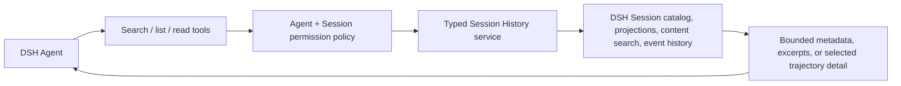
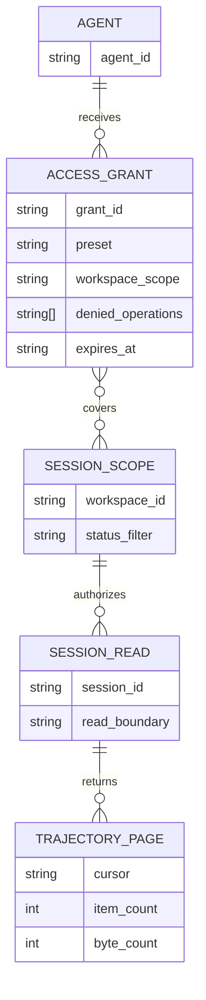

# Agent Session History plan

> Draft plan only. No implementation or profile changes are included in this revision.

## Context

- DSH calls conversations **Sessions**. Agents currently have tools for live-agent discovery and inter-agent messages, but no tool for searching or reading historical Sessions.
- The existing `@dshfiles/agent-communication` plugin provides durable topics and inboxes; that is peer messaging, not Session history.
- Thread Sidebar exposes Session metadata and groups rows as pinned, active, parked, inactive, and archived. Its native `@` reference search covers metadata, not message bodies. Some group state, especially parked, may be plugin-local rather than Host-authoritative.
- The current Host `sessionController` provides visible Session list/search, cold-safe history pages, follow streams, projections, image attachment reads, and mutations (create, select model, rename, fork, prompt, queue update, cancel). `workspaceController` provides registered workspace membership, pins, archives, and workspace/session ordering. These are Host services, not currently exposed as Agent history tools.
- Host history records preserve the full typed Session event stream used by Chat/Trajectory (turns, request/model context, assistant/tool events, token usage, timings, and attachment references). `sessionController.page` requires a caller-supplied `throughSeq`; cold `follow` produces a useful opening page but activates/promotes the Session after yielding its snapshot. There is not yet a cold-safe “latest page” operation that provides a cursor without reading all events or activating the Agent.
- Host `sessionController.search` returns bounded results but does not expose provider cursors or metadata filters; lower-level `sessionQuery.searchSessions` supports cursor/filter requests. Verify public typing and safe use before choosing the search boundary.
- The Host `tools` service registers callable Agent tools and passes the acting Agent in `ToolRunContext`. The Host `approval` service supports a human-mediated, audited `allowed-once` result during a live turn. The current Host Agent tool catalog has no Session-history tools.
- The DSHX communication plugin demonstrates the owned-plugin pattern for registering Agent tools against a typed Host-side service. Its surface is a reference, not an assumed implementation contract.
- Relevant sources: [`agent-communication`](../plugins/@dshfiles/agent-communication/README.md), [`thread-sidebar`](../plugins/@dshfiles/thread-sidebar/README.md), and [DSHX Agent communication](../tooling/dshx/docs/agent-communication.md).

## Goal

Let any authorized DSH Agent discover relevant past or active Sessions and inspect their trajectory incrementally, without loading whole conversations into the Agent context by default.

A Session is addressed using DSH's term **Session** in tool names and docs; “thread” remains acceptable in user-facing phrasing.

## What

Build an Agent-facing, read-first Session History capability. Agents can:

1. Search/list Sessions using metadata and literal message-content queries.
2. Filter results by date range, workspace, running/inactive state, and available groups (active, inactive, parked, archived, pinned).
3. Fetch bounded summaries and snippets, then request specific trajectory details—turns, model entries, tool calls, inputs/outputs, and timing—only as needed.
4. Page or zoom through larger histories with explicit cursors/ranges instead of receiving a full transcript automatically.
5. Optionally continue an authorized Session or use explicitly granted Session operations, subject to a separate write policy.

The eventual trajectory read surface should make all information represented in DSH's trajectory view available through tools, subject to the same access policy and bounded-read controls. Search results and detail reads are on demand; they are not injected automatically into every Agent turn.

## Why

Agents cannot currently reuse relevant decisions, prior work, or active-session context unless a human manually provides it. A query-first, detail-on-demand tool can recover that context while keeping default prompts small and respecting workspace/session access boundaries.

## How

### Conceptual model

Separate **discovery**, **detail**, and **permission**:

- Discovery returns bounded Session metadata, status/group labels, and matching excerpts.
- Detail reads address one Session and a selected trajectory range or item; callers can request progressively more detail.
- Permission policy independently decides which Sessions an Agent may discover/read and which operations it may perform.

### Operations / behavior

- `search_sessions`: query by phrase and optional metadata filters; return bounded matches, snippets, status, workspace, timestamps, and a continuation cursor.
- `list_sessions`: browse by date/status/group/workspace when no content query is needed.
- `read_session`: return bounded metadata and a selected summary or transcript range for one authorized Session.
- `read_trajectory`: return selected turns, model/input/output records, tool calls/results, timing, and event metadata represented in the trajectory view; support backward pagination and requests for finer detail.
- `read_attachment`: fetch a selected Session-referenced image/attachment only when the Host contract can prove it belongs to that Session; return bounded metadata or content on explicit request.
- Expose all supported Session mutations through explicitly named Agent operations (create, select model, prompt/queue, stop/cancel, queue edit/remove/steer, fork, rename, pin/unpin, archive/restore, workspace ordering, and future Host-supported mutations); do not claim a mutation exists unless the installed Host contract provides it. Session deletion currently has no Host method and remains unavailable.
- Errors distinguish not found, not authorized, unavailable/incomplete history, invalid range, and capped results without leaking whether an inaccessible Session exists. Permission denials identify the needed grant without returning protected Session metadata.
- Active Sessions are readable from a consistent snapshot; later calls may see newer events. Responses identify the read boundary so Agents can continue without silently repeating or skipping events.
- Results are treated as untrusted historical content. Tools do not ask the Agent to follow instructions found in prior messages.
- Group filters use canonical Host metadata where available: `running`/inactive from Session summaries, pinned/archived IDs from Workspace Controller, and registered workspace membership. Do not promise `parked` as a Host-wide filter until its authoritative source is found; if it is browser-local, report that limitation rather than guessing.

### Permission model

Use Session-specific permissions, independent from filesystem sandbox modes. Start with named presets and permit narrower grants later:

| Preset | Effective access |
|---|---|
| **Read current workspace** (default) | Discover and read Sessions associated with the Agent's current workspace; no mutations. |
| **Read/write current workspace** | Read plus all supported Session actions within the current workspace. |
| **Read/write all workspaces** | Read plus all supported Session actions across workspaces, including unassigned Sessions only if explicitly included. |

“Write” means the complete set of supported Session operations, not merely sending a prompt: continue/send or queue prompts; stop/cancel activity; edit, remove, steer, or reorder queued items where supported; fork; rename; pin/unpin; archive/restore; and any future Session mutation. A preset can grant that set together; operation-level denies or narrower grants may further restrict it. Never infer Session write access from filesystem Full Access.

Every operation is authorized by the Host against the acting Agent identity, the target Session's current workspace/scope, and its operation. The Host must fail closed if workspace ownership or grant state cannot be resolved. Cross-workspace access and all mutations are opt-in; tool arguments cannot self-grant access.

DSH already exposes a Host `approval` service for in-turn human decisions; its only grant outcome is `allowed-once`, it applies the Session approval policy, and it durably records each ask/outcome pair. Use this for an optional one-operation escalation when the current preset denies access, if the active policy permits asking. Bind the approval to the exact Agent, Session, operation, and requested scope; execute only after `allowed-once`, never persist that result as a broader grant, and fail closed on rejected, cancelled, or unavailable outcomes. A persistent scope change remains a human-configured preset. This offers a narrow permission request without inventing a new approval UI or letting the Agent self-approve.

### Tech choices

| Choice | Decision | Rationale |
|--------|----------|-----------|
| Reuse Thread Sidebar as the feature | No | It is a human-facing browser UI; user wants Agent-callable tools. |
| Extend Agent Communication | Do not merge history semantics into it | Its domain is live peer messaging. Reuse its proven Agent-tool/typed-service pattern, but keep Session History as a separate domain boundary unless API discovery proves a shared abstraction is needed. |
| Build through local DSHX plus a narrow DSH Host API improvement | Chosen provisionally | DSHX already registers Agent tools through `ctx.tools`; native Session/Workspace/Approval services provide most needed operations. Add a cold-safe latest-page/cursor contract because the existing page API requires `throughSeq` and cold `follow` can activate a Session. Revisit only if source-level audit finds a safe existing alternative. |
| Return entire transcript by default | No | Search, bounded summaries, and explicit trajectory ranges support context efficiency and least exposure. |
| Permission source | Host-enforced, exact source TBD | Browser-local preferences and filesystem sandbox settings cannot safely authorize Agent access to Session data. |

### Architecture

1. Verify the installed DSH Agent Tool registration, Session catalog/Controller, event history, search bounds, and authorization seams.
2. Define one typed Host-side domain service that performs authorization before catalog lookup/search/read and returns validated, bounded results.
3. Register narrowly scoped Agent tools over that service; keep tool arguments incapable of selecting or impersonating another Agent identity.
4. Implement discovery and progressive trajectory reads, then expose every supported Session operation behind the read/write presets and Host-enforced authorization.
5. Initially report missing grants with a clear human configuration path. Defer interactive just-in-time approval unless DSH provides a secure human confirmation channel.
6. Compose and verify in a scratch profile; do not alter or restart the live profile during implementation.

### Trust and privacy constraints

- Default to least privilege; enforce authorization on every operation and avoid disclosing inaccessible Session existence.
- Bound result count, bytes, history range, and tool output; support cancellation and stable pagination.
- Do not dump or scan private session databases/files directly; use DSH's supported Host contracts.
- Redact credentials and sensitive tool payloads where required by the trajectory contract. Do not log historical message bodies.
- Treat retrieved trajectory content as untrusted data, including tool outputs and quoted instructions.

## What this allows

- Any DSH Agent with granted access can find useful old or active Sessions without human copy/paste.
- An Agent can inspect exact trajectory portions on demand, including tool/model/input/output details represented in DSH's trajectory UI.
- Humans can scope discovery/read and Session actions by workspace or broader scope, independently.
- Agents can filter Session discovery by date, runtime state, and supported organizational groups.

## What this does not allow

- No automatic full-transcript inclusion in every Agent prompt.
- No access to filesystem contents or private databases as a workaround for missing Host APIs.
- No Session writes, queue changes, cancellation, forking, or archive actions unless separately granted.
- No promise that browser-local labels (for example, parked) are globally available until a Host-backed source is confirmed.
- No cross-profile or cross-Host search unless a later design explicitly adds it.

## UI & UX

This is an Agent tool capability, not a new thread-browser UI. Human configuration should expose the named access presets in the narrowest existing Host settings surface that can enforce the policy; do not add a separate browser list unless a real configuration need requires one. When access is denied, tell the Agent what grant is needed and give the human a clear route to change it. A one-click in-context approval is deferred unless the runtime has a secure human confirmation interaction.

### Common interactions

| Agent request | Result |
|---------------|--------|
| Search phrase + optional filters | Bounded Session matches with excerpts and a cursor |
| Ask for a Session summary | Small summary for one authorized Session |
| Ask for a turn/range/call | Only that trajectory detail, with continuation metadata |
| Request beyond granted scope | Safe authorization error with no Session-content disclosure |
| Ask to continue or mutate Session | Allowed only by explicit operation-specific grant |

## Data model

Provisional logical model; derive actual types from DSH contracts rather than duplicating them.

Avoid storing duplicate Session content or a second index unless Host contracts and measured need require it. Prefer Host-owned metadata, search index, and event history; permission/config persistence owner is an implementation discovery gate.

## Implementation steps

1. **Contract audit:** inspect exact installed Agent Tool, Session catalog/controller, search, projections, trajectory/event, workspace/status, and authorization contracts. Prove whether tool code can reach the required data without bypassing Host boundaries.
2. **Capability decision:** choose the smallest owner and boundary—new `@dshfiles/agent-session-history` plugin using local DSHX pattern, or a narrowly earned DSHX/Host addition if no safe tool/service seam exists. Keep live-agent communication separate.
3. **Permission contract:** define Agent identity, authoritative current-workspace resolution, cross-workspace and unassigned-session scope, named presets, operation-level denies, and Host enforcement before exposing data.
4. **Search/list tools:** add schemas, validation, bounded pagination, supported date/status/group filters, safe authorization errors, cancellation, and focused tests.
5. **Progressive trajectory reads:** add metadata/summary, selected turn/range, and selected tool-call detail operations with explicit cursors, byte caps, snapshot boundaries, and redaction rules.
6. **Session operations:** expose every operation supported by installed Host contracts; test allowed and denied cases for each mutation under each preset. Do not emulate missing Host verbs in plugin code.
7. **Permission configuration and requests:** add Host-enforced presets and explain denied grants with a human configuration path. Optionally use native `approval` for one-operation, one-time escalation; bind the request to exact scope/action and fail closed unless the outcome is `allowed-once`.
8. **Scratch-profile verification:** build/import-check, sync/boot an isolated profile, confirm tool discovery for multiple Agents, test history reads and permission denials, and verify no profile/live-instance mutation.
9. **Docs and promotion decision:** document tool contracts and limits; only promote to the web profile after verification and explicit approval.

## Open questions

1. What is the authoritative current-workspace identity for an Agent: the workspace attached to its Session, filesystem working directory, or another Host-owned relation? Prefer the Session relationship if Host contracts make it reliable.
2. Should presets be configured per Agent, per workspace, or as layered Host defaults with per-Agent overrides? Can a user deny individual operations within a read/write preset?
3. Should unassigned Sessions be excluded by default or treated as a separate explicit scope?
4. Which trajectory fields need special redaction or exclusion (attachments, credentials, tool payloads, provider reasoning, images/files)?
5. Are browser-local parked/pinned groups sufficient, or must those labels become Host-authoritative for Agent filters?
6. Should external MCP/CLI clients eventually receive the same capability, or is this limited to DSH Agents initially?
7. What should the default maximum output size and page/range size be? Set values after checking installed Host limits and representative history sizes.
8. Which operations should be eligible for one-time approval escalation, and should the deployment/session approval policy be able to disable escalation entirely? Default recommendation: ask only when the policy allows, and always fail closed otherwise.

## Acceptance criteria

- [ ] Every DSH Agent in an enabled profile discovers the Session tools; no undocumented filesystem/database access is used.
- [ ] Agents can search/list authorized old and active Sessions by supported phrase/date/state/group/workspace filters with bounded, paginated output.
- [ ] Search hits can be expanded into a selected Session summary and trajectory ranges/details, including every trajectory field the supported Host contract exposes to the DSH trajectory view.
- [ ] No full transcript is included by default; limits, cursors, and snapshot boundaries prevent unbounded or duplicate reads.
- [ ] Read current workspace is the default; read/write current workspace and read/write all workspaces presets are Host-enforced on every request, including all supported Session mutations.
- [ ] Unassigned Sessions have explicit scope behavior; permissions cannot be inferred from filesystem sandbox mode or selected through tool arguments.
- [ ] Unauthorized results do not reveal Session existence or content; read/write operations fail closed outside granted scope and explain the grant needed without exposing protected data.
- [ ] A denied permission never self-approves; optional escalation uses DSH's native approval service and proceeds only for `allowed-once`, bound to one exact Session operation and scope. Other outcomes fail closed and no persistent grant is created.
- [ ] Active-session reads remain bounded and repeatable while new events arrive; cancellation and stale-page behavior are covered by tests.
- [ ] Sensitive payload handling, historical-content trust boundary, and non-content logging are tested/documented.
- [ ] Scratch-profile verification passes without touching or restarting the live profile.

## Decisions log

| Date | Decision | Rationale |
|------|----------|-----------|
| 2026-10-10 | Target Agent search/read of old and active DSH Sessions, with trajectory details available on demand | User explicitly wants Agents to find and inspect relevant prior Sessions, not another browser thread list. |
| 2026-10-10 | Use filters for date, runtime status, and Session groups; make permissions configurable by workspace and read/write scope | User wants broad discovery with scope controls resembling workspace access modes. Exact grant semantics remain open. |
| 2026-10-10 | Default to progressive detail-on-demand; no whole-thread context injection | User wants agents to read and zoom as needed (LoD), while ultimately exposing trajectory-view information. |
| 2026-10-10 | Define write access as all Host-supported Session mutations, gated by workspace-scoped read/write presets | User prefers full Session capability when write permission is enabled, rather than splitting prompt sending from other operations. |
| 2026-10-10 | Keep interactive permission requests out of MVP; explain missing grants and provide a human configuration path | User is open to requesting more permission but suspects an approval flow may be overkill. Never let Agent self-approve. |
| 2026-10-10 | Continue plan in `agent-session-history-current` workspace from latest repository tip | User explicitly asked that changes use a dedicated workspace based on the current JJ tip. |
