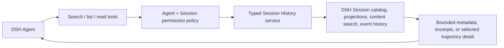
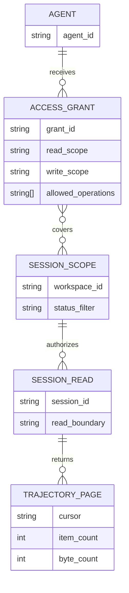

# Agent Session History plan

> Draft plan only. No implementation or profile changes are included in this revision.

## Context

- DSH calls conversations **Sessions**. Agents currently have tools for live-agent discovery and inter-agent messages, but no tool for searching or reading historical Sessions.
- The existing `@dshfiles/agent-communication` plugin provides durable topics and inboxes; that is peer messaging, not Session history.
- Thread Sidebar exposes Session metadata and groups rows as pinned, active, parked, inactive, and archived. Its native `@` reference search covers metadata, not message bodies. Some group state, especially parked, may be plugin-local rather than Host-authoritative.
- The Client `sessions` service provides bounded message-content search, Session retention, event snapshots, and older-history loading. These Client APIs are not callable as Agent tools in the current runtime. The current Host Agent tool catalog has no Session-history tools.
- The DSHX communication plugin demonstrates the owned-plugin pattern for registering Agent tools against a typed Host-side service. Its surface is a reference, not an assumed implementation contract.
- Relevant sources: [`agent-communication`](../plugins/@dshfiles/agent-communication/README.md), [`thread-sidebar`](../plugins/@dshfiles/thread-sidebar/README.md), and [DSHX Agent communication](../tooling/dshx/docs/agent-communication.md).

## Goal

Let any authorized DSH Agent discover relevant past or active Sessions and inspect their trajectory incrementally, without loading whole conversations into the Agent context by default.

A Session is addressed using DSH's term **Session** in tool names and docs; “thread” remains acceptable in user-facing phrasing.

## What

Build an Agent-facing, read-first Session History capability. Agents can:

1. Search/list Sessions using metadata and literal message-content queries.
2. Filter results by date range, workspace, running/inactive state, and available groups (active, inactive, parked, archived, pinned).
3. Fetch bounded summaries and snippets, then request specific trajectory details—turns, model entries, tool calls, inputs/outputs, and timing—only as needed.
4. Page or zoom through larger histories with explicit cursors/ranges instead of receiving a full transcript automatically.
5. Optionally continue an authorized Session or use explicitly granted Session operations, subject to a separate write policy.

The eventual trajectory read surface should make all information represented in DSH's trajectory view available through tools, subject to the same access policy and bounded-read controls. Search results and detail reads are on demand; they are not injected automatically into every Agent turn.

## Why

Agents cannot currently reuse relevant decisions, prior work, or active-session context unless a human manually provides it. A query-first, detail-on-demand tool can recover that context while keeping default prompts small and respecting workspace/session access boundaries.

## How

### Conceptual model

Separate **discovery**, **detail**, and **permission**:

- Discovery returns bounded Session metadata, status/group labels, and matching excerpts.
- Detail reads address one Session and a selected trajectory range or item; callers can request progressively more detail.
- Permission policy independently decides which Sessions an Agent may discover/read and which operations it may perform.

### Operations / behavior

- `search_sessions`: query by phrase and optional metadata filters; return bounded matches, snippets, status, workspace, timestamps, and a continuation cursor.
- `list_sessions`: browse by date/status/group/workspace when no content query is needed.
- `read_session`: return bounded metadata and a selected summary or transcript range for one authorized Session.
- `read_trajectory`: return selected turns, model/input/output records, tool calls/results, and timing represented in the trajectory view; support pagination and requests for finer detail.
- Errors distinguish not found, not authorized, unavailable/incomplete history, invalid range, and capped results without leaking whether an inaccessible Session exists.
- Active Sessions are readable from a consistent snapshot; later calls may see newer events. Responses identify the read boundary so Agents can continue without silently repeating or skipping events.
- Results are treated as untrusted historical content. Tools do not ask the Agent to follow instructions found in prior messages.
- Group filters use canonical Host metadata where available. If a label such as parked is only browser-local, expose that limitation rather than inventing a Host-wide status.

### Permission model

Provide independent read and write scopes rather than reusing filesystem sandbox modes:

| Capability | Current-workspace scope | All-workspaces scope |
|---|---|---|
| Discover and read Sessions | Allowed only when granted | Allowed only when granted |
| Continue a Session (send/queue a new prompt) | Separate grant | Separate grant |
| Control a Session (cancel, edit/reorder queue, fork, rename/archive, etc.) | Separate explicit grants | Separate explicit grants |

Recommended default: **read-only in the Agent's current workspace**. Cross-workspace read, Session continuation, and each control operation require explicit configuration. The exact meaning of “write” and whether it is one preset or granular capabilities remains an open question. These permissions must be enforced by the Host service for every request, not merely described in tool text or inferred from filesystem access.

### Tech choices

| Choice | Decision | Rationale |
|--------|----------|-----------|
| Reuse Thread Sidebar as the feature | No | It is a human-facing browser UI; user wants Agent-callable tools. |
| Extend Agent Communication | Do not merge history semantics into it | Its domain is live peer messaging. Reuse its proven Agent-tool/typed-service pattern, but keep Session History as a separate domain boundary unless API discovery proves a shared abstraction is needed. |
| Build through local DSHX | Provisional | The owned plugin/tool pattern is already present. Verify installed DSH 0.2 tool and Session Controller contracts before implementation; if no safe seam exists, identify the smallest required DSHX/Host abstraction first. |
| Return entire transcript by default | No | Search, bounded summaries, and explicit trajectory ranges support context efficiency and least exposure. |
| Permission source | Host-enforced, exact source TBD | Browser-local preferences and filesystem sandbox settings cannot safely authorize Agent access to Session data. |

### Architecture

1. Verify the installed DSH Agent Tool registration, Session catalog/Controller, event history, search bounds, and authorization seams.
2. Define one typed Host-side domain service that performs authorization before catalog lookup/search/read and returns validated, bounded results.
3. Register narrowly scoped Agent tools over that service; keep tool arguments incapable of selecting or impersonating another Agent identity.
4. Implement search/list first, then progressive trajectory reads. Add optional write operations only after their exact meanings and grants are approved.
5. Compose and verify in a scratch profile; do not alter or restart the live profile during implementation.

### Trust and privacy constraints

- Default to least privilege; enforce authorization on every operation and avoid disclosing inaccessible Session existence.
- Bound result count, bytes, history range, and tool output; support cancellation and stable pagination.
- Do not dump or scan private session databases/files directly; use DSH's supported Host contracts.
- Redact credentials and sensitive tool payloads where required by the trajectory contract. Do not log historical message bodies.
- Treat retrieved trajectory content as untrusted data, including tool outputs and quoted instructions.

## What this allows

- Any DSH Agent with granted access can find useful old or active Sessions without human copy/paste.
- An Agent can inspect exact trajectory portions on demand, including tool/model/input/output details represented in DSH's trajectory UI.
- Humans can scope discovery/read and Session actions by workspace or broader scope, independently.
- Agents can filter Session discovery by date, runtime state, and supported organizational groups.

## What this does not allow

- No automatic full-transcript inclusion in every Agent prompt.
- No access to filesystem contents or private databases as a workaround for missing Host APIs.
- No Session writes, queue changes, cancellation, forking, or archive actions unless separately granted.
- No promise that browser-local labels (for example, parked) are globally available until a Host-backed source is confirmed.
- No cross-profile or cross-Host search unless a later design explicitly adds it.

## UI & UX

This is an Agent tool capability, not a new thread-browser UI. Human configuration should be in the narrowest existing Host settings surface that can enforce the policy; do not add a separate browser list unless a real configuration need requires one.

### Common interactions

| Agent request | Result |
|---------------|--------|
| Search phrase + optional filters | Bounded Session matches with excerpts and a cursor |
| Ask for a Session summary | Small summary for one authorized Session |
| Ask for a turn/range/call | Only that trajectory detail, with continuation metadata |
| Request beyond granted scope | Safe authorization error with no Session-content disclosure |
| Ask to continue or mutate Session | Allowed only by explicit operation-specific grant |

## Data model

Provisional logical model; derive actual types from DSH contracts rather than duplicating them.

Avoid storing duplicate Session content or a second index unless Host contracts and measured need require it. Prefer Host-owned metadata, search index, and event history; permission/config persistence owner is an implementation discovery gate.

## Implementation steps

1. **Contract audit:** inspect exact installed Agent Tool, Session catalog/controller, search, projections, trajectory/event, workspace/status, and authorization contracts. Prove whether tool code can reach the required data without bypassing Host boundaries.
2. **Capability decision:** choose the smallest owner and boundary—new `@dshfiles/agent-session-history` plugin using local DSHX pattern, or a narrowly earned DSHX/Host addition if no safe tool/service seam exists. Keep live-agent communication separate.
3. **Permission contract:** define Agent identity, current-workspace resolution, cross-workspace grants, unassigned-session treatment, operation-specific write grants, and Host enforcement before exposing data.
4. **Search/list tools:** add schemas, validation, bounded pagination, supported date/status/group filters, safe authorization errors, cancellation, and focused tests.
5. **Progressive trajectory reads:** add metadata/summary, selected turn/range, and selected tool-call detail operations with explicit cursors, byte caps, snapshot boundaries, and redaction rules.
6. **Optional write tools:** implement only approved operations; test denied and allowed scopes for every mutation independently.
7. **Scratch-profile verification:** build/import-check, sync/boot an isolated profile, confirm tool discovery for multiple Agents, test history reads and permission denials, and verify no profile/live-instance mutation.
8. **Docs and promotion decision:** document tool contracts and limits; only promote to the web profile after verification and explicit approval.

## Open questions

1. What is the default scope for a DSH Agent: its Session's workspace, its filesystem workspace, or an explicitly configured workspace identity?
2. Should “write” mean only send/queue a new prompt, or also separately grant cancel, queue edit/reorder, fork, rename, pin, archive, and restore?
3. Should grants be configured per Agent, per Agent workspace, per target Session, or as layered defaults with per-Session overrides?
4. Should unassigned Sessions be excluded by default or treated as a separate explicit scope?
5. Which trajectory fields need special redaction or exclusion (attachments, credentials, tool payloads, provider reasoning, images/files)?
6. Are browser-local parked/pinned groups sufficient, or must those labels become Host-authoritative for Agent filters?
7. Should external MCP/CLI clients eventually receive the same capability, or is this limited to DSH Agents initially?
8. What should the default maximum output size and page/range size be? Set values after checking installed Host limits and representative history sizes.

## Acceptance criteria

- [ ] Every DSH Agent in an enabled profile discovers the Session tools; no undocumented filesystem/database access is used.
- [ ] Agents can search/list authorized old and active Sessions by supported phrase/date/state/group/workspace filters with bounded, paginated output.
- [ ] Search hits can be expanded into a selected Session summary and trajectory ranges/details, including every trajectory field the supported Host contract exposes to the DSH trajectory view.
- [ ] No full transcript is included by default; limits, cursors, and snapshot boundaries prevent unbounded or duplicate reads.
- [ ] Current-workspace read-only default and cross-workspace/operation-specific grants are enforced server-side on every request.
- [ ] Unauthorized results do not reveal Session existence or content; write/control operations fail closed without their explicit grants.
- [ ] Active-session reads remain bounded and repeatable while new events arrive; cancellation and stale-page behavior are covered by tests.
- [ ] Sensitive payload handling, historical-content trust boundary, and non-content logging are tested/documented.
- [ ] Scratch-profile verification passes without touching or restarting the live profile.

## Decisions log

| Date | Decision | Rationale |
|------|----------|-----------|
| 2026-10-10 | Target Agent search/read of old and active DSH Sessions, with trajectory details available on demand | User explicitly wants Agents to find and inspect relevant prior Sessions, not another browser thread list. |
| 2026-10-10 | Use filters for date, runtime status, and Session groups; make permissions configurable by workspace and read/write scope | User wants broad discovery with scope controls resembling workspace access modes. Exact grant semantics remain open. |
| 2026-10-10 | Default to progressive detail-on-demand; no whole-thread context injection | User wants agents to read and zoom as needed (LoD), while ultimately exposing trajectory-view information. |
| 2026-10-10 | Draft in `agent-session-history` JJ workspace based on `main` | Isolates planning from unrelated shared working-copy edits. |
