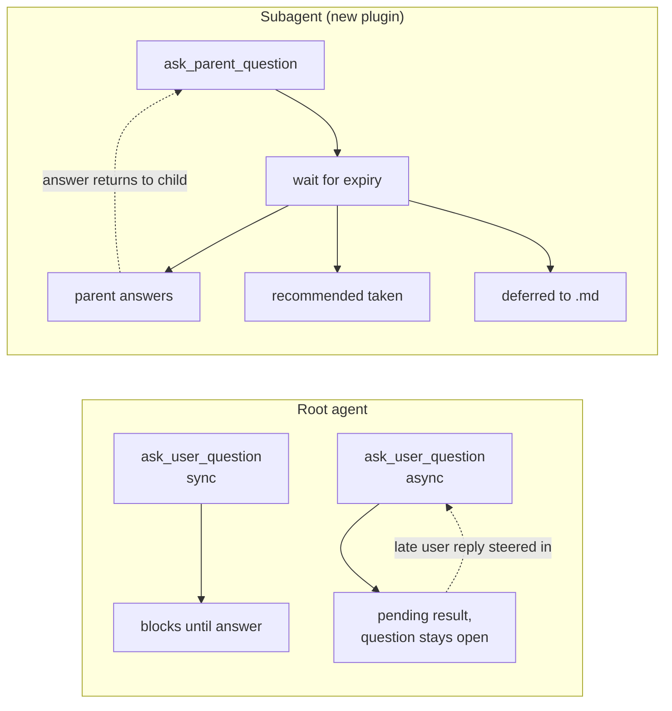
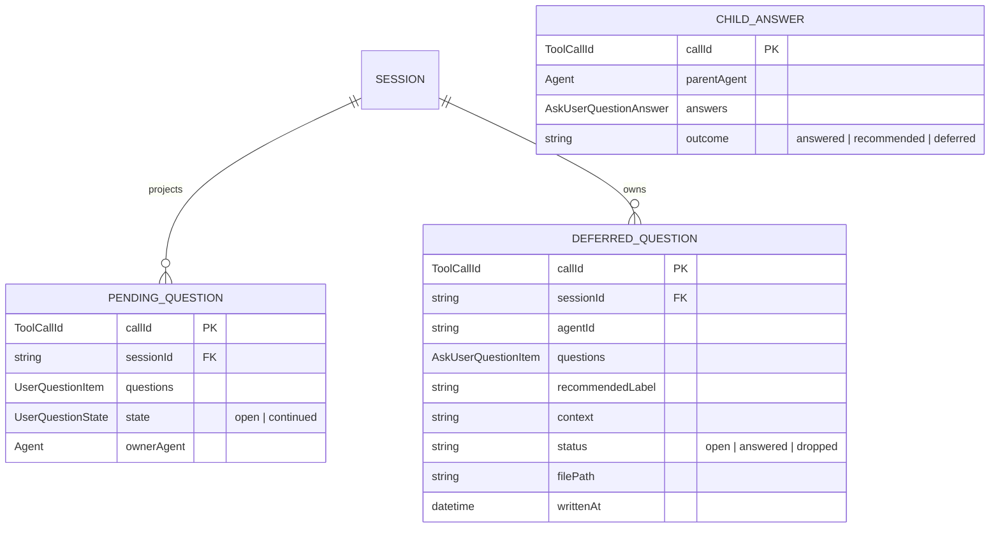

# Async agent questions plan

## Context

- **Today the agent only asks blocking questions.** `ask_user_question` from
  `@deepseek-ai/dsh-tool-ask-user` ships two modes, but every shipped preset
  selects the default:
  - `mode: legacy` (default) — `ctx.userQuestions.ask()`, waits forever.
  - `mode: timed` (opt-in) — foreground wait of N seconds, then
    `{ pending: true, callId }` and the agent continues. The question stays
    answerable; a late reply is steered in as a `user-question-reply` message.

  The presets (`dsh-web-app/presets/standard.patch.yml`) declare
  `- id: tool-ask-user` with no `config`, so `mode` defaults to `legacy`.

- **The current mode switch is bad ergonomics.** `timeout` doubles as the mode
  selector: `timeout: -1` blocks forever, any positive value means async. There
  is no way to express "async, and the question never goes stale" — the closest
  is a huge timeout, which is a lie in the schema description.

- **Subagents cannot ask anything.** `UserQuestionService.assertLiveRoot`
  (`dsh-user-questions/lib/index.js`) throws `DELEGATED_CALLER` when
  `agents.roots()` does not include the calling agent. The rationale is
  structural: the Web question card lives in the root Session's composer seat,
  so a child's question would have no surface to render on.

- **Two `ask_user_question` rows cannot coexist.** Both modes register the same
  tool name in the preset's single registry scope, and `NamedEntries.insert`
  throws on a duplicate (`tool "ask_user_question" is already registered in
  this scope`). Renaming the tool is not an escape either: the Host projection
  (`isTimedAskUserQuestionSchema`, `dsh-user-questions/lib/index.js:93`) and the
  UI tool view (`client.js`, `"data-tool": "ask_user_question"`) both hard-code
  the name. **Any async work must either reuse this name in one row, or use a
  genuinely separate tool.**

- **Agent-to-agent messaging already exists here.** `@dshfiles/agent-communication`
  (this repo) gives independent Agents durable topics, private inboxes, and
  `Agent.steer` for allowlisted urgent sends. It covers *peer* agents that are
  not in a parent/child runtime relationship, so it does not directly solve
  "my subagent needs a decision".

- **The seams needed for a child→parent question exist**: `Agent.parentAgent`
  for runtime ownership, `AgentRegistry.roots()`, and `agent.steer(message)` for
  delivering a reply into a live agent's next step.

- The installed DSH is `0.2.0-rc.2`, and both the active global install and the
  `web` profile resolve the same `dsh-tool-ask-user@0.2.0-rc.2` build that
  contains `registerTimedAskUser`.

## Goal

Every agent — root or subagent — can ask a question without blocking, and the
question is answered by the human, the parent agent, or a declared default, all
through the shipped timed `ask_user_question` for root agents and one new
parent-routed tool for subagents.

## What

A two-part capability:

1. **Async questions for the root agent**, shipped by flipping one preset row to
   `mode: timed`. The tool's own `timeout` parameter is the only mode selector:
   `-1` blocks forever, a positive value means async with that foreground wait.
2. **A `@dshfiles/agent-questions` plugin** that gives subagents a question tool
   with three fallback behaviours on expiry: parent agent answers, the declared
   recommended option is taken, or the question is deferred to a markdown file
   in the workspace.

In scope: root async, subagent asking, parent-as-answerer, recommended-default
fallback, deferred-question files, parent escalation to the human.

Out of scope: an orthogonal `mode` field (dropped — it would need a second tool
name and would break the projection), a new Web composer card for child
questions (the parent turn carries a steerable message instead), renaming the
DSH tool, forking DSH core.

## Why

Blocking questions cost the whole turn. When an agent needs a preference or a
name, everything else stalls until the human answers — and the human may not even
be looking. Async lets the agent finish 90% of the work and fold in the answer
whenever it lands.

Subagents are worse: today they must guess, or return the open question as prose
in their final result and hope the parent relays it. That is lossy and slow.
Giving a subagent a real question channel closes the loop.

## How

### Conceptual model

Two independent axes, collapsed into one tool per audience:



- **sync** — work cannot continue without the answer. Optional timeout converts
  an unanswered wait into an error instead of a hang.
- **async** — post the question, continue. Optional timeout only controls how
  long the question stays *offered*; absent means it never goes stale. The
  answer arrives later as a `user-question-reply` user message.
- **subagent** — a question routed to the parent agent, with an expiry policy.

### Operations / behavior

| Operation | Result |
|-----------|--------|
| Root asks sync | Tool call blocks; card in composer; answer returns as tool result |
| Root asks sync with timeout | Blocks; on expiry the call errors with `ASK_TIMED_OUT` |
| Root asks async | Tool result is `{ pending: true, callId }`; agent continues |
| Human answers a pending root question late | Steered in as a `user-question-reply` user message; projection closes the question |
| Subagent asks | Routed to the live `parentAgent` as a steerable question |
| Parent answers the child's question | Answer returns to the waiting child tool call |
| Nobody answers before expiry | `onExpiry` runs: `ask-parent` / `recommended` / `defer` |
| `defer` | Question written to `questions/<session>/<callId>.md`; child continues without the answer |

### Tech choices

| Choice | Decision | Rationale |
|--------|----------|-----------|
| Fork DSH core to add `mode`/`timeout` | No | The tool row is config-driven; `mode`/`timeout` orthogonalisation is a small local wrapper, and a core fork costs upgrade pain for one schema field |
| Reuse `ask_user_question` for async | Yes, for the root agent | Renaming breaks the Host projection and the UI tool row; reusing the name keeps the card, countdown, late-reply and review paths intact |
| Separate tool `ask_parent_question` for subagents | Yes | A second row with the same name throws; a genuinely different name has its own registry entry and its own `parentAgent` routing. It does not need the `userQuestions` projection because it is not a human card. |
| Route a child question through `ctx.userQuestions` | No | That seam asserts a live root and is coupled to the Web card + projection. A subagent question is agent-facing, not human-facing. |
| Reuse `@dshfiles/agent-communication` for parent routing | No | It targets independent peers with durable topics and an allowlist for steering. Parent routing is a direct in-runtime relationship with no durability requirement. |
| Force `recommended` on async questions | Yes | If a question can fall back to a default, the default must be declared. Sync questions keep it optional — the human is answering. |
| Fork DSH at all | No | Everything needed is a preset row plus a new `@dshfiles` plugin using public seams (`parentAgent`, `steer`, `tools.register`). |
| Build an orthogonal `mode` + optional `timeout` surface (was Phase 1) | **No — Phase 1 dropped** | A second tool name breaks `isTimedAskUserQuestionSchema`, which hard-codes both the `ask_user_question` name and the `timeout` parameter, so the card, countdown, late-reply and review paths would all die. One tool with one `timeout` field already expresses "block forever" (`-1`) and "async with a deadline" (any positive value). "Async that never goes stale" is expressed as a large timeout; the cost is only a description that reads slightly literally. |
| Render a child question as a new Web composer card | **No — steerable message** | A card means a new client plugin, slot, tool view, locale dictionaries and a claim handshake — a reimplementation of the question card for a second surface. A steer into the parent's turn reuses the existing path, and the parent's escalation to the human then calls the ordinary root `ask_user_question`, which gets the full card for free. |
| Deliver the child question via `ctx.subagents.sendMessage` | **Yes** | `dsh-tool-subagent-control` already ships bidirectional `send_message`: a child may target its direct parent, a working target receives the message at its next step boundary through Steer, and an inactive target starts or resumes a turn. The plugin needs no routing of its own. |
| Require `recommended` on every async question | **Yes — load-bearing** | Without a declared default, expiry has only two outcomes: block (which defeats the purpose of async) or defer (which turns every timeout into file spam). Requiring `recommended` makes every async question auto-resolvable in one field. Sync questions keep it optional because the human is answering. |
| Allow the parent to escalate to the human | **Yes — free** | The parent answers the steer with the ordinary root `ask_user_question`, which already provides card, countdown, late reply and durable projection. The escalation path adds no new surface. |
| Deferred questions layout | **Flat `questions/` in the workspace** | One file per deferred question, named `{iso-timestamp}_{question-slug}.md`. `ls questions/` is the index; no session nesting and no manifest to keep in sync. |
| Deferred questions location | **Workspace-relative** | A question is about this repository's work, so the file is reviewable, committable and survives a machine move, unlike a `~/.dsh` path. A later session can read the folder to pick up unanswered decisions. |

### Architecture

```
dsh-web-app preset (row, id-targeted)
  tool-ask-user  mode: timed  timeout: <default>   ── root agent async + sync
                                                   (timeout: -1 = block forever)

@dshfiles/agent-questions (new plugin)
  preset row: ask-parent-question
    ├─ ToolDefinition ask_parent_question
    │    questions[], recommended (required), context, onExpiry, timeout
    ├─ resolve parent: exec.agent.parentAgent   (must exist)
    ├─ deliver: ctx.subagents.sendMessage(parent, questionMessage)
    │           └─ parent busy  → steer at its next step boundary
    │              parent idle  → starts/resumes a turn
    ├─ await: answer | abort | expiry
    └─ onExpiry: recommended | defer
  defer writer
    questions/{iso-timestamp}_{question-slug}.md
      { question, options, recommended, asking agent, context, status }
```

The plugin is a child-scope row so it registers into the preset scope like every
other tool row, and its tool takes sender identity from `ToolExecution.agent`,
never from arguments. Delivery reuses `ctx.subagents.sendMessage`, so the plugin
owns no routing, no lifecycle and no allowlist.

The parent answers with either an `ask_parent_question`-shaped reply message or
by escalating through the ordinary root `ask_user_question`, which is what makes
the human in the loop one step away rather than a new surface.

## What this allows

- The root agent keeps working while a question is open, and folds the answer in
  when it arrives.
- A subagent can get a decision it needs instead of guessing or writing prose into
  its final result.
- A parent agent can answer for a child, so a human only needs to be involved
  when the parent itself escalates.
- A subagent can proceed on a declared default when nobody answers in time.
- A question that truly cannot be auto-resolved is persisted as a markdown file
  with full context, answerable later.

## What this does not allow

- A subagent's question is not rendered as a human card in the root Session
  composer (v2; v1 routes to the parent only).
- The DSH tool name `ask_user_question` cannot be duplicated for a second mode.
- A deferred question is not answerable from the file itself — only by telling
  the agent, which is a v2 affordance.
- Async questions still cost one steer-in user message when the human answers
  late; the wait itself costs no tokens.
- A subagent cannot ask a *different* peer agent; only its runtime parent.

## UI & UX

### Desktop

```
Sync (unchanged)
┌─ composer ────────────────────────────────────────┐
│ │ Proceed with cleanup?                            │
│ │  ● Yes, delete them (Recommended)                │
│ │  ○ No, keep them                                 │
│ │                              [Submit] [Take time]│
└────────────────────────────────────────────────────┘

Async, unanswered (countdown card, existing UI)
┌─ composer ────────────────────────────────────────┐
│ │ DB driver?                        ⏱ 4:12       │
│ │  ● Postgres (Recommended)                        │
│ │  ○ SQLite                                        │
│ │                              [Submit] [Take time]│
└────────────────────────────────────────────────────┘
   ... agent continues working; card stays docked ...

Async, pending (after expiry; card reopenable from the tool row)
   the tool row in the transcript reads "asked — pending", click reopens the card

Late answer
   a `user-question-reply` bubble appears in chat; the card becomes read-only

Subagent question (new; arrives in the PARENT's turn as an ordinary steer)
┌─ parent turn ─────────────────────────────────────┐
│  ⟠ from subagent "reviewer" · asks                │
│  API version?  ● v2 (Recommended)  ○ v1            │
└────────────────────────────────────────────────────┘
   the parent model decides: answer directly, or call the ordinary root
   ask_user_question to put the human card in the composer

Deferred question (file, flat in the workspace)
questions/2026-10-04T15-42-08Z_db-driver-for-orders.md
```

### Mobile

No separate mobile surface exists for the existing card; the async and parent
flows inherit whatever the current card does. The deferred file is the mobile-
friendly fallback: it is readable and answerable as plain markdown.

### Common interactions

| Action | Result |
|--------|--------|
| Submit a sync card | Tool call returns the answer; card closes |
| `Take time` on an async card | That Client's wait becomes indefinite; other Clients keep their countdown |
| Card countdown reaches zero | Agent released; question stays answerable; card shows as pending |
| Human answers after expiry | Answer steered into the agent as a user message |
| Subagent calls `ask_parent_question` | Parent turn receives a steer carrying the question and its options |
| Parent answers the child question | Waiting child tool call resolves with the answer |
| Parent escalates to the human | Parent calls root `ask_user_question`; the human sees the ordinary card |
| Nobody answers before expiry | `onExpiry` behaviour runs; child continues |
| `defer` fires | Markdown file written to `questions/`; child continues; question stays answerable |

### Deferred question file

```markdown
# DB driver for orders service

- **Asked by:** subagent `implementer` (session `8f2a…`)
- **Deferred:** 2026-10-04T15:42:08Z after 180s unanswered
- **Status:** open

## Context

The orders schema needs a driver before the migration scripts can generate.

## Question

Which database driver?

- **Postgres (Recommended)** — matches prod, migrations available
- **SQLite** — simpler locally, no prod parity

## Answer

<!-- fill in here, or tell the agent: answer questions/2026-10-04T15-42-08Z_db-driver-for-orders.md -->
```

## Data model



`DEFERRED_QUESTION` is durable state the plugin owns; the DSH `userQuestions`
projection owns `PENDING_QUESTION` and stays untouched. `DEFERRED_QUESTION` has
no session folder in its path: it is flat under the workspace `questions/`, with
`sessionId` recorded in the file body.

## Implementation steps

### Phase 0 — root async, no build

1. Edit the `preset-standard` bundle's `tool-ask-user` row to
   `config: { mode: timed, timeout: <default> }`. It is a preset row, not a
   top-level `cordis.patch.yml` entry.
2. Restart the Host, run a session, and confirm the card counts down and a late
   answer steers in.
3. Add a durable rule to `AGENTS.md` describing `timeout: -1` vs a finite value.

### Phase 1 — `@dshfiles/agent-questions`

7. Scaffold the plugin next to `agent-communication` in this repo: `src/`,
   `cordis.patch.yml`, `package.json` with the same peer-dependency shape.
8. Implement `ask_parent_question`: validate ids, resolve `exec.agent.parentAgent`,
   require a recommended option, and deliver the question through
   `ctx.subagents.sendMessage` to that parent. No routing of its own — the
   subagent service already accepts a child targeting its direct parent.
9. Await the answer with a timeout, and run the expiry policy on expiry.
10. Implement the expiry policies: `recommended` (returns the declared default),
    `defer` (write the markdown file and return a "deferred" outcome), and the
    default `ask-parent` which waits for the parent past the child's own turn.
11. Implement the deferred-question writer: `questions/{iso-timestamp}_{slug}.md`
    with the question, options, recommended option, the asking agent, a context
    blurb, and a status line.
12. Add a parent-side prompt rule so the parent knows a child question arrived
    and that it should answer directly or escalate to the human through the
    ordinary root `ask_user_question`.

### Phase 2 — wire into the profile

13. Add the plugin as a `link:` dependency in the profile manifest and list it in
    `dsh.profile.bundles`.
14. Build the plugin and restart the Host; confirm activation and no scope leaks.

### Phase 3 — hardening

15. Add an agent-facing rule to `AGENTS.md`: prefer async, reserve sync for true
    blockers, use `defer` for decisions a subagent cannot make.
16. Bound the deferred file growth: prune answered or older-than-N files.
17. Cover cancellation: a child disposal must abort its pending parent question.

## Open questions

All six questions from the design discussion were decided; they are recorded in
the decisions log and reflected in How, UI & UX and Implementation steps.

Still open while building:

1. What is the default `timeout` for the root preset row — 180s, 300s, or longer?
   A short value releases the agent sooner; a long one gives the human more time
   to answer inside the same turn before the answer becomes a separate turn.
2. Should a child question be answerable by *any* live ancestor, or strictly its
   direct `parentAgent`? `send_message` today allows a child to target its direct
   parent only.
3. Should `defer` also be available to a root agent, or is it a subagent-only
   outcome?
4. What prunes `questions/`: an agent rule, a host-side sweep, or nothing at all
   and let the repository own the folder?
5. Should the deferred-question writer reuse `write-file-atomic`, as
   `@dshfiles/agent-communication` already depends on it?

## Acceptance criteria

- [ ] The `preset-standard` row sets `mode: timed` and a finite default timeout.
- [ ] An async root question returns `{ pending: true, callId }` and the agent
      continues in the same turn.
- [ ] A human answering a pending question steers a `user-question-reply` user
      message into the agent.
- [ ] A sync question with no answer and `timeout: -1` blocks indefinitely; a
      finite timeout releases the agent with a pending result instead of hanging.
- [ ] A subagent can call `ask_parent_question` and blocks until the parent
      answers, the recommended default is taken, or the question is deferred.
- [ ] `ask_parent_question` rejects a call with no `recommended` option.
- [ ] A deferred question produces `questions/{iso-timestamp}_{slug}.md`
      containing the question, options, recommended option, asking agent,
      session, context, and a status line.
- [ ] No duplicate `ask_user_question` registration is introduced; the preset
      mounts without a scope error.
- [ ] A disposed subagent aborts its pending parent question without leaking a
      wait or a file.
- [ ] A durable `AGENTS.md` rule describes when to use sync, async, and defer.

## Decisions log

| Date | Decision | Rationale |
|------|----------|-----------|
| 2026-10-04 | Reuse `ask_user_question` in timed mode for root async | Renaming breaks the Host projection and the UI tool row, both of which hard-code the name |
| 2026-10-04 | No DSH core fork | Every requirement is a preset row or a plugin over public seams |
| 2026-10-04 | Separate tool name for subagent questions | Two rows with the same name throw on duplicate insertion in the preset's single scope |
| 2026-10-04 | Route subagent questions to the parent, not the user, in v1 | The human card lives in the root Session composer; a child has no surface to render on |
| 2026-10-04 | Require `recommended` on async questions | A question that can fall back to a default must declare that default |
| 2026-10-04 | Do not reuse `@dshfiles/agent-communication` for parent routing | That targets independent durable peers with a steering allowlist, not an in-runtime parent relationship |
| 2026-10-04 | ~~Make `mode` and `timeout` orthogonal~~ → **dropped** | See the superseded-then-overturned row below; a second tool name breaks `isTimedAskUserQuestionSchema` |
| 2026-10-04 | Keep one `timeout` parameter; drop the orthogonal `mode` surface (Phase 1 removed) | `timeout: -1` already blocks forever and any positive value is already async. A wrapper tool with a new name would fail `isTimedAskUserQuestionSchema`, which hard-codes both the tool name and the `timeout` parameter, so the card, countdown, late-reply and review paths would be lost. "Async that never goes stale" is a large timeout; the only cost is a description read literally. |
| 2026-10-04 | Render the child question as a steerable parent-turn message, not a composer card | A card needs a new client plugin, slot, tool view, locale dictionaries and a claim handshake. The parent answers the steer with the ordinary `ask_user_question`, which yields the full human card for free |
| 2026-10-04 | Deliver the child question through `ctx.subagents.sendMessage` | `send_message` already permits a child to target its direct parent and steers a busy parent at its next step boundary; the plugin needs no routing, lifecycle or allowlist |
| 2026-10-04 | Require `recommended` on **every** async question, not only when an expiry policy needs it | Without a declared default, expiry can only block (defeating async) or defer (turning every timeout into file spam). One required field makes every async question auto-resolvable |
| 2026-10-04 | Let the parent escalate to the human | The parent calls the ordinary root `ask_user_question`; the escalation path adds no new surface |
| 2026-10-04 | Flat `questions/` folder, one file per deferred question | `ls questions/` is the index; no session nesting and no manifest to keep in sync |
| 2026-10-04 | Deferred questions are workspace-relative | They are reviewable, committable and machine-portable, unlike a `~/.dsh` path, and a later session can pick up unanswered decisions by reading the folder |