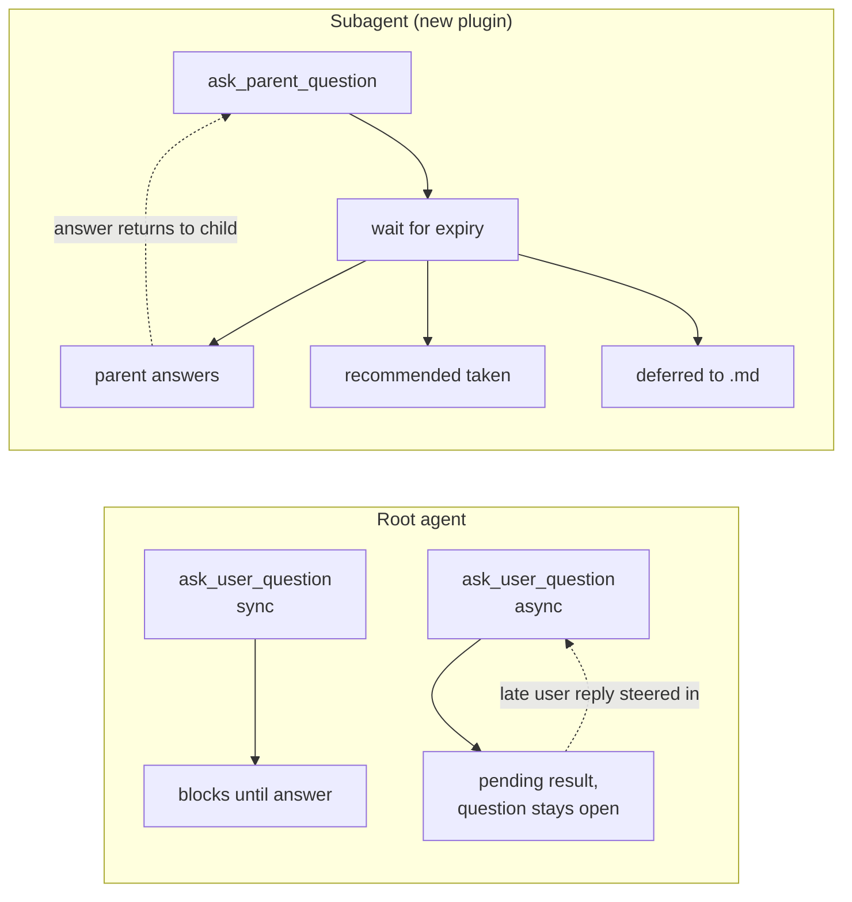
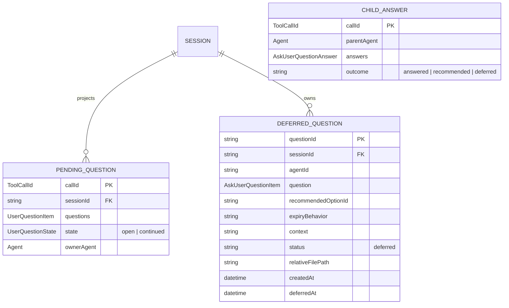

# Async agent questions plan

> **Current status (2026-10-05):** DSH 0.2.0-rc.2 already ships the root
> `ask_user_question` timed mode. Its native service returns a pending call after
> the foreground wait and keeps the question answerable. The subagent
> `sendMessage` contract is one-way accepted inbox delivery; it has no correlated
> reply wait or restart recovery. Do not implement the proposed child question
> plugin until the Host provides that lifecycle. The child flow below is a
> future design, not a claim about the installed runtime.

## Context

- **Today the agent only asks blocking questions.** `ask_user_question` from
  `@deepseek-ai/dsh-tool-ask-user` ships two modes, but every shipped preset
  selects the default:
  - `mode: legacy` (default) — `ctx.userQuestions.ask()`, waits forever.
  - `mode: timed` (opt-in) — foreground wait of N seconds, then
    `{ pending: true, callId }` and the agent continues. The question stays
    answerable; a late reply is steered in as a `user-question-reply` message.

  The presets (`dsh-web-app/presets/standard.patch.yml`) declare
  `- id: tool-ask-user` with no `config`, so `mode` defaults to `legacy`.

- **Root timed mode is already explicit.** `mode: timed` selects the native
  pending-question path. Its `timeout` controls only how long the tool waits in
  the foreground; after that, the question remains answerable. `timeout: -1`
  selects a blocking wait. Do not add a second root question tool.

- **Subagents cannot open the native human-question card.**
  `UserQuestionService.assertLiveRoot` throws `DELEGATED_CALLER` for a child.
  The Web card belongs to the root Session's composer seat. A child can send a
  message to its parent, but the installed service cannot connect that delivery
  to a child call waiting for an answer.

- **Two `ask_user_question` rows cannot coexist.** Both modes register the same
  tool name in the preset's single registry scope, and `NamedEntries.insert`
  throws on a duplicate (`tool "ask_user_question" is already registered in
  this scope`). Renaming the tool is not an escape either: the Host projection
  (`isTimedAskUserQuestionSchema`, `dsh-user-questions/lib/index.js:93`) and the
  UI tool view (`client.js`, `"data-tool": "ask_user_question"`) both hard-code
  the name. **Any async work must either reuse this name in one row, or use a
  genuinely separate tool.**

- **Agent-to-agent messaging already exists here.** `@dshfiles/agent-communication`
  (this repo) gives independent Agents durable topics, private inboxes, and
  `Agent.steer` for allowlisted urgent sends. It covers *peer* agents that are
  not in a parent/child runtime relationship, so it does not directly solve
  "my subagent needs a decision".

- **Only child-to-parent delivery exists.** `Agent.parentAgent` identifies the
  parent and `ctx.subagents.sendMessage()` accepts a one-way inbox message. It
  returns a `MessageId`, not a reply handle; no API waits for the correlated
  answer or recovers that wait after restart.

- The installed DSH is `0.2.0-rc.2`, and both the active global install and the
  `web` profile resolve the same `dsh-tool-ask-user@0.2.0-rc.2` build that
  contains `registerTimedAskUser`.

## Goal

Every agent — root or subagent — can ask a question without blocking, and the
question is answered by the human, the parent agent, or a declared default, all
through the shipped timed `ask_user_question` for root agents and one new
parent-routed tool for subagents.

## What

A two-part capability:

1. **Async questions for the root agent**, shipped by flipping one preset row to
   `mode: timed`. The tool's own `timeout` parameter is the only mode selector:
   `-1` blocks forever, a positive value means async with that foreground wait.
2. **A `@dshfiles/agent-questions` plugin** that gives subagents a question tool
   with three fallback behaviours on expiry: parent agent answers, the declared
   recommended option is taken, or the question is deferred to a markdown file
   in the workspace.

In scope: root async, subagent asking, parent-as-answerer, recommended-default
fallback, deferred-question files, parent escalation to the human.

Out of scope: an orthogonal `mode` field (dropped — it would need a second tool
name and would break the projection), a new Web composer card for child
questions (the parent turn carries a steerable message instead), renaming the
DSH tool, forking DSH core.

## Why

Blocking questions cost the whole turn. When an agent needs a preference or a
name, everything else stalls until the human answers — and the human may not even
be looking. Async lets the agent finish 90% of the work and fold in the answer
whenever it lands.

Subagents are worse: today they must guess, or return the open question as prose
in their final result and hope the parent relays it. That is lossy and slow.
Giving a subagent a real question channel closes the loop.

## How

### Conceptual model

Two independent axes, collapsed into one tool per audience:



- **sync** — work cannot continue without the answer. Optional timeout converts
  an unanswered wait into an error instead of a hang.
- **async** — post the question, continue. Optional timeout only controls how
  long the question stays *offered*; absent means it never goes stale. The
  answer arrives later as a `user-question-reply` user message.
- **subagent** — a question routed to the parent agent, with an expiry policy.

### Operations / behavior

| Operation | Behavior |
|-----------|----------|
| Root asks in legacy mode | Tool blocks on the native `userQuestions` service. |
| Root asks in timed mode with `timeout: -1` | Tool blocks until the answer arrives. |
| Root asks in timed mode with a positive timeout | Returns `{ pending: true, callId }` after the foreground wait; root agent continues and the question remains answerable. |
| Human answers a pending root question | Native question service routes the answer through the existing root question path. Source contract verified; interactive UI acceptance remains open. |
| Subagent sends a question to its parent | The plugin persists a direct-parent question with a durable id, then uses one-way inbox delivery as the notification and wakeup; the durable row remains the source of truth. |
| Parent answers the child | `answer_parent_question` verifies the exact live parent and stores the answer against the question id; the matching child wait resolves. |
| Child question expires or is deferred | Every new request selects a valid recommendation and `recommended` or `defer`; defer writes and records a private workspace Markdown file. Legacy version-1 rows expire without a new default. |

### Tech choices

| Choice | Decision | Rationale |
|--------|----------|-----------|
| Add root `mode`/`timeout` support | No | Installed `dsh-tool-ask-user` already provides opt-in timed mode and foreground timeout. Configure the native row only after isolated acceptance. |
| Reuse `ask_user_question` for async | Yes, for the root agent | Renaming breaks the Host projection and the UI tool row; reusing the name keeps the card, countdown, late-reply and review paths intact |
| Separate tool `ask_parent_question` for subagents | Yes | The Host-owned Storage Domain correlates a direct parent's answer to one durable child question; inbox delivery is only the wakeup. |
| Route a child question through `ctx.userQuestions` | No | That seam asserts a live root and is coupled to the Web card + projection. A subagent question is agent-facing, not human-facing. |
| Reuse `@dshfiles/agent-communication` for parent routing | No | It targets independent peers with durable topics and an allowlist for steering. Parent routing is a direct in-runtime relationship with no durability requirement. |
| Force a `recommended` answer for root timed questions | No | Native timed questions stay open for a human answer; they do not auto-resolve on foreground timeout. |
| Fork DSH core for child questions | No for the scoped Host contract | A Host-only DSHX bundle owns durable identity, sender validation, correlated answers, and expiry through Storage Domain; `sendMessage` remains a notification, not an answer transport. |
| Build another child composer card now | No | First establish Host-owned reply identity and lifecycle. Do not duplicate the native question UI. |
| Deliver a child question via `ctx.subagents.sendMessage` | Notification only | `sendMessage` accepts a one-way inbox item and returns `MessageId`. It does not wait for a parent reply or reconnect that reply to the child call. |
| Require `recommended` on child questions | Yes | Every new child request names one of its options and an explicit expiry behavior. `recommended` returns that option; `defer` writes a workspace record. Version-1 rows remain readable and expire without an invented default. |
| Allow the parent to escalate to the human | Manual only | A parent may independently ask the root user, but the child cannot know which human answer resolves its message. |
| Deferred questions layout | **Flat `questions/` in the workspace** | One file per deferred question, named `{file-safe-iso-timestamp}_{question-slug}.md`; a stable question-id suffix resolves timestamp/slug collisions. `ls questions/` is the index; no session nesting and no manifest to keep in sync. |
| Deferred questions location | **Workspace-relative** | A question is about this repository's work, so the file is reviewable, committable and survives a machine move, unlike a `~/.dsh` path. A later session can read the folder to pick up unanswered decisions. |

### Architecture

```
dsh-web-app preset
  tool-ask-user { mode: timed, timeout: <positive seconds> }
    └─ native userQuestions.askTimed()
         ├─ answer before timeout → normal tool result
         └─ foreground timeout → pending { callId }, root question stays open

subagent
  ctx.subagents.sendMessage(parent, content)
    └─ accepted inbox MessageId; no correlated answer wait

Host prerequisite before any child-question plugin:
  durable question id + answer delivery + cancellation + restart reconciliation
```

The native root tool owns human-facing timed questions. A future child question
feature must use a Host-owned correlated reply contract; it must not infer an
answer from unrelated parent messages or add a second question registry.

## What this allows

- The root agent keeps working while a question is open, and folds the answer in
  when it arrives.
- A subagent can get a decision it needs instead of guessing or writing prose into
  its final result.
- A parent agent can answer for a child, so a human only needs to be involved
  when the parent itself escalates.
- A subagent can proceed on a declared default when nobody answers in time.
- A question that truly cannot be auto-resolved is persisted as a markdown file
  with full context, answerable later.

## What this does not allow

- A subagent's question is not rendered as a human card in the root Session
  composer (v2; v1 routes to the parent only).
- The DSH tool name `ask_user_question` cannot be duplicated for a second mode.
- A deferred question is not answerable from the file itself — only by telling
  the agent, which is a v2 affordance.
- Async questions still cost one steer-in user message when the human answers
  late; the wait itself costs no tokens.
- A subagent cannot ask a *different* peer agent; only its runtime parent.

## UI & UX

### Desktop

```
Sync (unchanged)
┌─ composer ────────────────────────────────────────┐
│ │ Proceed with cleanup?                            │
│ │  ● Yes, delete them (Recommended)                │
│ │  ○ No, keep them                                 │
│ │                              [Submit] [Take time]│
└────────────────────────────────────────────────────┘

Async, unanswered (countdown card, existing UI)
┌─ composer ────────────────────────────────────────┐
│ │ DB driver?                        ⏱ 4:12       │
│ │  ● Postgres (Recommended)                        │
│ │  ○ SQLite                                        │
│ │                              [Submit] [Take time]│
└────────────────────────────────────────────────────┘
   ... agent continues working; card stays docked ...

Async, pending (after expiry; card reopenable from the tool row)
   the tool row in the transcript reads "asked — pending", click reopens the card

Late answer
   a `user-question-reply` bubble appears in chat; the card becomes read-only

Subagent question (new; arrives in the PARENT's turn as an ordinary steer)
┌─ parent turn ─────────────────────────────────────┐
│  ⟠ from subagent "reviewer" · asks                │
│  API version?  ● v2 (Recommended)  ○ v1            │
└────────────────────────────────────────────────────┘
   the parent model decides: answer directly, or call the ordinary root
   ask_user_question to put the human card in the composer

Deferred question (file, flat in the workspace)
questions/2026-10-04T15-42-08Z_db-driver-for-orders.md
```

### Mobile

No separate mobile surface exists for the existing card; the async and parent
flows inherit whatever the current card does. The deferred file is the mobile-
friendly fallback: it is readable and answerable as plain markdown.

### Common interactions

| Action | Result |
|--------|--------|
| Submit a sync card | Tool call returns the answer; card closes |
| `Take time` on an async card | That Client's wait becomes indefinite; other Clients keep their countdown |
| Card countdown reaches zero | Agent released; question stays answerable; card shows as pending |
| Human answers after expiry | Answer steered into the agent as a user message |
| Subagent calls `ask_parent_question` | Parent turn receives a steer carrying the question and its options |
| Parent answers the child question | Waiting child tool call resolves with the answer |
| Parent escalates to the human | Parent calls root `ask_user_question`; the human sees the ordinary card |
| Nobody answers before expiry | `onExpiry` behaviour runs; child continues |
| `defer` fires | Markdown file written to `questions/`; child continues; question stays answerable |

### Deferred question file

```markdown
# DB driver for orders service

- **Asked by:** subagent `implementer` (session `8f2a…`)
- **Deferred:** 2026-10-04T15:42:08Z after 180s unanswered
- **Status:** open

## Context

The orders schema needs a driver before the migration scripts can generate.

## Question

Which database driver?

- **Postgres (Recommended)** — matches prod, migrations available
- **SQLite** — simpler locally, no prod parity

## Answer

<!-- fill in here, or tell the agent: answer questions/2026-10-04T15-42-08Z_db-driver-for-orders.md -->
```

## Data model



`DEFERRED_QUESTION` is durable state the plugin owns; the DSH `userQuestions`
projection owns `PENDING_QUESTION` and stays untouched. `DEFERRED_QUESTION` has
no session folder in its path: it is flat under the workspace `questions/`, with
`sessionId` recorded in the file body. Its file is an open decision record and
not a separate answer transport; a later edit does not deliver a child-tool
response.

## Implementation steps

### Phase 0 — native root timed path

1. Keep the shipped preset default unchanged until isolated acceptance passes.
2. In a scratch profile, set the existing `tool-ask-user` row to
   `config: { mode: timed, timeout: 120 }`.
3. Verify the human card, pending result, late answer, cancellation, and restart
   behavior on a scratch Host. The current core package identity failure blocks
   this interactive acceptance; do not use the active profile as a substitute.

### Phase 1 — Host child-reply contract

`@dshfiles/agent-questions` now provides the Host-only contract over the public
Storage Domain, Agent registry, ownership, and subagent-message seams. It stores
a stable parent-scoped question id, accepts an answer only from the exact live
parent, lets only the requesting child wait or cancel, and preserves pending
questions across Host/service recreation. The parent inbox notice is only a
wakeup: prose messages never settle a child question. Preserve the existing
root question card and projection; this bundle adds no client surface.
parent-scoped question request with a stable id, authenticated correlated answer,
bounded cancellation, and restart reconciliation. The child must receive only
the answer to its own request. Preserve the existing root question card and
projection; do not invent a second question engine in a plugin.

### Phase 2 — plugin after Host support

The Host contract and thin child `ask_parent_question` tool now pass focused
service/storage checks, a fresh scratch Host activation, and focused tool build
and type checks. The direct parent uses `answer_parent_question` after deciding
or after asking a human with native `ask_user_question`. Two concurrent
questions, wrong-parent answers, cancellation, timeout, and service recreation
are covered. Host shutdown interrupts the waiter without cancelling the durable
row; a restarted service can answer and reattach. The tool reports expiry
without selecting a default or writing a deferred file because neither outcome
is part of the Host contract yet. Do not adopt in a profile until the remaining
browser and process-restart acceptance gates pass.

## Open questions

All six questions from the design discussion were decided; they are recorded in
the decisions log and reflected in How, UI & UX and Implementation steps.

Still open while building:

1. What is the default `timeout` for the root preset row — 180s, 300s, or longer?
   A short value releases the agent sooner; a long one gives the human more time
   to answer inside the same turn before the answer becomes a separate turn.
2. Should a child question be answerable by *any* live ancestor, or strictly its
   direct `parentAgent`? `send_message` today allows a child to target its direct
   parent only.
3. Should `defer` also be available to a root agent, or is it a subagent-only
   outcome?
4. What prunes `questions/`: an agent rule, a host-side sweep, or nothing at all
   and let the repository own the folder?
5. Should the deferred-question writer reuse `write-file-atomic`, as
   `@dshfiles/agent-communication` already depends on it?

## Acceptance criteria

- [x] Installed source exposes root `mode: timed`, pending `{ callId }`, and the
      native `userQuestions` service. This is source evidence only.
- [ ] Scratch-profile browser acceptance proves timed card, pending continuation,
      late answer, cancellation, and restart behavior.
- [x] Host provides a durable parent-scoped question id and correlated answer
      wait with sender validation, cancellation, and restart recovery.
- [x] Concurrent child questions cannot consume each other's answers.
- [x] Only after the Host contract passes, the child tool calls it without
      registering a second human question projection.
- [x] No plugin timer or unrelated parent message is treated as an answer.
- [x] Every new child question names an existing recommended option and an
      explicit `recommended` or `defer` expiry behavior.
- [x] Version-1 pending questions remain readable and expire without selecting
      a new default.
- [x] Deferred outcomes persist their file path, reattach idempotently, reject
      path changes, and never overwrite an edited or symlinked file.

## Decisions log

Entries dated 2026-10-04 that describe `sendMessage` as bidirectional or promise
plugin-level answer waits are superseded by the verified 2026-10-05 Host
contract above. Keep them only as design history.

| Date | Decision | Rationale |
|------|----------|-----------|
| 2026-10-06 | Put the correlated contract in a Host-only DSHX bundle | The real JSON Storage Domain and a fresh DSH Host both accept the bundle; the Host service owns IDs, authorization, answer state, cancellation, and recovery while leaving the native root question projection unchanged. |
| 2026-10-04 | Reuse `ask_user_question` in timed mode for root async | Renaming breaks the Host projection and the UI tool row, both of which hard-code the name |
| 2026-10-04 | No DSH core fork | Every requirement is a preset row or a plugin over public seams |
| 2026-10-04 | Separate tool name for subagent questions | Two rows with the same name throw on duplicate insertion in the preset's single scope |
| 2026-10-04 | Route subagent questions to the parent, not the user, in v1 | The human card lives in the root Session composer; a child has no surface to render on |
| 2026-10-04 | Require `recommended` on async questions | A question that can fall back to a default must declare that default |
| 2026-10-04 | Do not reuse `@dshfiles/agent-communication` for parent routing | That targets independent durable peers with a steering allowlist, not an in-runtime parent relationship |
| 2026-10-04 | ~~Make `mode` and `timeout` orthogonal~~ → **dropped** | See the superseded-then-overturned row below; a second tool name breaks `isTimedAskUserQuestionSchema` |
| 2026-10-04 | Keep one `timeout` parameter; drop the orthogonal `mode` surface (Phase 1 removed) | `timeout: -1` already blocks forever and any positive value is already async. A wrapper tool with a new name would fail `isTimedAskUserQuestionSchema`, which hard-codes both the tool name and the `timeout` parameter, so the card, countdown, late-reply and review paths would be lost. "Async that never goes stale" is a large timeout; the only cost is a description read literally. |
| 2026-10-04 | Render the child question as a steerable parent-turn message, not a composer card | A card needs a new client plugin, slot, tool view, locale dictionaries and a claim handshake. The parent answers the steer with the ordinary `ask_user_question`, which yields the full human card for free |
| 2026-10-04 | Deliver the child question through `ctx.subagents.sendMessage` | `send_message` already permits a child to target its direct parent and steers a busy parent at its next step boundary; the plugin needs no routing, lifecycle or allowlist |
| 2026-10-04 | Require `recommended` on **every** async question, not only when an expiry policy needs it | Without a declared default, expiry can only block (defeating async) or defer (turning every timeout into file spam). One required field makes every async question auto-resolvable |
| 2026-10-04 | Let the parent escalate to the human | The parent calls the ordinary root `ask_user_question`; the escalation path adds no new surface |
| 2026-10-04 | Flat `questions/` folder, one file per deferred question | `ls questions/` is the index; no session nesting and no manifest to keep in sync |
| 2026-10-04 | Deferred questions are workspace-relative | They are reviewable, committable and machine-portable, unlike a `~/.dsh` path, and a later session can pick up unanswered decisions by reading the folder |
