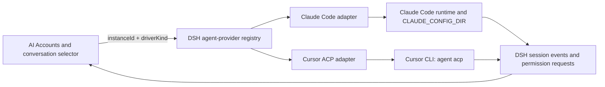
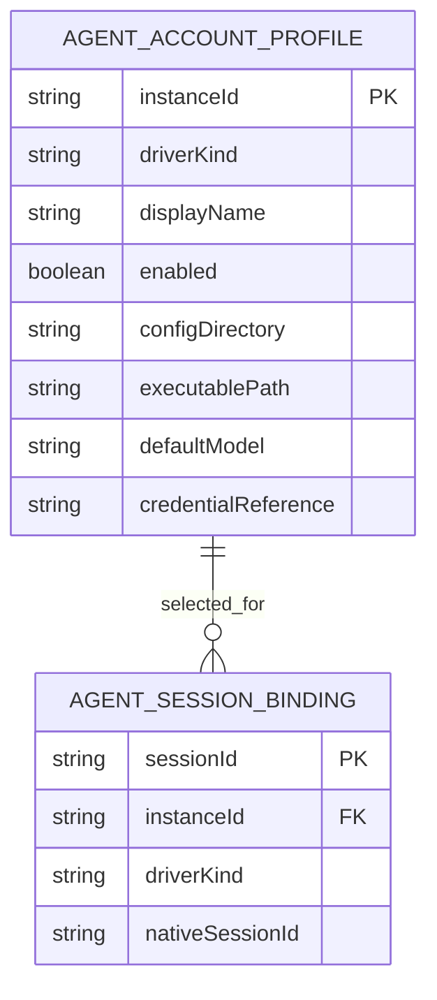

# Claude and Cursor account support plan

> **Status:** The provider architecture and release gates are specified. Feature implementation requires a DeepSeek Harness core source checkout because the current DSH runtime has a single agent-factory slot and no provider-driver registry. Do not add plugin-local adapter types or runtime workarounds before that Host contract exists.

## Context

- The owned [AI Accounts plugin](../plugins/@dshfiles/ai-accounts/src/api.ts) currently manages Codex, OpenCode Go, and Command Code profiles. Codex and OpenCode Go are LLM routes backed by `PiAiAdapter`; Command Code is a keyed provider route. Its account file stores profile metadata and references local authentication rather than returning tokens to the client.
- The [BB AI Accounts plugin](../../bb-plugins/plugins/ai-accounts/README.md) supports separate Codex and OpenCode Go profiles through a shared ACP provider bridge. Each account registers a provider launch spec; the bridge owns ACP transport. This is the generic adapter-boundary reference, but it does not itself implement Claude/Cursor account or DSH Session lifecycle.
- T3 Code treats Claude and Cursor as agent runtimes. Its provider architecture keeps driver kind separate from each provider instance and assigns account/session state to the instance. Its [Claude guide](https://github.com/pingdotgg/t3code/blob/main/docs/user/providers-claude.md) uses one `CLAUDE_CONFIG_DIR` per account and keeps the real `HOME` and macOS Keychain intact. T3's [provider constraints](https://github.com/pingdotgg/t3code/blob/main/docs/internals/providers.md) also say provider protocols, permissions, and account ownership belong at the adapter boundary.
- Cursor documents `agent acp` as its supported custom-client integration. ACP provides sessions, streaming updates, permission requests, and cancellation over stdio JSON-RPC. Cursor documents `CURSOR_CONFIG_DIR` for CLI configuration and supports `CURSOR_API_KEY` / `CURSOR_AUTH_TOKEN` for authentication. The config-directory setting alone does not prove that a browser login is isolated per account; that needs a live CLI check before multi-login is promised. See [Cursor ACP](https://prod.cursor.com/docs/cli/acp) and [Cursor CLI configuration](https://prod.cursor.com/docs/cli/reference/configuration).
- Installed DSH is `0.2.0-rc.2`. Its `dsh-llm` adapter boundary handles individual model calls. The installed `@deepseek-ai/dsh-agent` service exposes one `AgentFactory` slot, which `dsh-agent-loop` registers; a second `setFactory()` throws. There is no installed per-provider agent-driver registry. A first-class Claude/Cursor integration therefore needs a Host/runtime provider-dispatch seam before this plugin can route whole agent sessions.
- Marketplace candidates cover pieces of the feature, but not the required combination:

  | Candidate | What it provides | Why it is not the implementation |
  |---|---|---|
  | [dsh-claude-cli](https://github.com/katsos/dsh-claude-cli) | Claude Code `--print` as an LLM adapter, with an MCP bridge for tool schemas | It is a model-call adapter rather than a native Claude agent instance. Its declared `@deepseek-ai/dsh-llm` peer is `^0.1.0-rc.6`, not the installed 0.2 line. |
  | [dsh-cursor-passthrough](https://github.com/mingzhong15/dsh-cursor-passthrough) | Cursor CLI ACP routed through the chat model picker | It intercepts `llm/stream`, uses local Cursor login, and documents local stubs for session title and compaction. Its client injection includes `@deepseek-ai/dsh-client-runtime`, removed in DSH 0.2. |
  | [dsh-external-agents](https://github.com/NOirBRight/dsh-external-agents) | One-shot Claude Code and Cursor workers called as subagents | This is a delegation tool with one adapter configuration per provider kind, not a selectable multi-account main-session provider. Its release notes target DSH `0.1.2-alpha.1`. |
  | [dsh-llm-cursor](https://dshmarket.com/zh/p/NOirBRight/dsh-llm-cursor/) | A Cursor subscription model route using a private HTTP/2/protobuf interface | The maintainer's marketplace disclosure says Cursor staff consider this private-client use against the Terms of Service and that accounts may be restricted. Exclude it. |

## Goal

Let users create named Claude Code and Cursor Agent account profiles, authenticate each profile on the DSH host, and select a profile as the native agent runtime for a new DSH conversation.

This plan assumes native CLI agents, following T3 Code's provider model. It does not reinterpret Cursor as a model API route. The current Codex, OpenCode Go, and Command Code model routes keep their existing behavior.

## What

Add Claude Code and Cursor Agent as first-class agent-provider profiles in AI Accounts. Each profile has an account identity, provider-specific configuration and authentication context, and a stable selection identity for new sessions. The DSH conversation uses the selected provider's native agent loop and presents its streamed output, permission requests, failures, and completion through DSH's session UI.

Claude and Cursor each get a provider adapter behind a shared DSH agent-provider registration contract. They share account management and session selection, not protocol implementations. Claude uses its supported Claude Code runtime and per-account config directory. Cursor uses its official ACP interface (`agent acp`).

The owned plugin reuses BB's account-management patterns and its own current profile, usage, and model-curation UI. It does not copy the BB plugin's implementation.

## Why

Users already manage multiple Codex and OpenCode Go profiles from one place. Claude Code and Cursor Agent are the other subscription-backed agent runtimes used in T3 Code, but they have different protocols, permission handling, and authentication storage. Adding them through the existing LLM adapter alone would hide those differences and lose native session and tool behavior.

## How

### Conceptual model

`driverKind` identifies Claude Code or Cursor Agent. `instanceId` identifies one account/configuration. The selected instance stays bound to the DSH session so a later account change cannot silently resume another provider's native session.

### Operations / behavior

- Add, edit, enable, disable, and remove a named Claude or Cursor profile.
- Copy provider-specific sign-in instructions for the host that runs DSH. Login stays in the official CLI or the provider's supported credential flow.
- Refresh a profile's installed, authenticated, identity, and model status without starting an agent turn or launching an interactive login.
- Select a provider profile for a new conversation. The DSH session records the driver, profile instance, and provider-native session id needed for resume.
- Stream text, tool activity, permission requests, cancellation, and terminal status into the DSH conversation through the provider adapter.
- Show provider quota/usage only when the provider supplies a supported account-scoped source. Unsupported or unavailable is a valid status; do not derive quota from conversation text.
- Keep the existing model route and picker for DSH-managed LLM agents. Native CLI agent profiles appear in a clearly identified agent/runtime selector.

### Tech choices

| Choice | Decision | Rationale |
|---|---|---|
| Integration shape | Native agent-provider adapters | Claude Code and Cursor Agent run full agent loops. `llm/stream` is a model-call contract and cannot represent their complete session and permission lifecycles. |
| Host contract | Add a typed provider-driver registry to `@deepseek-ai/dsh-agent`; expose it through dshx after the Host contract exists | Installed DSH 0.2.0-rc.2 has one `AgentFactory` slot in `AgentRegistry`; `dsh-agent-loop` owns it, and session creation/resume route through it. Plugin code cannot safely add a second factory. |
| Claude runtime | Use Claude Code's supported runtime and `CLAUDE_CONFIG_DIR` per account | Official Claude documentation says this variable supports multiple accounts and stores configuration/session history under the chosen directory. Preserve the user's actual `HOME` and Keychain. |
| Cursor runtime | Use official Cursor CLI ACP (`agent acp`) | Cursor documents ACP session creation/resume, streaming, permission requests, cancellation, and `cursor_login`. Do not use the private Cursor model API. |
| Credentials | Keep provider credentials in provider-owned stores or secret references; never in account JSON | Resolve credentials only on the Host for the selected instance. Cursor API key/auth token references can provide explicit per-instance auth; browser-login isolation must be verified before it is advertised for multiple accounts. |
| Cursor isolation | Treat `CURSOR_CONFIG_DIR` as CLI configuration isolation only until browser-login storage is proven to follow it | Cursor documents the variable for `cli-config.json`; its auth page says credentials are stored locally but does not specify that path. Do not claim these docs prove multi-account browser-login isolation. |
| Usage | Defer quota cards from the first release; keep usage probes separate from agent execution | Cursor usage is a separate provider data path. Quota availability must not determine whether agent execution works. Add cards later only when the source is stable and account-scoped. |
| Adoption choice | Build account management and adapters here; implement the runtime registry in the DSH core source that owns `AgentRegistry` | The surveyed marketplace plugins do not provide compatible DSH 0.2 native-provider selection. The BB AI Accounts plugin uses a generic ACP bridge for its Codex/OpenCode Go provider rows, which is a useful adapter-boundary reference, not a DSH agent-runtime implementation. |

### Architecture

1. DSH core owns a provider-driver registry next to `AgentRegistry`. One built-in DSH loop driver remains the default. Session creation and resume select by a stable `driverKind`; account-specific mutable state is keyed by `instanceId`. The selected pair and provider-native resume identity are pinned to the durable DSH session.
2. Each provider implements one shared, provider-neutral adapter contract. The Host owns DSH session identity, persistence handles, event publication, inbox semantics, ownership, and approval policy. An adapter owns its process/protocol, provider authentication selection, native session cursor, and decoding into normalized runtime events. Adapters do not import `AgentLoop`, controller internals, or each other's protocol types.
3. The shared adapter contract covers create, resume, bounded status, prompt delivery, permission response, cancellation, and disposal. Normalized events cover text, tool/activity progress, permission requests, terminal status, and failures. The Host maps those events into DSH's existing Agent and Session surfaces; unmappable permission requests fail closed with a visible error.
4. dshx exposes the Host-owned registry and adapter contract as a typed authoring surface after the core API is implemented. Plugins must not restate runtime interfaces or cast through a generic agent context. Adding a provider requires one adapter registration and provider-local protocol mapping, without changing the composer, session controller, or other adapters.
5. AI Accounts stores profile metadata and account-scoped credential references. It resolves paths and secret references on the Host only for the selected instance. Its UI selects the separate native Agent runtime; the model picker and `ctx.llm.registerAdapter` remain unchanged.
6. Claude and Cursor adapters are independent. Claude uses the documented Claude Code CLI stream-JSON/session interface and a per-profile `CLAUDE_CONFIG_DIR`. Cursor uses official CLI ACP (`agent acp`) and a per-instance auth source whose isolation is verified.
7. Model discovery and health refresh are explicit bounded operations. They do not log in, create sessions, start MCP servers, or execute provider hooks. Quota is outside the first release.

The Host contract is a shared runtime adapter plus one independent adapter per provider. In API terms, the registry resolves an adapter by `driverKind`, while `instanceId` carries the selected account. An adapter creates or resumes a provider session, reports bounded profile status, and returns a session handle with prompt, event-stream, permission-response, cancel, and dispose operations. Its event union is provider-neutral: assistant text, tool/activity updates, permission requests, terminal status, and failures. The Host converts those events into DSH Session events and owns durable history. A later provider should implement this contract and register its adapter; the composer and session controller keep using the same Host APIs.

### Runtime ownership verified against installed DSH

The installed `@deepseek-ai/dsh-agent@0.2.0-rc.2` declares `AgentRegistry.setFactory()` as a single slot and throws when another factory is registered. `@deepseek-ai/dsh-agent-loop` registers that slot. The Session Controller creates and resumes agents through `ctx.agents`, and the session-persistence contract says a Session published outside the Agent lifecycle has no persistence writer. The public dshx Host capabilities currently cover commands, tools, prompts, and RPC, but do not own this runtime lifecycle. Therefore this feature needs a DSH core change before plugin implementation; a plugin-local second factory, prototype patch, or provider-specific interception would bypass the owning lifecycle.

The DSH core source owner is `@deepseek-ai/dsh-agent` in the DeepSeek Harness repository. dshx then exposes that new stable contract to owned plugins. The current `dshfiles` checkout contains the dshx hard fork but not the DeepSeek Harness core source, so the Host change cannot be completed from this checkout alone.

### Adoption survey and decision

The choice is **build the Host contract in DeepSeek Harness, expose it through dshx, and implement account/adapters in this repo**, not adopt a partial marketplace plugin or fork a model-route workaround. The Claude CLI plugin has an older LLM peer range and does not preserve the native Claude agent lifecycle. The Cursor passthrough plugin uses ACP but embeds the whole provider session under `llm/stream` and relies on a DSH 0.1 client runtime. The external-agents plugin is a subagent/delegation feature and declares an older DSH target. The private Cursor API plugin is excluded based on its own Terms of Service disclosure. Recheck candidate compatibility if the Host provider-driver contract changes before implementation begins.

## What this allows

- Multiple named Claude Code and Cursor Agent profiles with separate provider-owned authentication/configuration.
- Choosing a native Claude or Cursor runtime for a DSH conversation while retaining DSH's transcript, session identity, and user-facing permission flow.
- Per-profile model/default options and account health when the official runtime exposes them.
- Optional account-scoped quota cards when a supported provider source is available.

## What this does not allow

- No private Cursor endpoints, reverse-engineered protocols, or private dashboard quota APIs.
- No pretending a Cursor ACP session is an ordinary LLM adapter call.
- No copying provider auth files or putting raw tokens in the account store, browser, logs, or Nix configuration.
- No resuming a conversation under another account/config directory. Switching provider accounts starts a new conversation or requires an explicit reviewed handoff.
- No API-key-only Anthropic model route in this feature. That remains a separate `PiAiAdapter` capability if requested.
- No promise of per-account Cursor browser login until the official CLI's authentication isolation is verified. Per-instance API key/auth-token references may be supported if the official CLI can use them safely.

## UI & UX

### Desktop

Add an **Agent accounts** section to AI Accounts alongside the existing model accounts. Each row shows provider, account label, sanitized identity, CLI readiness, config/profile location, default model, enabled state, and supported quota status. Adding a profile starts with a provider choice, then asks for a display name and provider-specific config path. Sign-in instructions explain which host runs the command.

The conversation composer gets a separate **Agent runtime** selector: DSH Agent, Claude Code · Work, Cursor Agent · Personal. This separates full agent runtimes from the existing model picker. The selected runtime is visible in the conversation header and is fixed for that session.

### Mobile

Keep the web plugin responsive. On narrow screens, account details stack under the provider row and the runtime selector remains available above the composer. There is no separate native mobile client requirement in this plan.

### Common interactions

| Action | Result |
|---|---|
| Add Claude profile | Saves metadata and shows the `CLAUDE_CONFIG_DIR=<path> claude auth login` instruction for the DSH host. |
| Add Cursor profile | Shows `agent login` for the DSH host and explains whether the profile uses an isolated config directory or a secret reference. |
| Refresh status | Reads bounded provider status and identity; never starts a conversation or login flow. |
| Select runtime on a new conversation | Pins the driver and account instance to that session before the first prompt. |
| Change a profile while a session runs | Existing session stays bound. The new profile applies to a new conversation. |
| Disable or remove a profile | Prevents new sessions. Existing sessions are stopped or retained according to the explicit confirmation and DSH driver lifecycle contract; profile credentials are removed only when the user explicitly chooses sign-out. |
| Refresh quota | Updates usage independently; chat remains usable if quota is unsupported or refresh fails. |

## Data model

`driverKind` is a closed validated union (`claude-code`, `cursor-agent`). `credentialReference` is optional and contains an opaque DSH credential id or environment-variable name, never a credential value. Provider-native session identifiers are stored with the DSH session binding so resume uses the same driver and account. Existing `AccountProfile` rows for Codex, OpenCode Go, and Command Code remain valid and unchanged; add a separate discriminated agent profile shape rather than making current model-account fields optional.

## Implementation steps

1. In the DeepSeek Harness source checkout, add the generic driver registry in `@deepseek-ai/dsh-agent`. Preserve `AgentRegistry` lifecycle ownership and keep the existing DSH loop registered as the default adapter. Route session create/resume through the pinned `driverKind` and `instanceId`; the registry owns the DSH `AgentHandle`, Session, persistence handle, cancellation, and teardown.
2. Extend session metadata and the Session Controller creation/resume contract so the chosen driver and account survive reload and resume. Reject a resume when its pinned driver/account is missing or disabled; never silently fall back to another provider.
3. Add the public dshx Host capability and exported types for adapter registration. The contract must compile against the Host registry and let a fake adapter register without importing `dsh-agent-loop` or controller internals.
4. Define the agent-account schema, safe profile persistence, sanitized status wire model, and profile-to-session binding in `plugins/@dshfiles/ai-accounts`. Preserve old account files and IDs. Add Claude and Cursor as native Agent runtime kinds without changing the existing Codex, OpenCode Go, and Command Code LLM routes.
5. Implement the Claude adapter using supported stream-JSON input/output and resume. Set `CLAUDE_CONFIG_DIR` per account; verify status probes are bounded and side-effect-free, and preserve the real `HOME` and system Keychain behavior.
6. Implement the Cursor adapter over official ACP: initialize, authenticate, create/load session, stream updates, answer permissions, cancel, and tear down. Use per-instance `CURSOR_API_KEY` or `CURSOR_AUTH_TOKEN` secret references for multi-account authentication unless isolated `agent login` storage is verified on the supported CLI. `CURSOR_CONFIG_DIR` alone is not proof of auth isolation.
7. Add AI Accounts create/edit/status/disable/remove UI and a separate Agent runtime selector. Pin driver and account identity to the Session; changing either requires a new Session or an explicit reviewed handoff.
8. Add generic-registry and per-adapter tests with a fake Host and fake ACP/CLI peers, plus isolated temporary config directories. Run native CLI smoke checks without authenticating a live account. Keep fake-protocol, static, native CLI, and authenticated live-account evidence distinct. Defer model catalogs and quota cards until supported account-scoped sources exist.

## Resolved decisions and release gates

1. `@deepseek-ai/dsh-agent` is the runtime owner for the first implementation; `dsh-agent-loop` remains the default driver.
2. Quota and provider-specific model catalog cards are deferred. They are not required for session execution and must not become a dependency of the adapter contract.
3. API-key-only Anthropic model routing remains a separate future feature; it is not Claude Code Agent support.
4. Cursor browser-login multi-account support is a release gate: verify that the supported CLI isolates login state per profile with official behavior. Until then, support per-instance API key/auth-token secret references and show browser-login multi-account as unsupported rather than sharing global credentials.

## Acceptance criteria

- [ ] Existing Codex, OpenCode Go, and Command Code routes load and behave as before.
- [ ] The default DSH agent loop remains registered and works when no external agent runtime is selected.
- [ ] One provider-neutral adapter interface covers provider-session create/resume, bounded status, prompt, event stream, permission response, cancellation, and disposal; adapters contain provider-specific process and protocol mapping while the Host owns the DSH lifecycle.
- [ ] A fake provider registers and creates/resumes through the shared registry without changing the composer, Session Controller, default driver, or another adapter.
- [ ] DSH owns Session, AgentHandle, persistence, inbox, permission policy, and runtime teardown for every registered adapter.
- [ ] Multiple Claude profiles use distinct config directories; a session resumes only with the profile and driver that created it.
- [ ] Multiple Cursor profiles do not silently share a login. Browser-login isolation is verified against the supported official CLI version; otherwise each profile uses an explicit per-instance secret reference.
- [ ] Cursor requests use the documented ACP transport and handle initialization, stream updates, permissions, cancellation, and shutdown.
- [ ] Provider permission requests map to DSH approval semantics; unsupported or unmappable requests fail visibly and safely.
- [ ] Profile status refresh does not launch agent sessions, login windows, MCP servers, or hooks.
- [ ] Browser APIs, account JSON, diagnostics, and logs contain no raw provider credentials.
- [ ] Unsupported quota/model discovery is shown as unsupported or unavailable and never blocks agent execution.
- [ ] The feature uses no private Cursor API and no `llm/stream` interception to run the full Cursor agent.
- [ ] Validation reports static, fake-protocol, native CLI, and authenticated live-account evidence separately.

## Sources and implementation references

- Installed DSH 0.2.0-rc.2 contracts: `@deepseek-ai/dsh-agent`, `@deepseek-ai/dsh-agent-loop`, `@deepseek-ai/dsh-session-persistence`, and `@deepseek-ai/dsh-api-session-controller`.
- DSH Agent API: https://github.com/deepseek-ai/deepseek-harness/blob/master/packages/core/agent/README.md
- DSH Agent Loop API: https://github.com/deepseek-ai/deepseek-harness/blob/master/packages/core/agent-loop/README.md
- T3 Code provider boundary: https://github.com/pingdotgg/t3code/blob/main/docs/internals/providers.md
- BB AI Accounts adapter reference: `../../bb-plugins/plugins/ai-accounts/server.ts` registers account-specific launch specs; `host.ts` delegates ACP transport to `experimental_acpProviderBridge`.
- Claude Code environment variables: https://code.claude.com/docs/en/env-vars
- Claude Code CLI and stream-JSON interface: https://docs.anthropic.com/en/docs/claude-code/cli-usage and https://docs.anthropic.com/en/docs/claude-code/sdk
- Cursor ACP: https://prod.cursor.com/docs/cli/acp
- Cursor CLI configuration: https://prod.cursor.com/docs/cli/reference/configuration
- Cursor CLI authentication: https://prod.cursor.com/docs/cli/reference/authentication

## Decisions log

| Date | Decision | Rationale |
|---|---|---|
| 2026-10-04 | Plan native Claude Code and Cursor Agent profiles | The request references T3 Code's provider support and the existing account-management pattern. |
| 2026-10-04 | Use provider-specific agent drivers, not LLM adapter interception | DSH's LLM seam is for model calls; Claude and Cursor own full agent loops and session protocols. |
| 2026-10-04 | Use Cursor's official ACP interface; exclude private model APIs | Cursor documents ACP for custom clients, while the private API marketplace candidate warns of account enforcement risk. |
| 2026-10-04 | Keep one generic runtime adapter contract with independent provider adapters | T3 Code separates driver kind from provider instance, and the BB plugin delegates ACP transport to a shared bridge; common orchestration does not contain Claude/Cursor protocol logic. |
| 2026-10-04 | Put runtime routing in DSH core and expose it through dshx | Installed `dsh-agent` has one factory slot, and persistence depends on the Agent lifecycle; plugin-only routing would be unsafe. |
| 2026-10-04 | Use Cursor API-key/auth-token secret references until browser-login isolation is verified | Official docs document `CURSOR_CONFIG_DIR` for CLI configuration but do not establish that login credentials follow it. |
| 2026-10-04 | Defer usage cards and Anthropic model routing | Neither is needed for native Agent execution; keeping them separate keeps the first adapter contract small. |
