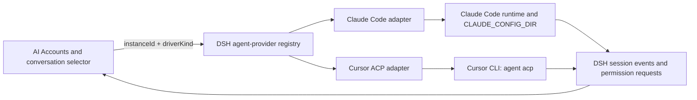
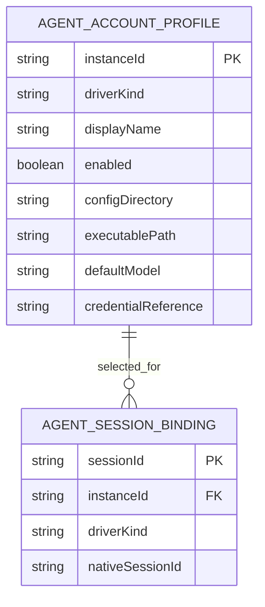

# Claude and Cursor account support plan

## Context

- The owned [AI Accounts plugin](../plugins/@dshfiles/ai-accounts/src/api.ts) currently manages Codex, OpenCode Go, and Command Code profiles. Codex and OpenCode Go are LLM routes backed by `PiAiAdapter`; Command Code is a keyed provider route. Its account file stores profile metadata and references local authentication rather than returning tokens to the client.
- The [BB AI Accounts plugin](../../bb-plugins/plugins/ai-accounts/README.md) currently supports separate Codex and OpenCode Go profiles. Its account rows, explicit sign-in instructions, model curation, and provider-specific usage views are useful UX patterns. It does not already implement Claude or Cursor.
- T3 Code treats Claude and Cursor as agent runtimes. Its provider architecture keeps driver kind separate from each provider instance and assigns account/session state to the instance. Its [Claude guide](https://github.com/pingdotgg/t3code/blob/main/docs/user/providers-claude.md) uses one `CLAUDE_CONFIG_DIR` per account and keeps the real `HOME` and macOS Keychain intact. T3's [provider constraints](https://github.com/pingdotgg/t3code/blob/main/docs/internals/providers.md) also say provider protocols, permissions, and account ownership belong at the adapter boundary.
- Cursor documents `agent acp` as its supported custom-client integration. ACP provides sessions, streaming updates, permission requests, and cancellation over stdio JSON-RPC. Cursor documents `CURSOR_CONFIG_DIR` for CLI configuration and supports `CURSOR_API_KEY` / `CURSOR_AUTH_TOKEN` for authentication. The config-directory setting alone does not prove that a browser login is isolated per account; that needs a live CLI check before multi-login is promised. See [Cursor ACP](https://prod.cursor.com/docs/cli/acp) and [Cursor CLI configuration](https://prod.cursor.com/docs/cli/reference/configuration).
- Installed DSH is `0.2.0-rc.2`. Its `dsh-llm` adapter boundary handles individual model calls. The installed `@deepseek-ai/dsh-agent` service exposes one `AgentFactory` slot, which `dsh-agent-loop` registers; a second `setFactory()` throws. There is no installed per-provider agent-driver registry. A first-class Claude/Cursor integration therefore needs a Host/runtime provider-dispatch seam before this plugin can route whole agent sessions.
- Marketplace candidates cover pieces of the feature, but not the required combination:

  | Candidate | What it provides | Why it is not the implementation |
  |---|---|---|
  | [dsh-claude-cli](https://github.com/katsos/dsh-claude-cli) | Claude Code `--print` as an LLM adapter, with an MCP bridge for tool schemas | It is a model-call adapter rather than a native Claude agent instance. Its declared `@deepseek-ai/dsh-llm` peer is `^0.1.0-rc.6`, not the installed 0.2 line. |
  | [dsh-cursor-passthrough](https://github.com/mingzhong15/dsh-cursor-passthrough) | Cursor CLI ACP routed through the chat model picker | It intercepts `llm/stream`, uses local Cursor login, and documents local stubs for session title and compaction. Its client injection includes `@deepseek-ai/dsh-client-runtime`, removed in DSH 0.2. |
  | [dsh-external-agents](https://github.com/NOirBRight/dsh-external-agents) | One-shot Claude Code and Cursor workers called as subagents | This is a delegation tool with one adapter configuration per provider kind, not a selectable multi-account main-session provider. Its release notes target DSH `0.1.2-alpha.1`. |
  | [dsh-llm-cursor](https://dshmarket.com/zh/p/NOirBRight/dsh-llm-cursor/) | A Cursor subscription model route using a private HTTP/2/protobuf interface | The maintainer's marketplace disclosure says Cursor staff consider this private-client use against the Terms of Service and that accounts may be restricted. Exclude it. |

## Goal

Let users create named Claude Code and Cursor Agent account profiles, authenticate each profile on the DSH host, and select a profile as the native agent runtime for a new DSH conversation.

This plan assumes native CLI agents, following T3 Code's provider model. It does not reinterpret Cursor as a model API route. The current Codex, OpenCode Go, and Command Code model routes keep their existing behavior.

## What

Add Claude Code and Cursor Agent as first-class agent-provider profiles in AI Accounts. Each profile has an account identity, provider-specific configuration and authentication context, and a stable selection identity for new sessions. The DSH conversation uses the selected provider's native agent loop and presents its streamed output, permission requests, failures, and completion through DSH's session UI.

Claude and Cursor each get a provider adapter behind a shared DSH agent-provider registration contract. They share account management and session selection, not protocol implementations. Claude uses its supported Claude Code runtime and per-account config directory. Cursor uses its official ACP interface (`agent acp`).

The owned plugin reuses BB's account-management patterns and its own current profile, usage, and model-curation UI. It does not copy the BB plugin's implementation.

## Why

Users already manage multiple Codex and OpenCode Go profiles from one place. Claude Code and Cursor Agent are the other subscription-backed agent runtimes used in T3 Code, but they have different protocols, permission handling, and authentication storage. Adding them through the existing LLM adapter alone would hide those differences and lose native session and tool behavior.

## How

### Conceptual model

`driverKind` identifies Claude Code or Cursor Agent. `instanceId` identifies one account/configuration. The selected instance stays bound to the DSH session so a later account change cannot silently resume another provider's native session.

### Operations / behavior

- Add, edit, enable, disable, and remove a named Claude or Cursor profile.
- Copy provider-specific sign-in instructions for the host that runs DSH. Login stays in the official CLI or the provider's supported credential flow.
- Refresh a profile's installed, authenticated, identity, and model status without starting an agent turn or launching an interactive login.
- Select a provider profile for a new conversation. The DSH session records the driver, profile instance, and provider-native session id needed for resume.
- Stream text, tool activity, permission requests, cancellation, and terminal status into the DSH conversation through the provider adapter.
- Show provider quota/usage only when the provider supplies a supported account-scoped source. Unsupported or unavailable is a valid status; do not derive quota from conversation text.
- Keep the existing model route and picker for DSH-managed LLM agents. Native CLI agent profiles appear in a clearly identified agent/runtime selector.

### Tech choices

| Choice | Decision | Rationale |
|---|---|---|
| Integration shape | Native agent-provider adapters | Claude Code and Cursor Agent run full agent loops. `llm/stream` is a model-call contract and cannot represent their complete session and permission lifecycles. |
| Host contract | Add a typed provider-driver registry in the runtime-owning DSH layer; expose the authoring contract through dshx | The current DSH agent service has one factory slot. A second plugin-local factory or a local stream interception would conflict with the default loop or bypass its session semantics. |
| Claude runtime | Use Claude Code's supported runtime and `CLAUDE_CONFIG_DIR` per account | Official Claude documentation says this variable supports multiple accounts and stores configuration/session history under the chosen directory. Preserve the user's actual `HOME` and Keychain. |
| Cursor runtime | Use official Cursor CLI ACP (`agent acp`) | ACP is Cursor's documented integration point and includes session lifecycle, streaming, permissions, and cancellation. Do not use the private Cursor model API. |
| Credentials | Provider-owned CLI login by default; explicit API key/auth token only through a secret reference | Keep secret values out of account JSON, UI RPC responses, logs, and model catalogs. Resolve any explicit credential only on the Host for the selected instance. |
| Usage | Separate provider usage probes from agent execution | T3 Code reads Cursor limits from its authenticated provider connection and treats missing history as unavailable. Usage availability must not determine whether chat works. |
| Adoption choice | Build the account/runtime integration in this repo and add the missing Host contract at the layer that owns the agent runtime | The surveyed plugins are either model routes, delegation tools, target an older DSH generation, or rely on the private Cursor API. None is a compatible multi-account native-provider implementation. |

### Architecture

1. DSH Host exposes provider-aware agent creation/resume while retaining the built-in DSH loop as the default driver. Each registered driver gets typed create, resume, status, permission, cancel, and dispose operations. The Host routes by `driverKind`; account-specific state is keyed by `instanceId`.
2. dshx exposes the Host contract as a typed authoring surface. Plugins must not restate the runtime interfaces or cast through a generic agent context.
3. AI Accounts stores profile metadata and account-scoped credential references. Provider adapters resolve paths and secrets on the Host, launch the provider for the selected instance, and translate provider events into DSH session events.
4. Claude and Cursor adapters are independent. Shared code is limited to stable account identity, process lifecycle, status, cancellation, and event boundaries; ACP messages and Claude events stay provider-local.
5. Model discovery and usage refresh use explicit bounded operations. Background health checks do not run login, start sessions, or execute hooks.

### Adoption survey and decision

The choice is **build it with dshx plus the required Host contract**, not adopt a partial marketplace plugin or fork a model-route workaround. The Claude CLI plugin has an older LLM peer range and does not preserve the native Claude agent lifecycle. The Cursor passthrough plugin uses ACP but embeds the whole provider session under `llm/stream` and relies on a DSH 0.1 client runtime. The external-agents plugin is a subagent/delegation feature and declares an older DSH target. The private Cursor API plugin is excluded based on its own Terms of Service disclosure. Recheck candidate compatibility if the Host provider-driver contract changes before implementation begins.

## What this allows

- Multiple named Claude Code and Cursor Agent profiles with separate provider-owned authentication/configuration.
- Choosing a native Claude or Cursor runtime for a DSH conversation while retaining DSH's transcript, session identity, and user-facing permission flow.
- Per-profile model/default options and account health when the official runtime exposes them.
- Optional account-scoped quota cards when a supported provider source is available.

## What this does not allow

- No private Cursor endpoints, reverse-engineered protocols, or private dashboard quota APIs.
- No pretending a Cursor ACP session is an ordinary LLM adapter call.
- No copying provider auth files or putting raw tokens in the account store, browser, logs, or Nix configuration.
- No resuming a conversation under another account/config directory. Switching provider accounts starts a new conversation or requires an explicit reviewed handoff.
- No API-key-only Anthropic model route in this feature. That remains a separate `PiAiAdapter` capability if requested.
- No promise of per-account Cursor browser login until the official CLI's authentication isolation is verified. Per-instance API key/auth-token references may be supported if the official CLI can use them safely.

## UI & UX

### Desktop

Add an **Agent accounts** section to AI Accounts alongside the existing model accounts. Each row shows provider, account label, sanitized identity, CLI readiness, config/profile location, default model, enabled state, and supported quota status. Adding a profile starts with a provider choice, then asks for a display name and provider-specific config path. Sign-in instructions explain which host runs the command.

The conversation composer gets a separate **Agent runtime** selector: DSH Agent, Claude Code · Work, Cursor Agent · Personal. This separates full agent runtimes from the existing model picker. The selected runtime is visible in the conversation header and is fixed for that session.

### Mobile

Keep the web plugin responsive. On narrow screens, account details stack under the provider row and the runtime selector remains available above the composer. There is no separate native mobile client requirement in this plan.

### Common interactions

| Action | Result |
|---|---|
| Add Claude profile | Saves metadata and shows the `CLAUDE_CONFIG_DIR=<path> claude auth login` instruction for the DSH host. |
| Add Cursor profile | Shows `agent login` for the DSH host and explains whether the profile uses an isolated config directory or a secret reference. |
| Refresh status | Reads bounded provider status and identity; never starts a conversation or login flow. |
| Select runtime on a new conversation | Pins the driver and account instance to that session before the first prompt. |
| Change a profile while a session runs | Existing session stays bound. The new profile applies to a new conversation. |
| Disable or remove a profile | Prevents new sessions. Existing sessions are stopped or retained according to the explicit confirmation and DSH driver lifecycle contract; profile credentials are removed only when the user explicitly chooses sign-out. |
| Refresh quota | Updates usage independently; chat remains usable if quota is unsupported or refresh fails. |

## Data model

`driverKind` is a closed validated union (`claude-code`, `cursor-agent`). `credentialReference` is optional and contains an opaque DSH credential id or environment-variable name, never a credential value. Provider-native session identifiers are stored with the DSH session binding so resume uses the same driver and account. Existing `AccountProfile` rows for Codex, OpenCode Go, and Command Code remain valid and unchanged; add a separate discriminated agent profile shape rather than making current model-account fields optional.

## Implementation steps

1. Implement the provider-aware agent-driver registry in the Host/runtime package and retain `dsh-agent-loop` as the default. Add a typed dshx surface and a provider-selection field on session creation/resume. Keep `ctx.llm.registerAdapter` behavior unchanged.
2. Define the agent-account schema, safe profile persistence, sanitized status wire model, and profile-to-session binding. Add migration behavior that reads old account files without rewriting existing IDs or profile values.
3. Implement Claude Code using the supported Claude runtime and per-profile `CLAUDE_CONFIG_DIR`. Verify identity/status probes are bounded and side-effect-free; keep `HOME` and system Keychain behavior intact.
4. Verify Cursor CLI authentication isolation on the supported versions. Then implement the Cursor driver over official ACP: initialization, auth, new/load session, streaming updates, permissions, cancel, and process teardown. If `CURSOR_CONFIG_DIR` does not isolate login state, require an official per-instance secret reference or defer multi-account login instead of sharing the default account silently.
5. Add AI Accounts UI for create/edit/status/disable/remove and the separate Agent runtime selector. Pin provider instance identity in the conversation session and require a new session or reviewed handoff to change accounts.
6. Add provider-specific model catalog support and quota cards only where the official runtime exposes stable account-scoped data. Report unsupported and stale results explicitly.
7. Verify each adapter with a fake Host/ACP peer, isolated temporary provider config directories, and focused native CLI smoke runs. Keep synthetic protocol proof, static checks, and authenticated live-account proof labeled separately. Update plugin docs and compatibility declarations only after the installed DSH Host contract is available.

## Open questions

1. Does the supported Cursor CLI store browser-login credentials under `CURSOR_CONFIG_DIR`, or must multiple Cursor profiles use per-instance `CURSOR_API_KEY` / `CURSOR_AUTH_TOKEN` references? Verify before promising multiple CLI-login accounts.
2. Which DSH runtime package owns the new provider-aware agent registry in the first implementation: the installed DSH host package or another runtime package? The current public `dsh-agent` contract has one factory slot, so implementation must land at the actual owner before plugin work.
3. Should provider quota appear in the first release, or should it follow after session execution and account isolation are proven? Cursor's usage is a separate provider data path and may need credentials not used by ACP.
4. Is API-key-only Anthropic model routing wanted as a later companion feature? It can reuse the existing LLM route shape, but it is not part of native Claude Code account support.

## Acceptance criteria

- [ ] Existing Codex, OpenCode Go, and Command Code routes load and behave as before.
- [ ] The default DSH agent loop remains registered and works when no external agent runtime is selected.
- [ ] Multiple Claude profiles use distinct config directories; a session resumes only with the profile and driver that created it.
- [ ] Multiple Cursor profiles do not silently share a login. The chosen credential/config isolation is verified against the supported official CLI version.
- [ ] Cursor requests use the documented ACP transport and handle initialization, stream updates, permissions, cancellation, and shutdown.
- [ ] Provider permission requests map to DSH approval semantics; unsupported or unmappable requests fail visibly and safely.
- [ ] Profile status refresh does not launch agent sessions, login windows, MCP servers, or hooks.
- [ ] Browser APIs, account JSON, diagnostics, and logs contain no raw provider credentials.
- [ ] Unsupported quota/model discovery is shown as unsupported or unavailable and never blocks agent execution.
- [ ] The feature uses no private Cursor API and no `llm/stream` interception to run the full Cursor agent.
- [ ] Validation reports static, fake-protocol, native CLI, and authenticated live-account evidence separately.

## Decisions log

| Date | Decision | Rationale |
|---|---|---|
| 2026-10-04 | Plan native Claude Code and Cursor Agent profiles | The request references T3 Code's provider support and the existing account-management pattern. |
| 2026-10-04 | Use provider-specific agent drivers, not LLM adapter interception | DSH's LLM seam is for model calls; Claude and Cursor own full agent loops and session protocols. |
| 2026-10-04 | Use Cursor's official ACP interface; exclude private model APIs | Cursor documents ACP for custom clients, while the private API marketplace candidate warns of account enforcement risk. |
| 2026-10-04 | Build account management in the owned plugin and add the missing Host runtime seam | Surveyed marketplace projects do not provide compatible DSH 0.2 multi-account native-agent selection. |
