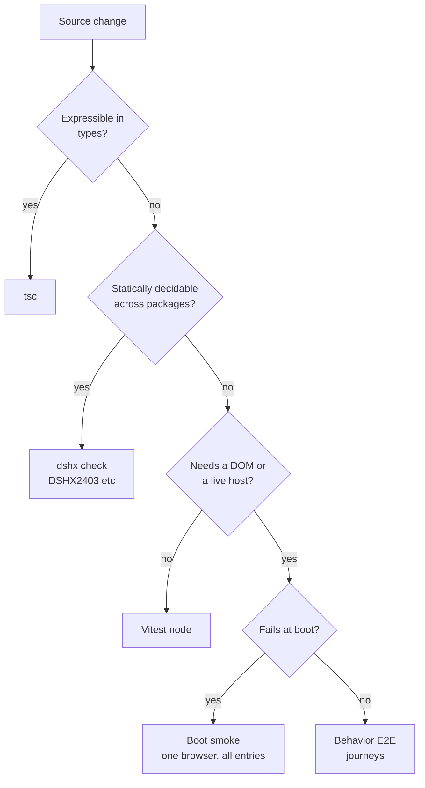
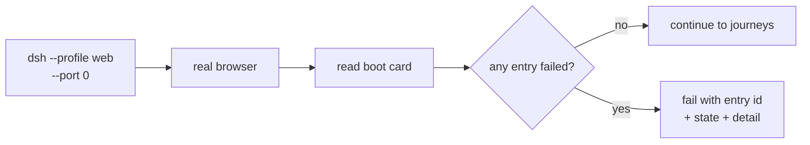

# DSH end-to-end testing plan

## Context

Two consecutive defects on 2026-10-04 passed every existing gate and failed only
in the browser:

- `@dshfiles/queue-reorder` and `@dshfiles/ai-accounts` called
  `ctx.slots.inject(...)` inside `defineClient({ setup(ctx) })` without declaring
  `slots` in `inject`. `ctx.slots` was `undefined`, `setup` threw inside
  `apply`, the Cordis fiber went to `failed`.
- Fixing that let queue-reorder run for the first time, and it immediately
  collided with `@deepseek-ai/dsh-client-ui-conversation` over the `conversation`
  locale namespace. The shipped Locale runtime rejects a duplicate
  `(namespace, locale)` pair, so a _shipped_ plugin died and seven more fell to
  `pending (waiting for service: uiConversation)`.

`tsc` passed. `dshx check` passed. The build produced a valid artifact. The
symptom existed only as a DOM card in a real browser.

Reproducing that by hand cost a jsdom harness, three wrong assumptions about how
the Web UI loads its bundles, and a session to find the actual thrown error.
That harness then produced a false 36-entry failure from its own stubbed `fetch`
and a spurious `dsh-client-hmr` error from a missing `EventSource`, which is the
concrete evidence that a hand-built DOM shim is the wrong instrument.

### What exists today

| Layer         | Tool                                      | Reaches a browser half bug?                  |
| ------------- | ----------------------------------------- | -------------------------------------------- |
| Typecheck     | `tsc`                                     | Only if the contract is expressible in types |
| Unit          | Vitest, node env                          | No DOM, no host                              |
| Build guard   | `dshx check`, compiler plugins            | Static only                                  |
| Host boot     | `dshx check --boot`                       | Server half only                             |
| DSH smoke     | `scripts/smoke-dsh.mjs`, `playwright-cli` | Yes, for a scaffolded plugin                 |
| Profile smoke | none                                      | No                                           |

`scripts/smoke-dsh.mjs` already drives a real browser via `playwright-cli`
(`open` → `snapshot` → `run-code`). That is the closest thing to the missing
layer and the pattern to extend.

The environment blocker is concrete: `playwright@1.63.0-alpha-2026-08-05` wants
`chromium_headless_shell-1237`, and only `1234` was installed. Installing the
matching build is one command and took about a minute:

```sh
node node_modules/.pnpm/playwright@<version>/node_modules/playwright/cli.js \
  install chromium-headless-shell
```

## Goal

Every class of defect that can only manifest in a browser fails in CI, without a
human reproducing a boot, while keeping local iteration fast enough that people
actually run the suite.

## What

A layered E2E strategy, with the layer boundary drawn by _where the defect can
live_ rather than by tooling preference.

1. **Static contract checks** — the cheap layer, extended so whole classes of
   cross-plugin defects never reach a browser. Implemented in
   `plans/plugin-boot-integrity.md`; referenced here because it changes what E2E
   must cover.
2. **Boot smoke** — one real browser, one real profile, assert every client entry
   reaches `active`. This is the net for anything static analysis misses.
3. **Behavior E2E** — Gherkin journeys for the surfaces plugins actually
   change, in a real profile with a real Host. Feature files carry the intent;
   step definitions carry the selectors, so a UI change is absorbed in one place
   rather than in every test.

## Why

The failure mode is asymmetric. A defect caught by TSC costs seconds. The same
defect caught by hand costs 40 minutes and produces a misleading message that
names the wrong plugin. The gap between those costs is what this closes.

It also has to not become a burden. An E2E suite nobody runs is worth less than
none, because it rots and then lies.

## How

### Conceptual model

Classify a defect by the earliest layer that can _see_ it, and put a check there.



The boot smoke and behavior E2E are deliberately the same harness with different
assertions. One browser launch is the expensive unit; splitting into two
frameworks doubles that cost for no extra coverage.

### Operations / behavior

- `dshx check --boot` proves the server half loads. Adding `--runtime` extends it
  with the browser pass, which asserts no client entry is `failed`.
- `scripts/smoke-dsh.mjs` proves a scaffolded plugin works against a pinned DSH.
- The full profile smoke composes the checked-in `profiles/web` seed in a
  scratch DSH home, so it validates this repo's bundle graph without touching
  the active profile.

### Tech choices

| Choice                                             | Decision                      | Rationale                                                                                                                                                                                                                      |
| -------------------------------------------------- | ----------------------------- | ------------------------------------------------------------------------------------------------------------------------------------------------------------------------------------------------------------------------------ |
| jsdom                                              | Rejected                      | Lacks `EventSource`, has no module loader, and a stubbed `fetch` produced a false 36-entry failure. It simulates the browser rather than running it.                                                                           |
| Vitest browser mode                                | Rejected                      | Wrong lifecycle. These tests must boot a _DSH profile_, own a port, and assert across a whole plugin graph; Vitest browser mode assumes it owns the page and starts from a fixture URL. It would fight the thing being tested. |
| Playwright BDD (`test.step` / `playwright.test()`) | **Recommended for journeys**  | See the section below.                                                                                                                                                                                                         |
| Plain `@playwright/test` specs                     | Used only for boot assertions | The boot check is one assertion against one DOM node. A feature file for it would be ceremony.                                                                                                                                 |
| Mock the host                                      | Rejected                      | The defects were precisely about services the host provides and packages negotiate between. A mock reproduces the assumption under test.                                                                                       |
| One browser per run                                | Rejected                      | 15-20s each. Boot smoke shares a single launch across all entry assertions.                                                                                                                                                    |

### Why Gherkin earns its keep, and where it does not

The argument for `.feature` files is not that BDD is fashionable. It is a
specific failure mode that plain specs have and feature files do not.

A behavior E2E test for this product is a sequence of UI steps: open the panel,
send a message, wait for a reply, drag a queue row. Written as imperative spec
code, the _intent_ is buried under selectors and waits. When the UI shifts — a
heading changes, a button moves — the spec breaks, and the fix is to re-read 40
lines of Playwright code and guess which line the change invalidated. In a
feature file the breakage is usually visible on sight, because the step is
literally `When I open the AI Accounts panel` and nothing about that sentence
mentions a selector.

The second property matters more for this repo: the steps are the reusable part.
Booting a profile, waiting for the UI, signing in, opening a session, sending a
message — that setup is identical across every journey. In spec code it is a
helper that accretes arguments until nobody can change it without touching every
test. As step definitions it is written once, and a UI change is absorbed by
editing one step file instead of every spec that used it.

```gherkin
Feature: Queue reordering

  Background:
    Given the web profile is booted
    And a conversation exists with two queued messages

  Scenario: Reordering a queued message runs it in the new order
    When I drag the second queued message above the first
    Then the queue shows it first
    And the Host records a queue_move for that item

  Scenario: Reordering is refused once the first message is running
    Given the first queued message is already running
    When I drag the second queued message above the first
    Then the queue order is unchanged
    And no queue_move is sent to the Host
```

Where it does **not** earn its keep:

- **The boot smoke.** One assertion, one DOM node, no journey. A feature file
  would be three lines of ceremony for no intent that code does not already carry.
- **Anything with more than about five steps in a scenario.** Past that point the
  scenario is testing several things, and the feature file's readability advantage
  inverts — a long Gherkin scenario is harder to follow than a long spec.
- **Unit and static checks.** Unchanged; they stay in Vitest.

So: Gherkin for journeys, plain specs for single assertions, static checks for
contracts.

### Architecture

```
pnpm test                vitest, node     ~40s   types + static contracts
pnpm test:e2e:gen        bddgen           ~2s    compile feature files to specs
pnpm test:e2e            Gherkin journeys ~1min  user-visible behavior
```

The boot smoke runs as the first scenario rather than as its own command: it is
one assertion against one DOM node, so a separate command would buy a second
browser launch for no extra coverage.

`smoke:dsh` was retired on `main` as unused by knip, so the cross-version layer
is gone. Reinstating it is future work, not a claim this plan makes.

Boot smoke and journeys share one module that boots a profile on a reserved port
and hands the caller a live `page`. They differ in assertion style, not in
harness, so a journey scenario does not pay for a second browser launch.

```gherkin
# e2e/features/queue-reorder.feature
Feature: Queue reordering
  Background:
    Given the web profile is booted
  Scenario: A queued message can be moved up
    Given a conversation with two queued messages
    When I move the second queued message up
    Then the queue lists it first
```

```ts
# e2e/steps/queue.ts — the only file that knows the selector
Given('a conversation with two queued messages', async ({ page, boot }) => {
  await boot.sendMessage('first')
  await boot.sendMessage('second')
})
When('I move the second queued message up', async ({ page }) => {
  await page.getByRole('button', { name: 'Move queued message up' }).nth(1).click()
})
Then('the queue lists it first', async ({ page }) => {
  await expect(page.getByRole('listitem').first()).toContainText('second')
})
```



Boot smoke and profile smoke share one module that boots a profile on a free port,
opens it, and returns the parsed boot card. The difference is the profile, not the
driver.

## What this allows

- A cross-plugin client contract defect fails CI rather than a Web UI session.
- The repo's real profile is verified to boot, which is currently asserted by
  nobody.
- Failures name the entry, its state, and the detail line, instead of a screenshot
  of a card.
- A regression test for any future defect can be written at the layer where the
  defect actually lives.

## What this does not allow

- Static analysis covering everything. A dynamically constructed `defineClient`
  definition stays opaque, so the boot smoke stays mandatory.
- `pending` entries being treated as failures. This check does not run a Host
  conversation, so entries waiting on `sessions` or `remote.*` are expected. Only
  `failed` is a defect here.
- Coverage of the `dshmarket` plugin surface beyond boot, or of DSH itself.
- Faster than one browser launch per layer. That is the floor, and it is why the
  layers stay few.

## UI & UX

No product UI. The failure output is a terminal diagnostic:

```
DSHX4111 [error] The Web UI booted with 1 client entry/entries that failed to activate.
  @deepseek-ai/dsh-client-ui-conversation: failed
    import failed: client-modules: "@deepseek-ai/dsh-client-ui-conversation"
    not loaded because dependency "@deepseek-ai/dsh-client-locale" failed
```

In CI, the same run attaches a Playwright trace on failure.

## Data model

The boot card remains the contract surface for startup assertions. Each browser
run now also writes a bounded local receipt that links the run to its JJ source
revision and, in CI, the provider's source run URL:

```typescript
interface E2EStep {
  sequence: number
  parentSequence: number | null
  title: string
  category: 'action' | 'assertion'
  outcome: 'passed' | 'failed'
  offsetMs: number
  durationMs: number
}

interface E2EAttachment {
  sequence: number
  name: string
  kind: 'screenshot' | 'trace'
  contentType: string
  file: string
  sizeBytes: number
  sha256: string
}

interface E2ETest {
  key: string
  titlePath: string[]
  file: string
  line: number
  expectedStatus: string
  outcome: 'passed' | 'failed' | 'cancelled'
  durationMs: number
  retry: number
  steps: E2EStep[]
  attachments: E2EAttachment[]
}

interface E2ERunEvidence {
  schemaVersion: 1
  runId: string
  startedAt: string
  completedAt: string
  outcome: 'passed' | 'failed' | 'cancelled'
  source: { revision: string | null; runUrl: string | null }
  browser: {
    engine: 'chromium'
    viewport: { width: number; height: number }
    actionIdentity: 'ordered Playwright test steps'
    frameIdentity: 'test-scoped; trace retains internal frame order'
    frameAlignment: 'trace-only; no synthetic action-to-frame mapping'
  }
  tests: E2ETest[]
}
```

Only failure screenshots and trace archives are copied. Artifact bytes, bytes
per run, total retained bytes and retained run count are capped; paths and token
URLs are not included in the manifest. The trace keeps its own action/frame
ordering. A separate screenshot-to-action identity is not inferred.

A stable accessor for the boot card — rather than screen-scraping it in each
test — is still worth proposing upstream as a documented
`window.__DSH_BOOT_STATE__`.

## Implementation steps

1. Pin the Playwright browser build. Install `chromium-headless-shell` matching
   the workspace's `playwright`, and add it to the repo setup script so a fresh
   clone does not fail at the first browser test.
2. Extract the boot-card reader into one module used by every layer, and pin its
   output with unit tests over real card text.
3. Add the boot smoke: boot a profile on a reserved port, open it, assert no
   entry is `failed`. Wire it into `smoke-dsh.mjs` for the scaffolded plugin.
4. ~~Add the profile smoke.~~ Implemented in `test:boot`: preserve every bundle
   from the checked-in `profiles/web` seed, link all local source bundles, and
   assert the composed profile in a real browser. A static provider contract
   also requires each `@dshfiles/*` external to be a local dependency and bundle.
5. ~~Adopt `@playwright/test` with Gherkin for journeys.~~ Done:
   `e2e/features/client-boot.feature` compiles to Playwright specs via
   `bddgen`, with `e2e/support/steps.ts` the only file that knows the boot
   card's wording.
6. Keep the boot smoke as a plain spec, not a feature. Revisit only if it grows
   past a single assertion.
7. Add the first user-visible journey now that the harness exists: send a message,
   assert a reply renders, assert the queue lists the second message beneath the
   first.
8. Add a bounded evidence reporter with ordered named steps, retained failure
   screenshots/traces, JJ source identity and a CI source-run URL.
9. Propose `window.__DSH_BOOT_STATE__` upstream so both the boot smoke and the
   journey steps read a documented hook instead of parsing a localized DOM card.

## Open questions

1. Should the profile smoke run on every `jj` revision, or only on the `web`
   profile and on release? A full boot per keystroke would be unusable; the
   question is where the boundary sits.
2. Should the boot smoke use the repo's real profile or a minimal one derived from
   it? The real one catches more but is slower and depends on installed
   third-party plugins.
3. Does the boot smoke belong in `dshx check --boot --runtime`, or in CI only?
   Keeping it in the CLI makes it usable locally, at the cost of a browser launch
   in a command people run often.
4. Is `pending`-on-live-host acceptable indefinitely, or should the smoke start a
   Host session so those entries reach `active` too?

## Acceptance criteria

- [ ] A plugin whose client `apply` throws fails the boot smoke with the entry id.
- [ ] The boot smoke passes on a healthy profile.
- [ ] The boot smoke treats `pending` on `sessions` or `remote.*` as a pass.
- [ ] The repo's `web` profile boots clean under the profile smoke.
- [x] Local external providers are present as linked profile dependencies and bundle rows.
- [ ] A fresh clone reaches the browser tests without a manual browser install.
- [ ] Both original defects are covered: the missing `slots` service by the static
      check, the locale collision by the type-level refusal and the boot smoke.
- [x] Failed and interrupted runs retain a bounded, source-linked manifest.
- [x] Ordered named actions and assertions are recorded without copying prompt,
      page text, Host stdout or tokenized local URLs into the manifest.
- [x] Frame ordering is tied to the Playwright trace; the manifest does not invent
      action-to-frame correlation.

## Decisions log

| Date       | Decision                                                                                            | Rationale                                                                                                                                                                                                            |
| ---------- | --------------------------------------------------------------------------------------------------- | -------------------------------------------------------------------------------------------------------------------------------------------------------------------------------------------------------------------- |
| 2026-10-04 | Rejected jsdom for boot verification                                                                | It produced a false 36-entry failure from a stubbed `fetch` and a spurious `dsh-client-hmr` error from a missing `EventSource`.                                                                                      |
| 2026-10-04 | Rejected Playwright BDD                                                                             | A second runner and config for no coverage; `smoke-dsh.mjs` already drives a real page.                                                                                                                              |
| 2026-10-04 | Rejected Vitest browser mode                                                                        | These tests boot a DSH profile and own a port; browser mode assumes it owns the page and starts from a fixture URL.                                                                                                  |
| 2026-10-04 | Adopted Gherkin for journeys, plain specs for single assertions                                     | The intent of a journey is buried under selectors in a spec, and the shared setup is the reusable part — which is what step definitions are for. A boot assertion is one node and gains nothing from a feature file. |
| 2026-10-04 | One boot harness shared by smoke and journeys                                                       | A browser launch is the expensive unit; two harnesses would pay for it twice.                                                                                                                                        |
| 2026-10-04 | Boot smoke shares one launch across all entry assertions                                            | One browser launch is the expensive unit; per-entry launches would make the layer unusable.                                                                                                                          |
| 2026-10-04 | Keep `playwright-cli` in `smoke-dsh.mjs`, use `@playwright/test` for the profile smoke and journeys | The former drives an already-running DSH; the latter owns a lifecycle and needs assertions, retries, and traces.                                                                                                     |
| 2026-10-04 | `pending` on a live-host service is not a failure                                                   | The smoke does not run a Host conversation, so those entries can never reach `active` here. Treating them as defects would make the check permanently red.                                                           |
