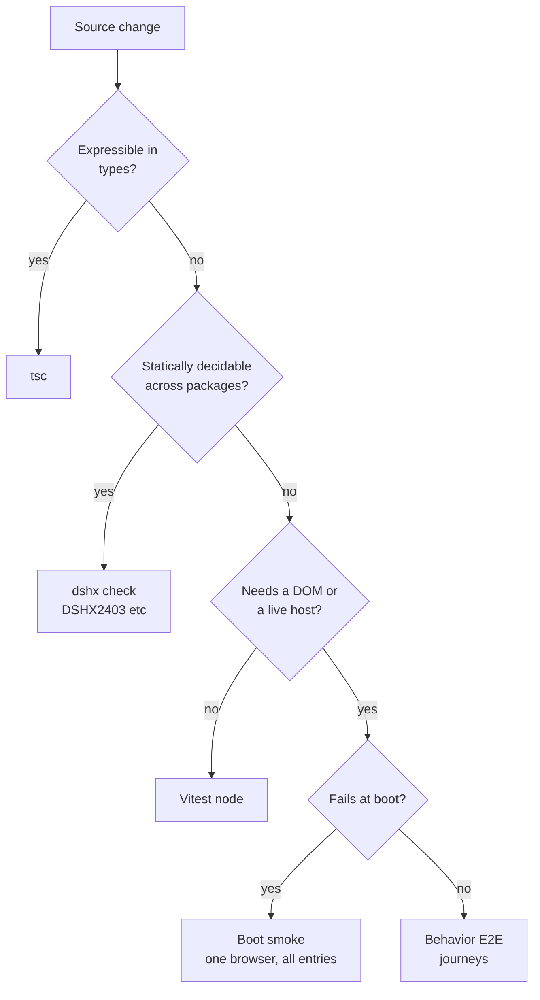
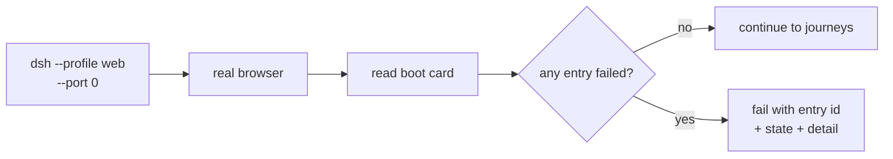

# DSH end-to-end testing plan

## Context

Two consecutive defects on 2026-10-04 passed every existing gate and failed only
in the browser:

- `@dshfiles/queue-reorder` and `@dshfiles/ai-accounts` called
  `ctx.slots.inject(...)` inside `defineClient({ setup(ctx) })` without declaring
  `slots` in `inject`. `ctx.slots` was `undefined`, `setup` threw inside
  `apply`, the Cordis fiber went to `failed`.
- Fixing that let queue-reorder run for the first time, and it immediately
  collided with `@deepseek-ai/dsh-client-ui-conversation` over the `conversation`
  locale namespace. The shipped Locale runtime rejects a duplicate
  `(namespace, locale)` pair, so a *shipped* plugin died and seven more fell to
  `pending (waiting for service: uiConversation)`.

`tsc` passed. `dshx check` passed. The build produced a valid artifact. The
symptom existed only as a DOM card in a real browser.

Reproducing that by hand cost a jsdom harness, three wrong assumptions about how
the Web UI loads its bundles, and a session to find the actual thrown error.
That harness then produced a false 36-entry failure from its own stubbed `fetch`
and a spurious `dsh-client-hmr` error from a missing `EventSource`, which is the
concrete evidence that a hand-built DOM shim is the wrong instrument.

### What exists today

| Layer | Tool | Reaches a browser half bug? |
|-------|------|----------------------------|
| Typecheck | `tsc` | Only if the contract is expressible in types |
| Unit | Vitest, node env | No DOM, no host |
| Build guard | `dshx check`, compiler plugins | Static only |
| Host boot | `dshx check --boot` | Server half only |
| DSH smoke | `scripts/smoke-dsh.mjs`, `playwright-cli` | Yes, for a scaffolded plugin |
| Profile smoke | none | No |

`scripts/smoke-dsh.mjs` already drives a real browser via `playwright-cli`
(`open` → `snapshot` → `run-code`). That is the closest thing to the missing
layer and the pattern to extend.

The environment blocker is concrete: `playwright@1.63.0-alpha-2026-08-05` wants
`chromium_headless_shell-1237`, and only `1234` was installed. Installing the
matching build is one command and took about a minute:

```sh
node node_modules/.pnpm/playwright@<version>/node_modules/playwright/cli.js \
  install chromium-headless-shell
```

## Goal

Every class of defect that can only manifest in a browser fails in CI, without a
human reproducing a boot, while keeping local iteration fast enough that people
actually run the suite.

## What

A layered E2E strategy, with the layer boundary drawn by *where the defect can
live* rather than by tooling preference.

1. **Static contract checks** — the cheap layer, extended so whole classes of
   cross-plugin defects never reach a browser. Implemented in
   `plans/plugin-boot-integrity.md`; referenced here because it changes what E2E
   must cover.
2. **Boot smoke** — one real browser, one real profile, assert every client entry
   reaches `active`. This is the net for anything static analysis misses.
3. **Behavior E2E** — scripted user journeys for the surfaces plugins actually
   change, in a real profile with a real Host.

## Why

The failure mode is asymmetric. A defect caught by TSC costs seconds. The same
defect caught by hand costs 40 minutes and produces a misleading message that
names the wrong plugin. The gap between those costs is what this closes.

It also has to not become a burden. An E2E suite nobody runs is worth less than
none, because it rots and then lies.

## How

### Conceptual model

Classify a defect by the earliest layer that can *see* it, and put a check there.



The boot smoke and behavior E2E are deliberately the same harness with different
assertions. One browser launch is the expensive unit; splitting into two
frameworks doubles that cost for no extra coverage.

### Operations / behavior

- `dshx check --boot` proves the server half loads. Adding `--runtime` extends it
  with the browser pass, which asserts no client entry is `failed`.
- `scripts/smoke-dsh.mjs` proves a scaffolded plugin works against a pinned DSH.
- The new profile smoke proves *this repo's* profile — the real
  `~/.dsh/profiles/web` composition — boots clean, which is the check that would
  have caught both defects on the day they shipped.

### Tech choices

| Choice | Decision | Rationale |
|--------|----------|-----------|
| jsdom | Rejected | Lacks `EventSource`, has no module loader, and a stubbed `fetch` produced a false 36-entry failure. It simulates the browser rather than running it. |
| Vitest browser mode | Rejected for now | Correct in principle, but the installed `playwright` alpha pins a browser build that was absent. It also wants to own the browser lifecycle, which `playwright-cli` already does for `smoke-dsh.mjs`. Revisit once the browser pin is stable. |
| Playwright BDD (`@playwright/test` + `playwright.test()`) | Rejected | Introduces a second test runner, a second config, and a second way to interpret a failure, for zero coverage. `playwright-cli`'s `run-code` already receives a live `page`. |
| Playwright test runner (`@playwright/test`, plain specs) | **Recommended** | One runner, `expect` assertions, parallel workers, retries, traces, and a `--ui` mode. `smoke-dsh.mjs` keeps using `playwright-cli` because it drives an already-running DSH rather than owning one; the profile smoke owns its lifecycle and belongs in `@playwright/test`. |
| Mock the host | Rejected | The defects were precisely about services the host provides and packages negotiate between. A mock reproduces the assumption under test. |
| One browser per run | Rejected | 15–20s each. Boot smoke shares a single launch across all entry assertions. |

### Architecture

```
pnpm test                       vitest, node          ~40s    types + static contracts
pnpm test:e2e:boot              boot smoke            ~60s    all client entries active
pnpm test:e2e:profile           profile smoke         ~90s    this repo's real profile
pnpm smoke:dsh -- --version X   cross-version smoke   ~5min   pinned DSH release
```



Boot smoke and profile smoke share one module that boots a profile on a free port,
opens it, and returns the parsed boot card. The difference is the profile, not the
driver.

## What this allows

- A cross-plugin client contract defect fails CI rather than a Web UI session.
- The repo's real profile is verified to boot, which is currently asserted by
  nobody.
- Failures name the entry, its state, and the detail line, instead of a screenshot
  of a card.
- A regression test for any future defect can be written at the layer where the
  defect actually lives.

## What this does not allow

- Static analysis covering everything. A dynamically constructed `defineClient`
  definition stays opaque, so the boot smoke stays mandatory.
- `pending` entries being treated as failures. This check does not run a Host
  conversation, so entries waiting on `sessions` or `remote.*` are expected. Only
  `failed` is a defect here.
- Coverage of the `dshmarket` plugin surface beyond boot, or of DSH itself.
- Faster than one browser launch per layer. That is the floor, and it is why the
  layers stay few.

## UI & UX

No product UI. The failure output is a terminal diagnostic:

```
DSHX4111 [error] The Web UI booted with 1 client entry/entries that failed to activate.
  @deepseek-ai/dsh-client-ui-conversation: failed
    import failed: client-modules: "@deepseek-ai/dsh-client-ui-conversation"
    not loaded because dependency "@deepseek-ai/dsh-client-locale" failed
```

In CI, the same run attaches a Playwright trace on failure.

## Data model

The boot card is the contract surface. Its shape is the thing to pin:

```typescript
interface ClientBootOutcome {
  /** True when the Web UI mounted without a plugin failure card. */
  ok: boolean
  /** Every entry line the card printed, with state and detail. */
  entries: Array<{ id: string; state: 'failed' | 'pending' | 'error'; detail?: string }>
}
```

A stable accessor for this — rather than screen-scraping the card in each test —
is what makes later E2E assertions cheap. Worth proposing upstream as a documented
`window.__DSH_BOOT_STATE__`, since a public test hook is better than every
downstream project parsing a localized DOM string.

## Implementation steps

1. Pin the Playwright browser build. Install `chromium-headless-shell` matching
   the workspace's `playwright`, and add it to the repo setup script so a fresh
   clone does not fail at the first browser test.
2. Extract the boot-card reader into one module used by every layer, and pin its
   output with unit tests over real card text.
3. Add the boot smoke: boot a profile on a reserved port, open it, assert no
   entry is `failed`. Wire it into `smoke-dsh.mjs` for the scaffolded plugin.
4. Add the profile smoke: boot the repo's actual `web` profile and assert the same.
   This is the check that would have caught both original defects.
5. Promote behavior E2E to `@playwright/test` only once a journey needs assertions
   more complex than "the entry activated". Start with one: send a message and
   assert a reply renders.
6. Propose `window.__DSH_BOOT_STATE__` upstream so tests read a documented hook
   instead of parsing a localized DOM card.

## Open questions

1. Should the profile smoke run on every `jj` revision, or only on the `web`
   profile and on release? A full boot per keystroke would be unusable; the
   question is where the boundary sits.
2. Should the boot smoke use the repo's real profile or a minimal one derived from
   it? The real one catches more but is slower and depends on installed
   third-party plugins.
3. Does the boot smoke belong in `dshx check --boot --runtime`, or in CI only?
   Keeping it in the CLI makes it usable locally, at the cost of a browser launch
   in a command people run often.
4. Is `pending`-on-live-host acceptable indefinitely, or should the smoke start a
   Host session so those entries reach `active` too?

## Acceptance criteria

- [ ] A plugin whose client `apply` throws fails the boot smoke with the entry id.
- [ ] The boot smoke passes on a healthy profile.
- [ ] The boot smoke treats `pending` on `sessions` or `remote.*` as a pass.
- [ ] The repo's `web` profile boots clean under the profile smoke.
- [ ] A fresh clone reaches the browser tests without a manual browser install.
- [ ] Both original defects are covered: the missing `slots` service by the static
      check, the locale collision by the type-level refusal and the boot smoke.

## Decisions log

| Date | Decision | Rationale |
|------|----------|-----------|
| 2026-10-04 | Rejected jsdom for boot verification | It produced a false 36-entry failure from a stubbed `fetch` and a spurious `dsh-client-hmr` error from a missing `EventSource`. |
| 2026-10-04 | Rejected Playwright BDD | A second runner and config for no coverage; `smoke-dsh.mjs` already drives a real page. |
| 2026-10-04 | Rejected Vitest browser mode for now | The installed `playwright` alpha pins a browser build that was absent; the browser pin is unstable. Revisit once it settles. |
| 2026-10-04 | Boot smoke shares one launch across all entry assertions | One browser launch is the expensive unit; per-entry launches would make the layer unusable. |
| 2026-10-04 | Keep `playwright-cli` in `smoke-dsh.mjs`, use `@playwright/test` for the profile smoke | The former drives an already-running DSH; the latter owns a lifecycle and needs assertions, retries, and traces. |
| 2026-10-04 | `pending` on a live-host service is not a failure | The smoke does not run a Host conversation, so those entries can never reach `active` here. Treating them as defects would make the check permanently red. |