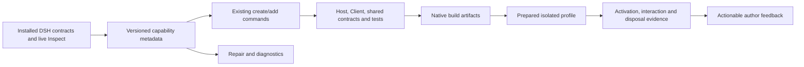

# DSHX plugin framework plan

## Context

Delivery date: **2026-10-05**. This document records the completed dshx framework work and the remaining DSH-owned seam. All work owned by this repository is implemented in the isolated `dshx-complete` JJ workspace; it has not been promoted into the live `web` profile. One limitation remains outside this repository: DSH `0.2.0-rc.2` does not expose a Client Slots Inspect provider, so live Slot scaffolding and occupancy cannot be proven until DSH adds that provider.

The maintained fork is already the right foundation. Continue **building with our local `@dshfiles/dshx` hard fork**: it owns compilation, authoring adapters, inspection, scaffolding, and diagnostics. DSH/Cordis own activation, scope, transport, state, registries, and cleanup. Another framework adoption or another fork would duplicate the work we have already earned. BB and OpenCode2 supply implementation ideas; they are not target runtimes or dependencies.

### Investigation scope and evidence limits

- Reviewed the complete visible ancestor history from repository setup through the current plugin fixes, plus the distinct `fast-fixes` and `hardening2` heads. Inspected selected changes behind the recurring failures, rather than treating commit titles as implementation proof.
- Mapped the framework source, creator templates, test surfaces, every owned package, and the BB plugin collection. Read the current SDK, architecture, compatibility, boot-integrity, hardening, and plugin boundary documentation.
- Checked installed native DSH declarations for conversation actions, subprocesses, and tool testing. `IConversation` is publicly exported and includes typed `updateQueue`; a plugin-local partial interface is therefore a typing/integration problem, not evidence that this action is absent.
- Found installed OpenCode2 at `/nix/store/8ac0acppdagyw0hw7rqkla6y8y741494-opencode2-2.0.20/bin/opencode2`. Compared official source at tag `v2.0.20`, tree SHA `84c9be93a56304a108f1a22df0c5d62c26d5b6ca`. Older OpenCode plugin examples use a different contract.
- Reproduced the scaffold command failures below with official fnm Node **22.23.3**, then rebuilt and tested the repaired commands. Generated and installed clean scratch projects, ran a scratch DSH instance on a non-default port with an isolated `DSH_HOME`, and completed browser-backed E2E checks. The live `web` profile was not changed or restarted.
- Work was completed in the isolated `dshx-complete` JJ workspace. Related historical heads were reviewed for reusable fixes; they were not merged into other workspaces or the default checkout.

### What already exists

| Area           | Implemented foundation                                                                                 | Preserve                                                                 |
| -------------- | ------------------------------------------------------------------------------------------------------ | ------------------------------------------------------------------------ |
| Authoring      | `definePlugin`, `defineClientPlugin`, lower-level Host/Client definitions, native context escape hatch | Additive migration; native types and lifetime semantics                  |
| UI             | Typed slots, panel/navigation pairing, composer actions, declaration-following registration            | Native props, slot ownership, HMR, and scope                             |
| RPC            | Shared `defineApi` contracts, Standard Schema validation, cancellable calls, `useApiQuery`             | Host/Client graphs remain separate; authentication belongs to Connection |
| Settings       | Loader-owned protocol-2 schema/forms, revisions, redaction, live updates                               | No parallel preferences persistence                                      |
| Tooling        | Build/check/dev/package, offline profile composition checks, inspect, repair, platform CLI             | Existing Oxc parser and bounded native outputs                           |
| Testing        | Real Cordis/tool/command/prompt/slot harnesses, Host/browser boot checks, behavior E2E                 | Distinguish registration, activation, rendering, and behavior evidence   |
| Compatibility  | Protocol-2 adapter, verified release list, platform dependency guards                                  | Installed contracts, not semver alone, decide support                    |
| Shared helpers | Ambient browser declarations and managed process cleanup                                               | Extend only where multiple callers share an invariant                    |

Primary sources: [SDK](../tooling/dshx/docs/sdk/getting-started.md), [architecture](../tooling/dshx/docs/architecture.md), [compatibility](../tooling/dshx/docs/compatibility.md), [fork provenance](../tooling/dshx/FORK.md).

### Lessons from past revisions

Commit IDs identify the inspected historical content. Use `jj show <id>`; do not infer that another head's changes are present here.

| Revisions                                                          | Lesson                                                                                                                               | Framework consequence                                                                                        |
| ------------------------------------------------------------------ | ------------------------------------------------------------------------------------------------------------------------------------ | ------------------------------------------------------------------------------------------------------------ |
| `8252633e`, `848ed9de`, `f90009a4`                                 | Hard-fork ownership, protocol-1 retirement, and documentation pruning already happened                                               | Keep one protocol-2 authoring path; do not resurrect upstream publishing machinery                           |
| `79cc90c2`, `21d681f3`, `2a17612a`                                 | Ambient declarations and platform package identity repeatedly forced plugin workarounds                                              | Put shared declarations and identity checks in tooling, not each plugin                                      |
| `35899754`, `aaa1422d`, `c4d407e0`                                 | Scaffolds and CLI parsing evolved separately; Oxc/native TS replaced the compiler API                                                | Exercise advertised commands through the built executable, including source edits                            |
| `175570d9`, `74d15e00`, `5747e339`, `97a2d3e5`                     | A second queue dock and borrowed locale namespace broke composition                                                                  | Explain ownership and replacement before registration; keep existing collision guards                        |
| `9ab8cff4`, `a2965830`, `0a6220dd`                                 | Source exports, helper bundling, and packaged declarations can drift                                                                 | Test actual public exports and built artifact imports, not source imports alone                              |
| `9afb9746`, `2b08c8b7`, `86e1327c`, `9fe64933`                     | Provider package edges, Cordis injection, and render-time service access were repeatedly confused; heads contain differing diagnoses | Verify native ownership/default injection once, then share the result between runtime and tooling            |
| `f5544986`, `bb44c4ef`, `e7fa87ed` and current account-store edits | Module state, concurrent writes, and first boot reads are separate ownership problems                                                | Teach plugin-local state and awaited initialization; do not promise a generic store before comparing callers |
| `02e984e1`, `6eb53baf`, `fcb2bc95` on other heads                  | Boot process ownership, local profile sync, and inspect response validation already have fixes                                       | Review and reuse these changes before proposing duplicate implementations                                    |

Related plans: [boot integrity](./plugin-boot-integrity.md), [E2E testing](./dsh-e2e-testing.md), [repo hardening](./repo-hardening/README.md), [async questions](./async-agent-questions.md). Their historical checkboxes do not replace current source inspection. This plan owns the proposed authoring workflow; implementation/API documentation remains in `tooling/dshx/docs` once behavior ships.

### Current plugin pressure

Ten packages are bundles; `project-folder-picker` is a source library. Inventory is about framework pressure, not a proposal to recreate every feature as an SDK capability.

| Package                 | What it exercises                                                            | Useful framework improvement                                                                           |
| ----------------------- | ---------------------------------------------------------------------------- | ------------------------------------------------------------------------------------------------------ |
| `ai-accounts`           | RPC, panels/footer, provider hooks, config, durable quota history            | Typed config and lifecycle recipes; domain refresh only through verified native seams                  |
| `queue-reorder`         | Native dock replacement, session scope, tool/RPC reuse                       | Typed scoped UI example, deliberate replacement diagnostics, no manual decorator                       |
| `thread-sidebar`        | Shell/child slot ownership, layout, workspace/session projections, shortcuts | Discoverable slot contracts and explicit render-time dependencies                                      |
| `jujutsu`               | Panel/RPC, cancellable subprocess, preview/confirm mutations                 | Complete panel scaffold; native process recipe; keep repository identity and confirmation domain-local |
| `mcp-servers`           | Credentials, managed processes, RPC, panels, command UI                      | Capability catalog and safe imperative UI registration; keep OAuth/MCP lifecycle local                 |
| `secret-catalog`        | Validated CLI boundary, redacted views, panel, folder selection              | Shared-contract recipes and execution context; avoid a generic secret API                              |
| `settings-search`       | Native `ConfigForms` descriptors and field mutation                          | Settings recipe with honest navigation limits                                                          |
| `shortcuts`             | Browser capture handlers and disposal                                        | Small client-only scaffold and real keyboard behavior test                                             |
| `agent-communication`   | Tools, Host events, CLI/MCP, durable inbox                                   | One domain operation reused across adapters; preserve untrusted-peer-text boundary                     |
| `plugin-marketplace`    | Catalog/RPC, install jobs, native bundle metadata                            | Bundle packaging/install verification; keep catalog/install policy in the plugin                       |
| `project-folder-picker` | Reusable React component with injected ports                                 | Explicit library/bundle distinction; do not add activation metadata to a component library             |

### Gaps reproduced before implementation

The following were verified in the starting tree. Their delivered fixes and the one external Host dependency are recorded under [Implementation record](#implementation-record) and [Resolved questions and Host request](#resolved-questions-and-host-request).

1. **Advertised scaffold commands currently fail.** From `plugins/@dshfiles/ai-accounts`, `fnm exec --using 22.23.3 node ../../../tooling/dshx/packages/dshx/dist/cli/bin.js add panel --id framework-plan-probe --dry-run --json` exits 2 with `Unknown argument "panel"`; substituting `api` produces the same failure. Help lists both. `src/cli/args.ts` accepts only `ui`, `tool`, `command`, and `hook` in its add-target branch. Source and built behavior agree here; this is not merely a stale bundle hypothesis.
2. **The underlying presets are incomplete workflows.** `cli/run.ts::runAddPreset` writes files with direct `writeFile`, then tells panel authors to register them manually. `panelClientEntry` and `apiHostEntry` exist in `scaffold/presets.ts`, but this path does not use them. Generated API helpers remain unregistered until hand wiring, and repeated APIs share `src/api.ts`.
3. **Capability knowledge is duplicated and incomplete.** Runtime `sdk/client.ts` maps uses to service names; `compiler/client/capabilities.ts` separately maps uses to provider packages and recognizes only three raw setup services. `shortcuts`, `layout`, `uiWorkspace`, `workspaces`, `commandUi`, and `remote` accesses in real plugins show why setup-only analysis is insufficient. Another head already corrects some default-injection/provider assumptions.
4. **Advanced UI exposes avoidable traps.** SDK `api.ui.register` already follows declarations and decorates components. Lower-level imperative registration makes authors remember both manually. Queue-reorder restates a `ConversationService` interface even though native `IConversation` exists; thread-sidebar reads services in closures invoked later during rendering.
5. **Local linking disagrees with the repository's proven installation path.** `profile/orchestrator.ts::ensureProjectProfile` calls `dsh plugin ... add <project.root>`. Repository evidence documents that local `pnpm add` fails while a `link:` manifest dependency plus `pnpm install` works. Another head's `scripts/profile-sync.ts` implements that route outside dshx.
6. **Verification can still report a misleading success.** `browser-boot.ts` treats a missing boot card as success, and `client-boot-check.ts` filters pending entries without proving the expected plugin mounted. A blank document or stalled readiness can therefore evade the intended condition; this is a source-level risk to reproduce with a native fixture before fixing it. `DSHX_BOOT_PROFILE_ROOT` is set by boot checks, but these functions do not themselves prepare the requested bundle; inspect the actual DSH consumer before claiming isolation or installation.
7. **Typed configuration stops at the SDK boundary.** `BasePluginApi.config` is a `Readonly<Record<string, unknown>>`. Plugins must decode their domain config themselves; introducing a decoder should preserve protocol-2 resolver unwrapping and settings redaction, not recreate Settings.

## Goal

Create, extend, and verify an ordinary native DSH plugin through a short, reliable workflow with no hand-written provider metadata, forgotten registration wiring, or unexplained runtime workarounds for supported capabilities.

Measure success by complete working examples and fewer manual steps. More exported helpers alone are not progress.

## What

Deliver seven ordered slices:

1. Repair and baseline the real authoring commands.
2. Centralize supported capability metadata and native ownership evidence.
3. Make existing `add` scaffolds complete, atomic, and repeatable.
4. Make project profile preparation and verification reliable.
5. Remove advanced UI and config traps through narrow, additive APIs.
6. Publish tested multi-surface recipes, adding helpers only after two real consumers prove them.
7. Integrate live discovery and diagnostics into the authoring loop, including agent-driven authoring.

Existing definitions and native extensions remain usable. Prefer improving `defineClientPlugin`, `definePlugin`, `defineApi`, and existing commands over inventing a second declaration DSL.

## Why

The expensive part of creating our plugins has become integration: finding the right slot, loading the right provider, declaring the right scope dependencies, wiring both halves, rebuilding the fork, and discovering that a green check never opened the panel.

Recent revisions already show the same failures across several plugins. That is enough evidence to improve tooling. It is not enough evidence to introduce universal persistence, routing, jobs, or provider-management runtimes.

## How

### Conceptual model

One domain implementation, shared validated boundary contracts, thin surface registrations, and a toolchain that produces and verifies native artifacts.



The catalog describes how to reach native services. It is not another service registry, permission system, or runtime cache.

### Inspiration to transfer

**BB:** `~/dev/bb-plugins/plugins/secret-catalog/server.ts` and `jujutsu/server.ts` use shared contracts and machine-specific Host operations across UI/RPC/tools/CLI. Secret Catalog derives the agent's execution location rather than accepting an arbitrary tool target. Adopt the shared-domain/thin-adapter pattern and execution-context discipline; DSH's Host and tool context decide the actual implementation. AI Accounts provides useful account/usage presentation and collection examples, not justification for a generic SDK quota subsystem.

BB's `sidebar-resize`, `settings-search`, and `diff-viewed` also contain DOM-dependent adaptations. Preserve their user behavior where native DSH slots exist; do not turn private DOM/Fiber inspection into framework APIs. `preserve-child-threads` demonstrates compensating state mutation; prefer a native archive policy when DSH offers one. `sidebar-commands/server.ts` is empty, so its server is not an implementation to port.

**OpenCode2 2.0.20:** Its [Promise context](https://github.com/anomalyco/opencode/blob/v2.0.20/packages/plugin/src/promise/plugin.ts) exposes named domains and cleanup. [Registration types](https://github.com/anomalyco/opencode/blob/v2.0.20/packages/plugin/src/promise/registration.ts) make early disposal explicit; [RPC types](https://github.com/anomalyco/opencode/blob/v2.0.20/packages/plugin/src/promise/rpc.ts) couple handlers to portable definitions and cancellation. These are useful ergonomic references for existing Cordis-owned adapters.

Its [versioned authoring examples](https://github.com/anomalyco/opencode/blob/v2.0.20/packages/plugin/src/README.md) distinguish synchronous collection transforms from live hooks and explicit domain reloads. Transfer that distinction into documentation and native capability investigation. Do not emulate collection transforms or reloads when DSH supplies only registration or events. Its separate [Host entrypoints](https://github.com/anomalyco/opencode/blob/v2.0.20/packages/plugin/src/host.ts) reinforce our existing Host/Client boundary. Promise/Effect parity is inspiration, not a reason to expose two new dshx SDKs.

### Operations / behavior

Command names below use existing commands where possible. New options and examples are proposed behavior, not current syntax guarantees.

| Author action                           | Required result                                                                                                                       |
| --------------------------------------- | ------------------------------------------------------------------------------------------------------------------------------------- |
| Create basic/UI/tool/full-stack project | Source, manifest, scoped Loader ids, local SDK link, supported toolchain, runnable meaningful tests                                   |
| `add panel`                             | Component/styles, paired registration through existing panel SDK, needed imports/providers/peers, registration/unload test            |
| `add api`                               | Uniquely named shared contract, wired Host handler, usable Client example, schema validation test                                     |
| `add ui`                                | Resolve installed slot contract; explain additive/replacement behavior; preserve native overloads and child declarations              |
| Dry-run any scaffold/repair             | Full source and metadata diff, structured diagnostics, zero writes or profile mutations                                               |
| Repeat an existing scaffold             | Deterministic no-op or conflict explanation; no duplicate registrations and no partial file writes                                    |
| `dev`                                   | Prepare the intended project profile, validate Node/package manager, build/watch, use native HMR/restart, own only launched processes |
| `check --fix`                           | Derive only provable metadata; preserve manual declarations; unknown dynamic source stays explicitly unknown                          |
| Boot verification                       | Prove expected bundle is linked, composed, active, and usable; timeout/pending/no application is not success                          |
| Inspect unavailable seam                | Report missing native capability and owner; do not manufacture a slot/service from an offline guess                                   |

### Tech choices

| Choice               | Decision                                                                          | Rationale                                                                        |
| -------------------- | --------------------------------------------------------------------------------- | -------------------------------------------------------------------------------- |
| Runtime              | DSH/Cordis only                                                                   | Existing scope, disposal, admission, persistence, and HMR are authoritative      |
| Authoring            | Existing SDK plus native escape hatch                                             | Keep compatibility and avoid parallel APIs                                       |
| Source analysis      | Existing Oxc parser and file-plan helpers                                         | Reuse installed tooling; no source evaluation or TS compiler API                 |
| Boundary schemas     | Standard Schema for SDK decoding; native schema rules for tools/settings          | RPC already supports Standard Schema; do not promise arbitrary schema conversion |
| Capability metadata  | Narrow private catalog per compatibility generation                               | Shared by runtime injection, diagnostics, repairs, templates, and docs           |
| Profile installation | Native registry install; verified `link:` manifest/install path for local bundles | Distinct operations with distinct ownership; no automatic mutation of `web`      |
| Validation           | Real native registration tests plus isolated built-artifact/browser scenarios     | Typecheck, boot, and meaningful behavior answer different questions              |
| Dependencies         | Existing pinned TS 7, pnpm 12, Vite 8.1+, Oxlint/Oxfmt setup                      | No toolchain migration required by this proposal                                 |

### Architecture

Keep changes at existing domain boundaries:

- `compat/`: capability descriptors and verified native provider ownership. Keep Node tooling dependencies out of browser-importable runtime metadata.
- `sdk/`, `client/`, `host/`: native adapters, typed config decoding, and safe registration. Registration ownership stays with the caller's Cordis fiber.
- `compiler/`, `project/`: use the shared analysis result for build/check/repair; preserve final-chunk hook inference after tree-shaking.
- `scaffold/` and `create-dshx/`: a shared contribution plan, not separate rendering and wiring implementations.
- `profile/` and `dev/`: project link/install and process ownership, including restart-vs-HMR decisions.
- `testing/` and existing E2E support: native-provider fixtures and complete authoring workflow scenarios.
- `docs/`: tested recipes and support matrix. Retain upstream decision history as provenance, not active API guidance.

## What this allows

- Add a real panel or API to an existing plugin without hunting down registration boilerplate.
- Extend ordinary slots with RPC/settings hooks without remembering a decorator.
- Get a diagnostic naming the missing service/provider and the specific known repair.
- Reuse one domain operation across a UI handler, agent tool, or command without divergent behavior.
- Iterate in a prepared scratch profile and distinguish a successful build from a usable plugin.
- Give an agent the installed contracts, safe edit plan, and repeatable checks needed to author plugins.

## What this does not allow

- Automatic promotion into the session's `web` profile, publishing, or history integration.
- A second session database, global provider catalog, RPC transport, job runner, permissions system, or routing runtime.
- Arbitrary durable conversation event vocabularies through the currently unsupported `defineConversation` path. Re-exported native event types do not prove a mutable runtime registry.
- Invented parked-session persistence, authoritative idle timestamps, clean URL routes, repository directory capabilities, or settings owner navigation absent from native contracts.
- Wrapping every DSH service or copying BB/OpenCode APIs simply because those projects expose them.
- Shipping thin replacement plugins without the existing adoption survey and installed-runtime verification.

## UI & UX

The primary interface is CLI/editor feedback. A new developer dashboard is unnecessary for this scope.

Expected scaffold preview:

```text
dshx add panel --id usage-history --dry-run

Create  src/usage-history-panel.tsx
Create  src/usage-history-panel.module.css
Update  src/client.tsx                 register paired panel
Update  package.json                   known provider/peer edges
Create  tests/usage-history-panel.spec.ts

Native target: main + sidebar.panellist
Ownership: additive plugin-owned panel
Profile: probe; live composition verification still required
```

Expected failure feedback names the owner and stage: package edge, Cordis activation, scope resolution, slot declaration, component rendering, or behavior assertion. Pending dependencies show the dependency chain; they do not get presented as the cause.

Generated UI should use native visual primitives/tokens where available, accessible labels, keyboard interactions, and narrow-width layouts. Keep CSS Modules as the simple default; retain supported styling alternatives. Full UI scaffolds need an actual Client test rather than only the Host command test currently emitted for the UI template.

## Data model

No new application database. Tooling needs three bounded internal records:

| Record                 | Fields and invariant                                                                                                                                                                                                   |
| ---------------------- | ---------------------------------------------------------------------------------------------------------------------------------------------------------------------------------------------------------------------- |
| Capability descriptor  | Generation, face, public capability, native services, provider packages, required type imports, availability, ownership evidence. Only verified facts enable a capability.                                             |
| Contribution edit plan | Target, files with expected before/after content, metadata edits, diagnostics, verification steps. Apply after all preconditions pass; rollback this operation's edits on failure.                                     |
| Verification report    | SDK/source/artifact versions, profile identity, expected bundle/entries/contributions, stage outcomes, bounded redacted diagnostics, durations. Missing evidence is `unknown`/`pending`/`failed`, never implicit pass. |

Extend existing types where possible (`FilePlan`, `DshxDiagnostic`, build and boot reports). Do not persist another source of truth for package or profile composition. A saved report must omit tokenized URLs, cookies, credentials, and raw settings/CLI payloads.

## Implementation record

All seven dshx-owned phases are delivered in this workspace. The phase descriptions below record outcomes, not pending instructions. Live Slots discovery and rendering remain dependent on the Host request at the end of this document.

### 1. Close the baseline and advertised-command gaps — delivered

The built CLI now accepts every documented create/add target, including `panel` and `api`, with option validation aligned to help. Panel and API contributions wire into the active Host/Client entrypoints and generate behavior tests. Baseline `add panel` and `add api` failures are covered by CLI regressions.

### 2. Unify capability metadata and checks — delivered

`create-dshx` owns the verified generation catalog for native packages, services, Client capabilities, and declared Slots. Runtime injection, compiler checks, repair, templates, inspection, and scaffolding consume the same facts. The catalog distinguishes packages from injected services and keeps dynamic source explicitly unknown.

### 3. Finish transactional scaffolds — delivered

Panel/API and UI generation use planned file edits, conflict checks, dry-run diffs, and rollback. API contracts have unique modules; generated registration tests exercise the native harness. `add ui` updates existing or newly created Client entries and adds verified first-party provider, renderer, Slot declaration, React, and peer metadata. Unknown third-party providers still require an author-supplied installed package.

### 4. Prepare and prove isolated profiles — delivered within available Host capabilities

Boot checks prepare a scratch DSH home/profile, install local bundles through the verified `link:` route, assert offline composed configuration before boot, pin official Node, read browser readiness, and clean only owned processes. Minimal and composed-profile browser scenarios run on non-default ports. The live `web` profile was not changed or restarted.

### 5. Remove UI and config escape hatches — delivered

Two real plugins now use declaration-following UI registration. `queue-reorder` uses native `IConversation` types instead of a copied service interface. Host configuration supports an opt-in Standard Schema decoder with inferred config, resolver unwrapping, and redacted failures. Native props, scope, explicit child ownership, and Host/Client separation remain intact.

### 6. Publish tested domain recipes — delivered

`tooling/dshx/docs/recipes.md` covers panels and RPC, session-scoped UI, settings, lifecycle and cancellation, subprocess boundaries, and separate Tool/Command/MCP adapters. It uses owned plugins as examples and adds no generic persistence, job, or tool-schema abstraction without shared semantics.

### 7. Complete the discovery and authoring loop — delivered

Create/add dry-runs, versioned JSON inspection, source-aware diagnostics, capability summaries, and the recipe guide now form one documented path. The scratch Basic-to-Slot experiment confirms the UI scaffold can install and build with all known first-party package metadata generated automatically when supplied an exact Inspect response. Runtime Slot discovery is still blocked by the missing DSH provider documented below.

## Validation and measured authoring

All timing samples used official fnm Node **22.23.3**. Create measurements ran five times per version with a new output directory each time, no install, and the same machine/cache state.

| Stage | Starting tree | Delivered tree | Conditions |
|---|---:|---:|---|
| Basic project creation, median | 71.6 ms | 76.8 ms | Five runs each; no meaningful speedup and no speedup claimed |
| Basic project creation, samples | 66.9–376.3 ms | 67.4–94.6 ms | Process-start and filesystem outliers dominate these sub-100 ms operations |
| Fresh-store dependency install | Not captured for the starting tree | 6.13 s | New isolated pnpm store; registry/OS caches may still be warm |
| Warm offline dependency install | Not captured for the starting tree | 3.39 s | Same isolated store after first install |
| Generated Basic typecheck / build / test / static check | Not captured for the starting tree | 1.36 / 2.66 / 1.24 / 0.45 s | Clean generated project, same install and Node |

The measured improvement is workflow completeness: the original built CLI rejected `add panel` and `add api`; generated Slot work previously needed hand-maintained provider metadata. Current tests cover the CLI wiring, and a clean scratch UI template plus Basic-to-Slot scaffold both install and pass typecheck/build/tests. The latter used an injected exact Inspect fixture because the installed Host has no Slots provider; it does not claim live Slot activation.

Final validation on 2026-10-05:

- `fnm exec --using 22.23.3 pnpm check` passed. This includes 469 dshx tests across 46 files, 25 create-dshx tests across two files, all 11 isolated plugin boots, plugin contracts/typechecks/tests/builds, Knip, Oxlint, and Oxfmt. Oxlint emitted warnings but no errors.
- `fnm exec --using 22.23.3 pnpm --dir tooling/dshx run test:e2e` passed **13/13**: three composed browser boot-integrity scenarios and ten isolated plugin boots. The suite cleaned up its scratch Host.
- The additional clean Basic-to-Slot fixture passed install, typecheck, build, its generated test, and static `dshx check`. Runtime Slot Inspect itself remains an external Host limitation, not a passed live scenario.

## Resolved questions and Host request

1. **Isolated profiles:** The boot gate builds an owned scratch home and profile, verifies the composed bundle list before launch, and cleans up its own process. Runtime evidence comes from a second scratch instance, never the user's `web` instance.
2. **Native conversation typing:** Yes. The public `IConversation` contract supports the queue operation; plugins now import and use it directly.
3. **Browser readiness:** The E2E suite exercises the Host/browser readiness contract and expected Client outcome, with cleanup on success and failure. Registration, boot, rendering, and behavior remain separate checks.
4. **Skill mounting/provider refresh:** The installed DSH generation does not expose the mutable seams required for those conveniences. Keep direct skill discovery and native DSH operations; do not simulate another runtime's collection transforms.
5. **Timing:** Basic scaffold creation is already below 100 ms and shows no measurable reduction. Fresh install costs dominate; this work targets missing wiring and failure diagnosis, not a speculative cache.
6. **Tool schema derivation:** Native Tool schemas, rendering, policy, and cancellation remain explicit. No generic Standard Schema converter was justified by the installed contract or two real callers.

### External DSH Host capability

On DSH `0.2.0-rc.2`, the scratch runtime reports `DSHX3201: The official Slots Inspect provider is not registered.` `dsh-tool-cordis` registers Service, Event, Config, and Tool Inspect providers; `dsh-client-ui-slots` has no Inspect adapter. `add ui` translates the missing provider to actionable `DSHX6102` and exits before writing. A regression test asserts the error and zero filesystem changes.

The DSHX generation path is separately proven using an exact synthetic Inspect response: a Basic project receives the Client contribution, native provider/renderer/Slot packages, React dependencies, and `dsh.client.inject`, then passes install, typecheck, build, tests, and static check. This proves the DSHX authoring boundary, not Host runtime discovery or rendered Slot behavior.

**Request to DSH:** register a first-party Client Slots Inspect provider that returns the native owner, mode and scope, registration fields, owner props, provider packages, replacement risk, required children, and current occupants. Until then, the offline `inspect slots --explain` catalog remains declaration guidance only, and `add ui` must not guess occupancy.

## Acceptance criteria

- [x] All documented create/add targets reach the built CLI; invalid option combinations fail with matching help and actionable diagnostics.
- [x] Basic, UI, tool, and full-stack templates have supported style/face coverage and public type tests for meaningful valid/invalid combinations.
- [x] `add panel` and repeated `add api` wire contributions and generate native tests without hand-written registration or known provider metadata.
- [x] Dry-run writes nothing; conflict and validation failures leave no partial scaffold; repeated application does not duplicate entries.
- [x] Runtime injection, diagnostics, repair, templates, and UI scaffolding share verified capability facts; dynamic source is explicit.
- [x] At least two real UI consumers use the safe registration path; native props, scope, cleanup, replacement, and HMR semantics remain covered.
- [x] Typed config is opt-in, inferred, decoded once, and redacted; raw/native extension behavior remains supported.
- [x] Local bundle linking uses the `link:` manifest plus pnpm install route and preserves unrelated profile state; component libraries are not treated as bundles.
- [x] Minimal and composed scratch-profile checks prove composition and browser readiness; the missing live Slots seam is reported separately rather than simulated.
- [x] Built Host artifacts import on official Node; Client bundles and public declarations are covered by artifact checks.
- [x] Check-owned Hosts and profiles are cleaned on tested exit paths; existing sessions and `web` remain unaffected.
- [x] Shared capability helpers have multiple consumers; unsupported DSH behavior is a Host request, not a plugin workaround.
- [x] Before/after create medians and separate delivered-tree fresh-store/warm-store stage timings are recorded without claiming a speedup.
- [x] Framework/plugin tests, typechecks, lint/format, boot checks, and E2E evidence are reported after final validation.
- [ ] **External DSH dependency:** a first-party runtime Slots Inspect provider is needed to prove live Slot discovery, occupancy, and rendering on DSH `0.2.0-rc.2`.

## Decisions log

| Date | Decision | Rationale |
|---|---|---|
| 2026-10-05 | Continue the local hard fork and improve existing APIs/commands | Compiler, adapters, tests, and real consumers already exist here. |
| 2026-10-05 | Fix parser, capability facts, scaffold wiring, and profile verification before adding new authoring abstractions | The reproduced failures came from incomplete command flows and duplicated facts. |
| 2026-10-05 | Use BB and versioned OpenCode2 as design evidence only | Their domain boundaries are useful; their runtime contracts do not apply to DSH. |
| 2026-10-05 | Keep domain recipes ahead of persistence/jobs/tool-schema abstractions | Repeated syntax alone does not establish shared semantics. |
| 2026-10-05 | Require native Inspect facts for live Slot scaffolding | The offline catalog cannot prove current provider ownership or occupants. |
| 2026-10-05 | Do not promote changes into the active `web` profile from this work | The isolated workspace and second instance provide reviewable evidence without disrupting active sessions. |
