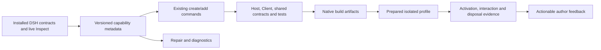

# DSHX plugin framework plan

## Context

Investigation date: **2026-10-05**. This is an implementation proposal, not a record of completed framework changes. The objective is to make a small, working plugin cheap to create and a substantial plugin straightforward to grow.

The maintained fork is already the right foundation. Continue **building with our local `@dshfiles/dshx` hard fork**: it owns compilation, authoring adapters, inspection, scaffolding, and diagnostics. DSH/Cordis own activation, scope, transport, state, registries, and cleanup. Another framework adoption or another fork would duplicate the work we have already earned. BB and OpenCode2 supply implementation ideas; they are not target runtimes or dependencies.

### Investigation scope and evidence limits

- Reviewed the complete visible ancestor history from repository setup through the current plugin fixes, plus the distinct `fast-fixes` and `hardening2` heads. Inspected selected changes behind the recurring failures, rather than treating commit titles as implementation proof.
- Mapped the framework source, creator templates, test surfaces, every owned package, and the BB plugin collection. Read the current SDK, architecture, compatibility, boot-integrity, hardening, and plugin boundary documentation.
- Checked installed native DSH declarations for conversation actions, subprocesses, and tool testing. `IConversation` is publicly exported and includes typed `updateQueue`; a plugin-local partial interface is therefore a typing/integration problem, not evidence that this action is absent.
- Found installed OpenCode2 at `/nix/store/8ac0acppdagyw0hw7rqkla6y8y741494-opencode2-2.0.20/bin/opencode2`. Compared official source at tag `v2.0.20`, tree SHA `84c9be93a56304a108f1a22df0c5d62c26d5b6ca`. Older OpenCode plugin examples use a different contract.
- Reproduced the two scaffold command failures below using official fnm Node **22.23.3**. Did not install bundles, mutate profiles, start a Host, drive a browser, or benchmark authoring time during this planning task. Historical boot reports are attributed to their revisions; they are not fresh runtime verification.
- The checkout changed concurrently during inspection. Source findings describe the observed tree; related work on other heads and unfinished working-copy changes must be reconciled before implementation. This plan does not authorize automatic history integration or promotion into `web`.

### What already exists

| Area           | Implemented foundation                                                                                 | Preserve                                                                 |
| -------------- | ------------------------------------------------------------------------------------------------------ | ------------------------------------------------------------------------ |
| Authoring      | `definePlugin`, `defineClientPlugin`, lower-level Host/Client definitions, native context escape hatch | Additive migration; native types and lifetime semantics                  |
| UI             | Typed slots, panel/navigation pairing, composer actions, declaration-following registration            | Native props, slot ownership, HMR, and scope                             |
| RPC            | Shared `defineApi` contracts, Standard Schema validation, cancellable calls, `useApiQuery`             | Host/Client graphs remain separate; authentication belongs to Connection |
| Settings       | Loader-owned protocol-2 schema/forms, revisions, redaction, live updates                               | No parallel preferences persistence                                      |
| Tooling        | Build/check/dev/package, offline profile composition checks, inspect, repair, platform CLI             | Existing Oxc parser and bounded native outputs                           |
| Testing        | Real Cordis/tool/command/prompt/slot harnesses, Host/browser boot checks, behavior E2E                 | Distinguish registration, activation, rendering, and behavior evidence   |
| Compatibility  | Protocol-2 adapter, verified release list, platform dependency guards                                  | Installed contracts, not semver alone, decide support                    |
| Shared helpers | Ambient browser declarations and managed process cleanup                                               | Extend only where multiple callers share an invariant                    |

Primary sources: [SDK](../tooling/dshx/docs/sdk/getting-started.md), [architecture](../tooling/dshx/docs/architecture.md), [compatibility](../tooling/dshx/docs/compatibility.md), [fork provenance](../tooling/dshx/FORK.md).

### Lessons from past revisions

Commit IDs identify the inspected historical content. Use `jj show <id>`; do not infer that another head's changes are present here.

| Revisions                                                          | Lesson                                                                                                                               | Framework consequence                                                                                        |
| ------------------------------------------------------------------ | ------------------------------------------------------------------------------------------------------------------------------------ | ------------------------------------------------------------------------------------------------------------ |
| `8252633e`, `848ed9de`, `f90009a4`                                 | Hard-fork ownership, protocol-1 retirement, and documentation pruning already happened                                               | Keep one protocol-2 authoring path; do not resurrect upstream publishing machinery                           |
| `79cc90c2`, `21d681f3`, `2a17612a`                                 | Ambient declarations and platform package identity repeatedly forced plugin workarounds                                              | Put shared declarations and identity checks in tooling, not each plugin                                      |
| `35899754`, `aaa1422d`, `c4d407e0`                                 | Scaffolds and CLI parsing evolved separately; Oxc/native TS replaced the compiler API                                                | Exercise advertised commands through the built executable, including source edits                            |
| `175570d9`, `74d15e00`, `5747e339`, `97a2d3e5`                     | A second queue dock and borrowed locale namespace broke composition                                                                  | Explain ownership and replacement before registration; keep existing collision guards                        |
| `9ab8cff4`, `a2965830`, `0a6220dd`                                 | Source exports, helper bundling, and packaged declarations can drift                                                                 | Test actual public exports and built artifact imports, not source imports alone                              |
| `9afb9746`, `2b08c8b7`, `86e1327c`, `9fe64933`                     | Provider package edges, Cordis injection, and render-time service access were repeatedly confused; heads contain differing diagnoses | Verify native ownership/default injection once, then share the result between runtime and tooling            |
| `f5544986`, `bb44c4ef`, `e7fa87ed` and current account-store edits | Module state, concurrent writes, and first boot reads are separate ownership problems                                                | Teach plugin-local state and awaited initialization; do not promise a generic store before comparing callers |
| `02e984e1`, `6eb53baf`, `fcb2bc95` on other heads                  | Boot process ownership, local profile sync, and inspect response validation already have fixes                                       | Review and reuse these changes before proposing duplicate implementations                                    |

Related plans: [boot integrity](./plugin-boot-integrity.md), [E2E testing](./dsh-e2e-testing.md), [repo hardening](./repo-hardening/README.md), [async questions](./async-agent-questions.md). Their historical checkboxes do not replace current source inspection. This plan owns the proposed authoring workflow; implementation/API documentation remains in `tooling/dshx/docs` once behavior ships.

### Current plugin pressure

Ten packages are bundles; `project-folder-picker` is a source library. Inventory is about framework pressure, not a proposal to recreate every feature as an SDK capability.

| Package                 | What it exercises                                                            | Useful framework improvement                                                                           |
| ----------------------- | ---------------------------------------------------------------------------- | ------------------------------------------------------------------------------------------------------ |
| `ai-accounts`           | RPC, panels/footer, provider hooks, config, durable quota history            | Typed config and lifecycle recipes; domain refresh only through verified native seams                  |
| `queue-reorder`         | Native dock replacement, session scope, tool/RPC reuse                       | Typed scoped UI example, deliberate replacement diagnostics, no manual decorator                       |
| `thread-sidebar`        | Shell/child slot ownership, layout, workspace/session projections, shortcuts | Discoverable slot contracts and explicit render-time dependencies                                      |
| `jujutsu`               | Panel/RPC, cancellable subprocess, preview/confirm mutations                 | Complete panel scaffold; native process recipe; keep repository identity and confirmation domain-local |
| `mcp-servers`           | Credentials, managed processes, RPC, panels, command UI                      | Capability catalog and safe imperative UI registration; keep OAuth/MCP lifecycle local                 |
| `secret-catalog`        | Validated CLI boundary, redacted views, panel, folder selection              | Shared-contract recipes and execution context; avoid a generic secret API                              |
| `settings-search`       | Native `ConfigForms` descriptors and field mutation                          | Settings recipe with honest navigation limits                                                          |
| `shortcuts`             | Browser capture handlers and disposal                                        | Small client-only scaffold and real keyboard behavior test                                             |
| `agent-communication`   | Tools, Host events, CLI/MCP, durable inbox                                   | One domain operation reused across adapters; preserve untrusted-peer-text boundary                     |
| `plugin-marketplace`    | Catalog/RPC, install jobs, native bundle metadata                            | Bundle packaging/install verification; keep catalog/install policy in the plugin                       |
| `project-folder-picker` | Reusable React component with injected ports                                 | Explicit library/bundle distinction; do not add activation metadata to a component library             |

### Concrete remaining gaps

1. **Advertised scaffold commands currently fail.** From `plugins/@dshfiles/ai-accounts`, `fnm exec --using 22.23.3 node ../../../tooling/dshx/packages/dshx/dist/cli/bin.js add panel --id framework-plan-probe --dry-run --json` exits 2 with `Unknown argument "panel"`; substituting `api` produces the same failure. Help lists both. `src/cli/args.ts` accepts only `ui`, `tool`, `command`, and `hook` in its add-target branch. Source and built behavior agree here; this is not merely a stale bundle hypothesis.
2. **The underlying presets are incomplete workflows.** `cli/run.ts::runAddPreset` writes files with direct `writeFile`, then tells panel authors to register them manually. `panelClientEntry` and `apiHostEntry` exist in `scaffold/presets.ts`, but this path does not use them. Generated API helpers remain unregistered until hand wiring, and repeated APIs share `src/api.ts`.
3. **Capability knowledge is duplicated and incomplete.** Runtime `sdk/client.ts` maps uses to service names; `compiler/client/capabilities.ts` separately maps uses to provider packages and recognizes only three raw setup services. `shortcuts`, `layout`, `uiWorkspace`, `workspaces`, `commandUi`, and `remote` accesses in real plugins show why setup-only analysis is insufficient. Another head already corrects some default-injection/provider assumptions.
4. **Advanced UI exposes avoidable traps.** SDK `api.ui.register` already follows declarations and decorates components. Lower-level imperative registration makes authors remember both manually. Queue-reorder restates a `ConversationService` interface even though native `IConversation` exists; thread-sidebar reads services in closures invoked later during rendering.
5. **Local linking disagrees with the repository's proven installation path.** `profile/orchestrator.ts::ensureProjectProfile` calls `dsh plugin ... add <project.root>`. Repository evidence documents that local `pnpm add` fails while a `link:` manifest dependency plus `pnpm install` works. Another head's `scripts/profile-sync.ts` implements that route outside dshx.
6. **Verification can still report a misleading success.** `browser-boot.ts` treats a missing boot card as success, and `client-boot-check.ts` filters pending entries without proving the expected plugin mounted. A blank document or stalled readiness can therefore evade the intended condition; this is a source-level risk to reproduce with a native fixture before fixing it. `DSHX_BOOT_PROFILE_ROOT` is set by boot checks, but these functions do not themselves prepare the requested bundle; inspect the actual DSH consumer before claiming isolation or installation.
7. **Typed configuration stops at the SDK boundary.** `BasePluginApi.config` is a `Readonly<Record<string, unknown>>`. Plugins must decode their domain config themselves; introducing a decoder should preserve protocol-2 resolver unwrapping and settings redaction, not recreate Settings.

## Goal

Create, extend, and verify an ordinary native DSH plugin through a short, reliable workflow with no hand-written provider metadata, forgotten registration wiring, or unexplained runtime workarounds for supported capabilities.

Measure success by complete working examples and fewer manual steps. More exported helpers alone are not progress.

## What

Deliver seven ordered slices:

1. Repair and baseline the real authoring commands.
2. Centralize supported capability metadata and native ownership evidence.
3. Make existing `add` scaffolds complete, atomic, and repeatable.
4. Make project profile preparation and verification reliable.
5. Remove advanced UI and config traps through narrow, additive APIs.
6. Publish tested multi-surface recipes, adding helpers only after two real consumers prove them.
7. Integrate live discovery and diagnostics into the authoring loop, including agent-driven authoring.

Existing definitions and native extensions remain usable. Prefer improving `defineClientPlugin`, `definePlugin`, `defineApi`, and existing commands over inventing a second declaration DSL.

## Why

The expensive part of creating our plugins has become integration: finding the right slot, loading the right provider, declaring the right scope dependencies, wiring both halves, rebuilding the fork, and discovering that a green check never opened the panel.

Recent revisions already show the same failures across several plugins. That is enough evidence to improve tooling. It is not enough evidence to introduce universal persistence, routing, jobs, or provider-management runtimes.

## How

### Conceptual model

One domain implementation, shared validated boundary contracts, thin surface registrations, and a toolchain that produces and verifies native artifacts.



The catalog describes how to reach native services. It is not another service registry, permission system, or runtime cache.

### Inspiration to transfer

**BB:** `~/dev/bb-plugins/plugins/secret-catalog/server.ts` and `jujutsu/server.ts` use shared contracts and machine-specific Host operations across UI/RPC/tools/CLI. Secret Catalog derives the agent's execution location rather than accepting an arbitrary tool target. Adopt the shared-domain/thin-adapter pattern and execution-context discipline; DSH's Host and tool context decide the actual implementation. AI Accounts provides useful account/usage presentation and collection examples, not justification for a generic SDK quota subsystem.

BB's `sidebar-resize`, `settings-search`, and `diff-viewed` also contain DOM-dependent adaptations. Preserve their user behavior where native DSH slots exist; do not turn private DOM/Fiber inspection into framework APIs. `preserve-child-threads` demonstrates compensating state mutation; prefer a native archive policy when DSH offers one. `sidebar-commands/server.ts` is empty, so its server is not an implementation to port.

**OpenCode2 2.0.20:** Its [Promise context](https://github.com/anomalyco/opencode/blob/v2.0.20/packages/plugin/src/promise/plugin.ts) exposes named domains and cleanup. [Registration types](https://github.com/anomalyco/opencode/blob/v2.0.20/packages/plugin/src/promise/registration.ts) make early disposal explicit; [RPC types](https://github.com/anomalyco/opencode/blob/v2.0.20/packages/plugin/src/promise/rpc.ts) couple handlers to portable definitions and cancellation. These are useful ergonomic references for existing Cordis-owned adapters.

Its [versioned authoring examples](https://github.com/anomalyco/opencode/blob/v2.0.20/packages/plugin/src/README.md) distinguish synchronous collection transforms from live hooks and explicit domain reloads. Transfer that distinction into documentation and native capability investigation. Do not emulate collection transforms or reloads when DSH supplies only registration or events. Its separate [Host entrypoints](https://github.com/anomalyco/opencode/blob/v2.0.20/packages/plugin/src/host.ts) reinforce our existing Host/Client boundary. Promise/Effect parity is inspiration, not a reason to expose two new dshx SDKs.

### Operations / behavior

Command names below use existing commands where possible. New options and examples are proposed behavior, not current syntax guarantees.

| Author action                           | Required result                                                                                                                       |
| --------------------------------------- | ------------------------------------------------------------------------------------------------------------------------------------- |
| Create basic/UI/tool/full-stack project | Source, manifest, scoped Loader ids, local SDK link, supported toolchain, runnable meaningful tests                                   |
| `add panel`                             | Component/styles, paired registration through existing panel SDK, needed imports/providers/peers, registration/unload test            |
| `add api`                               | Uniquely named shared contract, wired Host handler, usable Client example, schema validation test                                     |
| `add ui`                                | Resolve installed slot contract; explain additive/replacement behavior; preserve native overloads and child declarations              |
| Dry-run any scaffold/repair             | Full source and metadata diff, structured diagnostics, zero writes or profile mutations                                               |
| Repeat an existing scaffold             | Deterministic no-op or conflict explanation; no duplicate registrations and no partial file writes                                    |
| `dev`                                   | Prepare the intended project profile, validate Node/package manager, build/watch, use native HMR/restart, own only launched processes |
| `check --fix`                           | Derive only provable metadata; preserve manual declarations; unknown dynamic source stays explicitly unknown                          |
| Boot verification                       | Prove expected bundle is linked, composed, active, and usable; timeout/pending/no application is not success                          |
| Inspect unavailable seam                | Report missing native capability and owner; do not manufacture a slot/service from an offline guess                                   |

### Tech choices

| Choice               | Decision                                                                          | Rationale                                                                        |
| -------------------- | --------------------------------------------------------------------------------- | -------------------------------------------------------------------------------- |
| Runtime              | DSH/Cordis only                                                                   | Existing scope, disposal, admission, persistence, and HMR are authoritative      |
| Authoring            | Existing SDK plus native escape hatch                                             | Keep compatibility and avoid parallel APIs                                       |
| Source analysis      | Existing Oxc parser and file-plan helpers                                         | Reuse installed tooling; no source evaluation or TS compiler API                 |
| Boundary schemas     | Standard Schema for SDK decoding; native schema rules for tools/settings          | RPC already supports Standard Schema; do not promise arbitrary schema conversion |
| Capability metadata  | Narrow private catalog per compatibility generation                               | Shared by runtime injection, diagnostics, repairs, templates, and docs           |
| Profile installation | Native registry install; verified `link:` manifest/install path for local bundles | Distinct operations with distinct ownership; no automatic mutation of `web`      |
| Validation           | Real native registration tests plus isolated built-artifact/browser scenarios     | Typecheck, boot, and meaningful behavior answer different questions              |
| Dependencies         | Existing pinned TS 7, pnpm 12, Vite 8.1+, Oxlint/Oxfmt setup                      | No toolchain migration required by this proposal                                 |

### Architecture

Keep changes at existing domain boundaries:

- `compat/`: capability descriptors and verified native provider ownership. Keep Node tooling dependencies out of browser-importable runtime metadata.
- `sdk/`, `client/`, `host/`: native adapters, typed config decoding, and safe registration. Registration ownership stays with the caller's Cordis fiber.
- `compiler/`, `project/`: use the shared analysis result for build/check/repair; preserve final-chunk hook inference after tree-shaking.
- `scaffold/` and `create-dshx/`: a shared contribution plan, not separate rendering and wiring implementations.
- `profile/` and `dev/`: project link/install and process ownership, including restart-vs-HMR decisions.
- `testing/` and existing E2E support: native-provider fixtures and complete authoring workflow scenarios.
- `docs/`: tested recipes and support matrix. Retain upstream decision history as provenance, not active API guidance.

## What this allows

- Add a real panel or API to an existing plugin without hunting down registration boilerplate.
- Extend ordinary slots with RPC/settings hooks without remembering a decorator.
- Get a diagnostic naming the missing service/provider and the specific known repair.
- Reuse one domain operation across a UI handler, agent tool, or command without divergent behavior.
- Iterate in a prepared scratch profile and distinguish a successful build from a usable plugin.
- Give an agent the installed contracts, safe edit plan, and repeatable checks needed to author plugins.

## What this does not allow

- Automatic promotion into the session's `web` profile, publishing, or history integration.
- A second session database, global provider catalog, RPC transport, job runner, permissions system, or routing runtime.
- Arbitrary durable conversation event vocabularies through the currently unsupported `defineConversation` path. Re-exported native event types do not prove a mutable runtime registry.
- Invented parked-session persistence, authoritative idle timestamps, clean URL routes, repository directory capabilities, or settings owner navigation absent from native contracts.
- Wrapping every DSH service or copying BB/OpenCode APIs simply because those projects expose them.
- Shipping thin replacement plugins without the existing adoption survey and installed-runtime verification.

## UI & UX

The primary interface is CLI/editor feedback. A new developer dashboard is unnecessary for this scope.

Expected scaffold preview:

```text
dshx add panel --id usage-history --dry-run

Create  src/usage-history-panel.tsx
Create  src/usage-history-panel.module.css
Update  src/client.tsx                 register paired panel
Update  package.json                   known provider/peer edges
Create  tests/usage-history-panel.spec.ts

Native target: main + sidebar.panellist
Ownership: additive plugin-owned panel
Profile: probe; live composition verification still required
```

Expected failure feedback names the owner and stage: package edge, Cordis activation, scope resolution, slot declaration, component rendering, or behavior assertion. Pending dependencies show the dependency chain; they do not get presented as the cause.

Generated UI should use native visual primitives/tokens where available, accessible labels, keyboard interactions, and narrow-width layouts. Keep CSS Modules as the simple default; retain supported styling alternatives. Full UI scaffolds need an actual Client test rather than only the Host command test currently emitted for the UI template.

## Data model

No new application database. Tooling needs three bounded internal records:

| Record                 | Fields and invariant                                                                                                                                                                                                   |
| ---------------------- | ---------------------------------------------------------------------------------------------------------------------------------------------------------------------------------------------------------------------- |
| Capability descriptor  | Generation, face, public capability, native services, provider packages, required type imports, availability, ownership evidence. Only verified facts enable a capability.                                             |
| Contribution edit plan | Target, files with expected before/after content, metadata edits, diagnostics, verification steps. Apply after all preconditions pass; rollback this operation's edits on failure.                                     |
| Verification report    | SDK/source/artifact versions, profile identity, expected bundle/entries/contributions, stage outcomes, bounded redacted diagnostics, durations. Missing evidence is `unknown`/`pending`/`failed`, never implicit pass. |

Extend existing types where possible (`FilePlan`, `DshxDiagnostic`, build and boot reports). Do not persist another source of truth for package or profile composition. A saved report must omit tokenized URLs, cookies, credentials, and raw settings/CLI payloads.

## Implementation steps

### 1. Close the baseline and advertised-command gaps

1. Snapshot current source/head ownership and review the relevant pending fixes. In particular, resolve the differing service-injection diagnoses in `86e1327c` against `client/runtime.ts` and the installed renderer, and reuse `02e984e1`, `6eb53baf`, and `fcb2bc95` where applicable. Do not blindly merge whole heads.
2. Rebuild both local packages with official pinned Node. Add built-CLI regressions for every documented create/add target and valid/invalid option scope. Repair the reproduced `panel`/`api` parser branches and their error/help agreement.
3. Establish three authoring scenarios: command-only plugin, panel plus schema-validated RPC, and composer/dock contribution. Record commands, manual metadata/source edits, elapsed times by stage, and failures.
4. Record cold install/build and warm edit/rebuild separately. Measure baseline before choosing timing targets; do not claim a speedup from code size or anecdotal timestamps.

**Exit:** advertised commands execute; each scenario has a reproducible baseline and known failure stage. This is the smallest immediate framework change.

### 2. Unify capability metadata and checks

1. Inventory native package/service ownership, default Client injection, declaration imports, compatibility capabilities, and existing hook inference.
2. Replace duplicated mappings with the smallest catalog shared by runtime injection, compiler/check/repair, and templates. Keep raw custom Cordis injection supported.
3. Cover known optional services used by our plugins. Separate package load edges from service injection and from session-scoped service lookup; distinguish provided service, optional service, and unavailable capability.
4. Preserve soundness: static aliases and literal tuples can be recognized; arbitrary closures/spreads/computed runtime registration require explicit declarations and runtime verification. Do not claim complete interprocedural dependency inference.
5. Extend deterministic repair to missing known peers/development types when the pinned generation supplies the version. Never guess versions, overwrite manual policy, or uninstall unrelated dependencies.

**Exit:** one descriptor change updates all consumers; valid/invalid capability combinations have type and runtime coverage; existing raw definitions retain their documented default behavior.

### 3. Finish transactional scaffolds

1. Move panel/API presets onto the existing file-plan/rollback path used by other scaffold commands.
2. Wire panels through `api.panels.register`; wire API handlers into the actual Host definition and emit a real Client usage example. Use unique contract modules so a second API does not collide with `src/api.ts`.
3. Share generation logic with create templates. Preserve imports, aliases, formatting, and explicitly disabled faces. Ambiguous or dynamic setup code produces a proposed diff plus a precise limitation rather than a speculative rewrite.
4. Plan all files and metadata before applying. Check expected source contents immediately before writes; preserve concurrent edits. Prove rollback, dry-run, duplicate detection, Unicode offsets, and repeat execution.
5. Generate a meaningful registration/validation/disposal test for the new contribution. Avoid tests that merely snapshot the generated string.

**Exit:** a panel and two APIs can be added to a basic plugin, then checked/built/exercised without hand-edited registration or manifest fields.

### 4. Prepare and prove isolated profiles

1. Inspect how DSH resolves profile roots and whether `DSHX_BOOT_PROFILE_ROOT` is recognized. Provision the requested bundle explicitly and assert the composed configuration includes it before boot.
2. Move the proven local `link:` install operation into `profile/` after reviewing the existing sync script. Preserve unrelated bundle/dependency/config entries; refuse to retarget an existing link silently. Use dry-run and bounded rollback/error reporting.
3. Check official Node identity, pinned version, pnpm/store agreement, local SDK build freshness, and Cordis identity before install/boot. Diagnose mismatches without one-off global configuration fixes.
4. Reuse existing Host process-group ownership fixes. Ensure `finally` cleanup after timeout, cancellation, failed spawn/navigation, and successful checks; never stop a Host the check did not launch.
5. Reproduce readiness risks with real malformed/stalled fixtures. Require the native application readiness surface plus expected entries/contributions; permit pending only where an explicitly identified scenario does not require that scoped service.
6. Validate both a minimal native profile and a composed probe profile with sibling bundles. Include panel open, successful/invalid RPC, unload, and rebuild/HMR where relevant. A screenshot/card absence alone is insufficient.

**Exit:** intentional import, missing provider, missing decorator, locale collision, and missing expected bundle fixtures fail at the correct stage; success leaves no owned listener/process behind. `web` remains untouched.

### 5. Remove UI and config escape hatches

1. Migrate imperative registrations that fit `api.ui.register` in at least two real plugins. Preserve overloaded native options, injected props, locale, priority, children, and unload/redeclaration behavior.
2. Add a scoped registration convenience only if both queue-reorder and another actual consumer need the same lookup/lifetime semantics. First attempt a native typed context lookup using public `IConversation`; do not ship another partial interface or service-name cast.
3. Expose the installed slot's owner, mode/key, native props, required providers, current occupants, replacement priority, and child obligations through existing inspect/explain output. Extend occupancy analysis to SDK registration paths; reuse the current slot-analysis work rather than duplicating it.
4. Introduce an optional Standard Schema config decoder to the existing Host definition, inferred into `api.config`. Keep resolver unwrapping before decoding, one decode per setup, redacted error paths, and current behavior for definitions without a decoder. Prove settings live reactivation and valid/invalid config behavior.
5. Replace account config parsing boilerplate only after native lifecycle behavior is demonstrated. Avoid making browser config implicitly contain Host secrets.

**Exit:** migrated callers contain no manual component decorator or duplicated service interface; typed config rejects invalid data without logging values; shell replacement still has explicit native child ownership.

### 6. Publish tested domain recipes; earn new helpers

1. Build recipes from real callers: panel/RPC (`jujutsu`, `mcp-servers`), session-bound UI/tool operation (`queue-reorder`), settings (`settings-search`), lifecycle/cancellable collection (`ai-accounts`), native subprocess (`jujutsu`, `secret-catalog`), and tool/CLI/MCP adapters (`agent-communication`).
2. Show the domain operation once and adapters separately. RPC peers and agent tools have different admission/context rules; do not auto-expose every API method as a tool or command.
3. Keep native tool parameter/output schemas, execution policy, rendering, concurrency, and cancellation explicit. Prototype schema/tool boilerplate reduction only when native APIs can preserve those semantics; no generic Standard Schema-to-tool converter without proof.
4. Compare durable state requirements before extracting storage helpers. Initialization, write serialization, history retention, credential redaction, and cross-process safety differ; begin with recipes and focused native tests.
5. Investigate skills/agent preset/provider-refresh APIs as separate capability records. Add conveniences only for verified native seams and at least two consumers. Make unavailable creator mode visible rather than assuming packaged skills are mounted.

**Exit:** each recipe compiles, runs a native behavior test, and links to a real consumer; every new helper has two callers and a documented invariant.

### 7. Complete the discovery and authoring loop

1. Connect existing inspect/explain information to create/add dry-runs, with schema-versioned JSON reports, source locations, native owner, known remedy, and unknown capability status.
2. Document three short end-to-end paths plus the raw-context extension path. Provide an agent-readable capability summary and recipes from the same verified metadata.
3. Run the baseline scenarios again. Target **zero manual provider/peer/registration edits** for supported ordinary workflows, one shared API contract, and one explicit capability declaration per face. Report timing changes only against matched baseline conditions.
4. Fold completed API behavior into the fork docs, mark delivered steps here, and keep unresolved Host requests separate from SDK promises.

**Exit:** an author can discover a supported seam, generate a complete contribution, and prove it works without reading internal compiler source.

## Open questions

These are implementation investigations, not prerequisites for approving this document.

1. Does the installed DSH recognize the boot-profile root override, and which official profile operations support fully isolated bundle provisioning? Resolve before changing boot-check guarantees.
2. Can native context typing express session-scoped conversation lookup and declaration-following injected props directly? Prefer native types; an SDK scoped helper needs a second caller.
3. Which slots expose suitable stable readiness/ownership information for browser assertions? Use native composition evidence plus actual interaction when no public readiness API exists.
4. Are provider catalog refresh, skill mounting, and agent configuration publicly mutable in this generation? If absent, write a concrete Host capability request; do not simulate an OpenCode collection transform.
5. After the three baseline scenarios, does cold install, typecheck, build, or browser startup dominate time? Use that result to decide whether caching work is justified and where invalidation belongs.
6. Can native tool schemas express the desired schema-derived authoring shape without weakening inference, output rendering, or policy? Until demonstrated, retain native `defineTool` and improve recipes/scaffolds.

## Acceptance criteria

- [ ] All advertised create/add targets run through the built local executable; unsupported arguments fail with matching help and actionable diagnostics.
- [ ] Basic, UI, tool, and full-stack templates pass supported style/face combinations; public APIs cover meaningful valid and invalid type combinations.
- [ ] `add panel` and repeated `add api` produce usable wired contributions and meaningful native tests without manual registrations or provider metadata.
- [ ] Dry-run performs zero writes; conflicts leave no partial scaffold; successful repetition produces no duplicated imports/contributions.
- [ ] Runtime injection, diagnostics, repair, and templates share verified capability facts; dynamic source is reported honestly.
- [ ] At least two migrated imperative UI consumers use existing safe registration and preserve scope, props, cleanup, HMR, and replacement behavior.
- [ ] Typed config is opt-in, schema-inferred, validated once per setup, and redacted; current raw/native extension behavior remains supported.
- [ ] Local project linking uses the verified installation route and preserves unrelated profile state; library packages are not mistaken for bundles.
- [ ] Minimal and composed profile checks prove the expected plugin is present, active, rendered, and exercised; pending/blank/timeout states cannot masquerade as success.
- [ ] Built Host artifacts import on bare official Node; emitted Client artifacts and public declarations expose the actual intended native module shape.
- [ ] Check-owned Hosts/profiles are cleaned up on every tested exit path; existing sessions and `web` are unaffected.
- [ ] Shared helpers have two real consumers; unsupported Host seams remain explicit rather than becoming workarounds.
- [ ] Before/after authoring reports show zero manual metadata/wiring edits for supported scenarios and separate cold/warm stage timings.
- [ ] Focused regressions, framework/plugin typechecks, lint/format, and native integration evidence are reported separately from pre-existing baseline failures.

## Decisions log

| Date       | Decision                                                                                      | Rationale                                                                                 |
| ---------- | --------------------------------------------------------------------------------------------- | ----------------------------------------------------------------------------------------- |
| 2026-10-05 | Continue the local hard fork; improve existing authoring APIs and commands                    | The needed compiler, adapters, native tests, and real consumers already exist             |
| 2026-10-05 | Begin with reproduced CLI gaps and complete scaffold wiring                                   | Fast plugin creation first requires commands that reach a working registration            |
| 2026-10-05 | Verify capability ownership before centralizing metadata                                      | Other heads show differing diagnoses; consolidating an incorrect map would spread the bug |
| 2026-10-05 | Use BB implementations and versioned OpenCode2 2.0.20 source as design evidence               | Transfer useful invariants while respecting different native APIs and boundaries          |
| 2026-10-05 | Prefer tested recipes before persistence/jobs/provider abstractions                           | Repeated syntax alone does not establish shared domain semantics                          |
| 2026-10-05 | Keep implementation, profile promotion, and historical integration outside this planning task | Investigation and a reviewable Markdown plan are the requested deliverable                |
| 2026-10-05 | Delivered the boot-gate composition proof, Node pinning, and the profile `link:` route (steps 4.1–4.3) | The isolated gate proved vacuous: it booted an empty profile while provisioning elsewhere. Now it installs into `DSHX_BOOT_PROFILE_ROOT`, asserts the bundle in offline `dump-config`, and refuses an unpinned Node. `ensureProjectProfile` links through the proven `link:` manifest + pnpm install route with re-inspection. Composition fixtures and remaining browser-stall scenarios (4.5–4.6) remain open |
| 2026-10-05 | Delivered the parser repair and transactional `add panel`/`add api` presets (steps 1.2, 3.1–3.5) | Advertised commands now reach the built CLI: panel wiring uses `api.panels.register`, API contracts live in unique `src/api/<id>.ts` modules, dry-run/refusal leave zero writes, and generated tests mount the contribution. The three baseline scenarios (steps 1.3–1.4) and capability catalog (step 2) remain open |
