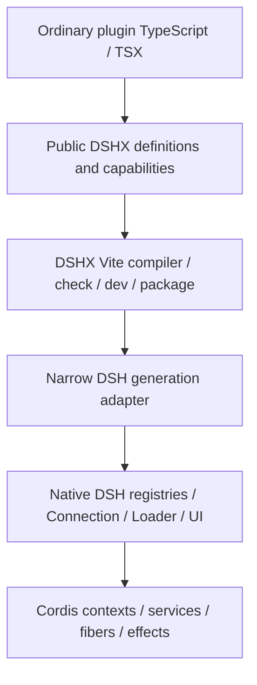

# DSHX plugin SDK architecture plan

Research snapshot: 2026-10-03. Status: proposed architecture, before implementation.

## Context — current state

**Choose option 2: evolve the existing DSHX fork.** It already does the difficult build, dependency, profile, inspection, and transport work. Keep its upstream bookmark and add a coherent author-facing API inside its existing package. A separate SDK stacked above DSHX would duplicate integration ownership. No DSH fork, replacement Cordis container, or independent plugin runtime is needed for the first slices.

This is a research/design deliverable. Examples marked proposed are not available APIs or verified running plugins. The evidence ledger is [dshx-sdk-evidence.md](./dshx-sdk-evidence.md); its source links, symbols, versions, and fingerprints make the findings reviewable.

### What was actually inspected

- DSHX fork `packages/dshx/src`, relevant tests, `packages/create-dshx/src`, fixtures, and authoring/build documentation. Package version: `0.1.4-preview.3`.
- Installed DSH `0.2.0-rc.2` declarations **and executable implementations**, including commands, tools, settings, client slots/renderer/modules/HMR, conversation input, layout, shortcuts, connection, sessions, agent events, and Cordis `4.0.4` source.
- Corresponding upstream DSH source for commands, slot renderer, conversation slots, and settings. Upstream `master` is supplementary; installed contracts decide compatibility.
- Installed BB SDK `0.4.47` declarations/runtime exports and current installed BB authoring references. These disagree in age; newer guide claims are identified as guide evidence, not proof that the older SDK implements them.
- OpenCode `dev` source: the actual v2 Promise and Effect plugin definitions, capability contexts, registration handles, core adapter, lifecycle owner, and lifecycle design status. This is evolving source, not an assertion that “OpenCode 2” is a released stable contract.

The fork is **not yet in this checkout**. Inspected location:

```text
/Users/astahmer/Documents/deepseek-harness/default-workspace/
  forks/dshx-fork/
  @dshfiles/ai-accounts/
```

`/Users/astahmer/dev/dshfiles` contained setup/instructions only when research started. The other agent's move/build/install claims are therefore not treated as completed work here. Its working files were not changed. The profile manifest inspected does not list `@dshfiles/ai-accounts`; this is an observation of saved metadata, not a complete activation diagnosis.

Official fnm Node `22.23.3` was selected explicitly for `dsh --version`, which returned `0.2.0-rc.2`. The ordinary shell initially resolved Node `24.20.0`, different from `.node-version`. `--dump-config` unexpectedly prepares/writes the profile's generated `cordis.yml` and was stopped by the filesystem sandbox. No claim is made that the current live slot tree or plugin activation was verified. Source/contracts are sufficient for this architecture deliverable; live composition checks remain slice acceptance gates.

### What DSHX already abstracts

| Area | Existing behavior | Remaining author work |
|---|---|---|
| Host definition | `defineHost`, native named exports, inferred injection from declarative commands/tools/prompts/settings/APIs | `setup(ctx)` exposes Cordis; imperative service dependencies are explicit |
| Client definition | `defineClient`, `defineSlot`, `defineLocale`, native named exports | Native slot keys, providers, owner props, store/inject/render shares |
| Commands | `defineCommand` preserves native `CommandDefinition`; host array registration | Native slash-command semantics and result types |
| Tools | Re-exports native `defineTool`; host array registration | Native parameter/output schema and execution/presentation policy |
| RPC | `defineApi`, `method`, `.host`, `useApi`, `useApiQuery` | Shared schema contract, API id/version, adapter drift |
| Settings | `defineSettings`, host contributions, `useSettings` | Namespace/config-generation correctness in protocol 2 |
| Compilation | Separate Vite host/client builds, generated native exports and client factory, CSS/assets inlining, boundary guards | Manifest/config still exposes native package edges and externals |
| Development | Build watchers, profile preparation, DSH child coordination, host restart, config replacement and last-good session handling | Host process ownership, version/package-manager setup; client state-preserving refresh not guaranteed |
| Validation | Manifest/export/patch checks, migration diagnostics, typecheck, compatibility assessment, optional runtime checks, repair previews | Correctness of adapter claims and dynamic registrations |
| Inspection | Slots/services/events bridge and scaffolding from contracts | Availability varies by adapter and running profile |
| Scaffolding | `create-dshx` starter/showcase; `dshx add ui/tool/command/hook` | Product-oriented basic/UI/tool/full-stack templates |
| Testing | Internal Vitest tests, injected CLI/dev drivers, transport/React fixtures | No supported plugin-author testing export |
| Packaging | Validates publish targets and emits native artifacts | No `dshx package` CLI command |

Sources: [F1–F12 in the evidence ledger](./dshx-sdk-evidence.md#fork).

### Native loading and packaging

**Host:** a bundle declares `dsh.bundle.patch`. Its patch inserts ordinary Loader entries identified by entry id and package name. Cordis activates a plugin function/module/service with native dependency injection and Config validation. DSHX's virtual host entry normalizes either a declarative default export or native named exports into `name`, `inject`, `Config`, `apply`. Vite emits one Node ESM `index.js`; bare packages and Node builtins remain external. Package exports and dependencies must resolve from the installed plugin/profile/DSH environment. A successful build does not establish that resolution.

**Client:** the package declares `dsh.client` and a `./client` export. The Host supplies the native graph. The browser loader materializes registered lazy factories, resolves shared modules and package edges, and activates native Cordis client fibers. DSHX emits a single factory registration in `window.__ModuleLoader__.load({ id, factory: (require) => ... })` form. Shared React comes from DSH's module table. CSS is incorporated into the factory artifact; native module ownership tracks/removes its style elements. DSHX currently rejects extra client chunks, standalone assets, workers, and WASM artifacts.

`dsh.client.inject` describes **package graph edges**; exported `inject` describes **Cordis service dependencies**; `dsh.client.external` describes **module requests**. They are three different things. The high-level API/tooling should derive the common cases, not collapse them into an inaccurate single concept. [F3, F4, N1, N2, N12, N13](./dshx-sdk-evidence.md)

### Services, events, and lifecycle

Cordis owns DI, dependency activation, plugin fibers, service proxies, effects, and event dispatch. Service calls made through a plugin context can acquire resources in the **calling fiber**. Native commands/tools and the renderer's `SlotRegistry.register` already do this. Capturing an unbound method or a root-owned service can lose that ownership: adapter code must call through the correct scoped context.

`ctx.on` and `ctx.once` are typed by the declaration-merged `Events` table and return disposers. Event modes include synchronous emit, awaited parallel, serial/bail, and waterfall. Hooks are not all notifications: return values and `next` continuations can participate in dispatch policy. Preserve argument tuples, `this` scope, return types, and ordering semantics.

`ctx.effect` runs its body immediately, collects supported disposer shapes, and guards inactive contexts. An effect's cleanup is idempotent and its collected disposers run in reverse order. **Do not promise globally serial LIFO teardown:** installed `Fiber._unload` awaits top-level effects with `Promise.all`. Dependent shutdown belongs in one native effect/cleanup function with explicit ordering. [N3–N7](./dshx-sdk-evidence.md#native)

### Slots, panels, and composer

The pure `SlotCore` has declaration-merged `SlotMap` contracts. Kinds are `single`, `list`, `keyed`, and `chain`; scopes include `root`, `session-maybe`, and `session`. Registration composes owner props, standard runtime props/hooks, child render permissions, stores, locale, and plugin inject props. Native validation enforces cardinality, required kind fields, ownership, and store scope. Child declaration removal cascades into descendants.

The renderer's Cordis service adds caller-owned effects, declaration-lifetime `inject`, renderer installation, and store-instance management. Use `slots.inject(name, () => slots.register(...))` for an extension whose parent can appear/disappear. Do not create a second slot registry or eagerly fake undeclared targets.

Verified useful surfaces:

- `main`: keyed, root-scoped global panels.
- `sidebar.panellist`: list of icons/labels matched to `main` keys; `layout.selectPanel` owns selection.
- `sidebar.footer.action`: additive footer controls.
- `shell.overlay`: additive global floating UI.
- `conversation.view`: session views.
- `conversation.input.left` / `.right`: additive session composer controls.
- `conversation.input.dock`, `.overlay`, `conversation.composer.dock`: additive presentation.
- `conversation.input.attachments`: **single** attachment presentation seat, not an attachment-type registry.
- `conversation.composer`: chain of composer replacements, with native selector semantics.

A global panel is not implicitly bound to the selected session. Session selection and its absence must remain explicit in props/hooks. An arbitrary sidebar “panel” must choose whether it means a global main panel, footer content, or a replacement of a native region.

Conversation standard props already expose useful session/input hooks and `inputActions`. `captureInsertion` + `insertText(text, span)` protect asynchronous edits from overwriting a changed draft. Composer wrappers must retain this guard, not implement draft state of their own. [N6, N8–N10](./dshx-sdk-evidence.md#native)

### Commands, tools, settings, and transport

**Commands:** Host `commands.register` registers agent-aware slash commands, with optional per-agent shadowing, attachment admission, cancellation, and command run/done log records. Native shape is `name`, `description`, `handler(invocation) → CommandResult`. Client `shortcuts.register` is a different native mechanism for window-local application commands, keyboard bindings, regions, and target resolution. Keep these distinct in the public API; a universal command-palette claim is unwarranted. [N4, N11](./dshx-sdk-evidence.md#native)

**Tools:** native `defineTool` already infers arguments/output from its parameter schema and canonical output schema. It supports cooperative timeout, concurrency classification, cancellation context, output rendering, policy hooks, and presentation. Re-export/lightly wrap it; do not bypass `ToolRuntime` or replace its execution pipeline with direct function calls. [N5](./dshx-sdk-evidence.md#native)

**Settings:** protocol 2 derives forms from each Loader entry's native `Config` schema and its volatile fields. Identity is the Loader entry id, not an independently registered namespace. Host `settings.describe/update/replace/mutate` and client `ConfigForms` own synchronization, revision checks, writes, and redaction. `ConfigForms.set/unset` return **boolean acceptance**, not `Promise<void>`. Schema/defaults must exist before plugin activation; this makes a free-form late `api.settings.register(schema)` a poor foundational API. [N7, N14](./dshx-sdk-evidence.md#native)

**RPC:** native `connection.rpc.handle(channel, handler)` registers an authenticated channel; handler receives `(endpoint, payload, signal, peer)`. Host/Origin and browser authentication live in Connection. DSH's generated remote service layer is another native typed communication mechanism. DSHX already supplies a generic contract facade over Connection; extending that is cheaper than a new transport. [F5, N15](./dshx-sdk-evidence.md)

### Compatibility findings that must precede expansion

These are concrete source mismatches, not a claim that every existing plugin is broken:

1. `compat/protocol-2.ts` still declares client settings service `settingsScope`, while `settings/client.ts` reads `configForms` and the native client provides `configForms`. `createClientPlugin` still injects `settingsScope` for settings hooks.
2. Protocol-2 conversation metadata still enables/injects `conversationEvents` even though its own comment says that registry no longer exists. The client runtime still calls `.register` on it. Generic slot contributions are reusable; this experimental conversation path needs a separate audit.
3. `createHostPlugin` does not attach the settings contract schema as `Config`. `registerSettings` only configures a page policy and constructs a facade. Native settings descriptions require `entry.fiber.runtime.Config` and volatile fields. Therefore declarative `defineHost({ settings: [...] })` cannot be assumed to produce native editable settings. Multiple contracts also call native `configure` repeatedly for the same owner, which native code rejects.
4. Client settings adaptation casts away the native boolean write outcome and does not pass the contract's redacted-value decoder to a form. This needs explicit contract-fidelity coverage.
5. DSHX's structural RPC interface accepts `{ authority: 'loopback' | 'trusted-host' }` as a third `handle` argument. Installed native `handle` accepts two arguments and ignores that extra argument. DSH authentication still applies, but **DSHX's advertised per-handler authority restriction is not established**. Resolve supported trust policy through native Peer/Connection contracts or diagnose it as unsupported. Do not silently imply stronger access control.
6. `verifiedVersions: ['0.2.0-rc.1', '0.2.0-rc.2']` and a capability count are adapter metadata, not integration test results. Peer/package ranges alone likewise do not prove behavior.

Sources: [F2, F6, F7, N7, N14, N15](./dshx-sdk-evidence.md). First implementation slice should reproduce and repair these seams before adding more author APIs.

## Goal

Make DSHX the discoverable, strongly typed TypeScript/React SDK and complete toolchain for native DSH plugins, with DSH/Cordis retaining runtime ownership and the full customization ceiling.

## What

Introduce additive high-level host/client definitions and small capability facades in the existing DSHX package. Generate native integration artifacts, declare required services and package edges, expose raw scoped contexts, and publish testing/documentation that prove the generated behavior.

Keep source boundaries explicit:

```text
package.json             package identity/version/display metadata
dshx.config.ts           optional overrides; convention defaults for common cases
src/host.ts              optional Node entry
src/client.tsx           optional browser entry
src/contracts.ts         optional browser-safe shared schemas/types
src/components/*.tsx     ordinary React
src/*.css                ordinary CSS
```

Generated exports, manifest fields, and patch ownership must have one clear source of truth. Package identity/version stay in `package.json`; definitions may omit `id` and inherit it. An explicit logical `id` maps to a generated Loader entry id and must not silently disagree with the bundle patch. Custom multi-entry bundles remain an advanced native path.

## Why — pain points

1. Authors repeat package identity, Loader entry identity, logical plugin name, output paths, provider edges, externals, and service names without understanding their differences.
2. `setup(ctx)` requires discovery of Cordis ownership and DSH services even for a command or event listener.
3. Adding one panel means matching two native slot registrations and navigation identity.
4. Slot types are powerful but their declaration imports, injected shares, and scoped ownership overwhelm common UI work.
5. Existing settings/RPC abstractions can typecheck against structural stand-ins while drifting from native behavior.
6. “Vite” suggests a dev server/Fast Refresh contract that this implementation does not have: it uses build-watch and DSH client HMR.
7. Profile installs fail late on pnpm major/store mismatches, unresolved native peers, missing providers, or incompatible service contracts.
8. Internal tests exist, but plugin authors cannot exercise the same registrations and cleanup through a supported harness.
9. An install/check report currently risks sounding like runtime proof. Static checks, native activation, UI mount, and user-visible action success need separate reporting.

## How — proposed public API

All examples in this section are **proposed** except names explicitly identified as existing. Import spelling remains `@becomeopc/dshx` for comparison with the fork; distribution naming is a later decision. Avoid changing package identity merely for this design.

### Definition and capability selection

Use `definePlugin` in `/host`, `defineClientPlugin` in `/client`. One package, two ordinary native entries. No mixed Node/React module requiring semantic code partitioning.

`uses` is a small, typed capability declaration. It serves native DI, compile-time API availability, and generated package edges. `events`, `lifecycle`, `log`, and `raw` are baseline. This explicit dependency declaration avoids pretending arbitrary imperative setup can be analyzed perfectly. It is cheaper than repeated native plumbing and keeps errors local.

```ts
// src/host.ts — proposed minimal plugin
import { definePlugin } from '@becomeopc/dshx/host'

export default definePlugin({
  setup(api) {
    api.log.info('Plugin ready')
  },
})
```

```ts
// src/host.ts — proposed slash command
import { definePlugin } from '@becomeopc/dshx/host'

export default definePlugin({
  uses: ['commands'],
  setup(api) {
    api.commands.register({
      name: 'hello',
      description: 'Say hello',
      handler({ agent, signal }) {
        signal.throwIfAborted()
        return { kind: 'success', text: `Hello from ${agent.id}` }
      },
    })
  },
})
```

Keep native command vocabulary because it is already useful and correctly expresses invocation scope. `api.commands.register` is a lifecycle-safe facade, not a second command collection. Its return is a managed `Registration` with idempotent `dispose(): Promise<void>` for early removal. Unload removal is automatic.

Client window commands use `api.shortcuts`, preserving native keyboard region, modal, target resolution, and catalog semantics. A future convenience helper can supply defaults for a simple application action; do not merge it with Host slash commands.

Declarative existing `defineHost({ commands: [...] })` remains supported and already infers dependencies. New helpers may infer `uses` from declarative contribution descriptors later; no hidden dynamic dependency scanner is required for phase 1.

The equivalent native Host entry already needs very little lifecycle ceremony:

```ts
// Native DSH/Cordis — current primitive
import type { Context } from '@deepseek-ai/cordis'
import type {} from '@deepseek-ai/dsh-commands'

export const name = 'example'
export const inject = ['commands']
export function apply(ctx: Context) {
  ctx.commands.register({
    name: 'hello',
    description: 'Say hello',
    handler({ agent, signal }) {
      signal.throwIfAborted()
      return { kind: 'success', text: `Hello from ${agent.id}` }
    },
  })
}
```

Both paths use that same native registry and its caller-owned cleanup. Do not manufacture a verbose native strawman: for a command alone, improvement is dependency discovery and generated packaging. The larger gain appears when a plugin combines paired panel slots, provider graph edges, Config identity, typed transport, React contexts, and validation.

### React UI and low-level slots

```tsx
// src/client.tsx — proposed; component stays ordinary React
import { defineClientPlugin } from '@becomeopc/dshx/client'
import './status.css'

function Status() {
  return <span className="plugin-status">Ready</span>
}

export default defineClientPlugin({
  uses: ['ui'],
  setup(api) {
    api.ui.register('sidebar.footer.action', {
      id: 'status',
      order: 20,
      component: Status,
    })
  },
})
```

`ui.register` is the one generic slot facade; avoid synonymous `slots.register` and `ui.register` collections. Preserve native kind-specific options and `ComposedProps` typing, including custom declaration merging. The adapter defaults local contribution ids to package-qualified identities, preserves native ordering/priority, and uses native declaration-lifetime injection. Advanced authors can specify an exact native identity when intentionally shadowing.

The SDK's standard contract type entry imports supported owners' **types** so common native keys autocomplete without manual augmentation imports. It must not bundle other UI plugins' implementations. Keep local CSS and theme tokens; do not import arbitrary Host components or mount a second React root.

### Sidebar and panels

```tsx
// proposed global main panel plus sidebar navigation
import { defineClientPlugin } from '@becomeopc/dshx/client'
import { NotesPanel } from './components/NotesPanel'

function NotesIcon({ size }: { size: number }) {
  return <svg width={size} height={size} aria-hidden="true">{/* glyph */}</svg>
}

export default defineClientPlugin({
  uses: ['panels'],
  setup(api) {
    api.panels.register({
      id: 'notes',
      title: 'Notes',
      component: NotesPanel,
      sidebar: { icon: NotesIcon, order: 30 },
    })
  },
})
```

One panel helper installs `main` and optional `sidebar.panellist` contributions with a shared native panel identity. `api.panels.open('notes')` delegates to `layout.selectPanel`; it stores no selected-panel state. Native scoped effects roll back partial registration if the second contribution fails.

Expose `api.sidebar.registerFooter({ id, component, order })` for footer UI. Do not introduce a vague `sidebar.register` that implies arbitrary regions exist. Session views get a separate `api.views.register` over `conversation.view`; right-sidebar behavior remains native/raw until its actual controller is covered by a focused slice.

### Composer actions

```tsx
// proposed; available only on the client
export default defineClientPlugin({
  uses: ['composer'],
  setup(api) {
    api.composer.registerAction({
      id: 'insert-summary',
      title: 'Insert summary prompt',
      position: 'left',
      async onClick({ input, signal }) {
        const span = input.captureInsertion()
        const text = await Promise.resolve('Summarize this session.')
        signal.throwIfAborted()
        if (!input.insertText(text, span)) return // user edited meanwhile
      },
    })
  },
})
```

This helper creates a React action contribution in the native left/right list, reading context from native session standard props. It owns only button presentation, pending state, and cancellation of its callback. Scope/unmount aborts the callback; native input actions retain authoritative draft/submission state. A component form remains available for richer UI.

No generic `registerAttachment(type, handler)` is proposed yet. Native draft attachment support is image/file-specific and a single presentation seat is not extensible attachment admission. New arbitrary durable attachment kinds require native transport/admission/schema support unless a later audit finds an existing seam.

### Tools

```ts
// proposed definition facade; defineTool is the existing native helper
import { definePlugin, defineTool } from '@becomeopc/dshx/host'

const greet = defineTool({
  name: 'greet',
  description: 'Greet someone',
  parameters: { name: { type: 'string' } },
  output: {
    schema: { type: 'string' },
    render: (_args, value) => [{ type: 'text', text: value }],
  },
  async execute({ name }, { signal }) {
    signal.throwIfAborted()
    return `Hello ${name}`
  },
})

export default definePlugin({
  uses: ['tools'],
  setup(api) {
    api.tools.register(greet)
  },
})
```

Keep the native schema helper for initial support. A Standard Schema input adapter needs JSON Schema emission plus validation/output/presentation fidelity; not every Standard Schema validator supplies that. Do not claim arbitrary `schema: MySchema` support by casting validators to a native tool definition.

### Settings

```ts
// src/contracts.ts — proposed descriptor, backed by native schemastery Config
import { defineSettings } from '@becomeopc/dshx/settings'
import Schema from '@deepseek-ai/schemastery'

export const preferences = defineSettings({
  schema: Schema.object({
    greeting: Schema.string().default('Hello'),
    enabled: Schema.boolean().default(true),
  }),
})
```

```ts
// src/host.ts — proposed Config is declared before native activation
export default definePlugin({
  settings: preferences,
  setup(api) {
    api.settings.onChange(value => {
      api.log.info(`Enabled: ${value.enabled}`)
    })
  },
})
```

```tsx
// proposed typed hook inside a registered component
import { useSettings } from '@becomeopc/dshx/client'
import { preferences } from './contracts'

function GreetingEditor() {
  const settings = useSettings(preferences)
  if (settings.status !== 'ready') return <p>Loading preferences…</p>
  return (
    <input
      value={settings.value.greeting}
      disabled={!settings.writable}
      onChange={async event => {
        const accepted = await settings.set('greeting', event.currentTarget.value)
        if (!accepted) console.info('Preference changed elsewhere; view refreshed')
      }}
    />
  )
}
```

Definition-level `settings` emits native `Config` with editable fields marked volatile and binds identity to the actual Loader entry. Start with one settings descriptor per entry. Multiple pages may edit it; multiple independent namespaces require explicit native entries. Ordinary restart-requiring Config is separate from live settings, not an `applies: 'restart'` promise on a protocol-2 form.

Schemas/defaults have one source. Native Config validation/redaction, revision fencing, and ConfigForms writes remain authoritative. Client decoders must receive redacted values; never return host-only secret fields through inferred settings types. Preserve false acceptance and transport failures separately. If schema forms cannot represent a validator/transform, fail with a schema-path diagnostic or keep it as advanced native Config.

### Events and session/agent hooks

```ts
// proposed; callback arguments preserve native tuples and scope
export default definePlugin({
  setup(api) {
    api.events.on('session/created', session => {
      api.log.info(`Created ${session.id}`)
    })
  },
})
```

`events.on/once` should be a typed delegation to native listeners, including their `this` binding. Observer handlers must follow native event mode; a synchronous emit listener is not automatically awaited. Do not expose a generic async notification abstraction that changes dispatch.

After focused coverage, provide selected discoverable aliases such as `api.sessions.onCreated` and `api.agent.hooks.requestError`, mapped to exact native events. The request-error hook has a continuation/policy role; it must preserve that role. Session durable event vocabulary and live Cordis event notification are different layers. New custom durable events need projection/replay/schema support; postpone a high-level durable-event authoring API until that integration is proven.

### Host/client RPC

**Ship the existing explicit shared-schema path first.** It already avoids duplicate TypeScript interfaces and provides runtime validation. The API spelling can become `api.rpc.register(contract, handlers)` plus the existing `useApi(contract)`; preserve existing `defineApi` contracts.

```ts
// src/contracts.ts — existing contract helpers
import { defineApi, method } from '@becomeopc/dshx/api'
import { z } from 'zod'

export const notes = defineApi({
  id: 'notes',
  version: 1,
  methods: {
    get: method({
      input: z.object({ id: z.string() }),
      output: z.object({ id: z.string(), text: z.string() }),
    }),
  },
})
```

```ts
// src/host.ts — proposed registration facade
import { definePlugin } from '@becomeopc/dshx/host'
import { notes } from './contracts'

export default definePlugin({
  uses: ['rpc'],
  setup(api) {
    api.rpc.register(notes, {
      get: async ({ input, signal }) => {
        signal.throwIfAborted()
        return { id: input.id, text: 'A note' }
      },
    })
  },
})
```

```tsx
// registered client component — existing hook, proposed definition wiring
import { useApi } from '@becomeopc/dshx/client'
import { notes } from './contracts'

function ReadNote() {
  const rpc = useApi(notes)
  return <button onClick={async () => console.info(await rpc.get({ id: 'one' }))}>
    Read note
  </button>
}
```

Reuse native Connection, existing namespaced channels, error taxonomy, request signals, version envelopes, query cancellation, and reconnect observables. Audit strict JSON round-tripping: a `JSON.stringify` byte count alone does not reject Dates, undefined members, or lossy number values. Preserve native peer information for handlers that need authorization. Hash/channel collision ownership must span the actual shared connection, not merely one child context.

**Later optional handler inference:** a host export can infer a browser contract type without a handwritten duplicate interface:

```ts
// proposed future host-only module
export const handlers = defineRpcHandlers({
  get: rpcMethod({ input: z.object({ id: z.string() }) }, async ({ input }) => ({
    id: input.id,
    text: 'A note',
  })),
})
export type NotesRpc = RpcClientOf<typeof handlers>

// client module — type-only import, never runtime host import
import type { NotesRpc } from './host'
const rpc = useHost<NotesRpc>()
```

Type inference can eliminate repeated TypeScript types; it **cannot create runtime validation from erased TypeScript**. Input schemas remain mandatory for exposed methods. Output schemas remain mandatory when runtime output validation is promised. Inference-only outputs need an explicitly documented JSON-only safety boundary. No arbitrary compiler synthesis of validators in the first design. Type-only imports are valid; value imports of host modules from client fail with a boundary diagnostic.

### Raw Cordis and lifecycle

```ts
// proposed escape hatch; same scoped context native apply receives
export default definePlugin({
  setup(api) {
    api.raw.ctx.on('session/created', function (session) {
      // native `this` scope and native session remain available
      console.info(session.id)
    })
    api.lifecycle.onDispose(() => console.info('Unloaded'))
  },
})
```

`raw.ctx` is the real native Context, not a synthetic imitation. Advanced `ctx.plugin`, `ctx.inject`, services, event modes, stores, and custom slot contracts remain available. Native named-export modules remain the full escape path when a definition helper does not fit.

`lifecycle.onDispose` registers one native effect. `lifecycle.signal` is an AbortController **owned by that same fiber** for author callbacks/long-lived resources; it is not a replacement plugin lifecycle. Core registration APIs delegate cleanup to native registries. Only non-native resources need an additional native effect. Catch partial setup failure in a native setup effect/child fiber, abort cooperative work, and await native cleanup. Do not double-own already-owned registrations in an independent global disposal list.

## How — internal architecture



The diagram describes artifact/integration flow; SDK registration calls in the generated artifact delegate directly through the adapter to native services. The compiler is not on every runtime call.

| Layer | Owns | Does not own |
|---|---|---|
| Plugin source | Business logic, React components, local state, dependencies | Host boot, platform DI, shared React root |
| Public SDK | Stable definitions, small capability interfaces, JSDoc, type inference | Plugin discovery or durable platform state |
| Compiler/tooling | Entry normalization, generated native artifacts, capability metadata, checks, watches, package inspection | A second running host/client registry |
| Adapter | Exact native calls, service/provider mapping, event typing bridges, version-specific schema/transport translation | Alternative dispatch/permission algorithms |
| DSH | Profiles, Loader graph, tool/command execution, transport trust, settings persistence, UI state | DSHX source conventions |
| Cordis | DI, scope, activation, effects, teardown, service proxy ownership | DSHX marketing/API naming |

### Layout and package boundaries

Evolve `packages/dshx` rather than create `dsh-kit`:

```text
packages/dshx/src/
  public/
    host.ts                 definePlugin, HostApi, native tool helper exports
    client.ts               defineClientPlugin, ClientApi, React hooks
    capabilities/
      commands.ts  events.ts  ui.ts  panels.ts  composer.ts
      settings.ts  tools.ts   rpc.ts
  internal/
    adapter/
      contracts.ts          narrow integration ports, capability mapping
      protocol-2/
        host.ts client.ts settings.ts rpc.ts ui.ts
      protocol-1/           legacy behavior only where actually maintained
    lifecycle.ts            delegation/normalization over native effects
    definition.ts           normalization into native module exports
  compiler/                 existing Vite kernel and artifact guards
  compat/                   existing version classification/capability facts
  dev/ profile/ project/    existing orchestration and diagnostics
  testing/                  isolated harness, native adapter conformance
```

This is a directional layout, not a request to move every file before useful behavior ships. Start by extracting the concrete seams from current `host/runtime.ts`, `client/runtime.ts`, and settings/RPC structural stand-ins. Keep forwarding public subpath exports. Tooling exports remain Node-only; public client import graphs must never pull them in.

Use existing **protocol-generation** adapter names. Patch-version directories are premature. Select by installed version and tested service contracts; distinguish verified, compatible-unverified, incompatible, and unavailable capability states. Integration methods import official package exports and exact exported declarations; private `src/*` imports or implementation file paths are forbidden outside explicitly labeled research/compatibility tooling.

Public ordinary capability types expose selected stable behavior. Advanced native types remain available under raw/native paths and are explicitly tied to installed DSH version. A raw Context is expected to track native changes; that does not force every convenience API to do so.

### Capability declaration and compilation

`uses: ['panels']` produces three things: a typed `api.panels`, native `inject` requirements, and client provider/module graph metadata. The adapter table knows exact services and provider entries. For example `panels` needs renderer `slots`, layout actions, and sidebar/layout contracts; settings needs `configForms`, not `settingsScope`.

Use a narrow AST analysis of literal definition metadata or explicit generated descriptor metadata. Never execute arbitrary plugin setup during check/build to “discover” registrations. Runtime normalization derives injection before `apply`. Tooling can handle imported metadata only when it can prove the value; otherwise request an explicit config override with a useful diagnostic. Arbitrary conditional registration remains legal once its capability is declared.

Maintain generated fields without clobbering advanced manifest overrides. Source settings/definitions are authoritative; generated patches/exports have clear ownership. `check` is read-only; explicit repair emits a preview. Runtime absence of a required capability causes a targeted activation diagnostic. Optional capabilities should eventually use an explicit native child injection API, not undefined members disguised as available services.

### Lifecycle and React ownership

- Registrations use the plugin's actual host/client context, including for callbacks after setup. Native service proxies stay caller-bound.
- Setup exceptions release owned contributions through native fiber/effect semantics. Tests must verify behavior, not assume it from returned functions.
- A paired panel uses native scoped cleanup to remove both registrations. Selection remains native layout state; test its behavior when the selected panel disappears rather than inventing a fallback reducer.
- React context adds only plugin identity, scoped capability access, and contract binding. No mirrored session/settings stores.
- Reuse `useApi`, `useApiQuery`, and `useSettings` where their native adapters are corrected. Add `usePlugin` only for access genuinely unavailable in props. Preserve native `useSession*`/input standard props rather than wrap every hook.
- Hook validity follows React component lifetime. Async composer/query callbacks receive cancellation and retain native revision guards. Hooks must survive StrictMode effect replay and stale generations.

## Capability matrix

“Transform” includes generated module/manifest metadata, not arbitrary code rewriting. “No DSH change” means a plugin can register against the inspected contracts; live provider availability must still be checked.

| Feature / proposed API | Native DSH primitive | Current DSHX support | Wrapper needed? | Build transform needed? | DSH modification needed? | Stability / risk |
|---|---|---|---|---|---|---|
| `definePlugin` / `defineClientPlugin` | Native module `name/inject/Config/apply` | `defineHost` / `defineClient` normalization | Small context facade | Extend virtual entry + capability metadata | No | Low; preserve old exports |
| `raw.ctx` | Scoped Cordis Context | `setup(ctx)` | Alias only | No | No | Native version-sensitive by design |
| `lifecycle` | `ctx.effect`, native fiber | Existing cleanup calls | Normalize handles/signal | No | No | Medium: async setup/unload races |
| Host `commands.register` | `CommandRuntime.register` | Native definitions + array | Thin; preserve invocation/result | Capability → native inject | No | Low/medium; slash and scope semantics |
| Client `shortcuts.register` | Native shortcuts service | Raw setup only | Light native surface | Provider/contract edges | No | Medium; region/modal semantics |
| `events.on/once` | Cordis Events and dispatcher | Raw setup + hook scaffold | Typed delegation | Contract type inclusion | No | Medium; `this`, modes, return types |
| `ui.register` | `SlotRegistry.inject/register` + SlotMap | Strong `defineSlot` support | Imperative facade + id defaults | Contract types/provider metadata | No | Medium; topology, priority, scope |
| `panels.register/open` | `main`, `sidebar.panellist`, `layout.selectPanel` | Generic slots | Pairing/navigation helper | Provider metadata | No | Medium; atomic pairing and unload |
| `sidebar.registerFooter` | `sidebar.footer.action` | Generic slots | Named convenience | Provider metadata | No | Low/medium |
| Session `views.register` | `conversation.view` | Generic slots | Light helper | Conversation type/provider metadata | No | Medium; exact keyed/session props |
| `composer.registerAction` | Left/right lists + native input actions | Generic slots | React action/context helper | Provider metadata | No | Medium/high; async draft guards |
| Composer replacement | `conversation.composer` chain | Generic chain types | Preserve low-level API | Contract/provider metadata | No | High; election/fallback semantics |
| Arbitrary attachment kinds | Image/file admission, single attachment UI seat | Generic presentation slots | Not enough | Not enough | **Yes unless another admission seam is demonstrated** | High; durable/protocol feature |
| Definition-level `settings` + hook | Config volatile fields, SettingsForms, ConfigForms | Contracts/hooks with identified drift | Correct per-entry binding | **Emit Config**, entry identity, provider metadata | No for one entry | High until repaired; secrets/revisions |
| `tools.register` | ToolRuntime + native defineTool | Already registers/re-exports | Thin | Native inject | No | Low wrapper; preserve execution policies |
| Arbitrary Standard Schema tool | Native supported JSON Schema + canonical output | Not general | Conversion with fidelity limits | Schema conversion if supported | No for representable schemas | Medium/high; reject unsupported schemas |
| Explicit typed RPC | Connection RPC / generated remotes | defineApi + useApi/query | Reuse and fix contract/trust | Existing package namespace + provider inference | No | High until trust/signature audit |
| Handler-inferred RPC | Same Connection RPC | Not implemented | Type helper | Type-only dependency checks; optional descriptor generation | No | Medium/high; erased types do not validate |
| Sessions/agent hooks | Session events; agent runtime event contracts | Raw hooks/scaffold | Selected named aliases | Import declared contracts | No for existing hooks | Medium/high; live vs durable and policy modes |
| Custom durable event API | Session event log, projections/replay contracts | Capability marked unsupported | Needs focused design | Schema/projection integration | Not established | High; deferred |
| `notifications.show` | Native Toast component exists; no general notification service found | No facade | A widget is not a service | Not sufficient | Needed for a platform-wide service absent a verified seam | Do not advertise yet |
| Own toast React UI | Native overlay slot + plugin component | Generic slots/CSS | Optional ordinary UI helper | Existing client build | No | Low; plugin owns ephemeral presentation |
| Client HMR | Native client-hmr SSE + module controller | Vite build-watch + bundle replacement | Reuse | Existing generated artifact | No | Medium; remount/disposal behavior |
| React Fast Refresh | Not established in inspected loader contract | Not proven | Prototype first | Potential Refresh transform + supported native replacement seam | Unknown | Separate experiment; no promise |
| Host hot reload | Native activation + Node module generation | Auto/manual DSH child restart | Reuse restart first | Existing watcher | No for restart; in-process reload not established | Medium/high; stale modules/resources |
| Scaffolding | Native bundle + existing create package | Starter/showcase and `add` | Template UX | Generate conventional sources/metadata | No | Low |
| Author test harness | Native registries/contexts/pure SlotCore | Internal tests only | Supported fixtures/drivers | Test entry exports | No | Medium; avoid fake runtime assertions |
| `package` / validation | Native bundle manifest, exports, artifacts | Build/check/publish-target checks | CLI/pack orchestration | Inspect actual tarball | No | Medium; resolve dependencies after install |

Native source references for each primitive are grouped as [N1–N16](./dshx-sdk-evidence.md#native); DSHX support references as [F1–F12](./dshx-sdk-evidence.md#fork). Unsupported rows are bounded findings, not proof that no future DSH version can expose them.

## Inspiration: BB and OpenCode 2

### BB

BB uses a backend factory receiving grouped capabilities and a separate `definePluginApp` frontend builder. Its client runtime forwards SDK hooks to the Host-provided shared runtime. Installed declarations show grouped slots, composer APIs, typed RPC contracts, settings, and disposal. Its supported tests expose behavior drivers, inspection views, and lifecycle controls; current authoring guides describe scaffold/build/dev and clear fix-oriented validation. [B1–B4](./dshx-sdk-evidence.md#bb)

Adopt the **DX patterns**: autocomplete by capability; one obvious operation for a panel; separate front/back source; source-driven metadata; shared-schema RPC; lifecycle-safe handles; test assertions against observable registrations; stale-generation diagnostics. Test behavior and inspection should be separate from lifecycle control so authors understand what drives events versus what records evidence.

Do not transplant BB's plugin registry, application slot catalog, custom app runtime shims, storage system, atomic reload model, or command surface. DSH already has different equivalents and much broader replacement/ownership mechanisms. BB's test reload guarantee is not automatically a DSH guarantee.

### OpenCode v2

The inspected v2 Promise entry is deliberately tiny: `define({ id, setup(context) })`. Its context groups agent, AISDK, catalog, command, integration, plugin, reference, and skill capabilities. The Effect entry uses `effect(context)` with Scope requirements; registration handles expose disposal. This is distinct from the older root plugin API that returns a bag of hooks. [Promise definition](https://github.com/anomalyco/opencode/blob/dev/packages/plugin/src/v2/promise/plugin.ts), [Promise context](https://github.com/anomalyco/opencode/blob/dev/packages/plugin/src/v2/promise/context.ts), [registration](https://github.com/anomalyco/opencode/blob/dev/packages/plugin/src/v2/promise/registration.ts).

The core `PluginHost.make` is an integration adapter over native core services. The native plugin service owns child scopes and closes them on removal/replacement; DSHX should take that separation of author context from integration ownership and use **Cordis** as its existing scope owner. [Core adapter](https://github.com/anomalyco/opencode/blob/dev/packages/core/src/plugin/host.ts), [core lifecycle](https://github.com/anomalyco/opencode/blob/dev/packages/core/src/plugin.ts).

The context's `plugin.add/remove` demonstrates composition through the same native plugin service for nested definitions. It supports the internal/external symmetry idea at the activation interface; external loading/distribution parity was not fully verified here. Its scoped Effect form offers advanced access, but the inspected Promise context has no generic `raw` escape hatch. We should add an explicit native Context escape because DSH hackability is a requirement, not claim OpenCode already has it.

Replayable catalog transforms are useful inspiration for contributions that disappear without rewriting durable config. OpenCode's lifecycle document explicitly says reload/watch and deferred external activation remain design work; do not copy them as finished behavior. [Lifecycle design status](https://github.com/anomalyco/opencode/blob/dev/specs/v2/catalog-config-plugin-lifecycle.md).

## Dependency handling and developer UX

### Normal TypeScript/React/Vite

Allow normal `.tsx`, local CSS/CSS Modules, ordinary React dependencies and npm/pnpm packages within native artifact constraints. Ordinary host bare dependencies remain external today; package them as real runtime dependencies and verify resolution from a fresh installation. Ordinary browser dependencies bundle unless declared/shared platform modules. React/ReactDOM and native shared services must not be duplicated.

Current DSHX supports Vite **build** plugins and watches, not a normal Vite dev server. Preserve supported transforms/CSS extension hooks; explain that `configureServer` does not run. A full normal Vite server workflow is a later tooling project contingent on native loading/HMR compatibility, not an implied consequence of the new API.

Package edges and official modules come from the installed DSH generation. Type development against those declarations or an exact matching prepared dependency tree. Do not install obsolete public `@deepseek-ai/*` packages to appease peer warnings. Do not turn profile `autoInstallPeers` on. Missing/nonmatching native packages need a direct diagnostic naming the installed DSH version and import/service that failed.

The repository instruction about peer-only packages is a known installation trap; diagnosis should inspect actual built imports rather than infer all compatibility solely from an empty `dependencies` block. Build artifacts that inline helper code and request native shared packages can have different dependency needs from a published plugin retaining unresolved third-party imports.

Workspace linking must honor pnpm scoped package paths and realpath behavior. Generated code should use package exports, not absolute local SDK paths. Workspace/monorepo tests must cover symlinks, missing externals, and installation away from the author's checkout. Preserve the upstream fork bookmark and pin the local fork; do not assume it is published under the upstream package name.

### Profile/development ownership

Default new projects to a dedicated native development profile and distinct port. Existing `web` profile use is an explicit attach/install mode; do not kill a listener or start a second Host on 3080. Continue using DSH's supported CLI/plugin-manager installation seams. Native `plugin_manager install_bundle` is the documented in-DSH path; external DSHX orchestration already uses supported DSH CLI commands. Preserve returned pending/restart/application states instead of duplicating manager bookkeeping.

Preflight compares official Node, resolved DSH binary/version, profile store's recorded pnpm major, and the package manager inherited by the actual Host child. Root/project `packageManager` is useful only when the child resolution context actually honors it. Changing the invoking shell after Host launch does not change the Host's PATH. Diagnose rather than reinstall/delete stores.

Use scoped local paths and native install tooling; no manual profile package/patch edit should be needed for a scaffolded common case. Check/build must not implicitly enable plugins. Dev can prepare its own explicitly selected development profile and show the actions and usable tokenized launch URL without persisting the token into source/artifacts.

### Proposed CLI trajectory

| Command | Existing foundation | Intended guarantee |
|---|---|---|
| `pnpm create dshx` / later `dshx create` | Existing create package | Basic/UI/tool/full-stack template, one working dev command |
| `dshx dev` | Existing build-watch/profile/child orchestration | Last-good build; native client replacement; honest host restart status |
| `dshx build` | Existing compiler + offline checks | Native artifacts and generated manifests agree |
| `dshx check` | Existing static/typecheck and optional runtime evidence | Reports static, adapter, activation, and live evidence separately |
| `dshx test` | New thin runner integration | Runs project's configured Vitest/test runner; no custom test language |
| `dshx package` | Existing publish-target checks + package manager pack | Builds/checks tarball; verifies included native exports, patch and client assets |
| `dshx inspect` / `add` | Existing strengths | Retain native discovery and targeted generators |

Illustrative **new diagnostic text**, not already assigned codes:

```text
Settings client requires configForms, but this adapter declares settingsScope.
Installed DSH: 0.2.0-rc.2. Update the protocol-2 settings adapter.
Your component and settings schema do not need changing.

Cannot register composer action: this profile has no conversation.input.left owner.
Enable the native Conversation UI provider or choose an available UI slot.
Run dshx inspect slots --root conversation to see this profile's extension points.

Host dependency "some-library" is imported by dist/index.js but absent from dependencies.
Add it as a runtime dependency, rebuild, and run dshx package.

Profile uses pnpm 12 / store v11; Host child resolves pnpm 10 / store v10.
Pin a matching package manager in the child execution environment and restart that Host.
```

Never rewrite a native failure as a false success. Keep the original cause available in verbose/JSON diagnostics; concise output explains capability, location, version, and action.

## What this allows

- Common registration through grouped, discoverable APIs with native cleanup.
- Normal React components contributed through native slots, without author React root mounting.
- Typed schema contracts across host/client without handwritten duplicate interfaces.
- Incremental adoption by existing DSHX and native modules.
- Full replacement/customization through raw Context and native slot/store contracts.
- A small, testable version boundary instead of DSH implementation imports throughout public helpers.

## What this does not allow

- Invented Host capabilities, new durable attachment kinds through UI alone, or a universal notification service without a native seam.
- Arbitrary host/client code partitioning, runtime validators inferred from erased TypeScript, or guaranteed state-preserving React refresh.
- A second registry, RPC transport, persistent settings store, session store, plugin loader, DI container, or independent lifecycle engine.
- Treating build/install/static check results as proof of live behavior.

## UI & UX

The product is the plugin-author workflow: autocomplete, TypeScript errors, documentation, scaffold prompts, terminal diagnostics, and the actual contributed DSH UI. There is no new SDK dashboard or bespoke editor.

Common path: create → `pnpm dev` → edit TSX → native client replacement; edit host → managed Host restart; edit schema/metadata → validate before replacing the last-good configuration. Every CLI result identifies whether it is static, generated-artifact, activation, or live evidence.

JSDoc on each public capability states host/client availability, required capability/provider, native semantics, unload behavior, minimal example, and limits. Prefer semantic operations such as panel registration while keeping full typed slot access. Components inherit the native theme; mobile/layout behavior remains the native application's responsibility and belongs in live UI tests for the contributed surface.

## Data model and ownership

No new durable SDK database/state model. Definition and build metadata contain:

```ts
// conceptual metadata, not an implemented public type
type PluginBuildDescriptor = {
  packageId: string
  version: string
  entryId: string
  faces: { host?: string; client?: string }
  requiredCapabilities: readonly string[] // public types narrow this by face
  adapterGeneration: 'protocol-1' | 'protocol-2'
  settings?: { configExport: string; entryId: string }
}
```

At runtime the SDK retains only lightweight per-fiber capability/contract bindings and cooperative callback cancellation. Native DSH owns registry contents, navigation, session data, settings revisions/persistence, graph reconciliation, and transport peers. Local component state remains React state.

## Migration strategy

1. Keep `defineHost`, `defineClient`, `defineSlot`, `defineCommand`, native `defineTool`, `defineApi`, `defineSettings`, `/tooling`, and native named-export entry support.
2. Add high-level helpers/subpaths without changing the meaning of old `setup(ctx)`. New definition helpers receive `api`; existing ones continue receiving native `ctx`.
3. Both paths normalize through the same adapter and native exports. Never mount both definitions for one entry. Internal testing checks equivalent native registrations/cleanup.
4. Repair protocol-2 semantics explicitly. Old settings namespaces cannot be silently remapped to arbitrary entry ids; diagnose unmappable contracts and offer a source/patch migration preview. Preserve old protocol behavior only with a genuinely tested old adapter.
5. Keep existing output layout (normally `dist`) working. Adopt conventions without rewriting custom projects; `lib` and `dist` are valid if exports/patch/manifest agree.
6. Use opt-in codemods only after the new surfaces have conformance coverage. `check --fix` handles deterministic metadata repair; it does not perform semantic source migration by surprise.
7. Keep unsupported/experimental conversation helpers available only with accurate capability diagnostics. Never label untested integration verified merely to avoid breaking a scaffold.

## Implementation steps — small vertical slices

### Slice 0: prove and repair native integration

Reproduce settings service/Config identity problems, removed conversation registry dependency, and RPC signature/trust mismatch against installed DSH. Correct adapter facts and isolate exact native typings. Add meaningful conformance tests using actual native packages; retain readable failure evidence. This has higher priority than a new `definePlugin` name.

Exit: one real settings entry is visible/editable with revision conflict and secret redaction preserved; RPC uses the real handler signature/trust boundary; supported generic slots load/unload; unsupported conversation capabilities are diagnosed honestly. Static tests distinguish typecheck from native/live verification.

### Slice 1: command + event + raw foundation

Introduce `definePlugin`, baseline typed API, explicit `uses`, lifecycle handle normalization, raw Context, commands, and events. Use the existing compiler/adapter. Publish a small native-context harness with this slice, not at the end of the project.

Exit: equivalent native and high-level hello plugins emit the same native command/events; unload removes listeners/command; startup throw rolls back; stale context rejects registration; raw plugin still works. No duplicate registry or package-wide eager service injection.

### Slice 2: ordinary React + one panel

Introduce `defineClientPlugin`, generic UI registration, standard type contracts, panel/sidebar pairing, CSS, and typed scoped props. Wire the existing API/settings React providers through the corrected adapter. Test declaration disappearance/reappearance and HMR cleanup.

Exit: panel is visible, navigation uses native layout, paired registrations disappear on unload, generic slots retain custom children/store capabilities, shared React is singular, old style elements do not leak across rebuilds. A live browser check proves rendering/action behavior.

### Slice 3: one full-stack tool/RPC/settings example

Reuse native tool registration and existing shared API contracts; expose corrected settings schema/binding. Build a Notes example whose panel calls the Host, has one typed tool and live preference. Add in-process transport/schema tests and real Connection tests.

Exit: the same example builds, packages, installs away from the workspace, executes its tool, calls typed RPC, handles cancellation/reconnect, preserves rejected settings writes and secrets, and unloads its resources. This slice validates host/client boundaries before many more wrappers accumulate.

### Slice 4: composer and selected session/agent hooks

Add action components and native input context with revision-safe async edits. Add only named hooks with verified native mode/scope and tests. Cover no-session, session switch, unmount, in-flight action, and input edit races. Keep advanced chain takeovers/raw events available.

Exit: a delayed action cannot overwrite a changed draft or target the newly selected session; policy hooks retain native continuation semantics; unsupported attachment/notification APIs remain unadvertised.

### Slice 5: ecosystem/toolchain completion

Expand scaffold templates, author harnesses, `test`, `package`, dependency diagnostics, monorepo support, and documentation. Reuse existing check/inspect/repair/dev/create machinery. Add packaged artifact installation tests and clear runtime evidence reporting. Experiment with faster native host reload/Fast Refresh separately, without regressing the working restart/replacement path.

Documentation ships with each slice, then consolidates into Getting Started; first plugin; commands/shortcuts; UI/slots; panels/sidebar; composer; tools; RPC; settings; events/lifecycle; testing; packaging/publishing; raw DSH/Cordis; migration/compatibility. Every page includes a minimal runnable project or snippet tested against its supported adapter.

## Testing architecture

Use real native registries/contexts where practicable. Test adapters through the same integration port used by production; minimal transport/window fixtures may substitute unavailable external infrastructure, with explicit fidelity limits. Existing native `SlotCore` and native tool fixtures are useful foundations, not reasons to simulate the entire application.

Proposed harness shape:

```ts
const host = await createTestHost({ capabilities: ['commands'] })
await host.lifecycle.mount(plugin)
expect(host.inspection.commands.list()).toContainEqual(
  expect.objectContaining({ name: 'hello' }),
)
await host.behavior.runCommand('hello')
await host.lifecycle.dispose()
expect(host.inspection.commands.list()).toEqual([])
```

```tsx
const client = await createTestClient({ owners: ['layout', 'sidebar'] })
await client.lifecycle.mount(plugin)
expect(client.inspection.slots.entries('main')).toHaveLength(1)
const panel = client.behavior.renderPanel('notes')
await panel.findByText('Notes')
await client.lifecycle.dispose()
```

These convenience methods are fixtures/drivers over native registrations; they are not production APIs or a fake-runtime proof of native correctness. Keep native agent/session scope fixtures for command behavior. Cross-plugin collisions, real trust/auth, actual provider composition, browser layout/themes, native HMR and Host process changes require integration/live tests. Do not promise BB-style atomic keep-old-on-activation-failure unless native DSH supports and tests it.

## Open questions

These affect later slices, not completion of this research document:

1. Final fork distribution name/versioning and pin strategy once source relocation is complete.
2. How to resolve Loader entry identity on the client for multiple instances of one package; start with one generated entry and fail clearly on unsupported multiplicity.
3. Exact stable native Peer permission contract for optional per-method authorization. Connection authentication is established; the old DSHX authority option is not.
4. Whether native Config reload preserves the expected settings observer lifetime for every supported live schema shape; prove with a focused integration test.
5. Which custom durable-event/projection contract is appropriate for plugins without modifying DSH.
6. Native loader requirements for genuine Fast Refresh and in-process host replacement; separate experiments before commitments.
7. Whether a platform notification service exists outside the inspected package contracts; a native Toast component alone is insufficient.

## Acceptance criteria

- [ ] Native and high-level examples produce equivalent native registrations, invocation results, and cleanup.
- [ ] No production SDK-owned plugin discovery, DI, RPC transport, parallel slot/session/settings registry, or lifecycle engine.
- [ ] Public host/client imports remain independent and normal TypeScript/React projects typecheck.
- [ ] Required native services/package edges/module requests are generated or diagnosed explicitly.
- [ ] Raw scoped Context and existing low-level/named-export modules remain usable.
- [ ] Protocol-2 settings and RPC mismatches are reproduced and corrected before expanding their facade.
- [ ] Unload, partial setup failure, declaration cycles, stale contexts, cancellation, and HMR have behavioral coverage.
- [ ] One command, panel, tool, settings form, event listener, and RPC example passes package/install/live checks against the installed supported DSH version.
- [ ] Unsupported extension points report the missing native capability and how to proceed without mutating durable state as a workaround.
- [ ] Test harness fidelity limits and static versus live verification are explicit.
- [ ] Common scaffold uses `pnpm dev` without manual profile editing; package manager/Node checks happen before expensive boot.
- [ ] Public JSDoc and common-operation docs ship alongside each capability.

## Decisions log

| Date | Decision | Rationale |
|---|---|---|
| 2026-10-03 | Fork/evolve DSHX, keep native DSH/Cordis ownership | Existing compiler/tooling/contracts do the difficult work |
| 2026-10-03 | Research document first; no SDK implementation or profile changes | Requested architecture must be reviewable before major coding |
| 2026-10-03 | Explicit host/client entries | Reliable dependency boundary; no speculative TS/React splitting |
| 2026-10-03 | Small typed capability declarations | Correct native DI and graph metadata without guessing dynamic setup |
| 2026-10-03 | Repair integration before API expansion | Existing structural stand-ins conceal real native contract drift |
| 2026-10-03 | Reuse native command/tool shapes and slot semantics | These already provide useful typing, scope, and cleanup |
| 2026-10-03 | Definition-level settings, one native entry initially | Config/schema/namespace exist before activation in protocol 2 |
| 2026-10-03 | Shared-schema RPC first; handler inference later | Avoid duplicate interfaces while keeping runtime validation honest |
| 2026-10-03 | Protocol adapters, not per-version framework | Existing generation boundary fits observed drift |
| 2026-10-03 | Harness/docs ship with vertical slices | Lifecycle and DX should be proved as APIs grow |
