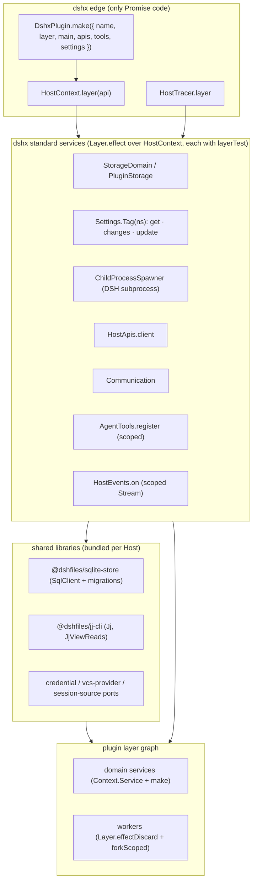

# Effect-native plan

Supersedes the execution model of [effect-refactor](../effect-refactor/README.md). That plan migrated APIs and
schemas; this one migrates the Host runtime itself. Evidence for every claim below lives in [reviews/](reviews/)
(seven independent reviews with file:line citations, plus the [rubric](reviews/rubric.md) they used and an
[Effect 4.1 cookbook](reviews/cookbook.md) drawn from `~/.references/{effect-4.1.0,opencode,t3code}`).

**Resume here:** Phases 0, 1 and 2.1–2.3 run as parallel lanes in workspaces `eff-{phase0,edge,tracer,services,lint,sqlite,jjcli}` on `lomurmxs`; integrate them into this thread line, then start Phase 3.

## Progress

| Phase                       | Status      |
| --------------------------- | ----------- |
| 0 — Stop the bleeding       | in progress |
| 1 — Foundation v2 (dshx)    | in progress |
| 2 — Shared libraries        | in progress |
| 3 — Exemplar + scaffold     | not started |
| 4 — Plugin waves            | not started |
| 5 — Schema cleanup          | not started |
| 6 — Gates and stabilization | not started |

## Context: what the previous wave delivered

Commit `jj:2f90b2f0f39d` (PR #25, 1117 files) was measured by schema-dump parity and `Effect.fn` counts. Neither
proves Effect-native code, and the result is mostly a **facade**: Promise implementations unchanged, wrapped at the
API edge.

| Group                                                                                                                                                                        | Units                                                       | Verdict                            | Effect-native share | Review                                          |
| ---------------------------------------------------------------------------------------------------------------------------------------------------------------------------- | ----------------------------------------------------------- | ---------------------------------- | ------------------- | ----------------------------------------------- |
| dshx foundation                                                                                                                                                              | `effect/{index,services,tracer,client}`, schema path, ports | facade / partial                   | 10–50%              | [foundation](reviews/foundation.md)             |
| ai-accounts                                                                                                                                                                  | 18.7k LOC                                                   | facade                             | ~3%                 | [ai-accounts](reviews/ai-accounts.md)           |
| jj-integration, jujutsu, multi-host                                                                                                                                          | 23k LOC                                                     | facade                             | 2–5%                | [vcs-multihost](reviews/vcs-multihost.md)       |
| backlog, memory, traces, usage, session-search, thread-sidebar, settings-shell, worktree-memory, prompt-stash, agent-telemetry                                               |                                                             | 6 schema-only, 1 facade, 3 partial | 0–50%               | [data-plugins](reviews/data-plugins.md)         |
| project-checks, mcp-servers, mcp-endpoint, annotations, agent-questions, secret-catalog, background-jobs, agent-communication, activity-timeline, editor, session-controller |                                                             | 7 facade, 4 partial                | 10–55%              | [mid-hosts](reviews/mid-hosts.md)               |
| 33 small Hosts + repo-wide Schema                                                                                                                                            |                                                             | 16 facade, 2 partial, 9 untouched  | 15–50%              | [small-and-schema](reviews/small-and-schema.md) |

Repo-wide numbers (non-test source):

| Signal                                                                        | Count           | Meaning                                                                                   |
| ----------------------------------------------------------------------------- | --------------- | ----------------------------------------------------------------------------------------- |
| `Context.Service` holding domain logic                                        | ~0              | services are ctx bags or Promise objects behind a tag                                     |
| `Layer.empty` / `Effect.sync(() => setupHost(ctx))` plugins                   | 4 / several     | runtime exists but owns nothing                                                           |
| Promise→Effect handler adapters (`effectify`, `effectHandler`, `liftHandler`) | 150+ handlers   | `tryPromise` over unchanged async code                                                    |
| `Schema.TaggedError` / with `cause` (`Schema.Defect`)                         | 74 / **0**      | every failure loses its cause; ≥49 carry only `message`                                   |
| `@effect/vitest` tests                                                        | ~1              | 104 ai-accounts test files, 0 `it.effect`; one test greps source for `Effect.runPromise(` |
| `Effect.runPromise` inside plugin domain/tool code                            | 54 (lint count) | no tool edge in dshx                                                                      |
| `effect/process` / `FileSystem` / `HttpClient` users                          | 0 / ~0 / 0      | 20 files import `node:child_process`                                                      |
| `@dshfiles/dshx/effect/services` consumers                                    | **0**           | the foundation's service layer is dead code                                               |
| `Schema.Class` / `Schema.brand`                                               | 0 / 0           | 131 manual `SessionId(raw)` re-brands                                                     |
| `decodeUnknownSync` vs `decodeUnknownEffect`                                  | 248 / 11        | sync decode inside Effect code in 17 files                                                |
| Per-plugin Schema wrapper modules (`strictStandardSchema`, `safeDecode`, …)   | ~60             | codemod kept zod's API on top of Effect                                                   |
| Spans per API call                                                            | 3               | `api-dispatch` + `dshx-effect <api>.<m>` + handler `Effect.fn`                            |
| Effect copies bundled into Host `dist/index.js`                               | 41              | 17 MB of Host bundles in the live checkout                                                |

## Diagnosis: why it came out mediocre

The plugin migrations are the symptom; the foundation and process are the cause.

1. **The foundation offers no real edge.** `DshxEffect.plugin` keeps a module `WeakMap<Context, ManagedRuntime>`,
   has no agent-tool, listener or settings edge, and cannot compose with a Promise `setup`. Every plugin therefore kept
   its globals, re-implemented a runner, or wrapped the old setup in `Effect.sync`.
2. **The service layer is unusable.** `PluginStorage`, `Subprocess`, … are `Layer.succeed` over raw Cordis params,
   run side effects at construction, share one causeless `EffectHostServiceError`, and nothing depends on a
   `HostContext`. Zero consumers.
3. **Error mapping is wrong.** `settle` uses `Cause.squash`: defects with a `_tag` (`SchemaError`,
   `NoSuchElementError`) reach the browser as remote codes with internal messages; interruption becomes
   `"All fibers interrupted"`; every typed failure is public. `effect.md` claims the opposite.
4. **Tracing is wrong.** Effect span ids differ from exported ids, events/links/timestamps are dropped, interruption
   is an error, layer construction is untraced (`Layer.merge` instead of `provideMerge`), every call has three spans,
   and the `context` hook enters AsyncLocalStorage on every primitive (measured +150 ns/op, 2.3× on CPU loops;
   guarded: 1.6×).
5. **The Effect Schema converter is non-strict and registered by side-effect import.** Each plugin re-added
   `additionalProperties:false` locally (≈60 wrappers); a schema resolved before the import publishes `{}`.
6. **Lint is off.** 1 of 8 upstream `effect-antislop` rules is enabled and it excludes the two files that run
   effects. The 7 repo rules miss every dominant smell.
7. **The plan measured the wrong things and named wrong APIs.** Byte-identical schema dumps and `Effect.fn` counts
   reward facades. It also cites `effect/unstable/process` (4.1 is `effect/process`, `effect/http`, `effect/sql`),
   and the global AGENTS.md points at `~/.references/effect`, which is 4.0.0-rc.111.
8. **No exemplar.** Sixty parallel agents each invented a shape. The closest-to-native plugin (background-jobs) was
   never promoted to a reference.

## Goal

Every owned Host half is an Effect program: a single layer graph per plugin built from one `HostContext`, services
with effectful `make`, scoped resources and fibers, typed causeful errors, platform services instead of Node
built-ins, one span per work unit, and `@effect/vitest` tests over real layers. Promise code survives only at the
Cordis/agent-tool/fork edge, in one place, owned by dshx.

## Standards (the bar every change is reviewed against)

Grounded in the [cookbook](reviews/cookbook.md); every API checked against `~/.references/effect-4.1.0`.

| Area        | Rule                                                                                                                                                                                                                                                                                                                                                      |
| ----------- | --------------------------------------------------------------------------------------------------------------------------------------------------------------------------------------------------------------------------------------------------------------------------------------------------------------------------------------------------------- |
| Imports     | Named imports from `effect`, `effect/process`, `effect/http`, `effect/sql`; no star or aliased imports. No `effect/unstable/*` (does not exist in 4.1).                                                                                                                                                                                                   |
| Service     | `class X extends Context.Service<X, {…}>()('@dshfiles/<plugin>/X')` with `static readonly layer = Layer.effect(X, make)`; `make` is `Effect.gen` that `yield*`s its dependencies; methods are `Effect.fn('<subject> <verb>')`. No `FooShape`, no deps as params, no `Layer.succeed` over imperative objects. `layerTest` only to fake an external system. |
| Edge        | `HostContext` is the only holder of the Cordis `ctx`; `ctx.get`/`ctx.on` appear only in dshx edge layers. Plugins never call `runPromise`/`runFork`/`runSync`; `DshxPlugin.make` does.                                                                                                                                                                    |
| Lifetime    | One `Scope` per plugin activation, closed by the one Cordis disposer. Background work = `Effect.forkScoped` inside a layer (`Layer.effectDiscard`). No `ctx.effect` disposers beside it, no `void p.then`, no `process.once`.                                                                                                                             |
| Errors      | One `Schema.TaggedError` per failure kind, bounded attributes, `cause: Schema.optional(Schema.Defect())` when wrapping. Message derived from attributes, never from `cause`. Wire exposure is opt-in via annotation. `Effect.catchTags`. `orDie` only for own-storage corruption or programmer error. Never `catch: () => new X()` or `catch: e => e`.    |
| Concurrency | `Semaphore` / `KeyedMutex` / `Queue` / `PubSub` / `FiberMap` / `FiberHandle` / `Cache` / `RcMap` / `SubscriptionRef` / `Deferred` / `Schedule`. No `setTimeout`/`setInterval`, promise chains, in-flight Maps, AbortController plumbing, or polling in Host code.                                                                                         |
| Platform    | `FileSystem`, `Path`, `ChildProcessSpawner` (DSH-backed, see 1.7), `HttpClient`, `SqlClient`, `Clock`, `Random`. No `node:fs`, `node:child_process`, global `fetch`, `Date.now`, `Math.random` in Host domain code.                                                                                                                                       |
| Tracing     | Exactly one server span per API call (owned by dshx); `Effect.fn` spans for work units; attributes are identities and counts. SQL statement spans off by default.                                                                                                                                                                                         |
| Schema      | Decode once at the boundary with `decodeUnknownEffect`/`decodeUnknown{Option,Result}`; hoist compiled codecs; `Schema.Class` for domain records, `TaggedClass`/`TaggedStruct` unions for variants; branded ids from `@dshfiles/dshx/ids`; `fromJsonString` instead of `JSON.parse`. No per-plugin wrapper modules.                                        |
| Tests       | `@effect/vitest` `it.effect`/`it.layer` over real layers (temp dirs, `:memory:` SQLite, scratch storage domain), `TestClock` for every schedule/TTL/debounce. No `vi.mock('node:*')`, no fake timers, no sleeps, no source-grep tests.                                                                                                                    |
| Forks       | Never touch `src/native/**` or vendored transports; owned delta files call Effect through the dshx edge.                                                                                                                                                                                                                                                  |

## Target architecture



### dshx public surface (sketch; exact types settled in Phase 1)

```ts
export default DshxPlugin.make({
  name: '@dshfiles/memory',
  layer: MemoryLive, // Layer<MemoryServices, never, HostContext | Scope>
  main: Maintenance.run, // optional root fiber, forked into the plugin Scope
  apis: [Api.bind(memoryApi, MemoryHandlers)],
  tools: [Tool.make({ name: 'memory_search', input: SearchInput, execute: Recall.search })],
})

const MemoryHandlers = Api.handlers(memoryApi, {
  notes: Effect.fn('memory notes')(function* (input) {
    const repo = yield* MemoryRepo
    return yield* repo.listNotes(input)
  }),
})

class NoteNotFound extends Schema.TaggedError<NoteNotFound>()('NoteNotFound', { id: NoteId }, { dshxWireCode: 'note-not-found' }) {}
```

Edge internals: `Layer.buildWithScope(Layer.provideMerge(layer, Layer.mergeAll(HostContext.layer(api), HostTracer.layer)), scope)`,
handlers run with `Effect.runPromiseExitWith(services)(…, { signal })`, so there is no runtime registry. Wire
mapping: interrupt-only cause → `aborted`; failure whose class carries `dshxWireCode` → `{ code, message, details }`
(the client decodes `details` back into the class); everything else → internal, logged with `Cause.pretty` on the Host.

## Phases

### Phase 0 — Stop the bleeding (independent, small, now)

| #   | Change                                                                                                                                                                                                                                         | Verify                                                 |
| --- | ---------------------------------------------------------------------------------------------------------------------------------------------------------------------------------------------------------------------------------------------- | ------------------------------------------------------ |
| 0.1 | agent-communication `host.ts:816`: `catchCause` before `Effect.repeat` (one failure stops topic maintenance until restart)                                                                                                                     | `it.effect` + `TestClock`: loop survives a failing run |
| 0.2 | mcp-servers `reconcile`: compute + apply under one `Semaphore` (older target list can win today)                                                                                                                                               | race test: slow older reconcile never overwrites newer |
| 0.3 | background-jobs: `refresh` must not return early on the `active` flag; `kill` must not map every error to `JobNotFound`                                                                                                                        | focused tests                                          |
| 0.4 | multi-host: remove the per-reload `process.once('exit')` leak                                                                                                                                                                                  | reload test counts listeners                           |
| 0.5 | jujutsu composer op-head cache: shared in-flight read must not run under the first caller's signal                                                                                                                                             | test: aborting caller A leaves caller B's read intact  |
| 0.6 | Revert fork drift: 4 vendored `src/native/**` files (model-selection, session-controller) and hmr-gate `client.tsx`                                                                                                                            | `node scripts/native-fork-diff.mjs` clean              |
| 0.7 | Delete apply-patch's source-grep test; restore loosened `.toThrow(msg)` assertions                                                                                                                                                             | package tests                                          |
| 0.8 | Correct the old plan: `effect/process`, `effect/http`, `effect/sql`; no `Layer.scoped`/`forkDaemon`/`catchAll`; point AGENTS.md Effect reference at `~/.references/effect-4.1.0`; thread-sidebar restart timer is still a module `setInterval` | doc diff                                               |

### Phase 1 — Foundation v2 (`tooling/dshx`, blocks everything)

Order follows the [foundation review](reviews/foundation.md#ordered-steps); the Promise API stays intact.

| #    | Deliverable                                                                                                                                                                                                                                                                                                                                                                                                                                                                                                                                                                   | Verify                                                                                                                                                                   |
| ---- | ----------------------------------------------------------------------------------------------------------------------------------------------------------------------------------------------------------------------------------------------------------------------------------------------------------------------------------------------------------------------------------------------------------------------------------------------------------------------------------------------------------------------------------------------------------------------------- | ------------------------------------------------------------------------------------------------------------------------------------------------------------------------ |
| 1.1  | Effect Schema → Standard/JSON Schema inline in `api/schema.ts`, **strict by default** (`onExcessProperty: 'error'`, closed objects, `Void` input handled once). Delete `registerEffectApiSchemaConverter` and side-effect imports. Regenerate the tool-schema snapshot; drop its exclusion set.                                                                                                                                                                                                                                                                               | snapshot byte-identical for every tool; a test resolves an Effect tool schema without importing `effect/index`                                                           |
| 1.2  | Wire error mapping: `dshxWireCode` annotation (precedent: `httpApiStatus`), interrupt → `aborted`, defects internal; unannotated tagged failures keep today's code for one release with a Host warning                                                                                                                                                                                                                                                                                                                                                                        | regression tests: `die(SchemaError)` → internal, interrupt → aborted, annotated → code + decoded `details`; snapshot every existing wire code                            |
| 1.3  | Tracer rewrite: one span object whose ids are the exported ids; events, links, end time; interrupt ≠ error; no-op when export is off; `context` hook guarded by `getStore() === parent`; tracer provided under the layer build                                                                                                                                                                                                                                                                                                                                                | `recordSpans`: `currentSpan.spanId` equals recorded id, layer-build spans exported, events present; bench ≤ +90 ns/op                                                    |
| 1.4  | One server span per API call (`<api> <method>` in `host-runtime`), no adapter span                                                                                                                                                                                                                                                                                                                                                                                                                                                                                            | traces board groups unchanged; one span per call in `traces_search`                                                                                                      |
| 1.5  | `HostContext`, `PluginScope`, `DshxPlugin.make`, `Api.bind/handlers`, `Tool.make` (+ `registerTool` for per-agent tools), `HostEvents.on`, `DshxPlugin.callback` (Promise function backed by the runtime for polyfills)                                                                                                                                                                                                                                                                                                                                                       | `it.layer(DshxTest.layer)`; unmount closes the scope; two plugins on one ctx; tool abort interrupts its fiber; activation failure closes the scope and reports the cause |
| 1.6  | `DshxEffect.plugin/host/setup` become deprecated shims over 1.5 (no WeakMap); removed when callers reach 0                                                                                                                                                                                                                                                                                                                                                                                                                                                                    | existing `effect.spec.ts` green unchanged                                                                                                                                |
| 1.7  | Standard services as `Layer.effect` over `HostContext`, each with `layerTest`, errors with cause: `StorageDomain` (scoped, `table(name)` serialized writes, `changes`), `Settings.Tag(ns)` (memoized tag, `get`/`changes`/`update`), `ChildProcessSpawner` backed by DSH subprocess (it scrubs env, owns process-range termination; stdin/stdout/stderr pipes are supported by `SubprocessSpawnSpec`/`SubprocessHandle`), `HostTerminal`, `HostApis`, `Communication` (generic lifter + inbox `Stream`), `Llm.complete`                                                       | real-implementation tests: scratch storage domain, real `ctx.subprocess` spawning `node -e`, kill on interrupt                                                           |
| 1.8  | Primitives: `KeyedMutex` (port opencode `effect/keyed-mutex.ts`), `@dshfiles/dshx/ids` (branded `SessionId`, `WorkspaceId`, type-compatible with core)                                                                                                                                                                                                                                                                                                                                                                                                                        | same key serial, different keys parallel, idle entry removed, interruption releases                                                                                      |
| 1.9  | `client.ts`: typed client errors (`ApiTransportError                                                                                                                                                                                                                                                                                                                                                                                                                                                                                                                          | ApiUnavailableError                                                                                                                                                      | ApiContractError | ApiRemoteError<Declared>`), abort = interruption, non-ApiError = defect | unit tests per kind |
| 1.10 | Lint: enable all 8 upstream `effect-antislop` rules; rescope `no-domain-effect-run` to `plugins/*/src` minus edges with a ratchet baseline (54); add repo rules: cause-dropping/unused catch param in `try`/`tryPromise`, `Layer.empty` in a plugin, `Effect.fn(…)(() => Effect.gen…)`, `Effect.repeat` over an uncaught fallible effect, `tryPromise` over a same-package async function, module `let`/`new WeakMap<Context` in Host files, `setTimeout`/`setInterval`/`node:child_process` in Host files, `void x.then(`, span-name format, codemods inside `src/native/**` | each rule has valid/invalid fixtures; baseline file committed                                                                                                            |
| 1.11 | `scripts/effect-native-audit.mjs`: per-plugin scorecard of the metrics in the Context table; used as the ratchet and as each plugin's done check                                                                                                                                                                                                                                                                                                                                                                                                                              | runs in `pnpm check`; numbers only go down                                                                                                                               |
| 1.12 | Docs and scaffold: rewrite `tooling/dshx/docs/sdk/effect.md` (standards above) and the observability section; `effect-host` template = `make()` + one service + one annotated error + an `it.layer` test, exact `effect@4.1.0` pins                                                                                                                                                                                                                                                                                                                                           | scaffold e2e builds and its test passes                                                                                                                                  |

### Phase 2 — Shared libraries (after 1.5–1.8)

| #   | Package                                                                                                                                                                                                                                                    | Replaces                                                                                         | Verify                                                                                                                                  |
| --- | ---------------------------------------------------------------------------------------------------------------------------------------------------------------------------------------------------------------------------------------------------------- | ------------------------------------------------------------------------------------------------ | --------------------------------------------------------------------------------------------------------------------------------------- |
| 2.1 | `@dshfiles/sqlite-store` on `@effect/sql-sqlite-node` (same `node:sqlite` driver): `SqliteStore.layer({ filename, migrations, legacyUserVersion, statementSpans: false })`, WAL/busy/pragmas, `0600` sidecars, `Migrator` adopting existing `user_version` | 7 hand-rolled openers (traces ×2, usage, memory, session-search, resource-packs, project-checks) | fresh DB; adopt `user_version=N` without re-run; failing migration rolls back; no statement spans; host-loop-freezes bench before/after |
| 2.2 | `@dshfiles/jj-cli`: `Jj.run` (exit as value) / `Jj.exec` (fails `JjCommandFailed` with redacted stderr), cached executable, op-head `JjViewReads` cache, `jj <verb>` span                                                                                  | duplicated runner, span and cache in jj-integration + jujutsu                                    | `it.effect` against a real temp jj repo; `pnpm check:cycles`                                                                            |
| 2.3 | Ports: credential-port single Effect resolver (delete dshx `SecretValues`); vcs-provider-port Effect builder + `Effect.forEach`; session-source-port schema-first decode + `fromEffect` adapter                                                            | Promise wrappers, causeless errors, `wirePayload`                                                | `it.effect` + every consumer typechecks                                                                                                 |
| 2.4 | `Jev` service (HttpClient + usage recording)                                                                                                                                                                                                               | duplicate backlog/memory Jev clients                                                             | decide placement in open question 5                                                                                                     |
| 2.5 | plugin-ui `createStoredValue` accepts Standard Schema                                                                                                                                                                                                      | 4 `createEffectStoredValue` copies, most of 47 zod-bridge files                                  | client tests                                                                                                                            |

### Phase 3 — Exemplar and scaffold

Finish **background-jobs** (≈2 kLOC, closest to native: `Queue.dropping` debounce, `Schedule`, `forkScoped`) as the
reference: `HistoryIndex` on `FileSystem` + `Semaphore`, `SubscriptionRef` rows, `wait` via `changes` +
`timeoutOption`, tagged errors, `it.layer` tests. Then **usage** as the `sqlite-store` pilot (diff a copy of the live
`usage.db` with `sqlite3 .dump` before and after). Freeze both as the canonical examples referenced from `effect.md`
and the scaffold. Every later agent prompt links to these two plugins and to this Standards table.

### Phase 4 — Plugin waves

Rules for every plugin:

1. **Characterization tests first, on current code**, for the risky behaviour named in its review. No production
   change in that revision.
2. Snapshot every wire error code and tool schema before; they must match after (behaviour parity, not just schema).
3. Build the layer graph bottom-up; delete the facade (`effectify`, `Layer.empty`, module state) in the same plugin
   change, never leave both.
4. Done = `effect-native-audit` shows zero for that plugin on every row of the Context table, package
   `build typecheck test`, built-bundle import check, one e2e journey in scratch DSH, one span per call in traces.
5. One revision per service group, `refactor(<plugin>): …`, body says which facade it deletes.

| Wave           | Plugins                                                                                                                                                                                                                                                                                                                                                                                                                                                       | Depends on      | Why this order                                              |
| -------------- | ------------------------------------------------------------------------------------------------------------------------------------------------------------------------------------------------------------------------------------------------------------------------------------------------------------------------------------------------------------------------------------------------------------------------------------------------------------- | --------------- | ----------------------------------------------------------- |
| A — mechanical | tool owners (apply-patch, goal-stall-guard, html-render, tool-search, pulls-review), settings singletons (policies, session-warming, web-search-brave), ctx-bag cleanups (shared-streams, request-messages, context-compaction, rich-composer host, model-effort-picker), small Promise-service ports (diff-viewed, privacy-controls, session-undo, workspace-folder-picker, loopback-access, prompt-stash, settings-shell, worktree-memory, agent-telemetry) | 1.5, 1.7        | proves the edge on many small surfaces; batch 4–5 per agent |
| B — mid hosts  | activity-timeline, mcp-endpoint, editor, agent-questions (`KeyedMutex`), secret-catalog (`Cache`, spawner), annotations, agent-communication, mcp-servers (scope per server), project-checks (durable queue on `Queue` + `FiberMap` + sqlite-store), session-controller owned adapters                                                                                                                                                                        | 1.8, 2.1        | each has one named primitive to adopt                       |
| C — data       | traces (receiver on `FiberHandle`, SQL spans off to avoid a self-feeding loop), memory, session-search (`effect/rpc` over worker), backlog, thread-sidebar Host                                                                                                                                                                                                                                                                                               | 2.1, 2.4        | shared SQLite/storage foundation                            |
| D — VCS        | jujutsu, then jj-integration (RepoLocks, IntegrationQueue, Cleanup, Maintenance), vcs-provider-port consumers                                                                                                                                                                                                                                                                                                                                                 | 2.2, 2.3        | jujutsu is smaller with the best tests                      |
| E — remote     | multi-host (`Ssh` on the spawner, `RcMap` runtime pool, scoped `LaunchFile`)                                                                                                                                                                                                                                                                                                                                                                                  | D               | depends on jj-integration contracts                         |
| F — accounts   | ai-accounts (~25 services; pool, routing, quota continuations, logins)                                                                                                                                                                                                                                                                                                                                                                                        | all foundations | largest blast radius; fail-over hooks have zero tests today |
| G — untouched  | tweet-context, queue-reorder, agents, references, resource-packs, fff-search, git-worktrees, agent-toolkit                                                                                                                                                                                                                                                                                                                                                    | A               | never migrated; same recipe                                 |

Characterization debt that must land before its wave (full lists in the reviews): ai-accounts fail-over hook order,
pool routing, quota-continuation reconcile, Codex login process-group kill, synchronous route priming at activation;
jj-integration per-repo land serialization, deferred integration timing, cleanup order, wire codes; multi-host pool
eviction/retry rules, tunnel readiness, launch-file ownership; project-checks cancel → process-group kill.

### Phase 5 — Schema cleanup (rides with each plugin, closes repo-wide)

Delete per-plugin wrappers after 1.1 (`strictStandardSchema` ×9, `method` ×9, `standardSchema` ×8, `closedDocument`
×7, `exact/openSchema`, `MultiHostSchema` (≈130 call sites), 16 decode-helper files, `asZodSchema`). Replace
`decodeUnknownSync` inside Effect code with `decodeUnknownEffect`; stop re-decoding stored values the storage domain
already validated; introduce `Schema.Class` for persisted records and `@dshfiles/dshx/ids` brands (≈150 re-brands go).
Keep `zodSchemaFromEffect` only where DSH core `defineDomain` needs zod. Error text: format Effect issues once in the
edge, and restore exact-message assertions.

### Phase 6 — Gates and stabilization

| #   | Gate                                                                                                                                                        |
| --- | ----------------------------------------------------------------------------------------------------------------------------------------------------------- |
| 6.1 | `effect-native-audit` all zero (or explicitly waived edge files); lint ratchet at zero                                                                      |
| 6.2 | Every e2e feature green in scratch DSH; `pnpm lint typecheck fmt check:cycles`; `native-fork-diff` clean                                                    |
| 6.3 | Traces: one server span per call, no orphans, no SQL spans, no traces→traces loop                                                                           |
| 6.4 | Perf (`live-performance-audit`): Host boot, event-loop lag, Host bundle size, tracer bench; before/after table in `docs/performance.md`; budget ≤ +10% boot |
| 6.5 | `complete-plan`: Standards → `tooling/dshx/docs/sdk/effect.md`; delete this plan and `effect-refactor`                                                      |

## What this does not do

- Native forks stay Promise inside `src/native/**`; only owned delta files change.
- DSH core, Cordis and the agent-tool protocol stay Promise; dshx owns the only adapters.
- Browser logic (old Phase 5) stays out until the Host is done; client wire errors become typed only through 1.9.
- No wire-code or tool-schema changes: compatibility is a gate, not a goal.

## Decisions log

| Date       | Decision                                                                                                    | Why                                                                                      |
| ---------- | ----------------------------------------------------------------------------------------------------------- | ---------------------------------------------------------------------------------------- |
| 2026-11-02 | Re-plan around the runtime, not schemas; foundation before plugins                                          | Seven reviews found the plugin facades are caused by the dshx edge and process           |
| 2026-11-02 | Done is measured by `effect-native-audit` + behaviour parity, not schema parity or `Effect.fn` counts       | The old metrics rewarded facades                                                         |
| 2026-11-02 | Expose DSH subprocess as Effect's standard `ChildProcessSpawner`                                            | Keeps DSH env scrubbing and process-range termination while plugins use the standard API |
| 2026-11-02 | `@dshfiles/jj-cli` and `@dshfiles/sqlite-store` as library packages, not dshx modules                       | Shared implementation, not contracts; keeps plugin dependency direction                  |
| 2026-11-02 | Add `@effect/platform-node`, `@effect/platform-node-shared`, `@effect/sql-sqlite-node` 4.1.0 to the catalog | User approved; needed for FileSystem, NodeWorker, SqlClient                              |
| 2026-11-02 | Named imports from `effect`                                                                                 | Matches dshx and opencode; user delegated the choice                                     |
| 2026-11-02 | `DshxEffect.*` stays as deprecated shims over the new edge; deleted at zero callers                         | Lets waves land plugin by plugin                                                         |
| 2026-11-02 | Keep one Effect copy per Host bundle for now; measure in 6.4 before changing the bundling contract          | Externalizing touches every bundle; decide on numbers                                    |
| 2026-11-02 | Shared `Jev` service as a library package                                                                   | Two consumers, no contract to own; keeps usage free of new responsibilities              |
| 2026-11-02 | `plans/effect-refactor` superseded by this plan                                                             | User approved executing this plan end to end                                             |
