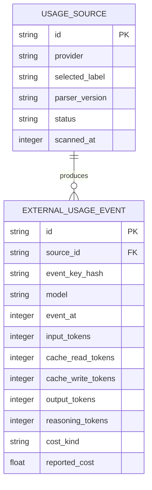

# External usage history plan

## Context

- DSH [AI Accounts](../plugins/@dshfiles/ai-accounts/README.md) stores provider quota windows and reset snapshots; it is not request-token history.
- DSH [Usage](../plugins/@dshfiles/usage/README.md) already owns DSH request analytics and Host-side SQLite, but it is not included in the current [web profile](../profiles/web/package.json#L44-L84).
- [TokiToki](https://github.com/astahmer/tokitoki) already provides local multi-harness usage reports. Its current MCP also exposes prompt-derived session search/detail; its public package/license contract is unclear. Cursor/T3 counts may be estimates, not exact usage.
- Codex rollout and OpenCode local stores are possible best-effort sources; Claude's official OTel request events are forward-only; Cursor has no documented local token schema. See [Codex rollout source](https://github.com/openai/codex/blob/main/codex-rs/rollout/src/lib.rs), [OpenCode schema](https://github.com/anomalyco/opencode/blob/dev/packages/core/src/session/sql.ts), and [Claude OTel event](https://code.claude.com/docs/en/monitoring-usage#api-request-event).

## Goal

Show opt-in, cross-harness token usage inside DSH Usage without importing prompt-derived text or confusing token totals with quota or billing.

## What

Add an external-source section to existing Usage only if DSH-native history adds value beyond standalone TokiToki reports. Prefer a documented usage-only source contract. If none exists, add isolated, explicitly supported Host parsers only after the prompt-read boundary is approved. Do not create a second analytics plugin.

## Why

User wants local token history alongside DSH analytics. TokiToki may already satisfy cross-harness reporting, so DSH integration must justify its maintenance and privacy cost with native DSH charts and filtering.

## How

### Conceptual model

Keep DSH-native requests, external usage events, provider quota snapshots, and cost provenance as separate domains. Label each imported source `documented`, `best-effort`, or `estimated`.

### Operations / behavior

- User explicitly enables each provider and selects its local source/account.
- Host performs bounded, read-only scans; client never reads provider files or databases.
- Show totals, model/provider breakdown, last scan, coverage, and parser status.
- Disable unsupported or changed schemas with an explicit partial/unsupported status; never silently display zero.

### Tech choices

| Choice                       | Decision                                                                                 | Rationale                                                                                              |
| ---------------------------- | ---------------------------------------------------------------------------------------- | ------------------------------------------------------------------------------------------------------ |
| New plugin vs existing Usage | Extend Usage if native DSH UI is needed                                                  | Avoid a second analytics owner.                                                                        |
| TokiToki integration         | Require versioned usage-only API and license confirmation first                          | Current event/MCP surfaces include prompt-derived fields and lack a clear public integration contract. |
| Direct imports               | Codex/OpenCode only as opt-in best-effort candidates; Claude OTel later; defer Cursor/T3 | Provider evidence and exactness vary.                                                                  |
| Persistence                  | Separate `external_usage_events` table/API from DSH `requests`                           | External records do not have DSH Session semantics.                                                    |
| Cost                         | Store provider-reported vs estimated provenance separately                               | Token counts and subscription/quota usage are not billing totals.                                      |

### Architecture

```text
Selected provider source
  -> Usage Host adapter (read-only, allowlisted decoder)
  -> external_usage_events + scan cursor/status
  -> typed Usage API
  -> separate External Usage view
```

## What this allows

- Cross-harness token totals and model/provider trends inside Usage.
- Explicit source freshness and completeness, including best-effort labeling.
- Future Claude OTel ingestion without transcript backfill.

## What this does not allow

- Prompt/session search, transcript display, tool-output capture, or remote sync.
- Treating imported sessions as DSH Sessions or merging quota windows into token totals.
- Billing-grade cost claims, exact Cursor counts, or unverified T3 totals.

## UI & UX

### Desktop

Add an `External usage` view beside DSH request analytics. Show source selection/status, freshness, supported fields, and an exact/best-effort/estimated badge. Keep quota status in AI Accounts.

### Common interactions

| Action                     | Result                                                                  |
| -------------------------- | ----------------------------------------------------------------------- |
| Enable a source            | Host records selected source and begins bounded read-only scan.         |
| Refresh                    | Re-scan selected sources idempotently; show partial/unsupported status. |
| Filter provider/model/date | Recompute aggregates without exposing raw source rows.                  |

## Data model



Store only allowlisted counts, model, time, source label, dedupe hash, and cost provenance. Do not persist descriptions, prompt text, absolute paths, raw rows, credentials, or unredacted external Session IDs.

## Implementation steps

1. Confirm DSH-native UI is required; compare it with TokiToki's standalone reports and allowed usage-only MCP/API surface.
2. Resolve privacy semantics: distinguish “do not retain/show prompts” from “must not read prompt bytes at all.” If strict no-read is required, reject transcript parsers and require an aggregate/export/OTel source.
3. Confirm TokiToki license and versioned usage-only contract; do not embed, fork, or expose session-search tools without both.
4. Define the Usage external-source DTO, separate storage, dedupe key, version detection, scan bounds, retention, and source status.
5. Implement one approved adapter with synthetic fixtures; keep Codex/OpenCode support explicitly best-effort unless completeness is proven.
6. Add the External Usage view and source setup/status UI; enable Usage in a probe profile before considering the web profile.
7. Verify no prompt-derived text/path crosses persistence, API, logs, errors, or UI; verify quota and cost provenance remain separate.

## Open questions

1. Does “no prompt history” mean no retention/display, or literally no reading of prompt bytes during parsing?
2. Is a standalone TokiToki report/MCP query sufficient, or is native DSH charting required?
3. Should the first source be a TokiToki usage-only export, or direct Codex/OpenCode parsers after the privacy gate?
4. Are best-effort counts acceptable? Which account roots and retention window should be supported?
5. Should external usage appear only in DSH Usage, or also in Agent Toolkit reports?

## Acceptance criteria

- [ ] Disabled by default; only user-selected roots/accounts are scanned, read-only and with bounded work.
- [ ] No prompt/tool/session text, absolute path, credential, or raw provider row is stored, returned, logged, or displayed.
- [ ] Repeated scans and duplicate events are idempotent; unsupported schema reports partial/unsupported, never a false zero.
- [ ] DSH requests, quota snapshots, external token counts, provider-reported costs, and estimated costs remain distinct.
- [ ] Every source has explicit freshness, coverage, parser-version, and exactness labels.
- [ ] Provider fixtures cover duplicate/forked Codex events, OpenCode schema versions, and malformed/partial data.
- [ ] Usage remains inactive until profile enablement is separately approved and verified in a probe.

## Decisions log

| Date       | Decision                                                                      | Rationale                                                                             |
| ---------- | ----------------------------------------------------------------------------- | ------------------------------------------------------------------------------------- |
| 2026-10-16 | Extend Usage only if native DSH history is needed; no new plugin              | Existing Usage owns DSH analytics; TokiToki already covers much standalone reporting. |
| 2026-10-16 | Block implementation on prompt-read semantics and a supported source contract | Local stores can contain sensitive prompt-derived data.                               |
