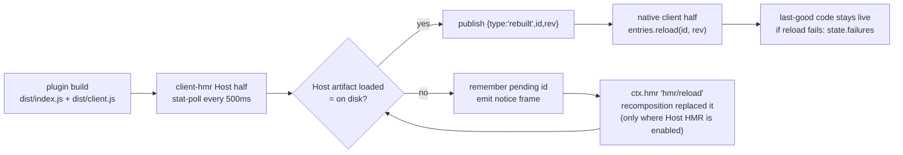

# HMR compatibility gate plan

> **Status: proposed (2026-10-23).** Nothing implemented. The mechanism table and API claims below were read from the
> installed `0.2.1-rc.2` runtime and this checkout during a read-only investigation.
>
> **Resume here:** **S0** (reproduce and name the skew), then **S1** (measure whether the Host can recompose a rebuilt
> `dist/index.js` in-process in a scratch profile). S2/S3 are the safe fallback if S1 shows the in-process replacement is
> unstable.
>
> **Owner thread:** this one (`thread-b39610`). Work in a thread workspace, never in `~/dev/dshfiles`.

## Progress

| Slice                                                     | State       | Evidence |
| --------------------------------------------------------- | ----------- | -------- |
| S0 Reproduce, name the skew, record the Host gap          | not started | gaps 76/77 added; reproduction still open |
| S1 Prove the gate's inputs (loaded-vs-disk, scratch DSH)   | partial     | `src/host/gate.test.ts` (8 tests): `exports`/`main` resolution, digest, apply/defer/release; scratch run open |
| S2 Gate: defer a rebuilt client frame while its Host half is stale | shipped | `plugins/@dshfiles/hmr-gate` (Host transport + gate + `deferred` frame + `hmr_gate_status`); typecheck, tests, build, host import check |
| S3 Surface: notice, retry, page reload                    | shipped (notice) | `plugins.item` row "HMR updates" in Settings → Plugins; retry/reload actions open |
| S4 Containment: slot `inject` callbacks never throw       | shipped     | `rich-composer` registers `ConversationController` before slots (+ `apply-order.test.ts`); `queue-reorder` resolves `conversation` per call |
| S5 Verification (scratch DSH, both skews, two builds)     | partial     | plugin typecheck/test/build green; boot check and the two-build journey open |
| S6 Docs and Host-gap rows                                 | shipped     | `docs/plugin-reload.md`, `docs/native-forks.md`, plan, plugin README/UPSTREAM, gaps 76/77, profile seed row |

## Context

### The incident

On 2026-10-22 the composer of a live thread (`Plan Shared AI Account Pools`, session `63bdc754`) crashed in the Web UI
on `127.0.0.1:3080` with:

```text
Error: queue dock: conversation service unavailable            client-entry.tsx:65
Error: ui-conversation: conversation service unavailable        apply.ts:149
slot entry crashed in 'conversation.input.dock'
slot entry crashed in 'conversation.composer.bar'
GET api/changes.summary?sessionId=…&seq=390 404
```

The Host stayed healthy (pid 71961, port 3080). `dshx status` at the time:

| Fact                   | Value                                                                 |
| ---------------------- | --------------------------------------------------------------------- |
| Host started           | 2026-10-22T20:21:30Z                                                  |
| Checkout then → now    | `nuuwuyltrwmk ecc6ff31b334` → `nuuwuyltrwmk 627f04525953`             |
| Bundles built after launch | 26, including `@dshfiles/rich-composer` (21:48:59Z)               |
| dshx's own warning     | “client HMR may already serve them, the running Host has not loaded them” |

Both failing messages come from the **client** bundles of this repo's forks, not from an RPC:

- `plugins/@dshfiles/queue-reorder/src/client-entry.tsx:47-65` — the dock's `inject(sessionId)` resolves
  `ctx.sessions.scope(sessionId).get('conversation')` and throws when it is `undefined`.
- `plugins/@dshfiles/rich-composer/src/native/apply.ts:136-151` — `scopedConversation`/`concreteConversation` throw the
  same way; the composer bar's `inject` goes through it.
- `conversation` is provided by the rich-composer fork: root service `super(ctx, 'conversation')`
  (`src/native/service.ts:185`) plus a per-Session `ctx.uiSession.provide({ key: 'conversation' })`
  (`src/native/apply.ts:318`).

So one of two things happened; S0 decides which:

| # | Hypothesis | Prediction |
| - | ---------- | ---------- |
| H1 | **Host/client skew.** The client applied a rebuilt bundle whose Host half (`dist/index.js`) the running Host never loaded. | A client-only rebuild never reproduces it; rebuilding `dist/index.js` + `dist/client.js` together does, and the first failure is a missing service the new client expects. |
| H2 | **Client fiber gap on replacement.** `entries.reload()` disposed the fork's fiber (the `conversation` provider) and the replacement did not re-provide it, or re-provided it after other slot entries re-injected. Concrete mechanism found while confirming this plan: in source order `rich-composer`'s `apply()` registers the `main` slot and the composer-bar inject **before** `ctx.plugin(ConversationController, …)`, which is what provides the root `conversation` service (`src/native/apply.ts:578-596`, service at `src/native/service.ts:185`; the composer bar's inject calls `concreteConversation` at `apply.ts:495`). Whether the runtime window is reachable depends on the fiber/effect flush order — S0 measures it. | A pure client rebuild of `rich-composer` reproduces it while the Host is untouched, and it clears on a page reload. |

`api/changes.summary` 404 is a separate, older problem (diff-viewed reads a review action's coordinates); it is out of
scope here except as a symptom of stale page state.

Two failure classes share the symptom, and the plan must separate them:

| Class | Trigger | Owner of the fix | Evidence |
| ----- | ------- | ---------------- | -------- |
| **A — Host/client skew** | `dist/index.js` rebuilt while the Host runs; client HMR delivers the new client against the old Host | the send gate (S2) | `docs/recovery.md:108-125` names this as an accepted cost of Host HMR being off |
| **B — client teardown window** | HMR reload of a service-providing plugin: the entry controller tears the old fiber down **before** the replacement imports and starts, and a live slot entry renders in that window | S4 (ordering + tolerant inject); the core half is #6883 | `entries.replace()` runs `invalidateForReplacement` → `prefetch` → `tearDownEntryFiber` → `import` → `refresh` (`@deepseek-ai/dsh-client-modules` `lib/client.js:492-505`) |

### Existing overlap in this repository

| Piece | What it already covers | What it does not |
| ----- | ---------------------- | ---------------- |
| [`docs/recovery.md:108-125`](../../docs/recovery.md) | states the accepted cost (old Host + new client) and the 2026-10-19 wedge that turned Host HMR off | no client-side consequence, no notice, no gate |
| [`docs/plugin-reload.md`](../../docs/plugin-reload.md) | HMR transport and restart rules | wrongly claimed Host `hmr` is on in `web`; corrected in this change |
| [`plans/slot-assembly-crash-safety`](../slot-assembly-crash-safety/README.md) | transient-gap tolerance for the `root` slot owner | different slot, different gap; the same “keep the last entry, recover without a reload” principle |
| [`plans/dsh-host-gaps.md`](../dsh-host-gaps.md) rows 54, 58 | asks for in-process Host reload and for a Host that lost a service | the per-package client gate is a new row (S0) |

### What the runtime actually does (verified)

| Layer | Ownership | Fact |
| ----- | --------- | ---- |
| Client graph transport | `@deepseek-ai/dsh-client-hmr` (Host half, 130 lines) | stat-polls each row's client bundle every 500 ms, calls `ctx.clientModules.rebuilt(id)`, and pushes `{type:'rebuilt',id,rev}` over `/plugins/events` (`lib/index.js`). |
| Client application | `@deepseek-ai/dsh-client-hmr` (client half) → `ctx.modules.entries` | `reload(id, rev)` per frame; failures reject and are logged (`lib/client.js`, `handle`). |
| Replacement order | `@deepseek-ai/dsh-client-modules` | `replace()` invalidates → `prefetch` → **`tearDownEntryFiber`** → `removeOwnedStyles` → `import` → `refresh` → `fiber.await()` (`lib/client.js:492-505`). The old provider is gone before the new module applies: that is class B. |
| Entry controller | `@deepseek-ai/dsh-client-modules` | `ClientEntries` owns a serial queue, `state` (`syncing`, `failures`), `reload`, `retry`, `dismissRelease`, and `releaseChange`; it admits only graphs of the page's boot release (`lib/types/client/entries.d.ts`). |
| Release identity | `@deepseek-ai/dsh-client-modules` | `WebBootRelease = { version, commit }` — the **DSH build**, not a plugin bundle (`lib/types/client/manifest.d.ts:79-99`). A rebuilt plugin never changes it, so the gate cannot see plugin-level skew. |
| Module table | `ctx.modules` (`ClientModuleLoader`) | public-ish service: `manifest`, `entries`, `loadCache`, `import`, `prefetch`, `importError`, `invalidate`, plus the Host-side `clientModules` service (`graph`, `artifactBaseline`, `rebuilt`, `onRebuilt`, `onGraphChanged`). |
| Host plugin reload | `@deepseek-ai/dsh-hmr` | `ctx.hmr.runExclusive`, `reconcileProfile()`; replaces plugins whose loaded files changed **when a recomposition runs**, and reports `pending`/`restartReason`. **Disabled in this profile**: `dshx plugins list --json` reports `include:hmr` `enabled:false`, `phase:null`, and `dsh --profile web --dump-config` shows `id: hmr` / `disabled: true` (seed NIX-MANAGED row + a local live row). Nothing recomposes a live `web` Host, so a rebuilt Host half waits for a restart by policy. |
| Why it is off | `docs/recovery.md:108-125` | A 2026-10-19 replacement dropped `sessionQuery` and took `session-controller` down twice; the accepted cost is written down: *“a rebuild reaches the browser but not the running Host, so a new client bundle can ask the old Host for a method it does not have until the next restart.”* The crash this plan investigates is that documented cost arriving. |
| Transactional Host swap | `dshx` `dev.hostHmr` | `createHostGenerationPlugin` already mounts a generation, disposes the previous one, and **remounts the previous implementation when the candidate fails** (`tooling/dshx/packages/dshx/src/host/generation.ts:147-179`, tests at `tests/host-generation.spec.ts:101-109`). Development-only; `web` does not enable it. |

Net: the page protects itself against a **DSH release** change, but nothing protects it against a **plugin bundle**
change. The client half updates immediately; the Host half waits for a restart because recomposition is off. This is a
recorded tradeoff, not an accident — the missing half of it is a gate that refuses the client half too.

## Goal

A rebuild of a plugin's Host half never produces a page that runs new client code against old Host code: the browser
keeps the last-good client code (HMR when the pair is coherent, a deferred update otherwise) and tells the user what a
Host restart will bring.

## Why

- Rebuilding owned bundles under the live Host is routine in this repository; `dshx status` said so in the same breath
  as it said the Host had not loaded them.
- The crash is cross-plugin: one stale provider makes every session-scope dock throw, and the only visible symptom is a
  dead composer with no recovery path.
- The runtime already proves the Host can swap a generation transactionally (`dshx dev.hostHmr`); what is missing is a
  decision about *when* a client update may be applied.

## Options

| Option | Lives in | Verdict |
| ------ | -------- | ------- |
| **A. Host recomposes on bundle change.** Re-enable the `hmr` row and add the linked package `dist/` dirs to its `root`, so a rebuilt `dist/index.js` is replaced in-process and the client frame is safe by the time it applies. | profile composition (`hmr` row) | **rejected for this plan.** This profile disables Host HMR on purpose after two `sessionQuery` losses on 2026-10-19; re-enabling it as a UX fix would re-open that outage. Revisit only behind a proven fix for #9100/#10237/#9812 (rows 54/58), tracked separately. |
| **B. Host-side send gate.** Fork `@deepseek-ai/dsh-client-hmr`'s Host half: before publishing `rebuilt`, compare the package's Host artifact on disk with the one the Host has loaded; while stale, publish a `deferred` frame (both generations + reason) instead, and publish `rebuilt` once the pair matches. Native client half stays untouched. | owned fork + profile row | **primary for class A**; no Host loading risk, ~130-line delta, and it degrades to “no HMR”/“restart to apply” instead of a crashed page. It does **not** fix class B. |
| **C. Client-side gate.** Fork the client half instead: hold the `rebuilt` frame and query a Host API for compatibility. | owned fork | rejected — more moving parts, and the Host already knows what it loaded. |
| **D. Recovery only.** Watch `ctx.modules.entries.state` and the renderer's crash markers; `retry()`, then a recovery banner/reload. | owned plugin | keep as **belt and braces** (S3); it does not prevent the skew. |
| **E. Tolerant `inject`.** Every slot `inject` callback resolves optional services without throwing and renders a degraded/disabled surface. | owned plugins | **required containment** (S4); two callbacks throw today (queue-reorder, rich-composer bar), and each one takes down the composer. |
| **F. Build discipline.** Never build a Host bundle under the live Host; use a scratch profile. | docs/ops | mitigation only; cannot be enforced, and routine work already violates it. |

## Reference comparison

Researched 2026-10-23 against pinned tags. `verified` means the source or docs page was read; `best-effort` means a
secondary source.

| System | Update unit | Last-good / rollback | Cross-half gate | Verdict for us |
| ------ | ----------- | -------------------- | --------------- | -------------- |
| **OpenCode 2** (`anomalyco/opencode` v2.1.3, MIT) | In-process **TypeScript source reload**, per plugin, in two separate processes: server plugin supervisor and TUI plugin watcher (config/skills/agents/commands too) | The supervisor only publishes a generation after the new revision imports and sets up; the running generation keeps its place on failure (`supervisor.ts`), activation is one batched swap behind a readiness latch (`plugin.ts`), and the TUI renders “(previous version still active)” on a failed swap (`context.tsx`). `verified` | **None.** No separately built client artifact: the TUI imports the same plugin source itself, and there is no Host↔UI version gate or restart-required notice. `verified` | The best precedent for class B and for Host-side loading: latch readiness, keep the running generation, say which version is active. **It does not solve class A** — their architecture never has a stale Host half. |
| OpenCode 1 / `opencode-ai/opencode` (Go) | Startup only | n/a | n/a | No HMR at all; the archived Go fork is irrelevant. `verified` |
| **Cordis HMR** `@cordisjs/plugin-hmr` v4.0.0-rc.12 (the framework DSH loads) | One plugin entry plus its accepted dependency tree; changed files are `accepted` or `declined`, externals always declined | Re-imports the graph and validates exports **before** touching the old plugin, then deletes the old entries, then activates. **No rollback after the delete**: a stage-3 throw leaves the plugin failed with no previous code. No UI signal; an `external` change calls `loader.exit()` (full restart). `verified` | n/a (single process) | **The counterexample**: unload-first with no last-good is exactly the failure shape of our Host recomposition. `@deepseek-ai/dsh-hmr` is a Cordis HMR fork, which explains the 2026-10-19 `sessionQuery` wedge better than any DSH-specific bug. |
| **VS Code extension host** 1.143.1 | Extension version: installed files may be newer, the running host keeps the old code | New version is **not activated** into the old host: `getRuntimeState()` returns a state instead of a hot swap, old code stays live | **The strongest precedent for us.** Explicit `{action, reason}` with `ReloadWindow` / `RestartExtensions` / `QuitAndInstall`, and a “requires a window reload” notification. `verified` | Our gate is the same rule one layer down: do not activate new client code in an old Host; surface `restart-host` with a reason. |
| **Vite HMR** v8.1.1 + `@vitejs/plugin-react` v4.3.4; **Metro** v0.84.6 | One module; the server walks importers to an accepted boundary | No generation rollback, but a failed import keeps the old module mounted (the accept callback receives `undefined`); Metro restores `prevExports` per module | Full reload is a **verdict with a reason** (`No root boundary`, `Invalidated boundary`, `full-reload`), never a silent failure | Supports gate-before-apply and “name the reason”; Metro/Vite decide at the module graph, which is what our notice should imitate in wording. |
| DSH today | Built client bundle per package; Host half loaded at boot | `entries.replace()` tears the old fiber down **before** importing the replacement; failures land in `entries.state`, and nothing rolls back | Release gate only (`version`+`commit`, i.e. the DSH build) | Both classes are ours to solve; OpenCode has no answer for A and a good answer for B. |

What the comparison changes:

- **Gate activation, and say why.** VS Code never activates new code in an old host and names the reason; Vite and
  Metro turn an unapplicable update into a full-reload verdict with a reason; OpenCode applies in-process but only after
  the new generation imports and sets up. None of them swaps blindly, and none stays silent. So the Host still emits a
  frame — a `deferred` one carrying both generations and a reason — while the native client half never receives a
  `rebuilt` frame it cannot apply. Same end state as withholding, plus observability.
- **The gate itself follows VS Code's model, not Cordis's.** A generation mismatch means “do not activate, offer reload
  with a reason”. Cordis HMR is the counterexample: unload first, no last-good, plugin left failed — and
  `@deepseek-ai/dsh-hmr` is a Cordis HMR fork, which is why this profile prefers to turn Host HMR off rather than rely
  on it.
- **Do not copy “reload the whole service”**: OpenCode's `opencode reload` invalidates every location layer before
  rebuilding, so a failed rebuild answers 503 with the old layers already gone. Per-package, gated updates are the safer
  shape.
- **Copy the readiness latch and the last-known-good surface.** OpenCode's supervisor only publishes a generation after
  the new one imports and sets up, behind a latch, and the TUI says “(previous version still active)”. Our class-B fix is
  the small version of that: provider before consumers, and a degraded surface instead of a throw.
- **OpenCode's automatic execution of changed local plugin code on save is a security property we already share**
  (linked bundles: build → HMR). The gate does not change it, but the notice should not imply otherwise.
- **Their package-plugin TUI stale-until-restart is our class A in reverse**, and they accept it silently — the thing
  this plan refuses to do.

## How

### Conceptual model

One rule: **a rebuilt client is only *activated* when the Host artifact it belongs to is the one the Host has loaded.**
HMR stays on for client-only changes (the common case); a Host-half change turns into an announced, deferred update that
says “restart to see this” and keeps the last-good client code live.



Deferring is the rollback: the old client code was never disposed, because `entries.reload()` is the only thing that
does that. There is no “undo” after a reload — the artifact the Host serves for an old `rev` is the file on disk.

With Host HMR off (this profile), the pending set is terminal: the frame is released by the next Host boot, which also
reloads the page. The `hmr/reload` edge is what keeps HMR alive in a profile that enables Host recomposition (a scratch
profile, later a fixed one).

### Operations

| Operation | Behavior |
| --------- | -------- |
| Client-only rebuild (`dist/client.js`) | unchanged: `rebuilt` is published immediately. |
| Host + client rebuild | deferred: no frame; the page keeps running the old client code; the notice lists the package(s). |
| Host recomposition replaced the plugin in-process (`ctx.hmr` `hmr/reload`) | only where Host HMR is enabled: the gate re-checks and publishes the pending frame, so HMR continues with no restart. In `web` this never fires. |
| Plugin with no Host entry (client-only package) | published immediately. |
| Gate cannot read the package's Host artifact | defer (fail-safe) and log once. |
| Host restart | page reloads onto the new release; the boot path is unchanged. |

### Tech choices

| Choice | Decision | Rationale |
| ------ | -------- | --------- |
| Which half to fork | Host half of `dsh-client-hmr` only; client half vendored byte-identical | the decision is Host knowledge; the notice subscribes to the same `/plugins/events` route from its own entry, so the vendored half keeps no delta |
| Loaded-vs-disk comparison | boot snapshot per package + refresh on `hmr/reload` | `WebBootRelease` is a DSH-build identity, not a plugin identity |
| Notice surface | S3 decides after `dshx inspect slots` | the 0.2.1-rc.2 slot catalog lists no global notice slot (`tooling/dshx/packages/create-dshx/src/slot-capabilities.ts`) |
| Host swap fallback | `dshx` generation pattern, dev-only | already proven with rollback tests; `web` loads `dist/index.js` directly, so this is not the production mechanism |

### Architecture

```text
profiles/web/cordis.patch.yml
  - id: client-hmr            # native row, disabled
    disabled: true
  - id: dshfiles-hmr-gate     # new row, replaces the transport
    name: '@dshfiles/hmr-gate'

plugins/@dshfiles/hmr-gate/
  dist/index.js     # fork of dsh-client-hmr lib/index.js + staleness gate (recorded delta)
  dist/client.js    # vendored native client half, byte-identical (no delta)
  native-fork.json  # upstream @deepseek-ai/dsh-client-hmr, pinned dsh-v0.2.1-rc.2

plugins/@dshfiles/hmr-notice/   # S3, client-only: its own /plugins/events subscriber
```

The gate reads the client row's `artifactBaseline(id).path`, walks up to the package root, resolves the package's Host
entry from its manifest (`exports['.']` or `main`), and hashes it. It records that hash when it first sees the row (the
Host has just loaded it), then refreshes the record from `ctx.hmr`'s `hmr/reload` event, which carries the reloaded
`filename`s.

## What this allows

- Edit a UI-only plugin under the live Host and see it appear immediately, as today.
- Edit a plugin's Host half and see “restart to apply” instead of a dead composer.
- Keep an agent's thread usable while its plugin Host code is stale.
- Recover a page whose last reload failed, without the user guessing that a Host restart is the answer.

## What this does not allow

- Restarting the Host (still the user's call; sessions end).
- True code rollback after a reload was applied (the Host serves the current file for every rev).
- Replacing the Host half of a package that no recomposition reaches (host modules, unmanaged plugins).
- Making a broken client bundle work (S3 recovers the page, not the code).
- Turning Host HMR back on; that stays a separate, evidence-gated decision (rows 54/58).

## Implementation steps

- [ ] **S0 — reproduce and name the skew.** In a scratch DSH (`dshx dev up`, `verify-dsh`), open a session whose
      composer uses the queue dock, then (a) touch only `plugins/@dshfiles/rich-composer/dist/client.js`, (b) touch
      `dist/index.js` + `dist/client.js` together. Record console, `ctx.modules.entries.state`, and whether the failure
      clears on reload. Answers H1 vs H2 and becomes the reproduction in this plan. H2 now has a named mechanism
      (provider registered after the slots that inject it), so test it first and check whether the window is only
      reachable on a remount. Add the Host-gap row (`plans/dsh-host-gaps.md`): *no per-package Host/client compatibility
      in `ReleaseChangeGate`; no public HMR frame filter*.
- [ ] **S1 — prove the gate's inputs in a scratch DSH.** With Host HMR left off (as in `web`), load a profile, record
      `clientModules.artifactBaseline(id).path` for one owned bundle and one native package, resolve each package root
      and Host entry from its manifest, then edit `dist/index.js` and confirm the on-disk hash drifts while the loaded
      record does not. Then enable Host HMR **in the scratch home only** and confirm `hmr/reload` fires with the reloaded
      filenames, so the pending frame can be released. No live profile is touched; option A stays out of scope.
- [ ] **S2 — build the gate (option B).** New plugin `@dshfiles/hmr-gate` at
      `plugins/@dshfiles/hmr-gate`: vendor the native Host half, add the staleness check, keep the SSE route and the
      poll semantics identical, publish a `deferred` frame type (ignored by the native client parser as `unknown`) that
      carries `{id, clientRev, hostLoaded, hostOnDisk, action, reason}`, refresh pending entries on `hmr/reload`, and
      expose the same shape through `hmrGate.status()` (dshx method, read-only) with a VS Code-style
      `action: 'hold' | 'reload-page' | 'restart-host'` and `reason` such as `host-stale`. Bind it as a read-only agent
      tool too (`hmrGate_status`), per the repository's capability-parity rule. Add `native-fork.json` and a
      `native-forks.md` row.
- [ ] **S3 — surface and recovery.** Notice with the deferred package ids and “Restart DSH to apply”; `Retry` calls
      `ctx.modules.entries.retry()`; a bounded page-reload action. The notice is its own client-only entry
      (`@dshfiles/hmr-notice`) that subscribes to the same `/plugins/events` route, so the vendored `client-hmr` half
      keeps no delta; fold it in only if a recorded delta is cheaper. Reuse the renderer's own crash markers
      (`[data-slot-error]`, `slot entry crashed in '<slot>'`) plus a `window` error listener, so a skew that still slips
      through (H2, a host module) surfaces the same way instead of a silent dead composer. Pick the slot after
      `dshx inspect slots`.
- [ ] **S4 — containment.** Two independent fixes. (1) Order: `rich-composer` must provide the root `conversation`
      service before anything can inject it — register `ConversationController` before the `main` slot generator
      (`apply.ts:578-596`), so a remount never renders a slot against a missing provider; add a test that fails if the
      controller is disposed while a slot entry is live. (2) Tolerance: the two throwing `inject` callbacks degrade
      instead — `queue-reorder` renders its dock disabled/absent when `conversation` is missing, and the composer bar
      resolves services through one guarded accessor. Add a lint-level rule or a unit test asserting no owned `inject`
      callback throws (the repo already treats a throwing slot as a crash).
- [ ] **S5 — verification.** Two builds against a scratch DSH with a live session: client-only (HMR applies, no
      notice) and Host+client (no reload, notice shown, composer still sends, then a Host restart applies both). Also
      run `node --run check:plugin-boot`, the gate's own unit tests for the staleness decision, and the `@smoke`
      journeys of the plugins whose docks share `conversation`.
- [ ] **S6 — docs.** `docs/plugin-reload.md` gains the gate rule (“a rebuilt frame is what carries a plugin update; the
      Host refuses to publish one its own code did not load” — this plan already fixes its stale “Host `hmr` is on in
      `web`” paragraph), `docs/native-forks.md` the fork row, and `plans/dsh-host-gaps.md` the two gaps. A notice plugin
      that renders UI ships its catalog entry and a screenshot under `docs/screenshots/`.

## Done when

- Rebuilding only a client bundle still hot-reloads the page.
- Rebuilding a Host bundle publishes no client frame while the Host is stale, and the page keeps working.
- A Host recomposition (`hmr/reload`) releases the deferred frame without a restart.
- A skew that escapes the gate shows the notice and a working composer, never a silent dead composer.
- No core file is patched.

## Acceptance criteria

- [ ] `dshx status --json` stops being the only place that knows about the skew: the Web UI states it.
- [ ] With a deferred frame, the composer sends a message (the dock's `conversation` lookup never throws).
- [ ] `ctx.modules.entries.state.failures` is empty after a client-only rebuild, and non-empty only with a notice shown.
- [ ] `node scripts/native-fork-diff.mjs` is clean for `hmr-gate`.
- [ ] The Host-gap rows exist and name the measurements.

## Open questions

1. **Does the gate only consider owned bundles, or every graph row?** A native package's Host half lives in `lib/index.js`
   and is part of DSH's own static graph (a host module), so it can never be replaced in-process — deferring is the only
   honest answer there, but it would also defer updates for native packages we do not own.
2. **Which package path does `artifactBaseline(id).path` point at** for a native package (`lib/client.js`) vs an owned
   bundle (`dist/client.js`)? S1 resolves the Host entry from the package manifest instead of a path convention.
3. **Where does the notice live?** The slot catalog lists no global notice slot; candidates are a fixed overlay owned
   by the gate's client half, the plugin-manager row, or the thread-sidebar banner area.
4. **Should the gate ever publish anyway?** A deliberate “apply anyway” action (per package) is useful when the Host
   half is irrelevant (data-only change); default off.
5. **Does H2 (fiber gap) also need a fix?** If S0 shows the fork's `conversation` provider disappears on its own
   reload even with a coherent Host, the gate does not help and S3/S4 carry the whole fix.

## Decisions log

| Date       | Decision | Rationale |
| ---------- | -------- | --------- |
| 2026-10-23 | Gate on the Host side, not the client | the Host is the only place that knows what it loaded; the client half already does the right thing once frames are honest |
| 2026-10-23 | Deferring counts as the rollback | `entries.reload()` is the only teardown; not calling it keeps the last-good code live |
| 2026-10-23 | Prefer option A when stable, keep option B as the default | A preserves automatic HMR for Host changes; B cannot break a live Host |
| 2026-10-23 | **Option A rejected** after confirming the profile disables Host HMR on purpose | re-enabling it as a UX fix re-opens the 2026-10-19 `sessionQuery` wedge; the gate must not depend on Host recomposition |
| 2026-10-23 | **Gate activation, announce with metadata** (VS Code model), not silent withholding | research: every comparable system announces the update and refuses to activate it, and a machine-readable `{action, reason}` is what lets the UI say “restart” instead of nothing |
| 2026-10-23 | Class B is fixed in the plugin, not the gate | the teardown window is core `entries.replace()` ordering (#6883); the plugins own the provider order and the tolerance |
| 2026-10-23 | Never a core patch | this repository runs stock 0.2.1-rc.2; the fork + profile row are supported surfaces |
