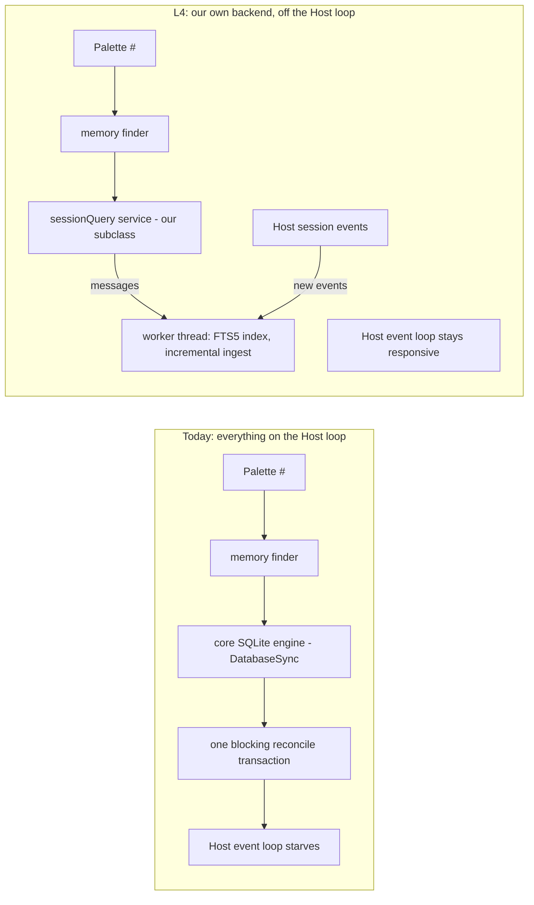

# Host loop freezes plan

> **Status: proposed (2026-10-18).** Nothing implemented yet.
> **Resume here:** confirm the budget in [Measurement gates](#measurement-gates) (see FEEDBACK NEEDED in the thread), then run **M0**.

## Context

- **Symptom.** On 2026-10-18 around 00:08–00:15 the live Web Host (`127.0.0.1:3080`) stopped making progress; the user killed it and restarted it. `~/.dsh/logs/startup-2026-10-17T22-15-15.684Z-*.log` shows no crash: the last committed event was 00:09:29, an `llm/retry` scheduled at 00:08:29 with a 1.1 s delay never fired, and the restart attempt failed once with `EADDRINUSE` because the old process still held the port. A second freeze report (00:15) is the same shape: process alive, timers starved.
- **Prime suspect.** The Web profile mounts DSH core's `@deepseek-ai/dsh-session-query-sqlite` (`profiles/web/cordis.patch.yml`, `openAt: first-search`) as a derived FTS5 index. Its reconciliation runs entirely on the Host event loop.
- **Fresh measurements, 2026-10-18 13:30 (+02:00), read-only, live instance untouched:**

  | Fact                                               | Number                                                                                                                        |
  | -------------------------------------------------- | ----------------------------------------------------------------------------------------------------------------------------- |
  | `~/.dsh/plugins/session-query-sqlite/index.sqlite` | 916 MB (683 MB `persisted_docs_content` + 184 MB `persisted_docs_data`), 682 sessions, 356 823 docs, `global_generation = 12` |
  | Session corpus (`~/.dsh/sessions`)                 | 783 session logs, 1.34 GB compressed                                                                                          |
  | Work one search must do now                        | 179 logs / **428 MB compressed** cold read: 77 changed (249 MB) + 102 never indexed (179 MB); none newer than 1 h             |
  | Live Host (pid 26856, up 12 min)                   | 18 open `session.lock`s, 1.3 GB RSS, **no index handle open**                                                                 |
  | Activity timeline                                  | 9 598 ingests over 141 h = **1.13 events/min**; each ingest rewrites a 2.85 MB `state.json`                                   |
  | Usage store                                        | `usage.db` 45 MB + 4.4 MB WAL; one synchronous commit per 4 MB slice every 30 s, yields between slices                        |

- **Core mechanism (installed `0.2.1-rc.2`, `lib/index.js`; not patchable from this repo):**
  1. Every search runs `_observeStable`. For **every** session in `ctx.sessions.list()` it `structuredClone`s the header and all events, builds every search document, and SHA-256s the whole JSON — even when nothing changed (`observeLive`/`observeSession`). Changed live sessions are then deleted and re-inserted **wholesale** into connection-local TEMP tables (`_replaceLiveSession`).
  2. Every cold log whose `revision` (`dev:ino:size:mtimeNs:ctimeNs`) differs is read in sequence; `persistedReadConcurrency: 4` is not used on this path.
  3. All writes go into **one** `BEGIN IMMEDIATE … COMMIT` through `node:sqlite` `DatabaseSync` on the Host event loop: no chunking, no yielding, `Array.from(text).length` per document.
  4. `assertNotAborted` runs _between_ cold reads, so an abort before the transaction discards all the work already done.
- **Trigger chain today.** Command palette `#` (`content-search-machine.ts`, 200 ms debounce, aborts the previous request on every keystroke) → `@dshfiles/memory` finder (`thread-finder.ts`, 1.5 s content deadline) → core `searchSessions`. While the user types, nothing ever commits. About 1.5 s after typing stops, the deadline fires and the finder starts its **un-abortable** warm search (`warmSessionContent`, no signal, no deadline), which runs the whole backlog at full speed and starves Host timers — the observed freeze window.
- **Related work.** `plans/dsh-host-gaps.md` row 14 (fast thread-content search) and row 57 (observation instability); the delivered finder ([memory README](../../plugins/@dshfiles/memory/README.md#finding-threads-one-finder-over-titles-content-and-memory)); `plans/ade-performance/README.md` (ADE interaction-speed audit; precedent for a plan-local benchmark harness).
- **Boundary.** Stock DSH 0.2.1-rc.2 and this repo's supported dshx/plugin surfaces only. Never patch DSH core, never restart or reload the live `web` profile, never run a search against the live index or the live corpus in place, never push.

## Measured baseline (M0, 2026-10-18)

Harness: [`plugins/@dshfiles/memory/bench/host-loop-freezes.ts`](../../plugins/@dshfiles/memory/bench/host-loop-freezes.ts),
run as `pnpm --dir plugins/@dshfiles/memory bench:freezes`. It replays the live index backlog into a throwaway index
copy, decodes the real concatenated-frame logs, runs the installed engine, and pings the process from a second process.
Raw numbers: [harness/baseline-2026-10-18.json](harness/baseline-2026-10-18.json); how it works and its traps:
[harness/README.md](harness/README.md).

Corpus 808 sessions / 1.26 GB compressed; live index 682 sessions / 356 823 docs; backlog **204 changed logs (460 MB) +
127 never indexed (198 MB)**. Load average ~5-10 on 10 CPUs.

| Scenario                             | Search wall | **Host stall** | What it is                                                                          |
| ------------------------------------ | ----------- | -------------- | ----------------------------------------------------------------------------------- |
| S1 cold catch-up (whole backlog)     | 336.8 s     | **290.5 s**    | one unbroken transaction; +111 047 docs                                             |
| S3 warm search, 18 live sessions     | 43.6 s      | **43.5 s**     | no durable writes at all; the whole cost is observing and re-inserting the live set |
| S4 one giant log changed (49.5 MB)   | 44.3 s      | **44.2 s**     | +12 588 docs                                                                        |
| S6 restart catch-up (20 newest logs) | 132.4 s     | **129.8 s**    | +19 296 docs                                                                        |

Three conclusions the plan now rests on:

1. **The freeze is real and it is this.** One content search blocks the Host event loop for minutes (S1) or tens of
   seconds (S3/S4/S6). The stall is a single uninterrupted block, so nothing else on the Host runs during it.
2. **Warming the index does not fix it.** A fully warm index still costs 43.5 s of stall per search, because core
   re-observes and re-inserts every loaded session wholesale on every search. L2 removes the 290 s catch-up, not the
   43 s floor.
3. **Typing amplification was not the largest term.** It multiplies the work (L1 still matters), but even one search
   on a quiet, warm instance is ~170× over the 250 ms budget.
4. **Search is not the cost — maintenance is.** On the real 946 MB index, an FTS5 `MATCH` answers in **27-70 ms** and a
   ranked page with snippets in **473 ms**. The 290 s is index maintenance performed on the read path. That is an
   architectural property of the core backend, not a tunable constant, and it is what L4 replaces.

Consequences for the layers: L1 and L2 stay worthwhile as small, cheap work-reducers, but **neither can meet the
budget**; L0 (content search off) or L4 (engine off the Host loop) are the only measured ways to reach it. The L4 gate
below is therefore already triggered by S3's 43.5 s; the question is no longer _whether_ it is needed but whether
content search is worth its cost (see FEEDBACK NEEDED and open question 7).

Caveats: S3's live set cycles real logs to 18 sessions, so its byte volume is calibrated rather than exact; the
in-process timer probe under-reports a stall that is still pending when the work resolves (the harness now drains one
macrotask turn before stopping both probes, see the harness README); absolute numbers drift with the live corpus, so
only rounds measured against one snapshot are comparable.

## Goal

Make a Host-loop freeze from session-content indexing either impossible or provably bounded, and pay for each mitigation only when a before/after measurement shows it is needed.

## What

A measurement-first repair plan with five candidate layers:

- **M0** — a reproducible harness that measures Host responsiveness and index work on a scratch instance, plus the frozen baseline numbers.
- **L0** — configuration-only escape hatch (content search off, degradation visible). Cost: none. Reversible.
- **L1** — stop keystrokes from starting and discarding core reconciles (palette + memory finder).
- **L2** — keep the index warm so a reconcile never accumulates a multi-hundred-megabyte backlog.
- **L3** — measure, then fix only if significant: activity-timeline write amplification and the usage indexer's synchronous commits.
- **L4** — move the search engine off the Host event loop (worker thread), only if L1–L3 leave a stall above budget.

In scope: Host responsiveness on this machine's `web` profile, the plugins named above, the harness, and the upstream gap record.
Out of scope: DSH core patches, search ranking/UX changes, a second content index unless L4's spike proves it cheaper than relocating the engine, and any change to session storage format.

## Why

The user lost working state twice and had to kill DSH by hand. The suspected cause is a core component we cannot patch, but every path that _triggers_ it is ours. The risk of this plan is the opposite failure: building a worker-thread index relocation (real maintenance: a new build entry, worker lifecycle, live-session feed, drift risk against core) for a stall that a 20-line change removes. The plan therefore measures before deciding, and names the number that justifies each layer.

## How

### Hypotheses and how each is falsified

| #   | Hypothesis                                                                                                                       | Falsified by                                                                    |
| --- | -------------------------------------------------------------------------------------------------------------------------------- | ------------------------------------------------------------------------------- |
| H1  | Keystroke-per-search + abort discards progress, so a stale index never converges while typing                                    | S2 burst reads ≈ one backlog, not K × backlog; index converges during the burst |
| H2  | The index falls behind because it reconciles only on search; the backlog (428 MB now) is what makes a single search take minutes | S1/S3 with a warm index: reconcile work is small and bounded                    |
| H3  | Per-search cost is dominated by the live-session observation + one unchunked transaction, independent of the backlog             | S3 (warm index, 18 loaded sessions): stall and wall time under budget           |
| H4  | Plugin background writes (activity timeline, usage) hold the loop often enough to matter                                         | S5 idle tax: measurable Host-loop share ≥ 5 ms/s                                |
| H5  | A few giant logs dominate the cold read (49 MB compressed / 343 MB raw is the current maximum)                                   | S4 single-giant-log change: cost bounded and one-off                            |

### Measurement harness (M0)

Deliverable: `plans/host-loop-freezes/harness/` — a runner script, a results JSON per round, and an `evidence/` folder. Reproduce `plans/ade-performance/benchmark.mjs` as the precedent.

- **Corpus snapshot.** `cp -al` (hardlink) `~/.dsh/sessions` into a frozen run directory, and **copy** (never hardlink) `index.sqlite` so the harness can never write the live index. The snapshot is frozen for a whole before/after round; absolute numbers are never compared across snapshots (the live corpus grows).
- **Scratch Host.** Boot a scratch DSH on the snapshot home (dshx `dshx dev up` with the session-content index patch already used by `tooling/dshx/e2e/support/steps.ts`; fallback `DSH_HOME=<run>/home dsh web --port 3199 --no-open`). Port 3080 and `~/.dsh` are never touched.
- **Probes.**
  1. **Host stall (G1)** — a second process pings a socket the measured process serves every 25 ms and the metric is
     the **maximum round-trip time**: when the loop is blocked, pings queue and their round trip _is_ the stall. The
     pinger's own tick cadence (`maxGapMs`) does not show a stall and must not be used as G1.
  2. **Search latency (G2)** — Playwright drives the real palette (`#` typing / submit) and times query → rendered hits, p50/p95.
  3. **Engine work (G3)** — read the snapshot index before/after with `sqlite3`: `persisted_sessions` rows, `persisted_docs` rows, `global_generation`, file size and WAL size; plus the session side by recomputing per-log revisions (`dev:ino:size:mtimeNs:ctimeNs`) against the index rows.
  4. **Logs** — the scratch Host's stdout for `memory: session-content index reconciled in <ms>` and any abort/timeout diagnostics.
- **Scenarios.**
  - **S1 cold catch-up** — snapshot index as it is today (179 logs behind): one search, no aborts. Measures the worst real case.
  - **S2 typing burst** — 12 aborted queries at 200 ms gaps, then settle. Matches `content-search-machine.ts` today. Measure G3 across the whole burst (this is the H1 metric).
  - **S3 warm search** — same snapshot after S1 reconciled: one search with 18 loaded sessions, warm index. Isolates H3.
  - **S4 giant log** — touch the largest session log and search: the worst single-session reconcile.
  - **S5 idle tax** — 5 min idle with no user action: G1 p99/max, activity-timeline ingest latency, usage pass timing. Isolates H4.
  - **S6 restart** — boot the snapshot with the 18 previously-live sessions' logs changed since the last reconcile (the normal restart shape), warm the rest: one search. This is the case L2 cannot remove.
- **Noise control.** The machine runs other agents. Run scenarios serially, record load average with each result, and treat only before/after pairs measured inside one round as comparable.

### Layers and gates

Each layer is one described JJ revision, landed only if its gate passes. If a gate fails, the layer is dropped and the failure is recorded here — that is a successful outcome of the plan.

#### L0 — config-only escape hatch (no code, one profile line)

Set `session-query-sqlite` to `openAt: never` in `profiles/web/cordis.patch.yml`. Content search then fails with `SESSION_QUERY_SEARCH_DISABLED` and `@dshfiles/memory` already degrades to a labeled title/workspace/memory page. Cost: none; zero maintenance. Trade-off: no message-text search at all.
Deliverable: the documented, reversible switch plus a palette string so the degradation is visible rather than mysterious. **This is a legitimate final answer** if the user prefers stability over content search.

#### L1 — keystrokes must not drive the engine

- **No submit gate** (confirmed 2026-10-18): the `#` view keeps showing content results while the user types. The debounce may rise from 200 ms to at most 500 ms; that is the only client-visible timing change allowed.
- `@dshfiles/memory`: content search becomes a single-flight queue. A client abort detaches the _reply_, never the core call; an in-flight reconcile is reused by the next query (cache keyed by query + corpus generation); at most one queued follow-up per in-flight pass; the deadline-miss warm is rate-limited and never starts while a user search is pending.
- **Why this is enough without a submit gate:** typing at a 500 ms cadence can keep at most one reconcile in flight plus one queued, so the work stops being `K × backlog` even though the UI stays live.
- **Gate:** S2 total cold bytes read ≤ 1.2 × one reconcile (was K × backlog); G1 during the burst ≤ 250 ms after the first reconcile commits; search results unchanged.

#### L2 — keep the index warm

- Warm calls from memory's Host runtime: at boot (delayed), debounced after `turn/end`, and on an interval. Single-flight, skipped while a user content search is pending, logged with duration, and surfaced as index health (sessions behind, last warm) in the finder's degraded diagnostics.
- **Measured 2026-10-18:** this converts S1's 290 s catch-up into S3's 43.5 s warm-search floor; it does not reach the budget, and it does not remove the restart catch-up (S6, 129.8 s).
- **Gate:** S1 and S3 cold bytes read per search ≈ the delta since the last warm; S6 (restart shape) is the only remaining cold case; no user-triggered search exceeds G1 250 ms.

#### L3 — plugin background tax (measure first, probably drop)

Current evidence says the activity timeline is ~1.13 events/min (≈ 0.5 ms/s of Host time), so this layer is expected to be dropped. Measure S5 for both plugins; implement only if the idle tax is ≥ 5 ms/s of Host time or an ingest/pass p95 blocks timers.

- Activity timeline: in-memory state plus append-only journal and periodic compaction instead of a full 2.85 MB rewrite per event.
- Usage: one commit per pass instead of per 4 MB slice, plus a WAL checkpoint policy.
- **Gate:** measured Host time saved ≥ 5 ms/s, or a timer gap > 250 ms attributable to a plugin write; otherwise drop with the numbers recorded.

#### L4 — own the search backend (the architectural fix)

The core backend cannot be tuned into shape. Its cost is not its query, it is its design:

- It **reconciles on the read path**: a search triggers index maintenance before it answers.
- It **re-materialises every loaded session on every search**: `structuredClone` of all events, a SHA-256 over their
  JSON, a full document rebuild, then a wholesale `DELETE` + `INSERT` of that session's documents.
- It **re-reads whole logs** whenever a revision differs, and writes the whole reconciliation in **one transaction**,
  so an abort discards everything and one giant log blocks everything.
- It stores **unbounded document text** and computes `Array.from(text).length` per document, so one huge event is
  expensive to sanitise, size, index, and snippet.
- Search itself is cheap: measured on the real 946 MB index, an FTS5 `MATCH` answer takes **27-70 ms** and a ranked
  page with snippets **473 ms**. Everything else (the 290 s / 43 s stalls) is maintenance.

So we fork the backend and invert the split: **ingestion becomes a background, incremental, resumable stream; search
becomes a pure read.**

| Piece               | Decision                                                                                                                                                                                                                                                                                                                                                                                                                                                                                                             |
| ------------------- | -------------------------------------------------------------------------------------------------------------------------------------------------------------------------------------------------------------------------------------------------------------------------------------------------------------------------------------------------------------------------------------------------------------------------------------------------------------------------------------------------------------------- |
| Service identity    | Our plugin extends core's exported `SessionQueryEngine` (`@deepseek-ai/dsh-session-query`) and implements only `searchSessions` / `searchEvents`. The inherited reads (`listSessions`, `readSession`, titles, filters, traces, `observeSession`) stay core's own code, so they cannot drift. The profile patch disables the `session-query-sqlite` row, leaving one `sessionQuery` registrant. Every caller — palette, `@dshfiles/memory` finder, `dshx sessions search` — gets the fast backend with no core patch. |
| Index ownership     | A `worker_thread` owns the SQLite FTS5 connection. The Host never opens the index file; it posts requests and receives pages.                                                                                                                                                                                                                                                                                                                                                                                        |
| Ingest              | Cursor per log (`dev`, `ino`, byte offset into the concatenated-frame container, `mtimeNs`): each pass decodes **only appended frames**. Commits are bounded (`BEGIN`/`COMMIT` per batch), so progress is resumable and a crash or abort never discards the corpus.                                                                                                                                                                                                                                                  |
| Documents           | Text is capped per event (default 8 KB) with the full text left in the log. The giant 49.5 MB log holds 157 MB of decoded events in 34 869 events; at an 8 KB cap it stores 74 MB, and snippet cost becomes bounded.                                                                                                                                                                                                                                                                                                 |
| Live sessions       | The Host forwards newly committed events to the worker (bounded text) instead of core's clone-hash-rebuild of the whole session per search. Fresh content is searchable within about a second.                                                                                                                                                                                                                                                                                                                       |
| Search path         | Pure read: worker round trip plus one `MATCH`. No writes, no reconciliation, no clone. If the index is behind, the answer says so (index health) instead of blocking.                                                                                                                                                                                                                                                                                                                                                |
| First build         | A full corpus build runs in the worker in batches with progress; searches answer from what is indexed and label the shortfall. The Host stays responsive throughout.                                                                                                                                                                                                                                                                                                                                                 |
| Health surface      | Bytes/frames behind, last ingest duration, index size, and worker state on the plugin API (and an agent tool), so staleness is visible instead of silent.                                                                                                                                                                                                                                                                                                                                                            |
| What we do not fork | The read engine, the persistence format, the session model, and the profile composition.                                                                                                                                                                                                                                                                                                                                                                                                                             |

Feasibility spikes, measured 2026-10-18 on this machine:

| Spike                                 | Result                                                                                                                                                           |
| ------------------------------------- | ---------------------------------------------------------------------------------------------------------------------------------------------------------------- |
| Register our engine as `sessionQuery` | `WorkerBackedEngine extends SessionQueryEngine` activates; our `searchSessions` answers; inherited `listSessions` and `readTitleSnapshots` still work            |
| Incremental frame resume              | decoding frames `[0..mid]` + `[mid..end]` is byte-identical to a whole-file decode (18 691 frames, 9 345 / 9 346)                                                |
| Worker-owned index                    | 200 000 FTS5 documents (~800 MB of text) indexed in 40.3 s in the worker while the Host loop's largest timer gap was **109.5 ms** and **0** gaps exceeded 250 ms |

Expected result: search latency of the order of the measured `MATCH` (tens of ms, capped documents keep the snippet
page bounded), and **no Host stall above the 250 ms budget**, including during a full first build.

Cost: one owned plugin (index schema, resumable ingest, worker protocol, service subclass, tests), a worker entry point
in the dshx build (extend dshx if it cannot express one — do not work around it), and the profile row change. This is
the largest item in this plan and the only measured way to keep content search.

- **Gate to build it:** already met by measurement (S3's 43.5 s stall on a warm index cannot be lowered by L1/L2).
- **Gate to keep it:** a full rebuild on the frozen snapshot shows **no Host stall above 250 ms** (G1, external probe)
  and a warm content search answers within G2 p95 1.5 s, with the same result set for the queries the finder and the
  palette issue (G5).
- **Gate to keep it:** S1/S6 meet G1 ≤ 250 ms with correct results and no schedule/timer regression over a 30-min scratch run.

#### L5 — upstream record

Update `plans/dsh-host-gaps.md` row 14 with this round's numbers and concrete asks: commit in bounded batches with yields, use `persistedReadConcurrency` on the cold-read path, do not discard progress on abort, index live sessions incrementally instead of wholesale per search, and expose index health.

### Measurement gates

**Confirmed 2026-10-18** (G1 max 250 ms / p99 100 ms, G2 p95 1.5 s, G3 1.2×, G4 5 ms/s). All thresholds apply to the scratch Host on the frozen snapshot.

| Gate              | Budget                                                             | Decides                     |
| ----------------- | ------------------------------------------------------------------ | --------------------------- |
| G1 host stall     | max 250 ms, p99 100 ms                                             | every layer; L4's necessity |
| G2 search latency | p95 ≤ 1.5 s warm                                                   | L1/L2 acceptance, L4 need   |
| G3 one reconcile  | ≤ 1.2 × the pre-existing delta; no repeated reads of the same logs | L1/L2 acceptance            |
| G4 background tax | ≥ 5 ms/s of Host time to justify L3                                | L3 keep/drop                |
| G5 correctness    | identical result sets, unchanged degradation labels                | every layer                 |

### Architecture (today vs after L4)

## What this allows

- A measured yes/no answer to "does DSH freeze because of session search, and what is the cheapest change that removes it".
- An immediate, zero-cost safe state (L0) while the rest is decided.
- A reusable harness to re-check after every DSH upgrade.

## What this does not allow

- No DSH core patch, no fork, no vendor of `dsh-session-query-sqlite`.
- No second content index, and no change to what a search returns, unless L4's spike proves it necessary and cheaper.
- No claim of a fix without a before/after number on the same snapshot.
- No maintenance carried for a layer whose gate failed.

## UI & UX

- `#` content view: title/workspace/memory hits render immediately; a "Searching all thread content…" state covers the engine call; while the index is behind, a one-line status ("index catching up, n sessions behind") replaces an indefinite spinner.
- No result-changing layout work. L0 shows a clear, localized "thread content search is off in this profile" state instead of an error.

## Data model

No new persisted user data in L0–L3. L4 owns a worker-side index generation record and an in-memory health snapshot only. Session storage format is untouched; the index stays derived and disposable.

## Implementation steps

- [ ] **M0.1** Snapshot harness: hardlinked corpus + copied index into a run directory, with a `--fresh` mode.
- [ ] **M0.2** Scratch Host boot on the snapshot, no touch of `:3080` or `~/.dsh`; record boot time and load average.
- [ ] **M0.3** Probes: G1 external HTTP poll, G2 Playwright palette driver, G3 `sqlite3` index counters, scratch-Host log capture.
- [ ] **M0.4** Scenarios S1–S6 scripted, results written to `harness/results-<timestamp>.json`.
- [ ] **M0.5** Baseline round on current code; record the numbers in this plan and in `dsh-host-gaps.md` row 14.
- [ ] **L0** Escape hatch + visible degradation; verify the degraded page on the scratch Host.
- [ ] **L1** Palette + finder single-flight; unit tests for coalescing/abort-detach; re-run S2; gate.
- [ ] **L2** Scheduled warm + health surface; re-run S1/S3/S6; gate.
- [ ] **L3** Measure S5; implement only if the gate triggers; re-run S5.
- [ ] **L4.1** Plugin skeleton: extend `SessionQueryEngine`, register as `sessionQuery`, disable the core `session-query-sqlite` row in the seed patch (contract already proven by the spike).
- [ ] **L4.2** Worker protocol + FTS5 schema + the search operations the palette and the finder issue (`searchSessions` and `searchEvents` with the filters, cursors, and snippets they use).
- [ ] **L4.3** Resumable incremental ingest: per-log frame cursors, bounded commits, capped document text, boot build with progress, crash-safe restart.
- [ ] **L4.4** Live event feed from the Host, index-health API and agent tool, and the typed "index warming" degradation path.
- [ ] **L4.5** Re-run the bench scenarios plus a full-rebuild scenario; gate on G1 ≤ 250 ms and G2, then confirm on a scratch DSH with the real palette.
- [ ] **L4.6** Retire the core index file and document the new backend where the behavior lives.
- [ ] **L5** Update the gap row; when the last item is done and verified, run `complete-plan`.

## Open questions

1. Confirm the budgets: G1 max 250 ms / p99 100 ms, G2 p95 1.5 s, L3 5 ms/s?
   **Answered (2026-10-18):** 250 ms is fine as the Host-stall bar; the rest stand as written.
2. L1 UX: is "content search on explicit submit or 800 ms idle" acceptable, or must typing show live content results?
   **Answered (2026-10-18):** no submit gate. Content results stay live while typing; a debounce of at most 500 ms is acceptable. L1 therefore relies on the finder's single-flight queue plus abort-detaches-the-reply, not on gating the UI.
3. Is one frozen snapshot of the real corpus acceptable as the benchmark corpus, with the caveat that absolute numbers are round-local?
   **Answered (2026-10-18):** yes — snapshot the real corpus, round-local comparisons only.
4. For L4: index live sessions from persisted logs in v1 (freshest events may lag until flush), with the live feed in v2 — acceptable?
   **Answered (2026-10-18):** yes.
5. If the L4 gate triggers, build it in this plan, or stop and come back for a decision?
   **Answered (2026-10-18):** stop and come back for a decision before building L4.
6. Is L0 (content search off) a contender as the final answer, or is message-text search worth the maintenance?
   **Open.** L0 plainly: one profile line sets `openAt: never`, so the palette can no longer search message text at all (titles, workspace paths and memory digests still work, already labeled as degraded). It costs zero maintenance and removes the freeze today; it also removes a feature the user asked for. It stays documented as the escape hatch until L1/L2 measurements say whether it is still needed.

7. **Decision (measured):** keep content search and build **L4 as our own backend** (fork the search engine behind the
   same `sessionQuery` service), or switch it off with **L0**? The numbers leave no third option: S3 is a 43.5 s stall
   per search on a warm index, and the spikes show the fork's two hard parts already work. L1/L2 can land as a stopgap
   in either case, but they do not change the decision.

## Acceptance criteria

- [ ] Baseline numbers exist for S1–S6 on the current code, with the frozen snapshot hash and load average recorded.
- [ ] Every landed layer has a before/after pair for the scenario it targets and a gate verdict in this plan.
- [ ] The live instance (`:3080`) and `~/.dsh` were never written to or reloaded by the harness; every run used a snapshot copy.
- [ ] The final state either meets the gates, or the plan records which gate failed and stops there.
- [ ] `dsh-host-gaps.md` row 14 carries this round's measured numbers and the specific upstream asks.
- [ ] What ships is documented where it belongs (plugin README / `docs/`), and this plan is retired with `complete-plan`.

## Decisions log

| Date       | Decision                                                                                                 | Rationale                                                                                                                                                                                                                                                             |
| ---------- | -------------------------------------------------------------------------------------------------------- | --------------------------------------------------------------------------------------------------------------------------------------------------------------------------------------------------------------------------------------------------------------------- |
| 2026-10-18 | Measure before/after every layer and drop layers whose gate fails                                        | The suspected fix (worker-thread relocation) carries real maintenance cost; only numbers justify it                                                                                                                                                                   |
| 2026-10-18 | Harness snapshots the real corpus (hardlinked) and copies the index; no synthetic corpus in v1           | Faithful cost profile now; synthetic generation can be added later if round-to-round drift hurts                                                                                                                                                                      |
| 2026-10-18 | L3 is measure-first and expected to be dropped                                                           | Measured activity-timeline rate is ~1.13 events/min (≈ 0.5 ms/s of Host time)                                                                                                                                                                                         |
| 2026-10-18 | L0 (content search off) is a legitimate final answer                                                     | Zero maintenance, already-degraded-gracefully finder path                                                                                                                                                                                                             |
| 2026-10-18 | No core patch, no live-profile restart                                                                   | Repo boundary                                                                                                                                                                                                                                                         |
| 2026-10-18 | L1 keeps the live `#` results and a ≤ 500 ms debounce; no submit gate                                    | User decision: typing must still show content hits, so the fix moves into the finder's single-flight queue and abort semantics                                                                                                                                        |
| 2026-10-18 | Stop and ask before building L4 even if its gate triggers                                                | The user wants to weigh the maintenance cost against the measured gain in person                                                                                                                                                                                      |
| 2026-10-18 | Benchmarks use one frozen hardlinked snapshot of the real corpus; only within-round numbers are compared | The live corpus grows between rounds, so absolute cross-day numbers would mislead                                                                                                                                                                                     |
| 2026-10-18 | Baseline recorded; G1 is the external probe's **max round-trip**, not its tick gap                       | A blocked server queues pings, so the round trip is the stall; the tick cadence stays ~25 ms and hides it                                                                                                                                                             |
| 2026-10-18 | The bench decodes concatenated zstd frames itself                                                        | One-shot `zstdDecompressSync` stops at the first frame (208 bytes for a 26 MB log) and under-measures the cold read by orders of magnitude                                                                                                                            |
| 2026-10-18 | Both probes drain one macrotask turn before stopping                                                     | The awaited work resolves in the microtask queue before the starved timer and queued pings are serviced, which silently dropped the reconciliation stall (reported as "169 ms" for a five-minute search)                                                              |
| 2026-10-18 | L1/L2 demoted from "the fix" to cheap work-reducers; L0 or L4 is the measured fix                        | S3 shows a 43.5 s stall on a warm index with zero durable writes, which warming cannot remove                                                                                                                                                                         |
| 2026-10-18 | Fork the search backend instead of tuning it (L4 = our own plugin)                                       | Measured: `MATCH` is 27-70 ms, so the freeze is index maintenance on the read path (reconcile-on-search, whole-session re-materialisation per search, unbounded documents, one transaction). Those are design properties, not tunables. The user authorised the fork. |
| 2026-10-18 | Keep core's `SessionQueryEngine` for inherited reads; override only `searchSessions` / `searchEvents`    | Spike: the subclass registers as `sessionQuery` and inherited `listSessions` / `readTitleSnapshots` keep working, so the 1200-line read engine is reused rather than forked                                                                                           |
| 2026-10-18 | Ingest by frame cursor, commit in bounded batches, cap document text                                     | Spikes: split frame decode is byte-exact; 200 k documents indexed in a worker cost the Host a 109.5 ms worst gap; capped text keeps the giant log at 74 MB instead of 157 MB and bounds snippet cost                                                                  |

## Progress

| Step                                               | Status                                                      | Evidence / next action                                                                                                                                                                                                                                                                                                                                                                                                                                                                                                                                                                                                                                                                                                                                                                                                                                                                                                                                                                                                                                                                                                                                                                                                                                                                                                                                                                                                                |
| -------------------------------------------------- | ----------------------------------------------------------- | ------------------------------------------------------------------------------------------------------------------------------------------------------------------------------------------------------------------------------------------------------------------------------------------------------------------------------------------------------------------------------------------------------------------------------------------------------------------------------------------------------------------------------------------------------------------------------------------------------------------------------------------------------------------------------------------------------------------------------------------------------------------------------------------------------------------------------------------------------------------------------------------------------------------------------------------------------------------------------------------------------------------------------------------------------------------------------------------------------------------------------------------------------------------------------------------------------------------------------------------------------------------------------------------------------------------------------------------------------------------------------------------------------------------------------------- |
| Diagnosis and fresh measurements                   | Done                                                        | Numbers in Context (916 MB index, 179 logs / 428 MB behind, 18 live sessions, 1.13 events/min)                                                                                                                                                                                                                                                                                                                                                                                                                                                                                                                                                                                                                                                                                                                                                                                                                                                                                                                                                                                                                                                                                                                                                                                                                                                                                                                                        |
| Plan review (budgets, L1 UX, L4 pre-authorization) | Done                                                        | Budgets confirmed 2026-10-18; no submit gate (≤ 500 ms debounce); snapshot corpus; L4 asked before building. L0 question still open                                                                                                                                                                                                                                                                                                                                                                                                                                                                                                                                                                                                                                                                                                                                                                                                                                                                                                                                                                                                                                                                                                                                                                                                                                                                                                   |
| M0 harness                                         | Done                                                        | [bench](../../plugins/@dshfiles/memory/bench/host-loop-freezes.ts) + [README](harness/README.md) + [baseline](harness/baseline-2026-10-18.json); two instrumentation traps found and fixed (first-frame-only zstd decode; probes torn down before the starved timer drained)                                                                                                                                                                                                                                                                                                                                                                                                                                                                                                                                                                                                                                                                                                                                                                                                                                                                                                                                                                                                                                                                                                                                                          |
| M0.5 baseline round                                | Done                                                        | S1 290.5 s stall, S3 43.5 s warm, S4 44.2 s one log, S6 129.8 s restart                                                                                                                                                                                                                                                                                                                                                                                                                                                                                                                                                                                                                                                                                                                                                                                                                                                                                                                                                                                                                                                                                                                                                                                                                                                                                                                                                               |
| M0.6 feasibility spikes                            | Done                                                        | service replacement works; incremental frame resume is byte-exact; 200 k docs / ~800 MB indexed in a worker with a 109.5 ms worst Host gap                                                                                                                                                                                                                                                                                                                                                                                                                                                                                                                                                                                                                                                                                                                                                                                                                                                                                                                                                                                                                                                                                                                                                                                                                                                                                            |
| Keep content search?                               | **Decided: build L4**                                       | User decision 2026-10-18; L0 stays as the escape hatch and the 916 MB stock index is kept for now                                                                                                                                                                                                                                                                                                                                                                                                                                                                                                                                                                                                                                                                                                                                                                                                                                                                                                                                                                                                                                                                                                                                                                                                                                                                                                                                     |
| L4.1 skeleton                                      | Done                                                        | `@dshfiles/session-search` registers the `sessionQuery` service from a `SessionQueryEngine` subclass; `cordis.patch.yml` inserts the row                                                                                                                                                                                                                                                                                                                                                                                                                                                                                                                                                                                                                                                                                                                                                                                                                                                                                                                                                                                                                                                                                                                                                                                                                                                                                              |
| L4.2 worker + index + search                       | Done                                                        | worker-owned FTS5 index, pure-read search, opaque cursors, refused (not ignored) filters; build, typecheck, 8 tests green                                                                                                                                                                                                                                                                                                                                                                                                                                                                                                                                                                                                                                                                                                                                                                                                                                                                                                                                                                                                                                                                                                                                                                                                                                                                                                             |
| L4.3 ingest                                        | Done                                                        | frame-cursor resume, bounded batches, per-kind text caps, health counters                                                                                                                                                                                                                                                                                                                                                                                                                                                                                                                                                                                                                                                                                                                                                                                                                                                                                                                                                                                                                                                                                                                                                                                                                                                                                                                                                             |
| Lint and antislop pass                             | Done                                                        | `check:diff` reports 0 errors and 0 warnings for the plugin: namespace classes, schema-decoded rows, one `withoutUndefined` helper, documented assertions                                                                                                                                                                                                                                                                                                                                                                                                                                                                                                                                                                                                                                                                                                                                                                                                                                                                                                                                                                                                                                                                                                                                                                                                                                                                             |
| L4.4 live feed + health tool                       | Done                                                        | a committed `session/event` nudges the ingest loop (500 ms coalesced), appended frames index in a bounded batch, and `session_search_health` exposes the index state (read-only)                                                                                                                                                                                                                                                                                                                                                                                                                                                                                                                                                                                                                                                                                                                                                                                                                                                                                                                                                                                                                                                                                                                                                                                                                                                      |
| L4.5 bench + parity                                | Done                                                        | `pnpm --dir plugins/@dshfiles/session-search bench:owned` (passing round): Host loop worst gap 171-240 ms with **0** gaps over 250 ms while indexing (stock: 24 gaps, worst 290 000 ms); searches p50 5-34 ms / p95 25-128 ms during the build; **match-level parity recall 1.0** (15/15, 15/15, 15/15, 3/3 sampled stock hits). Isolated ingest: 8.7 s for a 49.5 MB log (23 853 docs, ~2 700 docs/s). Honest caveat: one 300 MB round at load 20-27 recorded 2 gaps of ~306 ms and search p50 236 ms while the worker saturated, so the 250 ms budget is met on quiet rounds and marginally exceeded under extreme load — still ~1000× better than the stock freeze.                                                                                                                                                                                                                                                                                                                                                                                                                                                                                                                                                                                                                                                                                                                                                                |
| L4.6 docs + seed switch                            | Done                                                        | the web seed disables the stock row and installs `@dshfiles/session-search`; `boot-check-web.mjs --plugin` and `verify-web-profile-contract.mjs` pass. The live profile switches on the next restart (the user's call); the stock index file is untouched.                                                                                                                                                                                                                                                                                                                                                                                                                                                                                                                                                                                                                                                                                                                                                                                                                                                                                                                                                                                                                                                                                                                                                                            |
| L4.7 live cutover (2026-10-19)                     | Two defects the seed-based checks could not see, both fixed | (a) **Ownership:** the seed disabled the stock row _above_ the managed region, and an existing profile only reconciles that region — so the running profile kept the stock row, the stock backend registered first, won the `sessionQuery` service, and content search still paid the read-path reconcile (Host at 77% CPU; the finder reported `SESSION_QUERY_TIMEOUT` while `session_search_health` reported a healthy owned index nothing read). The disable now sits inside the seed's managed region _and_ in the plugin's own bundle patch, and `sessionSearchOwnershipErrors` in [verify-web-profile-contract.mjs](../../scripts/verify-web-profile-contract.mjs) fails the contract when either layer drops it; `session_search_health` reports `ownsService`, and a lost service skips the ingest and logs the conflict. (b) **Filters:** with our backend owning the service, both real callers failed with `SESSION_QUERY_INVALID_FILTER` — `@dshfiles/memory`'s finder and core's session controller (the palette's native path) each send `type: ['user/message','assistant/message']` + `surface: ['current']`. The backend now maps `type`, `surface`, `seq` and `time` onto SQL predicates applied before ranking (core's `materializeSessionEventResultFilters` validates), and refuses only `text` and the session filters it cannot serve. Regression tests cover the exact caller shapes through the real worker. |
