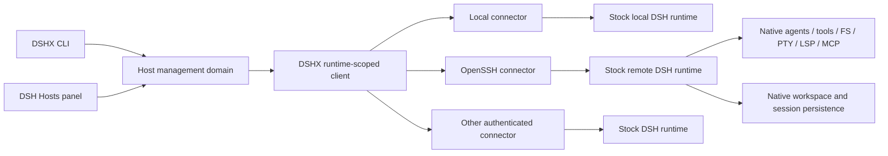
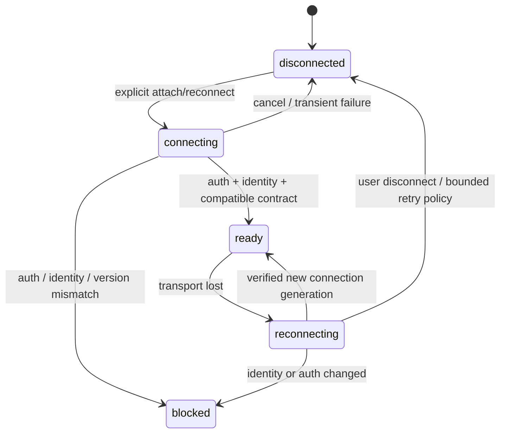

# Multi-host execution plan

The [implementation plan](implementation.md) defines current phase sequence,
Pi/VPS test targets, model budget and acceptance gates. This document retains the
source assessment and architecture rationale; completed runtime receipts live
with the [Multi-host package](../../plugins/@dshfiles/multi-host/docs/validation.md).

Research date: 2026-10-05. Recommendation: **H — runtime federation, using stock
DSH runtimes, a narrow DSHX API extension, and an owned host-management plugin.**
Initially attach existing runtimes; add OpenSSH forwarding as one connector.
Do not fork DSH or adopt a remote plugin as the architecture's foundation.

This is an architecture investigation and bounded POC, not a production feature.
The POC exposed and repaired an existing DSHX wire-contract defect. It did not
add machine management to the daily profile.

## Context

### Evidence and version boundaries

All serious candidates below were downloaded as source archives at exact GitHub
commits; no remote or bookmark was added to our DSHX hard fork. Snapshot identities,
licenses reported by GitHub, and commit dates are in
[source-snapshots.json](source-snapshots.json). Source inspections are evidence of
architecture; they are not successful boot or connectivity tests of those plugins.

Our executable is **DSH 0.2.0-rc.2**, also npm's current `latest`, published
2026-09-29. The investigation used official fnm Node **22.23.3**. Installed
package declarations and built JS were inspected separately from upstream master.
The shell initially selected Node 24.20.0; all DSH probes used the repository pin.

Upstream DSH master at
[5badb150](https://github.com/deepseek-ai/deepseek-harness/tree/5badb15009ae1756c3afe0ae0cef1faafc290ccc)
contains packages labeled `0.2.1-alpha.1`. In particular, official SSH providers
exist in source but were **not found in this installed DSH bundle tree**.
The public `@deepseek-ai/dsh-ssh` npm `latest` is `0.1.6-alpha.1`; installing that
old package is not a valid way to acquire master contracts for our runtime.
No upgrade or source compilation was attempted.

Upstream DSHX default-branch source remains
[8048a780](https://github.com/liyown/dshx/tree/8048a780a263cbd788b71d316f2ec84a272158f8),
our recorded fork baseline. npm `@becomeopc/dshx` latest is `0.1.3`; its peer ranges
exclude DSH 0.2. Our maintained `@dshfiles/dshx@0.1.4-preview.3` is the applicable
framework, not that registry package.

### Our repository

| Boundary | Current implementation | Multi-host implication |
|---|---|---|
| Authoring/build | `tooling/dshx/FORK.md`, compiler Host/Client pipelines, protocol-2 adapter | Emits native Cordis bundles; not a replacement DSH runtime |
| Host plugins | `packages/dshx/src/sdk/host.ts`, `host/runtime.ts` | Typed tools, commands, prompts, RPC; raw context remains available |
| Client plugins | `sdk/client.ts`, `client/runtime.ts` | Native React slots, panels/sidebar, composer actions; root and main views are not implicitly session-scoped |
| Host ↔ Client | `api/define.ts`, `api/host-runtime.ts`, `api/client.ts` | Schema-bound package RPC over native connection; channel ownership and disposal |
| Lifecycle | `sdk/lifecycle.ts`, native Cordis injection/effects | Plugin cleanup and service-driven activation; no machine connection manager |
| Settings/state | settings adapters, native storage, domain-owned stores | Loader row settings and durable plugin stores; no host registry |
| Workspaces | native workspace services, `project-folder-picker`, `thread-sidebar` | Native workspace ids and canonical host-local paths; no runtime qualifier |
| Sessions | `platform/client.ts`, native session service | Typed list/create/fork/prompt/history/etc.; no host field in native header |
| Tools/processes | native tools/commands; plugins use `ctx.subprocess` | No generic execution-host registry in our fork |
| Filesystem | native fs available through raw context; some plugins use Node fs directly | `jujutsu/src/host.ts` mixes Node `realpath/stat` with `ctx.subprocess`; primitive proxying can split its execution world |
| PTY/LSP | native capabilities, not dedicated DSHX wrappers | Must inspect installed provider and composition; avoid inventing parallel terminal/LSP stacks |
| Discovery | native bundle patches/Loader, DSHX inspect/check | Scoped row ids, provider edges, runtime/client boot checks already exist |
| CLI | `src/cli/platform.ts`, `src/platform/client.ts`, communication CLI/MCP | Sessions, commands, plugins, bundles, presets, models, skills, settings; not merely build/scaffold commands |
| Desktop | `apps/desktop/src/host.ts`, `main.ts` | Electron opens stock served UI; currently owns and stops its local DSH child with window lifecycle |

Paths beginning `packages/dshx` in this document are under `tooling/dshx`.

There is **no existing machine/runtime/workspace federation service** in the
current tree. DSHX's programmatic seam, native RPC authoring, UI contributions,
CLI command router, and independent profile boot support are reusable foundations.
Its platform HTTP client accepts loopback tokenized launch URLs. This already
works for a forwarded remote runtime; arbitrary remote HTTPS/auth connectors
would require an explicit transport adapter rather than weakening URL validation.

The shared checkout contained unrelated changes at entry. This work changes
only this plan, the platform client's RPC argument encoding, its focused tests,
and a standalone smoke script.

### What DSH actually abstracts

**DSH has replaceable execution primitives and a remotely usable client/server
protocol. Its standard product composition represents one Harness execution
world at a time.** It is not inherently restricted to a UI running on the same
physical computer, but native Web workspace/session identities are not a
multi-machine dispatch model.

Trace against
[current source](https://github.com/deepseek-ai/deepseek-harness/tree/5badb15009ae1756c3afe0ae0cef1faafc290ccc/packages):

1. Agent-scoped tools resolve native services from their Cordis context. Tool
   registration and cancellation are owned by DSH. A replacement tool does not
   redirect arbitrary plugin or MCP process execution.
2. Shell consumers ultimately use `SubprocessRuntime`: executable resolution,
   fully specified spawn, managed termination, output collection, and real
   terminal allocation. One service implementation is mounted per context.
   Filesystem and subprocess providers must describe the **same execution world**.
   See `packages/subprocess/subprocess/src/index.ts` and `types.ts`.
3. `FileSystem` returns opaque `FsTarget` identities and exposes process-path and
   file-URI conversion, containment, stale guards, bytes/text/ranges, and edits.
   This is a genuine remote-provider seam, not just a Node fs wrapper.
   See `packages/fs/fs/src/index.ts` and `types.ts`.
4. Official master SSH packages compose `ssh`, `fs-ssh`, `subprocess-ssh`, and
   `sandbox-ssh`. OpenSSH owns credentials/host identity; a installed remote
   helper owns files, processes, PTYs, and confinement. Control RPC and program
   streams are separate; per-stream TLS PSKs prevent stream/control confusion.
   Transport loss invalidates requests and starts helper cleanup on EOF/lease
   expiry. **No automatic provisioning, reconnect, mutation replay, or persistent
   full Harness daemon is supplied.** See
   [SSH source and contracts](https://github.com/deepseek-ai/deepseek-harness/tree/5badb15009ae1756c3afe0ae0cef1faafc290ccc/packages/ssh).
5. Master `lsp-stdio` canonicalizes and reads through `ctx.fs` and launches its
   language server through `ctx.subprocess`. It can therefore use matched remote
   providers. This does not prove our installed profile has LSP enabled or that
   an older community provider honors the current contract.
6. Web workspaces use Node `realpath/stat`; workspace uniqueness and session
   membership depend on canonical cwd equality. This was confirmed in installed
   `dsh-workspace@0.2.0-rc.2` JS as well as source. Replacing `ctx.fs` does not
   replace this persistence/domain behavior. See
   [workspace paths](https://github.com/deepseek-ai/deepseek-harness/blob/5badb15009ae1756c3afe0ae0cef1faafc290ccc/packages/workspace/workspace/src/paths.ts).
7. Installed session creation accepts `workspaceId`, `cwd`, optional explicit
   `sessionId`, and `agentPreset`. There is no native `hostId`/`runtimeId` routing
   argument. Session logs live in the serving runtime's configured persistence
   root, with projections and workspace associations owned there.
8. Browser terminal follow/retain and process lifetime are separate, with host
   retention policy and exclusive input attachment. Disconnect does not imply
   indefinite terminal retention or survival across a runtime restart. See
   `packages/api/terminal-controller/src/terminal.ts` and `retention.ts`.
9. Native connection/gateway exposes named RPC arguments and stream generations.
   Browser connection has transport hooks, but native session/workspace caches
   are bound to their current connection/context. Safe concurrent browser
   federation requires isolated contexts or separate served views.
10. Installed MCP stdio transport uses the MCP SDK's own child spawning, sharing
    environment scrubbing rather than all subprocess dispatch. A remote subprocess
    provider alone does not move these MCP servers. Entire remote DSH does.

The lowest useful **proxy** boundary is a matched fs/subprocess/sandbox execution
world, optionally spill/PTC/LSP. The lowest useful **complete-runtime** boundary
is the public native connection/gateway protocol. For our product, the latter
avoids private per-tool routing and workspace-path workarounds.

### Ecosystem source assessment

“dsh-remote-ssh” is ambiguous. GitHub projects and the scoped npm package are
different implementations. The bare npm name currently returned no dist-tags;
do not silently resolve it to an author's GitHub repository.

| Candidate / inspected version | What actual source does | Compatibility, lifecycle, security, reuse |
|---|---|---|
| [Yan-Zero remote SSH](https://github.com/Yan-Zero/dsh-remote-ssh/tree/21d727cbe24fbae283196e5101adb3de2bdd9157), 0.2.4; last commit Aug 16 | AHP-backed proxy fs/shell/subprocess/spill; multiple server/workspace routes; **also complete persistent `dsh-host`** via OpenSSH SOCKS tunnel and local Web gateway | Old `dsh-client-runtime`, host-apiproxy, shell APIs. Reconnecting logical endpoint, exponential jitter; unary mutations not replayed. Strongest conceptual reuse: connector/daemon separation and install locking. Not protocol-2 verified |
| [Yan-Zero dsh-host](https://github.com/Yan-Zero/dsh-host/tree/408f8a5d7a0d754f976dcd57f528cd54eee63bc2), 0.1.0; Aug 16 | Detached Harness supervisor, per-instance home, persistent identity, generation id/PID/random port/token registry; host protocol/control API | **Real persistent Harness, not just SSH commands.** Peer ranges target DSH 0.1 rc.6. Custom WebServer/auth and old protocol mean a port is substantial ownership. Remote SSH uses one shared `dsh-remote-ssh` instance per user, not arbitrary independent machine profiles. Apache-2.0 connector/MIT daemon licenses must remain separate if extracted |
| [aijunjiang remote SSH](https://github.com/aijunjiang/dsh-remote-ssh/tree/ebf6a08a84c4d697c9a3bfd3c84e36257631eb2f), root 0.3.3; Sep 11 | ssh2 service plus Python helper and fs/subprocess packages; GUI registry, per-session helper routing, remote directory picker/jobs | Proxy, not full remote Harness. Internal packages still pin DSH 0.1 rc.6. Broad assertions/manual interfaces. `SshRuntime.connect()` supplies **no hostVerifier**; password login can provision authorized_keys by default. Reconnect cannot promise old managed work survives. Do not adopt credential lifecycle |
| [ZhangFengshun remote SSH](https://github.com/ZhangFengshun/dsh-remote-ssh/tree/eeb27968641ca13b351d5dbc62e99840f1c9973a), 2.4.19; Oct 4 | OpenSSH command pool/cache, local mirror/marker workspaces, custom file HTTP operations, write bridge into `ctx.fs`, terminal shell wrapper, session-aware remote tools/@ references | Recently active; declares DSH 0.2 peers. More UX coverage, but not native complete runtime. No dedicated LSP provider found. Large 4,331-line host file, method wrapping and old/new settings adaptation. Generated terminal wrapper uses **StrictHostKeyChecking=no**; password path uses **sshpass -p**. Reuse UX ideas, not execution architecture |
| [dsh-ssh/dsh-ssh](https://github.com/dsh-ssh/dsh-ssh/tree/17764146e474b44222d12a95c585b5de782f9daa), @dsh-ssh/dsh-ssh 0.1.3; Aug 27 | ssh2/SFTP pool, local placeholder cwd routing, replacement bash/file/search tools, background remote jobs, native UI integration | DSH 0.1 peer cap excludes installed 0.2. Explicit known-host handling/TOFU and reconnect tests are useful; custom glob/grep and remote job semantics are maintenance debt. No full remote Harness or dedicated LSP provider found |
| [UynajGI dsh-ssh](https://github.com/UynajGI/dsh-ssh/tree/9c344efb9bef13ad942b4e9ea16c203fb0095632), 0.3.0-pre source; Aug 16 | ssh2 ProxyJump/SFTP fs/subprocess/PTY providers, registry routing, URI/placeholder remote cwd, workspace flow | More complete execution-provider approach; paired fs/process seam can serve stdio LSP conceptually. Runtime deps embed DSH 0.1 APIs and old client runtime; duplicate type/service identity risk in our profile. Configured fingerprint verification exists. No persistent full Harness |
| [ds-harness-remote](https://github.com/liguobao/ds-harness-remote/tree/ba8c5ec4377b59d5e8c1866b331cc8658500b81b), 0.4.27; Oct 3 | Running Harness access, host/client/both roles, trusted-device identity store, WebRTC/relay encrypted transport, API allowlist, reconnect, terminal/preview opt-ins, UI/CLI | Serious remote-runtime-access alternative; declares 0.2 ranges. **Does not itself establish our machine dispatch model.** `ApiProxySwitch` rewrites shared domains and one global target; historical API compatibility bridge is sizable. Uses default external rendezvous and broader Codex/ACP scope. Package declares MIT; extraction must inspect included license artifacts. Reusable pairing/status UX; substantial security/transport scope unnecessary for SSH-first attachment |
| [tengqi159 desktop](https://github.com/tengqi159/deepseek-harness-desktop/tree/0ca33b8541563f03556ab4ae7e96f7f8dbfd4eec), Aug 15 snapshot | Desktop SSH bridge and host-store tests; additional remote compute paths | Desktop-specific reference, not reusable DSHX host/runtime service. Search-index snippets appeared newer than retrieved source: source revision takes precedence |

Inspection included source entrypoints, package peers/dependencies, transport,
routing, persistence and UI boundaries, and relevant tests. None was installed
into `web` or `probe`. For old-generation projects, old API imports and explicit
peer exclusions are sufficient to reject unchanged adoption; a boot failure was
not fabricated. Semver compatibility for newer projects is a candidate signal,
not evidence that all composed plugins activate.

Discovery also covered upstream discussions and remote Web gateways. Those solve
access to one running Harness, not necessarily execution-host selection. Official
SSH providers are the strongest maintained primitive implementation to revisit
when matching release artifacts exist.

### bb reference architecture

Inspected [bb at 72279d01](https://github.com/get-bb/bb/tree/72279d019a9ac82351dd3f7bd70862cbd050a02e),
Oct 4, including domain schemas, host daemon, enrollment, server dispatch, CLI,
and [multi-device documentation](https://github.com/get-bb/bb/blob/72279d019a9ac82351dd3f7bd70862cbd050a02e/docs/multiple-devices.md).

| Concept | bb ownership / useful lesson |
|---|---|
| Host | Durable id/name, persistent/ephemeral type, connected state, last seen, permission ceiling, lifecycle and rejected protocol version; names need not be unique |
| Enrollment | Server-issued enroll credential becomes host credential; daemon has its own instance id; browser access does not enroll an execution machine |
| Daemon | Host-only provider/plugin worker package; connects to server, opens session with active threads/environments, heartbeat, reconnect and bounded queues |
| Project | Logical project can have host-specific paths or clone sources; broader than one canonical cwd |
| Environment | Domain schema explicitly has projectId, hostId, path, provisioning/provider selection, worktree facts, lifecycle; actual prepared execution location |
| Thread | Associated environment; server dispatch resolves machine/environment and daemon availability. The UI does not infer host from path spelling |
| RPC | Server selects daemon by host id; read/work/cleanup gates and retryability differ. Not all mutations are generically retryable |
| Persistence | Central server domain/events plus host runtime/provider storage and delivery state; reconnect reports active/undelivered thread ids. Not simply a list of SSH aliases |
| Lifecycle/version | Exact server artifact digest, daemon protocol handshake, controlled self-update/restart, per-server data/service isolation |
| CLI | Machine/environment/thread commands use the same domain model as UI |

Relevant source: `packages/domain/src/{host,environment,thread}.ts`,
`apps/host-daemon/src/{enroll,server-connection,runtime-manager,event-sink}.ts`,
`apps/server/src/services/hosts/online-rpc.ts`, and
`services/threads/queued-message-dispatch.ts`.

Borrow explicit identity, execution association, offline semantics, separate
daemon/connection lifetime, version negotiation, and shared UI/CLI APIs. Defer
bb's cloud machine lifecycle, provisioning/worktree environment hierarchy,
central dispatch/event replication, Connect gate and self-update machinery.
DSH already owns agent loops and durable sessions; replacing those with bb's
control-plane ownership would turn this into a new harness.

## Goal

Make execution machines first-class through explicit runtime-scoped workspace
and session APIs while preserving DSH's native execution and persistence.

## What

Start with a federation directory and attachment to existing DSH runtimes.
One machine may run several runtime/profile instances; each runtime owns its
workspaces, sessions, models, plugins and credentials. Local is an ordinary
runtime attachment. A connector obtains authenticated native API access.

## Why

Our current tooling can operate a session programmatically but has no durable
answer to “which machine/profile owns this path and session?” Proxy-only
implementations fail to preserve that answer across all plugin, MCP, filesystem,
and environment boundaries. Runtime federation preserves ordinary plugin behavior.

## How

### Strategy comparison

Ratings are relative to this repository. “Multi-host” means an explicit domain
model, not merely several configured SSH connections.

| Strategy | Implementation / maintenance | DSH coupling / DSHX fit | Multi-host / full runtime | UX / CLI | Extensibility / security / upstreamability |
|---|---|---|---|---|---|
| A: unchanged plugin | Low initial; inherited maintenance | Old candidates incompatible; recent candidates composition-dependent | Partial host UX; Yan-Zero and Remote have runtime access | Existing UX; inconsistent APIs | Inherits mirrors/global switch/custom auth; no candidate covers full desired abstraction |
| B: layer over plugin | Medium; two evolving APIs | Depends on plugin-private routing/lifecycle in most candidates | Possible, constrained by underlying model | Good if public stable API exists | Viable optional connector later; not sound current foundation |
| C: fork plugin | High continuing cost | Own legacy API port and Cordis identities | Can add both | High potential | Own auth/daemon/transport indefinitely; not justified by current gap |
| D: extract pieces | Medium–high initial; narrower owned code | Transport can be separated; old host protocol cannot simply carry over | Good for connector; no domain by itself | Must build product APIs | Yan-Zero lifecycle ideas useful; extraction requires licenses and protocol-2 adaptation |
| E: new plugin only | Medium–high | Public native RPC/settings/UI, but CLI/client remain one endpoint | Directory and explicit runtime routing feasible | Good hub UX; CLI needs shared API | Good product ownership; no need to replace fs/tools |
| F: DSHX extension only | Medium | Natural platform transport + typed workspace/session API | Programmatic federation, no complete product UI | Strong CLI; UI consumers still needed | Narrow shared primitives upstreamable; avoid putting SSH management in compiler |
| G: DSH modification/fork | Very high | Native model/client domain changes | True native federation or central-agent dispatch possible | Best deep native UX | Only needed for one universal cross-runtime native graph or central ownership; premature now |
| H: E + narrow F + stock runtimes | Medium staged; bounded ownership | Public protocol, ordinary plugins on each runtime | Multiple simultaneous runtimes; complete remote execution world | Host hub + CLI first, isolated native views initially | Connector-independent; established SSH auth; shared API extension has reusable callers |

**Choose H.** It preserves a coherent execution world for our existing plugins
and remote MCP, avoids mirror directories and global service mutation, and reuses
DSH's current authentication, gateway, native UI and persistence. No candidate
provides this whole domain cleanly against our installed generation.

This is a recommendation for runtime federation, not a claim that it exactly
matches bb's central control plane. Each DSH runtime owns its agent execution
and canonical session store. If one central agent must dispatch arbitrary tool
calls across machines, revisit matched provider routing and native model changes
as a separate requirement.

### Proxy versus remote runtime

| Concern | Proxy execution world | Full remote DSH runtime |
|---|---|---|
| Agent/model calls | Local Harness | Remote Harness |
| Host plugins | Mostly local; Node fs bypasses providers | Remote, including direct Node calls |
| Client plugins | Local UI composition | Initially served by selected runtime; hub remains local |
| Files/shell/PTYS/LSP | Remote only where provider/routing contract honored | Native on selected machine, if enabled there |
| MCP stdio | May remain local; requires explicit separate integration | Runs with remote runtime's MCP config/environment |
| Credentials/env | Model/plugin credentials local; explicit remote exec env forwarding | Remote runtime credentials/env; connector auth local; no automatic secret replication |
| Session/workspace state | Local durable state; Web path assumptions problematic | Durable state on remote runtime; hub stores references/cache |
| Disconnect | Local agent may remain; official SSH helper initiates process cleanup | Runtime independent of transport; exact agent/terminal retention must be verified |
| Runtime restart | Local state resumes; remote managed processes generally lost | Durable sessions resume; no promise old PTYs/agents survive process restart |
| Several machines | Requires scoped service sets/router and path identity changes | Several independent runtime connections with qualified references |

Both modes are useful, but they should be explicitly different deployment modes.
Do not label a leased remote execution helper as a persistent remote Harness.
Defer first-class proxy mode until a real requirement needs local agent/model
ownership or split credential placement.

### Architecture and ownership



1. **Host-management domain/plugin:** durable directory, machine/runtime records,
   explicit targeting, connection status and last verified summaries. Package-local
   service/API supports both React and CLI. It does not execute generic raw shell
   requests received from arbitrary browser callers.
2. **DSHX platform:** transport ownership, validated responses, named native wire
   args, runtime-qualified operation handles, typed workspace/session operations,
   cancellation and generation-safe stream handling. CLI reuses these operations.
   Existing `HostCapabilities` in the SDK means plugin capabilities; avoid
   overloading that name for machine capabilities.
3. **Connector:** bootstrap/discovery/auth/transport. OpenSSH resolves configured
   aliases and strict known_hosts using agent/key auth. Connector disconnect closes
   channels it owns, not the attached runtime. New backends return the same native
   transport, not a second universal fs/exec/terminal interface.
4. **Runtime:** stock DSH profile, agent loops, model calls, tool/plugin execution,
   native storage, process retention. Optional companion plugin publishes stable
   runtime identity, version/profile and capabilities if native discovery is
   insufficient. That plugin must not replace native web auth or session formats.
5. **Supervisor:** remote service manager/deployment owns persistent DSH lifecycle.
   On this machine setup belongs in Nix. Initial attach does not install or update
   a remote runtime. Later provisioning requires trusted matching prebuilt artifacts.

### Operations and API shape

Illustrative API, not implemented public declarations:

```ts
type RuntimeRef = { hostId: string; runtimeId: string }
type WorkspaceRef = RuntimeRef & { workspaceId: string }
type ThreadRef = RuntimeRef & { sessionId: string }

directory.hosts.list()
directory.runtimes.connect({ runtimeId, signal })
directory.runtimes.disconnect({ runtimeId })
directory.workspaces.list({ runtimeId })
directory.workspaces.open({ runtimeId, path })
directory.threads.create({ workspace: workspaceRef, agentPreset })
directory.threads.history({ thread: threadRef, signal })
```

Validate references at the API boundary, including that workspace/thread belongs
to the selected runtime. Native ids are opaque and never globally interpreted.
Do not infer a machine from a cwd prefix or silently fall back to local.
The connector returns an authenticated runtime transport plus verification facts;
higher layers never need SSH command strings. Credentials remain private handles.

### Lifecycle



Read-only resynchronization may retry. An admitted mutation interrupted after
transmission has an **unknown outcome** and is not replayed without a native
idempotency guarantee and reconciliation. Disconnect invalidates generation-owned
streams/caches; stale completions cannot update a different selected runtime.
Runtime restart requires reauthentication/new connection generation and native
history resynchronization. Remove host disables new dispatch; stopping/removing
remote runtime/data is a separate action.

## What this allows

1. Concurrent machine/runtime management without changing native session format.
2. Runtime-scoped workspace creation and thread APIs shared by UI and CLI.
3. Existing owned plugins executing entirely in their selected runtime.
4. Connector backends evolving without rewriting the product's machine model.

## What this does not allow

1. Automatic thread migration, central canonical session storage, or cross-host
   scheduling inside one native agent loop.
2. Claiming every plugin is safe on an arbitrary remote machine.
3. Transparent multi-runtime composition of every existing native React view.
4. Process survival after a runtime crash/reboot or indefinite unattended PTY life.

## UI & UX

1. Hosts panel lists machines and runtime/profile instances, verified version,
   online state, last seen and measured RPC latency. Unsupported capabilities show
   unavailable; a successful TCP handshake alone is not “ready.”
2. Workspace picker selects runtime first, then browses through that runtime's
   directory service. Expand `~` on the remote runtime; never local `realpath` a
   remote path. Cache summaries for offline display, clearly stale.
3. Thread list groups by runtime and workspace. Thread links encode qualified
   ids. Reopening an offline thread offers reconnect and cached metadata; execution
   controls stay disabled. No silent local substitute.
4. Initial “Open runtime” loads its complete native served UI in a separate
   origin/window/view. Existing native caches/plugins stay coherent. A later unified
   conversation view needs explicit isolated client contexts, tested retention,
   upload/media/approval routing, and reconnect generations.
5. Persistent remote runtime is not an Electron-owned child stopped on window
   close. Separate owned local child handles from attached remote handles.
6. Mobile follows the same host/thread identity; compact host selector does not
   change execution semantics.

## Data model and persistence

| Record | Durable fields | Owner |
|---|---|---|
| Machine | id, label, connector configuration/credential reference | Management directory |
| Runtime | stable id, hostId, profile/instance selector, expected identity/compatibility | Directory; verified against runtime |
| Connection observation | status, latency, version, capabilities, last seen, generation | Live manager; cached observations marked stale |
| Workspace reference | runtimeId, native workspaceId, last known path/title | Directory cache; native runtime owns canonical record |
| Thread reference | runtimeId, native sessionId, workspace reference | Directory/navigation; native runtime owns history |

Use native durable storage or an existing atomic domain store with schema version,
serialized writes and restrictive credential-store permissions. Store secrets
outside user-visible settings. Do not copy native JSONL journals to fabricate
central ownership. Two runtimes may use identical workspace paths and native ids;
qualified identity must still distinguish them. A machine id is not enough when
that machine runs several profiles or isolated DSH homes.

## CLI integration

Extend `src/cli/platform.ts` and shared platform client rather than add a parallel
CLI shell-out implementation. Proposed commands:

```sh
dshx host list --json
dshx host add --name homeserver --connector ssh --alias homeserver
dshx host status homeserver --json
dshx runtime list --host homeserver
dshx workspace list --runtime homeserver-web
dshx workspace open --runtime homeserver-web --path /srv/project
dshx sessions create --runtime homeserver-web --workspace <native-workspace-id>
dshx sessions list --runtime homeserver-web
```

Keep the existing `sessions` vocabulary; aliases such as `thread new` can be added
when they improve consistency. `--host` is convenient only when it resolves one
runtime; ambiguity must fail. JSON output contains qualified ids, safe error codes,
and explicit stale/offline status, never tokens or prompt content.

## Security review

Assets: model/provider credentials, SSH credentials, workspace contents, session
history, plugin code, runtime identity and execution privileges. Actors: local
operator/browser, management plugin, trusted remote runtime, untrusted workspace
content/processes, network attacker and potentially compromised remote machine.

| Finding / threat | Concrete boundary and required treatment |
|---|---|
| **Warning: host authenticity bypass in candidate** | aijunjiang `SshRuntime.connect()` has no hostVerifier; Zhang terminal wrapper disables StrictHostKeyChecking. Do not adopt those defaults. Use preconfigured strict OpenSSH trust; unknown/mismatched keys block attachment |
| **Warning: password exposure path** | Zhang's `sshpass -p` exposes password in process arguments. Keep secrets out of argv/settings/logs; prefer agent/key auth and established interactive enrollment |
| **Warning: shared target mutation** | Remote's ApiProxySwitch replaces shared domains; concurrent clients can inherit global selection. Use explicit qualified routing and connection generations |
| Wrong-host execution | Bind every operation to runtime identity and native owner ids. Verify identity after reconnect; path/name/port is not identity. Never automatic local fallback |
| Compromised remote runtime | Treat returned data, paths and capability claims as untrusted; validate/bound them. Do not execute returned commands or fetch remote plugin JS into the management page's origin. Runtime still receives any credentials explicitly configured there |
| Plugin execution | DSH plugins are trusted executable code, not a sandbox. Remote plugin installation/update is runtime-scoped and deliberate; no registry peer auto-install or cross-profile dependency substitution |
| Forwarded localhost | A localhost tunnel exposes privileged DSH APIs to local clients. Preserve DSH launch-token/cookie/auth and trusted-authority checks; bind only loopback; no wildcard listeners or unauthenticated reverse proxy |
| Secret/environment location | Complete runtime model calls use remote credentials. No implicit forwarding of local env, SSH agent or OAuth state. Proxy mode requires a separate explicit environment policy |
| Credentials/logging | Connector tokens/cookies live in private memory or protected store, not directory DTOs. Redact launch URLs, errors and recordings. POC prints no token/session content |
| Remote updates | Pin runtime/toolchain and artifact provenance; verify digests; no silent npm install or source build. Digest integrity is not protection against a compromised remote OS |
| Cancellation/retry | Unknown admitted outcome remains unknown; no automatic mutation replay. Connection teardown must not claim process termination it cannot observe |
| Browser media/tunnels | Native attachments, WebSockets, SSE, asset HMR and localhost preview links need distinct runtime-aware routing and origin policy; RPC success alone does not prove browser safety |

Confirmed source findings above are not claims of exploitation. The remote OS/user
is trusted infrastructure; SSH encryption and filesystem sandbox policy do not
protect secrets against that host administrator or same-user process inspection.

## Implementation steps

1. **Completed bounded POC:** two disposable stock DSH Web runtimes, existing
   DSHX platform client, real byte-forwarding TCP tunnel, isolated sessions,
   auth rejection, disconnect/reconnect and durable restart recovery. Repair
   native named-argument wire defect encountered on first run.
2. **Next: remote execution acceptance gate:** attach to one operator-provisioned
   Linux/macOS DSH 0.2 runtime over strict OpenSSH; no install automation. Run one
   deterministic DSHX diagnostic plugin on both ends; verify fs bytes, spawned
   process/env/cwd, native PTY I/O/resize, native LSP, MCP location, and continued
   agent work while UI/tunnel disconnects. Test version/auth/key mismatch.
3. **Identity and shared directory slice:** schema-backed machine/runtime records,
   stable verified runtime identity, local and forwarded connectors, public API
   and CLI list/status/workspace/session create. Show host selector plus “Open
   runtime” panel. Test identical paths/ids, duplicate names, offline reopen,
   reconnect cancellation and stale completions. Use probe/throwaway profiles.
4. **Reliable connection management:** bounded retry classification, generation
   resync, capability/version report and explicit mutation unknown outcomes.
   Reuse DSH's native guarantees; do not copy Yan-Zero's legacy host protocol.
5. **Product integration:** qualified sidebar/thread links, workspace picker,
   separate native runtime views. Earn a unified conversation surface only after
   isolated client contexts and approval/media/terminal routing work.
6. **Provisioning, only if needed:** service-manager startup, matching prebuilt
   runtime/plugin deployment, upgrade/rollback policy. A browser-independent
   runtime is an operational requirement, not a transport side effect.

Each phase should pass its vertical acceptance gate before adding richer UI.
No daily-profile promotion was attempted or is warranted by this POC alone.

## POC evidence

Run from repository root:

```sh
fnm exec --using 22.23.3 node --experimental-strip-types tooling/dshx/scripts/smoke-multi-host.mjs
fnm exec --using 22.23.3 pnpm --dir tooling/dshx --filter @dshfiles/dshx exec vitest run tests/platform-cli.spec.ts --maxWorkers=1
```

The smoke script isolates DSH_HOME twice, chooses OS-assigned loopback ports,
does not inherit provider/API-key environment variables, captures and checks
boot output, creates/renames sessions without model calls, and cleans up its
servers/tunnels/homes. Its TCP forwarder is a real carrier; it supplies no mocked
DSH API responses and performs no SSH authentication.

First run failed with `gateway/internal`: “Remote payload must contain exactly
one plain-object args field.” `DshPlatformTransport` and its callers previously
serialized positional arrays, including WebSocket follow. Installed generated
`TYPERT_REMOTE` descriptors supplied actual wire names: e.g. session create uses
`request`, session list uses `_request`, commands use `agentId/line/submittedAttachments`,
settings mutate uses `ns/ops/expectedRevision`. Those contracts now shape the
client's named argument objects. Generated artifacts were inspected, not edited.

Successful POC assertions:

1. Two stock runtimes boot without activation failures.
2. Identical workspace cwd does not merge the runtimes' session namespaces.
3. HTTP mutation and WebSocket history work through a loopback byte forwarder.
4. A launch token from runtime A fails against runtime B; unknown target rejects.
5. Dropped tunnel causes an operation error; runtime A remains usable; runtime B
   retains history; explicit reconnect does not replay the rejected mutation.
6. Runtime B restart using the same isolated home recovers durable history.

The unknown-target guard in this script is **not** a production directory/auth
implementation, and disconnected-before-send rejection does not test the harder
admitted-but-response-lost case. No physical remote host, agent/model turn,
filesystem/process operation, native PTY, LSP, browser UI, or supervisor was tested.

Focused platform suite: **17 tests passed**. Wider validation results are recorded
in the [package validation receipts](../../plugins/@dshfiles/multi-host/docs/validation.md). The transport's exported `rpc` argument type
changes from positional array to named object; custom transport adapters must
follow the installed native wire contract. In-repository callers were checked.

## Open questions

1. Does a live agent turn continue after all browser/tunnel consumers disconnect
   in our exact installed composition? Terminal retention is separate and bounded.
2. Which native version/identity/capability discovery methods are sufficiently
   stable? A minimal runtime-info companion plugin may be needed.
3. Which owned bundles should run on each machine? `secret-catalog`, account
   tooling, executable availability and desktop integrations have real placement
   requirements; complete-runtime ownership does not make them portable.
4. Can native client contexts be isolated cleanly for concurrent unified views,
   including uploads/approvals/media, without DSH changes? Separate views work
   around no durable-state limitations, but are less seamless UX.
5. How should cached offline history be encrypted/retained if added later? Initial
   directory caches metadata only; transcript replication is a separate decision.
6. Do users ultimately need one central agent/model account dispatching to many
   machines? That is materially different from the recommended federation model.
7. When will protocol-matching official SSH/LSP artifacts ship? Do not compile
   master or widen compatibility solely to consume them.

## Acceptance criteria

- [x] Inspected local fork and installed native contracts before choosing strategy.
- [x] Inspected multiple ambiguous remote projects and persistent dsh-host source.
- [x] Compared A–H, proxy/full-runtime semantics, bb concepts and concrete threats.
- [x] Real two-runtime session/tunnel/restart POC passes without profile contamination.
- [ ] Actual SSH/agent/process/PTY/LSP/MCP acceptance gate passes.
- [ ] Durable identity and runtime-qualified directory API/CLI exists.
- [ ] Hosts/workspace/thread UI and offline behavior pass browser evidence checks.
- [ ] Production connection and lifecycle semantics are verified and documented.

## Decisions log

| Date | Decision | Evidence |
|---|---|---|
| 2026-10-05 | Prefer complete-runtime federation | Native workspace uses local realpath; owned plugins and MCP can bypass primitive subprocess/fs proxying |
| 2026-10-05 | No unchanged plugin adoption or DSH fork | Legacy generation gaps; newer implementations have narrower/global-switch models; native gateway already permits remote access |
| 2026-10-05 | Treat machine and runtime as distinct ids | Multiple profiles/homes on one physical host must not collide |
| 2026-10-05 | Repair named RPC encoding in DSHX | Real installed gateway rejection; generated native descriptors and successful two-runtime POC |
| 2026-10-05 | Defer daemon/provisioning and universal browser federation | Not required to validate native boundary; operational/runtime retention gates still open |
