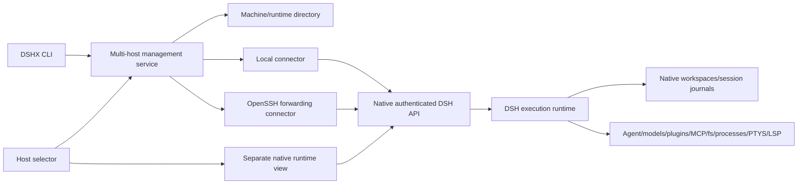

# Multi-host implementation plan

## Context

Status: ready for the remote execution proof, then gated implementation. Updated
2026-10-05. The user authorizes testing on their Pi or VPS and requests free or
very cheap model usage.

[The source assessment](README.md) owns the ecosystem comparison, source
references, strategy decision and security analysis. This document owns the
execution sequence and acceptance gates. [Recorded validation](validation.md)
describes the completed local POC, not remote acceptance.

The baseline is installed DSH `0.2.0-rc.2` and our local
`@dshfiles/dshx` fork. Two disposable stock runtimes already pass session
isolation, native HTTP/WebSocket RPC through a TCP tunnel, authentication
rejection, disconnect/reconnect and durable restart recovery. Actual SSH,
agent continuation, remote filesystem/processes, PTY, LSP and MCP remain unproved.

Read-only infrastructure checks on 2026-10-05 used existing key authentication,
`BatchMode=yes`, `StrictHostKeyChecking=yes` and `ForwardAgent=no`:

| Target | Live result | Test role |
|---|---|---|
| VPS `vps1`, documented `deploy` account | Linux x86_64; ~2.7 GiB available RAM; ~20 GiB free root disk; systemctl available | First remote vertical slice; common Linux binary target |
| Pi, documented `raspberrypi` account over LAN | Linux aarch64; ~6.1 GiB available RAM; systemctl available | Optional second remote host and ARM64 compatibility gate |

Neither account exposes `node` or `dsh` on the noninteractive login PATH. That
does not prove no runtime is installed elsewhere. Recheck before provisioning.
Existing infrastructure serves real applications; test homes and processes must
be separate. Host addresses and credentials stay in the infrastructure/secret
configuration, not this plan.

Operational sources: `../home-infra/AGENTS.md`,
`../home-infra/hosts/raspberrypi/README.md`,
`../home-infra/hosts/vps1/inventory-pre-takeover.md`, and
`../nixfiles/modules/ssh.nix`. The VPS inventory is historical; live inspection
takes precedence. Resolve current Tailscale identity before using its route.

## Goal

Make execution placement explicit and programmatically accessible: local and
remote DSH runtimes, qualified workspaces and sessions, shared UI/CLI operations,
and predictable offline behavior.

## What

Implement strategy H from the assessment: runtime federation, a narrow DSHX
platform surface and an owned `@dshfiles/multi-host` management plugin. Stock
DSH runs on each execution machine. Local and SSH-forwarded connectors attach
to its native authenticated API. SSH is transport/bootstrap, not the domain API.

The first useful release creates and opens a remote workspace/session from the
CLI and local host selector, shows execution placement, and returns to the same
remote session after disconnect. Separate native runtime views preserve each
runtime's plugin graph and client context.

## Why

Users should select where work runs without interpreting a local path as a
remote path. Full runtime placement keeps native tools, plugins, MCP processes,
model credentials and durable session ownership together. The existing platform
client and successful local tunnel POC justify validating this boundary before
building a transport-specific execution proxy or modifying DSH.

## How

### Conceptual model and ownership

DSHX owns typed native RPC, workspace bindings, connection cancellation and safe
errors that other platform callers need. The plugin owns machine/runtime records,
host-management use cases, connection policy, discovery and UI. CLI and UI call
the same service; the CLI must not import React or duplicate registry writes.

Choose the service's HTTP/remote registration through the existing DSHX Host ↔
Client mechanisms during phase 2. Expose a headless client for CLI use. Connector
code stays in the multi-host domain until another real caller needs it.

The execution runtime owns agent execution, provider calls, environment,
plugins, MCP children and canonical history. The directory stores references and
last-seen metadata. Each connector returns an authenticated native transport and
verification facts; higher layers do not receive SSH command strings or tokens.

### Operations and lifecycle

Connect verifies machine authentication, runtime identity, version and capability
facts before dispatch. SSH forwards a loopback-only local endpoint to a
loopback-only remote endpoint. Disconnect tears down the connection, not the
execution runtime. Removing a directory entry does not delete remote data.

Use one cancellation owner and generation per connection. Ignore stale work after
disconnect/reconnect. Reads may retry with bounded backoff. Mutations are never
automatically replayed after an ambiguous disconnect; report an unknown outcome
and reconcile using native IDs/state. An unavailable runtime never redirects
operations to local execution.

Do not label a runtime online from SSH reachability alone. Model authentication,
model quota, protocol mismatch, runtime authentication failure and missing tools
are separate facts. A runtime restart invalidates live handles and subscriptions;
recover durable references after identity verification.

### Model selection and spend control

No model is needed for transport, filesystem, process, persistence or most fault
tests. Run those deterministically first. Use a model only to prove an actual
agent invokes the diagnostic tool and keeps running after the tunnel closes.

Selection order for those few turns:

1. Existing OpenCode Go account with a currently free model. The public catalog
   on 2026-10-05 includes `longcat-2.5-preview-free` and `space-bunny-free`.
   Prefer the first that passes one bounded tool-call/schema check; do not assume
   tool support from a name. Resolve only the already configured account selected
   for the probe; do not select another person's account automatically.
2. An account-included cheap Go model, such as catalog-listed
   `mimo-v2.6-flash`, when free candidates are unavailable or fail tool calling.
3. Command Code free model if an existing account route is available. Its
   [current catalog](https://commandcode.ai/models) labels Ling 3.1 Flash,
   Space Bunny Alpha, Ling 3.0 Flash Sante and Laguna S 2.1 free. Resolve exact API
   IDs, account eligibility and tool capabilities through the live provider;
   marketing names are not dispatch IDs. No `commandcode`-named secret alias was
   found; this does not establish absence of an account in the DSH account store.
4. User's allowed fallback: `gpt-6-luna`, reasoning `low`, only when the selected
   provider actually exposes that model and setting. No silent premium fallback.

The owned ai-accounts plugin already has Go and Command Code adapters; inspect
and reuse them instead of adding a second provider implementation. Two Go secret
aliases exist, and the vault is currently unlocked; no secret values were read
for this plan. Provision one scoped test credential through the existing secret
workflow when running the remote agent test. Do not copy the full daily account
store, OAuth homes or unrelated credentials to the remote host.

[Go documentation](https://opencode.ai/docs/go/) currently lists DSH among clients
with incomplete session-header coverage. Validate stable conversation identity
and client User-Agent across the actual adapter path. Go subscription usage is
quota-limited; included usage is not unrestricted free usage. Disable paid
overage for the selected test route where supported, and avoid a paid route if
its spend cannot be bounded or priced.

Default test envelope: at most three model turns total, 8K input and 2K output
tokens per turn, three tool iterations per turn, a two-minute turn timeout, and
$0.10 estimated incremental paid spend for the run. These are chosen test limits,
not provider guarantees. Count reasoning tokens where billable; record usage and
route metadata. Check price/allowance before dispatch, stop at the first successful
agent proof, and cancel on exhaustion. A flaky free provider should not trigger an
unbounded retry loop. Infrastructure/lifecycle tests continue without model calls.

## What this allows

- Concurrent local and remote sessions with unambiguous execution placement.
- CLI access to the same host/workspace/session operations as the UI.
- Independent runtime profiles on one machine and durable remote state across
  control-plane disconnects, subject to the remote survival acceptance gate.
- Future connectors without replacing native execution APIs.

## What this does not allow

- Central transcript replication, transparent live session migration or a shared
  local model account driving arbitrary remote tool providers.
- Remote installs/upgrades performed implicitly by connecting.
- A unified conversation tree sharing mutable native client contexts.
- Claiming LSP support when the installed runtime does not provide it.

## UI & UX

Start with a host/runtime list showing verified placement, connection state,
version and capabilities. Provide “Open runtime” and workspace selection after
verification. Workspace creation resolves its path on the selected runtime.

Show host and runtime identity before session creation and beside the active
workspace. Offline references remain visible with last-seen metadata clearly
marked stale; reopening offers reconnect and does not start a local substitute.
Changing a selector does not move an existing session. Removing a host with active
references requires an explicit directory-removal action and explains retained
remote data. Native views own credentials, approvals, uploads and terminals.

## Data model

| Record | Fields | Persistence owner |
|---|---|---|
| Host | opaque id, display name, connector config reference | Management directory |
| Runtime | stable id, hostId, profile/instance, expected identity and compatibility | Directory, verified by execution runtime |
| WorkspaceRef | runtimeId, native workspaceId, last-known path | Directory cache; canonical workspace remote |
| SessionRef | runtimeId, native sessionId, optional workspace reference | Navigation directory; canonical session remote |
| Observation | connection generation, status, latency, capabilities, version, lastSeen | Live manager; stale cache optional |

Validate with the repository's schema convention. Persist schema-versioned records
through an existing atomic domain store with serialized writes. Credential handles
are private; secrets never enter display settings, URLs in logs, JSON CLI output
or checked-in fixtures. Identity is independent of display names, paths, SSH
aliases and forwarded ports. Bind a generated runtime id to its isolated durable
home in a small companion plugin only if native discovery cannot supply one.

## Implementation steps

### P0 — completed native transport proof

Keep `tooling/dshx/scripts/smoke-multi-host.mjs` and the named-wire-argument
regression tests as the local baseline. Evidence is in `validation.md`.

### P1 — real remote execution acceptance gate

1. Recheck VPS machine facts, service processes, available disk/memory and runtime
   installation paths. Check active infrastructure health without restarting it.
2. Attach to an existing matching runtime if present. Otherwise provision official
   matching prebuilt DSH and official Node artifacts in a dedicated test directory,
   verifying provenance, Linux x86_64 support and artifact integrity. No source
   build, global install or widening legacy peers. Record exact versions/digests.
   Keep reproducible machine configuration in nixfiles; service/deployment wiring
   follows home-infra conventions. Test provisioning must not deploy either whole
   repository or replace shared Node.
3. Create an isolated DSH home/profile and workspace owned by the documented
   unprivileged account. Use loopback binding and a runtime supervisor whose
   lifetime is independent of SSH. Verify user-service capability before assuming
   systemd user services survive logout. No production profile or container edits.
4. Add `plugins/@dshfiles/multi-host-probe/` only if native APIs cannot expose
   deterministic diagnostics. Its narrow tool writes a run-id marker, starts a
   bounded remote process and reports runtime/cwd/plugin placement. Supply a
   controlled, credential-free MCP fixture. It must not offer arbitrary diagnostic
   shell input. Reuse native filesystem/subprocess/PTYS contracts.
5. Add `tooling/dshx/scripts/smoke-multi-host-ssh.mjs`: attach, verify native API,
   create workspace/session, observe diagnostics, cut/rebuild only the owned
   forwarding process, restart only the test runtime, and assert persistence.
   Keep endpoints/tokens out of stdout and saved reports. Provisioning and runner
   failure must retain bounded safe diagnostics and clean up owned processes.
6. Run the model preflight and one tiny agent task. Use a delayed diagnostic marker
   so the test can observe agent admission, close all UI/tunnel subscriptions,
   then prove remote completion and persisted tool results after reconnect.
   Separate process survival from agent survival in the evidence.
7. Exercise the P1 matrix below. Record unsupported capability separately from a
   failed promised capability. If this boundary fails, revisit architecture with
   the source trace before starting P2.

P1 exit: local + VPS native execution and actual agent survival verified;
credential/host/protocol failures fail closed. PTY and MCP must be demonstrated
for their advertised capabilities. Missing LSP is a recorded limitation with no
support claim; a supported matching LSP artifact becomes its own later gate.

### P2 — identity, directory and CLI vertical slice

1. Implement schema-backed host/runtime directory and explicit local/SSH connectors
   in `plugins/@dshfiles/multi-host/`. Validate identity and qualify native IDs.
2. Extend `tooling/dshx/packages/dshx/src/platform/client.ts` with exact installed
   workspace RPC contracts. Add the shared headless management client; export only
   APIs needed by real callers. No hand-restated native declarations or casts.
3. Extend `tooling/dshx/packages/dshx/src/cli/platform.ts` with host add/list/remove/
   status, runtime list, workspace list/open and runtime selection on existing
   `sessions` commands. `--host` may resolve one runtime; ambiguity is an error.
4. Test local + VPS and two isolated profiles on one machine. Cover identical
   paths/native IDs, invalid references, unavailable runtimes, restrictive store
   permissions, restart persistence and concurrent directory writes.

P2 exit: CLI creates a remote workspace/session, lists it with qualified identity,
reconnects to it, and cannot accidentally dispatch to local. JSON has safe error
codes and explicit stale status. No UI dependency or duplicate persistence path.

### P3 — connection reliability

Add bounded reconnect with cancellation, generation protection, read resync and
unknown-mutation-outcome reporting. Kill transport after remote mutation admission
and reconcile native state without replay. Test runtime restart/token change,
lost auth, wrong host key, unsupported protocol and an unreachable target.

P3 exit: stale subscriptions never update a new generation; no duplicate mutation,
silent fallback or token leakage. Retry delays and error facts are observable.

### P4 — first-class host UI

Use existing DSHX slots/services for host/runtime list and remote workspace picker.
Open native runtime views with isolated plugin/auth contexts. Verify through the
collaborative browser: offline reopen, reconnect, host switching, active-placement
indicator and approval/upload/terminal routing. Test sidebar namespace collisions
and runtime boot output in probe profiles.

P4 exit: UI and CLI exercise the same service and preserve session placement.
Only then evaluate a unified conversation surface; any missing native client
isolation boundary gets a focused DSH proposal instead of global API switching.

### P5 — second machine and operational rollout

Use the Pi for the same acceptance suite with official Linux ARM64 artifacts.
Prove two remote runtimes concurrently plus local, and one-host failure isolation.
Then add declarative supervision/deployment, pinned upgrades and rollback in the
appropriate infrastructure repository. Promote an owned management plugin into
the daily profile only after probe-profile runtime and browser acceptance.

Rollback removes only the owned UI/directory registration and stops owned test
services/tunnels. Preserve remote journals unless explicit cleanup requests deletion.
Do not stop infrastructure services, remove shared volumes or change firewall/SSH
policy. At experiment completion, remove disposable credentials/test processes;
retain sanitized evidence and the test home's disposition.

## Execution status

| Phase | Status | Evidence boundary |
|---|---|---|
| P1 — VPS acceptance | Complete | Real SSH-tunnelled native API, PTY, workspace placement, restart, one bounded free-model turn, and MCP fixture; see `validation.md`. |
| P2 — identity, directory, CLI | Complete | Local x2, Pi, and VPS; distinct native IDs for identical workspace paths; remote CLI session creation, ambiguity rejection, wrong-token rejection, and restart persistence. |
| P3 — reliability | Partial | Wrong token, protocol pinning, live wrong-host-key rejection, reconnect, and one-host outage isolation passed. Synthetic lost-reply handling and no-replay reconciliation passed; the remote-runtime reply-drop gate remains unverified. |
| P4 — first-class UI | Partial | Online host switching and session creation passed. Offline stale-card/reconnect UI and approval/upload/terminal routing lack final preview evidence. |
| P5 — second machine and rollout | Partial | Pi ARM64 plus VPS and local runtimes passed concurrently; source profile registration was checked in an isolated nixfiles workspace. Durable declarative supervision and daily-profile activation remain pending. |

## Acceptance criteria

| Gate | Assertion | Model needed? |
|---|---|---|
| Placement | Files and process marker exist only in selected remote workspace; cwd/env/plugin/MCP process location verified | No |
| Agent continuity | Admitted agent finishes bounded tool task after every client/tunnel disconnects; result recovered from native history | Yes, one small turn |
| Isolation | Identical paths and native IDs across runtime homes never merge; wrong runtime reference rejected | No |
| Authentication | Wrong host key, runtime token and expected identity fail closed; loopback exposure verified | No |
| PTY | Remote I/O, resize, exit and documented disconnect/retention behavior verified | No |
| LSP | Remote file lookup and server process location when matching native capability exists; otherwise marked unsupported | No |
| Durability | Test runtime restart retains workspace/session identity/history; stale handles replaced | No |
| Failure | Other hosts remain usable; no local fallback; admitted mutation disconnect does not replay | No |
| CLI/UI | Same qualified records and use cases; active execution placement visible | Only if creating a prompted session |
| Budget/privacy | Bounded turns/tool iterations/time/spend; no credentials, tokenized URLs or transcripts in evidence | No |

Per phase run narrow real tests, affected package typecheck/build and scoped lint/
format checks. Inspect boot activation output and import the built entry before
claiming a plugin works. Preserve full diagnostics privately and publish compact
sanitized pass/fail evidence. Documentation-only planning does not rerun runtime
suites or format unrelated shared changes.

## Open questions

1. Which infrastructure target should own the durable runtime service and its
   declarative upgrade/rollback path? The current infrastructure repository is a
   scaffold, nixfiles does not manage either remote, and the Pi is managed by a
   separate Swarm setup. The acceptance services remain disposable user units.
2. Which existing secret source should supply provider credentials to a durable
   service, if agent turns are expected to survive host logouts? The accepted model
   turn used a disposable credential already present on the VPS; this plan does not
   persist or migrate that credential.
3. Browser proof for an offline runtime's stale card, reconnect flow, and native
   approval/upload/terminal routing is still pending. The collaborative preview
   automation host was unavailable during the final outage pass.
4. Matching LSP availability and client-context isolation for a later unified UI
   remain deferred; the installed DSH composition advertises no remote LSP contract.

## Decisions log

| Date | Decision | Rationale |
|---|---|---|
| 2026-10-05 | Keep researched runtime-federation boundary; validate remotely before product implementation | Stock native transport POC passed; source shows split-world risks of partial proxying |
| 2026-10-05 | VPS first; Pi second | Both trusted SSH routes work; x86_64 is simpler initial artifact target, ARM64 adds useful coverage |
| 2026-10-05 | Deterministic tests first, free/included models preferred, Luna 6 low fallback | User's explicit cost preference; most guarantees need no model |
| 2026-10-05 | Preserve native session ownership and `sessions` CLI vocabulary | Existing native APIs/client already provide this boundary |
| 2026-10-05 | Keep persistent deployment and daily-profile activation as explicit rollout gates | The isolated profile declaration resolves to the owned plugin, but neither remote is managed declaratively here and the shared web profile was not changed or restarted |
| 2026-10-05 | Plan-only update with read-only machine checks | User asks to make a plan; deployment and paid inference belong to P1 execution |
