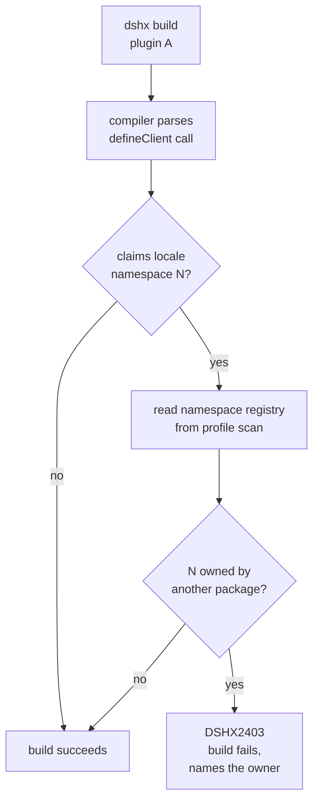

# Plugin boot integrity plan

## Context

Two consecutive failures on 2026-10-04 cost a debugging session each, and both
had the same shape: a plugin problem that surfaced only as a Web UI failure card,
with no build-time signal and no console error the user could act on.

**Failure 1 — a missing runtime service.** `@dshfiles/queue-reorder` and
`@dshfiles/ai-accounts` register their UI imperatively inside
`defineClient({ setup(ctx) })`, calling `ctx.slots.inject(...)`. dshx derived the
Cordis `inject` array only from the declarative `slots:` / `locales:` lists, so
with no declarative slots the `slots` service was never injected. `ctx.slots` was
`undefined`, `setup` threw inside `apply`, the fiber went to `failed`, and the UI
showed:

```
Failed to load plugins
@dshfiles/queue-reorder: failed
@dshfiles/ai-accounts: failed
```

Fixed in `svrzzpom` by injecting the full runtime surface for a definition that
brings its own `setup` and declares no `inject` of its own.

**Failure 2 — a colliding locale namespace.** That fix let queue-reorder actually
run for the first time, and it immediately tripped a second, latent bug.
`locales.ts` declared `QUEUE_REORDER_LOCALE_NAMESPACE = 'conversation'`,
borrowing the namespace already owned by `@deepseek-ai/dsh-client-ui-conversation`.
The shipped Locale runtime rejects a second registrant for the same
`(namespace, locale)` pair:

```js
// dsh-client-locale runtime
for (const [locale] of pairs)
  if (locales.has(localeKey(locale)))
    throw new Error(`locale namespace "${ns}" already has locale "${locale}"`)
```

So queue-reorder took down a shipped `@deepseek-ai/*` plugin, and 7 more
plugins fell into `pending (waiting for service: uiConversation)`. Fixed in
`svrzzpom` by giving the dock its own `conversation.queueReorder` namespace.

The important structural lesson is not either bug. It is that **fixing bug 1
revealed bug 2**, and that neither was visible without manually reproducing the
whole client boot. `dshx check` passed on both plugin revisions. TypeScript
passed on both.

### What exists today

- `dshx check` runs typecheck, DSH compatibility, and (with `--runtime`) a live
  boot check. It does **not** validate cross-plugin client contracts.
- `packages/dshx/src/compiler/client/capabilities.ts` already parses
  `defineClient` / `defineClientPlugin` call sites with the TypeScript compiler
  API, resolving identifier initializers and namespace imports. It extracts the
  `locales` field, the SDK `uses` list, and the `ctx.<service>` accesses.
- `packages/dshx/src/compiler/client/build.ts` already raises `DSHX1203` /
  `DSHX1204` / `DSHX1205` when a `setup` service lacks an `inject` declaration or
  a provider package edge. That is the exact seam this plan extends.
- `scripts/smoke-dsh.mjs` already drives a **real browser** through
  `playwright-cli` (`open` → `snapshot` → `run-code`). Real-browser verification
  is established practice in this repo; a jsdom harness is not.
- `@deepseek-ai/dsh-client-hmr` is in the default web profile. It polls bundle
  `mtime`/`ctime`/`size` and pushes an SSE `graph` frame, which the client applies
  through `entries.sync(...)` / `entries.reload(id, rev)`.

### Verified HMR behaviour

Measured on a live `dsh --profile web` instance, 2026-10-04:

| Action | Manifest rev changes? |
|--------|----------------------|
| Rebuild a plugin's `dist/`, then page refresh | No |
| Rebuild `dist/`, hold an SSE listener on `/plugins/events` | Yes — fresh `graph` frame within one `pollIntervalMs` (default 500ms) |
| Restart `dsh web` | Yes |

The rev is a content hash computed at **server start**, so a running server
serves a stable manifest. But HMR re-stats the bundle files and pushes a new
graph over SSE, and the client hot-swaps it. **A restart is not required**; a
rebuild plus the client receiving the graph frame is enough. The earlier belief
that a refresh alone was sufficient was wrong — the refresh rendered whatever
the server was already serving.

## Goal

Make a cross-plugin client contract violation impossible to ship, by failing the
`dshx build` that would produce it rather than the Web UI boot that discovers it.

## What

Three pieces, in decreasing order of value:

1. **Build-time locale namespace ownership.** A plugin that declares a locale
   namespace already owned by another package fails its own build, naming the
   owner. This is the bug that actually bit, and it is fully static.
2. **Real-browser boot smoke check.** A Playwright check that boots a real DSH
   Web UI with the plugin installed and fails on any entry whose state is
   `failed` or `import failed`. `pending` on live-host services is expected and is
   not a failure. This is the backstop for anything static analysis misses.
3. **A documented HMR workflow** in the repo `AGENTS.md`, so the next session
   does not re-derive whether a restart is needed.

Out of scope: making the client boot more forgiving. A plugin that registers a
namespace someone else owns should fail, not merge.

## Why

The failure mode is expensive and asymmetric. Both bugs cost a full debugging
session, and neither produced an actionable message — the user saw a failure card
listing symptoms (`ui-conversation: failed`, seven `pending` entries) that
pointed at the wrong plugin entirely. Meanwhile `dshx check` and `tsc` both
passed. The user filed the bug against dshx when the real defect was in
queue-reorder's `locales.ts`.

Detecting these at build time converts a 40-minute cross-layer investigation into
a one-line compiler error at the moment the offending line is written.

## How

### Conceptual model

A client plugin declares two kinds of contract:

- **Package edges** — `package.json` `dsh.client.inject`, the provider packages
  that must load. Already validated (`DSHX1203`).
- **Runtime services** — the Cordis services `apply` actually touches:
  `ctx.slots`, `ctx.locale`, `ctx.configForms`, … Already validated
  (`DSHX1204`).

Neither validation covers a **third** kind: a plugin claiming a *globally owned
name* — a locale namespace — that another package already owns. Locale namespaces
are a process-wide singleton: the runtime keeps one `Map<namespace, Map<locale,
dict>>` for the whole client. Ownership is therefore a property of the *set* of
installed packages, not of any one package, which is exactly why no single-package
check can see it today.



The build needs to know who else is installed. Two options, in preference order:

- **Profile scan.** `dsh --profile web --dump-config` already prints the composed
  tree. The compiler reads the profile's resolved package set and compares.
- **Registry file.** A checked-in `locale-owners.json` in the dshx repo, listing
  each shipped `@deepseek-ai/*` package and the namespaces it registers. Cheap,
  deterministic, and reviewable in a diff.

Use the profile scan for our own plugins, and treat the shipped
`@deepseek-ai/*` namespaces as reserved prefixes derived from the registry. A
namespace owned by a `@deepseek-ai/*` package is never overridable; a namespace
owned by another `@dshfiles/*` plugin is overridable only with an explicit opt-in.

### Operations / behavior

- `dshx build` on a plugin claiming a reserved namespace fails with the owning
  package and the offending `locales.ts` line.
- `dshx check --boot` boots a real DSH Web UI in Chromium with the plugin
  installed and asserts every client entry reaches `active`.
- HMR: `dshx build` (or `dshx dev`) while `dsh web` is running pushes a graph
  frame; the page updates without a restart.

### Tech choices

| Choice | Decision | Rationale |
|--------|----------|-----------|
| jsdom harness vs real browser | Real browser via `playwright-cli` | jsdom lacks `EventSource`, has no real module loader, and stubbed `fetch` left 36 entries `pending` — it produced a false failure the first time. `scripts/smoke-dsh.mjs` already drives playwright-cli; reuse it. |
| vitest browser mode vs a standalone smoke script | Standalone script | Vitest browser mode needs a matched `playwright` browser build; the installed `1.63.0-alpha` wants `chromium_headless_shell-1237` and only `1234` is present. Fixing that is a separate environment task. |
| Namespace ownership source | Profile scan + shipped registry | A profile scan reflects what is actually installed; a checked-in registry keeps the `@deepseek-ai/*` side deterministic. |
| Merge or fail on collision | Fail | The runtime already fails. Making the build agree with the runtime removes the surprise rather than adding policy. |
| Static-only or static + runtime | Both | Static catches the known classes; the browser smoke check catches whatever static analysis misses. Neither alone is sufficient. |

### Architecture

```
dshx build (plugin)
  │
  ├─ capabilities.ts ── parses defineClient call ──► { locales, services, sdk.uses }
  │                                                    │
  │                        ┌───────────────────────────┘
  │                        ▼
  │              locale-ownership check  (NEW)
  │                  │
  │                  ├─ is N reserved by @deepseek-ai/*?  → DSHX2403
  │                  └─ is N owned by another plugin?    → DSHX2403 (names owner)
  │
  └─ build.ts ── existing DSHX1203/1204/1205 ──► provider + service edges

dshx check --boot  (NEW)
  │
  ├─ dsh --profile <p> --port <free>
  ├─ open the tokenized URL in chromium
  ├─ read the client entry states from the live page
  └─ fail on any entry in `failed`, or any `import failed`
```

## What this allows

- A locale namespace collision fails the build that introduces it.
- A regression suite for cross-plugin client contracts that runs without a human
  reproducing the boot.
- A written answer to "do I need to restart `dsh web` after rebuilding a plugin?"

## What this does not allow

- Catching a namespace collision between two `@deepscan-ai/*` shipped packages —
  the registry is trusted for those.
- Guaranteeing full boot success from static analysis alone; a genuinely dynamic
  definition (`defineClient(config)` with a computed object) stays opaque, and
  the browser check is the backstop.
- Auto-repairing a collision. `dshx check --fix` can suggest a new namespace, but
  silently renaming a locale namespace would break every `locale:` field that
  referenced it.

## UI & UX

No new UI. The build failure is a terminal diagnostic in the existing `DshxError`
shape, with the owning package, the file, and a hint.

```
DSHX2403  src/locales.ts:4
  Locale namespace "conversation" is already registered by
  @deepseek-ai/dsh-client-ui-conversation.

  The Locale runtime keeps one dictionary per (namespace, locale) for the whole
  client, so two packages cannot share a namespace.

  hint: declare a namespace you own, e.g. "conversation.queueReorder", and
        rebuild.
```

## Data model

The namespace registry is a checked-in map, not a runtime table:

```json
{
  "reservedNamespaces": {
    "@deepseek-ai/dsh-client-ui-conversation": ["conversation"],
    "@deepseek-ai/dsh-client-locale": ["common", "settings"],
    "@mars-sea/dsh-commandcode-provider": ["commandcode"]
  }
}
```

Installed-profile namespaces are discovered at build time from
`dsh --profile <name> --dump-config` and merged on top of this table.

## Implementation steps

1. Extend `capabilities.ts` to return the locale namespaces a definition claims,
   as literals where statically resolvable and `undefined` where dynamic. The
   existing `declarativeClientDefinition` already walks `defineLocale` /
   `declareLocaleNamespace` call sites; capture the namespace argument there.
2. Add the reserved-namespace registry and the ownership check in `build.ts`,
   alongside `validateSetupServiceEdges`. Emit `DSHX2403` with file, owner, and
   hint.
3. Resolve installed-profile namespaces. Prefer `dsh --profile <name>
   --dump-config`; cache it per build so a multi-plugin build does not re-scan.
4. Add the namespace collision to `fixtures/` as a negative build fixture, and a
   passing positive fixture. Cover: reserved `@deepseek-ai/*` collision, sibling
   plugin collision, and the dynamic/undefined case staying silent.
5. Add `dshx check --boot`: spawn `dsh --profile <p> --port <free> --no-open`,
   open the tokenized URL through `playwright-cli`, read entry states, fail on
   `failed` or `import failed`, and always tear the server down.
6. Extend `scripts/smoke-dsh.mjs` to run the boot check for the profile it
   already builds, so CI covers it without a new entry point.
7. Add the HMR workflow section to the repo `AGENTS.md`.

## Open questions

1. Should a collision between two `@dshfiles/*` plugins be an error, or an error
   only when they are installed in the same profile? An error is simpler; a
   profile-scoped check is more precise and matches how the failure actually
   manifests.
2. Should `defineLocale`/`declareLocaleNamespace` itself refuse a namespace that
   is a reserved prefix at type level, rather than relying on the build check?
   A type-level refusal is earlier but only catches the static case.
3. Does `dshx check --boot` belong in the default `check`, or stay opt-in behind
   `--runtime` as today? Making it default would slow every local check by a
   browser launch.

## Acceptance criteria

- [ ] A plugin declaring `defineLocale('conversation', …)` fails `dshx build`
      with `DSHX2403` naming `@deepseek-ai/dsh-client-ui-conversation`.
- [ ] A plugin declaring its own unique namespace builds and boots clean.
- [ ] A dynamically constructed locale definition is not falsely rejected.
- [ ] `dshx check --boot` fails when any client entry reports `failed` or
      `import failed`, and passes when all entries reach `active`.
- [ ] `dshx check --boot` treats `pending` on live-host services as non-failure.
- [ ] `AGENTS.md` documents that a rebuild is picked up over HMR without a
      `dsh web` restart, with the verified SSE evidence.

## Decisions log

| Date | Decision | Rationale |
|------|----------|-----------|
| 2026-10-04 | Fix the missing-service inject in dshx, not in each plugin | Four plugins in the repo used the same imperative `ctx.slots` pattern; a per-plugin fix leaves the fifth broken. |
| 2026-10-04 | Give queue-reorder its own namespace rather than sharing `conversation` | The runtime rejects a duplicate `(namespace, locale)`; sharing is impossible, not merely discouraged. |
| 2026-10-04 | Reject jsdom for the boot check | It produced a false 36-entry failure from a stubbed `fetch`, and lacked `EventSource`. `smoke-dsh.mjs` already uses `playwright-cli`. |
| 2026-10-04 | Verify HMR rather than assume it | A rebuild plus refresh does not change the served rev; the SSE `graph` frame does. The user's recollection was right that a restart is unnecessary, and wrong about why. |