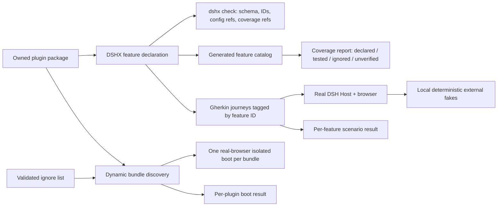

# Exhaustive plugin E2E coverage plan

## Context

- The existing E2E design is documented in [dsh-e2e-testing.md](dsh-e2e-testing.md). It correctly separates static contract checks, browser boot checks, and user-visible journeys. Playwright + `playwright-bdd` boot real disposable DSH profiles; the plan rejects mocking the Host because those tests must exercise real Host/plugin contracts.
- Dynamic discovery already exists in [boot-check-web.mjs](../tooling/dshx/scripts/boot-check-web.mjs): it finds each package with a `dsh` manifest and boots it alone. `pnpm --dir tooling/dshx test:boot` invokes it. It currently has no exception list. There are 23 DSH bundles today, 18 with a client half.
- [every-plugin-boots.feature](../tooling/dshx/e2e/features/every-plugin-boots.feature) separately hard-codes 10 examples (9 client bundles and one host-only bundle). It can drift. [client-boot.feature](../tooling/dshx/e2e/features/client-boot.feature) checks the composed owned-plugin profile; [palette-performance.feature](../tooling/dshx/e2e/features/palette-performance.feature) checks stylesheet and palette budgets. No feature file currently describes a complete product workflow such as editing a queued message or installing a plugin.
- Plugin packages have tests, but unit and model tests do not prove the assembled browser experience. The 23 bundle packages all have package test scripts; their test depth varies. Several user-facing surfaces have only focused model/Host tests, and some packages have no README.
- DSHX already provides `createTestHost`, `createTestClient`, `mountPlugin`, generated registration/unload tests, manifest/service checks, and a generic DSH compatibility runtime check. The testing harness is described in [getting-started.md](../tooling/dshx/docs/sdk/getting-started.md#L281-L303). These test real Cordis/Host primitives or check platform compatibility; they do not declare a plugin’s user-visible features or map each one to a browser journey. [`checkProjectManifest`](../tooling/dshx/packages/dshx/src/project/manifest.ts#L423-L520) validates DSH wiring, not product feature coverage.
- This plan distinguishes two kinds of test boundary: keep our DSH Host, client, storage and plugin behavior real; replace only paid, uncontrollable or nondeterministic third-party services with deterministic local fakes at their external adapter boundary. No routine test may call a production provider or use a user’s credentials.

### Current repository inventory (source-audited draft)

The following is the baseline to turn into the maintained catalog. It records observable behavior and configuration—not a claim that each behavior has already passed browser verification. Detailed per-feature scenarios, defaults, valid values, failure states and verification status are a deliverable of implementation step 2.

| Package | User-visible features / behavior to catalog | Configuration or state to enumerate | External or controlled test boundary |
|---|---|---|---|
| `agent-communication` | Eight Agent communication tools: list Agents/topics, subscribe/unsubscribe, publish, direct-send, read inbox, acknowledge; queued vs allowlisted urgent steering; workspace topic discovery. | Recipient policy, subscriptions, acknowledgement; durable service state. No UI/settings. | Real DSH multi-Agent delivery; deterministic service fakes for unit/error cases. |
| `agent-questions` | Parent/child questions and answers; defer-to-Markdown expiry; durable feedback submission, batched resolution, stale-document/reanchor flow. | Recommendation/expiry, max wait/retention, question and feedback states; durable workspace file effects. | Real Host parent/child wake, restart and persistence; temp workspace for safe file cases. |
| `ai-accounts` | Account status, usage and cost views; provider/model curation; quota refresh, routing, cooldown/failover and session affinity; usage history/forecast; composer cost estimate. | Provider accounts, credential references, pool policy, usage refresh/history retention, model visibility/order/reasoning, price overrides and route policies. | Fake provider/auth/quota/pricing responses; never call paid APIs. Exercise DSH Host/settings with scratch state. |
| `command-palette` | App-wide searchable overlay for threads, files, actions and commands; keyboard invocation; namespaced plugin actions and frecency. | Action registration, availability, key chords, aliases, frecency browser state. Current feature claims exceed the small existing Host test surface. | Fake deterministic search responses for focused UI tests; real shell slots, keyboard, thread/files Host APIs for browser integration. |
| `cursor-agent` | Cursor ACP driver; prompt streaming, cancellation, approvals, tool/status updates; recovery status/confirm for interrupted operations. | Runtime instances, credential aliases, ACP operation/recovery receipts. | Existing fake ACP executable for deterministic tests; real scratch DSH lifecycle. Never invoke user Cursor credentials in routine CI. |
| `diff-viewed` | Mark/unmark reviewed files; progress count; retain marks per session/change/path; cross-window adoption. | Browser-local marks, retention cap and corruption fallback. | Real review-summary API/slot in integration; controlled storage and API responses in unit tests. |
| `dsh-core-runtime` | Private opt-in replacement of DSH core runtime rows with checkout-local implementations; infrastructure bridge, not a standalone product feature. | Scratch-profile paths and exact replaced bundle rows. | Scratch DSH + local core checkout; assert package/module identity and profile composition. |
| `editor` | Workbench editor, file tree, tabs, dirty/save/reload/keep-mine, line navigation, cross-plugin open/search actions. | Placement setting; per-session in-memory tabs; file-size and write constraints. | Temporary local project/filesystem; real DSH workspace-file APIs and write Host boundary. |
| `goal-stall-guard` | Detect consecutive empty assistant goal rounds and pause the goal; tool-only progress counts as activity. | `stallThreshold` (default and supported range). | Real DSH goal event/pause wiring; deterministic event-shape tests. |
| `jujutsu` | Repository graph/status/review; history and diff browsing; change/bookmark operations; file-level operations; workspace/session creation; preview/confirm for mutations. | Repository selection, local preferences, command preview identity/revision/status; limits and confirmation choices. | Disposable local jj repositories and real DSH subprocess/Host; no production repository or uncontrolled remote mutation. |
| `mcp-servers` | Server manager and composer quick panel; Registry discovery; custom server CRUD; connect/disconnect/refresh; stdio and Streamable HTTP; OAuth; registered-tool status. | Server rows, enabled state, transport/auth settings, credentials by reference. Source indicates some documented settings are currently defaults rather than live Config. | Fake Registry/OAuth endpoints; local deterministic MCP servers; real scratch DSH ConfigEditor, credentials, subprocess and tool registry. |
| `multi-host` | Local/SSH runtime directory; connect/authenticate, status, workspace/session creation, runtime views, safe RPC, close/remove; stale and uncertain mutation warnings. | Host/runtime identity, directory migration, ports, view leases and expiry. | Fake SSH/process/gateway/WebSocket boundaries for regular CI; real isolated local/remote DSH only for connector acceptance. |
| `optmem` | Capture eligible conversation/tool events; backfill; scoped memory search/zoom/context/status; bounded prompt-context injection; optional full mode and subagents. | Enable/mode, provider/model/effort, capture and exclusion rules, byte limits, concurrency/timeouts, context and tool limits, scope policy. | Fake summarizer/LLM responses; real temporary SQLite and DSH event/turn lifecycle. Never call a paid model in CI. |
| `plugin-marketplace` | Framework Hub browse/search/filter/sort/paginate; compatibility/risk detail; install confirmation and progress. No uninstall/update/hotload. | Hub URL, initial sort, hide-incompatible. | Fake Hub/GitHub/package metadata; real DSH CLI only in isolated scratch profile. |
| `project-checks` | Run trusted project checks; view bounded receipts and hook history; optional verify-before-complete flow that retries/steers or stops a turn. | Trusted roots/actions, timeout, auto-verify and attempts; revision-bound receipts. | Harmless command in temporary project; real DSH session, storage, subprocess and turn hook. Never execute tests in the user’s project. |
| `prompt-stash` | Save/edit/delete/insert prompts; list recent loaded user messages; save/restore drafts; guard insertion against composer changes; never send. | Browser-local libraries/drafts, size/count caps, conflict policy and recent limit. | Real DSH composer/chat insertion integration; deterministic browser storage and cross-tab changes. |
| `queue-reorder` | Expand/collapse queue; reorder pending messages; edit/remove; steer running item when allowed; text-only editor and failure/cancel flows. | `expandByDefault`, preview length, queue state and pending/running variants. | Real DSH inbox, durable queue mutation and UI slot; in-memory test fixture for pure logic. |
| `secret-catalog` | Search/filter secret aliases; reveal/copy/add/edit/rename/remove aliases or vault items; environment/scope and ambiguity safeguards; metadata-only Host tool. | Default scope/environment, reveal timeout, hide-on-blur and notices; vault state is external. | Fake `secret` CLI/Bitwarden data only for regular tests; scratch DSH Host and disposable vault for deliberate acceptance. Never inspect or mutate the user vault. |
| `settings-search` | Search settings by schema metadata; browse categories; keyboard navigation; edit typed values/unset overrides; route to owning Settings section when supported. | Navigation search, focus-on-open, result cap; every schema-backed setting field and secret exclusion. | Real ConfigForms/Settings shell integration. Native owner routing depends on documented companion DSH core support; verify before treating it as available. |
| `shortcuts` | Capture-phase sidebar toggle and panel selection shortcuts; event propagation, editable target and modifier behavior. Current labels for New Session/Settings both call `selectPanel(null)`, so test actual Host semantics rather than labels alone. | Chord definitions (currently no user settings/persistence). | Synthetic keyboard events for matcher tests; real DSH layout and competing shortcuts in browser. |
| `sidebar-commands` | `/goto` chooser for panels and recent sessions; thread-sidebar palette/search actions when available; guarded navigation when target disappears. | Live panel/session availability and recent-session limit. | Real DSH commands/layout/sessions/workspaces/slots; deterministic snapshots for unit tests. |
| `thread-sidebar` | Sidebar replacement; workspace/project grouping; pin/archive/restore/park/idle archive; navigation, palette/search, history, shortcuts, restart and pending-update notices. | Host-synced display/order/visibility/density/shortcuts/idle policies, migration and local park state. | Real Host sessions/workspaces/settings/slots/restart contract; no paid API. Cover old-Host and unavailable-service fallbacks. |
| `workbench` | Main and right-side docking layouts; plugin panel registration, early open requests, tab/split/float/rearrange, missing-panel recovery and reset. | Independent localStorage layouts and live header toggle. | Real DSH main/right slots and settings; deterministic Dockview/storage tests. |

Reusable packages without a DSH bundle still belong in the feature map with an explicit test level and consuming plugin(s), but must not be mistaken for separately bootable plugins:

- `plugin-ui`: shared UI, query/form/state-machine/table/chart/diff components and browser storage hooks; test native component behavior and actual consumer styling.
- `project-folder-picker`: injected folder/workspace picker modal; component tests use its ports, consumer E2E verifies actual DSH Host picker/modal.
- `optmem-core` and `optmem-sqlite`: domain engine and SQLite adapter backing `optmem`; test real temporary SQLite plus a fake summarizer, not a separate DSH profile.

Known inventory gaps that must be resolved during the feature audit: unsupported/ambiguous behavior must be labeled rather than guessed; several bundles lack README files; `command-palette` README claims need comparison with actual implementation; MCP server settings currently appear hard-coded; Settings Search owner routing depends on DSH core; some host-only packages have a non-UI surface. A source inventory is not runtime proof.

## Goal

Every owned DSH bundle is discovered and boot-tested automatically, every user-observable plugin feature and configuration choice has a maintained inventory entry and deterministic test coverage, and routine E2E tests never depend on paid or uncontrolled external services.

## What

1. Make the standalone boot smoke discover all `plugins/@dshfiles/*` packages with a valid DSH bundle manifest. New bundles join automatically. Add a small, validated, manually maintained ignore list only for a concrete failure; each entry needs package ID, reason, owner/issue and expiry or removal condition. An unknown, duplicate, expired or no-longer-applicable ignore entry fails the check.
2. Build an exhaustive feature catalog spanning user-visible client, Host, command, tool, settings, persistence, integration and workflow behavior. For each feature, enumerate controls, configuration keys and their defaults/valid values, meaningful states/variants, errors, cancellation/interruption and external dependencies. Include all configuration options—even hidden or host-only ones—in the catalog.
3. Give each feature a stable ID and at least one browser-level Gherkin scenario for its ordinary user-visible behavior. Add scenarios for meaningful configuration variants and failure/interrupt paths; unit/contract tests may cover pure boundaries and exhaustive combinations where browser E2E would be redundant. No listed feature can silently remain “not tested”; a documented not-applicable rationale is required.
4. Preserve real DSH/Host/plugin interactions in end-to-end tests. Replace only uncontrolled external providers—model APIs, provider quota/pricing APIs, OAuth/Registry/catalog APIs, Cursor/ACP and remote systems—at adapter/network/process boundaries with deterministic local fakes. Use temporary local repositories, files, databases, profiles and harmless commands for stateful tests.
5. Extend DSHX so a plugin can declare its feature catalog and test mapping, and DSHX can validate/generate a complete repository-wide report. The catalog declaration must be authored with the plugin, checked in CI and used by the test runner; it cannot be a separate stale list.

Explicit coverage rule: “every feature” means each product behavior and each configuration choice is inventoried and exercised at least once in an applicable E2E journey. It does not mean the Cartesian product of every setting, state, platform and failure mode gets a browser scenario; those combinations use risk-based representative browser cases plus exhaustive unit/contract tests.

## Why

A newly added plugin should not require editing a central boot table to receive a smoke test. More importantly, “plugin boots” is not “plugin works”: feature behavior, settings, error handling and external-service assumptions can remain uncovered while package tests pass. A source-owned feature catalog ties product intent to repeatable tests and makes omissions visible in review. Deterministic external fakes avoid surprise charges, account access and flaky CI without masking our own Host/plugin integration defects.

## How

### Conceptual model



### Operations / behavior

- Discover packages from the same manifest boundary DSHX already uses. Exclude reusable libraries only because they have no DSH bundle manifest; inventory them as library surfaces and test them through their consumers.
- Boot each discovered bundle alone for cause-localization, in a disposable profile and real browser. Report one result per plugin ID; support reasoned temporary ignores without suppressing inventory or package tests.
- Boot a composed scratch profile for interactions that depend on multiple plugins: shared slots, Locale ownership, palette action registrations, theme/style integration and plugin-to-plugin APIs.
- Run one or more human-readable feature scenarios for each catalog feature. Keep selectors and test setup in shared steps/fixtures; keep Gherkin focused on behavior.
- Start local, per-test fake servers/processes for external APIs. Supply canned normal, streaming, malformed, timeout, cancellation, rate-limit and auth-failure responses where relevant. Tests assert our real adapter and plugin behavior, not the external service’s live state.
- Generate the inventory/report from plugin declarations, not from manually copied global tables. Surface missing declaration, missing test reference, orphan test tag, ignored bundle, unavailable capability and source-audit/runtime-verification status distinctly.

### Tech choices

| Choice | Decision | Rationale |
|---|---|---|
| Dynamic smoke enumeration | Use package discovery from DSH manifests; share it between `test:boot` and reporting | Discovery already exists in `boot-check-web.mjs`; remove the stale manual Gherkin example list and avoid a second source of truth. |
| Boot smoke format | Plain dynamically parameterized browser tests; Gherkin for user journeys | Boot is one assertion per bundle. Gherkin adds value for readable feature behavior, not a static package registry. |
| Host / DSH mocking | Reject for browser E2E | Real service composition and plugin interactions are exactly what the boot and behavior tests must prove. `createTestHost`/`createTestClient` remain useful for unit/integration tests. |
| Third-party calls | Fake only at owned adapter or external transport boundary | Prevent cost, nondeterminism and credentials while exercising our actual orchestration and decoding. |
| Feature metadata | Add typed plugin-owned metadata under a DSHX namespace in the package manifest (exact schema finalized in step 3) | Co-locates feature IDs with each plugin and lets `dshx check` validate them without making DSH runtime behavior depend on test metadata. |
| Feature docs | Generate repository-wide Markdown/JSON report from declarations | Report stays derived; plugin declarations remain the source of truth. |
| Coverage strategy | Every declared feature maps to a Gherkin scenario; config options map to explicit variants or a documented reason | Enforces product breadth without an unbounded setting cross-product. |

### Architecture

```text
package.json dshx.features      owned source of truth
        │
        ├─ dshx check             schema, stable IDs, config refs, missing/orphan test tags
        ├─ dshx features          generated catalog + coverage report
        └─ playwright-bdd         feature tags → declared feature IDs
                                      │
all DSH package manifests ──> dynamic isolated boot tests
                                      │
Gherkin scenario ──> browser + real scratch DSH Host + real plugin
                                      │
                 local fake HTTP/process adapters for outside services only
```

A feature declaration should minimally contain:

```json
{
  "dshx": {
    "features": [
      {
        "id": "queue-reorder.edit-message",
        "title": "Edit a pending text message",
        "summary": "Edit text in the queue without changing its position.",
        "surfaces": ["client", "host-api", "tool"],
        "configuration": ["expandByDefault", "previewLength"],
        "externalDependencies": [],
        "scenarios": ["queue-reorder-edit-pending-text"]
      }
    ]
  }
}
```

Scenario tags are the executable coverage link, e.g. `@feature:queue-reorder.edit-message`. DSHX validates that IDs are unique and stable, referenced config keys exist where statically verifiable, every declared scenario exists, every feature has a scenario, and no scenario tag points to an undeclared feature. Human review remains necessary to prove the feature declaration itself is exhaustive; code cannot infer omitted product behavior reliably.

### UI & UX

No product UI change. Developer-facing output should show concise totals and exact omissions, for example: `23 bundles discovered; 22 booted, 1 ignored; 74 declared features; 71 mapped to passing scenarios; 3 uncovered`. Each row links to the owning package, feature ID, scenario, and failure artifact. It must never expose credentials, prompt bodies, raw user files, tokenized URLs or external service secrets.

### Data model

- **Plugin bundle:** `packageId`, `projectRoot`, `hasClient`, `ignored?` and discovered manifest source. Derived at runtime from package metadata.
- **Ignore entry:** `packageId`, `reason`, `owner`, `issue`, `expiresOn` (or explicit removal condition). Ignore only the selected test tier, never the feature catalog or static/package checks.
- **Feature:** stable ID, title, user-facing summary, surfaces, linked configuration schema paths/options, state/persistence notes, external dependency IDs, scenario IDs, inventory status and verification evidence.
- **Scenario:** stable ID, feature ID(s), Gherkin path, setup/profile requirements, external fake fixtures, expected states and result.
- **External fake:** named service/adapter, deterministic request/response fixture set, local-only endpoint or executable, protocol/version assumptions, no secret-bearing production values.

### Initial external fake inventory

| Boundary | Routine deterministic fake | Real system still required for |
|---|---|---|
| LLM/model answers and streaming | Local scripted OpenAI-compatible/provider responder or injected test provider; canned completion, streaming, tool-call, timeout and failure sequences | DSH request/session lifecycle and our provider adapter; no live paid model call in normal CI |
| Account quota, usage and pricing APIs | Fixture responses for each supported provider and models.dev | Real Host credential/settings boundary in a scratch profile; never load real accounts |
| MCP Registry and OAuth | Local HTTP Registry, metadata and token endpoints; deterministic local MCP stdio/HTTP servers | Actual plugin config, credentials, process and tool-registration integration |
| Framework Hub / marketplace | Local fake Hub routes plus fixture metadata and controlled CLI adapter | DSH CLI install only inside disposable profile |
| Cursor ACP | Existing fake ACP executable / expanded protocol fixture | Driver registration, approval, session and recovery integration in scratch DSH |
| Multi-host SSH/gateway | Controlled process, SSH, HTTP/WebSocket gateway fixtures | Deliberate local/remote connector acceptance; routine CI must not contact remote hosts |
| Secret CLI / Bitwarden | Fake executable and synthetic vault catalog | Only an explicitly approved disposable-vault acceptance test |
| jj / filesystem / SQLite / project commands | Temporary real local repo, temporary directories/db and harmless commands | Real local system semantics; no user repo or remote mutation |

## What this allows

- Newly added DSH bundles enter the isolated boot test without manual registration.
- Temporary boot failures can be ignored with a visible owner, reason and expiry; expired ignores cannot silently persist.
- Every plugin feature, setting and supported variant has an inspectable inventory row and a test relationship.
- CI tests AI/external-service behavior without live accounts, paid calls or internet dependency.
- Maintainers can distinguish source-inventoried, test-mapped, browser-verified, blocked and deliberately unsupported behavior.
- DSHX scaffolds and checks can make feature/test metadata a normal part of creating and maintaining an owned plugin.

## What this does not allow

- It does not make an unverified README claim true; source-derived facts must be labeled until checked against a running DSH/browser.
- It does not fake DSH Host, Cordis, service injection, storage, slots or plugin lifecycle in browser E2E.
- It does not require every setting combination to have a separate browser test; it requires every option and meaningful effect to be inventoried and covered proportionally.
- It does not permit routine tests to read user credentials, user profiles, repositories, secrets or production service endpoints.
- It does not treat reusable libraries (`plugin-ui`, `project-folder-picker`, `optmem-core`, `optmem-sqlite`) as bootable DSH bundles.
- It does not claim external provider behavior itself is tested; fakes verify our integration behavior and protocol assumptions only.

## Implementation steps

1. **Make dynamic boot coverage authoritative.** Reuse/refactor existing manifest discovery so both standalone boot checks and the report share one implementation. Replace the fixed package list in `every-plugin-boots.feature` with a per-package dynamic test path (plain Playwright spec preferred for this smoke). Add strict ignore-list validation: IDs must exist, reasons and owners are required, expiry is enforced, and report still lists ignored plugins. Ensure all current 23 bundles are discovered, including host-only entries; package-only libraries are reported separately.
2. **Complete the source inventory.** For each bundle, inspect README, manifest/config schemas, `cordis.patch.yml`, Host/client entries, Slot contributions, tools/commands/APIs and current tests. Record each user workflow, small UI action, edge/failure behavior, persistence boundary, every configuration key/default/value/range and external dependency. Record missing/contradictory docs and unavailable Host/runtime capabilities explicitly. Audit the four package-only libraries and map each to consumers/test levels. Review the initial source-audited draft above against implementation before marking complete.
3. **Settle DSHX feature metadata contract.** Add a typed schema and stable-ID conventions (proposed `package.json` `dshx.features`). Provide a DSHX command/report to aggregate catalog entries and a `dshx check` diagnostic for malformed/duplicate IDs, missing configuration references, missing scenario tags and orphan tags. Add scaffold-generated minimal feature declaration and one test mapping for new plugin templates. Validate generated reports instead of checking in hand-maintained duplicates.
4. **Build deterministic external-service fixtures.** Inventory actual outbound HTTP/process seams by package, then add the smallest reusable local fakes: model/stream responder, provider quota/catalog responses, OAuth/Registry, Hub metadata, ACP executable, SSH/gateway and secret CLI only where needed. Use actual production adapters pointed at local fixtures when endpoint configuration permits; otherwise inject at the narrowest external adapter boundary. Deny uncontrolled network access in routine E2E and assert no credentials leak to test artifacts.
5. **Map feature inventory to browser journeys.** For each feature ID, add Gherkin scenarios for the ordinary path, each material configuration option/effect, and relevant empty/error/cancel/stale/permission paths. Preserve shared steps/selectors and test-specific deterministic data. Use real DSH shell/Host/profile services; split scenarios when state transitions or setup become unreadable. Do not add journeys for internal helpers as if they were separate user features; keep those in unit/contract suites and link them to the owning user feature.
6. **Validate composed behaviors.** Add explicit cross-plugin journeys for real shared seams (palette actions, editor/thread-sidebar file lookup, queue UI/Host API, settings routing, slot takeover and styling). Add independent feature journeys for plugins that are not enabled together by default using scratch profile composition.
7. **Wire CI and report.** Run focused unit/contract checks, dynamic per-bundle boot smoke, Gherkin feature suite with local fakes, and catalog completeness checks. Publish per-plugin/per-feature results and bounded failure traces/screenshots with source revision; redact local tokenized URLs, secrets, raw prompts and user data. Define local fast subset and full CI tier without silently omitting a feature from reporting.
8. **Verify the inventory against the running product.** Exercise each feature’s P1/P2 behavior in a scratch profile; mark source-only, passed, failed or blocked. File behavior discrepancies as product bugs or correct the catalog. Re-run after any plugin/Host contract changes that invalidate evidence.

## Open questions

1. Should the typed feature declaration live under `package.json` `dshx.features` (recommended for discovery and schema checking) or `dshx.config.ts` (better TypeScript ergonomics, but requires loading plugin config to enumerate)?
2. Which LLM fake is the narrowest faithful seam for each provider-backed plugin: local OpenAI-compatible HTTP server, injected DSH provider, or both? Recommendation: use a local protocol server when the plugin’s real adapter supports a configurable base URL; otherwise inject only its provider adapter and retain adapter contract tests.
3. Should the full browser feature suite run on every CI change, or split into PR smoke plus scheduled full suite? The coverage report must still show all features and the last full-suite evidence; no feature may be silently marked covered by a test not run in that tier.
4. Are the current source-supported `settings-search` owner route, `mcp-servers` configurable settings and `command-palette` README claims expected capabilities or known gaps? Audit results show source/docs need reconciliation before scenarios are specified.
5. What evidence retention budget is acceptable for the substantially larger all-feature suite? Existing bounded source-linked evidence design should be reused, with artifact size measured before increasing retention.

## Acceptance criteria

- [ ] Adding an owned DSH bundle with a valid DSH manifest requires no edits to a central boot registry and automatically adds a separately reported isolated boot case.
- [ ] Ignored IDs must exist, have reason/owner/removal condition, cannot silently expire, and remain visible in the coverage report.
- [ ] All 23 current DSH bundles and the four package-only reusable libraries are accounted for; bundle and library test paths are distinct.
- [ ] Every user-observable feature, including small actions and host-only capabilities, has a stable feature ID, summary, surfaces, configuration/options, meaningful variants, failure states, external dependencies and current test status.
- [ ] Every feature ID maps to at least one runnable Gherkin scenario or a reviewed, explicit not-applicable rationale; no orphan scenario tags or stale declarations pass `dshx check`.
- [ ] Every configuration option is listed with its default/valid choices and covered by a meaningful behavior assertion; no invalid Cartesian-product requirement is introduced.
- [ ] Browser E2E uses real DSH/Host/plugin lifecycle and real owned adapters; only external nondeterministic/paid dependencies are replaced by controlled local fakes.
- [ ] Routine CI performs no paid API call, production OAuth, real secret access, remote SSH, or user-project mutation; outbound network is blocked or locally captured.
- [ ] Generated catalog/report matches plugin-owned declarations and visibly distinguishes ignored, failing, unrun, source-only and browser-verified features.
- [ ] New DSHX plugin scaffolds include a minimal valid feature declaration and test linkage; validation catches a newly declared feature without a scenario.
- [ ] Source inventory is reviewed against the running product in disposable profiles; known documentation/runtime discrepancies are filed and not presented as verified behavior.

## Decisions log

| Date | Decision | Rationale |
|---|---|---|
| 2026-10-10 | Reuse dynamic DSH-manifest discovery for standalone boot smoke | `boot-check-web.mjs` already discovers and boots all owned bundles; the fixed feature examples are the manual, drifting path. |
| 2026-10-10 | Keep DSH Host real; fake external services only at owned adapter boundaries | Boot/composition defects are about real cross-plugin service contracts; paid or uncontrolled services need deterministic test data. |
| 2026-10-10 | Keep Gherkin for user behavior, use dynamic plain tests for one-assertion boot smoke | A package registry is not user behavior; dynamic browser test cases report each plugin without manually maintaining Examples. |
| 2026-10-10 | Make feature metadata plugin-owned and reports generated | A central manual inventory recreates the drift this plan is meant to eliminate. |
