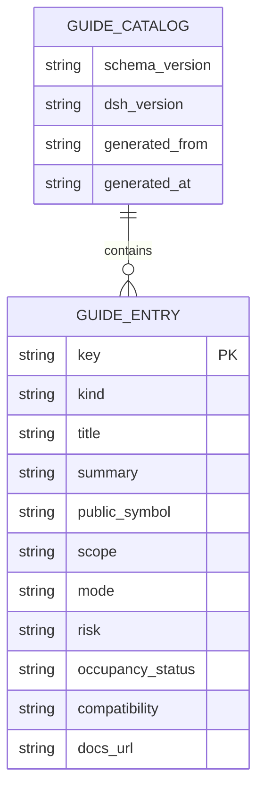

# Plugin Guide plan

## Context

- BB's first-party [Plugin Guide](https://getbb.app/plugin-guide) visualizes extension surfaces with numbered maps, API details, examples, and “Copy for agent.”
- DSHX already provides strong CLI discovery: [static `inspect slots --explain` and live `inspect slots --root`](../tooling/dshx/docs/cli-reference.md#L65-L80). The [Agent Toolkit](../plugins/@dshfiles/agent-toolkit/README.md#L3-L18) inventories what an Agent can use, not where a plugin may extend DSH.
- Cordis Inspect is a read-only development provider, not a business Service a plugin can call. DSH's `root` slot shadows shell UI; additive `shell.overlay`, composer, panel, and action surfaces are safer.
- Live Client Slot query timed out in one research run. V1 must not promise live occupancy.

## Goal

Give DSH plugin authors a version-aware visual guide to public extension surfaces and safe SDK entry points, reducing repeated source exploration and replacement mistakes.

## What

Build a developer-only main panel backed by a generated, versioned static catalog of DSH-owned public Slots, panels, composer actions, Tools/Commands, and documented lifecycle APIs. Show purpose, import/registration symbol, scope, mode, additive-versus-replacement risk, and authoritative docs/source link. State clearly that occupancy is a build-time or unknown snapshot, not live.

## Why

DSH already has CLI inspection, but no visual entry point for understanding which public surface to use and what it replaces. This is useful for the user as a DSH plugin developer; it is not an end-user feature priority.

## How

### Conceptual model

The guide is a rendered view over a whitelisted public contract catalog. Catalog generation uses DSHX offline capability/Slot declarations and public SDK docs; no runtime Inspect calls originate from the client plugin.

### Operations / behavior

- Browse/filter by surface group and search API/Slot names.
- Open a detail card with registration shape, scope, version, replacement risk, examples, and source links.
- Copy bounded guidance into the composer draft; never submit automatically.
- Label occupancy `static`, `unavailable`, or `live`; V1 supports only `static`/`unavailable`.

### Tech choices

| Choice | Decision | Rationale |
|--------|----------|-----------|
| In-app vs CLI-only | Additive DSH panel backed by generated catalog | Complements existing CLI with a visual map. |
| Runtime Inspect | Do not call from plugin | Inspect is development introspection, not a plugin business API. |
| V1 occupancy | Static/unavailable only | No supported live Host projection is established. |
| Public surface | DSH-owned/public SDK contracts only | Avoid documenting unstable Cordis internals as supported API. |
| Shell extension | `api.panels.register`; never replace `root` | Avoid shadowing shipped UI. |

### Architecture

```text
DSHX public declarations + SDK docs
  -> versioned generated GuideCatalog
  -> Guide Host/Client plugin panel
  -> source links + draft-only copy action

Future, separately approved:
Host-owned typed slotCatalog/occupancy API -> live status DTO
```

## What this allows

- Searchable visual map of supported DSH extension points.
- Clear additive/replacement risk and version/source provenance.
- Examples and commands that lead back to DSHX CLI and public docs.

## What this does not allow

- Calling Cordis Inspect, reading arbitrary live React props, or mutating slot registrations.
- Claiming live occupancy in V1, exposing private service internals, or replacing `root`.
- Full parity with every BB surface unless DSH exposes an equivalent public contract.

## UI & UX

### Desktop

Use a main panel with category/search rail, surface map/list, and detail card. Show an explicit `Static catalog · DSH <version>` banner. Put replacement warnings beside the slot name; highlight `root` as shell-owned/high-risk.

### Mobile

Collapse categories into a selector and show one detail card at a time; no separate mobile-only capability.

### Common interactions

| Action | Result |
|--------|--------|
| Search/select API or Slot | Show purpose, version, scope, registration shape, risk, and links. |
| Copy for agent | Insert bounded selected guidance into draft; do not send. |
| Open live CLI command | Copy/open `dshx inspect slots --root <slot>`; UI does not claim result is live. |

## Data model



V1 has no occupant IDs or arbitrary runtime props. Each entry names its source/version and `occupancy_status` is `static` or `unavailable`.

## Implementation steps

1. Define the public-surface allowlist and risk vocabulary from DSHX native Slot contracts, public SDK exports, and documentation.
2. Add a versioned catalog generator with freshness/schema tests; fail visibly when generated catalog and DSH version disagree.
3. Register a panel through the supported DSHX API and build category/search/detail views.
4. Add source links, `dshx add ui`/inspect command affordances, and bounded draft-only “Copy for agent.”
5. Test that `root` warnings are prominent, no Inspect Provider is called, and stale/unavailable status is explicit.
6. If live occupancy is required, separately design a Host-owned typed read API with version/freshness and bounded occupant metadata; implement only after that contract is approved and tested.

## Open questions

1. Is a static generated map useful for V1, or is live occupancy mandatory?
2. Should V1 include only DSH-owned public APIs, or vetted third-party plugin extension examples too?
3. Is the intended audience only DSH plugin developers? This plan assumes yes.

## Acceptance criteria

- [ ] Every V1 entry links to an authoritative public source and displays DSH/catalog version.
- [ ] Slots show scope, mode, registration shape, and additive/replacement risk; `root` warning is prominent.
- [ ] Occupancy is never labeled live in V1; unknown or stale status is visible.
- [ ] Copy action changes draft only and never submits.
- [ ] Panel uses supported additive registration; no Cordis Inspect call or arbitrary prop access exists.
- [ ] Catalog generation/freshness tests catch missing or incompatible public contracts.

## Decisions log

| Date | Decision | Rationale |
|------|----------|-----------|
| 2026-10-16 | Useful for DSH developers; static generated guide is V1 | DSH has CLI discovery but no visual map; live occupancy lacks a supported plugin API. |
| 2026-10-16 | Keep live occupancy as a separate Host API phase | Inspect cannot be treated as a business Service. |
