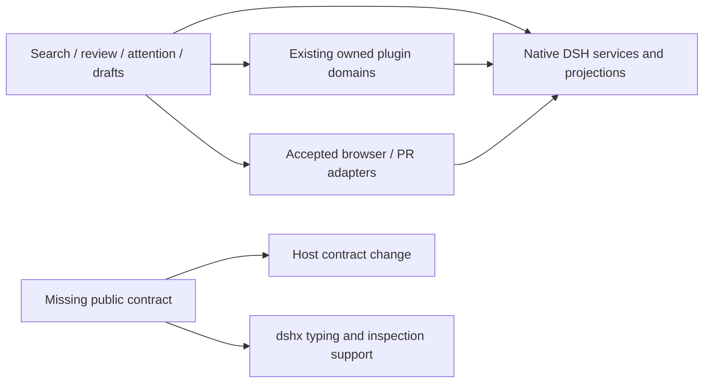

# Reference feature additions plan

## Context

Survey date: 2026-10-05. Scope: useful product behavior from T3 Code,
OpenCode 2, BB, Codex, Claude Code, Cursor, Pi, Oh My Pi, and Amp, compared
with our existing plugins, the installed DSH
runtime, and available community plugins. This is an investigation and phased
plan; no plugin was installed, enabled, or changed for this survey.

The recommendation is to improve the daily coding loop first: find past work,
review changes reliably, set drafts aside, and understand delegated work. Adopt
compatible community implementations where they cover the actual need. Keep
filesystem isolation, conversation rollback, provider execution, and browser
ownership separate from presentation features.

### Evidence and limits

| Reference | Inspected baseline | Evidence |
|---|---|---|
| T3 Code | `pingdotgg/t3code@efecd3cf8bcec3d1891b5f5a27dc2f6d797c6448`, upstream main fetched on survey date | Source archive: contracts, web feature modules, server services, user and orchestration documentation. The old installed Alpha app is 0.0.36; it is not the baseline for current feature claims. |
| OpenCode2 | Installed Nix package 2.0.20; matching upstream tag `v2.0.20`, commit `84c9be93a56304a108f1a22df0c5d62c26d5b6ca` | Core service contracts and app session commands, review, context, terminal, and request modules. This is `anomalyco/opencode`, not one of the unrelated repositories named `opencode2`. |
| BB | Installed `bb.app` / `bb-app` 0.44.0 | Installed CLI command index, thread-operation and creation references, plugin API index; local `../bb-plugins` behavior and implementation. No private conversations, credentials, or databases read. |
| Codex | Installed CLI 0.159.2; current official OpenAI documentation retrieved on survey date | Local environments/actions, code review, hooks, and long-running work. Some Codex documentation now redirects to combined ChatGPT product pages; these are documented behavior references, not proof of CLI or account availability. |
| Claude Code | Current official documentation retrieved on survey date | Hooks, agent teams, context inspection, memory/rules, and extension boundaries. Agent teams are explicitly experimental. No claim that the locally installed binary enables every documented feature. |
| Cursor | Current official documentation retrieved on survey date | Agent overview, Plan Mode, Debug Mode, and rules. No proprietary implementation inspected or runtime comparison performed. |
| Pi | `badlogic/pi-mono@b2b5c42f6138b73ec4b2f49ec0ca468800f88586` | Source and docs for extensions, branching, compaction, virtual models, Code Mode/MCP, and RPC UI. Local binary is 0.99.1; source snapshot is the comparison baseline. |
| Oh My Pi | `can1357/oh-my-pi@1c0993c3d12e70042169a951663bb2702e2c0a9e` | Tool implementations and detailed docs: hash editing, LSP, DAP debugging, AST edits, context notebook, rollover, Python evaluation, read selectors, and rule matching. Experimental behavior is labelled below. |
| Amp | Current official documentation retrieved on survey date | Dial, specialist subagents, tool routing, plugins, design workflow, and provider connections. No local runtime installed or tested. |
| DSH | Actual executable resolves `@deepseek-ai/dsh@0.2.0-rc.2` | Installed declarations and implementation for Session, Agent, SubagentRuntime, WorkspaceRegistry, ScheduleService, SessionQueryEngine, workspace changes, skills, input, references, and sidebar tabs. |
| Our plugins | Working checkout at survey time | Plugin READMEs and focused source outlines; existing customization, async questions, desktop, and boot integrity plans. Presence of source is not a runtime acceptance claim. |
| Marketplace | `awesome-dsh-plugin.com/plugins.json`, reported updated 2026-10-01, 4,412 entries | Whole catalog searched across relevant feature terms; published package archives inspected for shortlisted candidates. Counts, stars, and descriptions are discovery aids, not adoption evidence. |

`dsh --profile web --dump-config` produced a composed tree containing
`session-query-sqlite`, but also warned that patches target missing
`llm-openai-codex` and `preset-standard:tool-ask-user` entries. Do not infer
successful boot or active feature behavior from that dump. Resolve composition
warnings before combined runtime acceptance. The command used the installed
official fnm Node 22.23.3; the ambient shell had Node 24.20.0, which differs
from this repository's pin.

No DSH runtime interaction or comparative performance benchmark was run.
The T3 collaborative browser opened and navigated to the marketplace, but its
snapshot tool failed twice with `PreviewAutomationExecutionError`; no browser
acceptance is claimed. The source survey is broad, not proof that every feature
works on this profile. Each proposed implementation has a probe gate below.

### Source index

These pinned paths make the feature matrix reproducible without depending on
temporary survey files.

| ID | Source |
|---|---|
| T1 | [T3 composer behavior](https://github.com/pingdotgg/t3code/blob/efecd3cf8bcec3d1891b5f5a27dc2f6d797c6448/docs/user/composer.md), `apps/web/src/promptStashStore.ts`, and `packages/contracts/src/composerContext.ts` at the same revision |
| T2 | [T3 thread sidebar](https://github.com/pingdotgg/t3code/blob/efecd3cf8bcec3d1891b5f5a27dc2f6d797c6448/docs/user/thread-sidebar.md) |
| T3 | [T3 source control](https://github.com/pingdotgg/t3code/blob/efecd3cf8bcec3d1891b5f5a27dc2f6d797c6448/docs/user/source-control.md), `packages/contracts/src/review.ts`, `threadPullRequest.ts`, and `apps/server/src/orchestration-v2/pullRequestWatch.ts` |
| T4 | [T3 delegation contract](https://github.com/pingdotgg/t3code/blob/efecd3cf8bcec3d1891b5f5a27dc2f6d797c6448/docs/orchestration-v2/orchestrator-mcp-server.md) and `packages/contracts/src/orchestratorMcp.ts` |
| T5 | [T3 provider capabilities](https://github.com/pingdotgg/t3code/blob/efecd3cf8bcec3d1891b5f5a27dc2f6d797c6448/docs/orchestration-v2/provider-capability-system.md), `provider-switching-and-context.md`, and `feature-lifecycles.md` |
| T6 | [T3 scheduler contract](https://github.com/pingdotgg/t3code/blob/efecd3cf8bcec3d1891b5f5a27dc2f6d797c6448/packages/contracts/src/scheduledTask.ts) and `apps/server/src/scheduledTasks/ScheduledTaskService.ts` |
| T7 | [T3 browser automation contract](https://github.com/pingdotgg/t3code/blob/efecd3cf8bcec3d1891b5f5a27dc2f6d797c6448/packages/contracts/src/previewAutomation.ts), `preview.ts`, and `apps/web/src/lib/previewAnnotation.ts` |
| T8 | [T3 SnapShots](https://github.com/pingdotgg/t3code/blob/efecd3cf8bcec3d1891b5f5a27dc2f6d797c6448/docs/user/snap-shot.md), `terminal.md`, `usage.md`, `remote-access.md`, and `mobile-notifications.md` |
| O1 | [OpenCode2 session commands](https://github.com/anomalyco/opencode/blob/84c9be93a56304a108f1a22df0c5d62c26d5b6ca/packages/app/src/session/commands/use-session-commands.tsx) |
| O2 | [OpenCode2 context inspector](https://github.com/anomalyco/opencode/blob/84c9be93a56304a108f1a22df0c5d62c26d5b6ca/packages/app/src/session/files/session-context-tab.tsx), `session/timeline/session-context-usage.tsx`, and `session/review/` |
| O3 | [OpenCode2 snapshots](https://github.com/anomalyco/opencode/blob/84c9be93a56304a108f1a22df0c5d62c26d5b6ca/packages/core/src/snapshot.ts), `session/revert.ts`, `session/inbox.ts`, and `session/compaction.ts` |
| O4 | [OpenCode2 worktrees](https://github.com/anomalyco/opencode/blob/84c9be93a56304a108f1a22df0c5d62c26d5b6ca/packages/core/src/worktree.ts), `worktree/strategies.ts`, and `vcs.ts` |
| O5 | [OpenCode2 permissions](https://github.com/anomalyco/opencode/blob/84c9be93a56304a108f1a22df0c5d62c26d5b6ca/packages/core/src/permission.ts), `form.ts`, `skill.ts`, `session/transfer.ts`, and `packages/app/src/session/terminal/` |
| O6 | [OpenCode2 browser plugin](https://github.com/anomalyco/opencode/blob/84c9be93a56304a108f1a22df0c5d62c26d5b6ca/packages/plugin-browser/README.md), `packages/core/src/codemode/`, `formatter.ts`, and `tool-output.ts` |
| B1 | Installed `bb-app/server/dist/builtin-skills/bb-cli/references/command-index.md`: thread, environment, terminal, machine, browser, diagnostics, voice, and skill groups |
| B2 | Installed `bb-app/server/dist/builtin-skills/bb-cli/references/thread-operation.md` and `thread-creation.md`; plugin authoring `backend-api-index.md` |
| B3 | Local [BB plugin inventory](../../bb-plugins/README.md) and each plugin README, especially [diff-viewed](../../bb-plugins/plugins/diff-viewed/README.md), [memory-watch](../../bb-plugins/plugins/memory-watch/README.md), [auto-handoff-parent](../../bb-plugins/plugins/auto-handoff-parent/README.md), and [preserve-child-threads](../../bb-plugins/plugins/preserve-child-threads/README.md) |
| D1 | Installed `@deepseek-ai/dsh-session/lib/types/index.d.ts`, `dsh-agent/lib/types/index.d.ts` and `runtime-types.d.ts`, `dsh-subagent/lib/types/index.d.ts` |
| D2 | Installed `dsh-session-query/lib/types/index.d.ts`, `dsh-workspace/lib/types/index.d.ts`, `dsh-workspace-changes/lib/types/types.d.ts` |
| D3 | Installed `dsh-schedule/lib/types/index.d.ts` and `types.d.ts`, `dsh-session-checkpoint-policy/lib/types/index.d.ts`, `dsh-skill/lib/types/index.d.ts` |
| D4 | Installed `dsh-client-ui-conversation/lib/types/client/contract/{input,draft-editor}.d.ts`, `dsh-client-ui-sidebar-right/lib/types/client/contract/slots.d.ts`, and API workspace-file declarations |

| C1 | Official OpenAI documentation: [local environments and actions](https://learn.chatgpt.com/docs/environments/local-environment), [code review](https://learn.chatgpt.com/docs/code-review), [long-running work](https://learn.chatgpt.com/docs/long-running-work) |
| C2 | Official OpenAI documentation: [hooks](https://learn.chatgpt.com/docs/hooks) |
| CL1 | Claude Code [feature boundaries](https://code.claude.com/docs/en/features-overview), [hooks](https://code.claude.com/docs/en/hooks), and [agent teams](https://code.claude.com/docs/en/agent-teams) |
| CL2 | Claude Code [memory and scoped rules](https://code.claude.com/docs/en/memory), [context inspection](https://code.claude.com/docs/en/context-window), and [checkpointing](https://code.claude.com/docs/en/checkpointing) |
| CU1 | Cursor [agent overview](https://cursor.com/docs/agent/overview), [Plan Mode](https://cursor.com/docs/agent/plan-mode), [Debug Mode](https://cursor.com/docs/agent/debug-mode), and [rules](https://cursor.com/docs/rules) |
| P1 | [Pi extension API](https://github.com/badlogic/pi-mono/blob/b2b5c42f6138b73ec4b2f49ec0ca468800f88586/packages/coding-agent/docs/extensions.md), plus `sessions.md`, `compaction.md`, and `rpc-extension-ui.md` in that directory |
| P2 | [Pi virtual models](https://github.com/badlogic/pi-mono/blob/b2b5c42f6138b73ec4b2f49ec0ca468800f88586/packages/coding-agent/docs/virtual-models.md), `codemode.md`, and `prompt-templates.md` in that directory; current [Pi documentation](https://pi.dev/docs/latest) |
| H1 | [Oh My Pi edit contract](https://github.com/can1357/oh-my-pi/blob/1c0993c3d12e70042169a951663bb2702e2c0a9e/docs/tools/edit.md), `ast-edit.md`, and the implementations under `packages/coding-agent/src/tools/` |
| H2 | [Oh My Pi LSP](https://github.com/can1357/oh-my-pi/blob/1c0993c3d12e70042169a951663bb2702e2c0a9e/docs/tools/lsp.md), `debug.md`, `read.md`, and `docs/python-repl.md` |
| H3 | [Oh My Pi context notes](https://github.com/can1357/oh-my-pi/blob/1c0993c3d12e70042169a951663bb2702e2c0a9e/docs/tools/context-notes.md), `new-context.md`, and `docs/compaction.md` |
| H4 | [Oh My Pi rulebook pipeline](https://github.com/can1357/oh-my-pi/blob/1c0993c3d12e70042169a951663bb2702e2c0a9e/docs/rulebook-matching-pipeline.md), `docs/handoff-generation-pipeline.md`, and `docs/memory.md` |
| M1 | Amp [Dial](https://ampcode.com/docs/the-dial), [modes and specialists](https://ampcode.com/docs/models-and-subagents), [tools](https://ampcode.com/docs/tools), and [plugins](https://ampcode.com/docs/customize/plugins) |
| M2 | Amp [design workflow](https://ampcode.com/docs/designing-ui), [model routing](https://ampcode.com/docs/customize/model-routing), and documentation index [llms.txt](https://ampcode.com/llms.txt) |
| D5 | Installed `dsh-hook-protocol`, `dsh-hooks-codex`, `dsh-hooks-claude-code` READMEs and declarations; `dsh-agent/lib/types/runtime-types.d.ts` turn-stopping contract |
| D6 | Installed `dsh-fs-observation-policy/README.md`, `dsh-fs/lib/types/index.d.ts`, `dsh-subprocess/lib/types/index.d.ts`, and `dsh-agent-instructions` README/declarations |
| D7 | Installed `dsh-experimental-agent-team` README and roster/task/projection declarations; experimental team tools/profile/client packages present in bundle tree |

Related work: [customization](dsh-customization/README.md),
[integration review](dsh-customization/integration-review.md),
[async questions](async-agent-questions.md),
[desktop shell](desktop-shell/README.md),
[boot integrity](plugin-boot-integrity.md).

## Goal

Choose a small, evidence-backed sequence of DSH additions that improves coding,
review, and parallel work without maintaining duplicate native features or
pretending that a UI plugin supplies missing Host capabilities.

## What

### Feature inventory and disposition

`Extend` means change an existing owned plugin. `Adopt probe` means a concrete
community candidate exists but must earn runtime acceptance. `Build` means
implement against DSH with dshx after the stated contract gate. `Host first`
means the public seam is missing or insufficient for the promised behavior.
`Covered` does not imply all acceptance checks have passed.

#### Conversation, composer, and navigation

| ID | Reference behavior | DSH coverage or gap | Disposition |
|---|---|---|---|
| F01 | Global title/content search and reopening past work (T2, B1) | Native `SessionQueryEngine` has indexed session/event search, filters and cursors; our sidebar is not a full-text results surface | **Adopt probe** `@hyzyn/dsh-search`; include archived work and exact event navigation if supported |
| F02 | Find within a conversation; previous/next user-message navigation (O1, O2) | Native chat navigation plus community `@ryuu-64/dsh-find-all` and `dsh-turnbar` candidates | Probe native behavior, then adopt a focused find bar; do not build another timeline by default |
| F03 | Quick-open files, line selection, add selection as context (O1, T1) | Native file/reference services exist; marketplace quick-open excludes 0.2 | **Fork/port** its useful path-search behavior only if native search falls short; prefer a small file palette over a replacement workbench |
| F04 | Unified command palette and discoverable shortcuts (O1, T1) | Native command contributions and our `shortcuts` already exist | **Extend** shortcuts with registered command discovery; survey `dsh-spotlight`, no parallel action registry |
| F05 | Prompt stash with multiple saved drafts (T1) | Candidate stash is text-only and does not admit this exact rc.2 peer baseline | **Fork/port** text-only stash first; rich drafts require a dshx/Host contract gate |
| F06 | Recall previously sent prompts (T1) | Community `dsh-composer-history`; useful but smaller benefit than stashing | Adopt probe after F05, preserve current unsent draft and reference semantics |
| F07 | Quote response, file/thread/PR/terminal context chips (T1, O1) | DSH input has references and revision-guarded insertion; file and session reference packages already ship | **Extend** context producers; terminal/review context first, reuse native chips |
| F08 | Drag threads into composer and lazy context lookup (T1) | Existing thread links plus native session references | Improve discovery in `thread-sidebar`; references should not copy whole histories or change lineage |
| F09 | Edit earlier prompt, fork from a message, undo/redo (T1, O1, O3) | Session fork exists; in-place rewind is not an equivalent operation | Expose **native fork** if absent; in-place rollback is F39, not a frontend shortcut |
| F10 | Multi-select pin/archive/reorder, project groups, hide settled work (T2, B1) | Mostly covered by `thread-sidebar`; some organization preferences are browser-local | **Extend** existing sidebar only after runtime acceptance; durable manual parent linking needs F41 |
| F11 | Snooze and wake threads (T2) | Existing park is browser-local; no native parked/snoozed projection found | **Host first** for synchronized snooze. Optional browser-local timer must say it is local |
| F12 | Unread state and attention badges (T2, B1) | Activity/read semantics must be defined; `updatedAt` is not a reliable last-work timestamp | **Extend** sidebar using explicit last-seen sequence; Host first for cross-device read state |
| F13 | Attach files, answer questions with files, preview HTML/PDF (T1, T8, B2) | Native attachments, file upload, renderer and question UI already exist | Probe native behavior; add only verified missing formats or question attachment contract |
| F14 | Voice input and screen/window capture (T8, B1) | Desktop OS capabilities, with marketplace candidates | Later optional shell integration; no always-on recording or separate plugin just for a button |

#### Coding and review

| ID | Reference behavior | DSH coverage or gap | Disposition |
|---|---|---|---|
| F15 | Diff files viewed, count/progress, hide reviewed files (T3, B3) | Native turn changes include summaries and diffs; our JJ panel has revision/file detail but no review ledger | **Build** `review-progress` using DSH/dshx; BB supplies behavior, not DOM patch architecture |
| F16 | Invalidate viewed state when reviewed content changes (T3, B3) | BB counts alone miss edits with equal added/deleted counts | Required part of F15: digest exact content/range, not line counts |
| F17 | Turn/revision/working-copy diff scopes and tree/list views (T3, O2) | Native turn changes and owned JJ inspection overlap | **Extend** JJ for repository ranges; review panel composes these sources without another VCS mutation owner |
| F18 | Inline comments and send selected hunks back to agent (T1, T3) | Revision-guarded draft insertion exists; durable review comment schema does not yet exist here | Phase two of F15, attach bounded immutable hunk context and explicit source identity |
| F19 | PR issue picker, read linked PR status (T3) | Candidate `dsh-github-picker` covers reference insertion, not a complete PR workflow | **Adopt probe** picker; build a small linked-PR panel only for missing status/watch behavior |
| F20 | Wake agent for check failures, comments, conflicts (T3) | Native schedule and Agent creation/resume/steering can be building blocks; no native PR-watch service found | **Build** `pull-request-watch` after durable execution/authority gate; avoid agent polling loops |
| F21 | Create PR, edit description, request review, merge, auto-merge (T3, B1) | External forge actions, not local diff UI | Later explicit actions via existing CLI/auth; start read-only, preserve remote mutation confirmation |
| F22 | Stacked PRs, multiple forge providers (T3) | Specialized workflow, substantial integration surface | Defer until GitHub linkage proves valuable; no universal forge abstraction for one caller |
| F23 | Worktree/workspace create, setup hooks, parallel isolated sessions (T2, O4, B2) | WorkspaceRegistry registers existing canonical directories; Agent creation accepts validated cwd | **Extend** JJ with `jj workspace` provisioning and DSH session creation; bind cwd before first turn. Not moving a live session |
| F24 | Transfer existing thread to another environment/machine (O1, B1) | No durable live-session workspace-transfer contract found in inspected DSH surface | **Host first**; creating a directory alone cannot rebind the session |
| F25 | Editor tabs, split panes, terminal panes, file preview (O1, O2, T8) | Native right-sidebar tabs, panes, terminal and file APIs already ship; `dsh-better-sidebar` overlaps heavily | Native probe first; adopt workbench only if it earns its broad replacement scope |
| F26 | Terminal history/search and captured output context (T8, O5, B1) | Native terminal and jobs; context producer integration can add value | Add bounded terminal-selection context in F07; separately probe whether durable history is missing |
| F27 | Background shell jobs, reconnect and inspect execution (O5, B2) | Native jobs and persistent shell tools exist | Covered at service level; integrate attention UI, do not create another process runner |
| F28 | Project commands, dependency setup, external editor launch (T8, B1) | Native dependency tool and open-in-app services overlap | Verify native coverage, then add explicit per-project command affordances; no automatic hook execution on import |

#### Agents, context, and automation

| ID | Reference behavior | DSH coverage or gap | Disposition |
|---|---|---|---|
| F29 | Delegated-task graph, inspect child state, interrupt, send follow-up (T2, T4, B2) | Native `SubagentRuntime` has catalogs, descendants, prompt and interrupt authority; owned messaging handles independent peers | **Extend** `agent-communication` with a work dashboard; keep owned child operations routed through SubagentRuntime |
| F30 | Provider-aware delegation with capability discovery (T4, T5) | DSH has named providers and explicit capabilities; no need to clone T3 orchestration graph | Use native contracts; expose actual capabilities and unsupported actions in F29 |
| F31 | Completed child output returned to parent (T4, B3) | DSH already has continuable settlement messages | Covered; test reconnect/delivery once. BB `auto-handoff-parent` repairs creation lineage, not completion delivery |
| F32 | Preserve children when parent is archived (B3) | DSH has its own archive admission and runtime ownership; BB plugin counteracts BB cascade semantics | Probe native archive behavior; do not install an archive-then-unarchive timestamp workaround |
| F33 | Async nonblocking questions and delegated decisions (T5, O5) | Native timed root questions; child routing already has a dedicated plan | Implement [async questions](async-agent-questions.md), do not create a second question system |
| F34 | Attention inbox: completions, errors, approvals, questions (T8, B1) | Existing approval/question cards; notification candidates available | **Adopt probe** focused notifications, then **extend** F29/sidebar with deduplicated attention state |
| F35 | Scheduled prompts and recurring jobs with browser closed (T6, B1) | Native ScheduleService has once/interval/daily/weekly/cron, catalog, history and concurrency-checked updates | Enable/validate native schedule first. New-session recurring jobs need separate execution contract |
| F36 | Kanban tasks, run history, pinned model/workspace (T6) | Community task board has Host ledger and its own cron/execution machinery | **Adopt probe** only if visual task management is wanted; do not build a competing scheduler |
| F37 | Goals, todo/proposed plans and stop conditions (T5, O1) | Native goal, todo, plan, workflow and Ralph tools/UI ship | Covered at package level; validate preset reachability rather than port tools |
| F38 | Context occupancy, inspect instructions/skills, manual compact (O1, O2, O3) | Native compaction and conversation context occupancy; AI Accounts owns usage history | **Build/extend** focused context inspector only for missing provenance. Keep cost analytics in AI Accounts |
| F39 | Conversation rewind coordinated with filesystem restore (T5, O3) | Session fork exists; `session-checkpoint-policy` is a durability flush policy, not file rollback | **Host first** for atomic conversation/filesystem rollback. Reject direct event-log surgery |
| F40 | Switch execution provider and return to old native session (T5) | Choosing an LLM route/account differs from running a Claude/Codex/OpenCode CLI session | Defer full harness adapters. Provider switching needs capabilities, transcript handoff, approvals, and ownership contracts |
| F41 | Link arbitrary existing sessions into a parent tree (B3, T2) | DSH distinguishes durable fork lineage and live parent ownership; no public reparent verb found | **Host first** for durable lineage; optional organizational links must be separately named and must not confer runtime authority |
| F42 | Skills explorer, provenance, invocation policy, recoverable removal (O5, B1) | Native skill catalogs/providers and community explorer exist | **Adopt probe** `@linxin666/dsh-client-ui-skill-explorer`; retain read-only bundled/symlink boundaries |
| F43 | Long-term memory and instruction discovery (O2, B1) | Many community memory systems; no evidence of missing recall workflow from this survey | Defer memory backend selection; use context inspector to identify actual pain first |
| F44 | Export/import session and portable handoff (O1, O5, T5, B1) | Native session log export/reference and fork machinery overlap | Probe export; portable import needs format validation, redaction, attachment ownership and policy restoration |
| F45 | Automated independent review/quality loops (T4) | Existing delegation plus many marketplace reviewers | Opt-in later, bounded rounds and budget; do not force every turn through extra LLM calls |

#### Browser, runtime, settings, and delivery

| ID | Reference behavior | DSH coverage or gap | Disposition |
|---|---|---|---|
| F46 | Shared browser tab, screenshot, DOM/console/network evidence (T7, O6, B1) | BrowserSkill community bridge exists; DSH core has no inspected browser-ownership service | **Adopt probe** BrowserSkill for browser operations; integrated shared preview is a separate product increment |
| F47 | Pick element, annotate region/style, attach evidence at composer cursor (T7) | Native attachment/reference producers can consume evidence; shared browser lifecycle missing | Later narrow `browser-context` integration on accepted browser provider, no arbitrary iframe claims |
| F48 | Browser profile import / saved cookies (T8, B1) | Credentials, not ordinary settings | Defer; explicit user-triggered import only, isolated local storage and provenance |
| F49 | Mobile/remote access, pairing, reconnect, offline sends (T8, B1) | Marketplace remote UI exists; authentication, deployment and queue semantics exceed a cosmetic plugin | Separate adoption probe after local workflows stabilize; no unauthenticated tunnel shortcut |
| F50 | Host machines, containers, remote environments (B1, B2) | Infrastructure lifecycle and credential boundary | Defer; Nix owns machine configuration. Not a DSH sidebar plugin project |
| F51 | Process memory/resource diagnostics (T8, B3) | BB memory-watch measures owned processes; DSH plugins share Node heap | **Extend** boot diagnostics with bounded Host process metrics; do not claim per-plugin heap attribution |
| F52 | Plugin safe mode, failure explanation, missing service diagnosis (B1) | Existing boot integrity plan/dshx work owns this concern | Finish [boot integrity](plugin-boot-integrity.md); do not add a second guardian implementation |
| F53 | Account/quota usage and cost history (T8, B3) | Owned AI Accounts and usage history already implement this domain | **Extend** missing providers/limits there, not another meter |
| F54 | MCP catalogs, OAuth, tool inspection (O1, B3) | Owned MCP Servers already covers domain; OAuth details need runtime acceptance | Complete existing package acceptance; adoption only for a concrete missing connector capability |
| F55 | Secrets/settings search/folder picker (B3) | Owned plugins/shared picker exist | Covered; preserve boundaries and finish runtime acceptance |
| F56 | Resize sidebar, navigation links, footer commands (B3) | Owned shell uses native layout geometry and contributions | Extend existing shell only if exact missing interaction reproduced |
| F57 | Themes, motion, typography, notification sounds (T8, O1, B1) | Native settings plus large theme marketplace | Adopt optional cosmetic plugin when requested; low priority for coding loop |
| F58 | Install/update services, desktop shell, remote client distribution (T8, B1) | Existing desktop-shell plan plus Nix machine setup | Improve shell/Nix, not a new Host bundle |
| F59 | Code Mode: discover tools, call multiple tools through code (O6) | Native PTC runtime and workflow-PTC packages already ship | Validate native PTC preset before porting another evaluator; bounded execution and permission mediation remain Host responsibilities |
| F60 | Format files after edit/write (O6) | OpenCode2 has Formatter service; DSH tool/file policy can host explicit integration | Optional project-local formatter bridge after checking native hooks; opt-in, actual repo commands, no global formatter choice |
| F61 | Language-server diagnostics following edits | Matching OpenCode2 edit/write source explicitly leaves LSP runtime as TODO | Do not claim this is an existing v2 feature to port. Independent future adapter only if needed |
| F62 | Oversized tool output retention and context pruning (O3, O6) | Native spill policy, tool-result pruner, timeout policy and compaction packages exist | Benchmark native truncation/spill discoverability; fix toolchain/domain gap rather than invent a second retention engine |
| F63 | Per-project model/permission defaults, sandbox and explicit approvals (T5, O5) | Native settings, agent options, permission presets and filesystem/shell sandbox services | Verify scope/inheritance; no UI option may relax runtime authorization implicitly |
| F64 | Activity log and failure/retry visibility (T5, T8, B1) | Session events, telemetry and existing boot diagnostics supply sources | Extend attention/diagnostics with bounded event history; no unbounded raw transport logger |
| F65 | Plugin authoring inspector, RPC and safe development loop (B1) | Local dshx inspect/check/build and boot-integrity work cover the core need | Improve local dshx only where multiple plugins expose a concrete missing contract; no parallel plugin framework |

#### Additional harnesses: coding reliability and context

These are new deltas. Common capabilities already covered by F01–F65 are
cross-referenced rather than counted twice. A workflow can be useful without
justifying a new plugin.

| ID | Reference behavior | DSH opportunity and disposition | Source |
|---|---|---|---|
| F66 | Project actions: named build/test/dev commands | **Build** a small project-actions surface using native terminal/subprocess ownership; extend existing command palette. Share validated action definitions with workspace setup F23 | C1 |
| F67 | Verification before an agent declares completion | **Covered seam / build narrow policy** using native Stop bridge or awaited `agent/turn-stopping`; attach bounded failed-check evidence and allow user cancellation. No new hook engine | C2, CL1, D5 |
| F68 | Inspect hook executions and compatibility | **Build** projection/UI over native hook results; show skipped hooks, timeouts and unsupported outputs. Input rewrite and hard run halt are **Host first** | C2, CL1, D5 |
| F69 | Claude-style team task dependencies and claims | **Native experimental probe**: DSH already has DAG tasks, revision checks, durable mailbox, roster and browser projection. Extend F29 dashboard only after its experimental contract passes | CL1, D7 |
| F70 | Path-specific rules and rule provenance | **Extend** context/instructions visibility: show loaded files, precedence, changes and budget. Native DSH already discovers scoped AGENTS/CLAUDE files; glob/frontmatter rules require an explicit matching contract | CL2, CU1, H4, D6 |
| F71 | Context occupancy and survival inspection | **Extend F38** with source, size estimate, active/compacted state and instruction provenance. Do not claim an exact provider token breakdown without counters | CL2, P1, D6 |
| F72 | Plan Mode with approval and read-only exploration | **Preset/configure first**, using actual tool restrictions and existing async decisions. Save actionable plan artifact; execution starts through explicit transition. Prompt text alone does not enforce read-only | CU1, CL1 |
| F73 | Debug Mode: hypotheses, reproduce, evidence, fix, verify | **Skill/preset first**; optional evidence collector later. Reuse browser/terminal artifacts and removable instrumentation. Never install a second agent runner to get this workflow | CU1 |
| F74 | LSP diagnostics, symbols, references and definitions | **Adopt probe** existing LSP packages, starting with diagnostics/symbols. Confirm advertised navigation coverage; add missing read-only operations only after measuring gap | H2 |
| F75 | LSP rename, format and quick fixes | **Adopt probe**, separate write gate from F74. Preview whole WorkspaceEdit, enforce per-file version/sandbox checks; reject unsupported resource operations | H2 |
| F76 | Hash-anchored edits and served-range checks | **Native baseline first / adopt probe** `dsh-better-edit`. DSH already rejects stale writes; the incremental value is range-aware editing and recovery. Benchmark both effectiveness and prompt overhead | H1, D6 |
| F77 | Explicit conflict reporting and prepared batches | **Extend F76 if proven**. Prepared edits and recovery receipts useful; multi-file OS writes are not an atomic transaction. Keep successful prefix visible on partial failure | H1 |
| F78 | AST query/rewrite with dry-run and scoped apply | **Adopt existing CLI through narrow tool**, initially ast-grep; source prebuilt binary from Nix. Bind apply to preview digest and cap total candidate/replacement counts | H1 |
| F79 | DAP launch, breakpoints, stack, locals and stepping | **Build later** a narrow debugger adapter if terminal debugging leaves a measured gap. Own sessions per agent/workspace; avoid Oh My Pi's global active-session model | H2 |
| F80 | Persistent Python evaluation for iterative data work | **Adopt kernel backend / build narrow adapter later**. Useful only for repeated analysis; native terminal already covers one-shot execution. Explicit reset, interruption, resource limits and disposal | H2 |
| F81 | Bounded read selectors for archives, PDF and SQLite | **Adopt tools by format** after native/MCP inventory; archive traversal, read-only database opening, size/page/row bounds. Avoid importing a whole replacement read stack | H2 |
| F82 | Durable session notebook that survives context rollover | **Build only after Host context gate**: branch-scoped revisions, provenance and explicit user visibility. Keep separate from cross-project memory; stale notes remain historical evidence | H3 |
| F83 | Explicit fresh-context rollover retaining notebook/history | **Host first**: coordinate compaction with active tools, cancellation, branch/model changes, persistence and retrieval. Oh My Pi's notes-backed path is experimental and off by default | H3 |
| F84 | Recover historical tool output through artifact references | **Extend F38 / reuse native spill and pruning**, with bounded read-back. Measure useful recovery rather than changing transcript/tool identities | P1, H3 |
| F85 | Specialist Search / Advisor / Library Research roles | **Configure existing subagent profiles first**; bounded inputs, role tool sets and result artifacts. Probe advisor candidate only if native profile behavior is inadequate | M1, H4 |
| F86 | Dial-like presets combining model, effort, prompt and tools | **Extend ai-accounts/preset UI**, show explicit bundle and capability checks; no hidden mid-run substitution. Amp's current Dial is low/medium/high/ultra, not an assumed old mode list | M1, P2 |
| F87 | Role-based provider routing and explicit fallbacks | **Extend ai-accounts**, preserve account/session identity, capability requirements and retry boundaries. No automatic cross-provider transfer of private context | M2, P2 |
| F88 | Context hooks / dynamic active tool sets | **Reuse Cordis/services first**. Pi's lifecycle hooks and tool activation are useful conventions; do not bridge its extension ABI wholesale. Add dshx helpers only after a repeated missing seam | P1 |
| F89 | Code Mode and MCP discovery without huge schemas | **Native inventory/probe**, extending F49. Current Pi already supports Code Mode/MCP; do not use the obsolete no-MCP comparison. Verify permission and cancellation across generated orchestration | P2 |
| F90 | Branch tree and branch summaries | **Covered by F13/F39/F40 plus native fork**. Improve navigation/provenance; rollback still requires Host contract | P1, CL2 |
| F91 | Prompt templates and reusable slash workflows | **Covered by skills/presets F42–F45**. Add discoverability/arguments only if absent; another template engine would duplicate ownership | P2, CL1, CU1 |
| F92 | Auto-memory and rule promotion | **Defer / extend F43**: user-reviewed scoped memory with source/evidence, expiry and edit history. No automatic conversion of uncertain notes into permanent instructions | CL2, H4 |
| F93 | Design variants, visual comparison, then implementation | **Skill/preset first**, attach variants/evidence using F46/F47. A gallery plugin needs repeated usage, not just a compelling demo | M2, CU1 |
| F94 | Background/cloud agents, multiplayer and remote portals | **Defer to multi-host/remote boundary**, F23/F54–F59. Auth, isolation, retention and durable execution are infrastructure, not a client-only plugin | C1, CL1, CU1, M2 |
| F95 | RPC extension UI and arbitrary plugin-defined agent modes | **Reuse DSH slots, tools and profiles**; improve dshx authoring only for verified gaps. Pi/Amp plugin systems are references, not compatible runtime packages | P1, M1 |

### Marketplace adoption audit

Actual npm names matter: several repository leaf names returned registry 404s
before the scoped published packages were identified. Archives were downloaded
for inspection only. None is marked runtime-compatible merely because it has
matching peers or a resolvable import.

| Candidate inspected | Findings against installed runtime | Choice |
|---|---|---|
| `@hyzyn/dsh-search@0.4.4` | Peer range explicitly admits rc.2. Host calls `sessionQuery.searchSessions` with event filters and bounded limit, with a scan fallback. Implementation filters out subagent headers; exact hit/archived coverage must be tested. No static `@deepseek-ai/*` runtime imports found in inspected JS | **Adopt probe** for F01. Extend/fork only if child search or event jumps are essential and absent |
| `dsh-quick-open@0.3.0` | DSH client peer ranges end below 0.2. Empty dependencies; references old sidebar service surface | **Fork/port** path search for F03 if native file search is inadequate. Do not install unchanged |
| `dsh-prompt-stash@0.3.2` | Exact DSH peers include rc.1 but exclude installed rc.2. Uses native draft actions, refuses both attachments and reference occurrences, persists plain text locally | **Fork/port** for F05 text-only behavior; full rich draft fidelity needs contract work, not a widened peer range |
| `dsh-better-sidebar@0.24.1` | Peers admit the 0.2 rc line, substantial editor/rendering dependencies; no direct native package dependencies in published dependencies | **Adopt probe** only for F25. Compare sidebar slot ownership with our shell; do not replace everything to gain one pane |
| `@linxin666/dsh-client-ui-skill-explorer@0.4.4` | DSH peer `>=0.2.0-rc.1`; Host scans/discovers skills and exposes mutation routes. No static native runtime imports found in inspected JS | **Adopt probe** F42, including canonical-root and paired-access authorization checks |
| `@linxin666/dsh-client-ui-task-board@0.4.4` | DSH peer `>=0.2.0-rc.1`; Host owns ledger, cron and real session execution. Has one direct `@deepseek-ai/*` dependency: verify singleton identity before boot | **Adopt probe** F36 only if task-board workflow earns value; do not build our own board meanwhile |
| `@wxg-prc-cpg/browser-skill-dsh-plugin@0.3.2` | Peers admit 0.2 rc; imports existing tools/primitives and schemastery. Uses external `bsk` executable, scoped browser ownership, archive cleanup and loopback observation routes | **Adopt probe** F46. Check official prebuilt `bsk` artifact and Nix wiring first. Shared preview/annotation remains additional work |
| `dsh-github-picker@0.5.3` | Peers explicitly target rc.2; inspected static LLM/Typert imports map to installed exports. Covers issue/PR context insertion | **Adopt probe** F19 reference picker, not a PR watch or forge client |
| `dsh-notification@0.1.2` | Reads native `agent/status`, `agent/error`, and waterfall `approval/request`; calls `next()` correctly. OS notifier and optional webhook; no direct native dependencies, has schemastery peer | **Adopt probe** basic desktop notifications only after import resolution; disable webhooks and sensitive detail by default |
| `@idoall/dsh-notify@0.4.1` | Peer ranges admit 0.2; in-page status/toast implementation, not equivalent to OS notifications | Probe if native attention UI is inadequate; avoid two overlapping notification systems |
| Unscoped `dsh-notify@0.1.7` | Windows PowerShell toast/tray package, different owner from `@idoall/dsh-notify`; empty dependencies | Reject for this macOS need |
| `dsh-rewind@0.11.12` | References removed `dsh-client-runtime`; implementation includes rewind/event repair and file restore rather than a single native rollback operation | Reject unchanged; F39 is a Host contract project |

Additional published archives inspected for F67/F74–F76/F85:

| Candidate inspected | Findings against installed runtime | Choice |
|---|---|---|
| `dsh-lsp-actions@0.5.7` | Native service peers admit 0.2; uses `defineTool`, `ctx.fs`, `ctx.subprocess`, sandbox exports, optional LSP seam and a bounded stdio fallback. Default server table is empty; editor backend defaults off. Direct native dependencies absent | **Preferred LSP adoption probe** F74/F75. Keep editor backend off in web, verify named imports and observation/write events; don't promise definitions/references before operation inventory |
| `dsh-tool-lsp@0.1.2` | Wildcard tools/schemastery peers offer little version evidence. Uses installed filesystem/subprocess method names, but inspected mutation calls `writeText(..., undefined, signal)` and direct reads; these do not themselves dispatch tool observation/write-intent events | **Alternative read-only probe**; block mutations until event/guard behavior is proven. README claims are insufficient |
| `dsh-lsp-diagnostics@0.1.1` | Tools peer explicitly `<0.2.0-0` | Reject unchanged; prefer newer action package before porting |
| `dsh-lint-loop@0.5.0` | Tools peer explicitly `<0.2.0-0` | Reject unchanged; verification gates and LSP diagnostics cover narrower need |
| `dsh-better-edit@1.0.0` | No native peers declared, but static imports include tools, home paths and sandbox. Substantial hash/served-range/SQLite state; filesystem bridge dispatches write-intent and observed events. Replaces built-in tools and self-heals registrations | **Controlled adoption probe** F76 only after loader/import checks. Compare native guard first; exercise HMR, resume, ownership, partial reads, encodings, collisions and undo. Never install casually in web |
| `dsh-advisor-plugin@0.2.6` | Agent/session/settings/tools peers target 0.1.5; incompatible with current settings generation | Reject unchanged; configure native specialist profile for F85 |
| `dsh-agent-frugality@0.1.5` | Tools peer broadly admits 0.2 but direct native imports lack dependency wiring. Completion hook uses assistant-tail heuristic, a live success map and bounded steering; also bundles read dedup, permanent rules and review routing | Do not adopt wholesale for F67. Reuse native Stop/turn-stopping seam and narrowly bind verification to current revision/run; a past success or completion-shaped sentence is insufficient evidence |

These are static findings, not boot or security acceptance. The absence of a
clear generic DAP/notebook fit in this bounded catalog search justifies further
contract work, not a claim that no community implementation can exist.

Most shortlisted bundles rely on peers without direct native dependencies.
This profile has a known import-resolution trap for that shape. A peer match
therefore permits further investigation, not installation confidence. Resolve
every runtime import using the actual profile bundle loader; verify shared
cordis/loader identity and boot output. Do not turn `autoInstallPeers` on or
install public older-generation `@deepseek-ai/*` packages to satisfy imports.

Static import checks found installed package/export entries for the shortlisted
0.2 browser and PR bridges. This does not cover computed imports, named-export
shape, Client composition, or authorization. Search and explorer bundling hides
some dependency boundaries; inspect those in the scratch profile.

## Why

The highest-value gaps are repeated interruptions in an otherwise usable
workflow: losing the location of past decisions, re-reviewing changed files,
discarding a draft to ask something urgent, and guessing which child needs
attention. These are focused surfaces on existing DSH services.

Large copies of T3's harness graph, OpenCode's worktree runtime, or BB's remote
machine system would create another ownership layer. Native scheduling, goals,
jobs, attachments and questions already carry much of that behavior. Use them
before increasing the maintenance surface.

## How

### Conceptual model

DSH owns agents, sessions, inboxes, permissions and native reminder execution.
Existing owned plugins own their domains. New bundles own only earned state:
review marks, PR subscriptions, or presentation state. A shared dshx abstraction
is added when multiple real callers need the same contract; do not introduce
a generic orchestration service for this plan.

### Priority and operations / behavior

| Priority | Work package | Value | Effort / dependency | First measurable gate |
|---|---|---|---|---|
| P0 | Existing profile/boot acceptance | Every feature depends on coherent composition | Resolve recorded warnings; use existing boot integrity work | Zero owned-entry activation failures in combined probe; native services visible |
| P1.1 | Search (F01/F02) | Recover past decisions without manual thread scanning | Low to medium; adopt search, avoid replacing sidebar | On fixed corpus, locate archived and live known answers; no stale result after query switch; record p50/p95 latency |
| P1.2 | Review progress (F15–F18) | Review long diffs once, revisit only changed content | Medium; new focused DSH UI, native/JJ sources | Same-line-count content edit clears mark; progress counts complete scoped file set |
| P1.3 | Plain-text prompt stash (F05) | Interrupt writing without losing draft | Low to medium; port compatibility and preserve proven text-only behavior | Stash/restore through reload; original draft survives refused restore; no unsupported rich content erased |
| P1.4 | Delegation/attention dashboard (F29/F34) | See blockers and address child work correctly | Medium; extend messaging/sidebar, native runtime authority | Parent with mixed child states survives reopen; only authorized child actions succeed |
| P1.5 | Async questions | Continue independent work while a decision waits | Already specified elsewhere | Run acceptance in existing async-questions plan, including late answers |
| P2.1 | Skills explorer (F42) | Find loaded skills and invocation policy | Adoption probe; inspect mutation boundaries | Correct source/provenance; bundled read-only entries cannot be deleted |
| P2.2 | Context/terminal/review references (F07/F38) | Give precise evidence, understand context pressure | Native context producers; provenance gaps may need Host support | Insertion lands at captured selection or refuses stale draft; no unbounded history copied |
| P2.3 | PR picker then durable PR watch (F19/F20) | Stop manually checking CI/review | Adopt picker; build watch after restart and wake contract | Same remote event yields one wake; no wake after unsubscribe; resume failures visible |
| P2.4 | Isolated JJ workspace launch (F23) | Safe parallel changes with ordinary DSH sessions | Extend JJ; separate provisioning and session creation | First tool executes in intended cwd; failed launch cleans only newly owned idle resources |
| P2.5 | Native schedule validation / optional board (F35/F36) | Repeated work with browser closed | Reuse native scheduler; board needs demand evidence | Browser-closed delivery, timezone/DST, restart and overlap behavior documented |
| P3 | Browser evidence (F46/F47) | Shared reproducible UI debugging context | External binary/provider first; larger integration | User and agent refer to same tab/capture, cleanup never closes borrowed browser |
| P3 | Runtime diagnostics (F51/F52) | Diagnose failures without guessing | Extend boot integrity/desktop shell | Process metrics labelled accurately, diagnostics redact tokenized URLs |
| Host backlog | F11/F24/F39/F40/F41 | Durable semantics unavailable to a cosmetic plugin | Separate contracts and designs | Typed supported/unsupported behavior before any UI implementation |

Effort labels are relative, not calendar estimates. P1 is the proposed first
implementation batch; the plan does not authorize automatic promotion to web.

### Additional reliability track

The original P1 usability batch remains intact. The follow-up adds narrow
coding-reliability experiments, not thirty simultaneous implementations.

| Order | Work | First measurable gate |
|---|---|---|
| R1 | Project verification/actions F66/F67; native hooks first | Intentionally failing check prevents completion claim; fixed revision reruns only needed checks; cancellation stops children and no endless stop loop |
| R2 | LSP read-only F74, then guarded actions F75 | Fixed TS project resolves diagnostics/symbols with UTF-16/non-ASCII correctness; cancelled requests settle; external edit cannot be overwritten |
| R3 | Hash editing comparison F76 | Fixed representative edit corpus: success/retry rates, tool/prompt tokens and latency against native observation policy; no blind or stale overwrite |
| R4 | Debug workflow F73 + instructions/context visibility F70/F71 | Reproduced failure has hypothesis, evidence and verified repair; temporary instrumentation removed; displayed rule sources match actual injected context |
| R5 | Specialist profiles/routing F85–F87 | Record cost/latency and successful task outcomes against one native agent; failures and fallback are visible; no unauthorized context transfer |
| Later | AST preview F78; notebook F82/F83; DAP F79; Python F80 | Implement only after recurring need and owner/cancellation/retention contracts; notebook rollover requires Host support |

### Tech choices

| Choice | Decision | Rationale |
|---|---|---|
| Adopt / fork / build | Explicit choice per matrix and package audit | Adoption is default, but incompatible or incomplete packages are not silently accepted |
| New authoring | Local `@dshfiles/dshx`, TypeScript/React and existing package conventions | Keep DSH 0.2 typing and bundling fixes in the owned toolchain |
| Review identity | Content-derived digest with source/range identity | Added/deleted counts are not a content fingerprint |
| Search backend | Native `SessionQueryEngine` and existing SQLite implementation | No second private conversation index |
| Mutations | Named native services and narrowly validated Host methods | No DOM-triggered remote mutation or direct session database edits |
| Scheduling | Native ScheduleService for session-bound reminders | Do not duplicate durability, timezone and delivery semantics |
| PR integration | External forge adapter with bounded requests and local subscription state | Keep remote state and local wake state distinct |
| Machine tooling | Official prebuilt binaries, pinned through Nix | Reproducible setup; source builds are last resort |

The inspected T3 and OpenCode source LICENSE files both declare MIT; preserve
their notices and source attribution when vendoring. The inspected personal BB
plugin manifests do not declare a license. Reimplement behavior unless source
ownership/license is established; preserve provenance for any copied code.
Pi and Oh My Pi also declare MIT in the inspected source snapshots. Preserve
their notices when porting; proprietary Codex/Claude/Cursor/Amp documentation
is behavioral reference, not permission to vendor implementation. No fork needs
an upstream remote unless ongoing synchronization is requested.

### Architecture and contract gates

1. **Search:** reuse native search with bounded pages and cancellation. Store
   query/filter/page in URL. Adopted search excludes children today: decide
   whether to expose a child filter rather than assume those results exist.
   Exact event jumps need a supported chat navigation target; if absent, ask
   for that contract instead of querying DOM text.
2. **Review:** native `WorkspaceChanges.summary/diff` is live-session data;
   summaries stop being available when the session is disposed. Clearly label
   that scope. Persistent historical review needs an authorized immutable
   artifact capture before disposal or a Host read contract. Repository-wide
   ranges should come from the existing JJ domain. Never show captured history
   as the current working copy.
3. **Drafts:** `InputState` exposes text, occurrences, attachment IDs, draft
   revision and submission phase; `InputActions` has text and attachment actions.
   Browser attachment IDs are not durable assets. A rich draft needs native
   snapshot/restore and attachment retention semantics, not serialized runtime
   IDs. The first port is explicitly text-only and refuses rich drafts intact.
4. **Delegation:** use `listChildren/listDescendants` and parent-authorized
   native prompt/interrupt operations. Peer inboxes remain the independent-agent
   messaging domain. An organizational parent link never grants child-control
   authority. Persisted catalog entries may have no live controllable agent.
5. **PR watch:** subscriptions own a task and event cursor; the Host owns bounded
   network checks and durable delivery. Session resume/steer has to preserve
   preset, cwd, permissions, archived state and handle disposal. A remote event
   can be recorded even when waking is refused. Native schedule reminders are
   session prompts, not permission to run arbitrary background code.
6. **Workspaces:** create JJ workspace and setup resources, then register its
   existing directory with WorkspaceRegistry and create a session with that cwd.
   Use provisioning receipts and repository identity checks. No automatic
   cleanup of a workspace with live agents, dirty files, or user-owned terminals.
7. **Browser:** OpenCode2 separates server tool/permission ownership from desktop tab/CDP ownership; this is a useful boundary, not permission to import its desktop runtime. A provider owns browser session, tab IDs, cancellation and archive
   cleanup; context UI owns only references and annotations. Local-only BrowserSkill
   observation routes do not establish remote pairing support.

8. **Verification:** `agent/turn-stopping` is awaited and fresh steering keeps
   the turn open. Native hook bridges already support Stop continuation, but
   command-only compatibility is partial: updated tool input and global halt
   are not honored, and unsupported hook shapes are skipped. Bind verification
   receipts to workspace identity, checked content/revision, action definition
   and run; invalidate after relevant writes. Cap corrections and surface blocked
   checks rather than looping or treating a crash as success. Team quality gates
   must use actual team transitions, not assume Claude event names map directly.
9. **Language tools:** subprocess ownership is scoped to workspace/server and
   disposal; decode LSP responses at the boundary, negotiate position encoding,
   bound outputs, cancel requests and reject out-of-root edits. Direct `ctx.fs`
   reads do not emit `fs/observed`; `writeText` with no explicit guard does not
   prove freshness. Inspect the entire event path and use an explicit observed
   version for writes. Reject multi-file mutations if safe partial completion
   cannot be reported. Language servers come from prebuilt Nix artifacts/cache.
10. **Editing:** native observation policy already supplies provider-owned
    compare-and-swap, but windowed reads currently authorize full-file overwrites;
    it enforces freshness, not view completeness. Hash/served-range additions
    must improve that measured gap. Short hashes are locators, not sufficient
    identity; validate full snapshot, range and owner. Oh My Pi's current hashline
    contract uses file-content tags backed by snapshots, not a universal per-line
    hash format. Never market prepared multi-file writes as atomic transactions.
11. **Context and rules:** read native typed instruction sources and compaction
    artifacts before creating parallel stores. Notebook writes need branch and
    owner revalidation after awaits, durable flush and explicit clearing semantics.
    Fresh-context commit must belong to the runtime maintenance boundary, with
    in-flight tools protected. Rule match/exclusion and budget truncation should
    be explainable. Historical notes are untrusted evidence, not new authority.
12. **Debugger/kernel:** agent/workspace owns each process/session; explicit
    launch/attach, timeout, interrupt, reset and disposal. Preserve borrowed targets
    on detach; expression evaluation is execution. Adopt protocols rather than
    Oh My Pi's entire debug tool, which also mixes harness profiling, raw logs,
    archives, cache cleanup and a process-wide inspector. Keep those concerns in
    existing diagnostics work. Never collect full transcripts/environment in a
    default debug artifact.
13. **Specialists/presets:** named role profiles use native providers and model
    capabilities, limited tools and bounded result artifacts. A friendly dial
    must expose what changes. Treat provider fallback as a new capability/privacy
    decision and preserve resumable identity; no hidden switching on rate limits.

## What this allows

1. Recover prior decisions and attach exact context without reading every thread.
2. Track which file versions were reviewed and send precise correction requests.
3. Preserve interrupted writing and identify questions or children needing attention.
4. Add PR, workspace, skill, and browser workflows in measured increments.
5. Turn missing repeated seams into narrow Host/dshx improvements.

## What this does not allow

1. Direct mutation of session logs to imitate native rewind or live reparenting.
2. Restoring files across other agents' changes without drift detection and ownership.
3. Reporting per-plugin heap usage from a shared-process total.
4. Treating account/model switching as execution-harness switching.
5. Claiming browser automation, remote pairing, or plugin adoption from static checks.

## UI & UX

### Desktop

Keep the current shell. Global search opens results with workspace, title,
snippet and event identity. Review uses a right-sidebar tab: scope selector,
file list, viewed count, unviewed filter, and file comparison. Delegated work
uses another tab plus compact sidebar attention badges. Stash is a composer
command/button with a saved-draft menu and clear text-only limitation.

### Mobile

Reuse existing responsive tabs and sheets. Search and attention work as lists;
review opens one file at a time. Hide unavailable desktop capture and terminal
actions. No desktop-only pointer interaction is the sole way to perform an
essential action; snooze should not promise cross-device behavior until durable.

### Common interactions

| Action | Result |
|---|---|
| Select search result | Opens session and supported event target; an unavailable target explains fallback |
| Mark file viewed | Saves exact review identity, folds file, updates count |
| Reviewed file changes | Mark becomes changed/unviewed even when line counts are unchanged |
| Attach selected hunk/output | Inserts bounded source-backed reference if draft revision still matches |
| Stash text-only draft | Durable local save completes before composer is cleared |
| Stash rich draft | Refuses intact until rich snapshot contract exists |
| Restore into nonempty composer | Offers explicit replace/insert/cancel; no silent overwrite |
| Open child row | Shows native state and lineage; only available authorized actions enabled |
| Subscribe to PR | Shows scope, polling cadence and wake policy; unsubscribe cancels future checks |
| Start isolated work | Shows resolved workspace/cwd and setup result before first agent turn |

For reliability additions, project actions show the command, cwd, live output
and last result. Verification shows checking/passed/failed/blocked/cancelled,
checked revision and whether a later edit invalidated the receipt. Rule/context
inspection links to the actual source and labels budget omissions. LSP writes
show file/range previews and conflicts; roles show model, effort and tool scope
before launch. These extend existing panels instead of adding six dashboards.

## Data model

These are proposed domain records, not new parallel Session/Agent tables.
Validate persisted input and version migrations at each owning boundary.

| Domain | Proposed state | Ownership / retention |
|---|---|---|
| Search | Query, filters, cursor, selected result | URL and cancellable native query; no transcript duplication |
| Review | `sourceKind`, repository/workspace identity, session or PR identity, range identity, path/previousPath, content digest, viewed timestamp | Review plugin, bounded retention and explicit reset; authoritative source remains native/JJ/forge |
| Plain stash | Schema version, session ID, entry ID, text, created time | Local browser storage, bounded entries; no attachment/runtime IDs |
| Rich stash later | Native draft snapshot with durable reference/asset handles | Only after native ownership/retention contract |
| Attention | Event identity, session/child ID, kind, observed/acknowledged sequence | Native projection plus narrowly scoped UI state; Host store only for cross-device semantics |
| PR subscription | Repository identity, PR URL, target session, enabled flag, cursor, last observed state, last delivery ID, wake policy | Host store; secrets resolved through existing auth, never subscription data |
| Workspace provisioning | Repository identity, JJ workspace name/path, launch request ID, setup stage, created resources, target session | JJ domain, idempotent receipts; never infer ownership from path alone |
| Browser evidence | Provider session/tab ID, URL, capture time, artifact handle, bounded selector/annotation | Browser provider owns lifecycle; renderer uses sanitized display fields |
| Verification | Workspace identity, action/config digest, checked revision/content digest, run ID, status, exit code, bounded artifact references | Host check runner; invalidated on relevant change, no stale pass reuse |
| Instructions/context | Native typed source IDs, path/scope, precedence, budget and compaction references | Derived native projection; UI preferences only, no second instruction authority |
| Notebook later | Schema version, owning session/branch, revision, bounded text, provenance | Session journal through supported Host seam; clearing appends revision, history remains historical |
| Specialist preset | Role ID, provider/model capability requirements, effort, allowed tools and result policy | Existing profiles/ai-accounts configuration; credentials stay in account store |
| Language/debug execution | Workspace/server/session IDs, owned subprocess receipt, cancellation and disposal state | Scoped Host owner; diagnostic/debug artifacts bounded and explicitly retained |

## Implementation steps

1. Resolve current composition warnings through existing work, then record
   native UI coverage and boot integrity in an isolated profile. Do not
   restart or change the active web server to perform this survey's experiments.
2. Probe P1 candidates individually. Pin exact package versions, resolve Host
   and Client imports through the real bundle loader, inspect required services,
   and read complete boot stdout. Reject duplicate top-level row IDs and locale
   namespaces before combined boot.
3. Compare native search with the adopted search candidate on a fixed synthetic
   corpus including live, archived, forked and delegated sessions. Record missing
   results, navigation behavior, latency and stale-query handling.
4. Implement review-progress against one proven diff source first. Add content
   digests, complete scoped counts, reload persistence and narrow regression
   checks. Add JJ range and review-context support only after that source works.
5. Port text-only stash against installed native input actions. Preserve refused
   drafts, bound storage and provide keyboard access. For rich drafts, inventory
   a second real caller before extracting shared snapshot support into dshx;
   Host must own any missing asset lifetime semantics.
6. Extend existing agent communication/sidebar with native child/attention
   projections. Test actual parent authority, offline children, repeated
   settlement, and late answers; complete the existing async-question plan.
7. Probe skills explorer and PR picker. Build PR watch only after proving durable
   wake ownership with crash/restart and unsubscribe races. No second scheduler.
8. Extend JJ for isolated workspace launch and explicit setup receipts. Prove
   cwd before first turn and refusal to remove dirty/in-use resources.
9. Validate native reminders with browser closed. Evaluate task board separately
   if task hierarchy/kanban is useful; inspect its own execution and cron semantics.
10. Probe BrowserSkill with official prebuilt tooling managed by Nix. Only then
    add shared browser evidence/annotation UX and document local/remote limits.
11. Run combined Client/Host acceptance with the owned plugins, inspect live
    browser evidence, and report measured improvement for each proposed promotion.
    Remove rejected experiments and stop only the probe processes we started.
12. Keep each accepted implementation as a focused, described JJ revision.
    Preserve copied-source licenses/provenance and update this plan's decisions.

### Reliability experiments

1. Inventory native hooks, observation policy, instructions and experimental
   team entries in the composed probe profile. Installed packages alone are not
   activation proof. Record exact native contracts and unsupported hook outputs.
2. Define trusted project action/check configuration and prototype a bounded
   verification receipt using native hooks. Add UI only after the behavior works.
3. Resolve LSP candidate imports with the actual bundle loader, configure one
   prebuilt language server and prove read-only results before enabling mutations.
4. Run the native-versus-hash editing comparison with real tools, representative
   partial reads, repeated lines, concurrent writes, encodings and resumed sessions.
5. Write Debug/Plan/design presets as small workflows; extend existing context
   and AI-account surfaces for provenance and roles only when evidence needs UI.
6. Leave DAP, kernels and notebook rollover unimplemented until their stated
   recurring-need and Host gates pass. Record incompatible candidates rather than
   widening peers or introducing old public native packages.

## Open questions

These are implementation gates, not requests blocking this investigation.

1. Does native chat already satisfy exact search-hit navigation and in-history
   find? Verify before choosing search UI changes.
2. Is text-only per-session stash sufficient initially, or does rich draft
   support justify a native snapshot/asset retention contract? First batch assumes text-only.
3. Are historical turn reviews needed after session disposal? Initial scope is
   live native turn diffs plus stable JJ ranges; historical capture is separate.
4. Should PR events notify only, or resume agents automatically? Initial design
   is notification-only until explicit wake policy is selected.
5. Does the desired recurring workflow reuse one session or create a fresh
   session each run? Native reminders cover the former; prove executor ownership for the latter.
6. Is a kanban task board useful beyond existing goals/todos and delegation
   visibility? Adopt only after a real workflow demonstrates value.
7. Which browser experience matters first: browser tools alone or a shared
   preview with annotations? Initial probe targets tools and ownership.

## Acceptance criteria

- [ ] Every accepted feature has a reference behavior, measured existing gap,
  explicit adopt/fork/build choice, and verified DSH service/slot contract.
- [ ] Package imports resolve in the scratch profile without installing another
  generation of native packages; Host boot and Client composition succeed.
- [ ] Search locates known live/archived content, cancels superseded queries,
  and documents child-session policy and exact-jump limitations.
- [ ] Review invalidates on same-count edits, rename, binary content and range
  changes; omitted/capped files are never presented as fully reviewed.
- [ ] Stash cannot erase rich or concurrently edited drafts, and only clears
  composer after successful storage. Missing assets are explicit in any later rich implementation.
- [ ] Child dashboard distinguishes catalog history from live control and rejects
  unauthorized parent/peer actions. Native settlement is not duplicated.
- [ ] Notifications are deduplicated and redact prompt text, secrets and tokenized
  URLs; webhook transmission remains off unless deliberately configured.
- [ ] PR watch persists cursor/delivery state, bounds retries, handles overlapping
  polls, and stops future delivery after unsubscribe. Delivery guarantees are documented.
- [ ] Workspace launch binds correct cwd before work and preserves dirty/live
  resources on failed launch, disposal, or user cancellation.
- [ ] Schedule behavior is tested with browser closed, Host restart, timezone/DST
  and overlap; native reminder semantics are not mislabeled as a job executor.
- [ ] Browser cleanup releases owned resources without closing borrowed user
  tabs; screenshots/cookies have explicit scope and lifetime.
- [ ] Each promotion states measured gain versus native/current baseline and
  reports focused tests, browser proof and unresolved limitations separately.

- [ ] Completion checks are tied to current content/run; old pass receipts,
  check crashes and a skipped hook cannot authorize a completion claim.
- [ ] Hook UI distinguishes supported, skipped, failed and timed-out behavior;
  hard halt/input rewrite remain labelled unsupported until Host contracts exist.
- [ ] LSP diagnostics use correct coordinates; stale/out-of-root edits reject;
  cancellation/disposal closes owned subprocesses; partial writes are explicit.
- [ ] Hash editing demonstrates measurable gain over native guards and preserves
  source bytes/encodings, session scope, served-range rules and external edits.
- [ ] Context/rule inspector agrees with actual injected sources and labels
  estimates/truncation; notebook is branch-scoped and does not replace memory policy.
- [ ] Debug workflow retains reproduction/evidence/verification and removes
  temporary instrumentation; any future DAP/kernel has scoped lifetime and reset.
- [ ] Experimental teams are tested for stale claims, dependency cycles, queued
  message recovery and reopen; shared checkout and ownership-release limits visible.

## Decisions log

| Date | Decision | Rationale |
|---|---|---|
| 2026-10-05 | First batch: search, review progress, text stash, delegation/attention, existing async questions | Frequent coding-loop pain with narrow DSH boundaries |
| 2026-10-05 | Reuse native scheduling, jobs, goals, compaction, references and terminal | Installed contracts already own these capabilities |
| 2026-10-05 | Probe scoped community search, skills, browser and PR picker | Concrete implementations exist; no reason to own duplicates before testing |
| 2026-10-05 | Port stash and possibly quick-open rather than widen peers blindly | Published ranges exclude installed runtime; stash also lacks rich draft behavior |
| 2026-10-05 | Build review-progress against DSH rather than carry BB DOM adaptation | BB behavior is useful; BB integration architecture and weak count fingerprint are not |
| 2026-10-05 | Keep rollback, synchronized snooze, live workspace transfer and arbitrary reparenting in Host backlog | Missing durable semantics cannot be supplied by UI alone |
| 2026-10-05 | Investigate only; no profile mutation or feature implementation | User requested survey and Markdown plan |
| 2026-10-05 | Extend survey to Codex, Claude Code, Cursor, Pi, Oh My Pi and Amp: 95 feature areas total | Additional harnesses contribute coding reliability and context behavior, while common capabilities reuse earlier rows |
| 2026-10-05 | Add reliability track: verification/actions, LSP, editing comparison, Debug workflow, provenance and roles | Narrow experiments improve the tool loop before heavier infrastructure |
| 2026-10-05 | Reuse native hook bridges, observation policy, scoped instructions and experimental teams | Installed runtime already owns core semantics; build visibility and measured deltas |
| 2026-10-05 | Prefer LSP-actions probe; reject old diagnostics/lint/advisor bundles unchanged | Published version bounds and inspected contracts differ materially |
| 2026-10-05 | Keep notebook rollover at Host boundary; DAP/kernel later; workflows begin as presets | Avoid duplicating runtimes or committing to expensive UI before recurring need |
