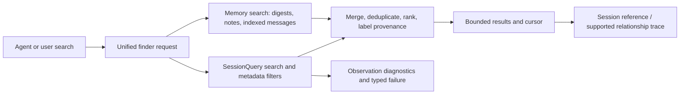

# Session search and thread finder plan

> **Status: delivered and verified (2026-10-17).** Resume here: nothing outstanding except the plan's own retirement
> (see "Delivered" below). All seven implementation steps are done; the acceptance list below is ticked with the
> evidence for each line.

## Delivered

| Piece                                                                                           | Where it lives                                                                                                                                                                                         |
| ----------------------------------------------------------------------------------------------- | ------------------------------------------------------------------------------------------------------------------------------------------------------------------------------------------------------ |
| Root cause and the supported mitigation                                                         | [`dsh-host-gaps.md`](dsh-host-gaps.md) — the SQLite backend allows two corpus observations and `continue`s on any snapshot/live-set change; the code is lost across the core RPC as `gateway/internal` |
| The composed finder (`findThreads`, `relatedThreads`, tools `find_threads` / `related_threads`) | [`plugins/@dshfiles/memory/src/thread-finder.ts`](../plugins/@dshfiles/memory/src/thread-finder.ts), wired in `runtime.ts` / `host.ts` / `api.ts`                                                      |
| Finder contract, degradation, scoping, cursors                                                  | [memory README → Finding threads](../plugins/@dshfiles/memory/README.md#finding-threads-one-finder-over-titles-content-and-memory)                                                                     |
| CLI resilience (`dshx sessions search`, `--limit`, fallback, typed failure)                     | [`tooling/dshx/docs/cli-reference.md`](../tooling/dshx/docs/cli-reference.md#dsh-platform-control-plane)                                                                                               |
| Tests                                                                                           | `thread-finder.test.ts` (15), `thread-finder.integration.test.ts` (4, real SQLite engine), `session-search.spec.ts` (14), `runtime.test.ts` (2 new)                                                    |
| Benchmark                                                                                       | `pnpm --dir plugins/@dshfiles/memory bench:finder` — real engine + real store, 24 threads, recall/precision/p50/p95                                                                                    |
| Ownership decision vs. Agent Session History                                                    | [`agent-session-history.md`](agent-session-history.md) — corrected context plus a decision row                                                                                                         |

Open follow-up (not blocking this plan): the same plan document exists as an identical commit in the JJ workspace
`thread-992924`. This revision keeps its copy so the two lineages merge without a delete/modify conflict; whoever owns
that workspace should retire its copy with `complete-plan` once both are on `main`.

## Context

- The Web profile mounts DSH's `@deepseek-ai/dsh-session-query-sqlite` as a derived FTS5 index, configured with `openAt: first-search`. It reconciles the current session corpus on search and returns literal token/phrase matches with snippets and cursor pagination. It is not the session-persistence database.
- The prior investigation observed `dshx sessions search` fail twice with `SessionQueryError: session-search persistence observation did not stabilize after one retry`. This is one reported incident, not a confirmed root cause. It also found related threads through `memory_search` after querying distinctive repository/workspace terms.
- `@dshfiles/memory` separately indexes digests, notes, and contentless message text using FTS5 BM25, identifier trigrams, reciprocal-rank fusion, and recency/project boosts. Its current API searches memory records; it does not provide one canonical cross-session discovery API with metadata filters and thread relationships.
- DSH's `sessionQuery` service supports full-text session/event search, filters, exact reads, and tracing. Its SQLite backend performs a serialized corpus observation/reconciliation before a search. Installed version and contracts must be verified during implementation; do not infer undocumented behavior from this plan.
- `plans/agent-session-history.md` proposes a broader Agent-facing Session search/read and trajectory capability. Coordinate with it and avoid duplicating its permissions, detail-reading, or session-history API work; this plan is narrowly about reliable discovery and ranked cross-session retrieval.
- Repository boundary: stock DSH 0.2.0-rc.2, no DSH core patches. If supported dshx/Host APIs cannot expose a needed operation, document the specific gap in `plans/dsh-host-gaps.md` and stop at that boundary. Never restart the live Web profile.

## Goal

Make historical-session search reliable and give agents and users one bounded way to find relevant prior threads by title, message content, project/workspace, and known relationships.

## What

Two coordinated outcomes are in scope:

1. **Search reliability:** identify and fix the observed persistence-observation instability or any confirmed equivalent failure in the supported session-query path; provide diagnosable, bounded failure behavior rather than silently retrying once and failing opaquely.
2. **Unified thread finder:** provide one discoverable search surface that can find sessions using title, user/assistant text, digest/summary, repository or workspace identifiers, with relevant metadata filters and bounded ranked results. A hit can lead to its session reference and related/follow-up candidates when the available data supports that relationship.

The design should reuse DSH session-query and `@dshfiles/memory` capabilities where their contracts fit. It must determine whether the unified surface belongs in existing `memory_search`, the native session-history tools described in `agent-session-history.md`, or a thin composed search API; do not create duplicate tools before that decision is evidenced.

## Why

The user had to repeat searches and manually infer related threads because dedicated session search errored and memory search surfaced related records only after trying several query formulations. This wastes time, hides existing work, and makes reliability failures look like missing memory.

## How

### Conceptual model

Separate **source search**, **ranking/relationship discovery**, and **result navigation**:

- Source search queries supported session history and memory indexes without reading private storage directly.
- A small retrieval layer normalizes requests, applies filters, ranks candidates, deduplicates the same session across sources, and preserves provenance for each match.
- Results provide a stable session reference, title/date/project/workspace metadata, bounded snippet, match category, and a way to inspect the session or follow a supported relationship.

### Operations / behavior

- Accept a natural-language query or exact phrase/title/identifier and optional project, workspace, date, and session-status filters where supported.
- Search session titles and message content through the supported session-query service; search digests/notes through memory when relevant. Keep source-specific query semantics explicit: session FTS is phrase/token based, while memory retrieval supports its own ranking and identifier handling.
- Merge duplicate hits by canonical session identity; rank exact title/repository/workspace identifier hits above broad text matches, with deterministic tie-breaking and a recency signal that does not swamp relevance.
- Return a bounded first page with snippets and a continuation cursor. Include source/match provenance and enough metadata to distinguish similar threads.
- Offer related-thread discovery using explicit parent/child/session lineage where available, plus shared workspace/project and strongly matching topic terms as clearly labeled candidates—not asserted relationships.
- On transient index observation instability, use a bounded retry only when safe and justified by the error contract. If retry still fails, return a typed actionable error and retain diagnostics. Do not silently substitute a lower-quality result set as if complete; if a partial fallback is offered, label its source and incompleteness.
- Allow exact title or identifier lookup to remain useful when full-text indexing is warming or unavailable, if a supported metadata/list API can safely provide it.

### Tech choices

| Choice                                   | Decision                                  | Rationale                                                                                                                                                                            |
| ---------------------------------------- | ----------------------------------------- | ------------------------------------------------------------------------------------------------------------------------------------------------------------------------------------ |
| Patch DSH core or replace its index      | No                                        | Use the installed public session-query contract and owned dshx/plugin surfaces; record a concrete Host gap if required.                                                              |
| New index alongside session-query SQLite | Defer unless measurements prove necessary | The current backend already owns ranked FTS5 and reconciliation; avoid a competing source of truth and duplicate indexing.                                                           |
| Reuse memory as the sole finder          | No, not without contract proof            | Memory has strong digest/message retrieval but does not currently provide session metadata filtering and relation navigation as one operation. Compose it only where it adds recall. |
| Embeddings as default                    | No initially                              | Existing benchmark found no improvement on its natural probes over BM25 and measurable cost/latency; collect targeted relationship-search evidence first.                            |
| Search error handling                    | Typed, bounded, observable recovery       | Prevent one transient snapshot race from looking like a successful empty search or an opaque hard failure.                                                                           |

### Architecture



Implement only after contract audit determines which calls are available to the intended caller (CLI, Agent tools, UI, or a subset). Enforce caller authorization at the Host boundary; do not expose the trusted context-wide SessionQuery service directly to model tools without the access policy already being designed in `agent-session-history.md`.

## What this allows

- Find a prior thread by a title phrase, memorable user wording, repository URL/name, workspace identifier, or topic.
- Distinguish exact matches from semantic/related candidates and see which source produced each hit.
- Continue through bounded results and open a selected session without putting whole transcripts into the current prompt.
- Diagnose whether a search failed because of index observation, unavailable storage, invalid filters, or no matches.

## What this does not allow

- No unrestricted cross-workspace history access; caller scope and authorization remain Host-enforced and must align with `agent-session-history.md`.
- No full transcript dump or automatic prompt injection.
- No direct reading of private session files/databases or a second unmanaged index.
- No claim that shared topic/workspace means two sessions are causally related.
- No embeddings/model service requirement, DSH core patch, or live profile restart as part of the initial implementation.

## UI & UX

This is primarily a search capability, not a replacement for Thread Sidebar. Prefer exposing the same bounded finder API to the supported Agent tool and, if the Host/UI contract permits, the existing session search entry point. Show title, date, project/workspace, a short redacted snippet, match source/reason, and a clear session reference. Related candidates must be labeled by evidence type (explicit lineage vs inferred similarity).

### Common interactions

| Action                                    | Result                                                                |
| ----------------------------------------- | --------------------------------------------------------------------- |
| Search a phrase or identifier             | Ranked, bounded session hits with snippets and provenance             |
| Filter by project/workspace/date          | Results restricted to supported metadata scope                        |
| Open a result                             | Native session reference or bounded detail path                       |
| Ask for related threads                   | Explicit lineage first; inferred candidates labeled separately        |
| Search index is unstable/unavailable      | Clear typed error, safe retry guidance, and diagnostic correlation ID |
| Request another page after corpus changes | Defined stale-cursor response and restart-search guidance             |

## Data model

Prefer no new persisted content. Define request/result contracts from installed DSH types and dshx schemas. A composed result can use the following logical projection (not a duplicated database schema):

```ts
type SessionSearchHit = {
  sessionId: string
  title: string
  createdAt: number
  cwd: string | null
  excerpt: string
  matchSources: readonly ('session-title' | 'session-event' | 'memory-digest' | 'memory-message' | 'memory-note')[]
  evidence: readonly ('exact-title' | 'identifier' | 'text-match' | 'explicit-lineage' | 'shared-workspace' | 'topic-candidate')[]
  cursor?: string
}
```

The actual type must enumerate safe fields, use the canonical Session identity, avoid spreading transport/session rows, and omit any field unavailable or unauthorized for the caller. Do not store message bodies in a new index; preserve the existing contentless-index/session-log separation.

## Implementation steps

1. **Reproduce and instrument:** capture the exact failing command/request, error code/cause, index-open mode, persistence observation revision/state, retry sequence, and elapsed time in a disposable environment. Confirm whether the failure is reproducible and whether the current installed implementation matches the package documentation.
2. **Contract and ownership audit:** inspect installed session-query and SQLite backend types/source, the CLI `sessions search` implementation, memory API, and `agent-session-history.md`. Map each caller to an authorized public boundary. Decide whether the incident is in DSH CLI, plugin backend, memory, or a race between observation and persistence.
3. **Reliability fix:** add the narrowest regression test for the reproduced instability. Implement recovery only according to typed error semantics; make retries bounded/cancellable and expose a useful error without returning false empty or falsely complete results. Add structured, redacted observability at the search/observation work-unit boundary.
4. **Unified finder contract:** settle one API/tool owner and request/result schema; compose session-query and memory results only where allowed. Add exact-match precedence, deterministic merging/deduplication, source labels, supported metadata filters, bounded snippets/results, cursor behavior, and explicit-vs-inferred relationship categories.
5. **Focused retrieval tests:** add a compact corpus of real-shaped, privacy-safe cases: title-only match, natural phrase in a user message, exact repository/workspace identifier, duplicate session found by two sources, ambiguous same-topic sessions, explicit parent/child relation, unrelated same-workspace candidate, stale cursor, cold/persisted and live sessions, and index-observation failure.
6. **Benchmark and tune:** measure top-3/top-5 recall, precision for related-thread suggestions, p50/p95 latency, cold-start cost, index reconciliation cost, empty-result rate, and typed search failures on an anonymized query set. Compare session-only, memory-only, and composed retrieval. Keep embeddings opt-in unless measured user-like paraphrase queries show a material gain.
7. **Verify isolated deployment:** run focused tests and package checks; exercise the intended Agent/CLI/UI path in a scratch profile, including a forced index failure and successful recovery. Do not modify or restart the live Web profile. Update docs and the `agent-session-history` plan with the ownership/overlap decision.

## Open questions

1. Which callers are required in the first delivery: `dshx sessions search`, Agent tool, Thread Sidebar, or a shared API consumed by more than one?
   **Answered:** the Agent tools (`find_threads`, `related_threads`) and `dshx sessions search`, both served by the one `dshfiles-memory` API; no Thread Sidebar surface was added in this delivery.
2. Should the unified finder include notes as searchable results, or only use memory results to find Sessions? Recommendation: include notes only when explicitly useful and visibly label them; keep the user’s request focused on locating conversations.
   **Answered:** notes are excluded by default (`includeNotes: false`) and, when asked for, come back in a separate `notes` list labeled `memory-note`.
3. What is the precise typed error and originating component behind “persistence observation did not stabilize”? Must be established by reproduction before choosing retry/backoff behavior.
   **Answered:** `@deepseek-ai/dsh-session-query-sqlite`, `_observeStable`, code `SESSION_QUERY_PERSISTENCE_FAILED` after `STABLE_OBSERVATION_ATTEMPTS = 2`; the code is lost across the session-controller RPC, so the caller also classifies the `gateway/internal` message.
4. Which metadata filters and relation signals are available through the installed supported contracts to each caller?
   **Answered:** `id`, `cwd`, `created-at`, `parent`, `availability`, titles via `readTitleSnapshots`, and full-text search via `searchSessions`; relations come from `parentSessionId` plus same-workspace/same-topic inference.
5. Should inferred related-thread candidates be part of the initial UI/tool response or an explicit second operation? Recommendation: separate opt-in operation until precision is measured.
   **Answered:** separate `related_threads` operation; precision is now measured at 0.67 @5.

## Acceptance criteria

- [x] The original persistence-observation failure is reproduced or conclusively shown to be stale/non-reproducible; the exact component and error contract are documented.
      Reproduced live (`dshx sessions search "session search"` and `"wasnt there another thread"`). Exact component: `@deepseek-ai/dsh-session-query-sqlite` `_observeStable` with `STABLE_OBSERVATION_ATTEMPTS = 2`; documented in [`dsh-host-gaps.md`](dsh-host-gaps.md).
- [x] A regression test covers the confirmed failure and proves bounded behavior: valid results, an explicitly labeled partial fallback, or a typed actionable error—never a false empty/success.
      `thread-finder.integration.test.ts` proves exactly 4 `list()` calls (2 observation attempts) then `SESSION_QUERY_PERSISTENCE_FAILED`, retry recovery with `diagnostics.attempts === 2`, and a labeled degraded page when instability is permanent; `runtime.test.ts` proves the typed `search-unavailable` failure instead of an empty page.
- [x] The configured SQLite index remains a derived index separate from persistence; no direct private-store access or unowned second index is introduced.
      The finder only calls `sessionQuery.searchSessions` / `readTitleSnapshots` and memory's own store; no new table, file or connection was added.
- [x] One documented finder contract searches supported session content/metadata and uses memory only through its public API; caller authorization is enforced before content is returned.
      `findThreads` / `relatedThreads` in memory, scoped by `projectsFilterFor(own, project)` (caller's project, or all only when `crossProject` is on); scoping happens before scoring and before snippets are produced.
- [x] Results are bounded, deterministic, deduplicated by canonical session ID, include provenance and a usable native reference, and paginate safely under corpus changes.
      `limit` 1–20 (default 8), deterministic order (score → `updatedAt` → session id), one merged row per session id with `sources`/`evidence`, and a stamped cursor that fails with `stale-cursor` when the corpus moved.
- [x] Exact title, repository/workspace identifier, natural message-text, ambiguous-title, and cross-source duplicate cases pass focused tests.
      `thread-finder.test.ts` — exact-title ranking, cwd identifier, paraphrase via content, two-source dedupe, ambiguous deterministic order, digest merge, cursor paging/stale/bad, filters, related explicit vs inferred; `runtime.test.ts` covers title+content on one hit.
- [x] Explicit session lineage is distinguishable from same-workspace/topic suggestions; inferred candidates are labeled and precision is measured.
      `related` returns `explicit` (parent/children) and `inferred` (labeled `shared-workspace` / `topic-candidate`); the benchmark measures inferred precision@5 = 0.67 with labeled sibling recall 1.00.
- [x] A benchmark reports top-k recall/precision and p50/p95 latency for session-only, memory-only, and composed search; any ranking changes are supported by evidence.
      `bench/thread-finder.ts`: recall@3/@5 = 1.00 in every mode and probe kind except memory-only title (0.94 @3, 1.00 @5); p50 ≤ 2.8 ms and p95 ≤ 35 ms across runs (the worst p95 is the first content search that opens/rebuilds the index; warm runs stay ≤ 8 ms), related precision@5 0.67. No ranking change was made on assumption: it fails the run when a labeled session stops being found.
- [x] Scratch-profile verification proves the intended caller path and failure behavior without modifying or restarting the live profile.
      Scratch `dshx dev up --plugin @dshfiles/memory` (port 60546, temp `DSH_HOME`): (a) degraded index (`openAt: "never"`) → labeled page `SESSION_QUERY_SEARCH_DISABLED after 1 attempt(s)` with title+memory hits, exit 0; (b) an unmatched query → exit 1 with `error [session-search-unavailable]: … Retry shortly or narrow the query.`; (c) after enabling the index patch and restarting the scratch host, `"cap the retry storm"` returned one deduped hit with `sources: [session-title, session-content, memory-message]` and no degradation. Scratch torn down with `dshx dev down`; the live `127.0.0.1:3080` instance was never touched.
- [x] The scope overlaps cleanly with `agent-session-history.md`; no duplicate history tool or unauthorized Host surface is added.
      Ownership decision recorded in [`agent-session-history.md`](agent-session-history.md): memory owns discovery, upstream `dsh-tool-session-query` owns trajectory reads (verified: nine tools, workspace-id authorization, installed nowhere); tool names `find_threads` / `related_threads` do not collide with the core `session_*` names.

## Decisions log

| Date       | Decision                                                                                                                                           | Rationale                                                                                                                                                                                                                                                                                               |
| ---------- | -------------------------------------------------------------------------------------------------------------------------------------------------- | ------------------------------------------------------------------------------------------------------------------------------------------------------------------------------------------------------------------------------------------------------------------------------------------------------- |
| 2026-10-16 | Plan reliability repair and a composed thread finder together, but gate design on reproducing the reported persistence-observation error           | Search reliability and cross-source discovery are one user journey; the single reported failure is not enough evidence to assume its root cause.                                                                                                                                                        |
| 2026-10-16 | Reuse supported session-query and memory APIs; do not add an index or default embeddings initially                                                 | Existing systems already index session history and memory records; duplication and embedding overhead need measured justification.                                                                                                                                                                      |
| 2026-10-16 | Treat explicit lineage and inferred topical/workspace similarity as separate evidence                                                              | Avoid presenting merely related sessions as confirmed follow-ups.                                                                                                                                                                                                                                       |
| 2026-10-17 | Fix the reliability incident at the caller, not in the SQLite backend                                                                              | The two-attempt observation loop lives in installed core (`STABLE_OBSERVATION_ATTEMPTS = 2`) and this repo carries no core patches; a bounded caller retry plus a labeled metadata/memory fallback keeps results honest without forking. The gap is recorded in [`dsh-host-gaps.md`](dsh-host-gaps.md). |
| 2026-10-17 | The finder lives in `@dshfiles/memory` as `findThreads` / `relatedThreads`                                                                         | Memory already owns cross-thread retrieval and reads `sessionQuery`, so no new plugin, no second index, and no duplicate of the upstream `session_*` tool names.                                                                                                                                        |
| 2026-10-17 | A finder failure crosses the dshx API boundary as a `PluginApiError` (`search-unavailable`), which the CLI reports as `session-search-unavailable` | Verified on a scratch Host: a thrown `ThreadFinderError` otherwise reaches the caller as `internal — API handler failed. See Host diagnostics.`, which is not actionable. The dshx Host already forwards plugin error codes and messages.                                                               |
| 2026-10-17 | Inferred related threads stay an opt-in second call                                                                                                | Measured precision@5 is 0.67 (labeled recall 1.00), so they are useful but not good enough to merge into the primary page.                                                                                                                                                                              |
