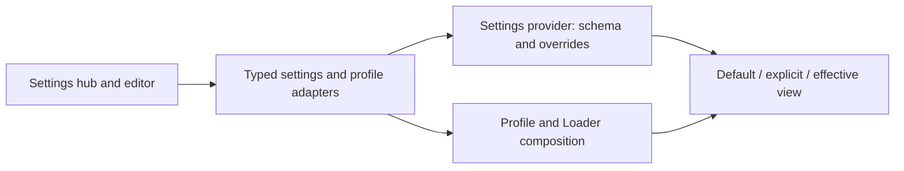

# Settings and configuration plan

Status: proposed; implementation not approved. Resume here: validate the effective-settings and profile-composition contracts in Phase 0, then bring the findings and editor choice for review. No live Host restart is authorized by this plan.

## Context

1. [Settings shell](../plugins/@dshfiles/settings-shell/README.md) already provides a grouped, searchable hub, editable schema-backed fields, modified markers and reset, plus a way to open the profile patch in an external app or the DSH editor. Its plugin settings currently apply globally; do not imply project or thread scopes exist.
2. The [settings provider](../tooling/dshx/docs/guides/settings.md) owns schema validation, defaults, user overrides, persistence and revision handling. [Settings tools](../plugins/@dshfiles/settings-shell/src/settings-tools.ts) already expose reads, merge and unset. Custom sections expose search entries separately, not necessarily a complete Host-side inventory.
3. Profile composition is a different domain: [profile sync](../docs/profile-installs.md#the-web-profile-reconciles-itself) reconciles a seed and a marked region while preserving local edits outside it. The live profile patch is YAML, not a settings JSON file. A disabled Loader row and a plugin setting are not interchangeable.
4. Recent DeepSeek account checks showed why an optional feature should have a discoverable, reversible control: disabling the model provider did not disable the separate account UI. Its live request suppression remains unverified until restart.
5. [VS Code settings](https://code.visualstudio.com/docs/configure/settings) provide searchable UI, modified indicators, reset, schema-backed JSON completion/diagnostics and default views. Its [scope and contribution model](https://code.visualstudio.com/api/references/contribution-points#contributes.configuration) is inspiration, not DSH's existing precedence contract.

## Goal

Make significant features easy to discover, understand, configure and disable, with a consistent settings UI and schema-aware in-app editing that clearly distinguishes defaults, overrides and their actual source.

## What

1. Extend the existing Settings hub and provider-backed configuration first; cover profile/Loader configuration in a later, separately verified phase.
2. Offer an in-DSH schema-aware JSON editing experience and preserve the external-editor option. Establish whether this is a safe view over existing storage or a new supported representation before choosing a format or migration.
3. Show defaults and explicit overrides, including an override equal to its default. Show provenance only when the owner can establish it; mark missing or uncertain source information as unknown.
4. Audit significant/opinionated features for configurable behavior or independent enable/disable controls, safe defaults, discoverability, and documented restart consequences.

## Why

People should mix dshfiles features to fit their workflows, see what changed and why, and avoid manually hunting through unrelated profile layers for a control. Text editing should complement the UI rather than create competing sources of truth.

## How

### Conceptual model

Separate **declared default**, **explicit user override**, **effective value**, **source/provenance** and **runtime application state**. A setting explicitly set to its default is still modified. A displayed inherited/default value is read-only ghost text or a separate defaults view, never silently written into the user's document. Do not call a disabled or overridden value unused merely because it equals a default.

### Operations / behavior

1. Search/browse existing settings and inspect documentation, current value, default, explicit-override status and known source; filter modified and reset a field by unsetting its override.
2. Open the same supported editable representation in DSH; provide schema-backed key/value completion, descriptions, diagnostics and actionable errors. Offer external opening and a read-only defaults/effective view; distinguish unsaved edits from applied values.
3. Save only validated changes through the owning API with revision/conflict detection; retain unsaved text on conflict, report recovery and preserve comments/unknown fields where editing existing documents. No silent replacement of YAML, profile structure or concurrent edits.
4. For profile rows, explain row ownership, enablement and dependencies, show whether a change is pending restart, and make reversal explicit. Do not equate a written profile patch with verified runtime activation.
5. Keep secret values out of schemas, defaults, search, snapshots, logs and editor responses; only approved secret references may appear. Include Agent-tool parity for any new durable read/write action.

### Tech choices

| Choice | Recommendation | Evidence / gate |
| --- | --- | --- |
| Settings UI | Extend `@dshfiles/settings-shell` | Existing hub, renderer and native-section seat; avoid a duplicate settings owner. |
| Source of truth | Existing settings provider and Loader/profile owners | First prove supported reads/writes and precedence; never infer a unified model. |
| JSON editor | Reuse the existing DSH editor if it can provide the required language/schema services; otherwise evaluate an established editor component | Spike bundle cost, accessibility, mobile behavior, licensing and schema support before choosing. |
| Defaults | Read-only generated view and/or ghost display | Based on owner-provided schema/defaults; do not generate writable inherited lines. |
| YAML profile | Keep the canonical profile representation and existing external editor | JSON projection only if lossless behavior and source mapping are proven; otherwise a separate schema-aware YAML path. |

### Architecture

The diagram is proposed, not an assertion that Loader provenance or safe mutation APIs already exist. Keep validation, revision and persistence at the owning boundary; use a plugin-owned Host API only when its contract can be met safely. No core patch, no browser-faked durability.

## What this allows

1. Discover significant feature switches and understand their consequences before changing them.
2. Compare inherited/default, explicitly configured and effective values without guessing, using only supported provenance.
3. Edit eligible configuration in DSH or externally without losing changes or exposing secrets.

## What this does not allow

1. Invented project/thread/language scopes, VS Code's exact precedence, or a universal merge rule before DSH owners support them.
2. Automatic migration of existing YAML or credentials, editing a rendered effective snapshot as if it were a writable source, or copying private data into test fixtures.
3. Silent plugin disablement, Host restarts, destructive bulk reset, or execution of configuration as code.

## UI & UX

### Desktop

Keep the existing Settings groups and search. Add a Modified filter and an inspectable source/default affordance to eligible rows; use non-color status labels and keyboard-accessible controls. Offer Settings UI, editable configuration and read-only defaults/effective views, with links between the same setting in each view. Distinguish restart-required, pending and unknown runtime state.

### Mobile

Retain the existing searchable picker; prioritize field controls and readable source summaries. The editor must remain usable without a hardware keyboard or explicitly offer the external path when the chosen component cannot meet that bar.

### Common interactions

| Action | Result |
| --- | --- |
| Set a value equal to its default | Still explicitly modified; reset removes the override. |
| Inspect inherited value | Show its default/source when known; no persisted line is added. |
| Save stale or invalid text | Reject safely, retain draft, show conflict/diagnostic and recovery. |
| Disable a feature | Explain effects and restart requirement; show pending versus verified runtime state. |

## Data model

Proposed per-field read model: namespace and field path, schema metadata, default, explicit presence and value, effective value, known source or `unknown`, revision, supported operations and application state. Each owner supplies only facts it can prove. Complex values require owner-defined merge behavior and secret-safe redaction. Profile rows need a separate identity and adapter, not fabricated setting namespaces.

## Implementation steps

1. **P0 — inventory and proof.** Map active settings/Loader sources, real precedence and lifecycle; inspect provider and editor contracts and enumerate significant features without a safe control. Reproduce baseline UI and sample profile behavior in a disposable environment. Document unknown provenance and supported scope; do not query or copy private credentials.
2. **P1 — settings metadata and UI.** Extend owner-backed read models only as needed for defaults, explicit presence, effective values and provenance. Add modified filtering, default/source display and reset through existing validated APIs. Provide tests for scalar, nested, array, equal-default, unavailable source and unknown schema cases; maintain Agent parity.
3. **P2 — in-app editing.** Spike the existing editor against schema completion, docs and diagnostics. Build a safe editable representation plus read-only defaults/effective view, external-editor fallback, revision-fenced writes, retained drafts, redaction and recovery. Preserve existing YAML and hand edits unless a separately approved migration proves lossless.
4. **P3 — feature controls and profile composition.** Prioritize the feature inventory; add or expose independent switches at their actual owners. Investigate supported Loader/profile reads and writes, dependencies, marked-region reconciliation and restart behavior. Ship only what can be safely proven; record residual Host gaps otherwise.
5. **P4 — acceptance and rollout.** Exercise UI, keyboard, phone viewport, agent tools and text editor against a scratch profile with representative fake settings and no private credentials. Test GUI-to-text round trips, invalid input, concurrent edits, reset, same-as-default, unknown fields and restart-pending states. Verify no change to shared defaults without explicit review; document upgrade/rollback and remaining gaps.

## Open questions

1. Which editor component and schema service meet completion, accessibility, mobile, performance and license requirements? Decide after the P2 spike.
2. Can the installed provider expose per-field source/default values reliably, especially for nested values? If not, mark unknown and define the narrow owner-side contract.
3. Which Loader controls support safe reads/writes and runtime-state confirmation without affecting unrelated rows or managed profile regions? P0/P3 must prove this before UI promises.
4. Should optional future project/thread scope exist at all, and which settings may safely vary there? Separate design and authorization; not implied by this plan.

## Acceptance criteria

- [ ] Every selected pilot feature has a documented, reversible control or an explicit reason why it cannot safely be controlled.
- [ ] UI, supported text editor and Agent reads agree on validated explicit and effective values; equal-to-default overrides are marked and reset correctly.
- [ ] Defaults/ghosts never become overrides until explicitly selected; provenance is accurate or marked unknown.
- [ ] Schema completions, descriptions, diagnostics, external editing, invalid input and concurrent modification are exercised against real owners; no silent data or comments loss.
- [ ] Secrets never leak into views, search, completions, logs or fixtures; unsupported scopes and destructive operations cannot be implied.
- [ ] Profile enablement and restart-pending state are truthful; relevant changes survive profile reconciliation, or their limitation is clearly reported.
- [ ] Scratch DSH verification covers desktop, mobile layout, keyboard access and Agent parity; live deployment and restart remain user-controlled.

## Decisions log

| Date | Decision | Rationale |
| --- | --- | --- |
| 2026-11-10 | Cover settings and profile/plugin enablement in phases. | User requested both; they have different owners. |
| 2026-11-10 | Plan an in-DSH editor with an external option. | User preference; editor implementation remains subject to a spike. |
| 2026-11-10 | Extend the existing Settings shell; preserve provider and profile ownership. | Existing capability and safety constraints favor reuse over parallel state. |
