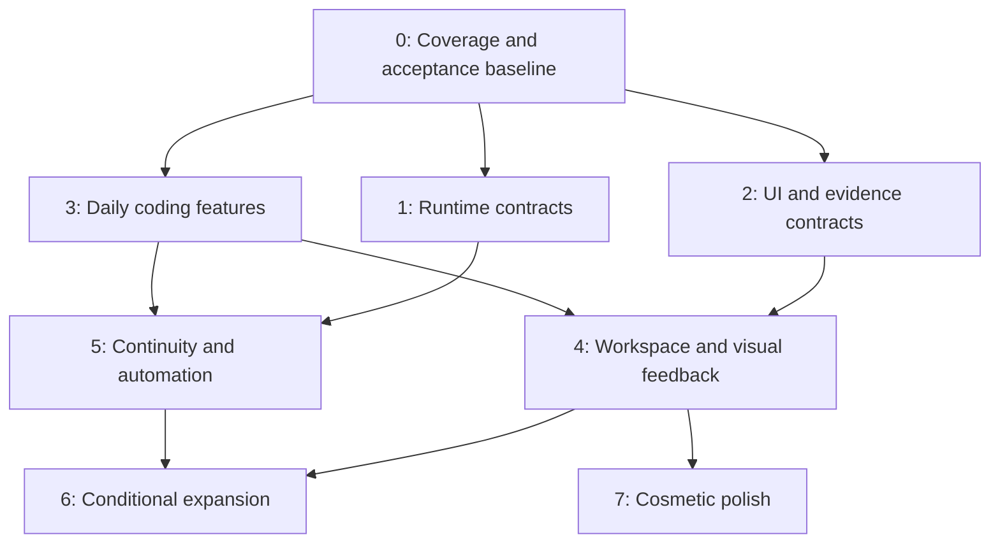

# Software additions roadmap plan

## Context

This plan orders the missing software increments in [reference feature additions](reference-feature-additions.md). That file owns source evidence and candidate findings; this file owns delivery phases and dependencies. Reference IDs below preserve traceability. Survey baseline is 2026-10-05; recheck current runtime and active profile at each phase.

The two scope filters remain mandatory: exclude agent roleplay/personas and exclude features already provided by native or custom plugins. Existing functionality that still needs runtime acceptance is a prerequisite check, not a new feature. Planned but unimplemented features remain eligible; extend their existing plans.

Related owners: [provider lifecycle](claude-cursor-accounts.md), [async questions](async-agent-questions.md), [customization](dsh-customization/README.md), [E2E testing](dsh-e2e-testing.md), [boot integrity](plugin-boot-integrity.md) and [multi-host](multi-host/README.md).

Implementation is authorized in this owned worktree and isolated scratch profiles. Promotion into the active web profile and restarting its server remain separate rollout actions.

## Goal

Establish reliable runtime and UI ownership first, deliver useful coding and review features next, and apply optional cosmetic polish last.

## What

| Phase | Priority               | Outcome                                                                |
| ----- | ---------------------- | ---------------------------------------------------------------------- |
| 0     | Prerequisite           | Verified gaps, exact owners and isolated acceptance environment        |
| 1     | Architectural, highest | Durable execution, provider lifecycle and bounded continuity contracts |
| 2     | Architectural, high    | Stateful panel composition, evidence and feedback contracts            |
| 3     | Features, highest      | Search, drafts, context explanation, review and project checks         |
| 4     | Features, high         | Movable workspace, visual feedback, recorded tests and attention       |
| 5     | Features, medium       | Provider continuity, isolated workspace launch and PR wake-ups         |
| 6     | Conditional expansion  | Advanced tooling/content/remote workflows with demonstrated need       |
| 7     | Cosmetic, last         | Appearance, animation and optional presentation refinements            |

Phase order expresses priority, not a requirement to finish every Host change before shipping any independent plugin. Each work item waits for its own dependencies. Do not invent a common abstraction solely to make unrelated features wait on it.

## Why

Provider switches without lifecycle ownership lose resumable state. Recovery without receipts repeats uncertain effects. Moving UI without panel ownership resets drafts and terminals. Recording without action/frame identity produces misleading proof. These foundations determine whether later features can be trusted.

Search, drafts, review and checks deliver daily value with smaller scope. Advanced tools and content surfaces are useful only when recurring workflows justify their cost. Cosmetics cannot substitute for correct ownership and acceptance.

## How

### Conceptual model

### Operations / behavior

Select a missing increment, verify its owning contract, probe adoption candidates, implement at the existing boundary, and promote only after focused and combined scratch-profile acceptance. Report measured benefit and unverified behavior separately. No restart of the live DSH instance.

### Tech choices

| Concern          | Decision                                                                  | Reason                                                          |
| ---------------- | ------------------------------------------------------------------------- | --------------------------------------------------------------- |
| Runtime          | DSH core owns lifecycle; adapters use capability registry exposed by dshx | Do not register a competing Agent factory or bypass persistence |
| Durability       | Extend native persistence/inbox/jobs; reconcile effects                   | Persisted transcript alone does not recover unfinished work     |
| UI layout        | Trellis adoption probe behind supported panel descriptors                 | Moving panels must preserve runtime and component identity      |
| Visual feedback  | Agentation through existing MCP domain                                    | Avoid rebuilding annotation protocol and connection management  |
| Context          | Probe dsh-context; add only remaining provenance gaps                     | Existing dashboard candidate beats bespoke duplicate            |
| E2E              | Existing Playwright acceptance; compare optional TesterArmy tooling       | Deterministic assertions remain test oracle                     |
| Dependencies     | Prebuilt artifacts/cache and Nix wiring; pinned packages                  | Respect binary-first machine/toolchain contract                 |
| State validation | Installed Effect Schema/zod conventions at boundaries                     | Decode external state once; version persisted records           |

### Architecture

Host owns sessions, agent handles, permissions, pending work and recovery. Provider adapters own subprocess/protocol state under Host cancellation/disposal. Existing owned plugins keep their domains. UI owns presentation preferences, never execution authority. Evidence adapters retain bounded artifacts and immutable source identities.

The existing provider plan records that DSH core source is outside this checkout. Phase 1 requires locating that source owner and implementing a supported seam there. dshx then exposes it. A missing seam blocks the affected feature, not independent search/review work.

## What this allows

A foundation-first delivery sequence with explicit exit gates, focused revisions and small useful releases. Full-feature additions remain traceable to the gap-only survey.

## What this does not allow

Specialist personas, prompt-only modes, duplicate account/MCP/scheduler/sidebar systems, a replacement harness, silent cloud migration or cosmetic work ahead of correctness. Deferred items are conditional options, not promised scope.

## UI & UX

### Desktop

Initially extend existing panels. Later make registered chat, terminal, files, review and evidence views dockable, tabbed or floating. Preserve focus, draft, scroll and native session identity. Show unsupported provider actions as unavailable with a concrete reason.

### Mobile

Use a narrow-screen stacked layout for the retained features. Preserve question answers and drafts across navigation. Keyboard access, readable controls and responsive behavior are acceptance requirements throughout, not Phase 7 cosmetics. Native mobile app development remains separate.

### Common interactions

| Action                      | Result                                                              |
| --------------------------- | ------------------------------------------------------------------- |
| Move panel                  | View remains mounted with same runtime subscriptions                |
| Restore draft               | Existing draft preserved on conflict or unsupported content         |
| Mark reviewed               | Receipt binds exact content; subsequent change invalidates it       |
| Answer document question    | Answer binds question ID and document revision                      |
| Switch provider during work | Request waits in order; current work retains owner until transition |
| Resume interrupted work     | Uncertain effects listed; only eligible operations continue         |
| Open evidence               | Run outcome, assertion results and recording coverage visible       |

## Data model

| Record                  | Required identity / ownership                                                                                |
| ----------------------- | ------------------------------------------------------------------------------------------------------------ |
| Capability projection   | Provider instance, supported operations, option schema and protocol version; Host adapter                    |
| Recovery receipt        | Operation/run/session, last durable result, uncertain effects, cancellation generation and eligibility; Host |
| Handoff                 | Ordered source history IDs, destination, budget, omissions and resume outcome; Host                          |
| Panel descriptor/layout | Stable instance/type, owning session/workspace, disposal policy; versioned layout preferences                |
| Evidence                | Run/revision, action/frame timestamps, assertions, outcome and bounded artifact references; evidence adapter |
| Feedback                | Target revision/locator, question ID, answer and resolution revisions; feedback owner                        |
| Review/check receipt    | Scope/path/content digest or action digest, checked revision and status; review/check owner                  |

These are requirements for existing owner schemas, not a proposal for one central database or generic service.

## Implementation steps

### Execution status (2026-10-07)

| Work                                    | Status                      | Evidence / remaining gate                                                                                                                                                                                                                                                                                                                                                     |
| --------------------------------------- | --------------------------- | ----------------------------------------------------------------------------------------------------------------------------------------------------------------------------------------------------------------------------------------------------------------------------------------------------------------------------------------------------------------------------- |
| Phase 0 — scope and acceptance baseline | Complete                    | Refreshed active composition and built an isolated candidate profile. Local DSH 0.2.0-rc.2 booted cleanly on 3289; browser checks covered global search, Context Insights, Skill Center, and the GitHub picker’s no-remote guard. Four community candidates and the owned Cursor adapter have exact versions recorded below; LSP actions remains excluded for its peer mismatch. |
| Phase 1A — provider driver seam         | Partial; local core identities fixed in the Host artifact, public CLI still blocked by Session Controller | DSHX now validates `host.bundleDependencies` and embeds explicitly selected package roots while keeping Cordis external. The core runtime Host mounts local AgentRegistry, SessionStore, and AgentLoop from one artifact. Focused DSHX tests pass 42/42; the DSHX build and core runtime typecheck/check/build/test pass. A scratch public `dsh core-runtime` boot reaches its ready URL with the core bridge and Cursor adapter active; the old `agents.registerRuntimeDriver` failure is gone. Session Controller still fails to import and UI Deliverables remains pending on `sessionController`, including when the scratch profile links a newly generated local controller package. The same verifier's direct `runProfile()` Host path passes SIGKILL recovery, exact reconciliation, and same-session synthetic ACP resume when given that scratch-generated controller artifact. Actual public CLI service activation and a credentialed provider turn remain open. |
| Phase 1B — restart reconciliation       | Partial; synthetic crash and prompt reconciliation runtime-accepted | JSONL recovery tests cover interrupted turns/tools, held inbox state, cancellation, setup rollback, and restart order. The scratch Host verifier now proves an in-flight SIGKILL marks the turn interrupted, preserves its exact prompt receipt, and blocks resume without replay. A global `/cursor-reconcile` command can inspect that target from a separate working Session, flushes the human confirmation to the invoking Session before clearing only the exact prompt receipt, and resumes the same ACP session for a later new prompt across Host restart. Uncertain provider-session creation is surfaced but cannot be cleared because its native id may be unavailable; create a fresh Cursor-bound Session. Real Cursor CLI and credentialed external effects remain unverified. |
| Phase 1C — continuity format            | Partial                     | V5 codec/migration plus bounded portable public-history replay pass focused tests. After an isolated Host SIGKILL, the Session history is unchanged and the synthetic ACP provider session resumes. Cross-format migration/fallback in a provider handoff and a credentialed turn remain unaccepted. Replay excludes private/tool/attachment data by contract. |
| Phase 1D — continuation decisions | Partial; attention and quota recovery source plus scratch Host evidence accepted; generated attention consumer and active scheduler/UI composition remain gated | Session attention has a Host Storage Domain, serialized prompt/read/snooze updates, a synchronized API event, a Session-flush barrier, and a Thread Sidebar consumer. The v2 row accepts v1 records, reconciles missed prompts from the Session log, and survives isolated Host SIGKILL with its unread watermark intact; DSHX decodes SessionSummary.attention, and the source scratch verifier recovered attention alongside 24 public Session records. The parent-question Host contract and correlated child/parent tools persist recommendation/defer outcomes, workspace-relative file paths, and reattachment; its v2 domain accepts v1 rows without inventing expiry. AI Accounts now owns durable quota-continuation state in a JSON Storage Domain: it validates exact manual/scheduled prompt identity, queues through Session Controller with stable request IDs, keeps snooze separate from reset evidence, reconciles missing tasks after restart, rejects recovery when inspection finds newer persisted user work, and schedules only known resets from successful account-correlated usage windows. Unknown or expired reset values remain unscheduled. The source run recorded 4 focused files passing 10/10, package typecheck/build, and an isolated AI Accounts scratch Host boot; revalidation on the integrated tree remains pending. The installed API Session Controller still lacks the generated updateAttention consumer contract, the active web composition omits both schedule bundles so automatic reset delivery is unavailable there, and authenticated UI/API acceptance remains unverified.  Attention and Session logs still lack an atomic cross-domain crash proof. |
| Phase 2 — panel, evidence, feedback     | Partial / Host-gated        | E2E scratch profile isolation, bounded evidence manifests, retention, and correlated parent-question tools are implemented with focused checks. New child questions require a valid recommendation and explicit expiry behavior; deferred files are private, workspace-relative, idempotent, and protected against symlink traversal or overwriting edits. The agent-questions Host bundle also supports exact revisioned Markdown anchors, durable parent resolution after child shutdown, stale receipts, and synthetic provider-backed cold-resume. JSON Storage Domain reopen coverage resolves while the child is stopped and retrieves the receipt after reattachment; the batch boundary accepts 20 and rejects 21. Native DSH PanelsApi only registers/shows/disposes views; Host docking, element feedback, and panel movement remain gated. |
| Phase 3 — daily features                | Implementation complete; runtime proof passes with skipped-event Host limit | Prompt drafts/history and exact-content review progress are implemented with focused tests. Project Checks now caches one storage-domain handle per Host context and closes it on disposal. Fresh scratch acceptance proves a trusted action receipt changes current → stale → current across JJ revisions, automatic verification passes, and the installed Codex Hooks bridge records a failing Stop hook (exit 7; stderr presence) that Project Checks exposes. The bridge emits no durable skipped-hook event, so per-hook skipped attribution remains Host-limited. |
| Phase 4 — workspace and visual evidence | Partial; 4C replay/assertion evidence shipped, 4A/4B/4D remain gated | DSHX writes a CSP-restricted screenshot timeline and searchable retained-run catalog, with actual outcomes, recorded/missing steps, source identity, and only local stored frames. Reports step through captured frames with hash navigation and list bounded static assertion IDs/outcomes; they do not reconstruct browser state or coverage. Video export remains optional and absent. Host still owns panel movement and session attention. Phase 2C provides Markdown feedback with durable late-answer receipts; element anchors and in-product visual review still await an accepted browser/evidence provider. Agentation is a local-app/MCP workflow, not a DSH-wide annotation surface. |
| Phase 5 — continuity and automation     | Partial; 5B source implementation added, runtime acceptance gated | Reuse DSHX's native session create/fork/history APIs, including sequence-bounded forks; do not add duplicate UI or history storage. Scratch Host evidence proves settled-turn recovery and in-flight uncertainty refusal without provider replay. This candidate adds isolated JJ workspace provisioning/launch and durable-event-boundary Session forks; focused checks and a real temporary-repository JJ workspace test pass (see receipt). Browser acceptance remains open; this historical source recorded an authentication-required 401. The ordinary CLI resolver, real provider handoff, linked PR wake owner, and Host-coordinated filesystem rewind remain explicit 5A/5C/5D gates. |
| Phase 6 — conditional expansion         | Review complete; no tracks admitted | All seven tracks now have explicit decisions below. No repeated unmet workflow or measured baseline gap justified expanding the runtime; the LSP peer mismatch and missing Host maintenance/rebind seams remain gates. |
| Phase 7 — polish                        | Deferred behind functional acceptance | Phase 3D action freshness, automatic verification, and native failed-hook result now have scratch runtime proof; skipped-hook attribution remains Host-limited. Phase 1/2/4/5 Host-dependent exits remain open. Responsive and reduced-motion runtime acceptance is not claimed. |

### Phase 0 — verify scope and acceptance baseline

1. Refresh active composition and installed contracts. Build a per-feature coverage ledger: provided, partial missing increment, absent, or unknown.
2. Remove any newly covered increments from roadmap and reference file. Unknowns require bounded reproduction before implementation.
3. Use existing boot-integrity/E2E tooling in scratch profile/DSH_HOME on another port; record native baseline and candidate versions/licenses.

Exit: each selected increment has an owner, exact missing behavior and falsifiable acceptance gate. Existing boot failures are recorded separately. No active-profile experiments.

### Phase 1 — durable runtime and provider contracts

1. **1A: Provider driver seam** (F40, I07/I09): Host-managed create/resume/stop/dispose, capability discovery, session identity and adapter-specific permission mapping. Start with one external adapter and existing native behavior; follow provider plan rather than expanding to every provider.
2. **1B: Restart reconciliation** (I06): pending-operation receipts, cancellation generations, explicit interrupted/uncertain work, held queue recovery where genuinely missing. Never replay unknown side effects blindly.
3. **1C: Continuity format** (F44, I07/I08/I15): ordered attributed portable history, bounded retrieval, omission index, intact new prompts and native-resume fallback. Exclude private reasoning, live tool state and historical attachments.
4. **1D: Continuation/decision semantics** (F11/F12/F33, I10/I11): durable answerability, synchronized read/snooze increments, known-reset continuation eligibility and invalidation. Reuse native questions/queues; add only missing semantics.

Exit: adapter lifecycle substitution checks pass; controlled crash/cancel/restart tests preserve order and authority; uncertain effects surfaced; unsupported capabilities explicit. Do not promise exactly-once effects without external idempotency/reconciliation.

### Phase 2 — panel, evidence and feedback architecture

1. **2A: Panel lifecycle** (I01): inspect native layout contracts, define stable descriptors only where missing, expose through dshx. Probe Trellis with two real stateful views; verify exact license before adoption.
2. **2B: Browser/evidence ownership** (F46/F47, I02/I03): accepted browser provider owns tab lifetime, viewport/action/frame identity and cancellation. Extend E2E artifact format with bounded retention and source run links.
3. **2C: Revisioned feedback** (F18/F33, I04/I11): document/element anchors, batched late answers, stale-target handling and resolution receipts. Extend async-question plan; do not create another question engine.

Exit: panel movement has zero unintended remounts/duplicate subscriptions; evidence ordering and missing coverage explicit; concurrent document edits cannot misapply answers. Basic accessibility and reset/recovery work.

### Phase 3 — highest-value daily features

1. **3A: Search and drafts** (F01/F03/F05/F06): archived/exact-event search, conditional file palette, saved drafts/history preserving current draft and supported assets.
2. **3B: Context and skills visibility** (F38/F42/F70, I05): probe dsh-context and skill explorer; only add provenance/matching explanations they do not provide.
3. **3C: Review progress** (F15/F16/F18): exact-content reviewed state, complete scoped counts, reload persistence, then hunk feedback using 2C.
4. **3D: Project checks** (F66/F67/F68): named trusted project actions, bounded completion receipts, failed/skipped hook visibility. Do not add another hook runner.

Exit: fixed corpus results correct; draft conflicts non-destructive; same-line-count edit clears review mark; edits invalidate prior check pass. Candidate adoption has boot and browser evidence.

### Phase 4 — usable workspace and visual evidence

1. **4A: Dockable workspace** (I01): registered views move/split/tab/float, named layouts, keyboard docking, reset and removed-plugin placeholders. Foundation from 2A becomes user-facing feature.
2. **4B: Visual/document feedback** (F47, I02/I04): Agentation local-app MCP flow and revisioned Markdown review using 2B/2C.
3. **4C: Test evidence** (I03/I14): failed/cancelled recordings, timeline replay, assertion results and optional video export. Compare TesterArmy cached action replay with deterministic Playwright baseline before adopting.
4. **4D: Attention and artifact access** (F29/F34/F64, I11/I12): blockers/results, run-to-error navigation, searchable retained outputs. Use 1D for durable answerability; initial artifact index only needs bounded evidence records from 2B.

Exit: live panels retain state; feedback reaches correct session once; replay does not fabricate coverage; failed assertions remain failures; artifacts reopen with source identity and retention controls.

### Phase 5 — continuity, isolation and event-driven automation

1. **5A: Provider switching** (F40/F44, I07/I09): one proven adapter pair, ordered queued switches, visible handoff timeline, native return/resume and capability-aware delegated task controls.
2. **5B: Fork/workspace operations** (F23/F24/F41, I08/I15): isolated JJ provisioning/setup/launch, selected-boundary runtime forks and scoped history tools. Live rebind requires explicit Host support. Organizational linking must never grant parent authority.
3. **5C: PR watch and limit recovery** (F19/F20/F11/F12, I10): linked PR status, deduplicated authorized wakes, manual/known-reset resume and synchronized attention. Existing schedulers remain owner of timing.
4. **5D: Coordinated rewind** (F39): separate conversation-only versus filesystem restore. Check overlapping/nested/symlink workspaces and archived active owners; reject unsafe restore and surface partial failure. Use recoverable transaction semantics, not claimed atomic OS writes.

Exit: context budgets enforced; fresh prompt unshortened; selected fork boundary respected; dirty/in-use workspace preserved; cancelled subscription cannot wake; unknown reset has no invented timer; restore failures never hang or silently succeed.

### Phase 6 — conditional functional expansion

| Track                          | Reference IDs           | Admission gate                                                                                                                                  | Decision and evidence                                                                                                                                                                                                 |
| ------------------------------ | ----------------------- | ----------------------------------------------------------------------------------------------------------------------------------------------- | ---------------------------------------------------------------------------------------------------------------------------------------------------------------------------------------------------------------------- |
| Language/editing               | F60/F74/F75/F76/F77/F78 | Demonstrated baseline gap; read-only LSP first, then stale-safe edits and preview-bound apply; hash editing earns benefit against native guards | **Defer.** No fresh read-only LSP baseline passed; `dsh-lsp-actions` has a DSH 0.2 peer mismatch. Native stale-write guards exist, and no measured formatter, hash-edit, or AST rewrite gap was established.                         |
| Debugger/kernel/format readers | F79/F80/F81             | Repeated need beyond terminal/MCP; owned process cancellation, reset and disposal                                                               | **Defer.** No repeated workflow beyond native terminal/MCP was demonstrated; no owned kernel/debugger lifecycle has acceptance evidence.                                                                               |
| Notebook/rollover/memory       | F43/F82/F83/F92         | Context inspection demonstrates loss; supported Host maintenance seam, branch-safe revisioned notes, user-reviewed promotion                    | **Defer.** No measured context-loss case was established, and no supported Host maintenance seam was found for branch-safe notes or rollover.                                                                          |
| Collaborative content         | I13                     | Actual page/drawing/table workflow; selected licensed component port, concurrency and export proof                                              | **Defer.** No current page, drawing, or typed-table workflow was identified; component selection, concurrent-edit behavior, and export proof are absent.                                                                 |
| Task boards/stacked forges     | F36/F22                 | Repeated workflow need; no duplicate scheduler or speculative multi-forge framework                                                             | **Defer.** No repeated board or stacked-forge need was demonstrated; native session/fork operations and scheduler ownership must not be duplicated.                                                                     |
| Remote/browser credentials     | F48/F49                 | Existing multi-host plan passes auth/ownership/reconnect gates; explicit scoped credential import                                               | **Defer.** Multi-host acceptance remains separate and open; credential import needs a scoped Host-owned auth flow with ownership and reconnect proof.                                                                    |
| Process diagnostics            | F51                     | Measured resource problem; bounded process metrics, no fictitious per-plugin heap attribution                                                   | **Reject until measured.** No resource problem was measured; plugins share the Host process, so per-plugin heap attribution would be unsupported.                                                                        |

Exit per admitted track: measured improvement, focused regression coverage and isolated live acceptance. Reject/defer tracks with no demonstrated gap. These features are functional, not cosmetic.

### Phase 7 — optional cosmetic polish

Refine layout spacing, theme tokens, transition animation, chart styling, icon consistency and optional sounds after relevant features pass acceptance. Use existing theme/customization mechanisms; do not add a theme engine or separate notification system. Respect reduced motion and user preferences.

Decision (2026-10-06): no cosmetic change is admitted yet. Phase 3D now has runtime proof for action freshness, automatic verification, and a native failed-hook result, while skipped-hook attribution remains unavailable without a durable Host event. Phase 1/2/4/5 retain Host-dependent acceptance gates. Revisit polish after those relevant runtime baselines pass, then verify responsive behavior and reduced motion in an isolated instance.

Exit: visual consistency and responsive checks pass; animation introduces no state reset or measurable interaction regression. This phase creates no new runtime authority or durable domain state.

### Delivery discipline

Each subphase gets focused described JJ revision(s), source-first generation where applicable, narrow checks and a compact acceptance receipt. Recheck coverage at phase entry. Stop only scratch processes started for verification. Promotion to web is a separate explicit rollout; never restart the user's live instance for a probe.

## Open questions

These are investigation gates, not questions the user must answer now:

1. Which supported Host resolver path will load the local V5 Session, catalog, and JSONL package identities in ordinary DSH CLI boots? The local JSONL fork exists; an earlier linked-profile boot still resolved core imports from the global pnpm tree, while the scratch verifier uses an explicit local Host entrypoint.
2. Which native views expose sufficient panel lifecycle contracts for Trellis, and what does its pinned license permit?
3. Which recovery and answerability behaviors remain after an actual scratch-instance crash? A settled-turn SIGKILL preserves public history and resumes the same synthetic ACP session. An in-flight Cursor turn is marked interrupted; its provider response cannot reach the old Host, and the durable receipt blocks later provider resume with explicit uncertainty. Real provider/tool side-effect reconciliation remains open.
4. Which community candidate survives combined rc.2 loader and browser acceptance?

Resolve by source inspection and isolated probes before asking for product decisions.

### Confirmed source and runtime constraints

| Question                 | Resolution                                                                                                                                                                                                                                                                                                        |
| ------------------------ | ----------------------------------------------------------------------------------------------------------------------------------------------------------------------------------------------------------------------------------------------------------------------------------------------------------------- |
| Editable DSH core source | Narrow official `dsh-v0.2.0-rc.2` snapshots live under `tooling/dsh-core` (MIT; provenance in [dsh-core/FORK.md](../tooling/dsh-core/FORK.md)). The source is editable, but a profile `link:` dependency is not a validated delivery path for dependencies imported from installation-scoped DSH packages.        |
| V5 persistence boundary  | The installed JSONL package imports the installation-scoped V4 catalog. This worktree now contains an MIT-attributed JSONL fork that adapts V5 generation scanning, migration, and source-row admission, linked to the local catalog. The ordinary DSH CLI resolver still lacks acceptance for those local identities; the explicit scratch Host verifier does not prove that loader path. |
| Local API/client declaration build | The API snapshot's `tsconfig.host.json` references absent pre-relocation `tooling/core/*` and `vendor/cordis` paths; its `tsdown.config.ts` imports the absent `tooling/client/tsdown.client.ts`, and `tsdown`, the required Typert generator, and the root build graph are not part of this narrow fork. The source contains `@Remote('updateAttention')` and the client contract/event handlers, but generated `lib/index.js`, `lib/client.js`, `lib/typert.remote-client.js`, and `lib/typert.remote-client.d.ts` remain stale; `lib/types/client/index.d.ts` is absent. A scratch `link:` therefore resolves old Host/Client output. Regeneration requires the pinned Host-then-Client DSH build pipeline [documented at the source baseline](https://github.com/deepseek-ai/deepseek-harness/blob/639ed015397290b3745d163aafe02ffee4aa3f84/docs/api-gateway.md). Thread Sidebar’s focused typecheck still resolves the installed rc.2 contract, which lacks `ISessions.updateAttention` and `SessionSummary.attention. |

## Roadmap integrity criteria (reviewed 2026-10-06)

These checks cover roadmap scope and execution discipline. Feature-phase acceptance remains tracked in Execution status and the receipts below.

- [x] Every retained reference feature and inspiration maps to a phase or conditional track.
- [x] Existing native/custom behavior and roleplay remain excluded.
- [x] Host/runtime and UI ownership gates precede their dependent features.
- [x] Independent useful features can ship without unrelated Host work.
- [x] Every phase has concrete exit evidence; source/build proof is distinct from live acceptance.
- [x] Cosmetics are last; accessibility and responsive correctness remain part of every relevant feature.
- [x] Dedicated plans remain their domains' source of implementation detail.
- [x] No active DSH restart, unauthorized profile change or concurrent-work rewrite occurred during this roadmap work.

## Decisions log

| Date       | Decision                                             | Rationale                                                                                                                                                                                                         |
| ---------- | ---------------------------------------------------- | ----------------------------------------------------------------------------------------------------------------------------------------------------------------------------------------------------------------- |
| 2026-10-05 | Architecture first, features next, cosmetics last    | User's requested priority                                                                                                                                                                                         |
| 2026-10-05 | Keep roadmap separate from source survey             | Evidence and delivery order have distinct owners                                                                                                                                                                  |
| 2026-10-05 | Trellis foundation early; cosmetic treatment last    | Stateful panel composition is architectural software                                                                                                                                                              |
| 2026-10-05 | Dependency gates rather than one global blockade     | Missing provider Host seam should not prevent search/review delivery                                                                                                                                              |
| 2026-10-05 | Advanced tooling/content/remote features conditional | Avoid committing to speculative maintenance scope                                                                                                                                                                 |
| 2026-10-05 | Phase 1A uses a narrow Agent-package fork; Host adoption remains gated | The installed Agent lacks the runtime-driver registration seam, so the repo owns a retained-name fork. A profile `link:` is not enough: the installed Host loader still resolves dependencies from its global pnpm tree. |
| 2026-10-06 | Phase 6 admits no new runtime track | Current composition and evidence establish no measured unmet workflow; peer and Host contract gaps keep remaining candidates behind explicit gates. |
| 2026-10-06 | Phase 7 stays deferred | Cosmetic work cannot pass its responsive/reduced-motion gate while relevant functional runtime acceptance remains open. |

## Acceptance receipts

| Date       | Item                                                                             | Receipt                                                                                                                                                                                                                                                                                                                                                                                                                                                                                                                                                                                                                         |
| ---------- | -------------------------------------------------------------------------------- | ------------------------------------------------------------------------------------------------------------------------------------------------------------------------------------------------------------------------------------------------------------------------------------------------------------------------------------------------------------------------------------------------------------------------------------------------------------------------------------------------------------------------------------------------------------------------------------------------------------------------------- |
| 2026-10-07 | Phase 4C: screenshot replay and assertion receipts | E2E reports now step through only stored screenshot frames with static fragment navigation and previous/next links; they do not reconstruct browser state. BDD steps persist bounded static assertion IDs and pass/fail outcomes without failure text or page content. Failed assertions cannot produce a passed run, interrupted outcomes remain distinct from skipped, and version 1 manifests without the new optional `assertions` field remain accepted by retention. `fnm exec --using 22.23.3 pnpm exec vitest run packages/dshx/tests/e2e-support.spec.ts` passed 1 file / 10 tests; a focused strict TypeScript check of `e2e/support/evidence.ts` and `steps.ts` passed. That check exposed and this revision fixed the E2E helper's invalid `Page` import from `playwright-bdd`, using `@playwright/test` instead. No broad checks or DSH browser probe were run; authenticated browser acceptance remains blocked by the previously recorded 401. |
| 2026-10-06 | Phase 1A: public CLI source-fork resolution probe | In a disposable Node 22.23.3 / DSH 0.2.0-rc.2 profile, launched the regular `dsh core-runtime --patch … --port 0 --no-open` command with a synthetic Cursor credential. Offline composition showed native `agent` disabled and the local `dshfiles-core-runtime-agent` row present; profile Node resolution pointed `@deepseek-ai/dsh-agent` to the local fork. The Host still logged `session-controller` import failure, `ui-deliverables` pending on `sessionController`, and Cursor setup failing with `TypeError: agents.registerRuntimeDriver is not a function`. Adding internal `@deepseek-ai/dsh-*` libraries to `dsh.profile.bundles` was rejected because those packages declare no `dsh.bundle` and did not change the failure. This isolates a mismatch between profile-local package links and the Agent service exposed to Cordis; a supported repair seam is not established. The existing direct `runProfile()` synthetic verifier was restored unchanged. No real Cursor CLI, external provider request, browser probe, or persistent-profile write occurred. |
| 2026-10-06 | Phase 1D: quota continuation Host seam audit | Correction to the earlier audit: the API Session Controller owns durable attention but no quota-continuation state; a durable scheduler does exist as an optional first-party Host package. Installed `@deepseek-ai/dsh-schedule@0.2.0-rc.2` exposes `Context.schedule`; `create(sessionId, request)` writes a Session-bound task to its version-1 durable `schedule` domain and drives it with one Host timer. The optional `@deepseek-ai/dsh-experimental-schedule-bundle` inserts `time-context`, `schedule`, and `ui-schedule`; its README says the shipped Web composition excludes those rows. At due time the scheduler resolves the original Agent and calls `followup` with a `source.kind='schedule'` user message. The seam can deliver a known-time follow-up after Host restart, but has no pause or execution state and its Session flush and task receipt are separate writes. It marks active tasks as archive activity and deletes them on `workspace/session-stop`. It does not provide quota eligibility, manual resume/snooze, account/reset correlation, or cancellation on a later user prompt. AI Accounts' `providerRetryAfterMs` and five-minute route cooldown are not reset evidence. I10 still needs a Host-owned continuation record that uses only an account-correlated provider `resetsAt`, creates no deadline for unknown reset, cancels on new work/archive, and recovers eligible state after restart. No implementation or runtime acceptance is claimed by this audit. |
| 2026-10-06 | Phase 1D: SIGKILL attention recovery and DSHX Session projection | `tooling/dshx/packages/dshx/src/platform/client.ts` now validates the Host attention summary and retains it in mapped Session rows. Its focused platform test passed (1 passed, 17 skipped), and the DSHX package build passed. The isolated verifier now accepts a scratch-built API Session Controller package through `DSHX_SCRATCH_API_SESSION_CONTROLLER_PATH` and, after SIGKILL/restart, asserts attention against the recovered latest user prompt (`readThroughSeq: -1`, `snoozed: false`, `unread: true`). `DSHX_SCRATCH_API_SESSION_CONTROLLER_PATH=/private/tmp/dshfiles-api-session-controller-runtime-20261006-01 fnm exec --using 22.23.3 node scripts/verify-core-runtime-scratch.mjs` passed: three scratch Host boots had no activation failures; 24 public Session records and unread attention recovered; uncertain work was refused without replay; the exact reconciliation receipt survived restart; and the same synthetic Cursor ACP session accepted one new prompt. This is scratch Host and synthetic ACP evidence only, not a credentialed provider turn, ordinary CLI resolution, or authenticated browser acceptance. The installed API package remains stale for `session.updateAttention`; quota wake, known-reset eligibility, and root timed-question browser acceptance remain open. No live profile or port 3080 was touched. |
| 2026-10-06 | Phase 1D: parent-question Host contract                                          | `@dshfiles/agent-questions` adds a Host-only Cordis service backed by the DSH JSON Storage Domain. It binds requests to exact live direct-child and parent Agents, stores path-safe idempotency keys, answers only the correlated question, and retains pending rows across Host shutdown. The focused package run passed 9/9 tests, typecheck, and build. The JSON-backend test closed and reopened the domain in fresh Cordis contexts with fresh Agent objects, interrupted the old waiter, answered by stable question id, and reattached the child wait. `fnm exec --using 22.23.3 node scripts/verify-agent-questions-scratch.mjs` composed and booted the local bundle in an isolated DSH 0.2.0-rc.2 profile on an OS-assigned port with no activation failures. This proves service/storage recreation and Host activation, not process-kill or end-to-end user answer flow; no child tool or parent answer tool exists yet. |
| 2026-10-06 | Phase 1D: runtime identity type import                                           | Revision `b68b85f7c776b8d5d7de6882b8ba1fdcf67dfc4c` changes the API-controller source to import `SessionRuntimeBinding` and `SessionRuntimeSelection` from the Session package's public `./types` entry. A focused TypeScript 7.0.2 check against that local package export passed on Node 22.23.3. This proves type-export resolution only: checked-in `lib/types/agent.d.ts` still imports `SessionRuntimeSelection` from the package root. Regeneration is blocked by the narrow source snapshot: the API Host config references absent `tooling/core/*` project inputs and root `tsconfig.base.json`, the root Host aggregate `tsconfig.host.json` is absent, and `tsdown.config.ts` imports absent `tooling/client/tsdown.client.ts`. No generated Host/Remote artifact or runtime acceptance is claimed. |
| 2026-10-06 | Phase 1A/1C: current worktree Host restart revalidation | `fnm exec --using 22.23.3 pnpm run verify:core-runtime-scratch` passed. The isolated DSH 0.2.0-rc.2 Host booted without activation failures before and after restart; the scratch profile listed the local core-runtime and Cursor bundles, and the same three public history records remained after restart. No provider credential or prompt was used. This revalidates public `runProfile` behavior only; ordinary `dsh` CLI resolution and a credentialed Cursor lifecycle remain open. |
| 2026-10-06 | Phase 3D: authenticated current-WIP revalidation | Node 22.23.3 / DSH 0.2.0-rc.2 scratch Host on port 55905 authenticated through the fresh `dsh web` launch URL; Project Checks listed the configured Node action and Run returned a Passed receipt (exit 0, 60 ms). This confirms the current storage-domain reuse path on a fresh Host. The UI reported “Working-copy revision could not be checked”; its configured default workspace is not a JJ workspace, so revision invalidation is not proved. No agent turn ran, so native hook results were unavailable. No provider credentials, model prompt, or live-profile writes were used; the scratch Host was stopped and port 55905 was free. |
| 2026-10-06 | Phase 7: cosmetic acceptance gate | No cosmetic patch was admitted while Phase 3 action receipts/hooks and Phase 1/2/4/5 Host-dependent exits remain open. Responsive and reduced-motion behavior was not runtime-tested, so Phase 7 remains deferred rather than reported complete. |
| 2026-10-06 | Phase 3D: fresh authenticated scratch runtime follow-up | A fresh DSH 0.2.0-rc.2 scratch Host on port 60895 printed a new tokenized URL; navigating with that exact URL opened DSH instead of the prior authentication-required page. The configured harmless `node --version` action appeared in Project Checks, but Run returned “The action did not start. Confirm the session directory and trusted project root.” No check receipt was returned; no agent turn ran, and the panel's native hook section remained empty. Browser console/network diagnostics were empty, and captured Host stdout contained no explanation for the action failure. No API key, model prompt, or live-profile change was used. The runtime action cause remains unknown and acceptance stays open. |
| 2026-10-06 | Phase 3D: single-open receipt storage and scratch acceptance | A bounded safe Host diagnostic placed the prior failure at `persist-receipt` (`DomainError`). Installed `@deepseek-ai/dsh-storage-domain@0.2.0-rc.2` source and README document one open handle per domain and owner-managed `close()`; Project Checks had reopened the domain on each request. It now shares one pending/open handle per Host context and closes it on disposal. Focused Project Checks tests passed 5/5, typecheck and build passed. Fresh Node 22.23.3 / DSH 0.2.0-rc.2 scratch profile on port 63355 authenticated with the exact launch URL from `dsh web` stdout; `node --version` returned exit 0 and a persisted Passed receipt appeared after refresh (50 ms). No Host diagnostic was emitted. The working-copy revision could not be checked and the native-hook list stayed empty because no agent turn ran; those gates remain open. No credentials, prompt, or live-profile mutation was used; the scratch Host was stopped and port 63355 was free. |
| 2026-10-06 | Phase 1A/1C: isolated local-core Host restart receipt | `pnpm run verify:core-runtime-scratch` builds a scratch profile from the installed web bundle list, links the local Agent, AgentLoop, Session, V5 persistence/catalog/migration packages and owned Cursor adapter, then launches only the scratch Host through DSH's public `runProfile` API with the scratch profile as `installAnchor`. Node 22.23.3 and DSH 0.2.0-rc.2 booted both selected bundles without activation warnings; the DSHX client created a Session, read three history records, stopped only that Host, and observed the same Session and records after restart. No provider credentials or prompt were used; ordinary `dsh web` resolution and a credentialed Cursor lifecycle remain open. |
| 2026-10-06 | Phase 6: conditional expansion admission review | Reviewed all seven tracks against the refreshed web composition, the retained feature survey, native terminal/session/scheduler behavior, and installed Host seams. No track met its measured-gap admission gate. LSP actions remains excluded for its DSH 0.2 peer mismatch; notebook/rollover lacks a supported Host maintenance seam; remote/browser credential work still depends on separate multi-host auth, ownership, and reconnect acceptance. Other candidates lack a demonstrated repeat workflow or measured resource problem. No candidate was installed or added to the active profile. |
| 2026-10-05 | Phase 1A–1C: runtime recovery and portable history checks                         | Node 22.23.3: Agent build passed; AgentLoop build and typecheck passed; `agent/tests/runtime-driver.spec.ts` 6/6, `agent-loop/tests/{agent,runtime-history,resume}.spec.ts` 61/61, and `cursor-agent/tests/host.spec.ts` 6/6. Covers legacy descriptor defaulting, native-resume preference, bounded ordered public-history fallback, intact new prompts, durable JSONL recovery, and Cursor's refusal to replay uncertain operations. This is package-level evidence; no credentialed Cursor turn or linked-profile DSH acceptance is claimed. |
| 2026-10-05 | Phase 1D: Host-owned continuation gap                                    | DSH 0.2.0-rc.2 `dsh-subagent` declares `sendMessage(...): Promise<MessageId>` as accepted inbox delivery, with no correlated answer wait. `thread-sidebar/README.md` documents park as browser-local and the missing Host projection; AI Accounts supplies bounded quota forecasting but no durable continuation owner. Keep synchronized snooze/read, quota wake, and restart-safe answerability behind Host contracts; do not emulate with a plugin timer or duplicate question engine. |
| 2026-10-05 | Phase 1A/1C: fresh linked-profile runtime resolution attempt                         | Fresh scratch `DSH_HOME`, DSH 0.2.0-rc.2, Node 22.23.3, and a profile with direct links to this worktree's Agent, AgentLoop, Session, JSONL persistence, format catalog, migration, and API controller. Profile ESM imports resolve local packages, but Host boot traces resolve Agent and Session dependencies from the global pnpm store and fail on missing `runtimeDriverEventSchema`, `decodeSessionEvent`, and V5 binding exports. Host source/module-resolution change is required; no credentials, user sessions, or active profile were used. |
| 2026-10-05 | Phase 1D: native root question contract                         | Installed `@deepseek-ai/dsh-tool-ask-user@0.2.0-rc.2` has opt-in `mode: timed`, bounded foreground wait, pending `{ callId }` result, and native `userQuestions` routing. The subagent service remains one-way. Source contract verified; no interactive question card acceptance claimed. |
| 2026-10-05 | Phase 0: isolated acceptance environment exists (scratch, repeatable)            | Probe root `DSH_HOME=/private/tmp/dsh-software-additions-probe`, profile `software` defined by its manifest (`probe/profiles/software/package.json`: DSH 0.2.0-rc.2 base + web-app + the five candidates), pnpm 12 manifest install, boot `dsh --profile software --port 3289 --no-open` on fnm Node 22.23.3 (3199 is held by an unrelated running instance; only 3289 belongs to this receipt)                                                                                                                                                                                                                                 |
| 2026-10-05 | Historical candidate receipt (superseded by refreshed profile below)             | Earlier candidate set included `dsh-lsp-actions`; its peer mismatch led to exclusion. Do not treat that five-candidate boot as current acceptance.                                                                                                                                                                                                                                                                                                                                                                                |
| 2026-10-05 | Phase 1A: historical override runtime receipt (not current acceptance)           | Booted client graph lists the four client candidate bundles (69 entries); a session consumer inside the pnpm store resolves `@deepseek-ai/dsh-agent` to this worktree's `tooling/dsh-core/agent/lib/types/index.js` (realpath check); live API on the scratch instance: `session/modelCatalog` ok, `session/create` (standard preset) ok, queued `session/prompt` accepted, `session/projections` reports the admitted turn with assembled context; the model call itself could not complete (scratch home has no provider credentials, `llmMs: 0`), so a credentialed model turn remains an open exit item for 1A              |
| 2026-10-05 | Phase 1A: seam engine checks (source/build proof, distinct from live acceptance) | `tooling/dsh-core/agent` `pnpm test` 5/5 green; AgentLoop `test:runtime` 10/10 green; `tsc --noEmit` clean. The Agent checks cover registry selection, unsupported targets, plugin-lifetime binding and capability snapshot, duplicate rejection, and failed-setup rollback through the real loop lifecycle.                                                                                                                                                                                                                                                                                                                    |
| 2026-10-05 | Phase 1A/1C: focused package checks                                              | Frozen offline installs, builds, and typechecks passed for Session, Agent, AgentLoop, API controller declarations, V4→V5 migration, catalog, and Cursor plugin. Session: 536 passed across 17 files; catalog: 39 passed across 6 files; Cursor plugin: 7 passed across 2 files and `dshx check`/build pass. API host suites typecheck, but their Vitest alias setup is missing from this narrow snapshot.                                                                                                                                                                                                                       |
| 2026-10-05 | Phase 1A/1C: linked-profile runtime failure                                      | Scratch `DSH_HOME=/private/tmp/dsh-phase1a-acceptance-20261005`, DSH 0.2.0-rc.2, Node 22.23.3, port 3199. The composed config had 1264 lines and included Cursor; booting with profile `link:` dependencies failed imports because linked AgentLoop/API packages resolved installation-scoped V4 Agent/Session packages. No production profile or port 3080 was touched.                                                                                                                                                                                                                                                        |
| 2026-10-05 | Phase 1A/1C: persistence integration gate                                        | Materializing local core packages under the scratch profile allowed the UI to boot, but the first Session write failed with `encodeCurrent requires Session format v4` from the installed JSONL writer. A scratch-only copy of the installed JSONL package, paired with the local V5 catalog, then wrote two compressed V5 session headers; those default sessions had no `runtimeBinding`, and the preview browser's remote WebSocket remained disconnected. This isolates the missing persistence/resolver work; it is not supported activation or Cursor-turn proof.                                                         |
| 2026-10-05 | Phase 1A: workspace package identity                                             | `createRequire` from Agent, Session, V4→V5, and catalog resolves Session to this worktree's `session/lib/index.js`; this proves workspace-local identity only. DSH profile `link:` runtime identity remains unproven and failed in the isolated boot.                                                                                                                                                                                                                                                                                                                                                                           |
| 2026-10-05 | Phase 0 receipt freshness                                                        | `/private/tmp/dsh-software-additions-probe` is absent; port 3289 is held by an unrelated process and was not used. Port 3080 remains owned by the user's live web process; it was not restarted or changed. Previous candidate receipts are historical until recreated.                                                                                                                                                                                                                                                                                                                                                         |
| 2026-10-05 | Phase 0: current scope and composition refresh                                   | Read only `~/.dsh/profiles/web/package.json` and ran `dsh --profile web --dump-config` under the pinned Node 22.23.3, filtering output to entry ids/names. Current bundles include `@dshfiles/goal-stall-guard`, `dshmarket`, and `@mars-sea/dsh-commandcode-provider` in addition to the previously listed owned plugins. Composition warns that patch targets `llm-openai-codex` and `preset-standard:tool-ask-user` are missing. `~/.dsh/profiles/probe` includes `@dshfiles/multi-host`, whose worktree source is active elsewhere; it was not booted or changed. No profile was modified and no live server was restarted. |
| 2026-10-05 | Phase 0: fresh native baseline boot                                              | `dsh --version` reports 0.2.0-rc.2. With Node 22.23.3 and fresh `DSH_HOME=/private/tmp/dsh-software-roadmap-acceptance-20261005`, offline composition loaded the default web graph and a second instance printed its tokenized URL on 127.0.0.1:3199 with no activation-failure lines. The process was stopped through its owned terminal session and lsof confirmed port 3199 free. No credentials or live-profile state were copied. Candidate version/license and behavior probes remain.                                                                                                                                    |
| 2026-10-05 | Phase 1A: API test runtime gap                                                   | Both changed API host suites typecheck, but the narrow source snapshot lacks upstream `tsconfig.base*.json` and its test-only Vitest alias run fails during module loading before tests execute. Do not count API host behavior as runtime-proven from this receipt.                                                                                                                                                                                                                                                                                                                                                            |
| 2026-10-05 | Phase 0: refreshed isolated candidate acceptance (complete)                      | Supersedes the earlier scratch-freshness receipt. Scratch `DSH_HOME=/private/tmp/dsh-software-additions-probe`, `software` profile, local DSH 0.2.0-rc.2 CLI on Node 22.23.3, port 3289. `--dump-config` produced 1280 lines with selected entries and no composition warnings. Boot log showed the search mount and server URL, with no activation failures. Browser rendered global search results, zero-session Context Insights, 32 Skill Center entries, and GitHub picker’s explicit no-remote state; this JJ workspace also has no configured Git remote. Candidates: `@hyzyn/dsh-search@0.4.4` Apache-2.0, `dsh-context@0.64.0` Apache-2.0, `@linxin666/dsh-client-ui-skill-explorer@0.4.5` BSD-3-Clause, and `dsh-github-picker@0.5.3` MIT. Owned Cursor adapter is `0.1.0` with no license field and no vendored Cursor implementation. No skill writes, credentials, model prompts, active-profile changes, or port-3080 restarts. LSP actions remains excluded for peer incompatibility; repository-backed GitHub behavior and credentialed Cursor execution remain separate gates. |
| 2026-10-05 | Phase 2A/2C: Host lifecycle and reply contract gates                           | Installed DSH/dshx contracts expose panel register/show/dispose but no Host docking, floating, or layout ownership API. Trellis requires root-owned React layout composition and its noncommercial license excludes commercial use; no plugin-only docking workaround is accepted. Root timed questions are native, while child `sendMessage` remains one-way with no correlated reply/wait/cancel contract. Panel movement and revisioned feedback stay gated on Host-owned contracts. |
| 2026-10-05 | Phase 2B: isolated E2E and evidence ownership                                   | DSHX now builds clean package manifests from allowlisted profile fields, resolves `link:` paths from the source profile, uses repository pnpm policy with user/global npmrc and credential environment removed, and boots with scratch `HOME`, `DSH_HOME`, XDG roots, and profile root. A real base/web-app scratch install and DSH 0.2.0-rc.2 boot passed on Node 22.23.3 at port 51490; the separate preview showed the UI without a provider key, then the owned process/home were removed and the port was confirmed free. The shipped Web UI scenario and isolated `@dshfiles/shortcuts` example each passed real Playwright boot. Bounded evidence stores ordered screenshot hashes, viewport, status, expected/missing steps, and a validated source-run link or explicit missing reason; local URLs, DOM text, traces, network data, and error strings are excluded. DSHX typecheck/build, BDD generation, and six focused filesystem/evidence tests passed. The other nine plugin examples remain unrun; Phase 2 stays partial behind 2A/2C Host contracts. |
| 2026-10-06 | Phase 3A/3C: prompt drafts and review progress                                      | Prompt Stash saves bounded text drafts and loaded text-only history without changing the composer; stale insertion is rejected and insertion preserves existing text and supported assets. Jujutsu review marks bind to exact patch identity, persist per repository/revision, and clear after a same-line-count edit. Focused tests, typechecks, and DSHX builds passed in this worktree. |
| 2026-10-06 | Phase 3D: Project Checks source and isolated Host probe                            | Added profile-trusted argv actions, canonical-root/session containment, managed cancellation and timeout, bounded durable receipts, source-revision freshness, and native hook-result projection. Five focused core tests, typecheck, and DSHX build passed; offline profile composition and scratch boot were clean. The T3 preview rendered the command, configured harmless action, and panel, but clicking Run produced no receipt. Preview Host RPC then returned connection-refused diagnostics while the scratch Host process remained owned on port 61059. No live-profile change, credential, or model request was used. Runtime action and hook-event acceptance remain open. |
| 2026-10-06 | Phase 4C/4D: bounded evidence timeline and retained-run catalog                    | DSHX E2E manifests now render an offline report with an ordered frame index, actual outcome, recorded/missing steps, source-run identity, and only stored screenshot files. A local catalog lists retained runs by date, suite, status, and coverage. Catalog/report output is escaped, CSP-restricted, symlink-checked, and included in the existing ten-run/20 MiB retention accounting. No DOM text, trace, network record, or video is copied into these artifacts. The focused evidence suite passed 7/7; DSHX typecheck and build passed. |
| 2026-10-06 | Phase 4A/4B/4D: Host and adoption gates                                            | Installed DSH panels expose register/show/dispose without layout ownership. [Trellis](https://trellisui.com/) currently offers non-commercial use and paid commercial tiers, but cannot supply the absent DSH Host layout contract. [Agentation](https://www.agentation.com/) and its [MCP integration](https://www.agentation.com/mcp) target an integrated desktop local app; redistribution inside a sold product has separate terms. [TesterArmy e2e](https://github.com/tester-army/e2e) is Apache-2.0 but remains pre-1.0 and reports optional anonymous usage telemetry; its cached agent-action replay does not replace DSHX's deterministic boot suite. None was vendored or installed. Session attention and revisioned feedback remain Host-owned. |
| 2026-10-06 | Phase 5A–5D: continuity and automation gap review                                | DSHX's existing platform CLI calls native Session create, bounded history, sequence-bounded fork, archive, cancel, and prompt APIs; no second session/fork layer is needed. The synthetic scratch Host acceptance below supersedes the earlier linked-profile lifecycle gap; the real credentialed provider handoff remains open. The GitHub picker candidate covers context selection only, not PR watch/wake. No current Host transaction binds filesystem restore to Session rebind or active workspace ownership; do not approximate it with `jj restore` from a plugin. The separate multi-host worktree remains outside this phase's acceptance. |
| 2026-10-06 | Phase 1A/1B/1C: synthetic Cursor ACP restart/resume | `fnm exec --using 22.23.3 node scripts/verify-core-runtime-scratch.mjs` passed under DSH 0.2.0-rc.2. Offline `--dump-config` confirmed the synthetic Cursor instance; the isolated profile links the local API session controller, Agent, AgentLoop, Session, V5 persistence/catalog/migration, core-runtime, and Cursor bundles. Both scratch Host boots had no activation failures. A Cursor-bound Session stored `cursor-fixture-response-1`, survived Host restart, resumed the same ACP session (`new=1`, `load=1`), stored the second reply (`prompt=2`), and retained three public Session history records. The synthetic fixture stores only its native session id and event kinds, not prompts or credential values. This proves local Host/runtime selection and synthetic ACP lifecycle only; the real Cursor CLI, external credentialed turn, and ordinary CLI resolver remain open. |
| 2026-10-06 | Phase 1B/1C: abrupt scratch Host crash recovery | `fnm exec --using 22.23.3 node scripts/verify-core-runtime-scratch.mjs` passed under DSH 0.2.0-rc.2. After a synthetic Cursor turn reached `turn/end`, the verifier sent SIGKILL to its directly owned scratch Host, restarted the same scratch profile/home, and recovered the cursor-bound Session with the exact same 12 public history records. The same ACP session loaded (`new=1`, `load=1`), accepted one post-crash prompt (`prompt=2`), and returned the second response. This proves settled-turn crash recovery through the explicit local Host entrypoint only; an in-flight crash, real provider turn, and ordinary DSH CLI resolver remain open. No live-profile writes or port-3080 restart occurred. |
| 2026-10-06 | Phase 3D: JJ freshness, automatic verification, and native hook result | `fnm exec --using 22.23.3 pnpm run verify:project-checks-scratch` passed. The isolated DSH 0.2.0-rc.2 Host used a fresh profile and a scratch JJ repository. A typed Project Checks action passed with current freshness, became stale after a working-copy edit, then passed again with a new current receipt; turn-stopping automatic verification also passed. The installed `@deepseek-ai/dsh-hooks-codex@0.2.0-rc.2` ran a harmless scratch command that exited 7 and wrote stderr; its native `hook/invoked` / `hook/result` pair appeared through Project Checks with exit 7 and only the stderr-presence bit exposed. An unsupported `prompt` hook produced no durable session event; skipped-hook attribution remains a Host limitation. Focused Project Checks tests passed 6/6 and typecheck passed; API schema test accepts fractional Hook Protocol durations. No real provider credentials or model request were used; one synthetic prompt went to the local ACP fixture. No browser probe, live-profile writes, or port-3080 restart occurred; the owned scratch Host and home were removed. |
| 2026-10-06 | Phase 1B: in-flight crash uncertainty and no replay | `fnm exec --using 22.23.3 node scripts/verify-core-runtime-scratch.mjs` passed under Node 22.23.3 / DSH 0.2.0-rc.2; focused Cursor package tests passed 11/11. After the first synthetic reply, the verifier gated the second ACP prompt, SIGKILLed only its owned scratch Host, and restarted the same scratch profile/home. The public Session history recovered with 24 records; the in-flight user prompt remained, its turn ended `interrupted`, and no provider reply was recorded. Releasing the fixture gate showed that the old ACP process could no longer notify its crashed Host. A post-restart prompt persisted an explicit `Cursor prompt outcome is uncertain; refusing to replay possible workspace changes` error; process, load, prompt, and response counts did not increase after the crash. The three recorded turns had balanced start/end events. The fixture records event kinds only, not prompt or credential values. This proves synthetic local-Host refusal and no replay, not reconciliation of real external effects or the ordinary DSH CLI resolver. No real provider credentials, live-profile writes, or port-3080 restart occurred; scratch state was removed. |
| 2026-10-06 | Root broad-check findings (user-reported; not rerun) | `pnpm check` passed package tests/builds and all 15 plugin boot checks, then Knip failed on the existing `scripts/smoke-multi-host-ssh.mjs` and `scripts/smoke-multi-host.mjs`. Root lint reported broad warnings and the format check reported 22 issues at the time. The separate style/lint revision `09819c14` was not included in those reported checks; root broad checks were not rerun after that revision. |
| 2026-10-06 | Phase 1D: Host attention service and sequence watermark | Added Host-owned attention storage, synchronized read/snooze events, and a flush barrier that waits for queued prompt writes. Fixed attached-session read-through to use the latest event index (`Session.seq - 1`), including `-1` for an empty Session. The focused Vitest run passed 2/2: actual JSON Storage Domain concurrent-update/reopen coverage and Host-service prompt/read/snooze/flush behavior. A strict focused typecheck of the attention modules passed. A temporary root tsconfig alias was needed because this excluded API package's root config is absent; no alias was retained. The API package project build remains blocked by stale project references and missing `tsdown` inputs; Thread Sidebar typecheck resolves the installed package and reports the new fields/method absent. No browser acceptance was claimed: the bounded tokenized-URL attempt still returned the authentication-required page. Child question correlation, cancellation/restart recovery, and atomic Session-log/attention-store crash recovery remain open. |
| Phase 2 — panel, evidence, feedback     | Partial / Host-gated        | E2E scratch profile isolation, bounded evidence manifests, retention, and correlated parent-question tools are implemented with focused checks. The existing agent-questions Host bundle supports exact revisioned Markdown anchors, durable parent resolution after child shutdown, stale receipts, and provider-backed cold-resume after a Host restart. A real JSON Storage Domain reopen test resolves while the child Agent is stopped and retrieves the receipt after reattachment; the batch boundary accepts 20 and rejects 21. Native DSH PanelsApi only registers/shows/disposes views; Host docking and element feedback remain gated. |
| 2026-10-06 | Phase 1D: attention Remote generation gate | Source inspection found the Host `@Remote('updateAttention')`, Client `ISessions.updateAttention`, and `api-session/attention` event handling. The generated local `lib/index.js`, `lib/client.js`, and `lib/typert.remote-client.{js,d.ts}` do not include the change, and `lib/types/client/index.d.ts` is absent. The API snapshot is pinned to DSH `dsh-v0.2.0-rc.2` commit `639ed015397290b3745d163aafe02ffee4aa3f84`; its `FORK.md` records the missing root tsconfigs/shared client helper, while the API package has no Typert generator dependency. The pinned DSH build contract generates strict Host and Client Remote artifacts in ordered phases. No generated files were hand-edited and no broad checks or browser probes were run; runtime/client acceptance remains open until the complete generation boundary is available. |
| 2026-10-06 | Phase 1D: generated attention Remote and Client consumer | Overlaid the owned API Session Controller source into a temporary checkout of pinned DSH commit `639ed015397290b3745d163aafe02ffee4aa3f84` and ran its official Typert generator. Generated `typert.remote-client.d.ts` contains both `session.updateAttention` and `'session/updateAttention'` with `SessionAttentionUpdateRequest` / `SessionAttentionSummary`. The API Host project now includes both attention source files; its focused project build reports no API Session Controller diagnostics, while the aggregate exits 2 on eight neighboring mixed-snapshot/reference errors (five `agent-preset-registry`, two `session-title`, and missing `@deepseek-ai/dsh-session-format-v4-to-v5`). The API Client build has no remaining attention/Remote/list-row diagnostics; it still exits 2 on the same eight references plus TS2717 where Host `SessionStore` and Client `ISessions` both claim `Context.sessions`. `lineage.client.spec.ts` passed 6/6, and the targeted retained-child attention fallback test passed 1/1. A Client-only Thread Sidebar typecheck against the fresh declarations and the plugin's own dependency identities passed. Its normal installed-package typecheck still fails with nine TS2339s: `updateAttention` absent twice and `SessionSummary.attention` absent seven times. No generated outputs were copied into the narrow source fork or installed profile. Browser acceptance remains blocked by the authentication-required page; process-kill recovery, quota wake, root timed-question UI, and known-reset eligibility remain open. |
| 2026-10-06 | Phase 1D: attention recovery from the Session log | Attention storage now writes domain version 2 while accepting version 1 rows, defaulting the new observation watermark for legacy records. Listing reconciles a missing suffix from `SessionObservation.events`, rebuilds the latest prompt/read watermark when the persisted Session cursor is shorter, and returns attention as unknown if reconciliation fails. `attention-store.host.spec.ts` plus `session-attention.host.spec.ts` passed 6/6 under Node 22.23.3 / Vitest 4.1.11; the two minimal root tsconfig files required by this narrow fork existed only during the test invocation and were removed. A strict TypeScript 7.0.2 check of `attention-controller.ts` and `attention-store.ts` passed. A direct API import-graph typecheck failed on mixed local-v5/installed-v4 Agent and Session declarations and missing `@types/mime-types`; it does not accept `list.ts` or `index.ts`. The Host test simulates a missing sidecar row with an extant Session log; it is not a process-kill acceptance. API Remote generation still needs the complete pinned Host build graph; the bounded browser attempt remains authentication-blocked. |
| 2026-10-06 | Phase 1B: cross-Session Cursor recovery | Source revision `4c5c4f43513c22dac6220868e3f8ea226d3c307e` adds `/cursor-reconcile list`, `status <session-id>`, and `confirm <session-id> <operation-id> verified`. Focused Cursor tests passed 18/18; plugin typecheck and build passed. `fnm exec --using 22.23.3 node scripts/verify-core-runtime-scratch.mjs` passed under DSH 0.2.0-rc.2: after an owned scratch Host SIGKILL, a separate native Session inspected and confirmed the exact Cursor prompt receipt; the source `command/run` survived Host restart, the target receipt stayed cleared, and one later prompt loaded the same ACP session and returned a new response. Provider process/load/prompt counts did not change during reconciliation, and the interrupted prompt was not replayed. Creation receipts are listed and explicitly left unchanged because their native id may be unavailable; a fresh Cursor-bound Session is the recovery path. This is synthetic ACP/Host proof only: no real Cursor CLI, credentialed turn, or browser UI proof. No live profile or port-3080 state was touched. |
| 2026-10-06 | Phase 2: child and parent question tools | `@dshfiles/agent-questions` now registers `ask_parent_question` and `answer_parent_question`. The child tool uses the Host request/wait service with the Tool call id as its idempotency key, supports reattachment by question id after a graceful Host interruption, and returns expiry without choosing an implicit default. The parent tool routes through exact-live-parent authorization; its notice marks child content untrusted and points to the native `ask_user_question` path. Focused package tests passed 10/10, typecheck and DSHX build passed, the built entry imported cleanly, and `fnm exec --using 22.23.3 node scripts/verify-agent-questions-scratch.mjs` composed and activated the plugin on an isolated DSH 0.2.0-rc.2 Host with no activation failures. This proves Host activation and service-flow behavior, not a process-kill recovery or browser human-answer flow. No persistent profile was changed. |
| 2026-10-07 | Phase 2C: revisioned Markdown feedback | The existing `@dshfiles/agent-questions` Host bundle submits exact workspace-relative Markdown line anchors with a whole-file SHA-256; it rejects traversal, symlinks, stale excerpts, and changed revisions. Parents resolve up to 20 rows with durable receipts, including after the child Agent stops. Five package test files passed 32/32; package typecheck and DSHX build passed. A real JSON Storage Domain test closes and reopens the Host store, resolves the row while the child is stopped, then verifies retrieval after reattachment. The batch boundary test accepts 20 and rejects 21 without partial resolution. The installed DSH `sendMessage` implementation authorizes persisted direct-child lineage and can cold-resume a child; at this point the provider-backed plugin-path acceptance was still open and is addressed in the following receipt. A fresh scratch Host activated with no failures. No external-provider or browser acceptance is claimed; element anchors and panel docking remain gated. |
| 2026-10-07 | Phase 2C: provider-backed feedback cold-resume | `fnm exec --using 22.23.3 pnpm --dir plugins --filter @dshfiles/agent-questions test` passed 5 files / 32 tests; package typecheck and DSHX build passed (3 artifacts). `fnm exec --using 22.23.3 node scripts/verify-agent-questions-scratch.mjs` passed across two fresh scratch Host boots. The first boot created a direct child and parent, ran the child through a local synthetic LLM adapter, and persisted exact Markdown feedback while that child turn was resident. The second boot confirmed the child was absent, resumed the parent, resolved through `parentFeedback`, cold-resumed the persisted direct child through the installed `sendMessage` path, ran the synthetic child adapter a second time, and read the durable resolved receipt. Reproduction first exposed `stale` / unavailable revision after restart; `currentRevision` now falls back to installed `@deepseek-ai/dsh-session-query@0.2.0-rc.2` `observeSession` and disposes its observation, without duplicating the absolute workspace path in feedback records. No external provider credentials, live-profile writes, or browser probe were used. Native panel docking and element feedback remain Host-gated; authenticated browser acceptance remains blocked by the prior 401. |
| 2026-10-07 | Phase 2A/4A: installed panel-layout contract gate | The installed DSH 0.2.0-rc.2 `dsh-client-ui-layout` declaration exposes `selectPanel`, `beginNavigation`, `toggleSidebar`, `openRightbar`, and `closeRightbar`; it has no move, split, tab, or float operation for registered views. This confirms that DSHX cannot provide Phase 4A docking from the current Client layout contract. Phase 2A/4A need a DSH Host/layout extension; this receipt is installed-source evidence only, with no runtime layout acceptance. |
| 2026-10-07 | Phase 5B: isolated workspace provisioning and selected-boundary Session forks | Jujutsu now previews and confirms `jj workspace add` at a listed commit in a new path outside the registered repository tree, binding the preview to the parent directory identity and rechecking canonical path and destination before the command. A separate native UI Workspace action creates and opens a DSH Session in the resulting directory. The Client lists Sessions, loads bounded native history, offers durable event sequence numbers only, and calls native `sessions.fork({ sessionId, atSeq })`; it adds no history store or parent authority. DSHX now exposes `ClientServiceMap` / `ClientContext` so Client-only `sessions` and `uiWorkspace` contracts can replace same-named Host Context services without Cordis-wide augmentation or restated interfaces. `fnm exec --using 22.23.3 pnpm --filter @dshfiles/jujutsu exec vitest run src/core.test.ts src/fork-boundaries.test.ts src/workspace-path.test.ts src/fileset.integration.test.ts` passed 4 files/18 tests and `fnm exec --using 22.23.3 pnpm --filter @dshfiles/jujutsu typecheck` passed. From the plugin directory, `fnm exec --using 22.23.3 pnpm run build` passed. In `tooling/dshx/packages/dshx`, `fnm exec --using 22.23.3 pnpm exec vitest run tests/client-runtime.spec.ts tests/client-build.spec.ts` passed 2 files/84 tests and `fnm exec --using 22.23.3 pnpm run build` passed. In the plugin directory, `fnm exec --using 22.23.3 node --input-type=module -e 'await import("./dist/index.js"); console.log("built Host entry imported")'` passed. A temporary JJ integration test proved the selected revision is used and dirty source files remain in the source workspace. The Host entry imported successfully. The bounded tokenized scratch-browser attempt returned the authentication-required 401 page; no browser UI acceptance is claimed and no further browser probe was made. The final path check and process launch retain a narrow TOCTOU window because the Host subprocess API has no opened-directory handle. This receipt covers 5B source and command evidence only; Phases 5A, 5C, 5D and client runtime acceptance remain open. |
| 2026-10-07 | Phase 1A: DSHX local core bundle and public CLI check | `host.bundleDependencies` now bundles explicitly selected package roots and keeps `@deepseek-ai/cordis` external. The core runtime mounts local AgentRegistry, SessionStore, and AgentLoop from one Host artifact; JSONL remains a separate row. `pnpm exec vitest run tests/config.spec.ts tests/host-build.spec.ts` passed 42/42. DSHX build and core runtime typecheck/build/check/package test passed; the package check's built-in runtime leg was skipped and covered separately. The scratch public `dsh core-runtime --patch … --port 0 --no-open` reached ready and activated the core bridge and Cursor adapter without the former AgentRegistry error, but still reported `session-controller` failed to import and `ui-deliverables` pending on `sessionController`, even with a scratch-generated local controller link. With `DSHX_SCRATCH_API_SESSION_CONTROLLER_PATH=/private/tmp/dshfiles-api-session-controller-runtime-20261006-01`, the direct Host verifier passed three boots, 24-record SIGKILL recovery, uncertain-work refusal without replay, exact durable reconciliation, and same-session synthetic ACP resume. Checked-in API Controller `lib/` is stale and its pinned generator/build graph is missing from this narrow fork; no generated output was copied by hand. No provider request, browser navigation, or persistent-profile write occurred. |
| 2026-10-06 | Phase 2: durable question expiry and deferral | `@dshfiles/agent-questions` now requires a recommended option and explicit `recommended` or `defer` expiry behavior. Storage Domain v2 declares compatibility with v1; a real JSON-backend reopen test confirms old pending rows still expire without an invented default. Deferred outcomes persist one validated workspace-relative `questions/*.md` path. The writer creates a 0600 file through a synced temporary file and exclusive hard link, fences untrusted content, reuses identical files, resolves timestamp/slug collisions with a stable question-id suffix, rejects symlinks, and refuses to overwrite edited content. `fnm exec --using 22.23.3 pnpm --dir plugins/@dshfiles/agent-questions test -- src/service.test.ts src/storage.test.ts src/deferred-question.test.ts` passed 19/19; the package typecheck, DSHX build, built-entry import, and `fnm exec --using 22.23.3 node scripts/verify-agent-questions-scratch.mjs` passed. The scratch Host activated without failures. No process-kill or browser human-answer proof is claimed; Phase 1D generated attention Remote wiring and other Host gates remain open. Root broad checks were not rerun; the previously recorded Knip, lint, and format findings remain separate. |

| 2026-10-06 | Phase 1D: durable quota-continuation owner | AI Accounts now stores session/account identity, failure cursor/time, validated account-correlated reset, snooze, schedule receipt, queue source, and state without storing prompt text. Exact continuation-message tests reject altered, forged, or mismatched prompts; manual resume uses one stable request ID. Service/storage tests cover unknown-reset manual recovery, known-reset timing, separate snooze/unsnooze, JSON Storage Domain reopen, recreation of a missing schedule after restart, rejection when a newer persisted user message exists, and invalidation on workspace/session-stop. Under Node 22.23.3 and Vitest 4.1.11, the focused quota suite passed 4 files/10 tests; package typecheck passed; DSHX build produced 6 artifacts with two existing DSHX4224 missing-peer warnings for dsh-client-ui-conversation and dsh-client-ui-renderer. The scratch verifier composed and activated AI Accounts on DSH 0.2.0-rc.2 with no activation failures. Scheduler timing uses the typed Schedule port fixture, not the live Schedule Host bundle. The current web profile manifest has neither Schedule dependency nor bundle, so automatic wake is not proven or enabled there. The prior authenticated preview returned 401; no further browser attempt was made, and client runtime acceptance remains open. |
