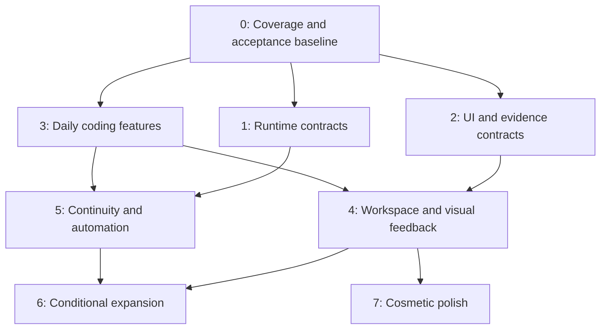

# Software additions roadmap plan

## Context

This plan orders the missing software increments in [reference feature additions](reference-feature-additions.md). That file owns source evidence and candidate findings; this file owns delivery phases and dependencies. Reference IDs below preserve traceability. Survey baseline is 2026-10-05; recheck current runtime and active profile at each phase.

The two scope filters remain mandatory: exclude agent roleplay/personas and exclude features already provided by native or custom plugins. Existing functionality that still needs runtime acceptance is a prerequisite check, not a new feature. Planned but unimplemented features remain eligible; extend their existing plans.

Related owners: [provider lifecycle](claude-cursor-accounts.md), [async questions](async-agent-questions.md), [customization](dsh-customization/README.md), [E2E testing](dsh-e2e-testing.md), [boot integrity](plugin-boot-integrity.md) and [multi-host](multi-host/README.md).

This document authorizes no implementation or active-profile changes. Current proof is source/document investigation, not runtime acceptance.

## Goal

Establish reliable runtime and UI ownership first, deliver useful coding and review features next, and apply optional cosmetic polish last.

## What

| Phase | Priority | Outcome |
|---|---|---|
| 0 | Prerequisite | Verified gaps, exact owners and isolated acceptance environment |
| 1 | Architectural, highest | Durable execution, provider lifecycle and bounded continuity contracts |
| 2 | Architectural, high | Stateful panel composition, evidence and feedback contracts |
| 3 | Features, highest | Search, drafts, context explanation, review and project checks |
| 4 | Features, high | Movable workspace, visual feedback, recorded tests and attention |
| 5 | Features, medium | Provider continuity, isolated workspace launch and PR wake-ups |
| 6 | Conditional expansion | Advanced tooling/content/remote workflows with demonstrated need |
| 7 | Cosmetic, last | Appearance, animation and optional presentation refinements |

Phase order expresses priority, not a requirement to finish every Host change before shipping any independent plugin. Each work item waits for its own dependencies. Do not invent a common abstraction solely to make unrelated features wait on it.

## Why

Provider switches without lifecycle ownership lose resumable state. Recovery without receipts repeats uncertain effects. Moving UI without panel ownership resets drafts and terminals. Recording without action/frame identity produces misleading proof. These foundations determine whether later features can be trusted.

Search, drafts, review and checks deliver daily value with smaller scope. Advanced tools and content surfaces are useful only when recurring workflows justify their cost. Cosmetics cannot substitute for correct ownership and acceptance.

## How

### Conceptual model

### Operations / behavior

Select a missing increment, verify its owning contract, probe adoption candidates, implement at the existing boundary, and promote only after focused and combined scratch-profile acceptance. Report measured benefit and unverified behavior separately. No restart of the live DSH instance.

### Tech choices

| Concern | Decision | Reason |
|---|---|---|
| Runtime | DSH core owns lifecycle; adapters use capability registry exposed by dshx | Do not register a competing Agent factory or bypass persistence |
| Durability | Extend native persistence/inbox/jobs; reconcile effects | Persisted transcript alone does not recover unfinished work |
| UI layout | Trellis adoption probe behind supported panel descriptors | Moving panels must preserve runtime and component identity |
| Visual feedback | Agentation through existing MCP domain | Avoid rebuilding annotation protocol and connection management |
| Context | Probe dsh-context; add only remaining provenance gaps | Existing dashboard candidate beats bespoke duplicate |
| E2E | Existing Playwright acceptance; compare optional TesterArmy tooling | Deterministic assertions remain test oracle |
| Dependencies | Prebuilt artifacts/cache and Nix wiring; pinned packages | Respect binary-first machine/toolchain contract |
| State validation | Installed Effect Schema/zod conventions at boundaries | Decode external state once; version persisted records |

### Architecture

Host owns sessions, agent handles, permissions, pending work and recovery. Provider adapters own subprocess/protocol state under Host cancellation/disposal. Existing owned plugins keep their domains. UI owns presentation preferences, never execution authority. Evidence adapters retain bounded artifacts and immutable source identities.

The existing provider plan records that DSH core source is outside this checkout. Phase 1 requires locating that source owner and implementing a supported seam there. dshx then exposes it. A missing seam blocks the affected feature, not independent search/review work.

## What this allows

A foundation-first delivery sequence with explicit exit gates, focused revisions and small useful releases. Full-feature additions remain traceable to the gap-only survey.

## What this does not allow

Specialist personas, prompt-only modes, duplicate account/MCP/scheduler/sidebar systems, a replacement harness, silent cloud migration or cosmetic work ahead of correctness. Deferred items are conditional options, not promised scope.

## UI & UX

### Desktop

Initially extend existing panels. Later make registered chat, terminal, files, review and evidence views dockable, tabbed or floating. Preserve focus, draft, scroll and native session identity. Show unsupported provider actions as unavailable with a concrete reason.

### Mobile

Use a narrow-screen stacked layout for the retained features. Preserve question answers and drafts across navigation. Keyboard access, readable controls and responsive behavior are acceptance requirements throughout, not Phase 7 cosmetics. Native mobile app development remains separate.

### Common interactions

| Action | Result |
|---|---|
| Move panel | View remains mounted with same runtime subscriptions |
| Restore draft | Existing draft preserved on conflict or unsupported content |
| Mark reviewed | Receipt binds exact content; subsequent change invalidates it |
| Answer document question | Answer binds question ID and document revision |
| Switch provider during work | Request waits in order; current work retains owner until transition |
| Resume interrupted work | Uncertain effects listed; only eligible operations continue |
| Open evidence | Run outcome, assertion results and recording coverage visible |

## Data model

| Record | Required identity / ownership |
|---|---|
| Capability projection | Provider instance, supported operations, option schema and protocol version; Host adapter |
| Recovery receipt | Operation/run/session, last durable result, uncertain effects, cancellation generation and eligibility; Host |
| Handoff | Ordered source history IDs, destination, budget, omissions and resume outcome; Host |
| Panel descriptor/layout | Stable instance/type, owning session/workspace, disposal policy; versioned layout preferences |
| Evidence | Run/revision, action/frame timestamps, assertions, outcome and bounded artifact references; evidence adapter |
| Feedback | Target revision/locator, question ID, answer and resolution revisions; feedback owner |
| Review/check receipt | Scope/path/content digest or action digest, checked revision and status; review/check owner |

These are requirements for existing owner schemas, not a proposal for one central database or generic service.

## Implementation steps

### Phase 0 — verify scope and acceptance baseline

1. Refresh active composition and installed contracts. Build a per-feature coverage ledger: provided, partial missing increment, absent, or unknown.
2. Remove any newly covered increments from roadmap and reference file. Unknowns require bounded reproduction before implementation.
3. Use existing boot-integrity/E2E tooling in scratch profile/DSH_HOME on another port; record native baseline and candidate versions/licenses.

Exit: each selected increment has an owner, exact missing behavior and falsifiable acceptance gate. Existing boot failures are recorded separately. No active-profile experiments.

### Phase 1 — durable runtime and provider contracts

1. **1A: Provider driver seam** (F40, I07/I09): Host-managed create/resume/stop/dispose, capability discovery, session identity and adapter-specific permission mapping. Start with one external adapter and existing native behavior; follow provider plan rather than expanding to every provider.
2. **1B: Restart reconciliation** (I06): pending-operation receipts, cancellation generations, explicit interrupted/uncertain work, held queue recovery where genuinely missing. Never replay unknown side effects blindly.
3. **1C: Continuity format** (F44, I07/I08/I15): ordered attributed portable history, bounded retrieval, omission index, intact new prompts and native-resume fallback. Exclude private reasoning, live tool state and historical attachments.
4. **1D: Continuation/decision semantics** (F11/F12/F33, I10/I11): durable answerability, synchronized read/snooze increments, known-reset continuation eligibility and invalidation. Reuse native questions/queues; add only missing semantics.

Exit: adapter lifecycle substitution checks pass; controlled crash/cancel/restart tests preserve order and authority; uncertain effects surfaced; unsupported capabilities explicit. Do not promise exactly-once effects without external idempotency/reconciliation.

### Phase 2 — panel, evidence and feedback architecture

1. **2A: Panel lifecycle** (I01): inspect native layout contracts, define stable descriptors only where missing, expose through dshx. Probe Trellis with two real stateful views; verify exact license before adoption.
2. **2B: Browser/evidence ownership** (F46/F47, I02/I03): accepted browser provider owns tab lifetime, viewport/action/frame identity and cancellation. Extend E2E artifact format with bounded retention and source run links.
3. **2C: Revisioned feedback** (F18/F33, I04/I11): document/element anchors, batched late answers, stale-target handling and resolution receipts. Extend async-question plan; do not create another question engine.

Exit: panel movement has zero unintended remounts/duplicate subscriptions; evidence ordering and missing coverage explicit; concurrent document edits cannot misapply answers. Basic accessibility and reset/recovery work.

### Phase 3 — highest-value daily features

1. **3A: Search and drafts** (F01/F03/F05/F06): archived/exact-event search, conditional file palette, saved drafts/history preserving current draft and supported assets.
2. **3B: Context and skills visibility** (F38/F42/F70, I05): probe dsh-context and skill explorer; only add provenance/matching explanations they do not provide.
3. **3C: Review progress** (F15/F16/F18): exact-content reviewed state, complete scoped counts, reload persistence, then hunk feedback using 2C.
4. **3D: Project checks** (F66/F67/F68): named trusted project actions, bounded completion receipts, failed/skipped hook visibility. Do not add another hook runner.

Exit: fixed corpus results correct; draft conflicts non-destructive; same-line-count edit clears review mark; edits invalidate prior check pass. Candidate adoption has boot and browser evidence.

### Phase 4 — usable workspace and visual evidence

1. **4A: Dockable workspace** (I01): registered views move/split/tab/float, named layouts, keyboard docking, reset and removed-plugin placeholders. Foundation from 2A becomes user-facing feature.
2. **4B: Visual/document feedback** (F47, I02/I04): Agentation local-app MCP flow and revisioned Markdown review using 2B/2C.
3. **4C: Test evidence** (I03/I14): failed/cancelled recordings, timeline replay, assertion results and optional video export. Compare TesterArmy cached action replay with deterministic Playwright baseline before adopting.
4. **4D: Attention and artifact access** (F29/F34/F64, I11/I12): blockers/results, run-to-error navigation, searchable retained outputs. Use 1D for durable answerability; initial artifact index only needs bounded evidence records from 2B.

Exit: live panels retain state; feedback reaches correct session once; replay does not fabricate coverage; failed assertions remain failures; artifacts reopen with source identity and retention controls.

### Phase 5 — continuity, isolation and event-driven automation

1. **5A: Provider switching** (F40/F44, I07/I09): one proven adapter pair, ordered queued switches, visible handoff timeline, native return/resume and capability-aware delegated task controls.
2. **5B: Fork/workspace operations** (F23/F24/F41, I08/I15): isolated JJ provisioning/setup/launch, selected-boundary runtime forks and scoped history tools. Live rebind requires explicit Host support. Organizational linking must never grant parent authority.
3. **5C: PR watch and limit recovery** (F19/F20/F11/F12, I10): linked PR status, deduplicated authorized wakes, manual/known-reset resume and synchronized attention. Existing schedulers remain owner of timing.
4. **5D: Coordinated rewind** (F39): separate conversation-only versus filesystem restore. Check overlapping/nested/symlink workspaces and archived active owners; reject unsafe restore and surface partial failure. Use recoverable transaction semantics, not claimed atomic OS writes.

Exit: context budgets enforced; fresh prompt unshortened; selected fork boundary respected; dirty/in-use workspace preserved; cancelled subscription cannot wake; unknown reset has no invented timer; restore failures never hang or silently succeed.

### Phase 6 — conditional functional expansion

| Track | Reference IDs | Admission gate |
|---|---|---|
| Language/editing | F60/F74/F75/F76/F77/F78 | Demonstrated baseline gap; read-only LSP first, then stale-safe edits and preview-bound apply; hash editing earns benefit against native guards |
| Debugger/kernel/format readers | F79/F80/F81 | Repeated need beyond terminal/MCP; owned process cancellation, reset and disposal |
| Notebook/rollover/memory | F43/F82/F83/F92 | Context inspection demonstrates loss; supported Host maintenance seam, branch-safe revisioned notes, user-reviewed promotion |
| Collaborative content | I13 | Actual page/drawing/table workflow; selected licensed component port, concurrency and export proof |
| Task boards/stacked forges | F36/F22 | Repeated workflow need; no duplicate scheduler or speculative multi-forge framework |
| Remote/browser credentials | F48/F49 | Existing multi-host plan passes auth/ownership/reconnect gates; explicit scoped credential import |
| Process diagnostics | F51 | Measured resource problem; bounded process metrics, no fictitious per-plugin heap attribution |

Exit per admitted track: measured improvement, focused regression coverage and isolated live acceptance. Reject/defer tracks with no demonstrated gap. These features are functional, not cosmetic.

### Phase 7 — optional cosmetic polish

Refine layout spacing, theme tokens, transition animation, chart styling, icon consistency and optional sounds after relevant features pass acceptance. Use existing theme/customization mechanisms; do not add a theme engine or separate notification system. Respect reduced motion and user preferences.

Exit: visual consistency and responsive checks pass; animation introduces no state reset or measurable interaction regression. This phase creates no new runtime authority or durable domain state.

### Delivery discipline

Each subphase gets focused described JJ revision(s), source-first generation where applicable, narrow checks and a compact acceptance receipt. Recheck coverage at phase entry. Stop only scratch processes started for verification. Promotion to web is a separate explicit rollout; never restart the user's live instance for a probe.

## Open questions

These are investigation gates, not questions the user must answer now:

1. Where is the editable DSH core source and supported delivery path for Phase 1 changes?
2. Which native views expose sufficient panel lifecycle contracts for Trellis, and what does its pinned license permit?
3. Which recovery/answerability behaviors already work after an actual scratch-instance crash?
4. Which community candidate survives combined rc.2 loader and browser acceptance?

Resolve by source inspection and isolated probes before asking for product decisions.

## Acceptance criteria

- [ ] Every retained reference feature and inspiration maps to a phase or conditional track.
- [ ] Existing native/custom behavior and roleplay remain excluded.
- [ ] Host/runtime and UI ownership gates precede their dependent features.
- [ ] Independent useful features can ship without unrelated Host work.
- [ ] Every phase has concrete exit evidence; source/build proof is distinct from live acceptance.
- [ ] Cosmetics are last; accessibility and responsive correctness remain part of every relevant feature.
- [ ] Dedicated plans remain their domains' source of implementation detail.
- [ ] No active DSH restart, unauthorized profile change or concurrent-work rewrite occurs.

## Decisions log

| Date | Decision | Rationale |
|---|---|---|
| 2026-10-05 | Architecture first, features next, cosmetics last | User's requested priority |
| 2026-10-05 | Keep roadmap separate from source survey | Evidence and delivery order have distinct owners |
| 2026-10-05 | Trellis foundation early; cosmetic treatment last | Stateful panel composition is architectural software |
| 2026-10-05 | Dependency gates rather than one global blockade | Missing provider Host seam should not prevent search/review delivery |
| 2026-10-05 | Advanced tooling/content/remote features conditional | Avoid committing to speculative maintenance scope |
