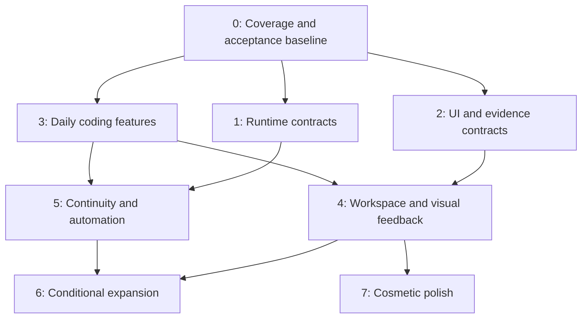

# Software additions roadmap plan

## Context

This plan orders the missing software increments in [reference feature additions](reference-feature-additions.md). That file owns source evidence and candidate findings; this file owns delivery phases and dependencies. Reference IDs below preserve traceability. Survey baseline is 2026-10-05; recheck current runtime and active profile at each phase.

The two scope filters remain mandatory: exclude agent roleplay/personas and exclude features already provided by native or custom plugins. Existing functionality that still needs runtime acceptance is a prerequisite check, not a new feature. Planned but unimplemented features remain eligible; extend their existing plans.

Related owners: [provider lifecycle](claude-cursor-accounts.md), [async questions](async-agent-questions.md), [customization](dsh-customization/README.md), [E2E testing](dsh-e2e-testing.md), [boot integrity](plugin-boot-integrity.md) and [multi-host](multi-host/README.md).

Implementation is authorized in this owned worktree and isolated scratch profiles. Promotion into the active web profile and restarting its server remain separate rollout actions.

## Goal

Establish reliable runtime and UI ownership first, deliver useful coding and review features next, and apply optional cosmetic polish last.

## What

| Phase | Priority               | Outcome                                                                |
| ----- | ---------------------- | ---------------------------------------------------------------------- |
| 0     | Prerequisite           | Verified gaps, exact owners and isolated acceptance environment        |
| 1     | Architectural, highest | Durable execution, provider lifecycle and bounded continuity contracts |
| 2     | Architectural, high    | Stateful panel composition, evidence and feedback contracts            |
| 3     | Features, highest      | Search, drafts, context explanation, review and project checks         |
| 4     | Features, high         | Movable workspace, visual feedback, recorded tests and attention       |
| 5     | Features, medium       | Provider continuity, isolated workspace launch and PR wake-ups         |
| 6     | Conditional expansion  | Advanced tooling/content/remote workflows with demonstrated need       |
| 7     | Cosmetic, last         | Appearance, animation and optional presentation refinements            |

Phase order expresses priority, not a requirement to finish every Host change before shipping any independent plugin. Each work item waits for its own dependencies. Do not invent a common abstraction solely to make unrelated features wait on it.

## Why

Provider switches without lifecycle ownership lose resumable state. Recovery without receipts repeats uncertain effects. Moving UI without panel ownership resets drafts and terminals. Recording without action/frame identity produces misleading proof. These foundations determine whether later features can be trusted.

Search, drafts, review and checks deliver daily value with smaller scope. Advanced tools and content surfaces are useful only when recurring workflows justify their cost. Cosmetics cannot substitute for correct ownership and acceptance.

## How

### Conceptual model

### Operations / behavior

Select a missing increment, verify its owning contract, probe adoption candidates, implement at the existing boundary, and promote only after focused and combined scratch-profile acceptance. Report measured benefit and unverified behavior separately. No restart of the live DSH instance.

### Tech choices

| Concern          | Decision                                                                  | Reason                                                          |
| ---------------- | ------------------------------------------------------------------------- | --------------------------------------------------------------- |
| Runtime          | DSH core owns lifecycle; adapters use capability registry exposed by dshx | Do not register a competing Agent factory or bypass persistence |
| Durability       | Extend native persistence/inbox/jobs; reconcile effects                   | Persisted transcript alone does not recover unfinished work     |
| UI layout        | Trellis adoption probe behind supported panel descriptors                 | Moving panels must preserve runtime and component identity      |
| Visual feedback  | Agentation through existing MCP domain                                    | Avoid rebuilding annotation protocol and connection management  |
| Context          | Probe dsh-context; add only remaining provenance gaps                     | Existing dashboard candidate beats bespoke duplicate            |
| E2E              | Existing Playwright acceptance; compare optional TesterArmy tooling       | Deterministic assertions remain test oracle                     |
| Dependencies     | Prebuilt artifacts/cache and Nix wiring; pinned packages                  | Respect binary-first machine/toolchain contract                 |
| State validation | Installed Effect Schema/zod conventions at boundaries                     | Decode external state once; version persisted records           |

### Architecture

Host owns sessions, agent handles, permissions, pending work and recovery. Provider adapters own subprocess/protocol state under Host cancellation/disposal. Existing owned plugins keep their domains. UI owns presentation preferences, never execution authority. Evidence adapters retain bounded artifacts and immutable source identities.

The existing provider plan records that DSH core source is outside this checkout. Phase 1 requires locating that source owner and implementing a supported seam there. dshx then exposes it. A missing seam blocks the affected feature, not independent search/review work.

## What this allows

A foundation-first delivery sequence with explicit exit gates, focused revisions and small useful releases. Full-feature additions remain traceable to the gap-only survey.

## What this does not allow

Specialist personas, prompt-only modes, duplicate account/MCP/scheduler/sidebar systems, a replacement harness, silent cloud migration or cosmetic work ahead of correctness. Deferred items are conditional options, not promised scope.

## UI & UX

### Desktop

Initially extend existing panels. Later make registered chat, terminal, files, review and evidence views dockable, tabbed or floating. Preserve focus, draft, scroll and native session identity. Show unsupported provider actions as unavailable with a concrete reason.

### Mobile

Use a narrow-screen stacked layout for the retained features. Preserve question answers and drafts across navigation. Keyboard access, readable controls and responsive behavior are acceptance requirements throughout, not Phase 7 cosmetics. Native mobile app development remains separate.

### Common interactions

| Action                      | Result                                                              |
| --------------------------- | ------------------------------------------------------------------- |
| Move panel                  | View remains mounted with same runtime subscriptions                |
| Restore draft               | Existing draft preserved on conflict or unsupported content         |
| Mark reviewed               | Receipt binds exact content; subsequent change invalidates it       |
| Answer document question    | Answer binds question ID and document revision                      |
| Switch provider during work | Request waits in order; current work retains owner until transition |
| Resume interrupted work     | Uncertain effects listed; only eligible operations continue         |
| Open evidence               | Run outcome, assertion results and recording coverage visible       |

## Data model

| Record                  | Required identity / ownership                                                                                |
| ----------------------- | ------------------------------------------------------------------------------------------------------------ |
| Capability projection   | Provider instance, supported operations, option schema and protocol version; Host adapter                    |
| Recovery receipt        | Operation/run/session, last durable result, uncertain effects, cancellation generation and eligibility; Host |
| Handoff                 | Ordered source history IDs, destination, budget, omissions and resume outcome; Host                          |
| Panel descriptor/layout | Stable instance/type, owning session/workspace, disposal policy; versioned layout preferences                |
| Evidence                | Run/revision, action/frame timestamps, assertions, outcome and bounded artifact references; evidence adapter |
| Feedback                | Target revision/locator, question ID, answer and resolution revisions; feedback owner                        |
| Review/check receipt    | Scope/path/content digest or action digest, checked revision and status; review/check owner                  |

These are requirements for existing owner schemas, not a proposal for one central database or generic service.

## Implementation steps

### Execution status (2026-10-06)

| Work                                    | Status                       | Evidence / remaining gate                                                                                                                                                                                                                                                                                                                                                                                                                                                                                                                                                                                                                                                                                                                                           |
| --------------------------------------- | ---------------------------- | ------------------------------------------------------------------------------------------------------------------------------------------------------------------------------------------------------------------------------------------------------------------------------------------------------------------------------------------------------------------------------------------------------------------------------------------------------------------------------------------------------------------------------------------------------------------------------------------------------------------------------------------------------------------------------------------------------------------------------------------------------------------- |
| Phase 0 — scope and acceptance baseline | Complete                     | Refreshed active composition and built an isolated candidate profile. Local DSH 0.2.0-rc.2 booted cleanly on 3289; browser checks covered global search, Context Insights, Skill Center, and the GitHub picker’s no-remote guard. Four community candidates and the owned Cursor adapter have exact versions recorded below; LSP actions remains excluded for its peer mismatch.                                                                                                                                                                                                                                                                                                                                                                                    |
| Phase 1A — provider driver seam | Partial; synthetic ACP lifecycle accepted | An isolated Node 22.23.3 / DSH 0.2.0-rc.2 Host with the linked local API controller and Agent stack selects Cursor, runs synthetic ACP create/prompt, restarts, resumes the same native session, and persists both replies. Focused registry and uncertainty-guard checks pass. The ordinary `dsh` CLI still anchors to installed core packages; actual Cursor CLI behavior and a credentialed provider turn remain unaccepted. |
| Phase 1B — restart reconciliation       | Complete at library boundary | JSONL recovery tests cover interrupted turns/tools, held inbox state, cancellation, setup rollback, and restart order. No full Host process restart was used as acceptance evidence.                                                                                                                                                                                                                                                                                                                                                                                                                                                                                                                                                                                |
| Phase 1C — continuity format            | Partial                     | V5 codec/migration plus bounded portable public-history replay pass focused tests. The isolated Host now creates a local V5 Session and returns the same three history records after a full scratch Host restart. Cross-format migration/fallback in a provider handoff and a credentialed turn remain unaccepted. Replay excludes private/tool/attachment data by contract. |
| Phase 1D — continuation decisions       | Host contract gate           | Root timed questions already exist in the native ask-user tool. Subagent `sendMessage` accepts one-way inbox delivery, with no correlated answer wait. Thread Sidebar park is browser-local; synchronized read/snooze and durable quota wake are missing. A plugin-only reply/recovery implementation would duplicate or fake Host authority.                                                                                                                                                                                                                                                                                                                                                                                                                       |
| Phase 2 — panel, evidence, feedback | Partial / Host-gated | 2B is locally complete: Playwright 1.56.1 produced a 14/14 healthy run with 64 ordered steps and a `jj:` source id; real failure and SIGINT fixtures retained screenshot/trace and cancelled receipts; four evidence tests pass. CI SHA/run-URL construction passes with deterministic GitHub values; no hosted Actions run occurred. E2E scratch isolation, bounded manifests, and retention are implemented. 2A remains Host-gated: `ctx.layout.selectPanel` selects one keyed `main` view and AppFrame renders only that key; PanelsApi only registers/shows/disposes, so docking is absent. Child replies lack correlated Host wait; panel movement and revisioned feedback remain blocked, and 2C stays open. Trellis requires a commercial license; Dockview is MIT but unprobed. No layout library was selected. |
| Phase 3 — daily features | Implementation complete; runtime proof passes with skipped-event Host limit | Prompt drafts/history and exact-content review progress are implemented with focused tests. Project Checks builds, typechecks, passes its core tests, and reuses one storage-domain handle per Host context, closing it on disposal. A fresh isolated Node 22.23.3 / DSH 0.2.0-rc.2 run proved trusted-action freshness current → stale → current across a JJ edit, automatic verification, and a failing native Codex Stop hook (exit 7; stderr presence only). Earlier scratch/preview attempts on ports 60895 and 61059 failed to start or produced no receipt; the later isolated checks pass. The Host emits no durable skipped-hook event, so per-hook skipped attribution remains Host-limited. |
| Phase 4 — workspace and visual evidence | Partial; 4C shipped, other increments gated | DSHX now writes a CSP-restricted screenshot timeline and a searchable catalog of retained runs, with true run status, recorded/missing steps, validated source identity, and local stored frames. No playback or coverage is synthesized. Host still owns panel movement and session attention; revisioned feedback lacks the 2C lifecycle. Agentation is a local-app/MCP workflow, not a DSH-wide annotation surface. |
| Phase 5 — continuity and automation | Partial; gaps reviewed | Reuse DSHX native session create/fork/history APIs, including sequence-bounded forks; do not add duplicate UI or history storage. The synthetic linked scratch Host proves local runtime identity through restart only. The ordinary `dsh` CLI still anchors to installed core packages, so real provider identity/handoff remains open. PR status has no linked wake owner, and filesystem rewind cannot atomically coordinate with Session/workspace state. These remain explicit Host gates. |
| Phase 6 — conditional expansion         | Review complete; no tracks admitted | All seven tracks now have explicit decisions below and were checked against current profile composition and acceptance gates. No repeated unmet workflow or measured baseline gap justified runtime expansion; the LSP peer mismatch and missing Host maintenance/rebind seams remain gates. |
| Phase 7 — polish | Deferred behind functional acceptance | No cosmetic change was admitted while Phase 3 receipt freshness/native-hook acceptance and Phase 1/2/4/5 Host-dependent exits remain open. Responsive and reduced-motion runtime acceptance is not claimed. |

### Execution status (2026-10-05)

| Work | Status | Evidence / remaining gate |
|---|---|---|
| Phase 0 — scope and acceptance baseline | Complete | Scratch profile composition and candidate boot receipts below; no active-profile experiment. |
| Phase 1A — provider driver seam | Partial | Core driver registry and native-loop routing are recorded below. External adapter and credentialed model turn remain open. |
| Phase 1B–1D — recovery, continuity, decisions | Pending | No acceptance receipts yet. |
| Phase 2 — panel, evidence, feedback | Pending | Native lifecycle contracts and stateful-view acceptance still required. |
| Phase 3 — daily features | Partial | Five candidate bundles passed scratch composition and boot; behavior-level browser acceptance and owned gaps remain. |
| Phase 4 — workspace and visual evidence | Pending | No phase exit evidence yet. |
| Phase 5 — continuity and automation | Partial implementation only | Multi-host and goal-stall work exists in separate plans; count it only after isolated acceptance. Provider switching and rewind remain open. |
| Phase 6 — conditional expansion | Gate review pending | Each track must be admitted or explicitly deferred with evidence. |
| Phase 7 — polish | Pending | Wait for functional exits; no cosmetics counted yet. |

### Phase 0 — verify scope and acceptance baseline

1. Refresh active composition and installed contracts. Build a per-feature coverage ledger: provided, partial missing increment, absent, or unknown.
2. Remove any newly covered increments from roadmap and reference file. Unknowns require bounded reproduction before implementation.
3. Use existing boot-integrity/E2E tooling in scratch profile/DSH_HOME on another port; record native baseline and candidate versions/licenses.

Exit: each selected increment has an owner, exact missing behavior and falsifiable acceptance gate. Existing boot failures are recorded separately. No active-profile experiments.

### Phase 1 — durable runtime and provider contracts

1. **1A: Provider driver seam** (F40, I07/I09): Host-managed create/resume/stop/dispose, capability discovery, session identity and adapter-specific permission mapping. Start with one external adapter and existing native behavior; follow provider plan rather than expanding to every provider.
2. **1B: Restart reconciliation** (I06): pending-operation receipts, cancellation generations, explicit interrupted/uncertain work, held queue recovery where genuinely missing. Never replay unknown side effects blindly.
3. **1C: Continuity format** (F44, I07/I08/I15): ordered attributed portable history, bounded retrieval, omission index, intact new prompts and native-resume fallback. Exclude private reasoning, live tool state and historical attachments.
4. **1D: Continuation/decision semantics** (F11/F12/F33, I10/I11): durable answerability, synchronized read/snooze increments, known-reset continuation eligibility and invalidation. Reuse native questions/queues; add only missing semantics.

Exit: adapter lifecycle substitution checks pass; controlled crash/cancel/restart tests preserve order and authority; uncertain effects surfaced; unsupported capabilities explicit. Do not promise exactly-once effects without external idempotency/reconciliation.

### Phase 2 — panel, evidence and feedback architecture

1. **2A: Panel lifecycle** (I01): inspect native layout contracts, define stable descriptors only where missing, expose through dshx. Probe Trellis with two real stateful views; verify exact license before adoption.
2. **2B: Browser/evidence ownership** (F46/F47, I02/I03): accepted browser provider owns tab lifetime, viewport/action/frame identity and cancellation. Extend E2E artifact format with bounded retention and source run links.
3. **2C: Revisioned feedback** (F18/F33, I04/I11): document/element anchors, batched late answers, stale-target handling and resolution receipts. Extend async-question plan; do not create another question engine.

Exit: panel movement has zero unintended remounts/duplicate subscriptions; evidence ordering and missing coverage explicit; concurrent document edits cannot misapply answers. Basic accessibility and reset/recovery work.

### Phase 3 — highest-value daily features

1. **3A: Search and drafts** (F01/F03/F05/F06): archived/exact-event search, conditional file palette, saved drafts/history preserving current draft and supported assets.
2. **3B: Context and skills visibility** (F38/F42/F70, I05): probe dsh-context and skill explorer; only add provenance/matching explanations they do not provide.
3. **3C: Review progress** (F15/F16/F18): exact-content reviewed state, complete scoped counts, reload persistence, then hunk feedback using 2C.
4. **3D: Project checks** (F66/F67/F68): named trusted project actions, bounded completion receipts, failed/skipped hook visibility. Do not add another hook runner.

Exit: fixed corpus results correct; draft conflicts non-destructive; same-line-count edit clears review mark; edits invalidate prior check pass. Candidate adoption has boot and browser evidence.

### Phase 4 — usable workspace and visual evidence

1. **4A: Dockable workspace** (I01): registered views move/split/tab/float, named layouts, keyboard docking, reset and removed-plugin placeholders. Foundation from 2A becomes user-facing feature.
2. **4B: Visual/document feedback** (F47, I02/I04): Agentation local-app MCP flow and revisioned Markdown review using 2B/2C.
3. **4C: Test evidence** (I03/I14): failed/cancelled recordings, timeline replay, assertion results and optional video export. Compare TesterArmy cached action replay with deterministic Playwright baseline before adopting.
4. **4D: Attention and artifact access** (F29/F34/F64, I11/I12): blockers/results, run-to-error navigation, searchable retained outputs. Use 1D for durable answerability; initial artifact index only needs bounded evidence records from 2B.

Exit: live panels retain state; feedback reaches correct session once; replay does not fabricate coverage; failed assertions remain failures; artifacts reopen with source identity and retention controls.

### Phase 5 — continuity, isolation and event-driven automation

1. **5A: Provider switching** (F40/F44, I07/I09): one proven adapter pair, ordered queued switches, visible handoff timeline, native return/resume and capability-aware delegated task controls.
2. **5B: Fork/workspace operations** (F23/F24/F41, I08/I15): isolated JJ provisioning/setup/launch, selected-boundary runtime forks and scoped history tools. Live rebind requires explicit Host support. Organizational linking must never grant parent authority.
3. **5C: PR watch and limit recovery** (F19/F20/F11/F12, I10): linked PR status, deduplicated authorized wakes, manual/known-reset resume and synchronized attention. Existing schedulers remain owner of timing.
4. **5D: Coordinated rewind** (F39): separate conversation-only versus filesystem restore. Check overlapping/nested/symlink workspaces and archived active owners; reject unsafe restore and surface partial failure. Use recoverable transaction semantics, not claimed atomic OS writes.

Exit: context budgets enforced; fresh prompt unshortened; selected fork boundary respected; dirty/in-use workspace preserved; cancelled subscription cannot wake; unknown reset has no invented timer; restore failures never hang or silently succeed.

### Phase 6 — conditional functional expansion

| Track                          | Reference IDs           | Admission gate                                                                                                                                  | Decision and evidence                                                                                                                                                                                                 |
| ------------------------------ | ----------------------- | ----------------------------------------------------------------------------------------------------------------------------------------------- | ---------------------------------------------------------------------------------------------------------------------------------------------------------------------------------------------------------------------- |
| Language/editing               | F60/F74/F75/F76/F77/F78 | Demonstrated baseline gap; read-only LSP first, then stale-safe edits and preview-bound apply; hash editing earns benefit against native guards | **Defer.** No fresh read-only LSP baseline passed; `dsh-lsp-actions` has a DSH 0.2 peer mismatch. Native stale-write guards exist, and no measured formatter, hash-edit, or AST rewrite gap was established.                         |
| Debugger/kernel/format readers | F79/F80/F81             | Repeated need beyond terminal/MCP; owned process cancellation, reset and disposal                                                               | **Defer.** No repeated workflow beyond native terminal/MCP was demonstrated; no owned kernel/debugger lifecycle has acceptance evidence.                                                                               |
| Notebook/rollover/memory       | F43/F82/F83/F92         | Context inspection demonstrates loss; supported Host maintenance seam, branch-safe revisioned notes, user-reviewed promotion                    | **Defer.** No measured context-loss case was established, and no supported Host maintenance seam was found for branch-safe notes or rollover.                                                                          |
| Collaborative content         | I13                     | Actual page/drawing/table workflow; selected licensed component port, concurrency and export proof                                              | **Defer.** No current page, drawing, or typed-table workflow was identified; component selection, concurrent-edit behavior, and export proof are absent.                                                                 |
| Task boards/stacked forges     | F36/F22                 | Repeated workflow need; no duplicate scheduler or speculative multi-forge framework                                                             | **Defer.** No repeated board or stacked-forge need was demonstrated; native session/fork operations and scheduler ownership must not be duplicated.                                                                     |
| Remote/browser credentials     | F48/F49                 | Existing multi-host plan passes auth/ownership/reconnect gates; explicit scoped credential import                                               | **Defer.** Multi-host acceptance remains separate and open; credential import needs a scoped Host-owned auth flow with ownership and reconnect proof.                                                                    |
| Process diagnostics            | F51                     | Measured resource problem; bounded process metrics, no fictitious per-plugin heap attribution                                                   | **Reject until measured.** No resource problem was measured; plugins share the Host process, so per-plugin heap attribution would be unsupported.                                                                        |

Exit per admitted track: measured improvement, focused regression coverage and isolated live acceptance. Reject/defer tracks with no demonstrated gap. These features are functional, not cosmetic.

### Phase 7 — optional cosmetic polish

Refine layout spacing, theme tokens, transition animation, chart styling, icon consistency and optional sounds after relevant features pass acceptance. Use existing theme/customization mechanisms; do not add a theme engine or separate notification system. Respect reduced motion and user preferences.

Decision (2026-10-06): no cosmetic change is admitted yet. Phase 3 still lacks a successful action receipt and native hook result; Phase 1/2/4/5 retain Host-dependent acceptance gates. Revisit polish after those relevant runtime baselines pass, then verify responsive behavior and reduced motion in an isolated instance.
Exit: visual consistency and responsive checks pass; animation introduces no state reset or measurable interaction regression. This phase creates no new runtime authority or durable domain state.

### Delivery discipline

Each subphase gets focused described JJ revision(s), source-first generation where applicable, narrow checks and a compact acceptance receipt. Recheck coverage at phase entry. Stop only scratch processes started for verification. Promotion to web is a separate explicit rollout; never restart the user's live instance for a probe.

## Open questions

These are investigation gates, not questions the user must answer now:

1. Which Host resolver change or owned persistence package will route the V5 Session and catalog through the installed JSONL writer?
2. Which native views expose sufficient panel lifecycle contracts for Trellis, and what does its pinned license permit?
3. Which recovery/answerability behaviors already work after an actual scratch-instance crash?
4. Which community candidate survives combined rc.2 loader and browser acceptance?

Resolve by source inspection and isolated probes before asking for product decisions.

### Confirmed source and runtime constraints

| Question                 | Resolution                                                                                                                                                                                                                                                                                                        |
| ------------------------ | ----------------------------------------------------------------------------------------------------------------------------------------------------------------------------------------------------------------------------------------------------------------------------------------------------------------- |
| Editable DSH core source | Narrow official `dsh-v0.2.0-rc.2` snapshots live under `tooling/dsh-core` (MIT; provenance in [dsh-core/FORK.md](../tooling/dsh-core/FORK.md)). The source is editable, but a profile `link:` dependency is not a validated delivery path for dependencies imported from installation-scoped DSH packages.        |
| V5 persistence boundary  | The installed JSONL persistence package imports the installed V4 catalog. A scratch-only materialized copy of that package with the local V5 catalog wrote V5 headers, but no persistence fork or Host resolver change is present in this worktree. Do not treat that experiment as a supported runtime override. |

## Roadmap integrity criteria (reviewed 2026-10-06)

These checks cover roadmap scope and execution discipline. Feature-phase acceptance remains tracked in Execution status and the receipts below.

- [x] Every retained reference feature and inspiration maps to a phase or conditional track.
- [x] Existing native/custom behavior and roleplay remain excluded.
- [x] Host/runtime and UI ownership gates precede their dependent features.
- [x] Independent useful features can ship without unrelated Host work.
- [x] Every phase has concrete exit evidence; source/build proof is distinct from live acceptance.
- [x] Cosmetics are last; accessibility and responsive correctness remain part of every relevant feature.
- [x] Dedicated plans remain their domains' source of implementation detail.
- [x] No active DSH restart, unauthorized profile change or concurrent-work rewrite occurred during this roadmap work.

## Acceptance criteria

- [ ] Every retained reference feature and inspiration maps to a phase or conditional track.
- [ ] Existing native/custom behavior and roleplay remain excluded.
- [ ] Host/runtime and UI ownership gates precede their dependent features.
- [ ] Independent useful features can ship without unrelated Host work.
- [ ] Every phase has concrete exit evidence; source/build proof is distinct from live acceptance.
- [ ] Cosmetics are last; accessibility and responsive correctness remain part of every relevant feature.
- [ ] Dedicated plans remain their domains' source of implementation detail.
- [ ] No active DSH restart, unauthorized profile change or concurrent-work rewrite occurs.

## Decisions log

| Date       | Decision                                                               | Rationale                                                                                                                                                                                                                |
| ---------- | ---------------------------------------------------------------------- | ------------------------------------------------------------------------------------------------------------------------------------------------------------------------------------------------------------------------ |
| 2026-10-06 | Phase 1A/1C: isolated local-core Host restart receipt | `pnpm run verify:core-runtime-scratch` builds a scratch profile from the installed web bundle list, links the local Agent, AgentLoop, Session, V5 persistence/catalog/migration packages and owned Cursor adapter, then launches only the scratch Host through DSH's public `runProfile` API with the scratch profile as `installAnchor`. Node 22.23.3 and DSH 0.2.0-rc.2 booted both selected bundles without activation warnings; the DSHX client created a Session, read three history records, stopped only that Host, and observed the same Session and records after restart. No provider credentials or prompt were used; ordinary `dsh web` resolution and a credentialed Cursor lifecycle remain open. |
| 2026-10-06 | Phase 1A/1B/1C: synthetic Cursor ACP restart/resume | `fnm exec --using 22.23.3 node scripts/verify-core-runtime-scratch.mjs` passed under DSH 0.2.0-rc.2. Offline `--dump-config` confirmed the synthetic Cursor instance; the isolated profile links the local API session controller, Agent, AgentLoop, Session, V5 persistence/catalog/migration, core-runtime, and Cursor bundles. Both scratch Host boots had no activation failures. A Cursor-bound Session stored `cursor-fixture-response-1`, survived Host restart, resumed the same ACP session (`new=1`, `load=1`), stored the second reply (`prompt=2`), and retained three public Session history records. The synthetic fixture stores only its native session id and event kinds, not prompts or credential values. This proves local Host/runtime selection and synthetic ACP lifecycle only; the real Cursor CLI, external credentialed turn, and ordinary CLI resolver remain open. |
| 2026-10-06 | Phase 1A/1C: current worktree Host restart revalidation | `fnm exec --using 22.23.3 pnpm run verify:core-runtime-scratch` passed. The isolated DSH 0.2.0-rc.2 Host booted without activation failures before and after restart; the scratch profile listed the local core-runtime and Cursor bundles, and the same three public history records remained after restart. No provider credential or prompt was used. This revalidates public `runProfile` behavior only; ordinary `dsh` CLI resolution and a credentialed Cursor lifecycle remain open. |
| 2026-10-05 | Architecture first, features next, cosmetics last                      | User's requested priority                                                                                                                                                                                                |
| 2026-10-05 | Keep roadmap separate from source survey                               | Evidence and delivery order have distinct owners                                                                                                                                                                         |
| 2026-10-05 | Trellis foundation early; cosmetic treatment last                      | Stateful panel composition is architectural software                                                                                                                                                                     |
| 2026-10-05 | Dependency gates rather than one global blockade                       | Missing provider Host seam should not prevent search/review delivery                                                                                                                                                     |
| 2026-10-05 | Advanced tooling/content/remote features conditional                   | Avoid committing to speculative maintenance scope                                                                                                                                                                        |
| 2026-10-05 | Phase 1A uses a narrow Agent-package fork; Host adoption remains gated | The installed Agent lacks the runtime-driver registration seam, so the repo owns a retained-name fork. A profile `link:` is not enough: the installed Host loader still resolves dependencies from its global pnpm tree. |
| 2026-10-06 | Phase 6 admits no new runtime track | Current composition and evidence establish no measured unmet workflow; peer and Host contract gaps keep remaining candidates behind explicit gates. |
| 2026-10-06 | Phase 7 stays deferred | Cosmetic work cannot pass its responsive/reduced-motion gate while relevant functional runtime acceptance remains open. |

## Acceptance receipts

| Date       | Item                                                                             | Receipt                                                                                                                                                                                                                                                                                                                                                                                                                                                                                                                                                                                                                                                                                                                                                                                                                                                                                                                                                                                                                                                                                         |
| ---------- | -------------------------------------------------------------------------------- | ----------------------------------------------------------------------------------------------------------------------------------------------------------------------------------------------------------------------------------------------------------------------------------------------------------------------------------------------------------------------------------------------------------------------------------------------------------------------------------------------------------------------------------------------------------------------------------------------------------------------------------------------------------------------------------------------------------------------------------------------------------------------------------------------------------------------------------------------------------------------------------------------------------------------------------------------------------------------------------------------------------------------------------------------------------------------------------------------- |
| 2026-10-05 | Phase 1A–1C: runtime recovery and portable history checks                        | Node 22.23.3: Agent build passed; AgentLoop build and typecheck passed; `agent/tests/runtime-driver.spec.ts` 6/6, `agent-loop/tests/{agent,runtime-history,resume}.spec.ts` 61/61, and `cursor-agent/tests/host.spec.ts` 6/6. Covers legacy descriptor defaulting, native-resume preference, bounded ordered public-history fallback, intact new prompts, durable JSONL recovery, and Cursor's refusal to replay uncertain operations. This is package-level evidence; no credentialed Cursor turn or linked-profile DSH acceptance is claimed.                                                                                                                                                                                                                                                                                                                                                                                                                                                                                                                                                 |
| 2026-10-05 | Phase 1D: Host-owned continuation gap                                            | DSH 0.2.0-rc.2 `dsh-subagent` declares `sendMessage(...): Promise<MessageId>` as accepted inbox delivery, with no correlated answer wait. `thread-sidebar/README.md` documents park as browser-local and the missing Host projection; AI Accounts supplies bounded quota forecasting but no durable continuation owner. Keep synchronized snooze/read, quota wake, and restart-safe answerability behind Host contracts; do not emulate with a plugin timer or duplicate question engine.                                                                                                                                                                                                                                                                                                                                                                                                                                                                                                                                                                                                       |
| 2026-10-05 | Phase 1A/1C: fresh linked-profile runtime resolution attempt                     | Fresh scratch `DSH_HOME`, DSH 0.2.0-rc.2, Node 22.23.3, and a profile with direct links to this worktree's Agent, AgentLoop, Session, JSONL persistence, format catalog, migration, and API controller. Profile ESM imports resolve local packages, but Host boot traces resolve Agent and Session dependencies from the global pnpm store and fail on missing `runtimeDriverEventSchema`, `decodeSessionEvent`, and V5 binding exports. Host source/module-resolution change is required; no credentials, user sessions, or active profile were used.                                                                                                                                                                                                                                                                                                                                                                                                                                                                                                                                          |
| 2026-10-05 | Phase 1D: native root question contract                                          | Installed `@deepseek-ai/dsh-tool-ask-user@0.2.0-rc.2` has opt-in `mode: timed`, bounded foreground wait, pending `{ callId }` result, and native `userQuestions` routing. The subagent service remains one-way. Source contract verified; no interactive question card acceptance claimed.                                                                                                                                                                                                                                                                                                                                                                                                                                                                                                                                                                                                                                                                                                                                                                                                      |
| 2026-10-05 | Phase 0: isolated acceptance environment exists (scratch, repeatable)            | Probe root `DSH_HOME=/private/tmp/dsh-software-additions-probe`, profile `software` defined by its manifest (`probe/profiles/software/package.json`: DSH 0.2.0-rc.2 base + web-app + the five candidates), pnpm 12 manifest install, boot `dsh --profile software --port 3289 --no-open` on fnm Node 22.23.3 (3199 is held by an unrelated running instance; only 3289 belongs to this receipt)                                                                                                                                                                                                                                                                                                                                                                                                                                                                                                                                                                                                                                                                                                 |
| 2026-10-05 | Historical candidate receipt (superseded by refreshed profile below)             | Earlier candidate set included `dsh-lsp-actions`; its peer mismatch led to exclusion. Do not treat that five-candidate boot as current acceptance.                                                                                                                                                                                                                                                                                                                                                                                                                                                                                                                                                                                                                                                                                                                                                                                                                                                                                                                                              |
| 2026-10-05 | Phase 1A: historical override runtime receipt (not current acceptance)           | Booted client graph lists the four client candidate bundles (69 entries); a session consumer inside the pnpm store resolves `@deepseek-ai/dsh-agent` to this worktree's `tooling/dsh-core/agent/lib/types/index.js` (realpath check); live API on the scratch instance: `session/modelCatalog` ok, `session/create` (standard preset) ok, queued `session/prompt` accepted, `session/projections` reports the admitted turn with assembled context; the model call itself could not complete (scratch home has no provider credentials, `llmMs: 0`), so a credentialed model turn remains an open exit item for 1A                                                                                                                                                                                                                                                                                                                                                                                                                                                                              |
| 2026-10-05 | Phase 1A: seam engine checks (source/build proof, distinct from live acceptance) | `tooling/dsh-core/agent` `pnpm test` 5/5 green; AgentLoop `test:runtime` 10/10 green; `tsc --noEmit` clean. The Agent checks cover registry selection, unsupported targets, plugin-lifetime binding and capability snapshot, duplicate rejection, and failed-setup rollback through the real loop lifecycle.                                                                                                                                                                                                                                                                                                                                                                                                                                                                                                                                                                                                                                                                                                                                                                                    |
| 2026-10-05 | Phase 1A/1C: focused package checks                                              | Frozen offline installs, builds, and typechecks passed for Session, Agent, AgentLoop, API controller declarations, V4→V5 migration, catalog, and Cursor plugin. Session: 536 passed across 17 files; catalog: 39 passed across 6 files; Cursor plugin: 7 passed across 2 files and `dshx check`/build pass. API host suites typecheck, but their Vitest alias setup is missing from this narrow snapshot.                                                                                                                                                                                                                                                                                                                                                                                                                                                                                                                                                                                                                                                                                       |
| 2026-10-05 | Phase 1A/1C: linked-profile runtime failure                                      | Scratch `DSH_HOME=/private/tmp/dsh-phase1a-acceptance-20261005`, DSH 0.2.0-rc.2, Node 22.23.3, port 3199. The composed config had 1264 lines and included Cursor; booting with profile `link:` dependencies failed imports because linked AgentLoop/API packages resolved installation-scoped V4 Agent/Session packages. No production profile or port 3080 was touched.                                                                                                                                                                                                                                                                                                                                                                                                                                                                                                                                                                                                                                                                                                                        |
| 2026-10-05 | Phase 1A/1C: persistence integration gate                                        | Materializing local core packages under the scratch profile allowed the UI to boot, but the first Session write failed with `encodeCurrent requires Session format v4` from the installed JSONL writer. A scratch-only copy of the installed JSONL package, paired with the local V5 catalog, then wrote two compressed V5 session headers; those default sessions had no `runtimeBinding`, and the preview browser's remote WebSocket remained disconnected. This isolates the missing persistence/resolver work; it is not supported activation or Cursor-turn proof.                                                                                                                                                                                                                                                                                                                                                                                                                                                                                                                         |
| 2026-10-05 | Phase 1A: workspace package identity                                             | `createRequire` from Agent, Session, V4→V5, and catalog resolves Session to this worktree's `session/lib/index.js`; this proves workspace-local identity only. DSH profile `link:` runtime identity remains unproven and failed in the isolated boot.                                                                                                                                                                                                                                                                                                                                                                                                                                                                                                                                                                                                                                                                                                                                                                                                                                           |
| 2026-10-05 | Phase 0 receipt freshness                                                        | `/private/tmp/dsh-software-additions-probe` is absent; port 3289 is held by an unrelated process and was not used. Port 3080 remains owned by the user's live web process; it was not restarted or changed. Previous candidate receipts are historical until recreated.                                                                                                                                                                                                                                                                                                                                                                                                                                                                                                                                                                                                                                                                                                                                                                                                                         |
| 2026-10-05 | Phase 0: current scope and composition refresh                                   | Read only `~/.dsh/profiles/web/package.json` and ran `dsh --profile web --dump-config` under the pinned Node 22.23.3, filtering output to entry ids/names. Current bundles include `@dshfiles/goal-stall-guard`, `dshmarket`, and `@mars-sea/dsh-commandcode-provider` in addition to the previously listed owned plugins. Composition warns that patch targets `llm-openai-codex` and `preset-standard:tool-ask-user` are missing. `~/.dsh/profiles/probe` includes `@dshfiles/multi-host`, whose worktree source is active elsewhere; it was not booted or changed. No profile was modified and no live server was restarted.                                                                                                                                                                                                                                                                                                                                                                                                                                                                 |
| 2026-10-05 | Phase 0: fresh native baseline boot                                              | `dsh --version` reports 0.2.0-rc.2. With Node 22.23.3 and fresh `DSH_HOME=/private/tmp/dsh-software-roadmap-acceptance-20261005`, offline composition loaded the default web graph and a second instance printed its tokenized URL on 127.0.0.1:3199 with no activation-failure lines. The process was stopped through its owned terminal session and lsof confirmed port 3199 free. No credentials or live-profile state were copied. Candidate version/license and behavior probes remain.                                                                                                                                                                                                                                                                                                                                                                                                                                                                                                                                                                                                    |
| 2026-10-05 | Phase 1A: API test runtime gap                                                   | Both changed API host suites typecheck, but the narrow source snapshot lacks upstream `tsconfig.base*.json` and its test-only Vitest alias run fails during module loading before tests execute. Do not count API host behavior as runtime-proven from this receipt.                                                                                                                                                                                                                                                                                                                                                                                                                                                                                                                                                                                                                                                                                                                                                                                                                            |
| 2026-10-05 | Phase 0: refreshed isolated candidate acceptance (complete)                      | Supersedes the earlier scratch-freshness receipt. Scratch `DSH_HOME=/private/tmp/dsh-software-additions-probe`, `software` profile, local DSH 0.2.0-rc.2 CLI on Node 22.23.3, port 3289. `--dump-config` produced 1280 lines with selected entries and no composition warnings. Boot log showed the search mount and server URL, with no activation failures. Browser rendered global search results, zero-session Context Insights, 32 Skill Center entries, and GitHub picker’s explicit no-remote state; this JJ workspace also has no configured Git remote. Candidates: `@hyzyn/dsh-search@0.4.4` Apache-2.0, `dsh-context@0.64.0` Apache-2.0, `@linxin666/dsh-client-ui-skill-explorer@0.4.5` BSD-3-Clause, and `dsh-github-picker@0.5.3` MIT. Owned Cursor adapter is `0.1.0` with no license field and no vendored Cursor implementation. No skill writes, credentials, model prompts, active-profile changes, or port-3080 restarts. LSP actions remains excluded for peer incompatibility; repository-backed GitHub behavior and credentialed Cursor execution remain separate gates. |
| 2026-10-05 | Phase 3A: owned text prompt stash (F05)                                          | Scratch `DSH_HOME=/private/tmp/dsh-prompt-stash-acceptance-20261005`, isolated `vanilla` profile, DSH 0.2.0-rc.2 on port 3291 with no credentials. `@dshfiles/prompt-stash` passed 7/7 library tests, TypeScript, Oxlint, Oxfmt, dshx build/check, and browser acceptance: save/reload persistence, insertion beside an existing unsent composer draft, stale-draft refusal without altering text, no submission, and confirmed deletion. The temporary saved prompt and composer text were cleared; the scratch server was stopped and port 3291 released. References, attachments, and sent-prompt history are not stored by this text-only increment.                                                                                                                                                                                                                                                                                                                                                                                                                                        |
| 2026-10-05 | Phase 3A: current-conversation recent text recall (F06)                          | `@dshfiles/prompt-stash` reads only direct user text from the current Chat snapshot, scans at most 1000 loaded nodes, and returns at most 20 recent prompts. It uses DSH's selector hook and revision-guarded `InputActions.insertText`; no sent history is persisted. The community candidate targets the 0.1 peer line and stores sent history locally. Node 22.23.3: 12/12 prompt-stash tests, plugin typecheck, dshx typecheck/build, plugin build, and `dshx check` pass. Fresh credential-free scratch DSH_HOME on port 3292 booted with no activation failures; browser opened Prompts → Recent here and showed the expected empty state for a new session with no console errors. No model request was made. Populated-history insertion remains unverified in browser; attachments remain excluded.                                                                                                                                                                                                                                                                                    |
| 2026-10-05 | Phase 2A: panel lifecycle contract and library license gate                      | Installed `@deepseek-ai/dsh-client-ui-layout@0.2.0-rc.2` exposes root-scoped `ctx.layout.selectPanel` for registered `main` keys; its AppFrame renders only the selected key. This proves the current seam cannot host multiple persistent native views or report dock lifecycle. Trellis' site states free non-commercial use and licensed commercial tiers; no commercial right is established here. Dockview is MIT but remains an untested candidate. No library was adopted and Phase 2A stays Host-gated.                                                                                                                                                                                                                                                                                                                                                                                                                                                                                                                                                                                 |
| 2026-10-05 | Phase 2A/2C: Host lifecycle and reply contract gates                           | Installed DSH/dshx contracts expose panel register/show/dispose but no Host docking, floating, or layout ownership API. Trellis requires root-owned React layout composition and its noncommercial license excludes commercial use; no plugin-only docking workaround is accepted. Root timed questions are native, while child `sendMessage` remains one-way with no correlated reply/wait/cancel contract. Panel movement and revisioned feedback stay gated on Host-owned contracts. |
| 2026-10-05 | Phase 2B: isolated E2E and evidence ownership                                   | DSHX now builds clean package manifests from allowlisted profile fields, resolves `link:` paths from the source profile, uses repository pnpm policy with user/global npmrc and credential environment removed, and boots with scratch `HOME`, `DSH_HOME`, XDG roots, and profile root. A real base/web-app scratch install and DSH 0.2.0-rc.2 boot passed on Node 22.23.3 at port 51490; the separate preview showed the UI without a provider key, then the owned process/home were removed and the port was confirmed free. The shipped Web UI scenario and isolated `@dshfiles/shortcuts` example each passed real Playwright boot. Bounded evidence stores ordered screenshot hashes, viewport, status, expected/missing steps, and a validated source-run link or explicit missing reason; local URLs, DOM text, traces, network data, and error strings are excluded. DSHX typecheck/build, BDD generation, and six focused filesystem/evidence tests passed. The other nine plugin examples remain unrun; Phase 2 stays partial behind 2A/2C Host contracts. |
| 2026-10-05 | Candidate adoption: boot + composition acceptance (historical; superseded by Oct 6 refresh) | `dsh --profile software --dump-config` composes clean (1292 lines, no warnings, no missing/inactive entries); all five bundles present: `@hyzyn/dsh-search` (global-search), `dsh-context`, `@linxin666/dsh-client-ui-skill-explorer`, `dsh-github-picker`, `dsh-lsp-actions` (host tools with inject tools/fs/subprocess and empty `servers` config); second-instance boot log shows one mount line + tokenized URL and no activation failures Historical snapshot only; the refreshed isolated candidate acceptance below supersedes this result, and later checks excluded LSP actions for peer incompatibility. |
| 2026-10-06 | Phase 2B: bounded E2E run evidence                                               | `pnpm run test:evidence` passes 4/4, including a real failed browser assertion with screenshot and trace, URL-token/page-text redaction, a deterministic CI SHA/run-URL fixture, and SIGINT cancellation with a retained manifest. Playwright 1.56.1 E2E passes 14/14 and records 64 ordered steps, 1280×800 viewport, and `jj:qpwkkmvlvmnq`; the healthy run correctly has no failure attachments. Caps: 20 runs, 128 MiB total, 8 MiB per attachment, 12 MiB per run, 512 KiB per manifest. No hosted Actions run occurred. Trace retains its own frame order; no action-to-frame mapping is inferred.                                                                                                                                                                                                                                                                                                                                                                                                                                                                                        |
| 2026-10-06 | Phase 3A/3C: prompt drafts and review progress                                      | Prompt Stash saves bounded text drafts and loaded text-only history without changing the composer; stale insertion is rejected and insertion preserves existing text and supported assets. Jujutsu review marks bind to exact patch identity, persist per repository/revision, and clear after a same-line-count edit. Focused tests, typechecks, and DSHX builds passed in this worktree. |
| 2026-10-06 | Phase 3D: Project Checks source and isolated Host probe                            | Added profile-trusted argv actions, canonical-root/session containment, managed cancellation and timeout, bounded durable receipts, source-revision freshness, and native hook-result projection. Five focused core tests, typecheck, and DSHX build passed; offline profile composition and scratch boot were clean. The T3 preview rendered the command, configured harmless action, and panel, but clicking Run produced no receipt. Preview Host RPC then returned connection-refused diagnostics while the scratch Host process remained owned on port 61059. No live-profile change, credential, or model request was used. Runtime action and hook-event acceptance remain open. |
| 2026-10-06 | Phase 3D: single-open receipt storage and scratch acceptance | A bounded safe Host diagnostic placed the prior failure at `persist-receipt` (`DomainError`). Installed `@deepseek-ai/dsh-storage-domain@0.2.0-rc.2` source and README document one open handle per domain and owner-managed `close()`; Project Checks had reopened the domain on each request. It now shares one pending/open handle per Host context and closes it on disposal. Focused Project Checks tests passed 5/5, typecheck and build passed. Fresh Node 22.23.3 / DSH 0.2.0-rc.2 scratch profile on port 63355 authenticated with the exact launch URL from `dsh web` stdout; `node --version` returned exit 0 and a persisted Passed receipt appeared after refresh (50 ms). No Host diagnostic was emitted. The working-copy revision could not be checked and the native-hook list stayed empty because no agent turn ran; those gates remain open. No credentials, prompt, or live-profile mutation was used; the scratch Host was stopped and port 63355 was free. |
| 2026-10-06 | Phase 3D: JJ freshness, automatic verification, and native hook result | `fnm exec --using 22.23.3 pnpm run verify:project-checks-scratch` passed. The isolated DSH 0.2.0-rc.2 Host used a fresh profile and a scratch JJ repository. A typed Project Checks action passed with current freshness, became stale after a working-copy edit, then passed again with a new current receipt; turn-stopping automatic verification also passed. The installed `@deepseek-ai/dsh-hooks-codex@0.2.0-rc.2` ran a harmless scratch command that exited 7 and wrote stderr; its native `hook/invoked` / `hook/result` pair appeared through Project Checks with exit 7 and only the stderr-presence bit exposed. An unsupported `prompt` hook produced no durable session event; skipped-hook attribution remains a Host limitation. Focused Project Checks tests passed 6/6 and typecheck passed; API schema test accepts fractional Hook Protocol durations. No real provider credentials or model request were used; one synthetic prompt went to the local ACP fixture. No browser probe, live-profile writes, or port-3080 restart occurred; the owned scratch Host and home were removed. |
| 2026-10-06 | Phase 3D: authenticated current-WIP revalidation | Node 22.23.3 / DSH 0.2.0-rc.2 scratch Host on port 55905 authenticated through the fresh `dsh web` launch URL; Project Checks listed the configured Node action and Run returned a Passed receipt (exit 0, 60 ms). This confirms the current storage-domain reuse path on a fresh Host. The UI reported “Working-copy revision could not be checked”; its configured default workspace is not a JJ workspace, so revision invalidation is not proved. No agent turn ran, so native hook results were unavailable. No provider credentials, model prompt, or live-profile writes were used; the scratch Host was stopped and port 55905 was free. |
| 2026-10-06 | Phase 4C/4D: bounded evidence timeline and retained-run catalog                    | DSHX E2E manifests now render an offline report with an ordered frame index, actual outcome, recorded/missing steps, source-run identity, and only stored screenshot files. A local catalog lists retained runs by date, suite, status, and coverage. Catalog/report output is escaped, CSP-restricted, symlink-checked, and included in the existing ten-run/20 MiB retention accounting. No DOM text, trace, network record, or video is copied into these artifacts. The focused evidence suite passed 7/7; DSHX typecheck and build passed. |
| 2026-10-06 | Phase 4A/4B/4D: Host and adoption gates                                            | Installed DSH panels expose register/show/dispose without layout ownership. [Trellis](https://trellisui.com/) currently offers non-commercial use and paid commercial tiers, but cannot supply the absent DSH Host layout contract. [Agentation](https://www.agentation.com/) and its [MCP integration](https://www.agentation.com/mcp) target an integrated desktop local app; redistribution inside a sold product has separate terms. [TesterArmy e2e](https://github.com/tester-army/e2e) is Apache-2.0 but remains pre-1.0 and reports optional anonymous usage telemetry; its cached agent-action replay does not replace DSHX's deterministic boot suite. None was vendored or installed. Session attention and revisioned feedback remain Host-owned. |
| 2026-10-06 | Phase 5A–5D: continuity and automation gap review | DSHX's existing platform CLI calls native Session create, bounded history, sequence-bounded fork, archive, cancel, and prompt APIs; no second session/fork layer is needed. The synthetic scratch Host acceptance below supersedes the earlier linked-profile lifecycle gap and proves local runtime identity through restart only. The ordinary `dsh` CLI still resolves installed core packages, and a real credentialed provider handoff remains open. The GitHub picker candidate covers context selection only, not PR watch/wake. No current Host transaction binds filesystem restore to Session rebind or active workspace ownership; do not approximate it with `jj restore` from a plugin. The separate multi-host worktree remains outside this phase's acceptance. |
| 2026-10-06 | Root broad-check findings (user-reported; not rerun) | `pnpm check` passed package tests/builds and all 15 plugin boot checks, then Knip failed on the existing `scripts/smoke-multi-host-ssh.mjs` and `scripts/smoke-multi-host.mjs`. Root lint reported broad warnings and the format check reported 22 issues at the time. Revision `09819c14` is an ancestor of this source candidate and was preserved as instructed; broad checks were not rerun after it. |
| 2026-10-06 | Phase 7: cosmetic acceptance gate | No cosmetic patch was admitted while Phase 3 action receipts/hooks and Phase 1/2/4/5 Host-dependent exits remain open. Responsive and reduced-motion behavior was not runtime-tested, so Phase 7 remains deferred rather than reported complete. |
| 2026-10-06 | Phase 3D: fresh authenticated scratch runtime follow-up | A fresh DSH 0.2.0-rc.2 scratch Host on port 60895 printed a new tokenized URL; navigating with that exact URL opened DSH instead of the prior authentication-required page. The configured harmless `node --version` action appeared in Project Checks, but Run returned “The action did not start. Confirm the session directory and trusted project root.” No check receipt was returned; no agent turn ran, and the panel's native hook section remained empty. Browser console/network diagnostics were empty, and captured Host stdout contained no explanation for the action failure. No API key, model prompt, or live-profile change was used. The runtime action cause remains unknown and acceptance stays open. |
| 2026-10-06 | Phase 6: conditional expansion admission review | Reviewed all seven tracks against the refreshed web composition, the retained feature survey, native terminal/session/scheduler behavior, and installed Host seams. No track met its measured-gap admission gate. LSP actions remains excluded for its DSH 0.2 peer mismatch; notebook/rollover lacks a supported Host maintenance seam; remote/browser credential work still depends on separate multi-host auth, ownership, and reconnect acceptance. Other candidates lack a demonstrated repeat workflow or measured resource problem. No candidate was installed or added to the active profile. |
