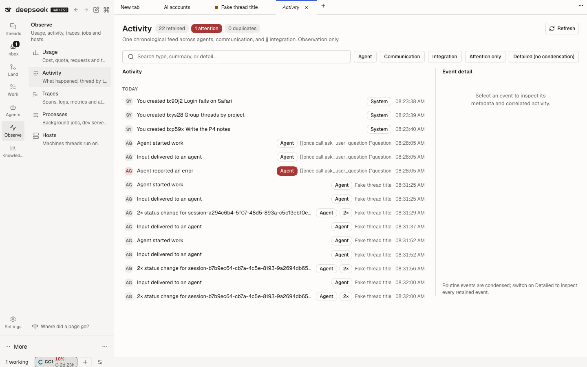
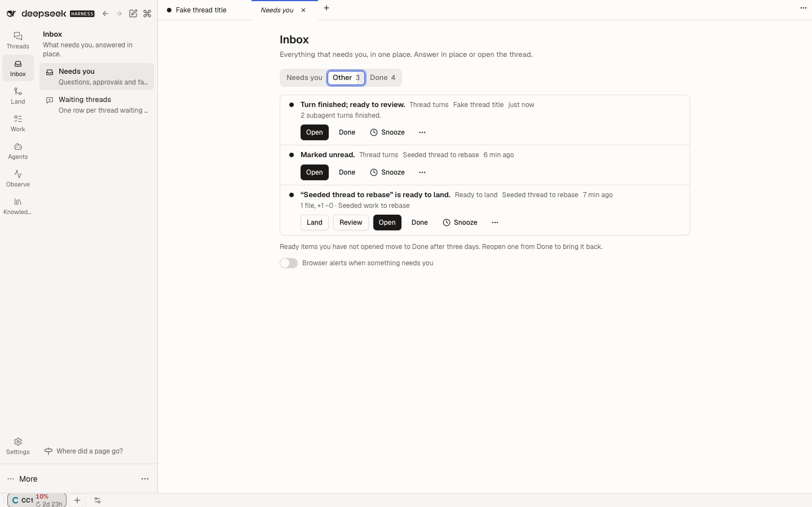
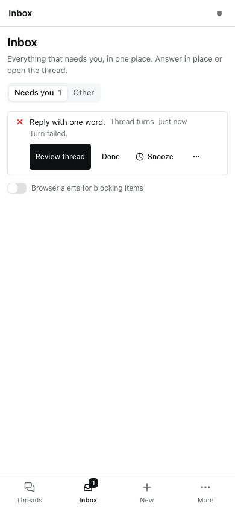

# DSH activity timeline



One chronological activity feed across agents, sessions, communication, and jj
workspaces — a shared activity room rather than another thread list. Observation
only: it never activates, messages, or steers an Agent.

Open the reusable **Activity Timeline: Activity** view from navigation or the Workbench chooser.

## Inbox: one place for everything that needs you





The plugin also owns the attention inbox of [the ADE plan](../../../plans/ade-ux/README.md#48-the-attention-model)
(Phase 2a). The **Inbox** entry in the left navigation (a temporary home until the Phase 3 rail) carries the only
badge, the Needs you count. The page has **Needs you** (blocking and failed items) and **Other** (ready items) tabs,
plus **Snoozed**, **Done** and **Muted** when they hold items. Each row shows a severity glyph, the reason, the source,
a link to the thread and its verbs inline: answer choices, Open, Done, Snooze (1 h, 4 h, tomorrow, until it changes)
and Mute source. The history tabs offer Reopen, Unsnooze and Unmute, so every user transition can be undone. Browser
alerts for new blocking items are opt-in, per browser, below the list.

### The attention contract

Providers import the `@dshfiles/activity-timeline/attention-api` dshx module (one-way dependency; the inbox never
imports a provider) and call it from their Host half with `HostApis.client(attentionApi)`:

| Method                                                                                | Who                                                                                            | What                                                                                                                                                                                                                                    |
| ------------------------------------------------------------------------------------- | ---------------------------------------------------------------------------------------------- | --------------------------------------------------------------------------------------------------------------------------------------------------------------------------------------------------------------------------------------- |
| `publish({ source, dedupeKey, subject, reason, detail?, severity, verbs, choices? })` | provider                                                                                       | Add or merge one item. Same source + key merges; an unchanged repeat writes nothing; a changed one lifts a Done or a snooze-until-change; a publish after resolve reopens it as a new occurrence. `info` goes to the Activity log only. |
| `resolve({ source, dedupeKey })`                                                      | provider                                                                                       | The underlying state changed (answered elsewhere, retry passed).                                                                                                                                                                        |
| `reconcile({ source, items })`                                                        | provider                                                                                       | State every open item of one source; unlisted open items resolve. Providers call it on start, on `dshfiles/attention/ready` and on every change of their own state.                                                                     |
| `list({ view?, limit? })`                                                             | anyone · tool `attention_list`                                                                 | One view plus every view's count and the muted sources.                                                                                                                                                                                 |
| `done` / `snooze` / `reopen` / `muteSource`                                           | user · tools `attention_done`, `attention_snooze`, `attention_reopen`, `attention_mute_source` | User transitions; each is reversible. A resolved item cannot be reopened by hand.                                                                                                                                                       |
| `act({ id, verb, choiceId? })`                                                        | user                                                                                           | Answer, Approve, Land, Retry or Resume, handed to the owning provider through the `dshfiles/attention/act` serial Cordis event.                                                                                                         |

Severities follow plan §4.7: `blocking` and `failed` are Needs you, `ready` is Other, `info` never reaches the inbox.
Items live in the `dshfiles_attention` storage domain (bounded at 2000; closed items kept seven days). Browsers follow
the `changed` event, which carries the new Needs you count, and fall back to polling while the event stream is down.

First providers: `@dshfiles/agent-questions` (pending child-to-parent questions are blocking items about the parent
thread, answerable in place with the question's options) and `@dshfiles/thread-sidebar` (unacknowledged finished turns
are Ready, or Failed for an error or the token limit; opening the thread resolves the item).

## Data flow

```
core agent events ──────┐
communication ───────────┤
jj integration + workspaces ─┤
Project Checks receipt ─────┴─► cordis 'dshfiles/activity/event' ─► validate + dedupe ─► durable store ─► condense ─► page API ─► Activity panel
Project Checks startup replay ◄── bounded receipt backfill
```

Sources are decoupled: the timeline listens on Cordis events and never reads
another plugin's state file or service. `@dshfiles/jj-integration` and
`@dshfiles/agent-communication` emit structured events; core
`agent/created|disposed|status|error|inbox/inserted` are mapped directly.
Project Checks emits only a strict v1 receipt summary after persistence and
answers a bounded backfill from its own receipt store. Timeline requests replay
on startup and after `dshfiles/activity/source-ready`, so either plugin boot
order works; receipt-derived event IDs dedupe overlapping replay.

## Normalized event

`{ id, at, source: session|communication|integration|system, type, level:
routine|notable|attention, sessionId, workspaceId, taskId, correlationId,
causationId, summary, detail, metadata, references[{kind,id,label}],
provenance: observed|reported }`. IDs come from the source (message ID, call ID,
integration event ID, or receipt-derived ID) so duplicate delivery dedupes.
Verification metadata carries only recorded before/after revision facts; current
freshness is not inferred from a historical event. Missing optional metadata is
normalized to `null`.

## Persistence and replay

Private JSON under `$DSH_HOME/runtime/dshfiles/activity-timeline/state.json`
(mode 0600, atomic rename, bounded to 5,000 events). The store is the replay
source across restarts; adapters can be re-fed historical payloads into the same
model. Schema version 1 is validated on read; malformed payloads are rejected,
unknown state shapes fail closed without being overwritten.

## Condensation

Deterministic, no LLM. Routine runs of the same type and session within ten
minutes collapse into a traceable group (`N× label for <session>`); consecutive
notable events sharing a correlation id collapse into a related group. Attention
events and named milestones (`session.error`, `session.input`,
`communication.message`, all `integration.*`, `verification.cancelled`, and
`workspace.ready|missing`) are always individual. The one exception is a burst
of `workspace.sync_refused` events (jj-integration's safe "checkout kept as is"
refusals): those with the same checkout and the same reason within thirty
minutes fold into one attention row (`N× <summary>`), placed at the newest one.
Selecting it shows the count, and **Detailed** expands each event. Folding is
read-only: nothing is retried or rebased. Every group carries the ids of its
members, and the `detailed` filter expands every retained event.

## UI

Activity panel in `main` with a compact toolbar (search, source toggles,
attention-only, detailed), a chronological feed (oldest top, newest bottom),
auto-scroll only when already near the bottom, a new-events indicator, jump to
latest, "load older" cursor pagination, and a detail drawer with metadata,
references, provenance, and correlated events. When an event names a Session,
"Open Session" navigates through the public Client workspace API only if that
Session is in the current Host list. Missing or archived Sessions show an
unavailable message without being revived or changed. Verification detail is a
historical summary; open Project Checks for live source freshness and the full
bounded receipt. Configuration equivalence is explicitly unknown.

## Agent tools

`activity_timeline_page`, `activity_timeline_attention`,
`activity_timeline_stats`, `activity_timeline_related` — all read-only.

## Known limitations

- Session coverage is lifecycle-level (created/disposed/status/error/input);
  turn-level tool calls are not yet emitted by core, so the adapter boundary is
  ready but that source is deferred.
- The panel polls the newest page every 5s; a push/stream subscription is the
  next step (the page API is already incremental via cursor).
- Thread/workspace references remain badges. Session navigation checks the
  complete Workspace archive snapshot and current Host session list before
  calling `uiWorkspace.openSession`; it fails closed while the archive snapshot
  is pending. Archived or missing Sessions show the same unavailable message;
  navigation does not open, wake, restore, or message them. The archived path is
  browser-tested; the installed `ISessions` contract has no delete operation,
  so no test-only orphan mutation is used for missing-ID UI coverage. See the
  [verification evidence guide](../../../docs/verification-evidence.md) for the
  cross-plugin security review and verification details.
- Scratch journeys cover the feed, condensation, manual and automatic verification
  projection, retry attempts, cancellation as notable/non-failure, revision
  privacy, Session navigation, restart/backfill dedupe, and Project Checks
  operation without Timeline. Manual and retry/cancellation journeys exercise
  both plugin boot orders.
- Run `pnpm check:e2e @dshfiles/activity-timeline` and
  `pnpm check:e2e @dshfiles/project-checks` from the repository root.
