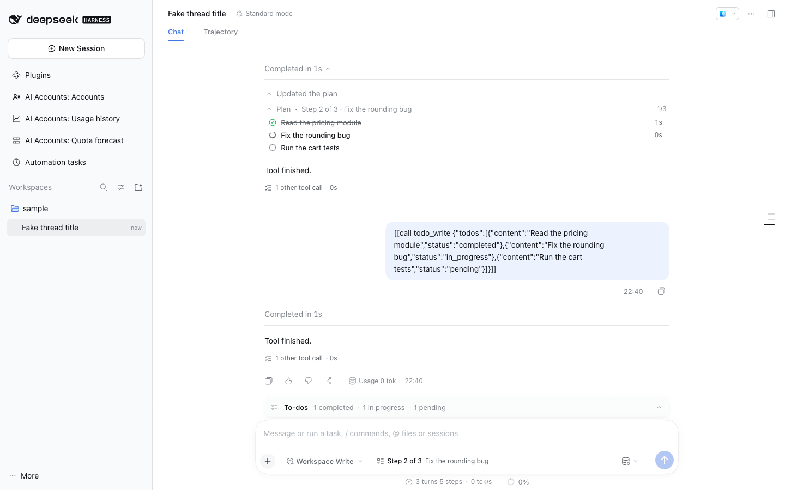
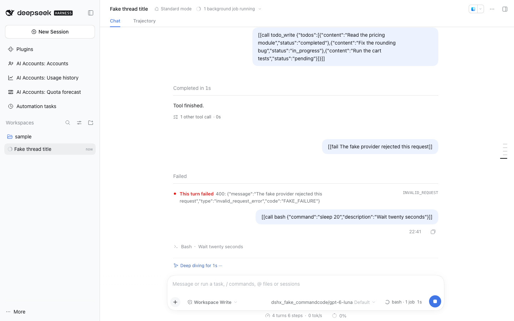
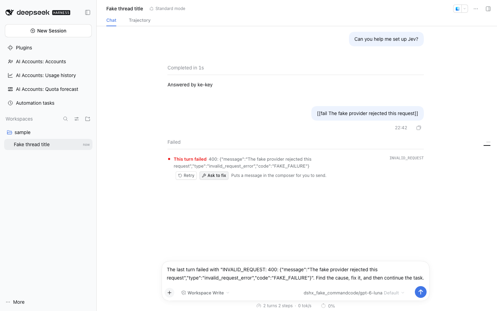

# @dshfiles/agent-plan

Agent work you can read at a glance, in the transcript and beside the composer:

- **Plan card.** Each `todo_write` call is drawn as a plan: "Step 2 of 3 · Fix the rounding bug", expanding to every step with a done / active / pending glyph and how long it took. A call the card cannot read, or that failed, shows the native todo row.
- **Pinned step.** While the latest turn's plan has steps left, a chip beside the native plan-mode control says "Step 2 of 3 · Fix the rounding bug · 12s" and opens the whole plan.
- **Live activity strip.** While anything runs, a strip beside the native composer activity names it — the running tool call, background jobs, subagents — with a live timer, and opens the full list with a timer per row. It renders nothing while idle.
- **Failure card.** Under a native turn-error row, and under a model-retry row once retrying gave up, a bar shows the retry count and two actions: **Retry** puts a retry request in the composer, **Ask to fix** inserts the failure with a request to fix it. Neither sends: you review and send. Stopped or interrupted turns get no actions.

Built with dshx (no port). The view ideas come from affectUI Agent Plan, AI Elements `plan` / `queue` and Agent Elements TodoTool, used as design reference only; no code is copied. Run `pnpm build`, `pnpm test` and `pnpm typecheck` from this package.

## Settings (`dshfiles-agent-plan`)

All apply live. Turning a card off restores the native view.

| Key             | Default | Meaning                                                                    |
| --------------- | ------- | -------------------------------------------------------------------------- |
| `enabled`       | `true`  | Master switch for every card below.                                        |
| `planCard`      | `true`  | Draw `todo_write` calls as the plan card instead of the native todo row.   |
| `stepTiming`    | `true`  | Show how long each step took.                                              |
| `pinnedStep`    | `true`  | Pin the current plan step beside the composer.                             |
| `activityStrip` | `true`  | Show what runs now beside the composer controls.                           |
| `failureCard`   | `true`  | Add the retry count and Retry / Ask to fix under failure rows.             |

## How it works

- **Data.** Two Conversation Definitions on `ctx.uiConversation`, each with its own view target, read Session events only:
  - `dshfiles-agent-plan` keeps every loaded `todo/write` event (its list, `time` and turn). Step timing follows the plan's lineage: walking back from a write while each earlier write shares a step with the next, so a plan rewritten across turns ("continue") keeps its timing and an unrelated plan starts fresh. A step starts at the first write showing it in progress and ends at the first write showing it completed.
  - `dshfiles-agent-activity` folds `tool/call`, `tool/result`, `job/registered` and `job/settled` into what runs now; a turn boundary closes calls an interrupted turn left open. Jobs whose kind names an agent count as subagents.
  - Components read them through `uiConversation.binding(sessionId).target(...)`, which activates the target for that Session on first read.
- **Seats.** Every native occupant here takes injected props a shadowing entry could not supply (the todo row's `todoHistory` hook, the plan-mode chip's `exitPlanMode`, the voice input's actions), so the plugin wraps the occupant in place, as `@dshfiles/tool-meta` does for the tool-call tree: the ledger renders the wrapper with the native props, and the wrapper draws ours beside or over the native view.
  - `tool.call.toolview` key `todo_write`: the plan card, with the native row as the fallback.
  - `conversation.input.plan` and `conversation.input.activity` are single slots held by native controls: the pin and the strip render **beside** the occupant, never instead of it. Where no native control holds the seat, the plugin's own entry (priority 100, losing to any native one) shows the chip alone.
  - `conversation.chat.node` keys `turn-error` and `model-retry`: the native row stays as drawn, the failure bar goes under it.
- **Actions.** Retry and Ask to fix use the dshx `Composer` contract (`setText` / `insert`, then `focus`), provided by `@dshfiles/rich-composer`. Without a provider the actions are hidden and only the retry count shows.

## Limits

- Queued messages are not counted in the activity strip: the native queue dock above the composer already lists them.
- Background jobs registered before the loaded history window are not listed until their next event.
- Retry does not resend the failed request; it writes a message you send, so the next turn starts fresh.
- The pin follows the native todo dock: a plan from an earlier turn is not pinned once a new turn starts.
