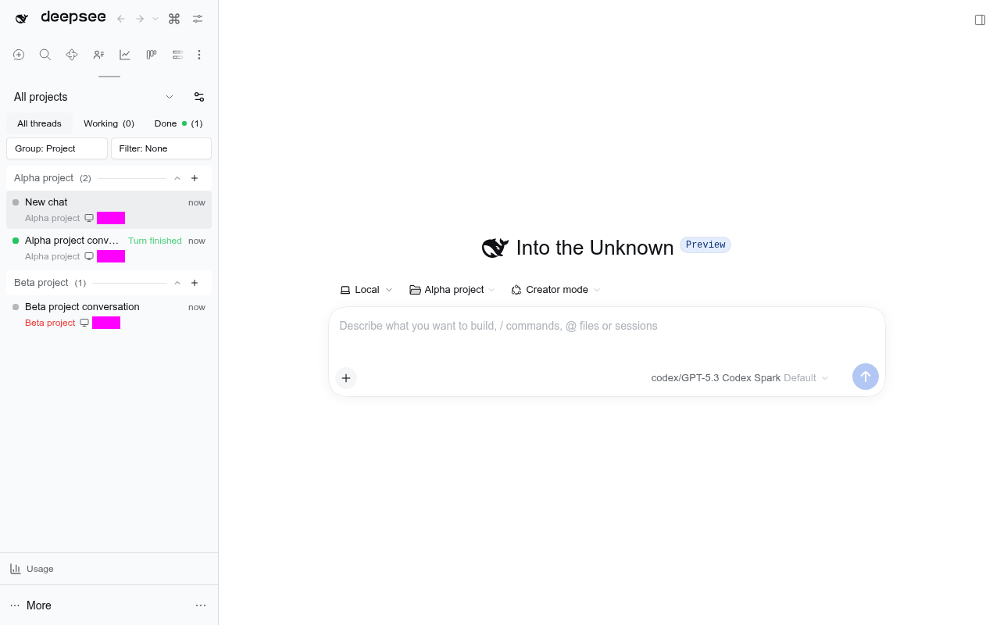

# @dshfiles/agent-preset



Whole native Loader-row fork of `@deepseek-ai/dsh-client-ui-agent-preset` from stock DSH `0.2.1-rc.2`.
The native preset seat's private stage/apply controller cannot be replaced through an additive slot.
This owned replacement preserves its UI, roster, header label, Settings section, composition viewer,
Coding Tools gate, refusal handling and both Creator entry points. No DSH core changes or private imports.

## Local choices, one owner

- The chip reads `ctx.sessionDrafts` through the canonical
  `@dshfiles/session-controller/draft-client` contract, not a second local draft store.
- A selection on a local identity calls `stagePreset` only. It does not call `agentPresets.select`,
  create a Session, or materialize an empty draft. The caption follows staged choice, local metadata,
  then the Host-effective default, rather than the provisional Session's stale projection.
- The same path handles a Settings default synchronized to its captured blank and a staged Creator
  choice. Creator navigation also passes `agentPreset: 'cordis'` through native `startSession` options;
  the owned controller carries that into `SessionCreateRequest` when content first materializes it.
- A Creator stage is fenced against the previous blank identity while navigation publishes its destination.
- Draft metadata and Session-list subscriptions share the binding's lifetime. A stage is cleared before
  metadata publication so synchronous subscribers cannot repeat it.
- A materialized Host blank still uses native `agentPresets.select`; a started Session cannot swap presets.
  The controller owns late choices while creation is pending. This plugin never introduces a competing
  per-id mutation path for a local draft.

Draft staging is presentation state, not an agent tool. Host preset selection and Settings keep their
existing native capabilities; the Host half of this UI row remains inert.

## Composition and installation

[The bundle patch](cordis.patch.yml) disables stock `ui-agent-preset` and inserts
`dshfiles-agent-preset`. Profile composition must keep **only this owner** active, alongside owned
`@dshfiles/session-controller` (providing `sessionDrafts`) and `@dshfiles/workspace-nav` (local creation).
The browser entry explicitly injects `sessionDrafts`; its absence leaves the row pending, never silently
falling back to the broken local-id Host RPC.

[The manifest](package.json) uses exact/catalog versions, workspace dependencies, a strict root
tsconfig, and `build`, `test`, `typecheck` scripts. Install from the repository root with the frozen
lockfile, then opt into the bundle in the desired profile. This contribution does not change a
profile, install globally, restart DSH, or update the running Host.

## Provenance and updates

- Upstream: <https://github.com/deepseek-ai/deepseek-harness>, `packages/client/ui-agent-preset`.
- Version/ref: `0.2.1-rc.2` / `dsh-v0.2.1-rc.2`, commit `687f282e8625c6b8d11ff58211a90524be2e4317`.
- MIT license retained in [LICENSE](LICENSE).
- [native-fork.json](native-fork.json) maps the browser snapshot, inert Host entry, CSS declarations and locale assets.
- Only [native registration](src/native/index.ts) and [seat controller](src/native/seat-store.ts) carry deltas.
  Native components/styles and Settings controller are unchanged.

On an upstream bump, run `node scripts/native-fork-diff.mjs agent-preset --to <new-tag>`, copy unchanged
files, reapply the two recorded deltas, update provenance, and rerun the focused tests plus the scratch journey.

## Verification

```sh
pnpm --dir plugins/@dshfiles/agent-preset typecheck
pnpm --dir plugins/@dshfiles/agent-preset test
pnpm --dir plugins/@dshfiles/agent-preset build
node -e "import('./plugins/@dshfiles/agent-preset/dist/index.js')"
node scripts/native-fork-diff.mjs agent-preset
```

[Controller tests](tests/draft-preset.test.ts) cover local/Host choices, stale provisional projections,
subscription reentry, captured Settings defaults and Creator stages. [Registration tests](tests/registration.test.ts)
exercise native wiring and both Creator callbacks with UI components stubbed (not a rendering proof).
The scratch scenario `thread-sidebar.pretyping-draft-choices` verifies real model/preset choices
before typing and captures the screenshot above. A source/package build alone does not prove
profile boot, native rendering, or the full first-content creation path.
