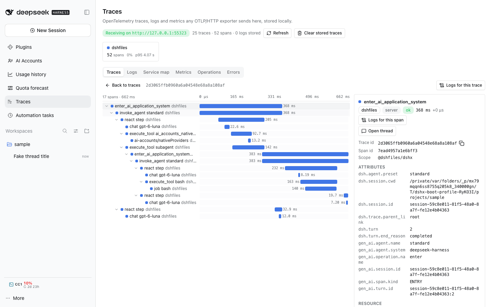

# @dshfiles/agent-telemetry



OpenTelemetry GenAI spans for every DSH agent turn, ReAct step, model call and tool call, exported through
[`@dshfiles/dshx/tracing`](../../../tooling/dshx/docs/guides/tracing.md) to the `OTEL_EXPORTER_OTLP_*` endpoint or the
in-process receiver of [`@dshfiles/traces`](../traces/README.md). Host only; row `dshfiles-agent-telemetry`.

Choice: **port**. [`@loongsuite/dsh-plugin`](https://github.com/loongsuite/dsh-plugin) 0.1.3 (Apache-2.0) already
mapped DSH events to the GenAI semantic conventions; this keeps its span names and attributes so any GenAI-aware
viewer reads the data, and fixes what its design could not do here (it built spans after the fact on a private SDK
provider, so nothing a tool did nested under it; every turn and every subagent was its own trace; it skipped model
calls with a purpose; it needed `OTEL_EXPORTER_OTLP_ENDPOINT` at launch). Provenance, the kept behaviour and the delta
are in [UPSTREAM.md](UPSTREAM.md); the licence in [LICENSE](LICENSE) and [NOTICE](NOTICE).

## The trace of one turn

```text
enter_ai_application_system            server   dsh.session.id, dsh.turn, dsh.trace.parent_link
└─ invoke_agent <agent>                 client   gen_ai.usage.* totals, gen_ai.response.finish_reasons
   ├─ chat <model>                      client   dsh.llm.purpose=session-title (a title call)
   └─ react step                        internal gen_ai.react.round, gen_ai.react.finish_reason
      ├─ chat <model>                   client   one per attempt: gen_ai.request.model, usage, TTFT
      ├─ llm retry wait                          dsh.llm.retry, delay, error.type
      ├─ execute_tool ai_accounts_native_providers
      │  └─ ai-accounts/nativeProviders server   (dshx API dispatch: nests because the tool body runs in its span)
      └─ execute_tool subagent
         ├─ approval wait                        dsh.approval.outcome
         ├─ job bash                    producer background job until it settles
         └─ enter_ai_application_system          the subagent's turn: same trace, dsh.trace.parent_link=async-context
            └─ invoke_agent … → react step → chat / execute_tool …
```

Also: `compaction` (with its `chat` call, `dsh.llm.purpose=compaction`), `execute_tool <name>` for a `run_code`
sub-dispatch, `chat <model>` with `dsh.llm.standalone=true` for a model call outside a step (a plugin's own call
nests under the plugin span that made it), and `dsh.inbox.spliced_messages` on `invoke_agent`.

Every span carries `dsh.session.id`. A top-level thread or a user fork starts one trace per turn; a subagent's turns
join their parent's trace under the delegation tool span. `dsh.trace.parent_link` says how the parent was found:
`async-context` (DSH started the turn inside the parent's tool body), `created-in-tool`, `running-tool`,
`parent-turn`, or `root`.

## List-price cost on model spans

Each `chat <model>` span with token usage carries `dshx.cost.usd` (and `dshx.cost.price_id`, the models.dev
`provider/model` the price came from); `invoke_agent` carries the sum of its turn's calls. Prices come from AI
Accounts' models.dev cache (`$DSH_HOME/plugins/ai-accounts/pricing.json`) and its account kinds, resolved by the same
`@dshfiles/ai-accounts/pricing-catalog` and `cost-estimate` code the usage ledger and memory digests use, so a span's
cost matches the Usage panel's request row. Subscription routes are priced at list price, like the Usage panel. A
route with no price leaves the attribute off rather than writing 0. The catalog and kinds reload every 5 minutes in
the background (every 30 s while no catalog exists yet, as on a fresh home before AI Accounts first fetched it); pricing never waits on disk or another plugin, and a pricing failure is logged and leaves the span
unpriced.

Why at span end, here, rather than at query time in the traces viewer: the cost then reaches every OTLP destination
(a collector, Langfuse, Tempo), not only the in-DSH viewer; the viewer only sums one attribute; and the price is the
one in force when the call ran. The trade-off is that spans recorded before this change, or by a sender without it,
show no cost.

## What any plugin gets for free

No per-plugin code: the `tools/execute` hook runs every agent tool body (dshx-bound or `defineTool`, any owner) with
its `execute_tool` span active, and `llm/stream` pulls every model chunk with its `chat` span active. So dshx API
dispatches, `jj` runs, secret lookups, Jev requests and multi-host calls made inside them land in the same trace. A
plugin that wants its own span adds one line with `withSpan` and asserts it with `recordSpans()`; see
[Add tracing to a plugin](../../../tooling/dshx/docs/guides/tracing.md#add-tracing-to-a-plugin).

A plain `defineTool` that calls its own code directly (no dshx API dispatch, no subprocess helper) shows as one
`execute_tool` span with nothing under it until it adds a `withSpan`.

## Enabling

Always loaded, no environment gate. Spans are no-ops until dshx tracing has a destination: an
`OTEL_EXPORTER_OTLP_ENDPOINT` / `OTEL_EXPORTER_OTLP_TRACES_ENDPOINT` in the Host environment, or the traces plugin's
receiver once it listens. Installing or removing the row takes a DSH Host restart; the destination can appear later
without one.

## Settings (`dshfiles-agent-telemetry`)

| Setting          | Default       | Effect                                                                                                                                                                                                                                                                                                                                    |
| ---------------- | ------------- | ----------------------------------------------------------------------------------------------------------------------------------------------------------------------------------------------------------------------------------------------------------------------------------------------------------------------------------------- |
| `captureContent` | `environment` | `off`: metadata only. `on`: prompts, replies, system prompt, tool definitions, arguments and results go on spans as GenAI JSON, each value cut to 1,024 characters (a `{ truncated }` marker beyond). `environment`: on only while `OTEL_INSTRUMENTATION_GENAI_CAPTURE_MESSAGE_CONTENT` is `SPAN_ONLY` or `SPAN_AND_EVENT`. Applies live. |

By default no message text, tool argument, tool result, approval reason, job label or provider error message leaves
the Host; span status messages are error types or codes. The traces viewer also stores GenAI content as its size while
its `redactGenAiContent` is on.

## Agent tools

None. The plugin serves no user verb: its only state is the setting above, which the generic `settings_set` tool
already writes, and its output is read through the traces plugin's `traces_*` tools.

## Limits

- No GenAI metrics (`gen_ai.client.*`); the usage plugin pushes the ledger's token and duration metrics.
- The step span is not the active context (DSH has no around-step hook); work between a model call and the tool calls
  it requested parents to the step only through the spans above.
- Waits DSH records no paired event for have no span: a timed `ask_user_question` (its tool span ends at `pending`),
  queued input before its turn, a quota-blocked turn and its later resume. See
  [Host gaps](../../../plans/dsh-host-gaps.md).

## Checks

```sh
pnpm --dir plugins/@dshfiles/agent-telemetry test        # coordinator and mapping, with the dshx recordSpans() kit
pnpm --dir plugins/@dshfiles/agent-telemetry typecheck
DSHX_E2E_ONLY=agent-telemetry node --run check:e2e      # a real turn with a tool and a subagent on the fake provider
```
