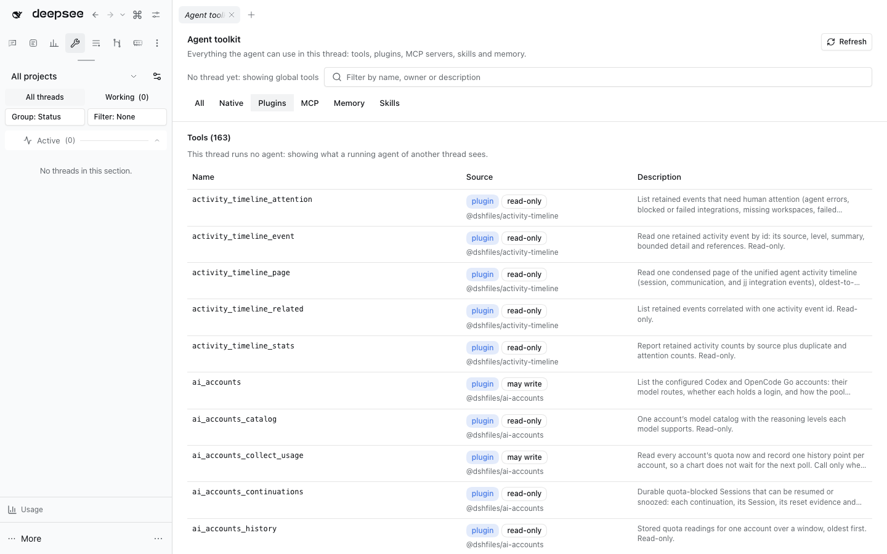

# @dshfiles/agent-toolkit



An **Agent toolkit** main panel (sidebar, or the command palette's _Open the agent toolkit_) showing what the agent
can use in one thread. With `@dshfiles/main-tabs` it opens as a tab like any panel. It replaces the Tools tab that
`@dshfiles/plugin-marketplace` drew under Settings › Built-in plugins.

The page is about the thread the palette was opened from, else the last thread the main view showed; a selector
switches to another recent thread. Search and a source filter (All, Native, Plugins, MCP, Memory, Skills) narrow every
section.

| Section     | Source                                                                          | Shows                                                                                                                                                                                  |
| ----------- | ------------------------------------------------------------------------------- | -------------------------------------------------------------------------------------------------------------------------------------------------------------------------------------- |
| Tools       | `dshxRegistryApi.list({ sessionId, cwd })`                                      | every tool the thread's agent sees (global tools when none runs), tagged native, plugin (with owner), MCP or memory, plus the read-only marker and the tools its preset restricts away |
| Plugin APIs | the same registry listing                                                       | the methods plugins serve each other (`useApi`, `createHostApiClient`), with the agent tool each is exposed as                                                                         |
| Plugins     | the Session Remote's `pluginInventory.list()`, versions from this plugin's Host | each Loader entry, ours first, with its version, state and a link to its settings page (`dshfiles:open-settings`)                                                                      |
| MCP servers | `@dshfiles/mcp-servers/api` `list`                                              | each server's status and its `mcp__<server>__*` tools                                                                                                                                  |
| Skills      | the same registry listing                                                       | Host-reported origin, provider and invocation mode across project, user, runtime, custom and bundled skills; absolute paths stay on the Host                                           |
| Memory      | `@dshfiles/memory/api` `startBlock({ cwd })` and `notes`                        | the block a new thread of the project gets now, note counts by type, and a link to the Memory panel                                                                                    |

"Native" is DSH's own tools and any plugin not built with dshx: the tools registry does not record who registered a
tool, so only dshx Hosts (`defineHost({ tools })` and API methods) name their owner. "Read-only" is the tool's own
claim that it can run beside sibling calls (dshx `readOnly: true`); a classifier may still refuse some arguments.

A section whose plugin is not loaded says so instead of failing the page. A registry served by older dshx lacks
read-only, restriction, source and invocation fields; missing skill origin is shown as `other` rather than guessed from
CWD or path, and missing user invocation defaults to true. Modern Hosts omit absolute skill paths, and the client drops
legacy path fields before rendering.

## Host

One API, `agent-toolkit.versions({ packages })`: the version of each package as the current profile resolves it,
reading `package.json` from the profile's `node_modules` and from each `@deepseek-ai` bundle's own location (DSH's
built-in plugins are those bundles' dependencies). Unknown packages map to `null`.

## Verify

```sh
pnpm --dir plugins/@dshfiles/agent-toolkit test
dshx dev up --name agent-toolkit --plugin @dshfiles/agent-toolkit --plugin @dshfiles/memory --plugin @dshfiles/mcp-servers --plugin @dshfiles/command-palette --plugin @dshfiles/thread-sidebar
dshx dev open agent-toolkit/agent-toolkit-page --name agent-toolkit
```
