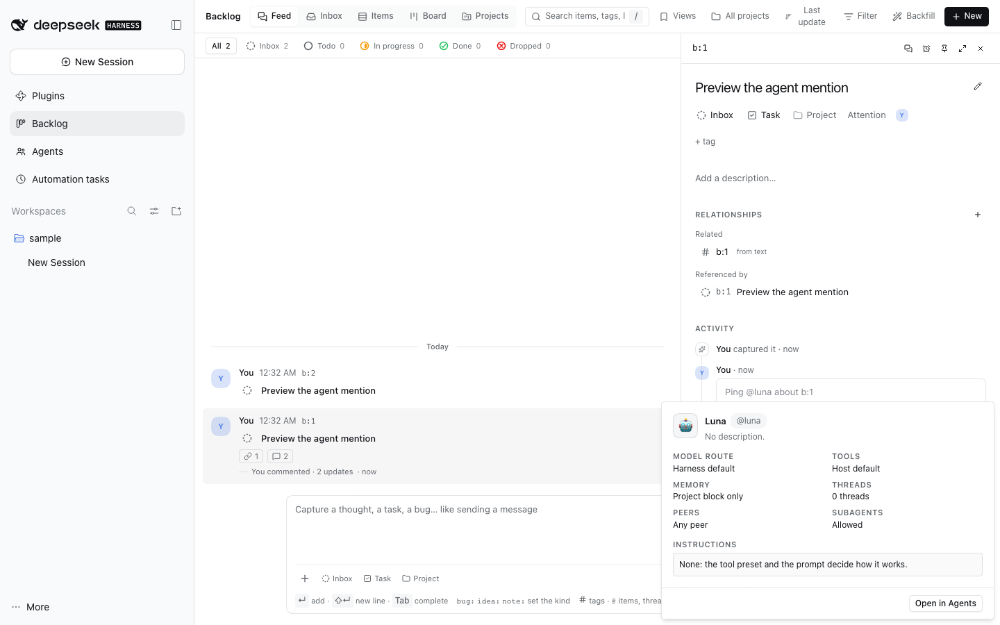
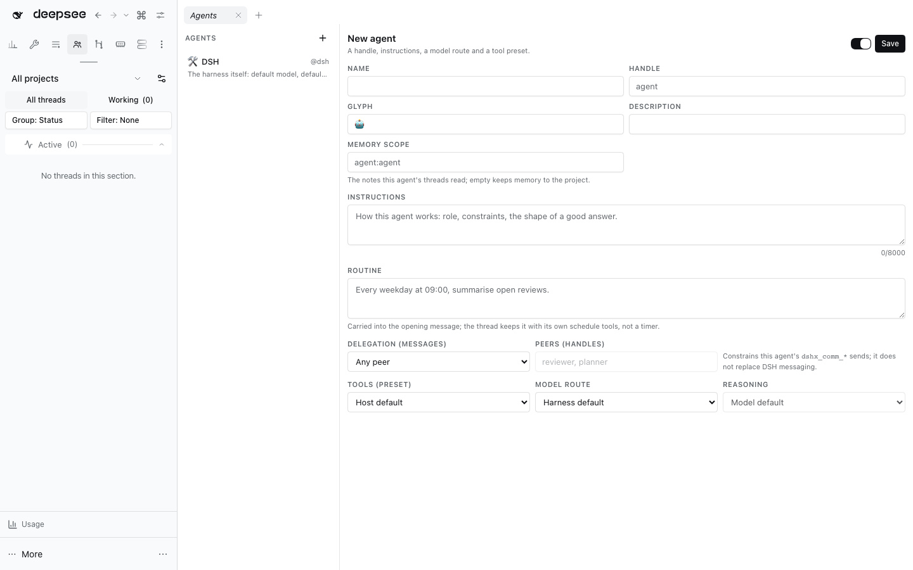

# @dshfiles/agents





Persistent, mentionable agents. An agent is saved configuration — identity, instructions, model
route and Agent preset — that dispatches an **ordinary DSH thread** when you mention its handle
where a thread starts.

- **One handle namespace.** `@dsh` ships built in and pins nothing, so it means “the harness
  itself”. A custom agent (`@reviewer`, `@frontend`) can pin a provider route and reasoning effort.
- **Dispatch, not a second runtime.** Starting a thread is DSH's own create → select model →
  rename → prompt sequence, with `agentPreset` from the agent; `@dshfiles/jj-integration` still
  gives the thread its workspace.
- **Instructions ride the opening message.** With no mid-thread system-prompt injection on stock
  DSH, the agent's instructions are the first part of the dispatch prompt, bounded to 4,000
  characters.
- **Where mentions mean something.** A backlog item comment whose first token is `@handle` starts
  that agent's thread for the item (the comment is recorded and the thread linked). The dispatch never
  takes you to that thread: the backlog reports it in a toast whose **Open** action shows it. The backlog's
  Start thread dialog also picks an agent, which replaces its account/model fields with the agent's
  preset, route and instructions. Inside a running thread the same text is a mention the Agent
  reads, because a preset and system prompt are fixed when the thread is created.
- **The `@` menu.** `@agent:` (or `@a:`) lists agents right away; a partial handle such as `@rev`
  lists matching agents beside files and threads. A plain `@` stays with files and threads.
- **Every mention is a preview.** A rendered `@{handle}` explicit reference (and legacy `@handle` mention)
  that names a saved agent is a link: clicking it (or pressing Enter) opens a card above the reference with its glyph, name, description, model route,
  tool preset, memory scope, delegation, routine, instructions and recent threads, plus **Open in
  Agents**. Sent messages both ways are covered — the conversation's own `@handle` chip and the plain
  mention in Markdown, so a backlog item's comments work too. An unknown, misspelled or removed handle
  stays plain text, and a code block or the composer is left alone.
- **A memory scope of its own.** An agent may name a memory scope (`agent:<handle>` by default). `@dshfiles/memory`
  reads it through this plugin's contract for every thread the agent started, and a subagent inherits it from the
  thread that spawned it, so those threads carry the project block plus that scope's notes; memory keeps one store and
  one scope column.
- **Routines ride DSH's schedules.** An agent may carry a routine line (“Every weekday at 09:00, summarise open
  reviews.”). It is part of the opening message, which tells the thread to keep it with its own `schedule_*` tools, so
  the reminder lives in DSH's session-scoped schedule store. The panel lists the schedules that belong to the agent's
  threads and opens one. There is no scheduler, timer or delivery path in this plugin.
- **Delegation targets are enforced where a message is sent.** An agent declares whether its threads may message any
  peer, only listed handles, or nobody. `@dshfiles/agent-communication` resolves both sides through this plugin's
  contract before it stores a `dshx_comm_send`, and refuses an unlisted peer with a reason naming both handles. A
  broadcast has no single peer, so `listed` allows it and `none` refuses it. A separate switch allows or forbids the
  agent's threads from creating subagents or starting a workflow: a synchronous `tools.guard` denies those calls before
  dispatch. The native delegation tools take no agent target, so only creation can be gated, not which agent a child
  would be.
- **Thread history is durable.** A dispatch records its Session in the agent's `threads` table, so
  the panel lists the threads an agent started (and opens one) after a Host restart, and the usage
  counters are read back from storage rather than recomputed per page load.
- **One Host contract.** `@dshfiles/agents/contract` exports the schemas, mention parsing and
  dispatch composition so the backlog links a thread with the same rules instead of restating them.

The reusable directory view is **Agents: Directory** in navigation and the Workbench chooser.

## Surfaces

| Surface              | Behavior                                                                                                                                          |
| -------------------- | ------------------------------------------------------------------------------------------------------------------------------------------------- |
| Agents sidebar panel | List, create, edit, enable/disable and remove agents (the built-in `@dsh` is not removable), start a thread, and open a thread the agent started. |
| `@` menu             | An `Agents` group in every composer; `@agent:` / `@a:` scopes the menu to agents. Picking inserts `@handle `.                                     |
| Agent tools          | `agents_list`, `agents_get`, `agents_threads`, `agents_save`, `agents_remove` (destructive, explicit opt-in).                                     |
| Mention preview      | A rendered `@handle` opens a card with the agent's details and threads; **Open in Agents** selects it in the panel.                               |

## Decisions

- **One handle namespace; a model is a property of an agent.** `@reviewer` may pin `codex/gpt-6-luna`, and the built-in
  `@dsh` pins nothing, so it means "the harness itself". Rejected: a separate raw `@model`/`@account` mention type —
  two mention kinds for one concept make the `@` menu ambiguous and double the parser.
- **An agent is configuration, not a runtime.** Dispatch creates an ordinary Session and reuses the existing
  create → select model → rename → prompt → link sequence. No new loop, tools or storage of conversation state.
- **Dispatch belongs to thread-creation surfaces.** A preset is chosen only at `sessions.create` and no supported verb
  re-composes a live Session, so `@handle` dispatches from a backlog comment, the start-thread dialog and the panel;
  inside a running thread the same text stays a mention the Agent reads.
- **Instructions and routines ride the opening message.** There is no mid-thread system-prompt injection, so the
  preamble is part of the first message and bounded by the 4,000-character limit; the task always survives truncation.
- **One Host contract, imported.** `@dshfiles/agents/contract` exports the schemas, mention parsing and dispatch
  composition; backlog, memory and agent-communication call it instead of restating it.
- **Every verb is a tool.** The agent tools are the panel's verbs: `agents_list`/`agents_get`/`agents_threads` are
  read-only, `agents_save` runs only when the user asked, and `agents_remove` takes an explicit `confirm: true`.

See [research.md](docs/research.md) for the reference-product comparison and the Host boundaries (ledger rows 71–74).

## Limits

- 100 agents, 8 KB of instructions each, 32-character handles (`^[a-z][a-z0-9-]{0,31}$`).
- A handle is the identity: it cannot be renamed after creation.
- 50 threads are kept per agent, newest first; an older row is pruned on dispatch.
- Memory, routines and delegation targets are per agent (see above). Delegation target _handles_ apply to messaging;
  subagents and workflows are allowed or refused as a whole, because the native tools expose no target to filter.
- A routine is text, not a parsed rule: the thread decides the timing with the schedule tool, so the schedule record
  stays the single source of truth and the panel reads it back from the Host's catalog.

## Development

```sh
pnpm test
pnpm typecheck
pnpm build
DSHX_E2E_ONLY=agents node --run check:e2e    # from the repository root
node --run screenshots -- --only agents       # refresh docs/screenshots/agent-registry.png
```

The journeys live in `tooling/dshx/e2e/features/agents.feature`: mention dispatch from a backlog comment, creating an
agent and keeping its settings, thread history after a reload, and inline `@` completion in the comment box.
