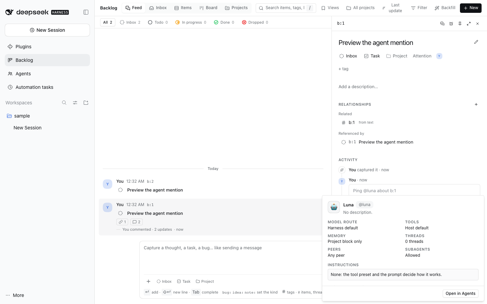
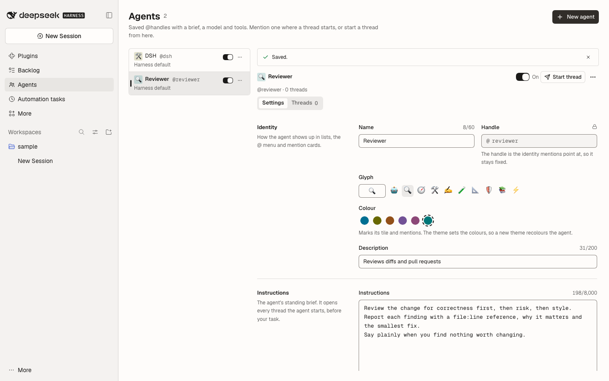
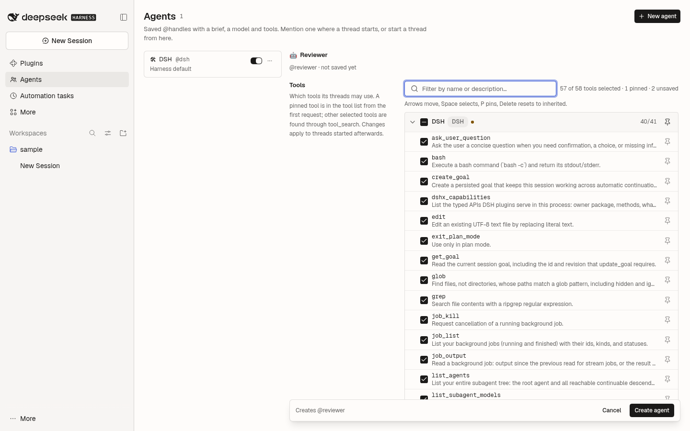
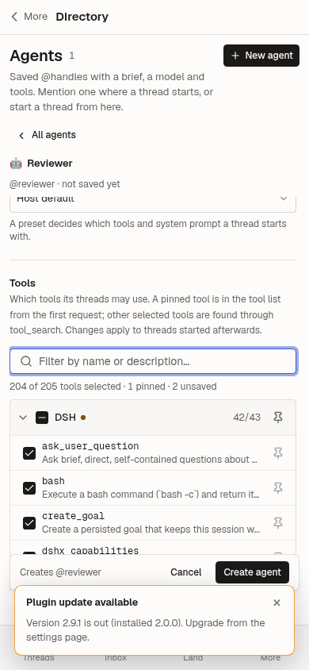

# @dshfiles/agents









Persistent, mentionable agents. An agent is saved configuration — identity, instructions, model
route and Agent preset — that dispatches an **ordinary DSH thread** when you mention its handle
where a thread starts.

- **One handle namespace.** `@dsh` ships built in and pins nothing, so it means “the harness
  itself”. A custom agent (`@reviewer`, `@frontend`) can pin a provider route and reasoning effort.
- **Dispatch, not a second runtime.** Starting a thread is DSH's own create → select model →
  rename → prompt sequence, with `agentPreset` from the agent; `@dshfiles/jj-integration` still
  gives the thread its workspace.
- **Instructions ride the opening message.** With no mid-thread system-prompt injection on stock
  DSH, the agent's instructions are the first part of the dispatch prompt, bounded to 4,000
  characters.
- **Where mentions mean something.** A backlog item comment whose first token is `@handle` starts
  that agent's thread for the item (the comment is recorded and the thread linked). If that item already links
  threads started by this agent, the backlog asks whether to queue the task in one of them or start a new thread;
  it never chooses a continuation for you. Queueing uses DSH's session controller and preserves the existing
  conversation and workspace. A continuation keeps the existing session's route, preset and instructions; agent edits
  affect only new threads. Attachments stay on the backlog item rather than being copied into the queued message. The
  backlog reports the result in a toast whose **Open** action shows the thread. The backlog's
  Start thread dialog also picks an agent, which replaces its account/model fields with the agent's
  preset, route and instructions. Inside a running thread the same text is a mention the Agent
  reads, because a preset and system prompt are fixed when the thread is created.
- **The `@` menu.** `@agent:` (or `@a:`) lists agents right away; a partial handle such as `@rev`
  lists matching agents beside files and threads. A plain `@` stays with files and threads.
- **One chip, one card.** Picking an agent in the `@` menu inserts the agent chip; a sent `@{handle}` and a
  written mention in an answer render that same chip, so the composer, sent messages and Markdown answers agree.
  Hovering the chip (or clicking it, or pressing Enter) opens the shared card with its glyph, name, description,
  model route, tool preset, memory scope, delegation, routine, instructions and recent threads, plus
  **Open in Agents**. A legacy `@handle` mention in an answer still opens the same card. An unknown,
  misspelled or removed handle stays plain text, and a code block is left alone.
- **A memory scope of its own.** An agent may name a memory scope (`agent:<handle>` by default). `@dshfiles/memory`
  reads it through this plugin's contract for every thread the agent started, and a subagent inherits it from the
  thread that spawned it, so those threads carry the project block plus that scope's notes; memory keeps one store and
  one scope column.
- **Routines ride DSH's schedules.** An agent may carry a routine line (“Every weekday at 09:00, summarise open
  reviews.”). It is part of the opening message, which tells the thread to keep it with its own `schedule_*` tools, so
  the reminder lives in DSH's session-scoped schedule store. The panel lists the schedules that belong to the agent's
  threads and opens one. There is no scheduler, timer or delivery path in this plugin.
- **Delegation targets are enforced where a message is sent.** An agent declares whether its threads may message any
  peer, only listed handles, or nobody. `@dshfiles/agent-communication` resolves both sides through this plugin's
  contract before it stores a `dshx_comm_send`, and refuses an unlisted peer with a reason naming both handles. A
  broadcast has no single peer, so `listed` allows it and `none` refuses it. A separate switch allows or forbids the
  agent's threads from creating subagents or starting a workflow: a synchronous `tools.guard` denies those calls before
  dispatch. The native delegation tools take no agent target, so only creation can be gated, not which agent a child
  would be.
- **Thread history is durable.** A dispatch records its Session in the agent's `threads` table, so
  the panel lists the threads an agent started (and opens one) after a Host restart, and the usage
  counters are read back from storage rather than recomputed per page load.
- **One Host contract.** `@dshfiles/agents/contract` exports the schemas, mention parsing and
  dispatch composition so the backlog links a thread with the same rules instead of restating them.

The reusable directory view is **Agents** in navigation and the Workbench chooser.

## The Agents panel

The page is built from the shared page kit (`Page` in fill mode, `PageSection`, `EntityList`/`EntityRow`, `EmptyState`) and
follows [DESIGN.md](../../../DESIGN.md).

- **List.** Each row shows the glyph, name, `@handle`, model and thread count, with an enable switch that saves at
  once and a row menu: **Start thread…**, **Duplicate**, **Remove…**. A switched-off agent is greyed and says that
  mentions ignore it. A filter field appears past six agents.
- **Editor.** Seven sections — Identity, Instructions, Model and tools, Tools, Delegation, Default for projects, Memory
  and routine — with the instructions in a tall monospace editor. The model field is the kit's searchable,
  provider-grouped Combobox over the Host model catalog (no owned plugin exports a model picker to reuse), and reasoning
  offers only that model's efforts. Peers are typed or picked from the saved agents.
- **Tools.** Like VS Code's _Configure Tools_: one collapsible group per MCP server, plugin or DSH, each with a
  tri-state checkbox (checked, cleared, or a dash when some tools are on) and a `k/n` count; a checkbox and a pin per tool
  with its first description sentence; a filter by name or description (Escape clears it); and an _N of M tools selected
  · P pinned · U unsaved_ line. A pinned tool is declared from the thread's first request; other selected tools are found
  through `tool_search`. A row says **set here** when it has its own entry or **from group** when its group decides,
  and its reset button (or Delete) drops the entry so it inherits again; a group checkbox or pin clears its tools' own
  value for that field so all of them follow it. A dot marks rows whose effective state is unsaved. Groups start
  collapsed and an expanded group renders 50 tools at a time, so a ~1,000-tool Host starts at ~20 rows. The tree is a
  WAI-ARIA tree with one tab stop: Up/Down/Home/End move, Right/Left open, enter or leave a group, Space toggles, Enter
  opens a group, P pins, Delete resets. `tool_search` and `tool_call` always stay on.
- **Subagents** (in Delegation): **Any agent** or **Only listed** (tap the saved agents) for what its subagents may run
  as, and a **Default subagent** Combobox (the parent thread's agent, or one allowed agent). A default outside the list
  blocks the save with a one-tap fix.
- **Default for projects.** A checklist of registered projects (`EntityLabels.projectsOf`, never thread workspaces),
  each saying which agent it uses now and what a save changes (`moves from @planner on save`). It lives in the agent
  editor rather than a separate project → agent table because the person is deciding where _this_ agent applies, it
  saves in the same batch as the agent's other settings, and the one-default-per-project conflict stays visible on each
  row. A filter appears past six projects.
- **Inline checks with a way out.** A missing name, a taken handle (with a free one offered), a bad memory scope (with
  the default offered), an empty peer list (with “no messaging” offered) block the save and sit under their field; a
  route this Host lacks, an unknown peer and instructions the 4,000-character opening message would clip are warnings.
  A new agent's errors wait until a field is left or **Create agent** is pressed.
- **Saving.** A save bar appears only with unsaved edits (or for a new agent), names what blocks it and jumps to the
  first problem; ⌘S/Ctrl+S saves. Leaving unsaved edits asks first. One save runs a plan: `save` only when the agent's
  own fields changed (a new agent is created whole, tools and subagents included), then one `setToolAccess` batch of the
  sparse entry edits (split only past the Host's 200-edit limit), `setSubagents`, and `setProjectDefault` per changed
  project. Sending edits instead of the whole agent keeps an untouched entry that another browser or an agent tool
  changed meanwhile. If a step fails, the remaining changes stay unsaved against the refreshed agent, so saving again
  sends only what is missing. Tool, subagent and project changes reach threads started afterwards.
- **Threads tab.** The threads the agent started and its routines' reminders, each opening its thread; an empty tab
  offers **Start thread**.
- **Start thread** opens a dialog: the task, the project it runs in (**Default project** or a registered one), and what the thread inherits (model, tools,
  instructions). ⌘Enter starts it.
- **Remove** asks first and says what goes (settings and the thread list; the threads stay), then offers **Undo**,
  which saves the same settings again.
- **First run.** With only `@dsh`, the panel explains agents and offers **New agent** or a Reviewer, Planner or
  Explainer template.
- **Phones and narrow panes.** Below 42rem the list and the editor take the whole pane in turn, with an **All agents** back button;
  checked with Playwright WebKit at iPhone size.

## Surfaces

| Surface              | Behavior                                                                                                                                                                                                                                        |
| -------------------- | ----------------------------------------------------------------------------------------------------------------------------------------------------------------------------------------------------------------------------------------------- |
| Agents sidebar panel | List, create (blank or from a template), edit, duplicate, enable/disable and remove agents with undo (the built-in `@dsh` is not removable), choose tools, subagents and default projects, start a thread, and open a thread the agent started. |
| `@` menu             | An `Agents` group in every composer; `@agent:` / `@a:` scopes the menu to agents. Picking inserts `@handle `.                                                                                                                                   |
| Agent tools          | `agents_list`, `agents_get`, `agents_threads`, `agents_save`, `agents_remove` (destructive, explicit opt-in), and the [tool access](#tool-access) tools.                                                                                        |
| Mention preview      | A rendered `@handle` opens a card with the agent's details and threads; **Open in Agents** selects it in the panel.                                                                                                                             |

## Tool access

An agent decides which tools its threads get. This plugin provides the
[`@dshfiles/tool-search/access`](../tool-search/README.md#per-agent-tool-access) contract (the `dshfilesToolAccess`
Cordis service); tool-search applies it. Without tool-search installed nothing changes.

- **Per agent: `tools`.** Sparse entries keyed by tool name (`tools`) or group key (`groups`: `mcp:<server>`,
  `plugin:<package>`, `native`), each `{ enabled?, pinned? }`. Every tool is on and deferred by default, tools that
  appear later included; a tool entry beats its group entry beats the default, and a tool added later to a disabled group
  is disabled. `tool_search` and `tool_call` are never disabled.
- **Per agent: `subagents`.** `{ allowed: 'any' | handles[], default: handle | null }`: which agents its subagents may
  run as and which one they run as by default (null: the parent thread's agent), edited in the panel's Delegation
  section. The `subagent` tool applies it; see [Subagents as agents](#subagents-as-agents).
- **Per project: a default agent**, keyed by the project's workspace id. A Session belongs to a project by the shared
  [`@dshfiles/vcs-provider-port/workspace-attribution`](../vcs-provider-port/README.md) rule, so a thread workspace
  (`<repo>-threads/thread-…`, or a provider's custom threads folder) counts for its project.
- **Per thread: its agent, decided once.** When the thread's DSH agent attaches: a recorded dispatch or mention
  (`explicit`) → a subagent's parent thread's agent (`inherited`) → the project's default agent → `@dsh`. The decision and
  the agent's tools at that moment are stored (`sessions` table, newest 5,000 threads), so editing the agent or the project
  default reaches only threads started afterwards. A dispatch recorded after the thread attached still makes it the
  thread's explicit agent and reports the change. Dispatches record the agent before sending the opening message.
- **Per thread: an override**, reversible: another agent's tools (as they are when chosen) or every tool. tool-search
  applies it from the thread's next model request; that request loses its prompt cache once.

| Capability                               | API method               | Agent tool                                   |
| ---------------------------------------- | ------------------------ | -------------------------------------------- |
| Tool catalog, grouped, first sentences   | `toolCatalog`            | `agents_tool_catalog` (read-only)            |
| Read an agent's tool access              | `toolAccess` (and `get`) | `agents_tool_access_get` (read-only)         |
| Enable/disable/pin/unpin tools or groups | `setToolAccess`          | `agents_tool_access_set` (entry null undoes) |
| Subagent choices                         | `setSubagents`           | `agents_subagents_set`                       |
| Project default agents                   | `projectDefaults`        | `agents_project_defaults` (read-only)        |
| Set or clear a project default           | `setProjectDefault`      | `agents_project_default_set`                 |
| A thread's agent and effective policy    | `threadAccess`           | `agents_thread_access` (read-only)           |
| Set or clear a thread override           | `setThreadOverride`      | `agents_thread_override_set`                 |
| Record a thread's agent explicitly       | `recordThreadAgent`      | none (a cross-plugin write for subagents)    |

Write tools run only when the user asked. The calling thread can read its own agent and access with tool-search's
`tool_search_access`.

## Subagents as agents

This plugin provides the [`@dshfiles/tool-subagent/agent-resolver`](../tool-subagent/README.md#the-agent-argument)
contract (the `dshfilesSubagentAgents` Cordis service). The `subagent` tool's `agent` argument asks it which agent a
fresh child starts as:

1. The `agent` argument, else the calling agent's `subagents.default`, else nothing: the child inherits its parent
   thread's agent, as before.
2. The calling agent's `subagents.allowed` must list the handle, unless it is `any` or the calling agent itself. An
   unlisted handle is refused with both handles, the allowed ones and `agents_subagents_set`; an unknown or disabled
   one is refused with the valid handles. A default that no longer exists is refused the same way, so it is noticed.
3. The tool gets the agent's route, preset and a preamble (`Work as @handle — Name.`, the description and the
   instructions, clipped to 4,000 characters; nothing for the bare built-in `@dsh`; no routine). It reserves the child's
   Session id and awaits `record`, which stores the agent as the child's `explicit` agent, before the child exists, so
   tool-search applies that agent's tools from the child's first request.
4. `list_subagent_models` with no arguments lists the agents the caller may start, the default, and how to change it.

A child started this way is not added to the agent's thread list (that list holds dispatches).

## Decisions

- **One handle namespace; a model is a property of an agent.** `@reviewer` may pin `codex/gpt-6-luna`, and the built-in
  `@dsh` pins nothing, so it means "the harness itself". Rejected: a separate raw `@model`/`@account` mention type —
  two mention kinds for one concept make the `@` menu ambiguous and double the parser.
- **An agent is configuration, not a runtime.** Dispatch creates an ordinary Session and reuses the existing
  create → select model → rename → prompt → link sequence. No new loop, tools or storage of conversation state.
- **Dispatch belongs to thread-creation surfaces.** A preset is chosen only at `sessions.create` and no supported verb
  re-composes a live Session, so `@handle` dispatches from a backlog comment, the start-thread dialog and the panel;
  inside a running thread the same text stays a mention the Agent reads.
- **Instructions and routines ride the opening message.** There is no mid-thread system-prompt injection, so the
  preamble is part of the first message and bounded by the 4,000-character limit; the task always survives truncation.
- **One Host contract, imported.** `@dshfiles/agents/contract` exports the schemas, mention parsing and dispatch
  composition; backlog, memory and agent-communication call it instead of restating it.
- **Every verb is a tool.** The agent tools are the panel's verbs: `agents_list`/`agents_get`/`agents_threads` are
  read-only, `agents_save` runs only when the user asked, and `agents_remove` takes an explicit `confirm: true`.

See [research.md](docs/research.md) for the reference-product comparison and the Host boundaries (ledger rows 71–74).

## Limits

- 100 agents, 8 KB of instructions each, 32-character handles (`^[a-z][a-z0-9-]{0,31}$`).
- A handle is the identity: it cannot be renamed after creation.
- 50 threads are kept per agent, newest first; an older row is pruned on dispatch.
- Memory, routines and delegation targets are per agent (see above). Delegation target _handles_ apply to messaging;
  `delegation.subagents` allows or refuses subagents and workflows as a whole, and `subagents.allowed` then narrows
  which agents a `subagent` child may run as. Workflow children and `subagent_fork` children keep the parent's agent.
- A routine is text, not a parsed rule: the thread decides the timing with the schedule tool, so the schedule record
  stays the single source of truth and the panel reads it back from the Host's catalog.

## Development

```sh
pnpm test
pnpm typecheck
pnpm build
DSHX_E2E_ONLY=agents node --run check:e2e    # from the repository root
node --run screenshots -- --only agents       # refresh docs/screenshots/agent-registry.png
node --run screenshots -- --only agents --feature agent-tools-tree   # the Tools tree
```

The journeys live in `tooling/dshx/e2e/features/agents.feature`: mention dispatch from a backlog comment, creating an
agent and keeping its settings, thread history after a reload, inline `@` completion in the comment box, and choosing
an agent's tools and default project with the keyboard, then keeping and resetting them across a reload.
