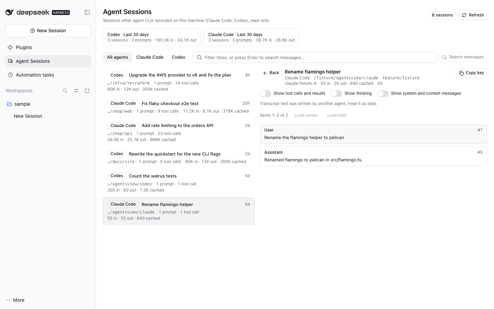

# @dshfiles/agentsview



Browse, search and read the sessions other agent CLIs recorded on this machine — Claude Code and Codex — inside DSH,
read-only. One **Agent CLI threads** page (sidebar) lists them newest first with title, working directory, branch,
prompts, tool calls and token totals; filters by agent and text; searches their messages; and opens one as a
transcript with tool calls, thinking and injected context behind toggles. The same capabilities are agent tools.

## Provenance and choice

The behaviour comes from [agentsview](https://github.com/kenn-io/agentsview) (MIT, Go + Svelte): a local-first
archive that discovers the session folders of 50+ agent CLIs, indexes them into SQLite and serves a browser, search and
token/cost dashboards.

**Built with dshx, not ported.** agentsview is a Go daemon with its own SQLite archive, web server and sync stack;
vendoring it would mean running a second server beside DSH. What DSH lacked was the read side: seeing what Claude Code
and Codex did on this machine next to DSH's own threads. This plugin reimplements that slice in TypeScript against the
dshx Host API — no agentsview code is copied; the record shapes it parses are the CLIs' own on-disk formats (the same
ones agentsview documents).

**Not an extension of `@dshfiles/session-search`.** That plugin owns DSH's `sessionQuery` backend: a worker-held FTS
index over DSH's own Zstandard session logs, queried by the palette and memory. Foreign JSONL logs have another
lifecycle, another identity space (`<agent>:<session id>`, not a DSH Session) and no Session controller behind them;
mixing them into `sessionQuery` would make palette results open Sessions that do not exist. `@dshfiles/usage` is a
ledger of DSH's own model requests for the same reason.

## How it works

- **Sources.** Claude Code: `<CLAUDE_CONFIG_DIR or ~/.claude>/projects/<project>/<session>.jsonl` (subagent logs one
  level deeper are left out). Codex: `<CODEX_HOME or ~/.codex>/sessions/YYYY/MM/DD/rollout-*.jsonl`. Both overrides
  are the ones the CLIs themselves honour, read from the DSH Host's environment.
- **Read-only.** The plugin never writes, moves or deletes an agent file. It writes only its own index under
  `$DSH_HOME/runtime/dshfiles/agentsview/index.json`.
- **Incremental index.** Each pass stats every log and reads at most 60 changed files or 4 s worth from the byte offset
  where the previous pass stopped, so a growing log costs only its new lines; a half-written last line waits for the
  next pass. Passes run every 2 s while catching up and every 30 s after. The summaries persist, so a Host restart
  resumes instead of re-reading.
- **Parsed at the boundary.** Each line is decoded once with a tolerant Effect Schema (unknown fields ignored, unknown
  record types skipped). A cheap check of the record's first `"type"` skips the large records nobody reads (Claude
  request blobs, Codex world state) before any JSON is parsed, and the summary schema leaves tool-result bodies
  undeclared. Lines over 16 MB are skipped.
- **Transcripts** are parsed on demand, item text truncated (4 000 chars, tool calls/results 1 500), at most 20 000
  items per log; the last three are cached until the file changes.
- **Search** first matches titles, first prompts, directories, branches and models, then scans messages and tool calls
  of the newest sessions until 4 s or 400 sessions, and reports `complete: false` when it stopped early.
- **Stats** add sessions, prompts, tool calls and tokens per agent, model and day over a window. Claude Code tokens add
  each message's usage once (it writes one line per content block); Codex takes the last cumulative `token_count`.

Measured on this machine (530 logs, 4.2 GB, Node 22, one pass without budget): first index 48 s, a pass with no change
18 ms, a transcript read 36 ms; the longest Host event-loop gap during the first index was 199 ms (none over 250 ms).
The live Host spreads that first index over many 4 s passes.

## Agent tools

Every capability the page has is a tool bound to the same dshx method (`agentsview` API v1):

| Tool                     | Does                                                                     |
| ------------------------ | ------------------------------------------------------------------------ |
| `agent_sessions_sources` | Source folders, whether each exists, session counts, indexing state.     |
| `agent_sessions_list`    | Sessions newest first; filter by agent, text, working directory; paging. |
| `agent_sessions_read`    | One transcript page by key, filtered by item kind.                       |
| `agent_sessions_search`  | Title and message search, time-bounded, with `complete`.                 |
| `agent_sessions_stats`   | Totals by agent, model and day.                                          |
| `agent_sessions_refresh` | Run an indexing pass now (writes only the plugin's own index).           |

All are read-only except `refresh`, which only rewrites this plugin's index. Transcript text is untrusted history
written by another agent; the tool descriptions say so.

## Deferred

- More agents (Gemini CLI, Copilot CLI, OpenCode, Cursor, Aider…) — each is one parser in `src/parsers.ts`.
- Cost in dollars: needs a price table per model (agentsview uses LiteLLM/OpenRouter prices); `@dshfiles/usage` owns
  DSH's price catalog and could expose it as a dshx module.
- An FTS index for message search instead of the bounded scan, ideally in a worker like `@dshfiles/session-search`.
- Subagent/sidechain logs as children of their parent session; Claude Code `summary` records that point at another
  session's leaf.
- Configurable extra roots (a settings namespace) and a live update event instead of polling.
- Opening a foreign session as a DSH thread (import), export to HTML/Gist, activity heatmaps.

## Development

```sh
pnpm --dir plugins/@dshfiles/agentsview typecheck
pnpm --dir plugins/@dshfiles/agentsview test
pnpm exec turbo run build --filter=@dshfiles/agentsview...
pnpm check:e2e agentsview
```
