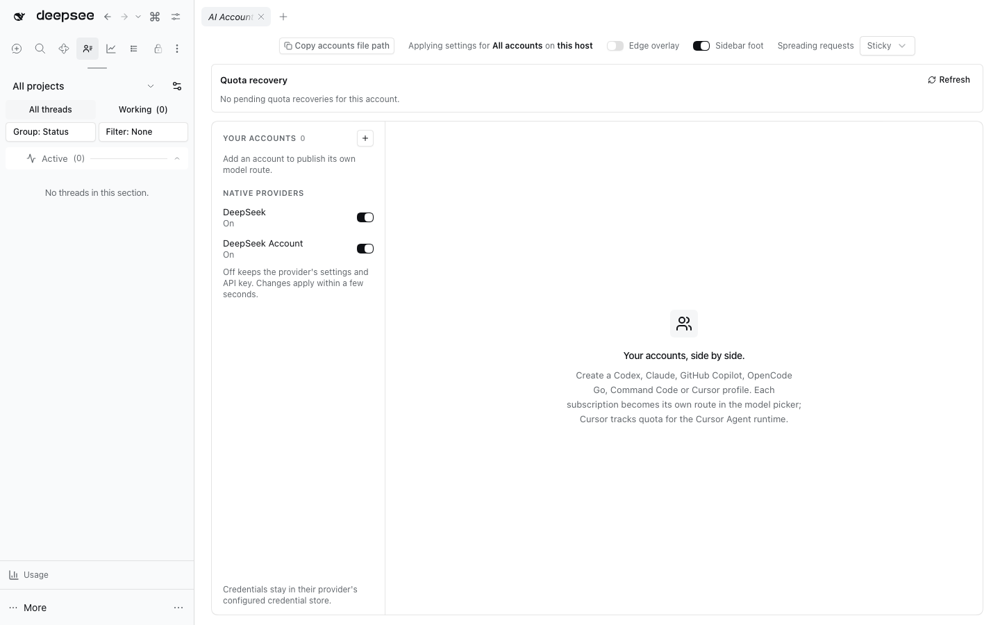

# AI Accounts

AI Accounts runs several subscription accounts side by side. Codex, Claude,
OpenCode Go and Command Code accounts each become their own route in the model
picker. GitHub Copilot connects through GitHub's device-code OAuth flow. Cursor
accounts only track identity and quota: DSH has no Cursor agent runtime, so
Cursor sessions run outside DSH.

## Providers

| Kind           | Login                                                                                                                                                    | Model route | Quota                                                                                                                       |
| -------------- | -------------------------------------------------------------------------------------------------------------------------------------------------------- | ----------- | --------------------------------------------------------------------------------------------------------------------------- |
| Codex          | `CODEX_HOME=… codex login`, one shadow home per account                                                                                                  | yes         | 5-hour and weekly windows, banked resets                                                                                    |
| Claude         | `claude auth login` under the account's `CLAUDE_CONFIG_DIR`; an optional `claude setup-token` in DSH credentials or the Host environment serves requests | yes         | 5-hour, weekly, weekly Opus/Sonnet (`/api/oauth/usage`)                                                                     |
| OpenCode Go    | key in DSH credentials or the Host environment                                                                                                           | yes         | rolling, weekly and monthly windows                                                                                         |
| Command Code   | key in DSH credentials or the Host environment, or `cmd login`                                                                                           | yes         | 5-hour and weekly window limits (`/alpha/billing/credits`)                                                                  |
| GitHub Copilot | GitHub device-code OAuth; grant and refresh token stay in DSH credentials                                                                                | yes         | premium requests and chat, from GitHub's internal `copilot_internal/user` (what GitHub's Copilot clients read; best effort) |
| Cursor         | `cursor-agent login`, or a token in DSH credentials or the Host environment                                                                              | no          | included usage for the billing cycle (undocumented dashboard endpoint)                                                      |

GitHub Copilot sign-in opens GitHub's device authorization page and shows a
short code in AI Accounts. Each account's OAuth grant is stored as a DSH
credential record, separate from `accounts.json`; the plugin refreshes tokens
through pi-ai and offers the Copilot models returned for that subscription.

The plugin reads Claude Code's login but never refreshes it. When that token
expires, run Claude Code once on the account. Quota needs the interactive
login, because a setup token cannot read usage. Cursor publishes no usage API,
so the plugin reads the dashboard's own endpoint. If Cursor changes that
endpoint, the card reports "unsupported" instead of a guessed number.

## Claude through the Claude Code CLI

A Claude account on its Claude Code login (no key variable) runs its requests through the official `claude` CLI, not
the Messages API. A Team or Max seat's allowance covers only requests Claude Code itself makes: the same OAuth token
sent over HTTP is billed to the organization's extra usage, and once that monthly cap is reached every request fails
with a 429 "monthly spend limit" while the seat still has quota. Through the CLI, the request reports
`isUsingOverage: false` and counts against the seat's 5-hour and weekly windows.

Each DSH conversation drives one `claude -p` process (stream-json in and out) with DSH's system prompt, no built-in
tools, no setting sources and an empty working directory, so local settings, hooks and CLAUDE.md files stay out. DSH's
tools reach Claude through a small MCP server the plugin starts per process: a tool call is held, the DSH step ends
with `toolUse`, and DSH's tool result releases it, so the same process continues the turn and keeps its prompt cache.
A new user turn goes to the same process; a process whose transcript diverged (an edit, a compaction, a Host restart)
is replaced by one that receives the transcript so far as text. Idle processes stop after 30 minutes, and at most six
run at once. `src/claude-cli.ts` holds the transport; a setup-token or API key keeps the Messages API.

## API keys

For every selected keyed account, **Set up key…** opens a setup dialog even if
its reference is blank or already has a value. New accounts get a suggested
account-specific reference such as `OPENCODE_GO_WORK_API_KEY`; **Use suggested
key name** fills it when needed. The field names the credential source, not the
key value. Enter a key in the dialog or import one from Secret Catalog. A manual
save replaces the value in DSH's writable credential store; a read-only
Host-environment value must be changed in the environment and takes precedence
until DSH is relaunched. Credential values never enter AI Accounts JSON or chat.

Secret Catalog is optional. Its import controls appear in the setup dialog when
the plugin is active. Global entries are listed immediately; choose a folder to
browse project/local entries. Imports go directly from the Host into DSH
credentials. When Secret Catalog is unavailable, use the dialog's manual key
field or configure the environment reference yourself.

**Copy accounts file path** in the page toolbar copies the active runtime JSON
path for advanced editing. That file stores account settings and reference names,
not secret values. The checked-in `profiles/web/ai-accounts.json` is only the
seed for a new runtime profile.

Entered keys go straight to DSH's write-only credential controller; managed
credential-store changes are resolved for the next request without restarting
DSH.

The account field stores only the variable name matching `^[A-Z][A-Z0-9_]*_API_KEY$`.
The DSH credential provider is the unversioned secret store fallback; no separate
credential JSON file is needed.

## Quota forecast

The **Quota forecast** panel (its own sidebar row) reads the stored quota
snapshots of every enabled account.

- **Forecast** lays each account over the next seven days in six-hour cells,
  most urgent first. The binding window is the first that runs out before its
  reset, else the one closest to its limit; windows shorter than a day (the
  5-hour session) only govern when nothing longer is reported. A cell is shaded
  by projected use, red where the window runs out, hatched while it stays locked
  until the reset, and dashed once a new window starts. Pace is the use over the
  last day of the current cycle (a quarter of the window for shorter ones),
  falling back to the window average; it assumes that pace holds. Selecting a
  row shows used against even pace, the projection, the lock, and the points
  used per day over the last week against the window's daily allowance.
- **Pace** draws every account on one window axis, from its start to its
  reset, against the even-pace diagonal: the use so far, the projection if the
  pace holds, where it runs out and how long it then stays locked. The ratio is
  the use so far against the share of the window elapsed (1.5x means 72% used
  when even pace would be at 48%). **Past windows** overlays the selected
  account's finished windows from the stored history and says how many ran out.
- **Table** lists the same projection.
- **Coverage** replays five weeks per provider kind with two or more accounts:
  one lane per account plus an "accounts free" lane, and the work hours when
  every account of the kind was spent at once. The current week continues on
  pace. A kind with one account is listed as having no cover.
- **Hand-off** plans the next seven days per kind with two or more accounts:
  each hour goes to the free account whose window resets soonest (quota left
  at a reset is lost), so the bar shows which account to work on, when to hand
  off, and when the kind runs dry. Every account keeps its own current pace;
  the plan does not move work between accounts.

Work hours default to Monday to Friday, 09:00 to 18:00; change them under
Settings › AI Accounts › Work hours.

The panel asks the Host for 36 days of history thinned to one reading per half
hour, keeping every reading where a reset time or a spent window changes. An
older Host ignores the bucket and returns its bounded series.

## Editing

Edits save automatically after a short pause by default. A subtle indicator
shows whether changes are unsaved, saving, saved or failed, and a failed save
can be retried. A route slug change saves when you leave the field, so a
half-typed slug never becomes a route. Switch to manual saving (Save and
Revert) under **Settings › AI Accounts**. The same page holds the auto-save
delay, the usage refresh interval, the sidebar and edge surfaces, request
distribution, and the history schedule.

Accounts can also be listed, enabled and edited at the bottom of
**Settings › Models**. Per-account model reasoning defaults are exposed to the
model catalog and picker, and are applied on route selection as well as request
dispatch; an explicit session effort still takes precedence.

Request distribution is one global policy applied within the selected provider
kind and compatible model capabilities; it never mixes unrelated providers or
models. The model
picker and transcript keep the provider you selected while the Host chooses the
account that serves the request; only a fail-over moves the picker (see Failure
recovery). Sticky keeps that account for the conversation
and fails over only while it is unavailable. Priority chooses the first healthy
compatible account in account-list order; move accounts up or down within each
provider group to change that order. Round-robin advances within each compatible
provider/model group, while Balanced favors accounts used least recently.

## Usage

A usage strip sits above the sidebar foot (the thread sidebar's
`sidebar.footer.above` seat; with the stock sidebar it renders in place among
the footer actions): one meter per account, wrapping onto more lines as
accounts grow. By default, each shows the account's governing window; Settings
› AI Accounts › Windows per account can show every quota window horizontally or
vertically. The collapsed rail always shows one button with the most critical
account. A spent limit draws as a red "Limit reached" pill. Settings › AI
Accounts › Meter shows picks percent left, time to reset, or both (the default)
for the strip and the rail button. Each strip meter carries the account's
short name: the one set beside the account in Settings › AI Accounts (up to six
characters), else its picker tag, else its initials. Settings › AI Accounts ›
Short names in the strip, or the strip's right-click menu (Hide/Show short
names), turns them off. Clicking a meter
opens the popover, which filters by provider and lists one card per enabled
account with quota, each showing its machine, session, weekly and monthly bars,
reset times and snapshot age; accounts with a spent window carry a "Limit
reached" badge and sink below the usable ones until you order them. Accounts
without quota data (signed out, failing) fold into one "N hidden" line that
expands. The grip in the popover's far corner resizes it both ways; wide
enough, the cards sit side by side in a grid, and the size is kept until you
double-click the grip. Strip and popover share one order and one hidden list (Settings › AI
Accounts): drag a meter or card onto another to reorder, or right-click it
(Shift+F10 / the menu key) to move it, hide it, or show every hidden account.
Banked Codex resets can be expanded; spending one stays a manual "Reset usage"
in the Codex app. The draggable edge overlay (off by default; it covers content in
narrow panes, and stays hidden while no account is set up) opens the same popover.

Codex Luna Reserve: the usage read asks for the reserve meter the way the
official client does (`x-openai-codex-luna-reserve: 1`) and shows it as its own
window. It never replaces the ordinary gauges. While a weekly limit is spent,
unreset, and the reserve lasts, requests on that account go out as
`gpt-reserve` (Settings › AI Accounts › Codex Luna Reserve, on by default);
the picker and transcript keep the model you chose.

Failure recovery (Settings › AI Accounts › Failure recovery) decides what a
failed request on an account route does, per kind: connection failure
(resets, timeouts, 5xx, Envoy replay-buffer overflow), rate limit, usage
exhausted, sign-in failure, request too large. The options run in order:
retry the same account (count and doubling backoff), continue on Luna Reserve
(Codex), fail over to the next account of the same provider kind that offers
the model (Priority uses account-list order; other modes use usage-strip order;
hidden accounts are skipped), wait out a declared reset, resend earlier images
as file placeholders, then fail the turn or hand the failure to DSH's own retry
and compaction. Defaults: connection → retry twice, then fail over; exhausted →
Luna Reserve, then fail over; rate limit → fail over, then wait up to a minute;
sign-in and oversized stay with DSH. A fail-over cools the account that failed
and selects its stand-in for the Session, keeping the model and reasoning
effort, so the retry and the picker both name the account now serving the
conversation; like any picker change, it also becomes the default model for new
Sessions. Switch back from the picker once the failed account recovers. Each
step shows as a retry row in the turn. Large
tool outputs are never trimmed.

### Model fallback chain

Under Priority, a thread can carry an ordered fallback chain: provider route
(any account, or a native provider the Host serves), model and optional
reasoning effort, across provider kinds (Codex, then Claude, then OpenCode). Edit
it from the **Fallbacks** section of the composer model picker: **Add current
selection**, move rungs up or down, remove them, or switch to **Default** to edit
the chain every thread without its own follows (**Use default** drops a
thread's own chain). When a chain has routes it replaces the same-provider
fail-over step above: a failure whose kind fails over (connection, rate limit,
exhausted by default) moves the turn to the next enabled, healthy rung after the
current one, never one the turn already tried. Sticky distribution never walks
the chain. The fail-over selects the fallback for the Session like an account
fail-over does. **After a fallback answers** chooses whether the thread stays
there (default; the provider's prompt cache stays warm) or returns to its
selection when the turn ends; **Return to selection** goes back by hand. The
chain and the fallback serving each thread live in Host storage. Agents read and
change them through `model_fallback_state`, `set_model_fallback_chain`,
`set_model_fallback_return` and `return_to_selected_model`; other plugins import
the contract from `@dshfiles/ai-accounts/model-fallback-api`. A native provider
has no cooldown signal, so a spent native rung is only skipped for the rest of
the turn that hit it.

When a turn stops on an exhausted quota, the Session is listed under **Quota
recovery** in the account's panel. **Resume now** queues a recovery prompt;
**Snooze** (1 h, 4 h, 1 day) pushes it back. If the provider declared a reset
time and the Schedule service is loaded, the prompt is scheduled for that time;
an unknown reset gets no invented timer and waits for a manual resume. Any newer
user message, other queued work, or stopping the Session invalidates the
pending recovery, so an old continuation never runs over newer work. Records live
in Host storage, so they survive a restart; finished ones are pruned after 30
days, and at most 500 are kept.

The exhausted-limit turn itself carries an inline notice. It shows while
exhausted-limit failover is off, and also when failover is on and the ladder
still stored a recovery for the turn — which happens when no other account
could take the request. It dates the reset and offers **Automatically
resume 1 minute after reset**, which schedules the saved request for one minute
past the reset instead of at the reset instant. **Resume with another model**
opens the currently available provider/account, model, and reasoning-effort
selects, defaulting to the same model on another provider when one offers it;
**Resume with this selection** applies that route to the Session and then queues
the saved request. The notice re-reads this turn's recovery when it appears, so
a continuations page cached before the failure never hides these controls.

When a turn ends with an authentication failure (including an invalid API key
or a missing credential), an inline **Add or fix credentials** action opens the
AI Accounts panel. Use the account's **Set up key…** action there to store a key
or repair its reference. Other failed turns do not show credential setup.

Every open surface shares one Host reading, cached for 30 seconds; **Refresh**
bypasses the cache.

The Host records one quota snapshot per enabled account on startup and then
at a configurable interval, 5 minutes by default and adjustable from 1 to 60
minutes. Snapshots are kept for 90 days by default, up to 365. A reading in
the same interval updates its row instead of adding one. Failed reads write
nothing, and plugin unload cancels an active collection and closes the
storage domain. History reads return at most 5,000 points, keeping recent
forecast inputs, reset boundaries and banked-reset changes. Values stay in
the Host's local `ai_accounts_usage` storage domain. Credentials and raw
responses are not stored.

The **Usage history** panel shows current limits, quota history split at
reset boundaries, banked-reset changes, and a linear depletion estimate based
on the observed pace. It does not import local token logs from Codex CLI or
OpenCode.
