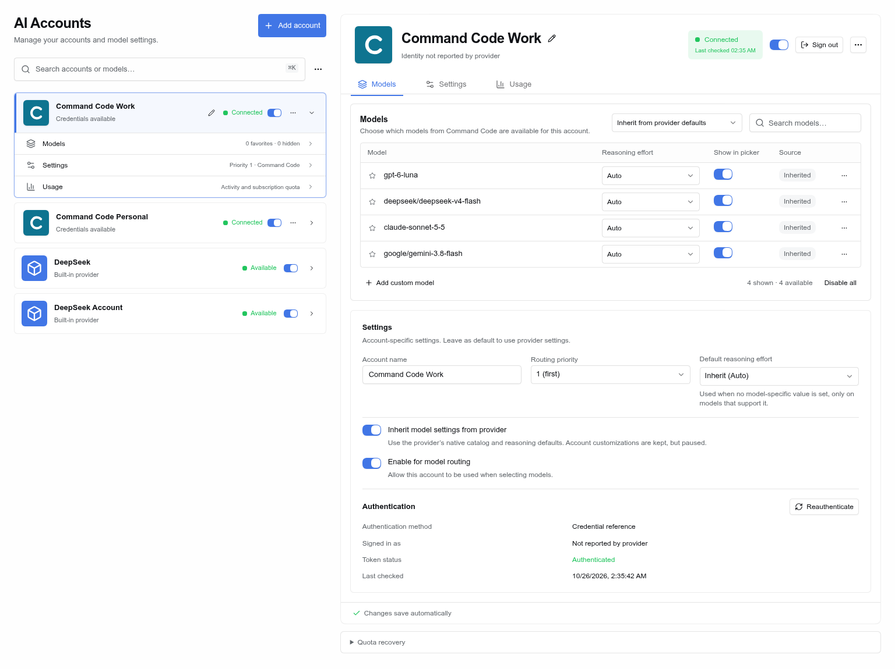
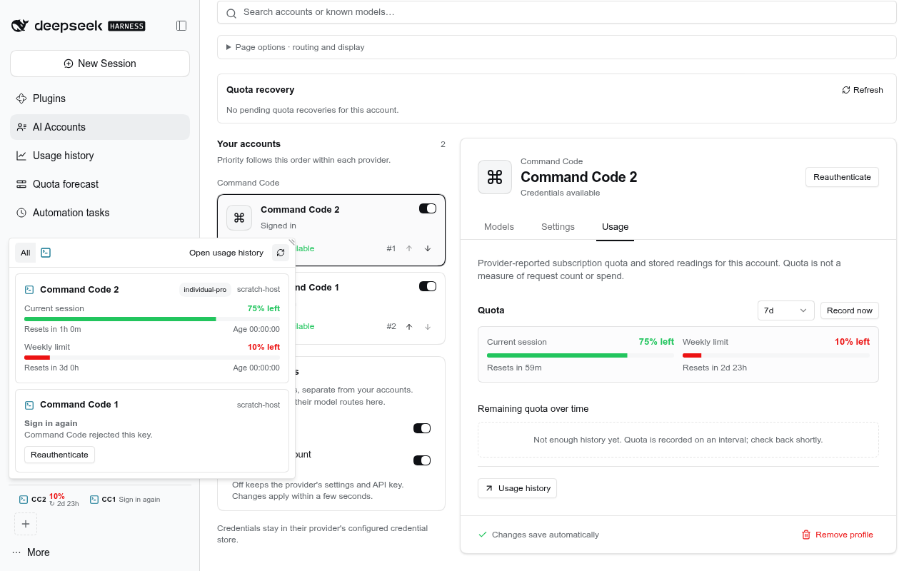
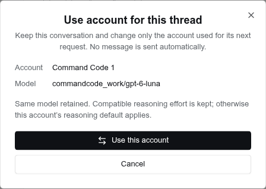
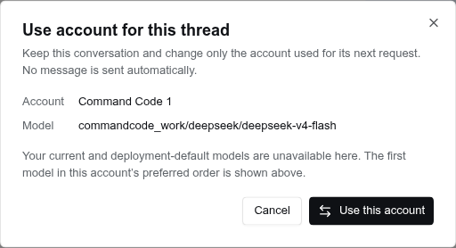
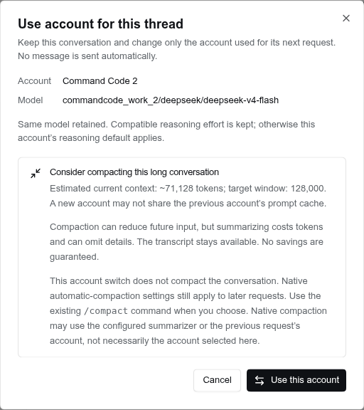
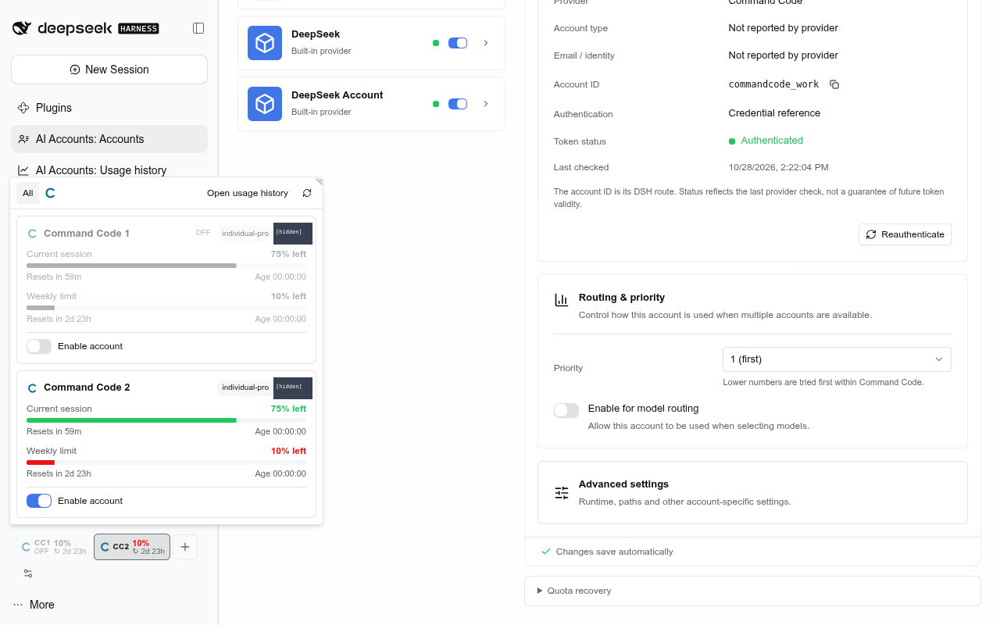
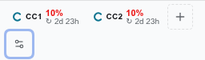
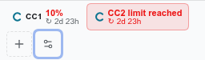
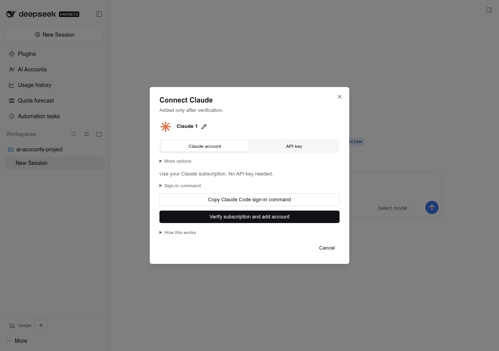

# AI Accounts



[Settings](docs/screenshots/reference-dashboard-settings.png) · [Usage](docs/screenshots/reference-dashboard-usage.png) · [Design-to-implementation checklist](docs/reference-dashboard.md)



AI Accounts runs several subscription accounts side by side. Codex, Claude,
OpenCode Go and Command Code accounts each become their own route in the model
picker. GitHub Copilot connects through GitHub's device-code OAuth flow. Cursor
accounts only track identity and quota: DSH has no Cursor agent runtime, so
Cursor sessions run outside DSH.

Reusable views are **AI Accounts: Accounts**, **AI Accounts: Usage history** and **AI Accounts: Quota forecast**. In Workbench, the sidebar quota contribution is **AI Accounts: Preview**; an AI Accounts-only footer action aggregate is **AI Accounts: Controls**.

## Use an account for the current thread

Requires the owned Session-controller bundle alongside AI Accounts. It adds the guarded thread-local Host contract; an older or stock-only controller remains usable for other account features but cannot perform this handoff.



Right-click an account in the sidebar and choose **Use this account for this thread** (keyboard: focus the card and press **Shift+F10**). Review the account and model, then confirm. **Cancel** changes nothing. The conversation and its history stay in place; there is no model-picker reselection, automatic message, or silent resume.

The preview retains the exact current model if the target offers it. Otherwise it shows the deployment-default model when offered, or explicitly labels the first model in the target account's preferred order. Compatible reasoning effort is retained; otherwise the account/model's supported default applies. Hidden models are not offered. An in-flight request is unchanged; the new choice applies to upcoming requests. Queued waking input must settle first, and a stale preview must be reviewed again.



The choice is local to this thread and survives reload/replay. It takes precedence over Priority/round-robin/balanced distribution without changing account order or global model defaults. Normal recovery can still select a compatible account if the chosen account cannot serve. A late retry or fallback restoration cannot overwrite a newer explicit choice. Choose another card to switch back, or use the ordinary model picker to clear this explicit preference.

For a large conversation, available native metering can offer **Consider compacting this long conversation** with an estimated input size and target context window. This is advice, not billed usage or guaranteed savings: account caches may differ, summarization costs tokens and can omit details. The account switch itself does not compact anything. Existing native automatic-compaction settings still apply when later requests are prepared; this feature does not disable or change that policy. Use native `/compact` only when desired. Both native automatic and manual compaction may use the configured summarizer or previous request account, not necessarily the newly selected account. The transcript stays available, but no supported undo for compaction is promised. Missing metering simply omits the advice.



A waiting quota continuation stays waiting. Selecting an account does not send its stored recovery prompt or change its automatic-retry choice; explicit **Resume** uses the current selection unless a separate model override is supplied. Archived/runtime-owned subagent threads and inaccessible targets are refused. An older Host without the new contract shows an unavailable preview rather than starting work.

Agent parity uses the same scoped API: `ai_accounts_preview_thread_switch` and `ai_accounts_switch_thread`. Agents may target only their own Session; writes require the user's request and the exact preview revision/target. Other Host plugins use the published `ai-accounts-thread` contract instead of duplicating routing or schemas.

### Verify the handoff

Use the pinned project Node and the raw stock-core/system-Chromium overrides described in `verify-dsh` when the local launcher rewrites HOME or bundled Chromium is unavailable. Build before starting browser checks; source-linked fixtures must not be rebuilt during a journey.

```sh
pnpm --dir plugins/@dshfiles/ai-accounts test --maxWorkers=2
pnpm --dir plugins/@dshfiles/session-controller test --maxWorkers=2
pnpm --dir tooling/dshx run features:check
node scripts/native-fork-diff.mjs session-controller
pnpm --dir tooling/dshx exec bddgen test --config=playwright.e2e.config.ts
DSHX_E2E_PREBUILT=1 DSHX_E2E_PREWARM=0 pnpm --dir tooling/dshx exec playwright test --config=playwright.e2e.config.ts ai-accounts.feature.spec.js --grep 'Switch the current thread account'
```

The focused journey exercises actual UI and public API responses, fake-provider account keys, preferred-model fallback, optional native context advice, exact Session identity and scratch-only restart persistence. The catalog reach requires both `@dshfiles/ai-accounts` and `@dshfiles/session-controller` in `dshx dev up`; it seeds a synthetic thread, then opens the real context menu and confirmation. Native automatic compaction on later turns is distinct from this action's no-request/no-compaction guarantee.

## Enable or disable accounts from the preview



Disabled saved accounts stay in the sidebar preview with their measured percentage and reset time visible in grey. A small **OFF** label sits beneath the account name without adding a row or changing the card height. Click the card to open the usage popover, then use its **Enable account** toggle to change routing availability without opening Settings. The toggle uses the same Switch component, blue enabled state and saved-account operation as Settings, preserves account order and profile fields, and shows pending or failed saves without pretending an unsuccessful change took effect. Disabled cards remain clickable for management but cannot be chosen with **Use this account for this thread**.

Disabling is not hiding: **Hide** in the context menu still removes a card from the preview until **Show** or **Show all hidden** is used. Quota visibility is separate from routing availability: measured windows remain visible while OFF, but the account is not used for model routing or chosen as the most critical enabled account. Missing quota still shows its ordinary unavailable status rather than an invented percentage. Enabling does not sign in, send a message, change the thread model or resume work. Agent parity remains the existing `ai_accounts_save_account` tool; there is no separate enable-state store.

## Quick setup and account workspace

The small **AI account settings** button beside **+** in the sidebar account strip opens the AI Accounts page. It closes an open quota popover without starting sign-in or changing the active chat.



Active, limit-reached and reserve states paint the same full-height sidebar button, rather than a shorter status badge inside it. An active exhausted account keeps its red status background and active outline.



Use **Add account** on the page, or the trailing **+** in the sidebar account preview. Both open the same setup without changing the active chat. Choosing a provider prepares a private, provisional connection—not an account-list entry. The Host saves and enables the account only after its selected sign-in check succeeds. Keyed/provider metadata checks are remote and read-only. Claude subscription checks are delegated to the official CLI's local authenticated-configuration status, not presented as remote token validation. Merely typing/storing a key or receiving an approval code does not add an account.

The dialog presents only the common sign-in choices. Claude uses **Claude account** or **API key**; existing credential references and custom CLI homes live under **More options**. Token import is under **Import from Secret Catalog**. Click the pencil beside a new account's name to edit it before connecting. Enter saves the pending name; Escape or **Cancel name edit** discards only that name edit. Names are trimmed (1–120 characters) and do not change route slugs, credential references or login paths. Existing saved accounts are renamed in Settings.

**Cancel**, the close button, Escape outside the name editor, failed verification and expiry add nothing. There is no **Finish later** account draft. Candidates never enter normal account reads, sidebar quota sweeps or model routes. Previously saved accounts are not automatically removed if their credentials later expire.

- **Claude subscription:** choose **Claude account**; no API key is required. Keep a new private home, select **More options → Use default Claude Code login**, or apply a custom `CLAUDE_CONFIG_DIR`. Copy the exact shell-quoted sign-in command and run it on the Host if needed. The unmodified official CLI checks its login configuration with the selected directory and supported Host environment, including `CLAUDE_CODE_OAUTH_TOKEN`. This local status is not a remote validity check; quota is optional. DSH neither intercepts Claude.ai OAuth nor refreshes its credentials itself.
- **Claude setup token or API key:** choose **API key**, import a Catalog entry, or select **More options → Use existing credential**. The token path does not require installing Claude Code. Verification sends a fixed synthetic request to Anthropic's official free, nongenerative token-count endpoint—never a paid inference request or another provider origin. Actual setup-token permission for that endpoint remains unverified; denial is not bypassed by switching identities. API keys retain separate API billing.
- **Codex:** keep official browser/device sign-in or select **Existing login**. **Existing or custom CLI home** restores the shared-home and distinct authentication-overlay fields before saving. Linking verifies the selected existing overlay without copying/deleting user auth. Device sign-in explicitly stages a new login and adopts it only after accepted completion, with replacement consent. Custom equal shared/overlay paths remain rejected; the generated private pair retains its managed policy. DSH does not install the CLI.
- **Command Code and Cursor:** choose a new key/token, an existing credential reference, or the existing `cmd login` / `cursor-agent login`. An explicit CLI choice remains pinned after saving and ordinary settings edits; it does not become a default environment-key fallback. Command Code base settings remain available in every mode. **Cursor** is still quota-only, never a DSH model route.
- **OpenCode Go:** paste/import a key or reuse an existing named credential, including `OPENCODE_API_KEY`. OpenCode CLI OAuth is not a supported path in this integration.
- **GitHub Copilot:** device OAuth remains provisional in Host memory until checked completion. Unlimited or nondisplayable quota no longer causes a valid authenticated connection to be rejected.

Keys stay in memory until their selected check succeeds; the account file stores only credential references. Empty/malformed/unauthenticated provider responses are not proof. Authenticated exhausted, unlimited or unavailable numeric quota is not itself a login failure. Switching methods never silently falls back from a missing named key to another CLI or environment identity.

The page follows the three supplied design references: an account rail with search/Add, branded compact rows, status/routing controls and expandable section shortcuts; a matching **Models**, **Settings**, and **Usage** detail pane. Names can be edited from either pencil or Settings. Models uses a searchable five-row table with favorites, reasoning, picker visibility, source badges, ordering menus and an expansion control. Provider inheritance pauses—not deletes—account customizations. Supported account-wide reasoning defaults apply below explicit per-model/request overrides. Settings presents observed account details, copyable DSH route ID, same-provider priority, reauthentication, and collapsed **Advanced settings**.

Usage queries the Usage plugin's ledger for the exact recorded serving-account route, including previous-period comparisons, requests/tokens/list-price estimates/mean latency, a chart and model/day/recent-request tables. Unknown usage/pricing stays unknown; old Hosts cannot fall back to unscoped totals. Subscription quota/history remains a separate disclosure. Native provider rows are visually integrated but retain their own plugin-owned configuration and credential boundaries.



[Verification commands, coverage and auth boundaries](docs/quick-setup-verification.md).

[Mobile setup](docs/screenshots/quick-account-setup-mobile.png) · [Earlier account lifecycle layout](docs/screenshots/account-lifecycle.png).

### Sidebar priority and current chat

The page and usage tiles share one Host-owned priority order. Drag a tile or use its move menu to update real same-provider priority; page moves update the preview too. The trailing **+** is never draggable. Hidden/disabled accounts are preserved. A move does not change cross-provider fallback chains or interrupt an in-flight request. Old cosmetic `usageOrder` preferences are ignored rather than silently promoted to priority. Failed/stale writes are shown and reconciled with the Host.

Every enabled, non-hidden account stays in the sidebar even when quota cannot be read. Rejected credentials show **Sign in again**; other missing quota shows **Quota unavailable**, with the provider's explanation in the tooltip and visible usage card. Signed-out usage cards include **Reauthenticate**: it closes the popover and opens the existing account's sign-in setup without navigating away or starting provider login automatically. Saved Codex browser reconnects offer **Continue with Codex**, not another check of rejected local credentials; replacement occurs only after successful approval. A failed attempt offers **Start again** for the same account. Cancelling preserves that account. Missing data is never represented as 0% or 100%. Only accounts explicitly hidden by the user go behind **hidden by you**. Saved credentials on the accounts page indicate local availability, not provider-verified validity.

The highlighted tile follows the foreground chat's **actual wire account**, including distribution and failover—not merely model selection. Running chats mark the current attempt; idle chats show **Last used by active chat** for the last successful account. A visible quota-unavailable active account keeps its status tile; an intentionally hidden active account gets a compact source chip. Unknown/old Hosts and native routes never get a guessed highlight. Only metadata is retained, for at most 2,000 chats and 90 days. Older chats remain unknown until a qualifying request succeeds; title/compaction traffic does not change attribution.

These changes include Host APIs/storage. Applying them to an already running DSH requires a user-managed Host restart. The client tolerates an older Host without pretending new actions succeeded.

### Sign-in and safety boundaries

New Codex and Claude profiles use private homes under the active accounts store, not a copy of the Host user's global login. A managed Codex route slug identifies that home and is read-only in Advanced; change **Display name** to rename it. Existing manually configured overlay homes keep their original containment checks. Managed Codex login stages official CLI output in a private directory, checks permissions, links, current profile and previous-auth fingerprint, then atomically adopts a successful login. Failure, expiry and cancellation do not overwrite the previous credentials. Cancellation invalidates the provisional operation before asynchronous cleanup; late responses cannot publish it. A verified commit already accepted by the Host cannot be undone by closing the dialog. Native credential storage and account-file persistence are not one transaction: if the latter genuinely fails after a unique native key was written, an unreferenced private credential can remain, but no account entry is added. Cleanup never blindly deletes a potentially concurrent credential writer.

Agent tools share the setup/save/order APIs. Starting or cancelling sign-in requires a user request; cancellation has an explicit opt-in. Device codes and approval URLs are returned only to the browser, never raw agent/plugin responses. There is no intercepted Claude.ai OAuth or fabricated token-validity control.

**Sign out** is a separate, explicitly confirmed operation that preserves the account profile and preferences. Supported scopes are an exact private Codex home, an exact Claude Code directory, an account-owned Copilot grant, or a sole-account private DSH key reference. Unsupported shared/global CLI logins and externally owned references show a disabled action with the reason instead of deleting outside credentials. Codex logout uses the official CLI and an unsigned private tombstone to prevent shared-home reseeding. A canonical-home owner excludes materialization and the complete token-refresh read/modify/persist sequence during logout; metadata/login changes share an account operation guard. Filesystem ownership, permissions and link guards are checked before mutation. Automated verification uses fake executables only; no real provider sign-out is claimed.

Automated verification uses fake CLI/device responses and a loopback provider. It does not approve real OpenAI/GitHub consent. Installed official CLI compatibility and real provider approval remain separate, human-dependent checks. The third-party Claude.ai OAuth boundary follows [Anthropic's terms](https://code.claude.com/docs/en/legal-and-compliance.md); this plugin keeps the unmodified official CLI path separate.

## Providers

| Kind           | Login                                                                                                                                                    | Model route | Quota                                                                                                                       |
| -------------- | -------------------------------------------------------------------------------------------------------------------------------------------------------- | ----------- | --------------------------------------------------------------------------------------------------------------------------- |
| Codex          | **Continue with Codex** in quick setup (official CLI device approval); existing CLI login remains supported                                              | yes         | 5-hour and weekly windows, banked resets                                                                                    |
| Claude         | `claude auth login` under the account's `CLAUDE_CONFIG_DIR`; an optional `claude setup-token` in DSH credentials or the Host environment serves requests | yes         | 5-hour, weekly, weekly Opus/Sonnet (`/api/oauth/usage`)                                                                     |
| OpenCode Go    | key in DSH credentials or the Host environment                                                                                                           | yes         | rolling, weekly and monthly windows                                                                                         |
| Command Code   | key in DSH credentials or the Host environment, or `cmd login`                                                                                           | yes         | 5-hour and weekly window limits (`/alpha/billing/credits`)                                                                  |
| GitHub Copilot | GitHub device-code OAuth; grant and refresh token stay in DSH credentials                                                                                | yes         | premium requests and chat, from GitHub's internal `copilot_internal/user` (what GitHub's Copilot clients read; best effort) |
| Cursor         | `cursor-agent login`, or a token in DSH credentials or the Host environment                                                                              | no          | included usage for the billing cycle (undocumented dashboard endpoint)                                                      |

GitHub Copilot sign-in opens GitHub's device authorization page and shows a
short code in AI Accounts. Each account's OAuth grant is stored as a DSH
credential record, separate from `accounts.json`; the plugin refreshes tokens
through pi-ai and offers the Copilot models returned for that subscription.

The plugin reads Claude Code's login but never refreshes it. When that token
expires, run Claude Code once on the account. Quota needs the interactive
login, because a setup token cannot read usage. Cursor publishes no usage API,
so the plugin reads the dashboard's own endpoint. If Cursor changes that
endpoint, the card reports "unsupported" instead of a guessed number.

## Claude through the Claude Code CLI

A Claude account on its Claude Code login (no key variable) runs its requests through the official `claude` CLI, not
the Messages API. A Team or Max seat's allowance covers only requests Claude Code itself makes: the same OAuth token
sent over HTTP is billed to the organization's extra usage, and once that monthly cap is reached every request fails
with a 429 "monthly spend limit" while the seat still has quota. Through the CLI, the request reports
`isUsingOverage: false` and counts against the seat's 5-hour and weekly windows.

Each DSH conversation drives one `claude -p` process (stream-json in and out) with DSH's system prompt, no built-in
tools, no setting sources and an empty working directory, so local settings, hooks and CLAUDE.md files stay out. DSH's
tools reach Claude through a small MCP server the plugin starts per process: a tool call is held, the DSH step ends
with `toolUse`, and DSH's tool result releases it, so the same process continues the turn and keeps its prompt cache.
A new user turn goes to the same process; a process whose transcript diverged (an edit, a compaction, a Host restart)
is replaced by one that receives the transcript so far as text. Idle processes stop after 30 minutes, and at most six
run at once. `src/claude-cli.ts` holds the transport; a setup-token or API key keeps the Messages API.

## API keys

For every selected keyed account, **Set up key…** opens a setup dialog even if
its reference is blank or already has a value. New accounts get a suggested
account-specific reference such as `OPENCODE_GO_WORK_API_KEY`; **Use suggested
key name** fills it when needed. The field names the credential source, not the
key value. Enter a key in the dialog or import one from Secret Catalog. A manual
save replaces the value in DSH's writable credential store; a read-only
Host-environment value must be changed in the environment and takes precedence
until DSH is relaunched. Credential values never enter AI Accounts JSON or chat.

Secret Catalog is optional. Its import controls appear in the setup dialog when
the plugin is active. Global entries are listed immediately; choose a folder to
browse project/local entries. Imports go directly from the Host into DSH
credentials. When Secret Catalog is unavailable, use the dialog's manual key
field or configure the environment reference yourself.

**Copy accounts file path** in the page toolbar copies the active runtime JSON
path for advanced editing. That file stores account settings and reference names,
not secret values. The checked-in `profiles/web/ai-accounts.json` is only the
seed for a new runtime profile.

Entered keys go straight to DSH's write-only credential controller; managed
credential-store changes are resolved for the next request without restarting
DSH.

The account field stores only the variable name matching `^[A-Z][A-Z0-9_]*_API_KEY$`.
The DSH credential provider is the unversioned secret store fallback; no separate
credential JSON file is needed.

## Quota forecast

The **Quota forecast** panel (its own sidebar row) reads the stored quota
snapshots of every enabled account.

- **Forecast** lays each account over the next seven days in six-hour cells,
  most urgent first. The binding window is the first that runs out before its
  reset, else the one closest to its limit; windows shorter than a day (the
  5-hour session) only govern when nothing longer is reported. A cell is shaded
  by projected use, red where the window runs out, hatched while it stays locked
  until the reset, and dashed once a new window starts. Pace is the use over the
  last day of the current cycle (a quarter of the window for shorter ones),
  falling back to the window average; it assumes that pace holds. Selecting a
  row shows used against even pace, the projection, the lock, and the points
  used per day over the last week against the window's daily allowance.
- **Pace** draws every account on one window axis, from its start to its
  reset, against the even-pace diagonal: the use so far, the projection if the
  pace holds, where it runs out and how long it then stays locked. The ratio is
  the use so far against the share of the window elapsed (1.5x means 72% used
  when even pace would be at 48%). **Past windows** overlays the selected
  account's finished windows from the stored history and says how many ran out.
- **Table** lists the same projection.
- **Coverage** replays five weeks per provider kind with two or more accounts:
  one lane per account plus an "accounts free" lane, and the work hours when
  every account of the kind was spent at once. The current week continues on
  pace. A kind with one account is listed as having no cover.
- **Hand-off** plans the next seven days per kind with two or more accounts:
  each hour goes to the free account whose window resets soonest (quota left
  at a reset is lost), so the bar shows which account to work on, when to hand
  off, and when the kind runs dry. Every account keeps its own current pace;
  the plan does not move work between accounts.

Work hours default to Monday to Friday, 09:00 to 18:00; change them under
Settings › AI Accounts › Work hours.

The panel asks the Host for 36 days of history thinned to one reading per half
hour, keeping every reading where a reset time or a spent window changes. An
older Host ignores the bucket and returns its bounded series.

## Editing

Edits save automatically after a short pause by default. A subtle indicator
shows whether changes are unsaved, saving, saved or failed, and a failed save
can be retried. A route slug change saves when you leave the field, so a
half-typed slug never becomes a route. Switch to manual saving (Save and
Revert) under **Settings › AI Accounts**. The same page holds the auto-save
delay, the usage refresh interval, the sidebar and edge surfaces, request
distribution, and the history schedule.

Accounts can also be listed, enabled and edited at the bottom of
**Settings › Models**. Per-account model reasoning defaults are exposed to the
model catalog and picker, and are applied on route selection as well as request
dispatch; an explicit session effort still takes precedence.

Request distribution is one global policy applied within the selected provider
kind and compatible model capabilities; it never mixes unrelated providers or
models. The model
picker and transcript keep the provider you selected while the Host chooses the
account that serves the request; only a fail-over moves the picker (see Failure
recovery). Sticky keeps that account for the conversation
and fails over only while it is unavailable. Priority chooses the first healthy
compatible account in account-list order; move accounts up or down within each
provider group to change that order. Round-robin advances within each compatible
provider/model group, while Balanced favors accounts used least recently.

## Usage

A usage strip sits above the sidebar foot (the thread sidebar's
`sidebar.footer.above` seat; with the stock sidebar it renders in place among
the footer actions): one meter per account, wrapping onto more lines as
accounts grow. By default, each shows the account's governing window; Settings
› AI Accounts › Windows per account can show every quota window horizontally or
vertically. The collapsed rail always shows one button with the most critical
account. A spent limit draws as a red "Limit reached" pill. Settings › AI
Accounts › Meter shows picks percent left, time to reset, or both (the default)
for the strip and the rail button. Each strip meter carries the account's
short name: the one set beside the account in Settings › AI Accounts (up to six
characters), else its picker tag, else its initials. Settings › AI Accounts ›
Short names in the strip, or the strip's right-click menu (Hide/Show short
names), turns them off. Clicking a meter
opens the popover, which filters by provider and lists one card per enabled
account with quota, each showing its machine, session, weekly and monthly bars,
reset times and snapshot age; accounts with a spent window carry a "Limit
reached" badge and sink below the usable ones until you order them. Accounts
without quota data (signed out, failing) fold into one "N hidden" line that
expands. The grip in the popover's far corner resizes it both ways; wide
enough, the cards sit side by side in a grid, and the size is kept until you
double-click the grip. Strip and popover share one order and one hidden list (Settings › AI
Accounts): drag a meter or card onto another to reorder, or right-click it
(Shift+F10 / the menu key) to move it, hide it, or show every hidden account.
Banked Codex resets can be expanded; spending one stays a manual "Reset usage"
in the Codex app. The draggable edge overlay (off by default; it covers content in
narrow panes, and stays hidden while no account is set up) opens the same popover.

Codex Luna Reserve: the usage read asks for the reserve meter the way the
official client does (`x-openai-codex-luna-reserve: 1`) and shows it as its own
window. It never replaces the ordinary gauges. While a weekly limit is spent,
unreset, and the reserve lasts, requests on that account go out as
`gpt-reserve` (Settings › AI Accounts › Codex Luna Reserve, on by default);
the picker and transcript keep the model you chose.

Failure recovery (Settings › AI Accounts › Failure recovery) decides what a
failed request on an account route does, per kind: connection failure
(resets, timeouts, 5xx, Envoy replay-buffer overflow), rate limit, usage
exhausted, sign-in failure, request too large. The options run in order:
retry the same account (count and doubling backoff), continue on Luna Reserve
(Codex), fail over to the next account of the same provider kind that offers
the model (Priority uses account-list order; other modes use usage-strip order;
hidden accounts are skipped), wait out a declared reset, resend earlier images
as file placeholders, then fail the turn or hand the failure to DSH's own retry
and compaction. Defaults: connection → retry twice, then fail over; exhausted →
Luna Reserve, then fail over; rate limit → fail over, then wait up to a minute;
sign-in and oversized stay with DSH. A fail-over cools the account that failed
and selects its stand-in for the Session, keeping the model and reasoning
effort, so the retry and the picker both name the account now serving the
conversation; like any picker change, it also becomes the default model for new
Sessions. Switch back from the picker once the failed account recovers. Each
step shows as a retry row in the turn. Large
tool outputs are never trimmed.

### Fast mode

The composer model picker offers Fast mode for supported Codex models. Use **Fast mode by default** in AI Accounts settings to enable it across eligible routes; each thread can still override its own route. The picker shows a lightning bolt while Fast mode is enabled and sparkles otherwise. Fast mode requests may cost more.

### Model fallback chain

Under Priority, a thread can carry an ordered fallback chain: provider route
(any account, or a native provider the Host serves), model and optional
reasoning effort, across provider kinds (Codex, then Claude, then OpenCode). Edit
it from the **Fallbacks** section of the composer model picker: **Add current
selection**, move rungs up or down, remove them, or switch to **Default** to edit
the chain every thread without its own follows (**Use default** drops a
thread's own chain). When a chain has routes it replaces the same-provider
fail-over step above: a failure whose kind fails over (connection, rate limit,
exhausted by default) moves the turn to the next enabled, healthy rung after the
current one, never one the turn already tried. Sticky distribution never walks
the chain. The fail-over selects the fallback for the Session like an account
fail-over does. **After a fallback answers** chooses whether the thread stays
there (default; the provider's prompt cache stays warm) or returns to its
selection when the turn ends; **Return to selection** goes back by hand. The
chain and the fallback serving each thread live in Host storage. Agents read and
change them through `model_fallback_state`, `set_model_fallback_chain`,
`set_model_fallback_return` and `return_to_selected_model`; other plugins import
the contract from `@dshfiles/ai-accounts/model-fallback-api`. A native provider
has no cooldown signal, so a spent native rung is only skipped for the rest of
the turn that hit it.

When a turn stops on an exhausted quota, the Session is listed under **Quota
recovery** in the account's panel. **Resume now** queues a recovery prompt;
**Snooze** (1 h, 4 h, 1 day) pushes it back. If the provider declared a reset
time and the Schedule service is loaded, the prompt is scheduled for that time;
an unknown reset gets no invented timer and waits for a manual resume. Any newer
user message, other queued work, or stopping the Session invalidates the
pending recovery, so an old continuation never runs over newer work. Records live
in Host storage, so they survive a restart; finished ones are pruned after 30
days, and at most 500 are kept.

The exhausted-limit turn itself carries an inline notice. It shows while
exhausted-limit failover is off, and also when failover is on and the ladder
still stored a recovery for the turn — which happens when no other account
could take the request. It dates the reset and offers **Automatically
resume 1 minute after reset**, which schedules the saved request for one minute
past the reset instead of at the reset instant. **Resume with another model**
opens the currently available provider/account, model, and reasoning-effort
selects, defaulting to the same model on another provider when one offers it;
**Resume with this selection** applies that route to the Session and then queues
the saved request. The notice re-reads this turn's recovery when it appears, so
a continuations page cached before the failure never hides these controls.

When a turn ends with an authentication failure (including an invalid API key
or a missing credential), an inline **Add or fix credentials** action opens the
AI Accounts panel. Use the account's **Set up key…** action there to store a key
or repair its reference. Other failed turns do not show credential setup.

Every open surface shares one Host reading, cached for 30 seconds; **Refresh**
bypasses the cache.

The Host records one quota snapshot per enabled account on startup and then
at a configurable interval, 5 minutes by default and adjustable from 1 to 60
minutes. Snapshots are kept for 90 days by default, up to 365. A reading in
the same interval updates its row instead of adding one. Failed reads write
nothing, and plugin unload cancels an active collection and closes the
storage domain. History reads return at most 5,000 points, keeping recent
forecast inputs, reset boundaries and banked-reset changes. Values stay in
the Host's local `ai_accounts_usage` storage domain. Credentials and raw
responses are not stored.

The **Usage history** panel shows current limits, quota history split at
reset boundaries, banked-reset changes, and a linear depletion estimate based
on the observed pace. It does not import local token logs from Codex CLI or
OpenCode.

For requests where Fast mode is enabled, AI Accounts records the terminal
Codex Responses event's reported service tier, response status, model, and token
counts. These bounded records use the same retention setting in the separate
`ai_accounts_fastmode` storage domain. Prompts, response text, credential data,
and Session IDs are not stored. The read-only `ai_accounts_fast_mode_history`
tool returns time-bucketed totals for provider-confirmed Fast, default, other,
and unreported tiers. It is a usage signal, not an invoice estimate; calls that
fail before a terminal response event are not counted.
