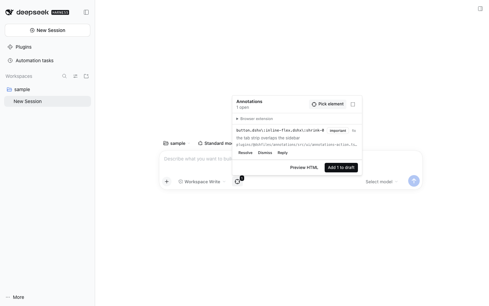

# @dshfiles/annotations



Element-linked visual feedback for DSH. Point at an element of the running UI,
write a note, and the composer draft receives a bounded block with the
selector, the page, and — when the bundle ships a source map — the exact
`file:line` in the owning plugin. The plugin never sends the draft, and it never
resolves an annotation by itself.

## Why owned rather than adopted

Agentation is a React component embedded in the _annotated app_ plus a stdio MCP
server, under PolyForm Shield 1.0.0; it cannot annotate DSH's own UI and would
not resolve our source maps. `dsh-annotate` covers arbitrary Chrome pages but
pays for it with an unpacked extension and a loopback WebSocket whose `Origin`
check is a spoofable header. `dsh-visual-edit` annotates HTML previews by
shadowing stock slot keys but is Electron-only for its Browser pane. None of
them can answer "which file and line renders this element?" for this checkout,
and the community options are all days-to-weeks-old single-author projects. The
preview and extension halves here reuse their _ideas_ (instrumented renderer,
`activeTab`, token-auth) without adopting their code or licences.

## Use

- **Pick**: the crosshair action on the left of the composer, or the panel it
  opens. Hover highlights the element under the pointer; click captures it;
  `Esc` leaves pick mode without storing anything.
- **Note**: the popover collects the note plus an optional intent (`fix`,
  `change`, `question`, `approve`) and severity (`blocking`, `important`,
  `suggestion`).
- **Insert**: the panel lists this thread's annotations and adds them to the
  draft at the composer cursor. `Annotated UI feedback (n)` is plain text: it
  stays editable and is only sent when you send the message.
- **Lifecycle**: annotations stay `pending` until an Agent acknowledges them
  (`annotations_ack`) or resolves them (`annotations_resolve`, bound to the exact
  revision it read). `annotations_dismiss` requires a reason. A target that no
  longer matches becomes `stale` and is never resolved silently.

## What it captures

| Kept                                                                 | Refused                                                  |
| -------------------------------------------------------------------- | -------------------------------------------------------- |
| selector (id, or ≤4-level path with ≤2 classes per level)            | form values, `contenteditable` contents, password fields |
| tag, allowlisted attributes (`data-testid`, `role`, `aria-label`, …) | any other attribute                                      |
| visible text (≤240 chars, whitespace collapsed)                      | full DOM, cookies, storage, headers                      |
| 16 allowlisted computed style properties                             | arbitrary CSS                                            |
| viewport rectangle                                                   | page screenshot (off by default)                         |
| `origin + pathname` of the page                                      | URL query and hash                                       |

`[data-private]` and `[data-visual-edit-private]` elements are skipped, and the
picker bubbles to no annotation rather than capturing a redacted subtree.

## Source resolution

`dshx` emits client source maps by default. For a captured class such as
`_primary_abc12`, the Host finds that literal in `dist/client.js`, maps the
generated position through `dist/client.js.map`, and reports
`plugins/@dshfiles/<pkg>/src/<file>:<line>`. When no map holds the class, it
falls back to an exact visible-text search in `sourcesContent`, and when neither
matches it reports no source instead of guessing. Scanning is lazy, cached by
`mtime + size`, and capped (32 MB per map, 160 MB per call).

Roots come from `DSHFILES_DIR` when set, otherwise from the nearest checkout with
a `pnpm-workspace.yaml` that declares `plugins`.

## Agent tools

| Tool                  | Kind      | Behaviour                                                          |
| --------------------- | --------- | ------------------------------------------------------------------ |
| `annotations_list`    | read-only | This thread's annotations plus per-status counts                   |
| `annotations_ack`     | write     | Marks pending/stale items seen; call after reading them            |
| `annotations_resolve` | write     | Requires the revision that was read; a changed revision is refused |
| `annotations_dismiss` | write     | Requires the user's reason                                         |
| `annotations_reply`   | write     | Adds a thread message to one annotation                            |
| `annotations_source`  | read-only | Resolves class names or text to `file:line`                        |
| `annotations_intake`  | read-only | Lists unattached extension annotations                             |

The extension token is deliberately not an Agent tool: device setup is a human
step.

## Chrome without an extension

The panel's **Chrome without an extension** section launches a **DSH-owned Chrome
profile** with a loopback debugging port, lists its tabs, and injects the same
bounded picker over the DevTools protocol. Nothing is installed and your daily
Chrome is never touched — this is the zero-install path for any page you log into
in that window.

- The profile is durable (`<DSH_HOME>/plugins/annotations/chrome-profile`), so
  sessions survive restarts; set `profileDir` to point elsewhere.
- `chromePath` empty auto-detects the platform install; `cdpPort` defaults to
  9222; a pick stays armed for `pickTimeoutSeconds` (300 by default).
- `startUrl` opens that page on launch, so _Launch Chrome_ lands on your dev
  server instead of a blank tab.
- `pickActiveTab` (default on) arms the pick on the **focused** tab — focus is read
  from each page (`document.hasFocus()`), not guessed from list order. Turn it off
  to get the tab list back and choose per pick.
- **Stop** signals the process group this Host started, so Chrome's helpers go with
  it; nothing else on the machine is touched.
- A debugging port that is already taken is skipped, so DSH never drives another
  browser that happens to sit on 9222 — it launches on the next free port and shows
  which one.
- A fresh profile gets `--password-store=basic --use-mock-keychain`: without it macOS
  pops a "Keychain Not Found" dialog over the window before any page exists.
- The pick runs with `Runtime.addBinding`, so it resolves only on the user's click
  (or Esc), never on a timer, and the popover is the same comment form the in-app
  picker uses.
- DevTools' protocol has no authentication, so we launch our own profile on
  loopback and never attach to your main one. Since Chrome 136, remote debugging
  requires a non-default `--user-data-dir` anyway.

## Extension (arbitrary pages)

A DSH plugin cannot read a page it does not own: `browserUse` exposes no tab or
DOM API, the right-sidebar Browser row is disabled outside the desktop profile,
and the document preview sandbox is opaque-origin. Pages DSH does not own
therefore need the page's own script, which is the companion MV3 extension in
[`extension/`](extension/README.md).

- Permissions are `activeTab`, `scripting` and `storage` only; there is no
  `<all_urls>` and no page is touched until you press the extension action.
- The service worker posts to `POST /api/dshfiles-annotations/ingest` with a
  bearer token, the extension's **pinned** origin and a loopback peer; the body is
  capped at 64 KB and every field is validated.
- **Pairing, not copy-paste:** _Pair extension_ in the panel arms a two-minute,
  single-use window; the popup's _Pair with DSH_ pulls the token through
  `POST /api/dshfiles-annotations/pair`. Both routes answer the extension's CORS
  preflight, so a real Chrome extension can read the response.
- The id comes from the public `key` committed in the manifest, so it is identical
  on every machine (`chrome-extension://onffhgfpkepofnhfaklomllipdpgmmbb`) and the
  Host trusts that one origin by default — no per-machine configuration.
- Loading unpacked is the one step Chrome refuses to automate: no page, extension
  or agent can install unpacked code. Everything after it is one click.
- Arrivals are **unassigned**. DSH shows them and asks which thread owns them;
  the Host never guesses a Session.

## HTML preview

**Preview HTML** in the panel opens a workspace-relative `.html` file in a
sandboxed frame this plugin owns, so picking works inside it:

- the page's own `<script>` tags, inline `on*` handlers and `javascript:` URLs
  are stripped, and the frame is `sandbox="allow-scripts"` **without**
  `allow-same-origin`, so previewed code cannot reach DSH's DOM or storage;
- an injected inspector with a per-open nonce posts the picked element back;
- the annotation is stored with `surface: "preview"` and the preview file as its
  source (`confidence: "file"` — the file is exact, the line is not claimed).

The file read is bounded: inside the DSH working directory, `.html`/`.htm` only,
2 MB, with `outside-workspace`, `unsupported`, `missing` and `too-large`
reported rather than guessed around.

## Design notes

- **Bounded by construction.** Every capture is a fixed shape: selector, tag,
  allowlisted attributes and styles, a 240-character text excerpt, a rectangle
  and an origin+pathname URL. There is no free-form DOM capture and no field the
  client can use to smuggle more.
- **The accessible name wins.** A control's text changes with its state (a count
  badge, a spinner); its `aria-label`/`title` is what makes the target findable
  again, so `stale` re-checks compare that first.
- **Selectors stay valid CSS.** Class names are escaped, so the stored selector
  both reads correctly and still resolves with `querySelector` for the stale
  check.
- **Nothing resolves itself.** A changed target becomes `stale` and waits; a
  resolution must name the revision it read, so an edit between read and resolve
  is refused instead of silently closing the wrong feedback.
- **One store per Host process.** The API handlers and the setup effect receive
  different Cordis contexts; a per-context store would keep its own mirror and
  clobber durable rows.

## Verified

- `pnpm --dir plugins/@dshfiles/annotations test` — 80 unit tests (schema,
  redaction, descriptor, region, stale, draft, store, source maps, real bundle,
  preview document and reader, ingest route).
- `DSHX_E2E_ONLY=annotations node --run check:e2e` — three journeys in a real
  browser: pick → note → source line → draft; HTML preview annotation; extension
  ingest → attach to this thread.
- `dshx dev up --plugin @dshfiles/annotations` + `dshx dev open
annotations/pick-element` — the scratch reach stores
  `plugins/@dshfiles/annotations/src/ui/annotations-action.tsx:145` for a picked
  control and reports no console errors.

## Limitations

- Annotating a cross-origin page without the extension is impossible by design.
- Source resolution only covers bundles built with source maps; anything else
  degrades to selector-only and says so.
- A very large source map is skipped rather than blocking the Host.
- The preview reads from the DSH working directory, not each Session's cwd.
- The Chrome path uses its own profile, so it has no cookies from your main Chrome
  until you sign in there; the extension path shares your normal session.
- Screenshots are not captured; the descriptor is text only.
- A rebuild of the extension with a _different_ key changes its id and is refused
  until `DSH_ANNOTATIONS_EXTENSION_ORIGINS` names the new origin.

## Development

```sh
pnpm --dir plugins/@dshfiles/annotations test
pnpm --dir plugins/@dshfiles/annotations typecheck
pnpm --filter @dshfiles/annotations build
DSHX_E2E_ONLY=annotations node --run check:e2e
dshx dev up --plugin @dshfiles/annotations
dshx dev open annotations/pick-element
```
