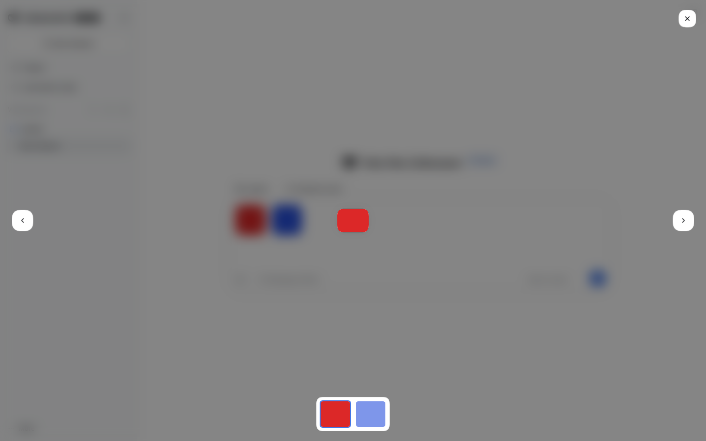

# @dshfiles/attachment-gallery



Owned port of DSH's native attachment presentation plugin. It keeps the stock composer drop target, mixed image/file rail, upload progress and retry behavior, and image rendering in messages, trajectory records, and image-bearing tool calls. Image previews add left/right keyboard navigation, side controls, and a selectable thumbnail strip.

## Upstream and license

The native baseline is `@deepseek-ai/dsh-client-ui-attachment@0.2.0-rc.2` from [`deepseek-harness/packages/client/ui-attachment`](https://github.com/deepseek-ai/deepseek-harness/tree/main/packages/client/ui-attachment). The lightbox interaction is an owned port of the DSH core `ui-primitives` implementation from revision `573ac248` in this checkout; it lives in the shared kit as `@dshfiles/plugin-ui/components/image-lightbox`, so the backlog composer uses the same gallery. Upstream code is MIT licensed; retain the notice in [`LICENSE`](./LICENSE).

This plugin is the deployed UI implementation. The core package stays available and unchanged; this bundle disables Loader row `ui-attachment` and inserts `dshfiles-attachment-gallery`. When DSH changes its attachment contracts or behavior, compare against the pinned upstream baseline and deliberately port the relevant changes here. Do not silently patch core or assume the fork stays in sync.

## Build and verify

```sh
pnpm typecheck
pnpm test
pnpm build
fnm exec --using=22.23.3 node -e "import('./dist/index.js')"
```

Profile composition is seeded in `profiles/web/`; it requires the user's next restart to load. Never restart the live `web` instance from plugin work.
