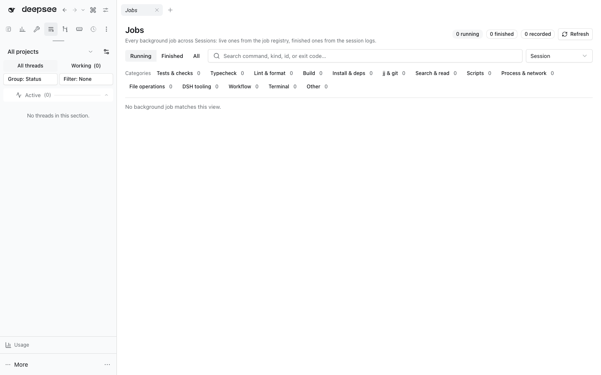

# DSH background jobs board



One page for every background job of every Session: the ones still running, and —
opt-in — the ones that already finished. Rows are classified deterministically
from the job kind and its label, so "when did we last run the e2e suite", "which
jj history commands ran today" and "what is still building" are one filter away.

Open the reusable **Background Jobs: Jobs** view from navigation or the Workbench chooser.

## Where the rows come from

```
ctx.jobs (live, every Session) ──┐
                                 ├──► merged by job id ──► classify ──► board API ──► Jobs panel
session logs job/registered+s/… ─┘
```

- **Live rows** come from `ctx.jobs.events.subscribe({ owners: 'all' })`: the job
  registry knows every job of this process, including the ones other Sessions
  started. A row is `live` exactly while its registry record exists, and a
  `settled` event converges it to its terminal status.
- **Recorded rows** come from the session logs, which are the only source that
  still lists what earlier DSH processes ran. `$DSH_HOME/sessions` is walked
  newest-first and each file resumes at the byte offset of its last complete
  Zstandard frame (through `@dshfiles/usage/session-log`, the one frame reader).
  A `job/registered` without a `job/settled` is reported as `interrupted`: the
  process that owned it is gone, and only a live twin turns it back into
  `running`.

The index persists to `$DSH_HOME/runtime/dshfiles/background-jobs/state.json`
(0600, atomic rename, bounded to 20 000 jobs). A malformed state file is
rebuilt by rescanning instead of failing the board, and the sessions root being
unreadable only costs the recorded rows.

## Categories

`src/classify.ts` normalizes the label first — `cd`, `export`, `fnm exec`,
`time`, banners and assignments are wrappers, not work — then reads the command
that actually ran, and falls back to a package-manager script scan
(`pnpm check:e2e` → tests) before giving up on `other`.

| Category            | Matches                                                           |
| ------------------- | ----------------------------------------------------------------- |
| tests               | vitest, playwright, `pnpm test`, `check:e2e`, any `check*` script |
| typecheck           | `tsc`, `pnpm typecheck`                                           |
| lint-format         | oxlint, oxfmt, prettier, `pnpm lint`/`fmt`                        |
| build               | turbo, `pnpm build`, `vite build`, tsup                           |
| install-deps        | `pnpm install/add/remove/exec`, nix, fnm, comma                   |
| vcs                 | `jj`, `git`, `gh`                                                 |
| inspect             | rg, grep, cat, sed, ls, find, `ast-outline`                       |
| scripts             | node, python, jq, shell one-liners                                |
| process             | ps, lsof, pgrep, curl, sleep, localhost probes                    |
| files               | cp, mv, rm, mkdir, tar, chmod                                     |
| dsh                 | `dsh`, `dshx`, session-log tooling                                |
| workflow / terminal | the `workflow` and `pty-send` job kinds                           |

The classifier is pure and table-driven (`src/classify.test.ts`), so a category
change is a one-line rule change plus a test.

## Panel

`sidebar.panellist` entry **Jobs** and the `main` panel next to it: scope tabs
(Running / Finished / All), search over labels, ids and exit codes, category
chips with live counts, grouping by Session or category, per-row output
expansion for jobs this process still holds a ring for, and a two-press Stop
that goes through the registry's owner fence. Running rows also take a checkbox
(Shift range, Cmd/Ctrl toggle, select-all over the visible running rows): Stop
selected stops them all after one confirmation naming the count, and every kill
still passes the same owner fence.

## Agent tools

| Tool                      | Kind               | Backing method                    |
| ------------------------- | ------------------ | --------------------------------- |
| `background_jobs_board`   | read-only          | `board`                           |
| `background_jobs_output`  | read-only          | `output`                          |
| `background_jobs_refresh` | write              | `refresh`                         |
| `background_jobs_kill`    | write, destructive | `kill` (requires `confirm: true`) |

`kill` stops another Session's job on the user's behalf, so it names the user
request it needs and refuses without the explicit `confirm` flag. Output reads
never touch the model's own consuming cursor.

## Limits

- Output is retained only for jobs of the current process; a recorded job from
  an earlier process reports that, and names any spill files the registry kept.
- The board reads the whole `$DSH_HOME/sessions` tree. The first pass after a
  fresh install decompresses every log once; afterwards each pass reads only the
  appended frames, and the UI shows the indexing progress until it catches up.
- Cross-Session visibility is the point of the page: every label is a command
  line another Session ran. It is the same information the stock per-Session job
  list shows, only not fenced to one Session.
