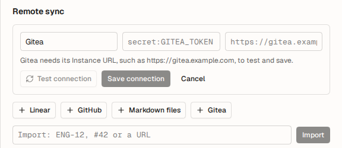

# @dshfiles/backlog-gitea



Gitea and Forgejo repositories as a [backlog](../backlog/README.md#remote-sync-connections-bindings-and-providers) sync
source. This plugin is Host-only: it serves the backlog's `backlog-provider` Host API
(`BacklogProviders.contract('@dshfiles/backlog-gitea')` from `@dshfiles/backlog/backlog-provider`) and renders nothing.
Its user-visible surface is **Backlog settings › Remote sync**, owned and screenshotted by `@dshfiles/backlog`; with
this plugin loaded, that section offers **Add Gitea connection**.

## Set it up

1. In Gitea, create an access token (**Settings › Applications › Generate token**) with **write:issue** and
   **write:repository**. **read:user** is optional: without it, the connection shows a hint instead of the login and
   everything else works. Store the token in the Secret Catalog.
2. In **Backlog settings › Remote sync**, add a Gitea connection: its key is the token's `secret:ALIAS` reference (empty
   falls back to the Host's `GITEA_TOKEN`, then `FORGEJO_TOKEN`), and its **Instance URL** the address of your
   instance, `https://gitea.example.com`. A trailing `/api/v1` is accepted, and a bare host (`gitea.example.com`)
   reads as https. Gitea has no public default, so **Test connection** and **Save connection** wait until the URL is
   set. **Test** names the account and lists the repositories with issues the token sees (archived repositories and
   repositories with issues off are left out).
3. Add a binding. Its container is a repository, `owner/repo`, or empty for the only repository with issues the token
   sees. The binding's provider setting:

| Setting               | Default | Use                                                                                             |
| --------------------- | ------- | ----------------------------------------------------------------------------------------------- |
| Create missing labels | yes     | `no` (or `false`, `off`, `0`) only attaches tags that already exist as labels in the repository |

### Plain http

The token is sent on every request, so the instance URL must use **https**. Plain **http** is accepted only for private
hosts: loopback, RFC 1918 and CGNAT (Tailscale `100.64.0.0/10`) addresses, and names under `.internal`, `.local`, `.lan`,
`.home.arpa` or `.ts.net`. On a tailnet the traffic is still encrypted by WireGuard.

## What maps to what

| Backlog   | Gitea                                                                                                                  |
| --------- | ---------------------------------------------------------------------------------------------------------------------- |
| title     | `title`                                                                                                                |
| body      | `body` (markdown, as is)                                                                                               |
| status    | `state`: open stands for inbox, todo and doing; closed for done and dropped (Gitea has no close reason)                |
| kind      | a label named after the kind on create (`bug`, `idea`…; none for `task`), write only                                   |
| tags      | labels, read in lower case; matched case-insensitively on write, missing ones created with a stable color unless off   |
| relations | issue dependencies: what blocks the issue is `depends-on`, what it blocks is `blocks` (none when dependencies are off) |
| comments  | issue comments both ways                                                                                               |
| delete    | closes the issue (unless the binding only pulls); issues are never deleted                                             |
| reference | `42` or `#42` in the bound repository, `owner/repo#42`, or `https://<instance>/owner/repo/issues/42`                   |

Parent and priority are not synced: Gitea has no sub-issues and no priority field. Pull requests are never items.

## How it talks to Gitea

- **API.** Gitea REST v1 (Forgejo serves the same API). Every path is built from an `owner/repo` that matches
  `[A-Za-z0-9_][A-Za-z0-9_.-]*` on both sides and a numeric issue number, each segment URL-encoded, and an issue URL
  is accepted only on the connection's host, under its web root; nothing a remote or a user typed reaches a path
  unchecked.
- **Auth.** `Authorization: token <token>`, resolved on the Host; the token never appears in an error, a log or a span.
- **Pulls.** `GET /repos/{owner}/{repo}/issues?type=issues&state=all&since=<checkpoint>` in pages of 50 (Gitea's default
  `MAX_RESPONSE_ITEMS`, so a short page really is the last). Gitea lists newest first; the checkpoint is the newest
  `updated_at` across all pages, compared as instants (Gitea answers with a zone offset), written as UTC. `since` is
  inclusive, so the issue at the checkpoint comes back once with an unchanged version, and no same-second edit is lost.
  With **links** synced, each changed issue costs two more requests (dependencies and blocks).
- **Rate limits.** 429 and 503 wait for `Retry-After` (capped at 60 s, else exponential backoff), three times at most.
- **Discovery.** `GET /repos/search`, which needs only repository scope; `GET /user` names the account when the token
  has `read:user`.
- **Telemetry.** One `gitea request` span per HTTP call with the operation, method, status and retries — never a URL,
  host or token.

## Verify

```sh
pnpm --dir plugins/@dshfiles/backlog-gitea test        # provider against the in-memory fake (src/gitea-fake.ts)
pnpm --dir plugins/@dshfiles/backlog-gitea test:e2e    # connect, bind, import and close against a loopback fake
```
