# @dshfiles/backlog

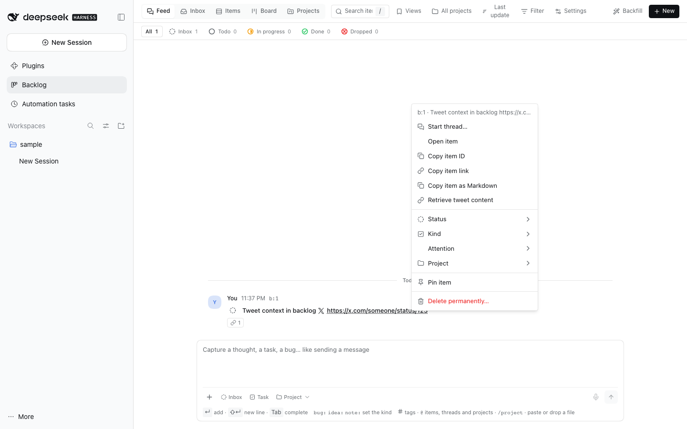

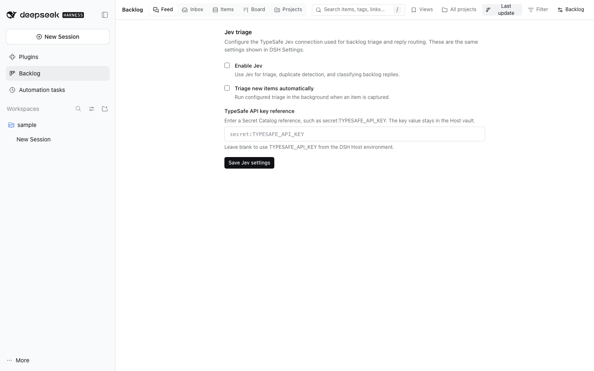

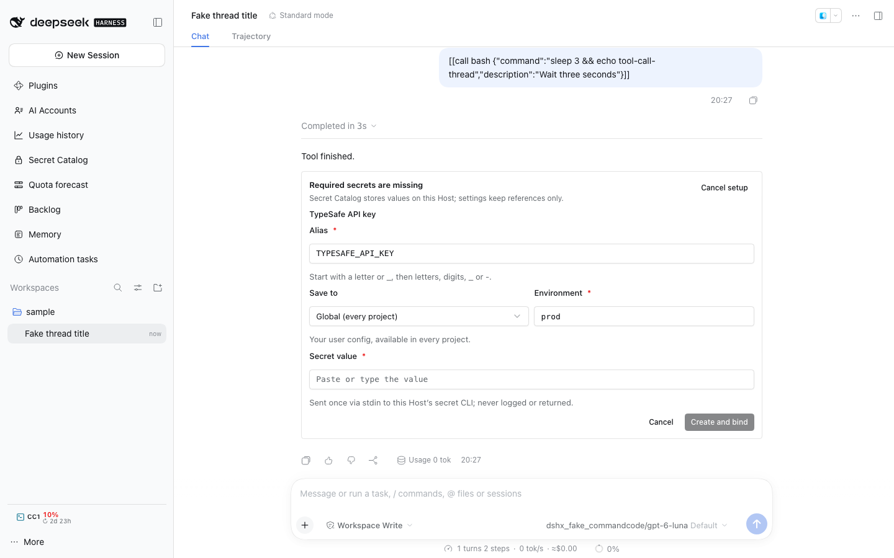

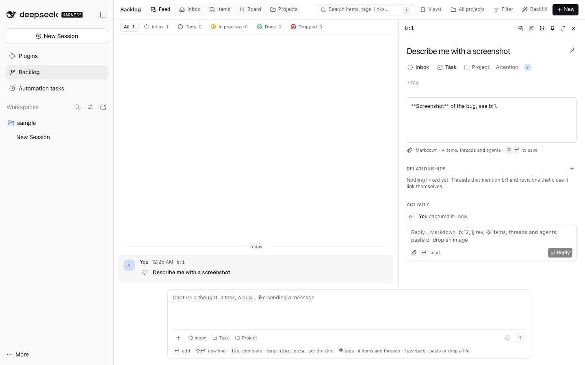

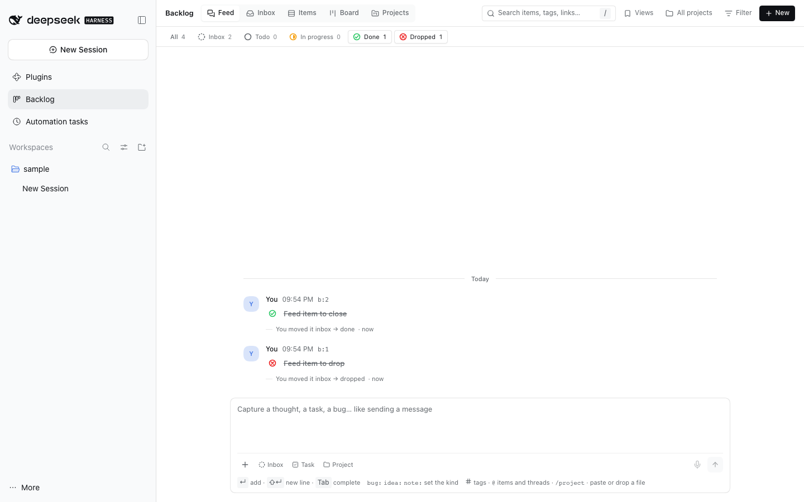

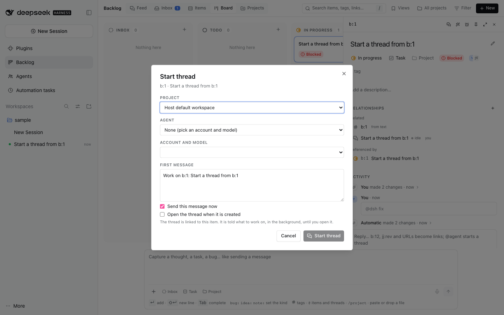

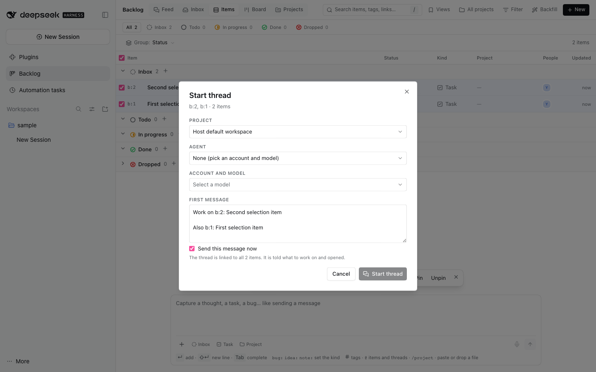

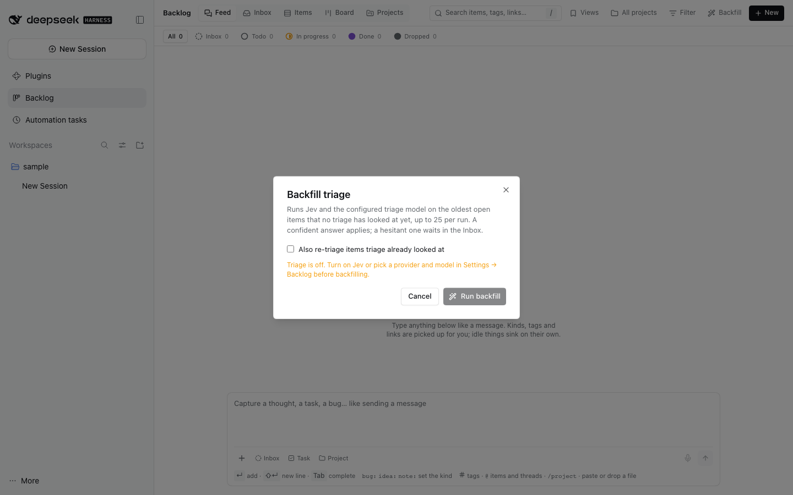

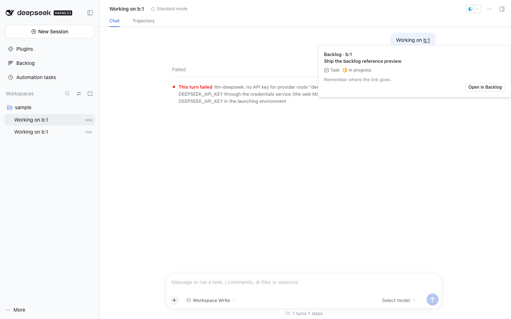

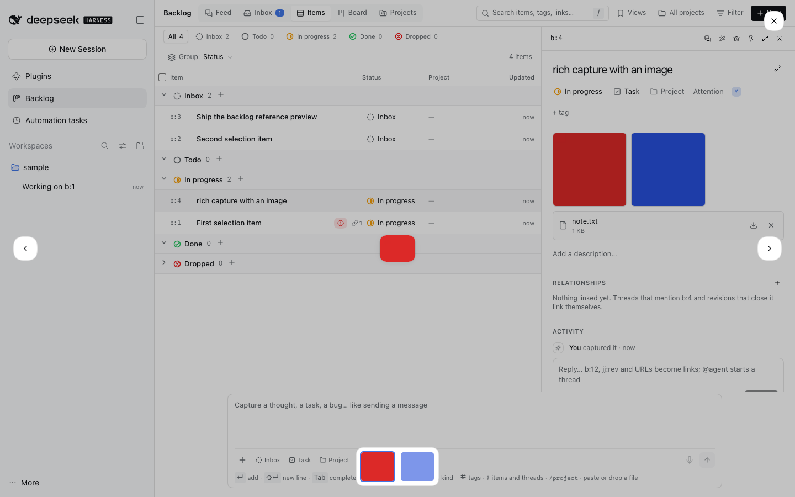

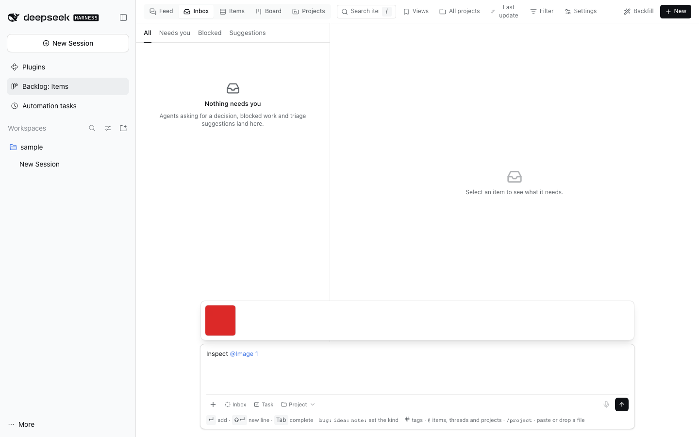

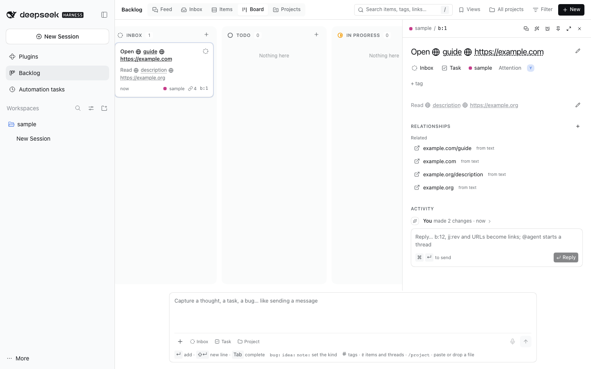

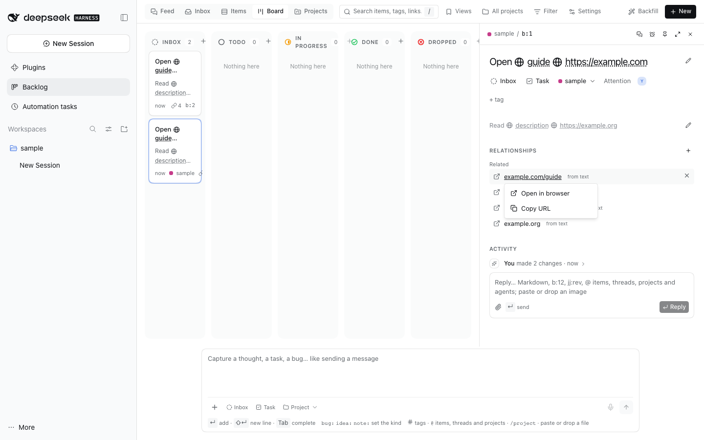

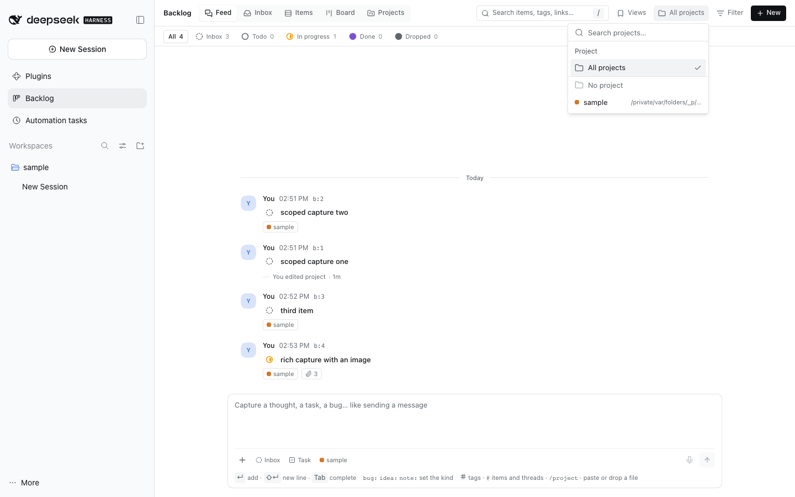

One capture feed for notes, tasks, bugs, ideas and questions, shared by the user and every agent. It
replaces a "TODO" chat channel: adding something costs one line, the feed stays ordered by activity so
idle things sink, and the tracker parts (status, actors, links, search, board) come for free.

Plan and open steps: [plans/backlog](../../../plans/backlog/README.md).

Open the reusable **Backlog: Items** view from navigation or the Workbench chooser. Items, Board, Projects and Inbox remain the page’s own view controls.

## Capture

The **Backlog** sidebar panel has one capture box pinned to the bottom of every view (Enter adds,
Shift+Enter breaks the line); agents use `backlog_capture`. It is a chat-sized card with a Linear-style
toolbar:

- The project chip opens a searchable combobox of the projects items are already filed under plus every
  registered workspace (`All projects` in the header, the project on the item). Typing `/project` in the
  text opens the same list inline; picking one removes the command and sets the chip.
- `+` picks images or any files, or links a backlog item or a thread. Picked references land in the text as
  `b:<n>` or a `session-…` id.
- Status and kind chips are editable before sending; the kind chip otherwise follows the text prefix.
- Files can be picked, pasted or dropped. Images are scaled to 1600 px and re-encoded as WebP; other files
  keep their bytes. The Host keeps the bytes in their own storage domain, never in the item row. An item
  shows images as a thumbnail grid and other files as download rows; a feed row shows a paperclip count.
  At most eight files, 16 MB each (20 MB before an image is shrunk).
- The microphone records a 16 kHz mono WAV and transcribes it through the Host voice-input bundle
  (`@deepseek-ai/dsh-experimental-voice-input-bundle`), so the selected SenseVoice provider prepares and
  recognizes audio on the Host machine. The button is disabled with the setup reason until that bundle is
  loaded and its recognizer is ready.

Structure comes from the text:

- `bug:`, `idea:`, `note:`, `question:`, `task:`/`todo:` set the kind; a first line ending in `?` is a
  question; anything else is a task. The first line is the title, the rest the markdown body.
- `#tag` adds a tag; `b:<n>` links another item; `jj:<rev>` a revision; `branch:<name>`, `workspace:<path>`,
  a `session-…` id and URLs become typed links.
- An agent capture links the calling thread, names the agent as owner and takes its working directory as
  the project. A thread running in its own jj workspace files under the project that workspace was cut from:
  the Host asks `@dshfiles/jj-integration` which project owns the workspace, so a custom threads directory
  folds the same way, and an item read back from an older row folds to its project too. Without
  jj-integration the captured path stays as it is.

New items land in `inbox`, in the project the header filters by when there is one, otherwise in the project
of the previous capture (`reuseCaptureProject`, on by default; off starts each capture with no project).
Picking a project the header does not show keeps that chip until you clear it.

## Feed, board and freshness

The feed lists pinned items first, then newest activity by default. Use the sort menu on Feed, Inbox or Items to
choose last update or creation date; each view remembers its choice across reloads. A chip row above the feed and
the Items list narrows both to one status or several at once; the picks persist across reloads and `All` clears them.
Freshness is derived on read and never stored:

| Item               | Leaves the feed                             |
| ------------------ | ------------------------------------------- |
| `note`             | dormant after 14 idle days                  |
| other open items   | dormant after 30 idle days                  |
| `doing`            | never; flagged **stale** after 14 idle days |
| `done` / `dropped` | archived after 7 days                       |
| pinned             | never                                       |

Dormant and archived items stay in search, filters and backlinks. Any edit, move, link or comment makes
an item fresh again. The list groups the feed like a chat history (Pinned, Today, Yesterday, This week,
Earlier). The board shows the same items by status; each card names its project beside the item id,
a click opens the item's detail beside the board, a drag moves the card to another column, and its
status ring changes status in place. Dragging a selected card moves the whole selection; dragging an unselected
card moves only that card. The drag preview names the count and dims every moving card.

Feed, Inbox, Items, Board, search results and project item groups share Cmd/Ctrl-click toggles and inclusive
Shift-click ranges. Plain clicks keep the existing open behavior and clear the batch. Right-click a selected
item to apply the menu's counted actions to the entire selection, including the existing explicit permanent-delete
confirmation. Filter changes and collapsed Items groups remove hidden targets; project overview groups keep separate
selection scopes. Items also has select-all-visible and the batch action bar.

Status, kind and drops update the view before the Host answers. While you type, chips under the capture
box show the kind, tags and links triage will derive.

Keyboard: `J`/`K` (or arrows) move, `Enter` opens the peek, `Esc` closes it, `C` focuses capture, `/` search,
`B` toggles list and board; a status or kind menu takes `1`–`5`.

Double-click an item in the feed, an Items row or a board card to rename it where it sits: the title
becomes an input, Enter or a click away saves it, Escape keeps the old title, and the peek stays closed for
this one gesture. A double click on a link, chip or button inside the row keeps that control's action
instead.

## Item peek

The peek opens beside the list (over it in a narrow pane). Edit the title and the markdown body in place, change kind and status, pin, link and unlink targets, comment, and read every event
with its actor (`user`, `system` or `agent:<sessionId>`). **Referenced by** lists the items that link to
this one. Click a URL reference to open a popover with **Open in browser** and **Copy URL** actions. Fields
the user changes by hand are recorded in `humanFields`, so later automatic moves can leave them alone.
Nothing is deleted; `dropped` closes an item.

The description box and the reply box are the capture composer's own text box: Markdown, `@` completion
for agents, backlog items and threads, and images or files picked with the paperclip, pasted or dropped.
A description's files are kept with the item; a reply's files belong to that comment and open in the
same gallery from the conversation. User-authored replies can be edited or deleted; their actions and the edit form are keyboard-operable, with visible focus and accessible labels. Reply cards have a little extra separation in the activity list.

## References in a conversation

An Agent writes `b:<n>` in its markdown, the way `jj:<rev>` marks a revision: prose and inline code become
links, while fenced code, existing links and words that merely contain the token stay as written. Clicking
one opens an inline card with the item's title, kind, status, project and body. Image attachments appear as
thumbnails; clicking one opens the shared, keyboard-navigable gallery above the card. **Open in Backlog**
selects that item in the panel. An item that no longer exists says so in the card instead of failing the
conversation.

## Retrieve tweet context

When a new item, an edited title or description, or an explicit URL link adds a public X/Twitter status, Backlog automatically retrieves its first unimported post through Tweet Context. For an older item—or after a failed or interrupted lookup—right-click its row and choose **Retrieve tweet content**. Retrieval sends the post ID to FxEmbed. Post and thread text is appended as a clearly marked, quoted section; existing descriptions and files are preserved. Available photos and sampled video frames become item attachments within the remaining slots and an eight-image, 16 MiB import budget.

Only public status links already present on the item are accepted. Private, deleted or unavailable posts leave the item unchanged; failed automatic lookups can be retried from the row menu. A successful import is recorded against the normalized post URL, so repeating it does not duplicate content.

## Starting a thread from an item

Right-click a feed entry, an Items row or a board card (or press **Start thread** in the peek header) to open
the start-thread dialog. It prefills the item's own project when that path is a registered project, offers the
other projects plus a bare folder for a project path the registry does not know, and lists every routable
account/model from the Host catalog with the model's reasoning efforts. Project rows have distinct color dots and
home paths display as `~/...`. The first message is prefilled from
the item (title plus preview) and can be cleared to create an empty thread instead.

Starting hands the request over and closes the dialog at once: the thread is created in the background, so a slow jj
workspace never holds the panel. The banner says `Starting a thread for b:<n>…` while the workspace and the Session are
built, then reports `Thread started for b:<n>`. The Host selects the account/model on the thread, names it after the
item, and sends its first message when one is present. Clearing the message creates an empty thread. The item is linked
to the thread (provenance `user`, or `agent` when an agent started it).

It does not take you to the thread by default: you stay where you were, and the report carries an **Open** action.
Settings → `dshfiles-backlog` → _Open threads started from a backlog item_ opens them instead; the dialog's own _Open the
thread when it is created_ box overrides that setting for one thread. An `@agent` comment follows the same setting.

Agents start the same thread through `backlog_start_thread` (`startThread` on the Host): the item ids, and optionally a
project workspace or bare folder, an agent handle, an account/model, and the first message. The panel and the tool share
one Host verb, so a thread an agent starts is the thread the dialog starts. The tool itself does not
navigate the calling thread.

A thread started from an item always runs in its own jj workspace of the chosen project, whatever the
isolate-by-default setting says: work captured in the backlog is independent, so it never shares a checkout
another thread is editing. `@dshfiles/jj-integration` creates that workspace (one `thread-xxxxxx` beside the
project) and the thread starts in it; outside a jj repository, or with the plugin not installed, the thread
starts in the project workspace as before. A thread with no project joins the first registered workspace, the
way the composer's New thread does, and is isolated there too. A workspace that cannot be created reports its reason
in the toast and nothing is started, so a jj failure never falls back to a shared checkout.

Failures after creation keep the thread and the toast still offers it: a refused model switch leaves the Host default
model, and a failed link is logged rather than losing the thread.

### Smart reply routing

Off by default (Settings → `dshfiles-backlog` → _Smart thread routing_); plain replies stay regular comments by default, so adding context cannot unexpectedly start a thread. Turn it on to classify plain replies before they are saved; when configured Jev receives that submitted text using the same Host-held TypeSafe credential as triage. Jev starts a linked `@dsh` thread when confidence meets _Reply thread threshold_. If Jev is off, its key is unavailable, or the request fails, a conservative leading-verb keyword fallback routes explicit work requests and leaves other text as a reply. A leading `@agent` remains an explicit, deterministic dispatch and does not need Jev.

For reply-worthy text without attachments, _Smart reply answers_ (on by default) saves the user's comment and then asks the selected agent to add a short AI answer as a separate comment. _Reply agent_ names an optional preferred handle, and _Reply agent order_ chooses whether that or the most recently linked item agent is tried first; `@dsh` and the model catalog's default route are the final fallback. A chosen agent's route and instructions apply, but its session preset and tools do not run for this one-shot answer. The generated comment is visibly prefixed with the chosen handle. Replies carrying files remain ordinary comments because the generator does not inspect attachments. If generation fails, the original reply stays saved and an error is shown. Thread-worthy work still saves the user reply and starts the linked thread; attachments stay with the item.

_Thread start notifications_ selects off, in-app, browser system, or both. The in-app notice offers **Open**. Browser
system notices are sent only if this browser already grants notification permission; Backlog never prompts or enables it
without an explicit browser action. The notice contains only the item id and title, not the submitted message.

## Backlog settings

The panel's **Settings** tab gives quick access to the backlog's Jev controls: turn Jev on, enable automatic
triage, and bind the TypeSafe key by its Secret Catalog reference. The same `dshfiles-backlog` settings remain
available in the usual DSH Settings screen. Only the reference is stored; leave it blank to use
`TYPESAFE_API_KEY` from the Host environment.

## Automatic triage

Off by default (Settings → `dshfiles-backlog`). With `autoTriage` on, every capture is triaged in the
background, so adding an item never waits:

- **Jev** (`jevEnabled`) answers two cheap yes/no questions:
  is this work to do (otherwise a plain capture becomes a `note`), and is it the same work as the closest
  open item (a suspected duplicate). Its key comes from `jevSecret` — a Secret Catalog reference such as
  `secret:ALIAS` or `secret:ALIAS@env` — and falls back to `TYPESAFE_API_KEY` in the Host
  environment when that setting is empty. The settings field's **Add secret** button creates or replaces the global
  `jev-api-key-optmem` alias and binds its reference automatically; project-scoped aliases cannot resolve here because
  triage has no project folder. The value is resolved on the Host and never stored in settings.
  When Jev is enabled, no key resolves, and `jevSecret` has no reference, the latest completed chat turn shows an opt-in
  **Set up missing secrets** offer. It creates a global alias (suggested `TYPESAFE_API_KEY`) and saves only `secret:ALIAS`
  to `jevSecret`; the value stays in Secret Catalog and never enters the conversation. If a reference is already set but
  cannot be resolved, the turn shows a repair warning instead of suggesting another alias.
- **A cheap model** (`triageProvider` + `triageModel`) proposes kind, status, title, tags and a duplicate
  among the similar items it is shown. Items whose applied triage you later corrected by hand are given
  to it as examples; they are read from the event log, not stored separately.

Agreement between the two raises the confidence, disagreement lowers it. At or above `applyThreshold`
(0.8) the proposal applies as `system` and leaves every field you set by hand alone; a duplicate is only
linked, never closed. Below it, the item shows a **Triage suggests** card (and a wand on its row) with
**Accept** and **Dismiss**; accepting makes those values yours. The wand in the peek header runs triage
on demand. A missing key, model or failing call is skipped and the item simply stays in the Inbox.

### Backfilling items captured before triage

Triage only runs on capture, so items that predate it stay untriaged. The wand in the panel header
(**Backfill triage**) starts a background pass over inbox/todo tasks only: the oldest eligible items,
25 per run, one at a time so a rate limit or bad key does not burst. The dialog shows a progress bar and
outcome counts while it runs; closing the dialog leaves the pass running, with a small progress control
to reopen it. `backlog_triage_backfill` starts the same pass for an agent and returns a job id;
`backlog_triage_backfill_status` reads its progress. `retriage` includes inbox/todo tasks triage already
looked at (after changing the prompt or model). An item triage found nothing to change on gets a "found
nothing to change" event without being bumped to fresh, so the next run skips it instead of reviving old
work.

## Lifecycle signals

On by default (`lifecycleSignals`). Items move without anyone filing them:

- A user message that mentions `b:12` links that thread to the item and moves it to In progress.
- A revision on `main` whose description says `Closes b:12` (also `Fixes`, `Resolves`, `Completes`,
  `Implements`; several ids with commas or `and`) links that revision and moves the item to Done. A bare
  mention such as `part of b:12` closes nothing.
- A linked thread whose turn ended **blocked** or **failed** marks its open items as blocked, so they reach the
  Inbox instead of sitting silently In progress. Its next finished turn clears that flag again; a cancellation,
  a token ceiling and a crash-interrupted turn leave the item alone.
- Set `idleThreadNudgeDays` to a positive number to nudge unfinished items when a linked thread has been idle
  that many days. The Inbox attention and comment name the thread; active threads, closed items and items with
  an existing attention request are left alone. The default `0` keeps this opt-in.

Signals only move forward (never Done back to In progress, never out of Dropped) and never over a status or
attention you set by hand; the link is recorded either way. Only the block this signal set is cleared later,
so a `blocked` an agent flagged itself stays until someone clears it or closes the item. Closing an item clears
agent/system attention and pending suggestions; closed items stay out of the Inbox even if older stored state still
has a flag. Hand-set attention is preserved on the item and can resurface if it is reopened. Revisions are read with
`jj log --ignore-working-copy` on `main` every `revisionPollMinutes` (5) in each repository an open item
names, plus `revisionRepositories`; an unchanged `main` costs one call.

Working on an item is the Agent's job past that point: every thread is told (a system-prompt section, not just
the tool descriptions) to move the item to Done with `backlog_update` once the thread resolved it, and when only
part is done or the work is stuck, to leave it In progress with a `partial` or `blocked` tag, set `attention`
when you must decide something, and say in its reply what is done and what is missing.

A finished turn is not proof the item is done, so nothing closes an item on its own. With `threadResolution`
(`propose`) and Jev configured (`jevEnabled` plus a key), the plugin instead asks Jev whether the thread's last
reply finished the item and leaves a **Thread suggests** card with `status done` for **Accept** or **Dismiss**.
It skips items whose status you set by hand, waits while a suggestion is open, and does not re-suggest an item
you dismissed until the item changes again. A missing key, a failing call or a plain progress reply suggests
nothing.

## `@` mentions

In any composer, `@b:` (or `@backlog:`) searches the backlog, and plain `@` shows up to five matching
items next to threads and files. The chip is sent as `b:12 "title"`, so the thread signal above links the
thread and starts the item, just as typing `b:12` does.

Every backlog text box — the capture composer, an item's description and its reply box — completes the same
sources from one `@` menu: agents, backlog items, threads and projects. Typing `@project-name` offers known projects;
picking one inserts `workspace:<URI-encoded absolute path>`, an extracted link reference that does not change the item's
project field. With `@dshfiles/agents` installed an `@rev` lists
enabled agents (Tab or Enter completes, Escape dismisses); picking one inserts `@handle ` as plain text, which
is what the reply box reads as a dispatch and what any other thread reads as a mention. `@b:`, `@t:` and `@f:`
keep their own scope: no agent row appears and the typed reference is left untouched.

Images and files work the same way everywhere: the paperclip, a paste or a drop puts them above the text,
Enter sends a reply and `⌘↵` saves a description, and a file that cannot be read says why instead of
dropping the rest of the draft.

## Agent tools

| Tool                       | Kind                                                                                  |
| -------------------------- | ------------------------------------------------------------------------------------- |
| `backlog_list`             | read: search and filter (`statuses`, `kinds`, `project`, `tag`, `actor`, `freshness`) |
| `backlog_get`              | read: one item with history and backlinks                                             |
| `backlog_get_many`         | read: up to 50 items at once, unknown ids listed separately                           |
| `backlog_referencing`      | read: items linking to a thread, revision, branch, workspace, URL or item             |
| `backlog_capture`          | write                                                                                 |
| `backlog_update`           | write: edit or move                                                                   |
| `backlog_link`             | write: link or unlink                                                                 |
| `backlog_comment`          | write, optionally with images or files                                                |
| `backlog_attach_file`      | write: keep one base64 image or file with an item                                     |
| `backlog_read_file`        | read: one image or file as a data URL; `save: true` also returns a temp file path     |
| `backlog_remove_file`      | write: remove one image or file                                                       |
| `backlog_triage`           | write: run triage on one item now                                                     |
| `backlog_triage_backfill`  | write: triage items captured before triage was set up, oldest first                   |
| `backlog_start_thread`     | write: start one thread for items, in the item project's own jj workspace, linked     |
| `backlog_projects`         | read: per-project counts, who needs you, people                                       |
| `backlog_accept_proposal`  | write                                                                                 |
| `backlog_dismiss_proposal` | write                                                                                 |

## Search and saved views

Typing in the header search filters the view you are on: the feed, Items, Board, Inbox and Projects keep
their layout and show only matching items (dormant ones stay hidden unless the filter menu includes them). Press
`Enter` to open the full results view, which ranks by relevance and says where each result matched (title,
tag, description, comment, original capture, project, link), with the matching words highlighted, and covers
dormant and archived items. Picking a view leaves the results and keeps the words as its filter; `Esc`
clears them. Words must all match; `"quoted phrases"` stay whole. Operators combine freely:

| Operator                | Example                                                  |
| ----------------------- | -------------------------------------------------------- |
| kind, status, attention | `kind:bug`, `status:doing`, `is:blocked`, `is:needs-you` |
| tag, project            | `#composer`, `project:welii`                             |
| who touched it          | `by:agent`, `by:me`                                      |
| what it links           | `has:thread`, `has:revision`, `has:url`                  |
| activity                | `updated:<7d`, `updated:>30d`                            |

**Views** saves the current view and search under a name in the plugin's settings (`savedViews`), so every
browser lists the same views.

## Project scope

The header's searchable project filter narrows the feed, Inbox, Items, Board and search to any number of
projects, including `No project`; `All projects` clears the selection. It persists like the status chips
and presets the capture box when exactly one project is selected. Paths inside the current user's home are
displayed as `~/...` where shown. Candidates are the projects items already name plus every registered
workspace, with isolated thread workspaces (`…/threads/thread-…`) left out, so the picker offers `dshfiles`
and not the checkout a thread runs in. The same single-select picker sits on the item's details line and in
every right-click menu's **Project** submenu, and every feed entry, Inbox row, Items row, board card and
search result labels the item's project.

## Inbox and the rest of the ADE

The Inbox holds open items whose `attention` is set (`needs-input`, `blocked`, `waiting`, set by agents with
`backlog_update` or by you) and open items with a triage suggestion. Closing an item clears agent/system attention
and its suggestion. Each open item appears once, combining its attention, suggestion and linked unread
thread reasons. With `inboxThreads` (`failures` by default), blocked or errored turns add their open linked
items (`all` adds finished turns waiting for review). Every distinct thread keeps its own open and acknowledge
actions; acknowledging a thread clears it in the sidebar too, without resolving item attention or dismissing
its suggestion. Filters and counts use unique items, and closed done/dropped items never return through
historical threads. Native `ask_user_question` forms stay in their threads: listing them across sessions is the
expensive scan recorded as a Host gap.

In the inspector, thread links show the thread's title and whether it is running, and a running linked
thread shows as an **Execution** strip at the top.

With `publishActivity` (on by default) item creation, moves, links, comments, triage and requests for
input are reported to `@dshfiles/activity-timeline` as `backlog.*` events (requests for input at
attention level), so the shared Activity room shows backlog work. The item's own event log stays the
source of truth: the timeline keeps a bounded, observation-only copy.

## Lifecycle and retention

`dormantAfterDays` sets, per kind, how many idle days an open item stays in the default views (0 keeps a
kind visible forever). Items asking for attention, pinned items and work in progress never go dormant; done
and dropped items archive after 7 days. Snoozing hides an item until a chosen time, then it resurfaces.

## Scale

Lists poll a revision number and refetch only when it changes. Items is virtualized, the Feed mounts the
newest 150 entries and loads older entries as you scroll upward, Board columns reveal 30 cards at a time as
you scroll, and project progress is counted on the Host over every item. Measured on 2,017 items (headless
Chromium, warm): Items 104–313 ms,
Board 208–269 ms, Feed 243–405 ms, search 82–550 ms, Projects 458–775 ms, first open 1.0–1.6 s.

## Storage

Host-owned storage-domain `backlog`, table `items` keyed by id, so every browser and agent reads the same
rows. Search is an in-memory token match over title, body, tags, project and link targets. Attachment bytes
live in the separate `backlog_files` domain, keyed by item and attachment; `backlog_read_file` returns a
data URL for the UI, and `save: true` writes a copy under `$TMPDIR/dsh-backlog-attachments/<item>-<attachment>.<ext>`
and returns that absolute path so an agent can read an image instead of a base64 string.

## Secret references

An item may name a credential without holding one: `secret:ALIAS` or
`secret:ALIAS@env` in the title or body becomes a `secret` link (the target is
`ALIAS` or `ALIAS@env`). Nothing is resolved there — the Secret Catalog owns the
value, and its own reveal covers the read. The capture composer deliberately
does not carry `data-secret-input`: an item holds prose, so its references are
typed as text. The reference-field picker belongs on the `jevSecret` setting;
the missing-key setup offer is a separate chat turn-tail card, not a button on
the free-form composer.
