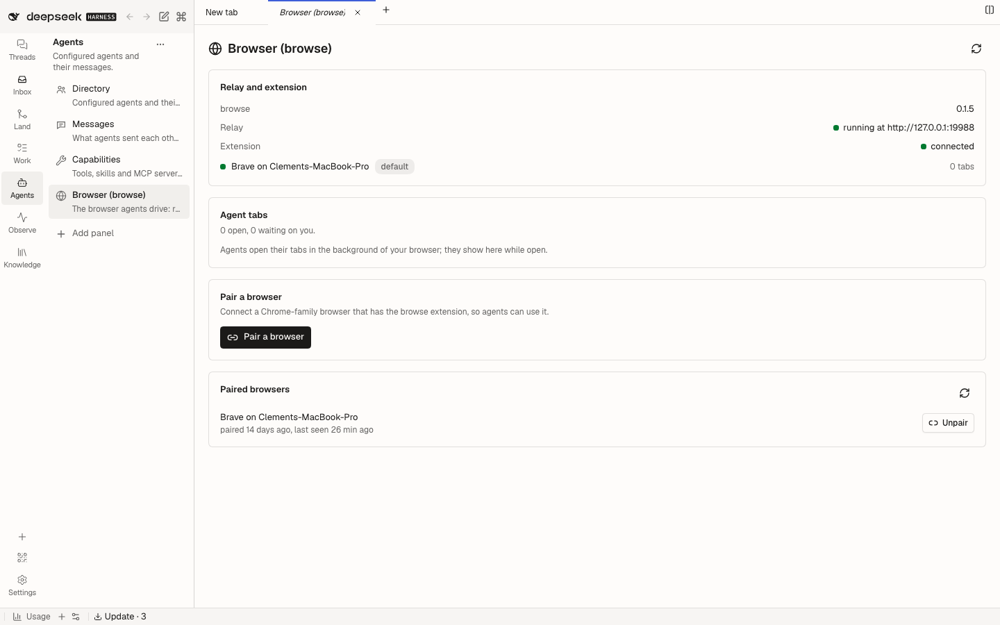
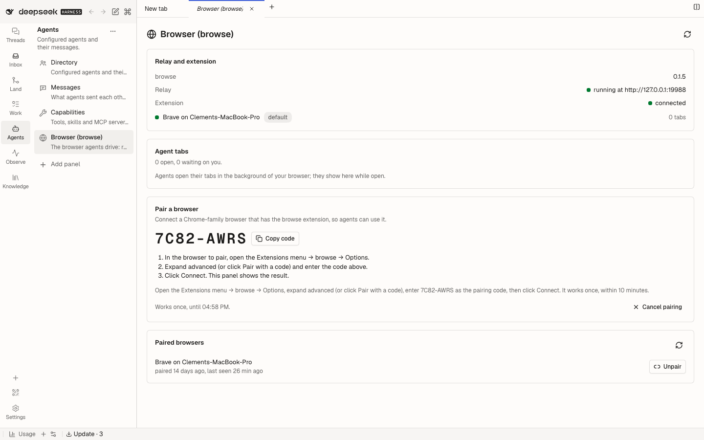

# @dshfiles/browse



The DSH companion for [browse](https://github.com/anomalyco/browse): the CLI, local relay (`127.0.0.1:19988`) and
Chromium extension that let agents drive your real browser. The browse MCP server itself is configured separately (the
`@dshfiles/mcp-servers` row runs `browse mcp`); this plugin adds no navigate or click tools. It shows the setup, pairs
browsers and tells you when an agent's tab waits on you.

## What it does

- **Browser (browse) panel**: Agents › Browser (browse), the command palette (**Browser (browse)**) and the New tab
  view chooser. It reads `browse status --json` on the Host: the CLI version, whether the relay runs, the extension
  state and its next step, connected browsers, and agent tabs with the ones that wait on you first. Reading status
  never starts the relay. While the panel is open it refreshes every `pollIntervalMs`.
- **Pair a browser**: runs `browse pair --wait-seconds 600` on the Host, shows the one-time code large with a copy
  button and where to enter it (Extensions → browse → Options → Pairing code), and keeps waiting Host-side. The panel
  then shows paired, expired (10 minutes), failed or cancelled. One pairing runs at a time; starting again returns the
  same code, **Cancel pairing** stops the process.
- **Paired browsers**: `browse pair --list`, with **Unpair** behind a confirmation (`browse pair --revoke <profile>`).
- **Tabs waiting on you**: when an agent's browse call hands off to you (sign-in, captcha, 2FA), each waiting tab is a
  blocking item in the Inbox (`browse.handoff`, needs `@dshfiles/activity-timeline`) until the call continues, and
  the panel header shows a badge.



## Agent tools

| Tool                    | Kind        | Does                                                               |
| ----------------------- | ----------- | ------------------------------------------------------------------ |
| `browse_status`         | read-only   | The panel's status: relay, extension, browsers, tabs, waiting tabs |
| `browse_pairings`       | read-only   | Paired browsers with their profile key                             |
| `browse_pair_start`     | write       | Start pairing and return the code; only when the user asked        |
| `browse_pair_cancel`    | write       | Stop the pairing in progress; only when the user asked             |
| `browse_pairing_revoke` | destructive | Unpair one browser; requires `confirm: true`, no default           |

## Settings

Settings › Plugins › browse (namespace `dshfiles-browse`, applies live):

| Setting          | Default  | Effect                                                                                                                                                                                                                                                                |
| ---------------- | -------- | --------------------------------------------------------------------------------------------------------------------------------------------------------------------------------------------------------------------------------------------------------------------- |
| `command`        | `browse` | The CLI to run: a name looked up on DSH's `PATH`, then `~/.local/bin`, `~/.nix-profile/bin`, `/etc/profiles/per-user/$USER/bin` and the system profiles; or an absolute path.                                                                                         |
| `pollIntervalMs` | `5000`   | How often the open panel and the handoff notifier run `browse status --json` (1000–60000).                                                                                                                                                                            |
| `notifyHandoffs` | `false`  | Off by default because it spends Host time on its own. When on, the Host checks for waiting tabs every `pollIntervalMs` and publishes them to the Inbox. It runs the local CLI only and spends no tokens. Off stops the background check and resolves the open items. |

## When something is wrong

- **browse is not installed**: install it with Nix (NixConfig home packages) or
  `curl -fsSL https://opencode.ai/browse/install | bash`, check `browse --version`, or set `command` to its absolute
  path when DSH runs with a shorter `PATH` (a launchd service, for one).
- **browse status failed**: run `browse status` in a terminal; `browse update` installs the latest version.
- **Pairing printed no code**: run `browse pair` in a terminal to see why.
- A DSH restart drops a waiting pairing; start a new one for a fresh code.

## Develop

```sh
pnpm --dir plugins/@dshfiles/browse typecheck
pnpm --dir plugins/@dshfiles/browse test    # parsers on captured 0.1.5 output; pairing with a fake browse on PATH
pnpm --dir plugins/@dshfiles/browse build
```

The Host half (`dist/index.js`) changes need a DSH restart; the panel (`dist/client.js`) hot-reloads.
