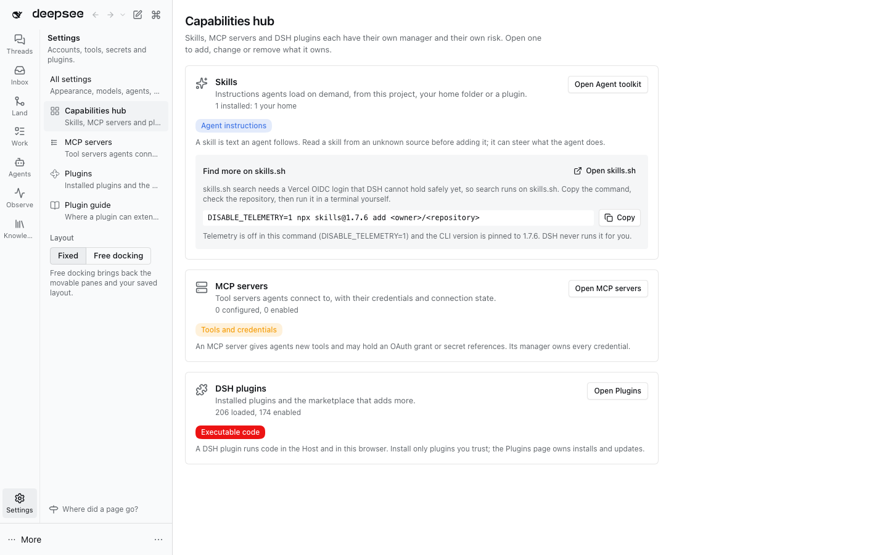

# @dshfiles/capabilities-hub



One launch point for the three kinds of capability an agent or DSH can gain. Open **Settings › Capabilities hub**:
each card names the kind, what adding one grants, a count read from its owner, and a button that opens the owner's
own page. The hub stores nothing, installs nothing and makes no network call.

| Kind        | Trust label           | Count read from                                             | Opens                                                        |
| ----------- | --------------------- | ----------------------------------------------------------- | ------------------------------------------------------------ |
| Skills      | Agent instructions    | the dshx registry's `skills` (read-only)                    | Agent toolkit (`@dshfiles/agent-toolkit`)                    |
| MCP servers | Tools and credentials | `mcpServersApi.list` (read-only)                            | MCP servers (`@dshfiles/mcp-servers`)                        |
| DSH plugins | Executable code       | the native plugin inventory (`remote.pluginInventory.list`) | Plugins (DSH core; dshmarket adds its marketplace tab there) |

A manager page that is not loaded keeps its card, with a disabled button and the package to add to the profile. An
owner API that is absent shows which plugin the count needs.

## skills.sh

The Skills card links out to [skills.sh](https://skills.sh) and shows a copyable command:

```sh
DISABLE_TELEMETRY=1 npx skills@1.7.6 add <owner>/<repository>
```

Telemetry is off and the CLI version is pinned (`SKILLS_CLI_VERSION` in `src/hub-model.ts`; bump it deliberately after
reading the CLI release). DSH never runs the command; the user reads the repository and runs it in a terminal.

In-app search stays off: skills.sh catalog search answers 401 without a Vercel OIDC login, and DSH has no supported
way to hold that credential on the Host. Add search only after an official authenticated contract exists, with a
validated response DTO, a previewed install target and explicit confirmation.

## Agent tool

`capabilities_hub_overview` (read-only) returns the same routing: each kind, its trust label, the page and package
that own it, the agent tools that own it (`skill`, `mcp_*`), and the skills.sh guidance. Agents add MCP servers or
skills through the owners' tools, never through the hub.

## Decisions

| Date       | Decision                                                               | Why                                                                                           |
| ---------- | ---------------------------------------------------------------------- | --------------------------------------------------------------------------------------------- |
| 2026-10-16 | A thin launchpad; every owner keeps its install, credentials and state | dshmarket, the Plugins page and the MCP manager already cover their domains.                  |
| 2026-11-05 | The launchpad is worth building without in-app skills.sh search (yes)  | One entry point with separate trust labels helps on its own; search waits for supported auth. |
| 2026-11-05 | Skills open in Agent toolkit; no second skill inventory                | The toolkit already lists skills by origin from the dshx registry.                            |

Open: which skill scopes an eventual installer offers (user, project or both), and whether the official CLI can
target DSH's skill directories without unsupported configuration.
