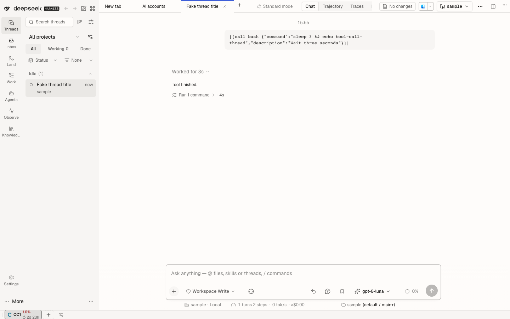
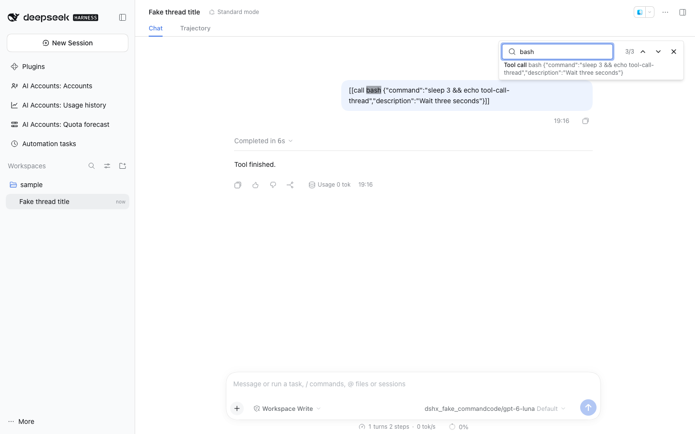
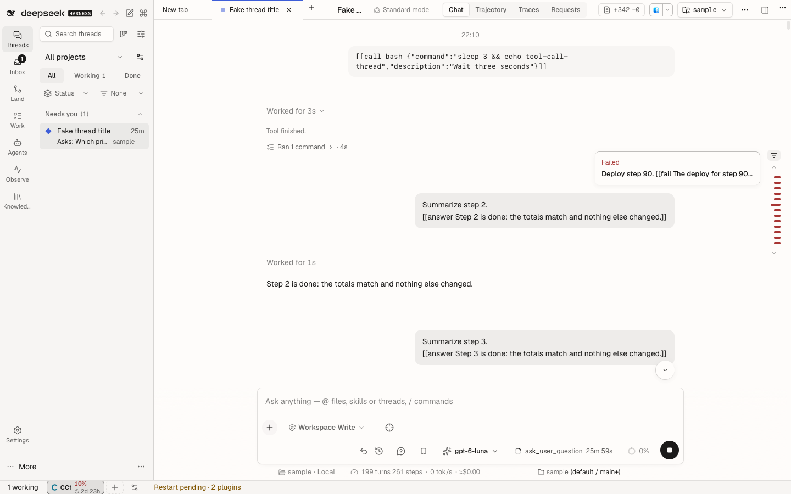
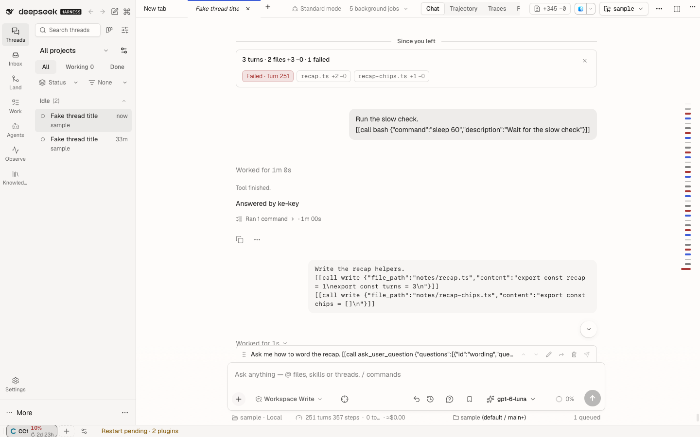
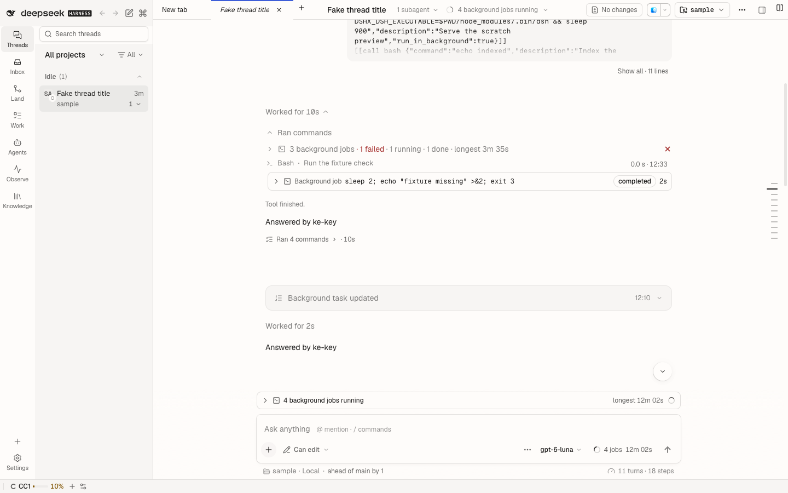
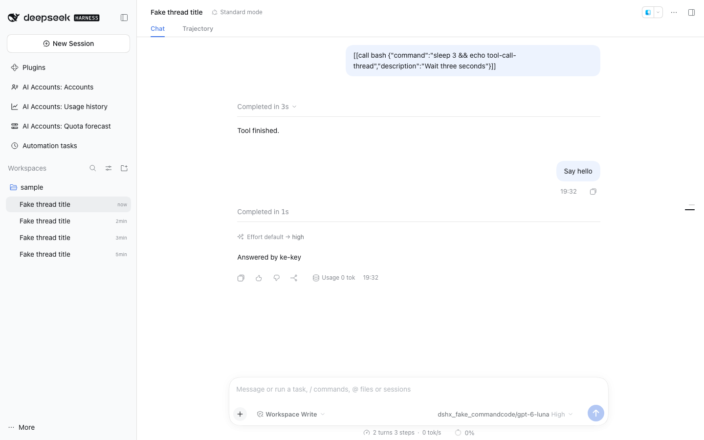
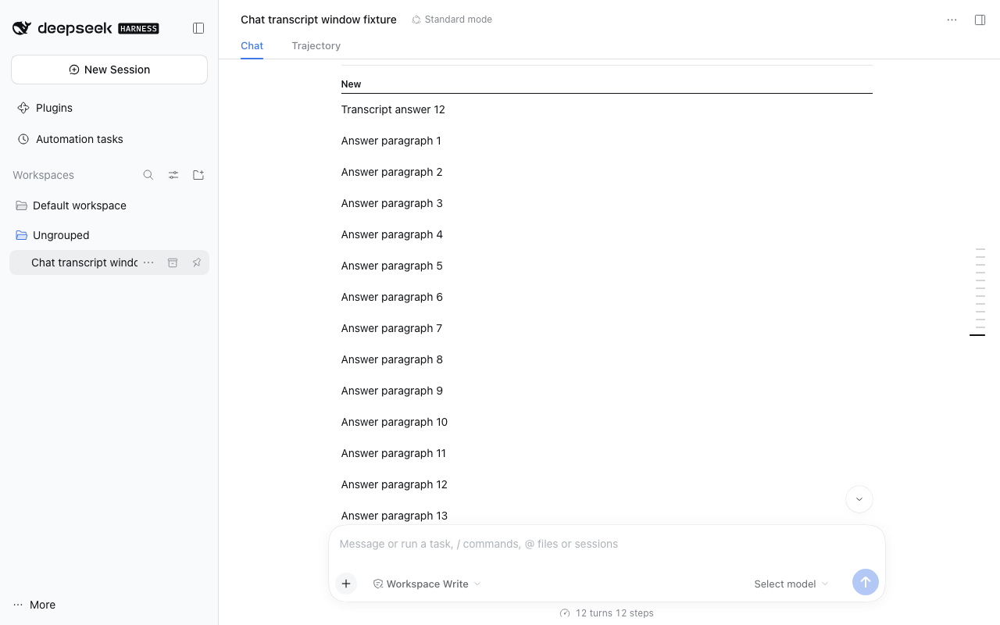

# @dshfiles/chat
















Owned fork of DSH's native Chat client plugin. It keeps the native transcript, its Slots, renderers, settings and
scroll behaviour, and mounts only the newest transcript rows plus the ones the reader scrolls up to (see Local delta):
on the live profile a single thread used to mount up to 42k DOM nodes on open.

## Upstream and license

- Upstream: [`deepseek-ai/deepseek-harness`](https://github.com/deepseek-ai/deepseek-harness)
- Package: `@deepseek-ai/dsh-client-ui-chat@0.2.2-rc.2` (MIT, [LICENSE](./LICENSE))
- Pinned revision: tag `dsh-v0.2.2-rc.2`
- Vendored source: [`src/native`](./src/native) is upstream `packages/client/ui-chat/src/client`;
  [`src/chat-settings.ts`](./src/chat-settings.ts), [`src/host.ts`](./src/host.ts) (upstream `src/index.ts`),
  [`src/css-modules.d.ts`](./src/css-modules.d.ts) and [`locale`](./locale) keep the upstream relative layout.

### Why a whole-package fork

The `conversation.chat.flow` Slot's data hooks (`useChat`, `useChatNode`, …) come from the package-private
`nodeSources(binding)` injection of the native registration, and `ChatView`'s scroll hook measures the flow's
rendered rows. A separate Slot occupant cannot rebuild either, so this package replaces the `ui-chat` Loader row:
its `cordis.patch.yml` disables `ui-chat` and inserts `dshfiles-chat`.

### Local delta

Every other vendored file is byte-identical to the pinned revision.

| File                                            | Change                                                                                                                                                                                                                                                                                                                                                                                                                                                                                                                                                     |
| ----------------------------------------------- | ---------------------------------------------------------------------------------------------------------------------------------------------------------------------------------------------------------------------------------------------------------------------------------------------------------------------------------------------------------------------------------------------------------------------------------------------------------------------------------------------------------------------------------------------------------- |
| `src/chat-settings.ts`                          | `CHAT_SETTINGS_NAMESPACE` is `dshfiles-chat`, the replacement row's id; the saved image gallery scope defaults to the current Turn and can include the full thread                                                                                                                                                                                                                                                                                                                                                                                         |
| `src/host.ts`                                   | exposes the gallery scope as a volatile setting that the client can read and update immediately                                                                                                                                                                                                                                                                                                                                                                                                                                                            |
| `src/native/apply.ts`                           | `apply` takes the dshx client decorator and hands it to the node-renderer registration, so a native node view can sit in this plugin's own client tree; it also wires the live image-gallery scope into Chat and its General settings row                                                                                                                                                                                                                                                                                                                  |
| `src/native/chat/register-node-renderers.ts`    | applies that decorator to the `turn-error` node renderer only: the inline **Resume** button reads the interruption API through the plugin's API context, and the renderer declares the `conversation.chat.turnErrorAction` child seat                                                                                                                                                                                                                                                                                                                      |
| `src/native/chat/MessageItem.tsx`               | `TurnErrorItem` renders the `action` node it is handed, which is where that **Resume** lands, plus the `extraActions` that seat contributes beside it                                                                                                                                                                                                                                                                                                                                                                                                      |
| `src/native/contract/slots.ts`                  | declares `conversation.chat.turnErrorAction` through its own contract module, so a feature plugin can fill it without importing the whole Chat contract; exposes the live gallery-scope hook to Chat views                                                                                                                                                                                                                                                                                                                                                 |
| `src/turn-error-action.ts`                      | new: the published `@dshfiles/chat/turn-error-action` contract — the seat's owner props and its `SlotMap` entry                                                                                                                                                                                                                                                                                                                                                                                                                                            |
| `src/native/chat/UserContent.tsx`               | hands every image position of one user message the whole message gallery, so the attachment row and the inline `[Image N]` references open one preview instead of one per image                                                                                                                                                                                                                                                                                                                                                                            |
| `src/message-images.ts`                         | new: the published `@dshfiles/chat/message-images` contract — the gallery group a position carries and the optional `gallery` owner prop every image slot accepts                                                                                                                                                                                                                                                                                                                                                                                          |     |
| `src/native/chat/ChatGroupSeat.tsx`             | a collapsed process group mounts its members the first time its body shows and keeps them; a collapsed historical Turn used to mount every tool row hidden (1k–7k DOM nodes per group on the live profile). Browser find no longer reveals text inside a group never opened                                                                                                                                                                                                                                                                                |
| `src/native/chat/ChatView.tsx`                  | mounts the rows `useTranscriptWindow` selects; the scroll hook gets the mounted order, first sequence and window-aware `hasMore`/`loadOlder`/`loadThrough`; an `OlderRowsSentinel` mounts older rows near the top; following the newest row again trims the window back to `TranscriptWindow.followingRows`; Markdown and tool-row image paths open the shared image lightbox, where the default current-Turn gallery can be widened to the full thread, loading older history when needed; expanded tool results retain their captured attachment gallery |
| `src/native/chat/markdown-image-links.ts`       | new: routes local and HTTP(S) image links to the lightbox while preserving existing file and web handling for non-images; passes local paths so the preview can select the matching gallery entry                                                                                                                                                                                                                                                                                                                                                          |
| `src/native/locale.ts`                          | adds localized image-gallery navigation labels and gallery-scope setting labels                                                                                                                                                                                                                                                                                                                                                                                                                                                                            |
| `src/native/conversation-nodes/README.md`       | records the answer-selection rule below as the conversation-node contract: the earliest settled reply of the trailing run is the answer                                                                                                                                                                                                                                                                                                                                                                                                                    |
| `src/native/conversation-nodes/turn-error.ts`   | a turn ended as aborted because the Host disposed its Agent (a restart) shows "DSH restarted before this turn finished" with code `INTERRUPTED`, like a crash-closed turn, instead of the plain stopped summary                                                                                                                                                                                                                                                                                                                                            |
| `src/native/conversation-nodes/turn-process.ts` | the folded answer is the earliest settled reply of the trailing run, where a tool call between two replies starts a new run: a notice-triggered acknowledgement stays visible after the answer instead of replacing it, and a tool call arriving later never moves the boundary by itself                                                                                                                                                                                                                                                                  |
| `src/native/conversation-nodes/turn-tail.ts`    | an open Turn with no `turn/end` yet also yields a tail with `closing: null`, so extension rows under `conversation.chat.turnTail` show while the Turn streams and no per-message actions appear                                                                                                                                                                                                                                                                                                                                                            |
| `src/native/chat/image-gallery.ts`              | new: gathers image attachments and resolvable `read_image` paths from loaded Chat nodes, then selects the clicked image's Turn or the loaded thread for the shared lightbox                                                                                                                                                                                                                                                                                                                                                                                |
| `src/native/image-gallery-scope.ts`             | new: reconciles the saved scope with accepted Host settings and publishes changes immediately to the view                                                                                                                                                                                                                                                                                                                                                                                                                                                  |
| `src/native/settings/ImageGalleryScopeRow.tsx`  | new: General settings row for choosing current-Turn or thread gallery scope                                                                                                                                                                                                                                                                                                                                                                                                                                                                                |
| `src/transcript-window.ts`                      | new: which rows are mounted (latest 24, +24 per step, anchored by the first mounted row's identity, widened to a restored anchor or a Turn jump before the Host is asked for older pages)                                                                                                                                                                                                                                                                                                                                                                  |

                                                                                                                                                                                                                 |

| `src/client-entry.tsx` | new: dshx client entry calling the native `apply`; provides the dshx `Browser` contract over the Host browser page and adds an **Open web page…** action to the Workbench New tab chooser while that page type exists |
| `src/chat-focus.ts` | new: the published `@dshfiles/chat/chat-focus` contract — a Turn/Step/tool-call focus, its opaque view-request encoding, and the cross-thread pending request (below) |
| `src/chat-focus-reveal.ts` | new: takes a focus from the native `viewRequest` or the pending request, jumps with the rail's `navigateToTurn`, opens folded groups with `beforematch` and highlights the row |
| `src/native/chat/ChatView.tsx` (also) | reads the native `viewRequest`/`completeViewRequest`/`openView` Conversation View props, runs `useChatFocus`, and provides `openView` to the Turn-tail seats |
| `src/native/chat/ChatNodeSeat.tsx` | tags each row with `data-chat-step`, so a Step focus can find it (a tool row already carries the native `data-chat-call-id`) |
| `src/native/chat/TurnTailNodeView.tsx` | adds the thread's `openView` to every `conversation.chat.turnTail` entry's owner props (`ChatTurnTailExtras`) |
| `src/native/contract/slots.ts` (also) | `TurnTailOwnerProps` extends `ChatTurnTailExtras` |
| `src/native/chat/AssistantMarkdown.tsx` | rewrites links whose scheme a dshx `LinkHandler` claims before `MarkdownText`, which keeps only http(s) and mailto hrefs, and routes clicks on them to the handler (`MarkdownLinks.openFromClick` on the root's click and aux-click capture) |
| `src/native/chat/ChatView.tsx` (also), `ChatFlow.tsx`, `TurnNavigator.tsx`, `TurnNavigator.module.css`, `turn-rail-items.ts` | productivity pass Q4 (long threads): rail items carry their `turn/start` sequence and a kind from the `dshfilesTurnMarks` projection (question accent, failure danger, edit muted fill), the rail draws a band behind the Turns on screen, previous / next buttons and an All / Questions / Errors / Edits filter; ChatView mounts the find bar, the Turns sheet and the Since-you-left placement, registers itself for the thread shortcuts and takes requests from the thread `⋯` menu; ChatFlow inserts the Since-you-left divider before the first unseen Turn's row |
| `src/native/chat/ThreadFindBar.tsx`, `find-reveal.ts`, `thread-find-model.ts`, `TurnsSheet.tsx`, `since-you-left.ts`, `SinceYouLeftCard.tsx`, `chat-view-registry.ts` (+ CSS modules) | new: find in thread (session-search's `findInThread`, loaded-Turns fallback, reveal through folds with the CSS Custom Highlight API), the phone Turns sheet, the recap math and card, and the per-page registry of mounted Chat views the ⌘F / `[` / `]` commands act on |
| `src/turn-marks.ts`, `src/thread-tools.ts`, `src/thread-find-port.ts` | new: the published `@dshfiles/chat/turn-marks` contract (projection key, wire shape, kind and filter rules; turn-summary serves it), the `@dshfiles/chat/thread-tools` handoff (thread-sidebar's `⋯` menu opens find / Turns; it hands over the unread record before clearing it) and the registered-API port to session-search |
| `src/native/chat/ChatView.module.css` | outlines (inside its box, so a folded group's scroll body does not clip it) and tints the row carrying `data-chat-focus` |
| `src/native/conversation-nodes/tool.ts` | a call whose tool name a `PinnedToolCalls` provider registered gets group-tree position `turn`, so it stays visible outside the completed Turn's fold and splits the step group around it |
| `src/native/conversation-nodes/chat-snapshot-builder.ts` | an incremental update whose only structural change is the latest Turn's tail row moving later keeps the visible order, so it skips the whole-window re-sort and Location rebuild every streamed chunk would otherwise pay |
| `src/pinned-tool-calls.ts` | new: the published `@dshfiles/chat/pinned-tool-calls` registry token |
| `src/pinned-tool-names.ts` | new: the registered names, set from `client-entry.tsx` and read synchronously while tool nodes build |
| `src/inline-references.tsx`, `src/inline-reference-markdown.tsx` | new: the published `@dshfiles/chat/inline-references` registry and `@dshfiles/chat/inline-reference-markdown` renderer (below) |
| `src/code-fences.tsx`, `src/code-fence-transform.tsx`, `src/fenced-markdown.tsx`, `src/report-once.ts` | new: the published `@dshfiles/chat/code-fences` registry, the transform `InlineReferenceMarkdown` applies, the published `@dshfiles/chat/fenced-markdown` renderer (below), and the log-once reporter both registries use |
| `src/native/chat/ReasoningContent.tsx`, `CompactionItem.tsx` | reasoning and the compaction summary render through `FencedMarkdown`, so a claimed fence renders there too |
| `src/native/chat/AssistantMarkdown.tsx` (also), `UserContent.tsx`, `ChatView.tsx` (also) | text blocks render through `InlineReferenceMarkdown`, the Referenced-session line through `InlineReferenceText`, and the transcript sits in an `InlineReferenceScope` naming its Session |
| `src/markdown-prose.tsx`, `src/native/chat/AssistantMarkdown.module.css` | productivity pass Q1 (readable replies): both Markdown renderers mark the native root `data-dsh-markdown`, and the answer styles hang off it — prose capped at `34em`, the root's size and leading inherited (15/24 on a phone instead of the primitive's 14px), 12px paragraph rhythm, headings 17/24, 16/24 and 14/22 at 600, list markers restored; upstream's dead `white-space: pre-wrap` (it targeted the unhashed class name) is gone |
| `src/code-fold.tsx`, `src/code-fold.module.css`, `src/markdown-prose.tsx` (also) | every native code card in Chat Markdown goes through `CodeFold`: no-wrap with horizontal scroll by default, Chat owns the card's `wrap` prop and portals its wrap toggle into the native toolbar (wrapped lines take a 2ch hanging indent from `ui-styles`' `transcript.css`), and a settled card folds after 24 lines behind "Show all · N lines"; a fence a code-fence renderer claimed is left to that renderer |
| `src/markdown-prose.tsx` (also), `src/native/chat/AssistantNodeView.tsx` | file references read as quiet chips: an inline-code mention the native resolver linked shows `name.ts:24` (its parent folder only when two references in the message share the name, trailing punctuation kept on its line), a Markdown file link is marked `data-file-chip="link"`, and a mention written with a line (`name.ts:24`, `#L24`) resolves through its path and opens at that line; links are underlined at rest (`ui-styles`' `transcript.css`) |
| `src/native/chat/UserContent.tsx` (also), `MessageItem.module.css`, `prompt-fold.ts` | a prompt taller than 8 lines (6 on a phone) folds behind "Show all · N lines" with a fade; the folded body keeps `overflow: hidden`, so browser find still matches it and scrolling to a match opens the fold; a pasted fence renders as a small code card without its ``` markers, and a prompt that is code throughout takes the code-card fill |
| `src/native/chat/MessageIconActions.tsx` (also), `MessageIconActions.module.css`, `TurnTailNodeView.tsx`, `MessageItem.tsx` (also), `time-divider.ts`, `AssistantNodeView.tsx` (also), `filler-reply.ts`, `ReasoningTiming.tsx`, `locale.ts` | quieter reply chrome: a reply's row is copy plus one `⋯` menu (feedback, Trace, branch, usage), shown on hover or focus on a pointer device and always on touch, the latest reply and user message included; times leave the rows and show as a centred divider above a user message after a day change or 30 quiet minutes (and above the thread's first turn; never above a turn whose predecessor is still unloaded, so paging history in moves nothing); reasoning clocks drop seconds; a settled reply that only acknowledges its tools ("Tool finished.") reads as a muted meta line under its turn's work row (kept in the DOM: scratch seeds and journeys wait for that text) |
| `src/markdown-prose.tsx` (also) | GitHub alerts (`> [!NOTE]`, `[!TIP]`, `[!IMPORTANT]`, `[!WARNING]`, `[!CAUTION]`) render as titled callouts in the status trios, and a top-level raw `<details>` … `</details>` pair wraps the Markdown blocks between them in a closed disclosure; only the two tags and the `<summary>` text are read, so no author HTML reaches the DOM, and an unclosed tag stays text |
| `src/native/chat/use-chat-viewport.ts`, `use-chat-scroll.ts`, `ChatView.tsx` (also) | a commit's scroll work (follow the tail, restore, keep a paging anchor) runs from a ResizeObserver delivery after the next layout instead of inside the layout effect, so a streamed publication or a first open no longer forces a synchronous layout; the older-rows sentinel reads its first scroll offset in its observer callback |
| `src/session-usage-cost.ts`, `src/native/chat/StatsPills.tsx`, `src/native/apply.ts` (also) | new: the published `@dshfiles/chat/session-usage-cost` seat; the composer usage pill declares it as a child of its dock entry and renders it after its label and beside each bucket of its dialog (below) |
| `src/native/conversation-nodes/assistant.ts`, `turn-tail.ts`, `AssistantMarkdown.tsx` (also) | text visibility is tested with `/\S/` instead of `trim()` where the whole text is scanned (`turn-tail.ts`, interruption evidence); since 0.2.2-rc.1 the ref carries per-block visibility itself (`visibleByIndex`), so `assistant.ts` keeps the ref's tracking instead of the former WeakMap cache |
| `src/native/conversation-nodes/route-change.ts`, `register.ts`, `src/native/chat/RouteChangeRow.tsx`, `RouteChangeRow.module.css`, `register-node-renderers.ts`, `src/native/locale.ts` | new: the `route-change` Definition and its keyed renderer (below), registered beside the request-prompt node, with three labels |
| `src/native/unread-landing.ts`, `src/native/settings/UnreadLandingRow.tsx`, `chat-settings.ts` (also), `host.ts` (also), `apply.ts` (also), `slots.ts` (also), `ChatNodeSeat.tsx` (also), `use-chat-viewport.ts` (also), `use-chat-scroll.ts` (also), `ChatView.tsx` (also), `ChatView.module.css` (also), `locale.ts` (also) | new: open an unread thread at its final answer (below): the `unreadLanding` volatile setting and its General row, a per-browser seen-answer memory, `data-chat-final-answer` on the latest settled answer row, and the first-open landing with its New divider |
| `src/turn-admission-panel.tsx`, `src/client-entry.tsx` (also) | new: the Settings › General **Running threads limit** row and the composer's **Waits to start** notice for `@dshfiles/session-controller`'s running-thread limit (see its README) |

### Open an unread thread at its final answer

A thread's answer often sits above a long tool tail or runs longer than the viewport, so opening at the end shows its
last lines. When a settled thread opens with no saved reading position in this tab and its latest final answer is one
this browser never reached, Chat lands with that answer at the top under a **New** divider. Reaching the end of the
transcript marks the answer read, so the next open lands at the end as before; sending a message removes the divider.
A running thread always follows its tail.

With **Since you left** (unseen Turns from the unread record), the landing is the same, and the Since you left divider
and recap card ride at the top of that answer row: the thread opens on the recap with the answer right under it, and
that divider is the only one (no **New** label). The card still sums every unseen Turn and its chips jump to them. When
the latest Turn failed or asked a question (no final answer), or with **Bottom**, the recap stays above the first unseen
Turn as before. The **New** divider is drawn like the Since you left one: a muted label between hairlines.

**Settings › General › Open unread threads at**: **Final answer** (default) or **Bottom** (the previous behaviour).
Live, no restart. Read state is per browser (`localStorage`, the 500 most recently read threads), so another browser
opens the thread at its answer once.

### Model and effort switch markers

A quiet row (`Model a → b`, `Account a → b`, `Effort a → b`) marks a request whose route differs from the request
before it. The Session logs a `request/header` only when the request configuration changes, and the
`route-change` Definition compares each one's provider, model and reasoning effort with the previous one, so fallbacks,
account switches and picker changes all show where they took effect, not where they were chosen. A header that changed
only its tools is silent. The row sits at the request, at group-tree position `turn`, so a folded Turn still shows it.
The first header of a loaded window has no predecessor there and gets no row until older history loads.

### Focus a Turn, Step or tool call from another plugin

`@dshfiles/chat/chat-focus` is how a plugin scrolls Chat to one Turn (`{ turn }`), Step (`{ turn, step }`) or tool call
(`{ turn, step, toolCallId }`) and highlights it — the traces plugin's **Show in chat** uses it.

- Inside the thread, a `conversation.view` entry calls the native `openView(CHAT_VIEW_ID, encodeChatFocus(focus))` it
  is handed: the shell selects Chat, which consumes the `viewRequest`. A Turn-footer entry
  (`conversation.chat.turnTail`) gets the same `openView` in its owner props, for the opposite direction.
- From outside it (a sidebar panel), call `requestChatFocus({ sessionId, focus })` right after
  `uiWorkspace.openSession`. The request waits up to 30 s for that thread's Chat to mount; a view of ours that the thread
  reopens on instead forwards it with `takeChatFocus` and `openView`.

Chat jumps through the turn rail's navigation (unloaded history pages in), opens the folded process group with the
`beforematch` event browser find uses, scrolls the row to the middle and outlines it for 4 s. A tool call or Step that
never appears within 4 s lands on its Turn.

The latest **Task stopped** or **Turn error** notice from a turn a restart cut
off, or whose model request failed (upstream outage, rate limit, transport),
offers an inline **Resume**; a signed-out account does not while that turn remains latest, idle, and writable. Older
notices remain historical. The action uses the owned session-controller's
`interruption-api` contract; an older Host without that API hides the action.
Resume sends a continuation prompt, never blindly replays unfinished tools.

### Keep a tool call visible after its Turn completes

A tool whose call is the Turn's deliverable (an `html_render` page) registers its name with
`api.add(PinnedToolCalls, { toolName })` from `@dshfiles/chat/pinned-tool-calls`. Chat builds that call's node at
group-tree position `turn` (like a turn error): it never joins a step group and stays out of the "Completed in" fold in
every work-details mode. Without providers nothing changes. When the set of pinned names changes after a thread's nodes
were built (a provider plugin enabled later), Chat registers or removes an inert `uiConversation` event Definition;
the native registry change rebuilds every bound Conversation, so open threads re-group at once.

### Render inline references from another plugin

`b:12`, `@{luna}`, `memory: n:3` and `jj:main` are links because their plugins add a provider to the
`InlineReferences` registry from `@dshfiles/chat/inline-references`:

```ts
plugin.add(InlineReferences, InlineReferenceModel.define({ id: 'backlog-item', surfaces: ['prose', 'code'], match, render }))
```

`match(text, context)` is pure over one text run and returns ranges; `render` returns the React node shown in place of
the text. Chat runs providers while it renders assistant Markdown (inline code is the `code` surface, with the block
text before it in `context.before`) and the Referenced-session line (`summary`); fenced code, links, buttons and math
are never offered. A higher `priority` wins an overlap, then the earlier start, the longer match and registration
order. A provider whose matcher reads outside state (saved agents, a thread's bookmarks) passes a `vocabulary` it bumps
when that state changes. Transformed blocks are cached by element identity, so a streaming message's frozen blocks
keep their rendered references. A throwing matcher or renderer shows the written text and logs once. Sent user
messages are rich-composer's: they use the native `conversation.user.text` rules and `conversation.user.text.node` slot
instead. Another plugin's own Markdown can apply the same providers with `InlineReferenceMarkdown` from
`@dshfiles/chat/inline-reference-markdown` (backlog item text does).

### Add a cost to the usage readouts

Chat owns two usage readouts and a list seat in each, so a pricing plugin (`@dshfiles/ai-accounts`) adds its estimate
without touching their markup:

- `conversation.chat.turnUsageCost` (`@dshfiles/chat/turn-usage-cost`): one completed Turn's usage dialog renders the
  entries as its cost row, with `{ turn, useProjection }`.
- `conversation.composer.usageCost` (`@dshfiles/chat/session-usage-cost`): the composer's Detailed usage pill renders
  the entries after its label (`placement: 'pill'`) and inside each bucket value of its dialog (`'input'`,
  `'cacheRead'`, `'cacheWrite'` when the thread wrote cache, `'output'`), with the thread's `useProjection`. An entry
  brings its own separator and spacing and returns `null` when it has nothing to add; Compact mode renders no seat.

Without entries the readouts are the native ones.

### Render fenced code from another plugin

A ` ```mermaid ` fence is a diagram because `@dshfiles/mermaid-diagrams` adds a renderer to the `CodeFences`
registry from `@dshfiles/chat/code-fences`:

```ts
plugin.add(CodeFences, { id: 'mermaid-diagrams', languages: ['mermaid'], Component: MermaidFence })
```

Chat swaps each native `CodeBlock` element whose language (the first word of the info string, case-insensitive) a
renderer claims for its `Component`, which receives `code` (without the trailing newline), `lang`, `streaming`,
`fallback` (the native card) and `source` (the same card without its header, for a renderer that draws its own).
`streaming` is per fence, not per message: the native root holds one child per top-level block, and a fence in any
block but the last is complete, so it arrives with `streaming: false` while the rest of the message is still written.
Fences inside lists and quotes count; the first renderer registered for a language wins. Transformed elements are
cached by identity, so a streaming message's frozen blocks render their fence once. A throwing renderer shows
`fallback` and logs once; new source tries again. Without renderers the native tree is returned unchanged. The
contract module imports nothing from the native renderer, so a renderer plugin bundles only the registry token; the
transform takes the native `CodeBlock` from its caller.

Assistant answers apply it through `InlineReferenceMarkdown`. Markdown that should not grow inline-reference links —
reasoning, compaction summaries, and other plugins' Markdown such as `ask_user_question` text in
`@dshfiles/user-questions` — renders through `FencedMarkdown` from `@dshfiles/chat/fenced-markdown`, which takes
`MarkdownText`'s props and applies only the fence registry.

### Build

The native build loads `@deepseek-ai/dsh-client-store`, `@deepseek-ai/dsh-client-ui-primitives`,
`@tanstack/react-virtual` and React from the module table and inlines everything else; `dshx.config.ts` mirrors
that (`bundleDependencies`), and `dist/client.js` requires exactly the same modules.

### Updating upstream

1. Diff upstream `packages/client/ui-chat/src` at the new release tag against the pinned tag.
2. Copy the new files over `src/native` and the root files above, then re-apply the delta table.
3. Build, type-check, run `pnpm test:boot` and the chat e2e journeys.

## Rollout

The settings namespace moves from `ui-chat` to `dshfiles-chat`, so a profile that set Chat preferences on the
`ui-chat` row (for example `transcriptView`) needs them set again in Settings → Chat, or on the `dshfiles-chat` row.an `OlderRowsSentinel` near the top mounts older rows, then requests older Host pages, once the reader leaves the tail or reads upward (wheel, key, scroll), and for at most three steps while the rows do not fill the view, so opening never pages in the whole history; the "Load earlier" button is gone
